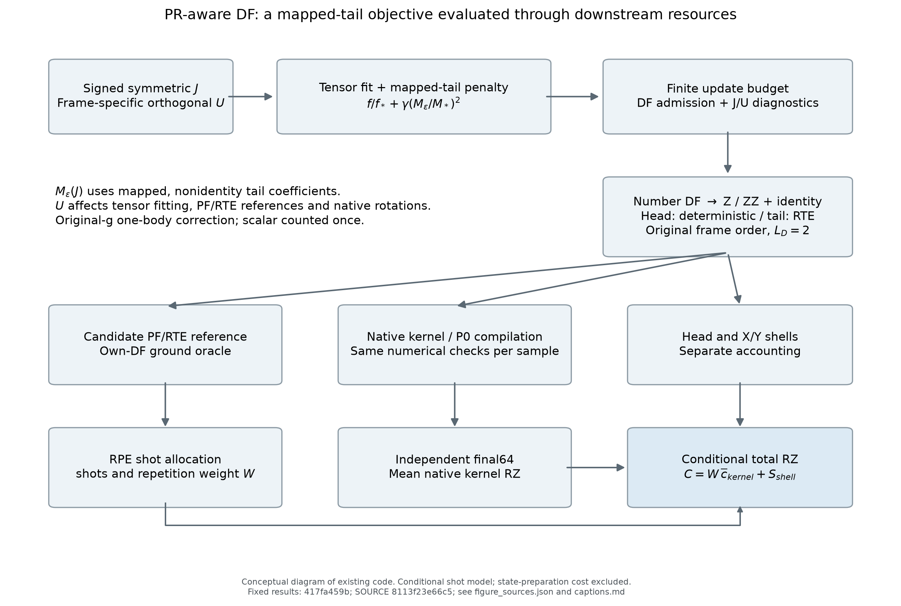
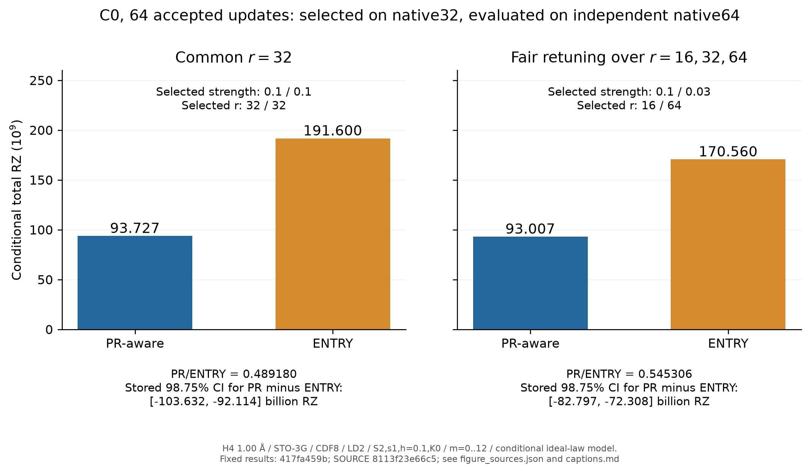
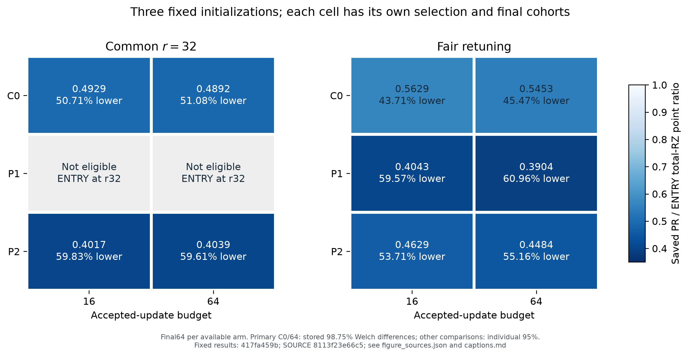
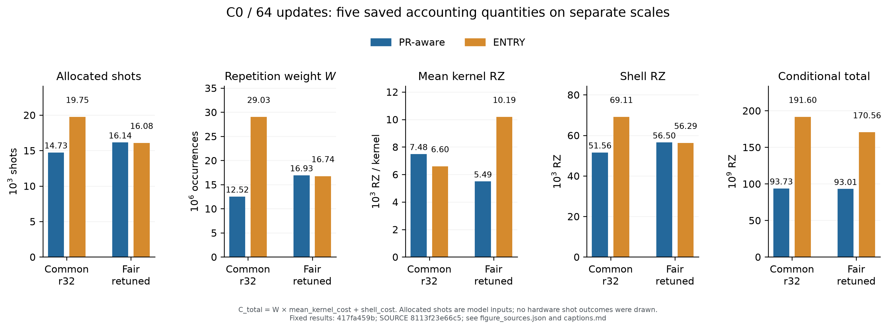
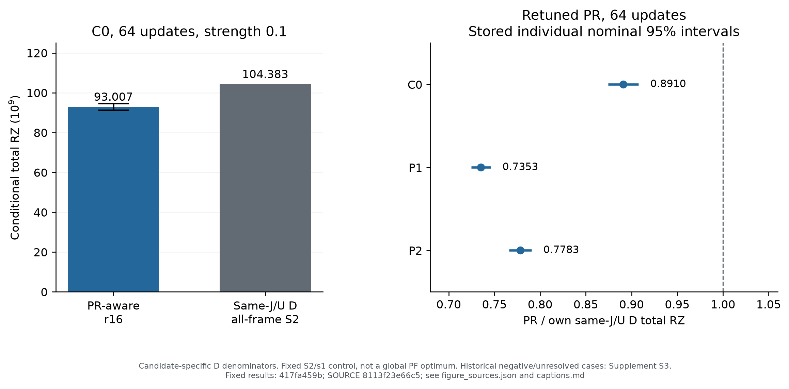

# Research C: H4/1.00 Å manuscript figures and saved-value tables

This package renders already-published results from `417fa459b823509be5c2010c5836e58955088282`. It adds no molecular evaluation, circuit construction/compilation, new scientific reanalysis, statistics, regression, bootstrap, extrapolation or candidate ranking. The existing scientific SOURCE, contract, raw results and STOP are preserved.

| Figure | Purpose | Reusable files |
|---|---|---|
| 1 | Method dependencies | [SVG](figures/F1_method.svg) / [PDF](figures/F1_method.pdf) / [PNG](figures/F1_method.png) |
| 2 | C0/64 common-r32 and fair-retuned totals | [SVG](figures/F2_fair_comparison.svg) / [PDF](figures/F2_fair_comparison.pdf) / [PNG](figures/F2_fair_comparison.png) |
| 3 | Initialization/budget ratios, with unresolved cells | [SVG](figures/F3_robustness.svg) / [PDF](figures/F3_robustness.pdf) / [PNG](figures/F3_robustness.png) |
| 4 | Separate shots/W/kernel/shell/total panels | [SVG](figures/F4_accounting.svg) / [PDF](figures/F4_accounting.pdf) / [PNG](figures/F4_accounting.png) |
| 5 | Same-J/U strong deterministic comparison | [SVG](figures/F5_same_JU_D.svg) / [PDF](figures/F5_same_JU_D.pdf) / [PNG](figures/F5_same_JU_D.png) |

SVG retains editable text; PDF embeds fonts; PNG is 240 dpi. Figure labels are English and prose drafts are Japanese as a working format. Neither final manuscript language nor journal is fixed.

[Captions and statistical qualifications](captions.md) must accompany reuse. [figure_sources.json](figure_sources.json) binds each figure to source commit, scientific SOURCE, input/candidate identity, candidate/r report paths and saved interval kind. Fully qualified draft prose and claim mapping are in [the evidence document](../../../docs/research/research_c_h4_100_paper_evidence_20261106.md).

## Reproduction

The renderer uses Python standard-library CSV/JSON readers and Matplotlib. It was run with Matplotlib 3.11.2 in the existing isolated evaluation environment, used read-only. The generic optimized-DF plotting scripts were inspected but not called: they construct optimized comparisons/ratios and do not fit this saved-value-only scope. No new environment or plotting framework was installed.

From the repository root with Matplotlib available:

```bash
MPLCONFIGDIR="$PWD/.cache/paper-matplotlib" python -B scripts/render_research_c_h4_paper_figures.py
python -B scripts/render_research_c_h4_paper_figures.py --check-only
```

The renderer reads existing summary and endpoint/reference JSON, including checkpoint stationarity and m12 reference fields. It never loads NPZ/QPY, imports the scientific engines, evaluates a Hamiltonian or calls a solver. It selects and joins existing fields; the only numerical presentation operations are unit conversion, decimal formatting and plot coordinates. All plotted ratios, reduction percentages, means and intervals already exist in the saved results. New computation of statistical limits or per-arm intervals is deliberately absent. The script overwrites only this new presentation package's generated figures/tables/index.

The original experiment's generated raw circuits/dense arrays remain in the execution-server worktree and are not all distributed on GitHub. The public compact source/result collection supports these saved-value displays; it is not advertised as a complete raw-data archive or an externally reproduced scientific run.

## Presentation checks

The 386 files listed by the scientific SOURCE manifest remain hash-identical, and the six input summary files match commit `417fa459b` byte for byte. All five generated tables were checked field by field against their saved JSON values (T1: 2 rows; T2: 4; T3: 4; S1: 36; S2: 108). All 15 figure exports were checked for file format and all five PNGs were visually inspected. The 81 relative links across the new manuscript documents and package resolved. These are author-performed presentation and provenance checks, not an independent scientific review or a rerun of numerical correctness tests.

## Tables and scope

T1/T2/T3 transcribe the primary comparisons, accounting quantities and m12 references. S1/S2 transcribe checkpoint and policy qualifications. [S3](S3_historical_D_comparisons.md) retains old negative/unresolved observations from the existing literature/evidence document at `1a588f5491bce394ecf039ee4d2de57581e2e0b1`.

The original primary-family 98.75% differences, descriptive other-cell 95% differences and individual same-J/U D nominal 95% intervals are kept separate. No ratio interval is invented for PR/ENTRY. P1/r32 missing comparisons remain unresolved. Internal legacy labels such as `RZ_PR_D_nominal` or `preselected r32 only` are interpreted through the actual outer task/arm/r/final64 binding, not through those historical strings.

H4/1.15 Å is excluded from further work: initialization stopped on a numerical consistency check, followed by the user's decision to end additional validation. The package makes no scientific transfer success/failure claim. It does not conduct an important scientific review, independent novelty certification, publication GO or submission. After commit/push and public verification, **MANDATORY STOP**.

## Preview










