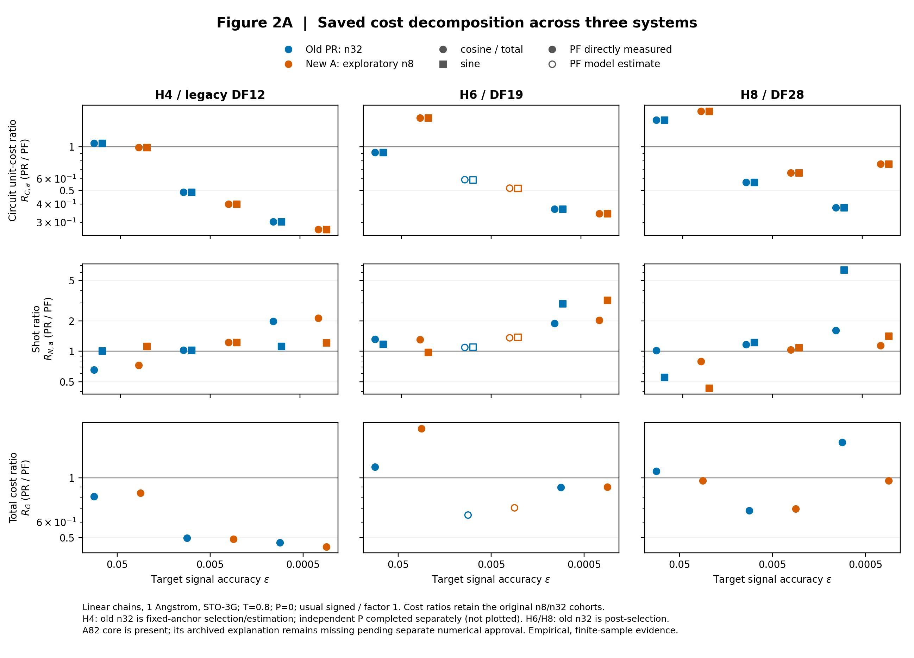
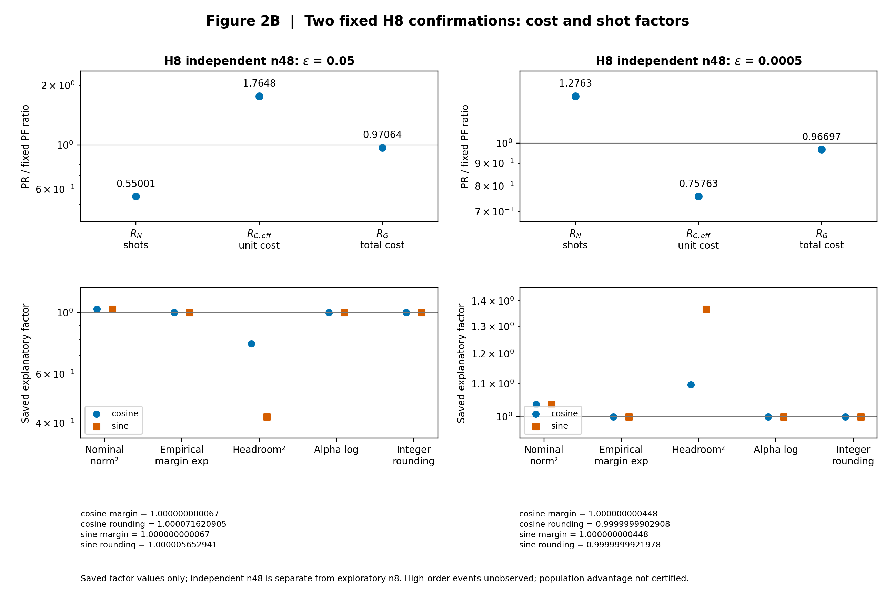

# H4/H6/H8 manuscript display and Methods

Accepted evidence base: `a77141ba5ff0752d6409e32fda9e4649d0919fdb`. Display arrangement is fixed by the user instruction; final scientific evidence freeze has not started.

- [Main Table 1](main_table.md), [unchanged saved-value CSV](main_table.csv)
- [Publication Figure 2 caption](figure2_caption.md)
- [Methods](methods.md), [input exceptions](input_exceptions.md)
- [H8 public-evidence limits](h8_public_evidence_status.md)
- [Publication manifest](publication_manifest.json), [CEM/ledger linkage](evidence_linkage.csv)
- [Actual GitHub read receipts](public_read_receipt.json), [documentation evidence ledger](documentation_evidence_ledger.csv)
- [Structural validation](structural_validation.json), [preservation inventory](preservation.json)
- [Japanese completion report](../../../../docs/research/track_a_h468_paper_display_methods_20261019.md)

## Figure 2A — original legacy/exploratory artwork

H4 is legacy DF12; H6/H8 are DF19/28. Old n32 and exploratory n8 series remain separate. The original A82 annotation is render-time history; the publication caption cites the later completed explanation table. No new H4 DF10 or new H6 independent samples are inserted here.

## Figure 2B — original H8 independent n48 artwork

These are the same H8 observations as the two main-table rows, not extra independent evidence. All 34 original Figure 2 files and numerical values remain unchanged.

Check with `python3 scripts/check_h468_paper_display.py` from repository root. The checker uses only Python's standard library and does not import scientific modules. `--receipt` saves a documentation-only structural receipt in this new bundle.

No new science/statistics/ratio/CI, sampling, or compile. Existing grants, ledgers, markers, STOP records, sources and raw results are retained. No H2 integration, detailed scientific review, or final evidence freeze. **MANDATORY STOP**.
