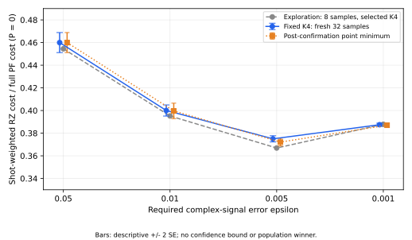
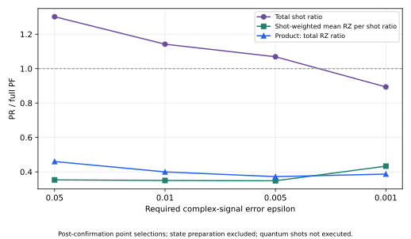
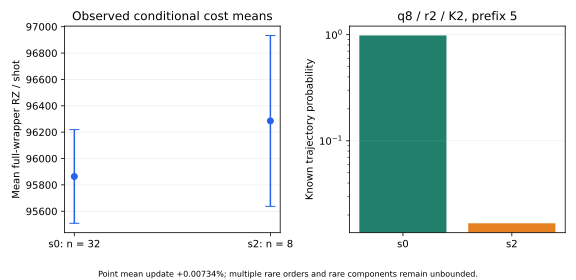

# 有限時間信号精度を一致させた部分ランダム化時間発展の実装資源評価：H6

原稿草案 v0.2、2026-10-13 JST。著者・所属・投稿先は未確定。完成済みGPT科学レビューを採用した統合版であり、新しい科学レビューや実計算を実施したものではない。H4旧稿v0.1を保全し、H6は別の固定条件のcase studyとして追加する。

## 要旨

量子化学Hamiltonianの部分ランダム化時間発展（PR）について、近似精度だけでなく、normalizationによる測定回数と実際にコンパイルした測定回路の資源を合わせて比較した。対象は直鎖H6、隣接距離1.00 Å、STO-3G、12 system modes、電子数3+3、tol-only DF 1e-8で得られたrank19、保存された指定state、発展時間T=0.8である。比較対象は全DF Hamiltonianの二次・四次Product Formula（PF）と部分DFの二次PFを組み合わせたPRであり、要求精度は有限時間複素信号の誤差0.05、0.01、0.005、0.001である。

92信号候補に対し、accuracy適格候補の592 groupを探索し、探索で事前選定した8構成を各32本の独立trajectoryで確認した。状態準備を除く測定込みRZ費用の点推定は、事前選定K4構成でも全PFに対して約54–63%低い。確認後の点最良構成を選ぶ場合も同程度の削減となるが、両者の意味は区別する。最厳精度のK2構成について、非ゼロTaylor次数を含む層を条件付き8本で補助測定したところ、既知層確率で重み付けした平均RZの点更新は+0.00734%であった。これは誤差上界ではなく、未観測次数・componentの母平均寄与は未認定である。

本結果は固定入力・固定compilerによる限定的な実装資源benchmarkである。エネルギー精度、完全な状態準備、fault-tolerant総資源、一般的分子優位、母平均の正式winnerを証明しない。

## 1. 研究上の問いと既存研究との関係

PRが量子化学時間発展の回路を短くしても、normalizationやbiasが必要shot数を増やせば測定込み資源は減らない。本研究の問いは、同じ有限時間信号精度で比較したとき、決定論的prefixとランダムなtailの分割が、1-shot回路費用と必要測定回数の積にどう現れるかである。

部分ランダム化による位相推定には、すでに量子化学・単一ancillaの資源評価がある。Güntherほかの[Phase Estimation with Partially Randomized Time Evolution](https://journals.aps.org/prxquantum/abstract/10.1103/ynxb-p2xq)を背景とし、本稿はPRの初提案や最初の化学資源評価を主張しない。Simon・Loveの[Halving the arbitrary rotation cost of controlled, Trotterized time evolution](https://journals.aps.org/pra/abstract/10.1103/h9gv-ml7w)を参照し、symmetric directional control自体を新規発明としない。[Theory and practice of Trotter product formulas for quantum chemistry](https://arxiv.org/abs/2606.30741)などのPF研究とも、近似式の性質と実装・compilerの条件を分けて比較する。

ここでの追加証拠は、固定DF-native実装を通した、信号bias・normalization・shot会計・paired full-wrapper compiled costの接続と、探索後の独立標本および希少次数の条件付き費用診断である。条件付きsamplingは標準的な期待値分解であり、新しい量子ランダム法則や統計的保証ではない。

## 2. 固定対象・候補・費用定義

Hamiltonianはserialized binary64のDF表現と指定stateで定義される。DFはtol-only 1e-8、cutoff0、signed generation order、weighted Hermitian projectionを用い、rank19を得た。粒子数sectorは400。基底状態やDF近似誤差の厳密保証として扱わない。

候補はB0（prefixだけのS2）12、B1（full19のS2/S4）8、B2（prefix5/10/15、S2、q=1/2/4/8、r=1/2/4、K=2/4）72、合計92である。delta=T/q=0.8/0.4/0.2/0.1。B1のS4はglobal Yoshida構成であり、B2へ四次PFを採用した比較ではない。B3の84組はnormalization補助診断だけで、B3の信号・費用評価を完了したとはしない。

primaryはsymmetric_directional controlのcosine/sine Hadamard full wrapperである。両軸は同じtrajectoryを共有する。Qiskit1.3.0、basis rz/sx/x/cx、optimization_level1、seed_transpiler17、backend/coupling/layout/routingはNone。固定compiler hashは1239304c14c65cde2e66ac783646abae19455ad8af6ce0cafd157557eeabb33b。旧hostとのoutput bit完全同一性は未確認のまま保持する。

軸aの誤差予算e=epsilon/sqrt(2)、headroom=e−abs(bias_a)−u_aを用い、alpha_a=0.025として、N_a=ceil(2 B_upper² log(2/alpha_a)/headroom²)を固定binary64演算順で評価する。uは経験的数値allowanceであり、floor1e-12・safety factor10などの既存方針を用いた。u/headroom<=0.01と1×/10×感度は実装チェックであって厳密certificateではない。

主要量はG_RZ=N_cos mean(RZ_cos)+N_sin mean(RZ_sin)。CX、RZ_depth、CX_depth、depth、sizeも保存されるが、RZの削減率を他指標へそのまま当てはめない。Nは十分shot式の解析値であり、実量子shot実行数ではない。

## 3. 探索と独立確認の分離

探索は16適格決定論groupと72×8 PR groupの計592 group、primary1184 wrapperにordinary-control感度4 wrapperを加えた1188件である。全92候補が全精度で適格という意味ではない。

探索の各精度B2上位2候補の和集合を事前に8構成へ固定した。prefix5、q1/2/4ではr4、q8ではr2、各K2/K4である。これらを探索とは別の32 trajectoryで評価し、256 group・512 wrapperを得た。8+32をpoolせず、確認後に点最良Kを選ぶ操作と、探索で選んだK4の独立確認を別の推定対象として示す。残64 PR構成を独立確認したものではない。

| epsilon | 全PF点最良 | 事前K4の確認PR/PF | 確認後の点最良PR | 確認後PR/PF | 点削減率 |
|---:|---|---:|---|---:|---:|
| 0.05 | B1_p19_q1_2nd | 0.459978 | B2_p5_q1_2nd_r4_K4 | 0.459978 | 54.00% |
| 0.01 | B1_p19_q2_2nd | 0.399990 | B2_p5_q2_2nd_r4_K2 | 0.399630 | 60.04% |
| 0.005 | B1_p19_q4_2nd | 0.374969 | B2_p5_q4_2nd_r4_K2 | 0.372105 | 62.79% |
| 0.001 | B1_p19_q2_4th | 0.387450 | B2_p5_q8_2nd_r2_K2 | 0.387006 | 61.30% |

事前K4の確認比は0.459978、0.399990、0.374969、0.387450である。3精度では確認後の点順位がK2へ移るが、全4精度でK2/K4差は記述的2SEの範囲内にある。K2が母平均で優れると結論しない。

図1。灰色は探索8本の選択結果、青は事前選定K4を新32本で評価した結果、橙は同じ確認8構成内での点最小。誤差棒は保存paired標本からの記述的±2SEで、formal confidence intervalや母平均winnerの証明ではない。

## 4. 回路費用と測定負担を分けた解釈

epsilon=0.05の確認点最良では、PRのN_total=30,400に対しPFは23,350であり、PRは多くのshotを必要とする。それでもRZ/shotが小さいためGが低い。epsilon=0.001ではPRは53,687,969、PFは60,083,125であり、関係は同じではない。したがって「PRの回路が安い」「shotが少ない」「測定込み資源が少ない」は別々に判定する。

図2。確認後の点最良について、総shot比とshot-weighted平均RZ/shot比、および積であるG比を示す。これは古典計算時間やmemoryの改善を示す図ではない。

状態準備はP=0として除外した。共通の仮想準備費用Pを各shotへ加えるとG(P)=G(0)+N_total Pとなる。方法間でshot数が違うので、同じ準備を使っても差は相殺されない。epsilon=0.05では、確認点最良PR/PFの交差はP≈67,181 RZ/shot、0.01では≈313,654、0.005では≈1,336,599である。0.001の選択PRはPFよりshotが少ないため、この二構成間に非負Pでの逆転はない。ただし候補のenvelope全体や実準備費用の予測とは異なる。

## 5. 希少Taylor次数の条件付き費用診断

探索72 PR構成の58構成では非ゼロ次数が未観測であった。独立確認の8構成でも非ゼロ次数が観測されたのは3構成で、選択K4のorder4は全て未観測である。次数確率が小さいことと、費用寄与が小さいことは同義ではない。

最厳精度の確認後点最良B2_p5_q8_2nd_r2_K2では、trajectory全体の16 occurrenceに少なくとも1つorder2が含まれるs2層の確率がpi2=0.0166969061である。元RTE分布をこの事象だけに条件付け、component選択・回路・compiler・signal・shot式を変えず、別namespaceの8 trajectory・16 full-wrapper compileを実施した。8本全てM=1であったが、samplingをM=1へ強制したものではない。

s0の確認32本のRZ平均95,863.78125、s2の条件付き8本の平均96,285.25を用いたpi0 mean(s0)+pi2 mean(s2)は95,870.81847となり、点更新は+7.03722 RZ/shot、+0.00734086%であった。epsilon=0.001のPR/PF点比は0.387005511→0.387033921、削減率61.2966%となる。この補助測定はq8/K2だけの局所更新で、他3精度の最良構成や事前K4のrare costを補正したとはしない。

図3。s2平均とs0平均の差は約1.14 SEであり、統計的に費用増加が確定したとはしない。既知層確率でweightedしたSEではs2 pilotの観測分散寄与は約0.0959%である。同じs2 samplingの追加は表示SEを少し変え得るが、未観測supportの上界を証明しない。

M>=2の無条件確率は約0.000131461、s2条件付き確率は約0.00787336であり、8本で未観測なのは自然である。M0/M1の経験的平均を固定した仮定付き感度では、未観測M>=2層の平均が約1.155e9 RZ/shotとなると現在のPFとの差が逆転する。この値はcost上界ではなく、M0/M1内の未観測componentを閉じる保証でもない。0.00734%を母平均の誤差限界として記載しない。

## 6. H4との関係と系サイズ拡張

旧H4はlinear1.00 Å/STO-3G/8 modes/固定DF rank12/S2、ordinary control・boundary_optimized、元探索・32標本の別sourceである。H4ではPM-1で補完したB0を含め、epsilon=0.05のPRはB1より64.895%、B0より約43.07%低い点資源を持つ。しかしH6はtol-only rank19、S2/S4 baseline、symmetric directional control、別数値allowanceであるため、H4とH6の削減率を一つの系サイズscaling curveへ結ばない。

旧[H4精度依存図](../../artifacts/resource_applicability/track_a_manuscript_v0_1/2026-10-05/figure_2_development_precision.svg)は、その旧契約内のcontextとして再利用できる。302精度点は保存値のposthoc解析であり、新たな302独立科学実験ではない。H4 1.30 Åの固定5構成と、稼働中のH4 geometry mapも、H6と同じ候補選択・compiler条件の比較として混合しない。

共通比較には、同一DF政策・native/control・PF次数・shot会計の選択を事前に固定したH4 anchor panelが必要である。最小panel案と既存証拠の再利用範囲を[比較実施案](../research/track_a_h4_h6_common_comparison_plan_v1.md)へ記した。H8では移植設定の性能と、同じ候補生成規則で探索した系別最良の性能を別々に評価する。[H8計画](../research/track_a_h8_resource_comparison_plan_v1.md)は未確定の科学契約であり、結果によって候補を都合よく変えない。

2026-10-13の追加anchorでは、旧H4 rank12を維持してnative/control/S2/S4 baselineを合わせた16構成の費用を取得した。固定panel内の4精度PR/PF点比は0.506631/0.471627/0.453431/0.510507である。[結果](../../artifacts/resource_applicability/track_a_h4_common_anchor_result_v1/2026-10-13/README.md)は旧H4全grid最良やH6と同じDF政策でのsize scalingとして扱わず、比較契約の不足を埋める限定証拠である。

## 7. 結論と限界

固定H6実装について、signal biasとnormalizationを含むshot会計に、実compiled full wrapperを接続した。事前選択K4を独立32本で評価してもPRの点RZ資源はfull PFより約54–63%低く、確認後K順位の変更だけで効果を説明する必要はない。局所s2 pilotの点更新は小さかったが、未観測費用のpopulation bound、経験的uの厳密保証、完全な状態準備、エネルギー推定の最終資源、一般的分子・漸近優位は未解決である。

次の研究判断はH8の比較契約と、H4の共通panelの必要範囲である。H8でPRが勝つことを成功条件にせず、不適格・数値未解決・資源STOP・候補coverage boundaryを分けて記録する。

## データ・再現性

[統合bundle](../../artifacts/resource_applicability/track_a_h6_manuscript_h8_plan_v1/2026-10-13/README.md)に表示CSV、SVG、metadata入力SHA、scalar再生成・検証scriptを保存する。科学SOURCE5a903aea2492c2d211c1e15e7737df0d50694c12、確認runtime SOURCE87b6b9f46b7e8ba9abe132ee21478c114b6f46f7、pilot SOURCE843265b624eac8fbb9acea47ef21cab1207e1880を保全した。新稿のcommitは原稿・計画・metadata解析のidentityであり、科学runnerのSOURCEを差し替えない。local整合性検査とGitHub byte取得は実分子計算の再現やCIとは区別する。
