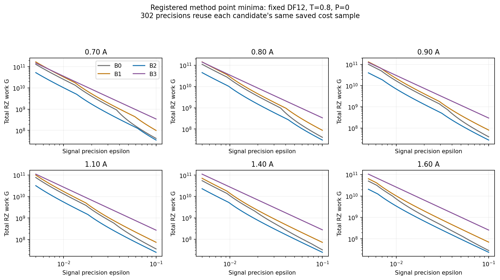
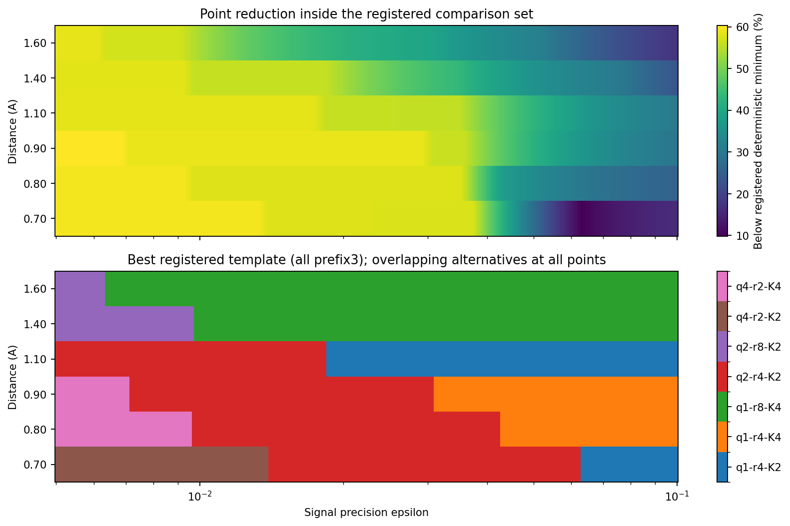
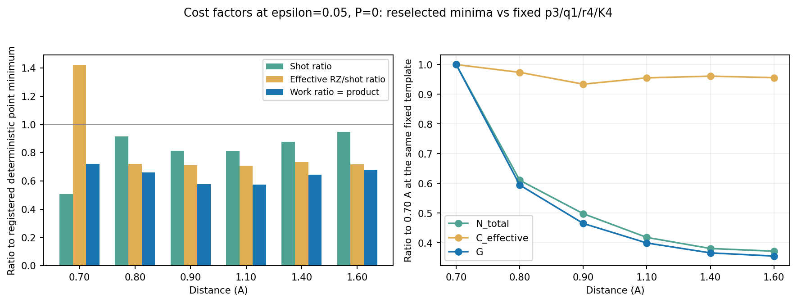
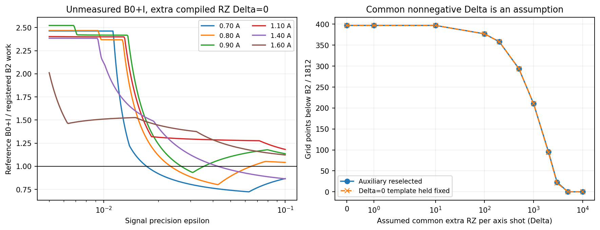

# 固定DF表現における部分ランダム化時間発展の有限signal資源：H4 geometryとH6確認の事例研究

日本語通し草案v0.3、2026-10-13。科学的採否・投稿可否は未review。
固定H6草案v0.2（`653d64bedba7516d4c17f2c7457cefbc80f877a2`）を基礎に、完了したH4 geometry、
H4固定anchorとB0+I追加感度を分離して統合する。旧草案・元結果・比較集合を改変しない。
著者、所属、投稿先は未確定。

## Abstract

部分ランダム化時間発展では、deterministicなDF-prefix product formulaと有限Taylor型randomized tailを
組み合わせることで、1-shot回路費用とnormalization・近似biasに伴う測定数を同時に調整できる。
本稿は有限時間complex signalの指定精度に対する、測定込みcompiled RZ費用の実装事例研究である。
H4 linear/STO-3G、固定DF rank12、6距離、T=.8の1308候補から、保存結果を302精度点へ投影した。
登録B0/B1/B2/B3内の点推定最小は全1812比較点でB2/prefix3であり、epsilon=.05では
最良登録deterministic候補より27.9〜42.7%低かった。
ただし全点に記述的±2SE区間が重なる近接候補があり、同じ32 trajectoryによる選抜と評価の限界がある。
H6では別条件の探索後に固定8構成を独立32 trajectoryで確認した。full PFに対する確認集合内の点費用は
約54〜63%低いが、未観測希少次数・経験的数値allowanceを残す。
H4の登録外B0+I対照には追加compiled費用未測定の感度を付し、Δ=0参考モデルで397点の比較順位が
変わり得ることを別節で示す。正式baselineの採用は未決定であり、元最良値表を置き換えない。
一般的分子優位、母平均winner、エネルギー精度、状態準備を含むfault-tolerant総資源、系サイズscalingを証明しない。

## 1. 背景と目的

部分ランダム化による位相推定・量子化学資源評価、directional controlによる回転費用削減は既存研究の対象である。
本稿はPRやsymmetric directional controlの初提案を主張しない。
先行草案の文献枠組みを維持し、固定近似表現、候補集合、control、Gaussian lowering、compiler、
数値・統計会計を明示した限定比較を目的とする。今回新たな文献網羅性・優先権reviewは行っていない。

Hamiltonian近似biasを小さくする構成が、必ずしも測定込み費用を最小にしない。
deterministic prefixとq、random tailのr/Kによって回路費用、normalization、biasが変わり、
残るheadroomから必要shot数が決まる。このtrade-offを保存値から追跡する。

## 2. 対象と比較契約

H4 geometryはlinear H4、距離.70/.80/.90/1.10/1.40/1.60 Å、STO-3G、8 modes/sector36、
legacy固定DF12、T=.8、delta=T/q。登録集合はdiscard B0（PM-1 p4/5補完を含む）、
full S2 B1、partial S2+finite RTE B2、random-dominant B3である。
各距離218候補、deterministic24候補は1 paired cost、stochastic194候補は32 paired trajectories。
H4 ordinary controlとstructured JW Gaussian loweringの費用系列であり、旧dense系列を混ぜない。

H6はlinear1Å/STO-3G、12 modes、Na=Nb=3/sector400、tol-only DF1e-8/cutoff0/rank19、
signed generation order/weighted Hermitian projection、T=.8。
B0/B2 prefix5/10/15、full19のS2/global Yoshida S4が登録対照である。
primaryはsymmetric_directional control、native JW Givens/Bogoliubov lowering、raw concatenation。
H4 geometryとのcompiler labelの共通性だけを、FPやsource、DF政策、費用系列の同一性とは扱わない。

H4固定1Å anchorはlegacy DF12の16固定panelで、PR8構成とfull S2/S4 8構成を
native/symmetric-directional条件で比較した。B0を含まず全H4候補探索ではない。
H8はlinear1Å/STO-3G、16 modes、Na=Nb=4/sector4900、tol-only DF1e-8/rank28。
本稿が引用するH8結果は固定feasibility8 cases/20 compileであり、full shot-mapの完成結果ではない。
後日のcore資料では92候補探索・独立確認のone-shotが承認されているが、このH4 taskから結果を補完しない。

全条件は[対応表](../research/track_a_resource_comparison_conditions_20261013.md)を参照。
科学SOURCE・input/seed SOURCE・結果commit・compiler/profileと文書blobのprovenanceを別に固定する。

## 3. 費用、precision、統計

評価精度epsilonは有限時間complex signal精度であり、chemical accuracyやQPE/RPE energy精度ではない。
状態準備P=0を主指標とし、各axisのalpha=.025を固定する。
H4 geometryでは `h_a=epsilon/sqrt(2)-bias_a`、`N_a=ceil(2*B^2*log(80)/h_a^2)`、h<=0なら不適格。
元契約のtargetは保存Eによる `exp(-iE*T)` であり、この事後解析はstate/referenceの厳密保証を追加しない。
H6/native anchorは経験的数値allowance uをhから減算し、B_upperを用いる別契約である。
H6 uのfloor1e-12/safety10やanchorのu=1e-11/10×感度はnumerical certificateではない。

`G=N_cos*C_cos+N_sin*C_sin=N_total*C_effective`。
Cはfull Hadamard wrapperのcompiled RZ平均で、cos/sinは同じtrajectoryを共有する。
paired covarianceを含むSEを使い、32 trajectoryを64独立標本と数えない。
±2SEは記述的なengineering intervalであり、希少事象・多重比較・選択後の楽観性に対する正式な補正ではない。
H4の302 precision点は同じ保存標本からの再算術で、302独立実験ではない。

## 4. H4 geometry：元登録集合の結果

元mapは1308 signal候補、74784 logical wrappersの全件coverageを保存して終了した。
新解析は全1308候補を各302精度へ投影し、method別適格数・最小費用・構成・axis bias/B/headroom/
shot/paired SEと費用分解を保存する。全1812点の点最小はB2/prefix3である。
geometryごとの構成領域は15、q1/q2/q4の点数は937/670/205。
精度切替はgrid上のbracketであり、連続精度の厳密境界ではない。

|距離 Å|B2 q/r/K (p=3)|G RZ work、epsilon=.05|登録deterministic比|点削減率|
|---|---|---:|---:|---:|
|.70|2/4/2|206510351.81|.721428|27.86%|
|.80|1/4/4|171335623.31|.658836|34.12%|
|.90|1/4/4|134062992.53|.577896|42.21%|
|1.10|1/4/2|112907239.50|.573120|42.69%|
|1.40|1/8/4|102934380.50|.643758|35.62%|
|1.60|1/8/4|97277315.91|.679176|32.08%|

図1：元登録B0/B1/B2/B3のmethod別点最小。linear H4/STO-3G/固定DF12/T=.8/S2/P=0。
curveの空白は不適格、B0にはPM-1補完を含む。点最小は母平均winnerを意味しない。

図2：元登録deterministic最小に対する点削減率と、B2の最良q/r/K。
同じcost標本の302点投影、全prefix3。各点に重なる近接候補が存在する。
図のgeometry間補間に物理的意味を与えない。

### 固定構成と点再選択の費用要因

epsilon=.05のN_totalは距離順に17187/28102/22921/19252/16474/15981。
選び直したpoint minimaのgeometry変化には構成変更が含まれるため、同一回路構成の物理応答と混同しない。
別に6固定構成×3精度×6距離を評価した。p3/q1/r4/K4を固定する.80→.90 Åでは
work比.78245837がshot比.81563590とeffective-RZ比.95932311に分解される。
B²は1.00147761倍へ増えるが、cos biasが.01312847から.00947307へ減り、headroomが広がる。
これは保存値上の費用要因であり、分子相関の変化が原因だという物理的機構の検証ではない。

図3：左は各geometryで選び直したpoint minimumのdeterministic比をshot比×effective-RZ比に分解。
右は同じp3/q1/r4/K4を固定した比で、.70 Åを基準とする。P=0、epsilon=.05。

## 5. H4の未登録B0+I対照：独立した追加感度

元B0はDF tail全体をdiscardし、そのIも捨てる定義である。実装ミスと認定しない。
B2/B3がtail Iをconstantへ移すことを踏まえ、別対照B0+Iではdiscarded identityだけを保持する。
tail scalarは各DF fragmentの `lambda/4*((Tr G_L)^2+Tr G_L^2)` の和で、保存signalは
`z_I=exp(-iT*c_tail)*z_B0` と位相回転できる。新しい量子signal simulationは行っていない。

source上では既存ancilla phaseの角度へ吸収でき、pre-transpile命令数を増やさない構成が可能。
q step間のphaseは加算できるが、wrapper Hadamardを越えて捨てられるglobal phaseではない。
compiled RZは角度とcompilerの融合・削除に依存し、差を0や1と保証できない。
旧B0 metricを変更対照の実測costとして流用しない。別template/source/FP/bindingが必要である。

追加compiled費用Δ=0を仮定した参考モデルは397/1812点でB2点最小を下回る。
geometry別は178/103/29/0/87/0、補助prefix/qはp5/q1が264点、p4/q1が46点、p3/q1が87点。
epsilon=.05の代表逆転閾値は.70/.80/1.40 Åで約2966/1019/212 RZ/axis-shot。
候補jの真の追加費用はaxis別Δ_j,c/Δ_j,sであり、
`N_c*Δ_j,c+N_s*Δ_j,s < G_B2-G_I,j(0)` の場合だけ当該固定候補が低い。
全候補共通の非負Δという追加仮定では、補助候補を選び直した点数は
Δ=100/500/1000/2000/3000で377/294/210/96/23となる。
これは実測順位ではなく、元登録比較表を置き換えない。

図4：未測定対照B0+Iの追加感度。左はΔ=0参考費用比、右は全候補・geometry・axis共通の非負Δという仮定。
実Δは異なり得る。補助候補を再選択する場合とzero-Δ候補を固定する場合を区別する。
B0+Iの正式採用・実compiled費用・より広いdeterministic手法との比較は未確定である。

## 6. Monte Carloと希少次数

H4 runtimeの閉じた保存schemaはcost、seed、numeric FPを保持するがevent次数・component列を保存しない。
元全record照合と今回のbounded schema読取から、次数観測件数はNOT_SAVEDであり「0回観測」ではない。
K2のorder4はOUTSIDE_CUTOFF。新たなsamplingやseed replayで欠測を補っていない。

1164 stochastic候補のうち、保存B=1へ丸められた172候補の次数確率は未解決とし、0へ補完しない。
残る992候補について法則のw_nと保存Bからp_nを近似逆算し、R=q*rで32本全zero確率p0^(32R)を計算した。
epsilon=.05の選択構成では41.06%〜65.79%である。
選択K4のorder4期待総draw数は.000167〜.000929、未観測確率は99.9098%〜99.9833%。
これは無条件法則からの確率であって、実際の観測の有無やwinner条件下の確率ではない。
component別cost・未保存の観測列なしには、未観測成分の母平均寄与を保証できない。

全1812点で近接候補の±2SE区間が重なる。登録deterministic最小に対して
`G_B2+2SE < G_det` は全点で成立するが、選択・希少未観測を補正した母平均優位を意味しない。
同じ32 trajectoryで選抜と費用評価をするH4と、探索8本と独立確認32本を分けるH6は統計設計が異なる。

## 7. H4固定anchor、H6確認、H6希少次数pilot

条件を揃えるためのH4 1Å固定panelはPR8×32とfull S2/S4 8×1、primary528＋ordinary感度4 compile。
epsilon=.05/.01/.005/.001のfixed-panel PR/full-PF比は.506631/.471627/.453431/.510507。
B0不在のpanel内結果であり、H4全最良deterministic比とは異なる。

H6は592探索groupの後に上位union8構成を固定し、256 group/512 wrappersの独立32本確認を完了した。
確認集合内の点最良PR/full-PF比は.459978/.399630/.372105/.387006、
探索で先に選んだK4候補の独立比は.459978/.399990/.374969/.387450。
確認後の最小選択と事前固定候補を分ける。未確認の残り64 B2構成の母平均劣位は認定しない。
K/rの近接差と、登録full PFとの差も別論点である。

H6の最厳精度候補p5/q8/r2/K2に対する条件付きs2 pilotは、非zero order2を含む事象
（pi2=.0166969061）から別seed8 trajectory/16 compileを取得した。
8本全てM=1だったがM=1へsamplingを強制していない。
s0 mean95863.78125、s2 mean96285.25、重み付きmean95870.81847で局所補正は+.00734086%。
残るM>=2や他希少componentの母平均保証ではない。この数値をH4やH8へ流用しない。

## 8. H8と外挿の境界

H8 fixed feasibilityは8 cases/20 compileを完了し、16-mode full wrapperの実行可能性を示した。
例えば1軸RZでfull S2/q1が104229、PR p7/q1/r4/K2が34484であるが、
精度を揃えたshot込み優位ではない。4 PR trajectoryで44 event全てorder0という限定標本である。
後日のcoreは92 signal、探索8本、最大8構成の独立32本確認を採択・one-shot承認している。
このH4資料にはその最終shot結果を取り込んでおらず、完了や速度・winnerを推測しない。
H8 source・実行・準備・grantへの変更は0。

H4 geometry/anchor、H6、H8ではDF政策、PF baseline、control、Gaussian lowering、
numerical allowance、標本・selectionが異なる。削減率を一つの系サイズscaling曲線へ接続しない。
H4 anchorもlegacy固定DF12であり、H6/H8 tol-only政策との完全な統制比較ではない。

## 9. 再現性と限界

公開bundleは軽量保存projection、全grid CSV、分類・Δ感度・固定構成・rare-law表、4図のPNG/SVG/PDF、
再生成script、元source/input/reference blob provenance、14限定人工算術検査と別公開算術照合を含む。
NPZ/raw/checkpoint/credentialは新commitに含めない。科学source・compiler/private venv・共有設定は変更しない。
公開projectionだけで保存資源算術を追えることと、元量子計算の独立再現は異なる。
local検証をCIや独立科学reviewとして扱わない。

B0+Iの採否、正式比較集合、主要claim、追加compiled測定範囲、H4独立確認・rare診断は
GPTへ判断を返す。6 compile案は3代表固定構成、10 compile案は逆転点の5zero-Δ構成、
240 compile案は120補助構成を覆うが、全て未実行・別認可が必要である。
未知wall/charge/peak RSSを既存sourceの命令数から確定しない。

## 10. Conclusion（草案）

固定DF・有限signal・所定compilerとshot規則の登録集合では、H4 geometryとH6確認において
部分ランダム化の低い点資源が得られた。費用変化はshot数とeffective回路費用に分けて追跡できる。
H4のregistered point resultと、未測定B0+I対照による感度は異なる証拠である。
元結果の算術を保持しながら、対照定義・希少次数・選択後不確かさを明示することで、
次の科学的採否判断に必要な範囲と追加測定を限定できる。

## データ・参考文献・編集上の判断

- [技術資料入口と全算術](../research/track_a_h4_geometry_technical_integration_20261013.md)
- [元結果・FP・input provenance](../../artifacts/resource_applicability/track_a_h4_geometry_results/2026-10-13/)
- [追加診断と再生成・図](../../artifacts/resource_applicability/track_a_h4_geometry_technical_integration/2026-10-13/README.md)
- [科学判断事項](../../artifacts/resource_applicability/track_a_h4_geometry_technical_integration/2026-10-13/SCIENTIFIC_DECISIONS.md)
- 基礎H6草案：[固定v0.2](https://github.com/HIROMU1015/Partially-Randomized-Trotter/blob/653d64bedba7516d4c17f2c7457cefbc80f877a2/docs/manuscripts/track_a_h6_resource_study_v0_2.md)。引用文献の詳細・採否はこの版の枠組みを維持し、最終科学reviewで点検する。
- H6確認：[固定資料](https://github.com/HIROMU1015/Partially-Randomized-Trotter/blob/321cd8c3066194fe98741cbebbcdba1515d1deaa/docs/research/track_a_h6_independent_confirmation_result_v1.md)。
- H6 rare pilot：[固定資料](https://github.com/HIROMU1015/Partially-Randomized-Trotter/blob/0f96a2e45ba58bd916508e1b1f32e6ff1ff65f41/docs/research/track_a_h6_conditional_s2_pilot_result_v1.md)。
- H8 feasibility：[固定資料](https://github.com/HIROMU1015/Partially-Randomized-Trotter/blob/a55da5c2b012912c485184845aa73ca053ac00b9/docs/research/track_a_h8_fast_feasibility_result_v1.md)。

編集上は、元結果表の維持、B0+Iの未登録感度の分離、一般的優位・energy precisionへの拡張を避ける
表現、系列ごとの条件表を採用した。これらの科学的採否は未reviewであり、本草案だけで新比較を承認しない。
