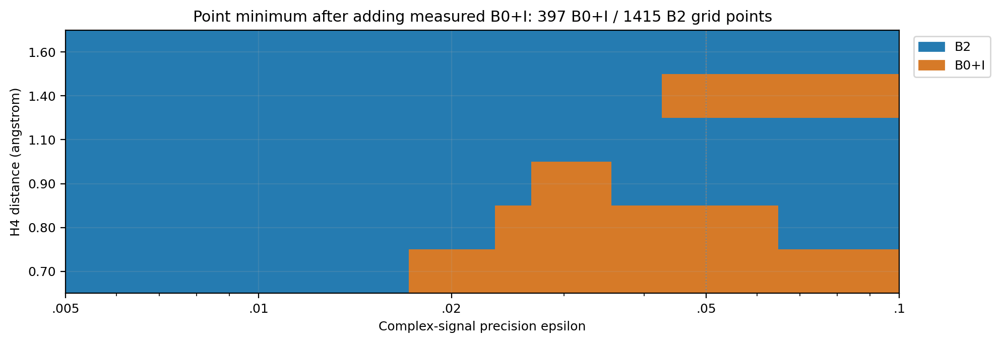
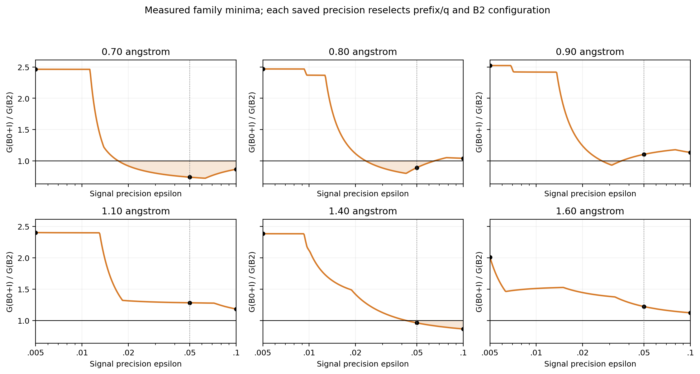
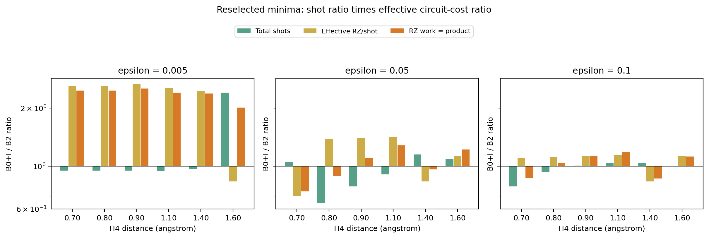
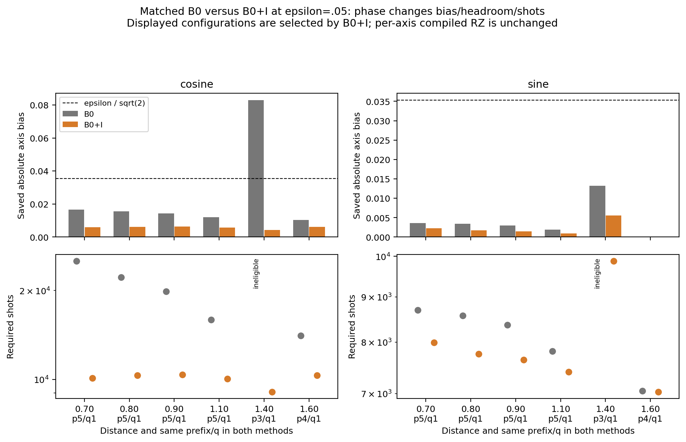
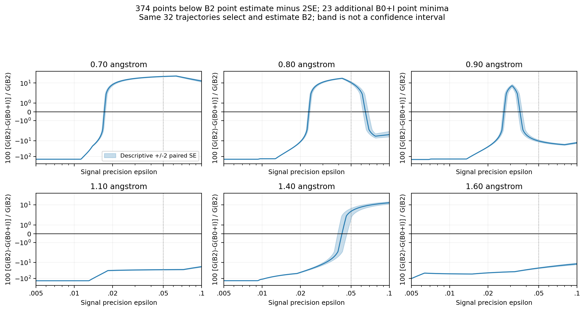

# 既知scalarを保持する対照との比較による部分ランダム化時間発展の有限signal資源

日本語通し原稿v0.4草案、2026-10-14。**科学的採否・主要claim・新規性・論文化の最終判断前のdraft**。
固定v0.3とH4 B0+I全240回路の実測結果を基礎にした、保存値解析による原稿統合である。
著者・所属・投稿先・最終題名は未確定。以下の解釈候補はGPT科学レビューの対象とし、追加計算の認可を含まない。

## Abstract

部分ランダム化時間発展では、決定論的Double Factorization（DF）prefix product formulaと有限Taylor型randomized tailを組み合わせ、回路費用・近似bias・normalizationに伴う測定数を調整する。
本稿は、固定Hamiltonian表現、有限時間complex signal、状態準備費用P=0、所定compilerとshot規則に限る実装事例研究である。
linear H4/STO-3G、固定DF rank12、T=0.8の6距離・元登録1,308候補を保存値から302精度点へ投影すると、B0/B1/B2/B3のみの登録集合では全1,812点でB2が費用点推定最小だった。
既知のdiscarded-tail identity成分を保持する決定論的対照B0+Iを追加し、prefix3/4/5/6/9、q=1/2/4/8の120構成・両軸240 full wrappersを実測した。
234件の新compileとprovenanceを照合したpilot6件を用い、全240軸で旧B0とのRZ/CX数・depth・size差は0だった。
追加後の費用点最小はB0+Iが397点、B2が1,415点となり、距離と要求精度に応じた対照依存性が現れた。
ε=0.05では0.70/0.80/1.40 ÅでB0+Iが低く、他3距離ではB2が低い。ε=0.005では6距離すべてB2が低い。
費用を総shot数と有効RZ/shotへ分解すると、低い回路費用が多いshot数を補う場合と、shot減少が重い回路を補う場合が区別された。
B2の同じ32 paired trajectoriesによる選抜と推定、希少eventの未保存・未保証を保持し、母平均winnerを認定しない。
別native系列のH6独立確認とH8 feasibilityは条件を分離して記載する。
一般的分子優位、系サイズscaling、energy/QPE/RPE精度、状態準備を含むfault-tolerant総資源はこの結果から保証しない。

## 1. 背景と研究目的

部分ランダム化による位相推定・量子化学資源評価、directional controlによる回転費用削減は既存研究の対象である。本稿はPR、directional control、scalar保持そのものの初提案を主張しない。
v0.3の文献枠組みを継承し、今回新たなprior-art網羅性・優先権判定は行っていない。
科学レビューで追加対照として採択されたB0+Iの実費用を取得したことにより、比較集合に依存する資源上の利点を、bias・shot・回路費用から追跡できるようにする。

本稿で検討する主張候補は「既知identityを保持する対照も含めたとき、PRの非identity tail補完が、どのgeometry/precision条件で低い測定込み費用点推定を与えるか」である。
これはレビュー前の問いの表現であり、新規性や論文価値を確定するものではない。
H4単独の大きな優位性claim、baseline-sensitive case study、H6/H8と分離した複数事例研究のどれを採用するかは、[handoff](track_a_h4_b0i_v0_4_scientific_review_handoff.md)へ返す。

## 2. 対象・比較集合・実行条件

### 2.1 H4 geometry系列

H4 linear chain、距離0.70/0.80/0.90/1.10/1.40/1.60 Å、STO-3G、8 modesとancilla1、sector36、legacy固定DF rank12、T=0.8とする。
元集合はdiscard B0（PM-1 prefix4/5補完を含む）、full S2 B1、partial S2＋finite RTE B2、random-dominant B3。
各距離218候補、決定論24候補は1 paired circuit、確率的194候補は32 paired trajectories。
q=1/2/4/8、δ=T/q=0.8/0.4/0.2/0.1、二次DF-prefix PF、ordinary control、structured JW Gaussian loweringの費用系列である。
旧dense Gaussian系列とは混合しない。

追加集合B0+Iは各距離prefix3/4/5/6/9×q1/2/4/8の20構成、計120構成とcosine/sine両軸240 full wrappers。
新しい科学baselineをこの原稿作成段階で独断追加したものではなく、直前の[科学レビュー](../../artifacts/resource_applicability/track_a_h4_b0i_manuscript_integration/2026-10-14/review_context/previous_scientific_review_20261013.md)で追加評価対象に採択されたものを扱う。
元B0の定義・値を上書きせず、拡張集合は「元集合＋B0+I」と明示する。

### 2.2 Compiler・provenance

Qiskit1.3.0、basis rz/sx/x/cx、optimization level1、seed_transpiler17、approximation_degree1、topologyなし、num_processes1等の固定条件を維持した。
既存private venvは変更せず、旧compilerとのoutput完全同一性が未確認であることを保持する。
今回の実行SOURCEは `924b779c2bc6f6e844d6283c355f91c73aed6445`、結果commitは `98cdb35cd08469714f20d6cc3b982d9c80908f46`。
元H4科学SOURCEは `d0726e946f89f8c30a08d383fb8ff48b363629ec`、dataset identity SOURCEは `5aa6c3685afb9c3afcfbdc36f80244da0a7fe525`。
source、入力byte/科学identity、compiler/environment、phase、axis、numeric FP、再利用mappingは結果bundleに保存されている。

## 3. B0+Iの数学的定義と制御位相

DFブロックを \(A_\ell=\lambda_\ell(\sum_i\eta_{\ell i}n_i)^2\)、\(n_i=(I-Z_i)/2\) とすると、identity係数は

\[
c_\ell=\frac{\lambda_\ell}{2}\sum_i\eta_{\ell i}^2+
\frac{\lambda_\ell}{2}\sum_{i<j}\eta_{\ell i}\eta_{\ell j}
=\frac{\lambda_\ell}{4}\left[(\operatorname{Tr}G_{\ell,L})^2+\operatorname{Tr}(G_{\ell,L}^2)\right].
\]

保存行列の下三角Hermitian規約 \(G_{\ell,L}\) を用い、upper/lower平均化・prune・別DF生成を導入しない。
prefix pに対し \(c_{\rm tail}(p)=\sum_{\ell\ge p}c_\ell\)。保持済みone-body/DFのidentity項を二重加算しない。
\(H=H_{\rm kept}+c_{\rm tail}I+V_{\rm tail}\) に対して、B0+Iは \(H_{\rm kept}+c_{\rm tail}I\) を使い、非identity tailはdiscardしたままである。
係数は既知DFから定まり、参照energyや費用最小化にfitした補正ではない。対照の着想が事後的であることは別に記録する。

固定B0のPF近似と保存signalには

\[
\widetilde U_I(T)=e^{-iTc_{\rm tail}}\widetilde U_0(T),\qquad
z_I=e^{-iTc_{\rm tail}}z_0
\]

の関係がある。今回のB0+I biasはこの解析的回転で得た保存値で、新たなsignal solverや量子backend shot実行ではない。
controlled wrapperでは制御枝間の相対位相として \(P(-Tc_{\rm tail})\) が必要であり、全wrapperのglobal phaseとして捨てない。
元builderの既存ancilla位相角へscalarを加え、保持ブロック・PF順序・controlを維持した。

位相回転はsignalの絶対値を保持するが、指定targetとのaxis biasが一律に減る保証はない。
nonidentity tailによる振幅変化、状態混合、長時間誤差を修復したことにもならない。
full Fockのidentity係数を、粒子数sectorや入力stateに対する最適scalarと呼ばない。

## 4. Precision・shot会計・費用・SE

εは有限時間complex-signalの誤差要求で、エネルギー精度Haやchemical accuracyとは区別する。元H4 targetは保存 \(\exp(-iET)\) であり、今回state/referenceの厳密証明を追加していない。
各軸aについて

\[
h_a=\epsilon/\sqrt2-b_a,\qquad
N_a=\left\lceil\frac{2B^2\log80}{h_a^2}\right\rceil
\]

とし、hが非正なら構成全体を不適格とする。B0+IはB=1、各軸α=0.025。H4元契約へ新しいnumerical allowanceを追加しない。
状態準備P=0の費用は

\[
G=N_c C_c+N_s C_s=N_{\rm total}C_{\rm eff},\qquad
C_{\rm eff}=\frac{N_c C_c+N_s C_s}{N_c+N_s}.
\]

Cはfull measured Hadamard wrapperのcompiled RZ。axis配分が変われば、同じ軸別CでもC_effは変わり得る。
B2のcos/sinは同じtrajectoryを共有し、標本数は32である。paired covarianceを含む

\[
SE(G)^2=\frac{N_c^2s_c^2+2N_cN_s s_{cs}+N_s^2s_s^2}{32}
\]

を用いる。±2SEは保存標本の記述的診断で、正式なconfidence interval、選択後・多重比較補正、希少eventの母平均保証ではない。
302 precisionは同じ保存値を再会計したもので、1,812独立実験ではない。

## 5. H4：元登録集合と追加実測集合

### 5.1 元登録集合の歴史的結果

元1,308候補・74,784 logical wrappersの結果を保持する。B0/B1/B2/B3のみでは全1,812点でB2/prefix3が費用点推定最小だった。
ε=0.05で元登録deterministic最小より27.9〜42.7%低かったというv0.3の値は、元集合に限定して有効である。
元集合の[図1〜4とv0.3](track_a_resource_study_geometry_native_v0_3.md)は不変で、追加集合の全面優位へ拡張しない。

|距離 Å|元B2 q/r/K（prefix3）|元B2百万RZ-work|元登録deterministic比削減率|
|---:|---:|---:|---:|
|0.70|2/4/2|206.51|27.86%|
|0.80|1/4/4|171.34|34.12%|
|0.90|1/4/4|134.06|42.21%|
|1.10|1/4/2|112.91|42.69%|
|1.40|1/8/4|102.93|35.62%|
|1.60|1/8/4|97.28|32.08%|

### 5.2 全240 wrapperの実compile結果

234新規compile＋provenance/新build numeric FPを照合したpilot6件の再利用で240/240 COMPLETE。
全240軸で旧B0とのRZ数、CX数、RZ depth、CX depth、total depth、circuit size差は0だった。
旧B0 cacheを変更回路の実測値として流用した結果ではない。新SOURCE/phase/task bindingと原本hashを結果receiptに保存した。
この0差を任意compiler・角度・control・Gaussian実装への保証とはしない。
12 workerでstage193.990秒、専用14 identity残存0、監視違反・OOM増分なし。全compute後にmandatory STOPした。
このstage wallを旧mapや6件pilotとの同条件速度benchmarkとして扱わない。

### 5.3 拡張集合の全地図

元集合にB0+Iを加えると、点最小はB0+I397/1,812（21.91%）、B2 1,415/1,812（78.09%）、同費用0点。
元のΔRZ=0参考感度と同数になったが、今回は全120構成の実compiled費用で確認した比較である。
全B0+I familyを測ったため、6件pilotの固定3構成だけによる比較とも区別する。

図1：元登録集合＋実測B0+Iの点費用最小。6距離は離散rowとして表示し、geometry間を物理的に補間しない。log εの表示cell境界は描画用の中点で、厳密な切替精度ではない。条件は第2節のH4/STO-3G/DF12/T=.8/S2/ordinary/structured/P=0。

|距離 Å|B0+I点最小|B2点最小|B0+Iが低い保存grid ε（最初〜最後）|
|---:|---:|---:|---:|
|0.70|178|124|0.017247616〜0.100000000|
|0.80|103|199|0.023505464〜0.064443967|
|0.90|29|273|0.026763740〜0.035397800|
|1.10|0|302|該当なし|
|1.40|87|215|0.042793207〜0.100000000|
|1.60|0|302|該当なし|

methodの連続grid領域は12、点最良templateの領域は19。[区間表](../../artifacts/resource_applicability/track_a_h4_b0i_manuscript_integration/2026-10-14/method_grid_regions.csv)に前/次の隣接grid精度も保存する。
例えば0.80 ÅのB2→B0+I切替は0.023271912〜0.023505464の隣接点で挟まれ、戻りは0.064443967〜0.065090714で挟まれる。区間内の真の連続ε根は解いていない。

図2：各precisionで別々に候補再選択したG_B0I/G_B2。黒点はε=.005/.05/.1、橙領域は保存点で比<1。線はgrid値を結ぶ表示で、連続境界保証ではない。
ε=.005では全6距離B2が低く、ε=.1では0.70/1.40 ÅでB0+I、他4距離でB2が低い。0.80/0.90 Åは中間精度だけB0+Iが低い。

|距離 Å|ε=.05のB0+I prefix/q|B0+I百万RZ-work|B2百万RZ-work|B0+IのB2比削減率|
|---:|---:|---:|---:|---:|
|0.70|5/1|152.87|206.51|25.97%|
|0.80|5/1|152.91|171.34|10.75%|
|0.90|5/1|148.13|134.06|−10.50%|
|1.10|5/1|144.71|112.91|−28.17%|
|1.40|3/1|98.91|102.93|3.91%|
|1.60|4/1|118.88|97.28|−22.20%|

## 6. Shot・bias・headroom・回路費用・構成再選択

### 6.1 別familyの点最小を比べた算術分解

図3：ε=.005/.05/.1におけるB0+I/B2の総shot比、有効RZ/shot比、総費用比。棒は比1を基準に上下へ表示し、log軸である。費用比は前二者の積。双方で選び直した構成を比べている。

|距離 Å、ε=.05|B0+I shot総数|B2 shot総数|shot比|有効RZ/shot比|費用比（積）|
|---:|---:|---:|---:|---:|---:|
|0.70|18,084|17,187|1.052191|0.703555|0.740274|
|0.80|18,080|28,102|0.643371|1.387188|0.892476|
|0.90|18,022|22,921|0.786266|1.405316|1.104952|
|1.10|17,442|19,252|0.905984|1.414663|1.281662|
|1.40|18,957|16,474|1.150722|0.835025|0.960882|
|1.60|17,363|15,981|1.086478|1.124779|1.222047|

0.70 ÅではB0+Iはshotが5.22%多いが有効回路費用が約29.64%低いため、総費用が25.97%低い。B2側はq2、B0+I側はq1であり、同一構成比較ではない。
0.80 ÅではB0+Iの回路は約38.72%重いがshotが約35.66%少なく、総費用は10.75%低い。
1.40 Åではshotが15.07%多くても回路が16.50%軽く、総費用は3.91%低い。
0.90 Åではshot減少が回路増加を補い切れず、B2が低い。これらは保存会計上の因子で、分子相関や個別DF項の物理的因果機構を新たに検証したものではない。

### 6.2 同じprefix/qの旧B0とB0+I

補助図S1：ε=.05でB0+Iが選んだ6構成を固定し、対応する旧B0と比較する。上段はaxis biasとε/√2、下段はlog軸の必要shot。片軸のheadroomが非正なら全構成を不適格とし、両軸shotを空欄にする。

0.70 Å/p5/q1ではcos biasが0.01669215→0.00588618、headroomが0.01866319→0.02946916。
shotは25,162→10,092、sineは8,699→7,992となり、総費用は286,252,195→152,874,144。
軸別RZ8,454/8,453は同じで、同一構成のscalar保持効果を費用として追跡できる。
1.40 Å/p3/q1の旧B0はcos bias0.08302436で不適格、B0+Iは0.00428204で適格になる。旧B0の費用を0と置いた比は計算しない。
1.60 Åで元登録最良B0はp5だが追加B0+Iはp4であり、最良値どうしの差と同じp4の位相効果を分ける。

全120構成のmatched表と、B0+I6/B2 6固定構成×6距離×3精度の216行display panelを保存した。
固定display構成は事後的な既存候補の表示選択で、H4の独立確認実験ではない。
axis Cが不変でもshot配分によりC_effが変わる点を明示し、geometryごとの再選択による利得を固定回路の物理応答と混同しない。

## 7. B2の選択後費用推定と未保存希少次数

図4：縦軸は100(G_B2−G_B0I)/G_B2、帯は固定保存点の差に対する±2 paired SE/G_B2（百分率）。正側はB0+Iの点費用が低い。符号を保つsymlog軸を使う。正式なconfidence intervalではない。

397点のうち374点ではG_B0I<G_B2−2SEも成立し、残り23点は点差が2SE以内。
B2が点最小の1,415点では、逆向きの記述的2SE条件が1,392点、残り23点は差が2SE以内だった。
この分類はpaired標本費用の診断であり、母平均優位の認定や境界での信頼保証を与えない。
B2の候補選抜と費用評価には同じ32 paired trajectoriesを使う。B2内の細かなr/K winner順位は独立確認されていない。

H4のTaylor次数・component履歴はNOT_SAVEDであり、0回観測へ読み替えない。
保存Bが1へ丸められた172確率的候補の法則確率は未解決である。
v0.3の残り992候補の法則逆算は近似的な無条件診断として保持し、実観測や選択後確率、母平均cost上界にはしない。
希少eventのcost寄与は未保証。seed再生成・新Monte Carlo・新統計手法・信頼保証を今回導入しない。

## 8. H4固定anchor・H6確認・H8の条件と外挿限界

H4 geometry/B0+Iはordinary/structured/legacy DF12系列。H4 1Å anchor、H6、H8は別native/symmetric-directional系列である。
H4 anchorはB0不在の固定16 panel、PR8×32とfull S2/S4 8×1。ε=.05/.01/.005/.001でPR/full-PF点費用比0.506631/0.471627/0.453431/0.510507。
これは最良deterministic全体との比較ではなく、今回のgeometry地図へ直接接続しない。

H6はlinear1Å/STO-3G、12 modes、sector400、Na=Nb=3、tol-only DF1e-8/cutoff0/rank19、signed generation order/weighted Hermitian projection、T=.8。
92候補の探索後に上位union8構成を固定し、別seed32 paired trajectories、512 wrappersで確認した。
確認集合内のPR/full S2/S4 PF比は0.459978/0.399630/0.372105/0.387006。探索で先に選んだK4候補の独立比0.459978/0.399990/0.374969/0.387450とは分ける。
経験的u floor1e-12/safety10、B_upperを用いる別shot契約で、数値certificateではない。
別条件付きs2 pilotの8本/16 compile、局所補正+0.00734086%はH4やH8へ流用せず、M>=2や他希少componentを保証したことにもならない。

H8の固定引用範囲はlinear1Å/STO-3G、16 modes、sector4900、Na=Nb=4、tol-only rank28、8 feasibility cases/20 compile。
full S2/q1の1軸RZ104,229とPR p7/q1/r4/K2の34,484は実行可能性の例であり、matched-accuracyのshot込み優位ではない。
後のcore92候補探索・独立確認は別承認系列。本作業にその最終結果は取得・統合しておらず、完了・winner・ライブ稼働を推測しない。H8の計算、worktree、source、grantへ操作していない。

[新条件対応表](../research/track_a_resource_comparison_conditions_20261014_v0_4.md)はDF政策、prefix、PF次数、control、lowering、compiler、reference/u、標本・selectionを分離する。
同じcompiler labelから費用系列の同一性を認定せず、各削減率を単一scaling curveへ接続しない。

## 9. 再現性・歴史的記述・科学レビュー待ち

元v0.3と旧4図、元source/NPZ/raw/checkpoint/result/ledgerは保全した。
旧図4は実compile前のΔ=0・共通Δ感度であり、新しい図1〜4の実測主図へ転用しない。
新[bundle](../../artifacts/resource_applicability/track_a_h4_b0i_manuscript_integration/2026-10-14/README.md)に全1,812費用因子、SE比較、method12領域/template19領域、matched120構成、1,440 metric比較、216固定display行、図PNG/SVG/PDF、生成script、bytes/SHA provenance、限定8算術検査を保存する。
公開保存値から算術と描画を追えることは、元科学計算の独立再現やCI、独立科学reviewとは異なる。
新科学計算、trajectory/seed replay、compile、NPZ読込、GPU、共有venv/H8変更は0。

### 主要claimの代替表現（採否待ち）

**候補A：**「固定H4 domain・保存標本・所定compiler/P=0において、scalar保持対照追加後もPRは1,415/1,812点で低い費用点推定を与え、残る397点はB0+Iが低い。」有限domainの記述として採用するかをレビューする。

**候補B：**「既知scalarの保持で対照を強化すると、PRの低費用領域はgeometryとsignal精度に依存する。実装会計の要因分解を通じ、その条件依存性を提示する。」case studyの中心として採用するかをレビューする。

**候補C：**「H4はbaseline-sensitive診断として位置付け、native H6/H8は条件を分離した独立事例として提示する。」論文全体の構成と証拠の充足性をレビューする。

いずれも新PR algorithm、一般的最適性、厳密母平均winner、energy/QPE/RPEやfault-tolerant総資源の主張へ拡張しない。
H4の追加独立確認・条件付き希少次数診断の要否、論文化の価値・着地点はGPTが判断する。

## 10. Conclusion（科学的採否前の草案）

元登録B0/B1/B2/B3でのB2全面点最小を保持したうえで、全120構成のB0+I費用を取得し、拡張集合の点最小が397/1,415へ分かれる保存値地図を得た。
既知scalarを保持した全240 wrapperのcompiled metricは対応する旧B0と同じで、追加対照のbias・headroom・shotと候補再選択が費用比較へ反映された。
高精度側のε=.005では全6距離B2が低く、中間/緩い精度にはB0+Iが低い条件がある。
これらは有限signal・固定表現・実装・保存標本/P=0の事実であり、一般的PR優位や母平均費用保証を意味しない。
主要claim・新規性・論文化・追加検証の最終判断は科学reviewに残し、今回の資料統合はmandatory STOPで終了する。

## データ・参考文献・レビュー資料

- [実測結果報告](../research/track_a_h4_b0i_map_results_20261014.md)と[固定結果bundle](../../artifacts/resource_applicability/track_a_h4_b0i_map_results/2026-10-14/README.md)。
- [技術証拠・検証・変更一覧の入口](../research/track_a_h4_b0i_manuscript_integration_20261014.md)。
- [GPT科学review handoff](track_a_h4_b0i_v0_4_scientific_review_handoff.md)、[主張候補と証拠](track_a_h4_b0i_v0_4_claim_evidence.md)。
- 文献・H6/H8固定参照の書誌枠組みは[v0.3](track_a_resource_study_geometry_native_v0_3.md)と[固定H6 v0.2](https://github.com/HIROMU1015/Partially-Randomized-Trotter/blob/653d64bedba7516d4c17f2c7457cefbc80f877a2/docs/manuscripts/track_a_h6_resource_study_v0_2.md)を継承。新しい文献優先権調査は未実施。
