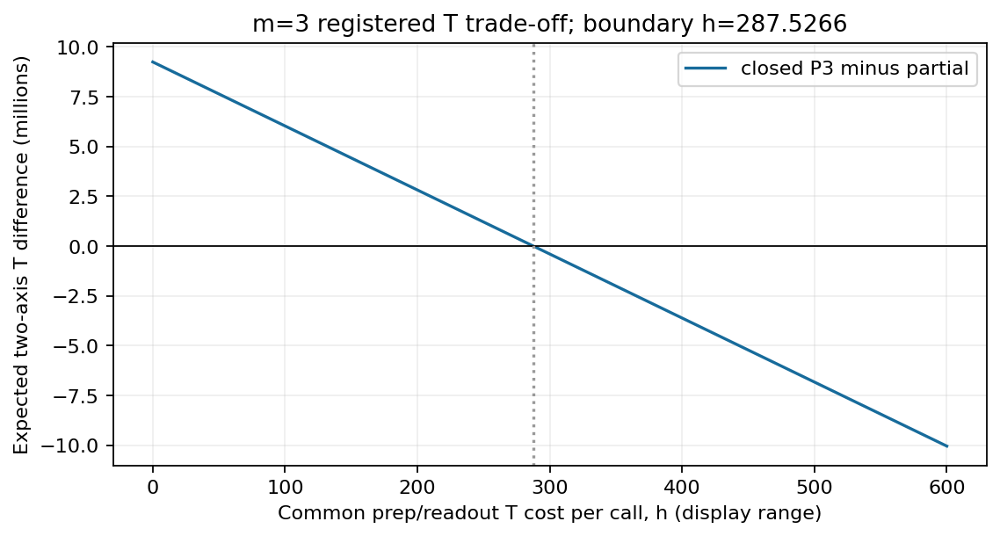
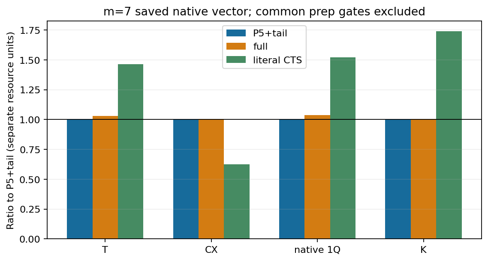
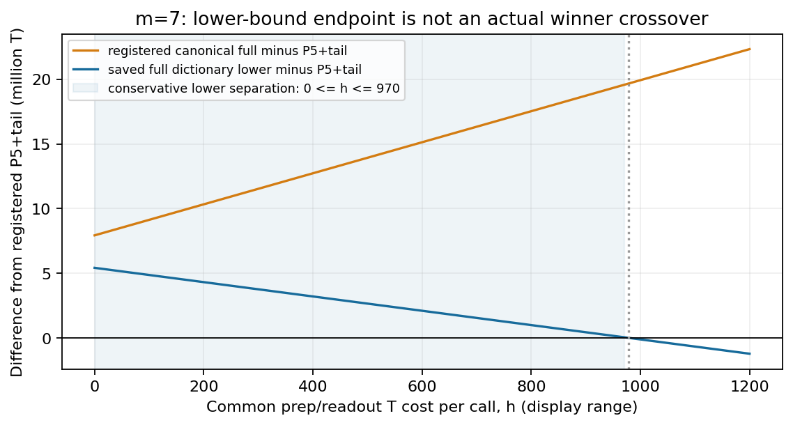

# 有限Taylor operatorのReturn Aggregation：局所構成、有限bit保証と資源評価の条件

技術・方法ノート v1.1 — 2026-10-20 JST

## 要旨

正の有理係数を持つHermitian involutionの線形結合について、同じshort-step有限Taylor operator meanを実現するReturn Aggregation（RA）の構成を記述する。隣接同labelの消去による形式returnを集約し、既知のfree-product Green関数から局所係数を取得する。既存の正値性証明、偶数parentと奇数childのEuler pairing、ordinary envelopeによる量子実行前の棄却を接続することで、全集約normalizerを事前取得せずeventを生成できる。有限bitでは実dyadic proposalを補正weightへ戻し、係数・角度・native実装のbiasを分離し、認証上界から十分な全trial予算を定める。提供precisionの一様な事前十分条件と標準bit費用は、既存F1/F2/F3の到達点として整理する。[E1][E2][MATRIX][F1][F2][F3]

資源評価では、理想normalizer、zero-fillの二次moment、認証十分N、accepted量子呼出し数、native T/CX/1Q、古典setup・online・保存費用を分ける。G7の条件付き正結果、G9/G10の強い低次数対照と固定辞書下界、反証済みP_U、D1–D3の保証・価格依存性を保持する。16,896件Pilotは固定P5入力の古典event生成・監査・保存pipelineの実行証拠であり、実量子shots・一般性能・Full-N実測を与えない。[G7][G9][E4][PU][D3][PILOT]

本稿の成果単位は、既存の構成と保証・実装・限界を一つの方法仕様として記述することである。既知のGreen式、Euler pairing、rejection、importance samplingを新原理とせず、結合全体の独立新規性、普遍的量子資源優位、PR/RPE/QPE全体の改善、投稿GOは認定しない。

**編集上の位置付け。** [v1.0][V10]を保持した独立改訂版である。ユーザー提供の統合レビューを通読して章構成の参考にし、重要な記述は下記の固定証明・SOURCE・結果へ戻して照合した。レビュー原本は非公開のまま保持する。新しい科学レビュー、証明、科学計算、保存値再解析、外挿、ランキング更新は実施していない。変更理由・主張と証拠・未確立事項・handoffは[編集記録](../research/track_b_return_aggregation_method_note_v1_1_20261020/README.md)にまとめる。以下の式(1)–(37)、P5導出・固定G10表はv1.0の既存記述を再掲し、追加節も既存成果の引用に限定する。

## 1. 対象、記号と問い

正の有理数p_i、Σ_i p_i=1、L個のHermitian involution Q_i²=Iを与える。奇数m≥1、有理数xで0<x≤1、σ∈{−1,+1}に対し

\[
R=\sum_{i=1}^{L}p_iQ_i,\qquad
M_m=P_m(-i\sigma xR)=\sum_{n=0}^{m}\frac{(-i\sigma xR)^n}{n!}
\tag{1}
\]

を対象とする。零質量labelは除外でき、x=0はidentityとして別扱いする。問いは、**同じ有限first operator
momentを実現する複数のensembleで、形式returnの集約が生成法とnative資源をどう変えるか**である。
中心構成の等式はこの有限M_mを対象とする。§§6–8のnative比較も同じ有限target内に限定する。
§9.2では別taskとして既存D1–D3のTaylor remainder・積誤差を含むexponential接続を引用するが、
一般の長時間PRやQPEのenergy精度を保証するものではない。

語u=(i₁,…,i_l)に対しQ(u)=Q_i₁…Q_i_l、p(u)=Π_t p_i_tとする。隣接iiを消去して得るreduced wordを
red(u)と書く。「全形式return」はQ_i²=Iだけによるこの消去をすべて含むという意味であり、Pauliの
交換・反交換や別語の物理的な一致まで収集する意味ではない。Q(u)はoperatorの左から右の順序で、
実際のcircuit時間順は逆になる。一般の奇数Q(u)をinvolutionと仮定しない。

|u|を語長、t_n=x^n/n!、χ=Σ_i p_i²、μ_k=Σ_i p_i^kとする。以下でBは係数質量、Zは受理率、Nは一axisの
全試行数、K=2NZは二axesの期待量子呼出し数である。確率/root精度はH_prob/H_rootで表し、Kと区別する。F1/F2のK_rootは同じroot精度H_rootを指す。

本稿では「理想構成」「有限bitの条件付き保証」「固定SOURCEの技術証拠」「未確立の一般化」を区別する。
数学の証明箇所は[E1][E2]、実装対応と既済有限testは[MATRIX]へ戻る。testの一致を一般証明の代用にしない。

coherent-axisの対象はReまたはIm Tr(ρM_m)である。unitaryのglobal phaseもcontrolled枝間の相対位相になる。
従ってensemble channelの一致だけでoperator平均の一致を代用しない。

## 2. 集約係数の成立とparent pairing

P_n(u)=Pr[red(I₁,…,I_n)=u]、I_tはpからのIID labelとする。reductionがparityを保存することから

\[
a_u=\sum_{\substack{|u|\le n\le m\\n-|u|\ {\rm even}}}
(-1)^{(n-|u|)/2}t_nP_n(u),\qquad
M_m=\sum_{u}(-i\sigma)^{|u|}a_uQ(u).
\tag{2}
\]

これは有限Taylorのraw語を同じ形式語へまとめた恒等式であり、語のreorderを必要としない。
位相は(−iσ)^n=(−iσ)^|u|(−1)^((n−|u|)/2)から得る。

### 2.1 Short-step正値性

長さn+2でuへreduceする語は、隣接pairを一つ消去すると長さnで同じuへ戻る。長さnの各語のn+1個の
gapsへiiを挿入するmultisetは対象を覆うため

\[
P_{n+2}(u)\le(n+1)\chi P_n(u),\qquad
\frac{t_{n+2}P_{n+2}(u)}{t_nP_n(u)}\le\frac{\chi x^2}{n+2}\le\frac12.
\tag{3}
\]

P_n(u)=0の場合もcoverからP_{n+2}(u)=0となる。多重生成があるため、最初の不等式を等式と扱わない。
有限alternating sumの最初の二項と一項を下界・上界に取れば、l=|u|に対し

\[
t_lp(u)\left(1-\frac{\chi x^2}{l+2}\right)\le a_u\le t_lp(u),\qquad a_u>0.
\tag{4}
\]

追加項が存在しない末尾でも同じ弱い下界を使える。正値性は0<x≤1という仮定付きであり、x>1へ延長しない。
これは既存のG6証明を本文へ移したもので、数値fixtureの一致を一般証明の代わりに用いていない。[E1]

### 2.2 偶数parentと単一involution回転

偶数長reduced uをparentとする。空parentでは全label、非空parentではi≠first(u)をchild集合C(u)とする。
各奇数reduced語iuは最初のlabelを除けば唯一の偶数suffixを持つので、重複なくpairできる。

\[
s_u=\sum_{i\in C(u)}a_{iu},\quad d_u=\sqrt{a_u^2+s_u^2},\quad
\phi_u=\arctan(s_u/a_u),\quad q(i\mid u)=a_{iu}/s_u,
\tag{5}
\]
\[
V_{u,i}=(-i\sigma)^{|u|}e^{-i\sigma\phi_uQ_i}Q(u).
\tag{6}
\]

Q_i²=Iからcosφ_u=a_u/d_u、sinφ_u=s_u/d_uとなり

\[
d_u\sum_iq(i\mid u)V_{u,i}
=(-i\sigma)^{|u|}a_uQ(u)+\sum_i(-i\sigma)^{|u|+1}a_{iu}Q_iQ(u).
\tag{7}
\]

右辺はparentと全childを一回ずつ再構成する。s_u=0なら純parentを扱う。回転generatorはQ_iだけであり、
一般の奇数語ではない。parentの(−iσ)^|u|=(−1)^(|u|/2)はcontrolled実装で保持する。
Euler pairingの基本原理はordinary RTEにもある。ここで異なるのは、return集約後のparentごとの係数と分布である。
ordinaryの既知samplerは次数とIID labelから生成する。[Wan–Berta–Campbell, Appendix C / Algorithm 2](https://arxiv.org/pdf/2110.12071v2)

## 3. 局所係数queryとglobal normalizerなしの生成

### 3.1 形式級数によるquery

Q_i²=Iだけの形式語はfree product of Z₂のCayley tree上のwalkとして扱える。形式first-passage級数F_iと
root return級数Gは

\[
F_i(z)=\frac{zp_i}{1-z\sum_{j\ne i}p_jF_j(z)},\quad F_i(0)=0,\qquad
G(z)=\frac1{1-z\sum_ip_iF_i(z)},
\tag{8}
\]
\[
\sum_{n\ge0}P_n(u)z^n=G(z)\prod_{t=1}^{|u|}F_{i_t}(z).
\tag{9}
\]

根からuまでの唯一のsimple pathをfirst-passageで通過し、最後にroot return因子を掛ける分解である。
scalar積は可換でもQ(u)の順序は変えない。z=0での形式解を次数順に求めればよく、数値resolventのbranchや
infinite samplingは必要ない。L=1ではF₁=z、G=(1−z²)^−1を含む。

式(8)–(9)は既知free-product Green multiplierのZ₂特殊化である。
[Aomoto–Kato, §1 Eq.(1.6), Lemma 1.1, pp.62–65](https://www.numdam.org/item/AIF_1988__38_1_59_0.pdf)
に対し、同論文のwalk重みをp_i/2、spectral変数をζ=1/zとし、resolventをzで割る対応を使う。
この有限Taylor queryへの対応は本構成側の説明であり、原論文に以下のRTE samplerがそのままあるという意味ではない。

f_i[n]=[z^n]F_i、C[n]=Σ_i p_i f_i[n]とすると

\[
f_i[n]=p_i\mathbf1_{n=1}+\sum_{b=1}^{n-2}f_i[b]\big(C[n-1-b]-p_if_i[n-1-b]\big),
\tag{10}
\]
\[
G[0]=1,\qquad G[n]=\sum_{a=1}^{n-1}C[a]G[n-1-a].
\tag{11}
\]

低次数から全iを求めC[n]を共有する。一つのparentの式(9)をm次までconvolveし、childにはcached parent
seriesとF_iを掛けることで、a_uと全a_iuを局所取得する。過去語を蓄積して全辞書を作る必要はない。

### 3.2 Ordinary envelopeと一試行の手順

偶数l≤m−1についてb_l=√(t_l²+t_(l+1)²)、B_ord=Σ_l b_lとする。式(4)から

\[
d_u\le b_lp(u),\qquad
B_{\rm full}:=\sum_{u\ {\rm even,reduced}}d_u\le B_{\rm ord},\qquad
A_u:=\frac{d_u}{b_lp(u)}\ge\frac1{2\sqrt2}>\frac14.
\tag{12}
\]

次のideal手順が指定した集約ensembleを生成する。

1. lをb_l/B_ordで選び、長さlのraw IID語をpから得る。
2. raw語に隣接同labelがあれば、その試行をzeroとする。reduce先の別parentへ再配分しない。
3. reduced parent uなら式(8)–(11)をqueryし、A_uで受理する。拒否はzeroとする。
4. 受理後、iをa_iu/s_uで選び、位相を保持したV_u,iを用いるaxis Hadamard測定Y∈{−1,+1}を行う。
5. 受理時X=B_ord Y、その他X=0とし、**全試行数**を分母に平均する。

Pr(u accepted)=d_u/B_ordとなるので

\[
Z=\frac{B_{\rm full}}{B_{\rm ord}},\quad
E[X]=\operatorname{Re}\text{ or }\operatorname{Im}\operatorname{Tr}(\rho M_m),\quad
E[X^2]=B_{\rm ord}B_{\rm full},\quad |X|\le B_{\rm ord}.
\tag{13}
\]

既知B_ordだけでweightを付けられ、B_fullの全列挙取得は不要である。ただしaccepted-only平均では式(13)にならない。
empty-parentからZ≥(1−χx²/2)e^−x≥1/(2e)を得る。拒否を含む古典処理も課金する。
m≥3,x>0ではempty-parentの上界がstrictになるためideal B_full<B_ordだが、native総費用の改善は従わない。

ZeroFillとDiscardのnormalization区別は既知である。
[Cugini–Atif–Subaşı, §IV.1–IV.2](https://arxiv.org/html/2603.13495v1)
のプロトコルと区別して、ここでは量子実行前の局所classical coinを用いる。

### 3.3 未知Zを予算へ無料利用しない

axisの残余誤差幅s>0、failure αに対するBernstein十分予算は、認証済みZ_+を用いて

\[
N\ge\left\lceil\log(2/\alpha)
\left(\frac{2B_{\rm ord}^{2}Z_+}{s^2}+\frac{4B_{\rm ord}}{3s}\right)\right\rceil.
\tag{14}
\]

追加情報なしならZ_+=1である。G10のlocal fullは全B_fullではなく、rootとraw-reduced質量から得る上界Uを使う。
raw-reduced長lの質量r_lはv_i(1)=p_i、v_i(l)=p_i(Σ_jv_j(l−1)−v_i(l−1))、r_l=Σ_iv_i(l)で求まり

\[
B_{\rm full}\le U=d_\emptyset+\sum_{l=2,4,\ldots,m-1}b_lr_l\le B_{\rm ord}.
\tag{15}
\]

root intervalとr_lのO(Lm)処理による上界であり、全parentのnormalizerではない。
finite-bit版では式(18)の丸め係数を戻す。exact signalやreference B_fullを使ったshot削減は行わない。

### 3.4 二次momentと量子実行費用を分ける

式(13)の二次momentは一つの**全古典trial**の値である。B_fullを既知として正規化したideal ensembleの一量子callの二次moment B_full²とは、試行単位が異なる。zero-fillでは拒否時に量子測定を行わず、N全trialのideal期待量子call数はNZ、二axesならK=2NZとなる。従ってB_ord B_fullが大きいという一項だけで、総量子費用の一般的な不利を結論できない。逆に、拒否が量子前であることから無料・完全同価とも言えない。[E1]§8、[W2C]

未知B_fullの代わりにUを使う認証予算では、式(14)のmoment項はB_ord Uに基づく。B_full²をそのまま実行予算に使った評価とは異なる。ceil、range、bias控除、confidenceと、event依存の量子単価・古典棄却費用を残す。digital受理率をideal Zと同一視せず、期待NZを実現accepted数やhard capと呼ばない。§6のKは保存された実proposalからの期待値であり、Pilotの観測件数とは別である。[MATRIX] M7–M10、[W2B][W2C]

## 4. 有限bitの平均、bias、input/accessと計算量

### 4.1 実proposalと補正weight

ideal b_l、d_u、φ_uは一般にirrationalであり、有限bitのexact samplerとは区別する。既存構成では、order・label・
acceptance・childの各確率をfull-support dyadic値へ丸める。有理近似d̃_uを使い

\[
\pi_{u,i}=h_l\prod_{j\in u}h_j\,h_Ah_{i\mid u},\quad
\widetilde\alpha_{u,i}=\widetilde d_u\frac{a_{iu}}{s_u},\quad
\widetilde W_{u,i}=\frac{\widetilde\alpha_{u,i}}{\pi_{u,i}}.
\tag{16}
\]

実際のπをweightへ戻すためπ W̃=α̃はexact rationalで成立する。zero試行も全試行数へ含める。
angleをidealのまま考えた平均はM̃=Σα̃Vであり、一般には元のM_mへのexact一致ではない。
確率丸めの補正と、係数・angle近似のbiasを分ける。

各dyadic massがidealの(1±η)内、|d̃_u−d_u|≤ρd_u、0<η,ρ<1なら、l≤m−1より

\[
\pi_{u,i}\ge(1-\eta)^{l+3}\alpha_{u,i}/B_{\rm ord},\quad
|\widetilde W|\le\frac{(1+\rho)B_{\rm ord}}{(1-\eta)^{m+2}},\quad
\|\widetilde M-M_m\|\le\rho B_{\rm full}\le\rho B_{\rm ord}.
\tag{17}
\]

pure-parentにchild因子がない場合もこの保守的上界を使える。digital second momentをideal値と同一視せず

\[
E[\widetilde X^2]\le\kappa B_{\rm ord}U,\qquad
\kappa=\frac{(1+\rho)^2}{(1-\eta)^{m+2}}
\tag{18}
\]

を使える。UなしならB_ordを代入する。B_ord≤e^x<3から、global norm取得なしにrangeとbiasも保守的に認証できる。
native event近似V̂_eに||V̂_e−V_e||≤δ_eがあれば、operator mean差は

\[
\|\sum_e\widetilde\alpha_e\widehat V_e-M_m\|
\le\rho B_{\rm ord}+\sum_e\widetilde\alpha_e\delta_e
\tag{19}
\]

以下である。測定task固有のbias係数は別に定める。controlled phaseを捨てたprojective errorでは代用しない。

### 4.2 Boundedな確率・root構成

short-stepではorder質量≥t_(m−1)/3、label≥p_min、valid-parent acceptance>1/4、存在するchild質量≥p_min/2、
d_u≥t_(m−1)p_min^(m−1)/2という下界がある。各inverseのlogは入力bit長とmに多項式で抑えられる。
従って指定η,ρに対し、相対精度を満たす有限precisionの選択が可能である。[E2]

既存実装はinteger isqrtから分母2^H_rootのoutward root区間を一回構成し、midpoint normalizationと
largest remaindersでdyadic massを作る。各massがq̃≥(1−η)q_hi、q̃≤(1+η)q_loを満たすことを検証する。
acceptanceは下向きに丸める。precision不足ではfail closedし、sampler retryやランダムなbit追加を行わない。

固定H_prob=160/H_root=256が任意入力で十分とは主張しない。一般のprecision選択可能性と、固定precisionの
prototypeで不足時に停止する仕様は別である。random bit interfaceの決定的mappingを実装したことも、
物理量子shotsや統計精度の実験を行ったこととは異なる。

角度も別に有限precision化する。式(4)/(12)からr=s_u/a_u≤2x/(l+1)≤2である。
φ=2 atan[r/(1+√(1+r²))]の内部引数は2/3未満なので、outward root区間とalternating atan級数の次項上界で
角度を囲める。必要項数はlog(1/τ)に多項式で、involution回転のangle誤差τはstrict operator差τ以下に戻せる。
これは係数/角度の数理処理可能性であり、native列のT価格やonline取得時間の保証ではない。[E2]

### 4.3 計算量と必要なoracle

| 処理 | 一般local構成の算術量／保持量 |
| --- | --- |
| F_i/Gのm次前処理 | O(Lm²) rational operations、O(Lm)係数 |
| 一parentと全childのquery | O(m³+Lm²) rational operations |
| raw語の隣接判定 | O(m)、語状態O(m log L) bits |
| root・確率・係数 | 入力bit長、m、log(1/η)、log(1/ρ)を含むprecision費用 |
| native取得・古典sampling | 上の係数算術に含めず、別に課金 |

pの総bit長H_p、xのbit長H_x、D=lcm denominator(p_i)とするとlogD≤H_p。確率級数n次は分母D^nで表せる。
a_uの分母はD^m den(x)^m m!を割り、係数bit長はO(m(H_p+H_x+logm))となる。
rational operation数はbit operation数・実時間ではない。mの数値に多項式という記述をlogmへの多項式性と読み替えない。

必要なaccessはpの明示table、controlled Q_i、signed controlled exp(−iσφQ_i)、位相・strict error・workspace・
native費用の証拠である。system-only Q_iからcontrolled oracleが無料に得られるとはしない。
φ_uは語長だけで決まらず、label構成にも依存する。非列挙の係数生成から、O(m)種類の合成角度、安いonline synthesis、
DF取得費用優位は従わない。G6時点のnative未接続と、後のG9/G10の小さい明示provider接続を区別する。

### 4.4 一様な事前精度仕様とF3実装

§4.2の「精度を選択可能」という既存lemmaは、F1で**提供された**H_prob/K_rootへの事前十分条件に具体化されている。全parentを訪問した後のguard成功を一般保証とする仕様ではない。n_o=(m+1)/2、t_min=x^(m−1)/(m−1)!、p_min=min p_i、d_min=t_min p_min^(m−1)/2、Δ=2^(−K_root)、h=2^(−H_prob)とする。F1の共通受入述語R(ζ,q_min)は次の既存不等式である。[F1]§§2–4

\[
0\le\zeta<1,\qquad
\frac h{q_{\min}}\le\frac{1-\zeta}{1+\zeta}-(1-\eta)(1+\zeta),\qquad
\frac h{q_{\min}}\le(1+\eta)(1-\zeta)-\frac{1+\zeta}{1-\zeta}.
\]

| 条件 | 全到達valid parentを扱うF1の既存仕様 |
|---|---|
| P0 domain | exact rational入力、正p、odd m、short step、η/ρ、正整数precision、合法helper呼出し、外部fresh independent uniform bitsの仮定 |
| P1 order | e=n_oΔ<1、a=Δ/t_min、ζ_o=(a+e)/(1−e)、R(ζ_o,t_min/3) |
| P2 label/child | h≤ηp_min、h≤ηp_min/2。存在しないchild lawは要求しない |
| P3 coefficient | Δ<d_min、Δ/2≤ρ(d_min−Δ) |
| P4 acceptance | Δ<1/4、(2−η)Δ+h≤η/4 |
| P5 identity/law | 同じinput/source/policyと実order・label・child law、bit幅・mappingを結び、x=0を独立分岐する |

この表はF1の再掲であり、新しい十分定数・selector・証明ではない。固定bit数がすべての入力で通るという主張もない。canonicalの有限group/root/conditional lawは別条件を持ち、Fullのchild下界を無断で転用しない。[F1]§5

F3ではFull用のexact入口、P0–P5の評価・実lawへの結合、identity、terminal failureの分類・証拠保持、既存half-angle/atan級数によるangle enclosureが実装され、既済63人工testの技術記録がある。後続Pilotは固定入力における実G7/F3接続を記録する。[F3][PILOT] これはF1/F2を「未完成の一般理論」へ戻す理由にはならず、任意入力での実用成功・物理provider認証へ拡張する理由にもならない。

正当なraw-nonreduced/coin rejectだけをzero-fillに含める。precision不足、不正入力、source/law不一致、保存障害はterminal failureとしてprefixと原因を保持し、zeroに読み替えない。未完了prefixや完走したrunへの事後conditioningに、全N完了時のconfidenceを移さない。H/K selector、再試行、物理RNG、全trial測定器、一般native providerはF3の完成範囲外である。元F3のcanonical非identity未対応と、後続Pilotのcanonical監査経路を区別する。[F1][F3][PILOT]

### 4.5 標準bitモデルと全trial費用

F2は§4.3の有理演算数を、GCD正規化・整数root・sort・law検査と線形selector・weightのbit長へ接続した既存の静的会計である。b-bit有理演算にQ(b)=O((b+1)³)、rootにR(b,K_root)=O((b+K_root+1)³)という保守的標準課金を用い、CPU秒の上界とはしない。[F2]§§1–3。科学コードの実行で取得したscaling曲線でもない。

| 費用の層 | 既存SOURCEに対して残す処理 |
|---|---|
| setup | O(Lm²)係数処理に加え、Fullでは3n_o回のroot、Uのroot/DP、order/label law、preflight・budgetの別項 |
| raw-zero | orderと各labelの毎回のlaw検査・線形走査、raw判定、bit供給 |
| coin-zero | raw処理に局所parent/child、2 root、child-law構築・sort、coinを加える。child-lawはcoinより前に作る |
| accepted | 以上にchild選択、実π・係数・weight・Counter/event、必要なangle/監査を加える |
| 実装固有の再計算 | Parent.sのchildごとの再sumによるO(L²)項、F3のhash/serialization・angle時event再queryを省かない |
| 保存・memory | generatorの係数個数とpeak bit領域を分け、全Nの出力形式・保持量・I/O/accumulatorを別項にする |

F2は係数bit長に加え、実πの最大(m+2)H_prob bitとweight長、通常算術・sortを含む条件付き費用を具体化している。現selectorにないalias table、過去全parentのcache、無料のchild sumを仮定しない。canonicalにはGreen不要の実経路と同等の合法最適化機会を与える。1trialの多項式性を、binary長log mだけの多項式性や、必要N・全出力・物理oracle込みの一様実時間保証へ移さない。[F2]§§4–9

## 5. P5のclosed少数群構成

P5のeven parentは長さ0,2,4である。t_n=x^n/n!とχ,μ₃,μ₄,μ₅から、rootは

\[
a_0=1-\chi t_2+(2\chi^2-\mu_4)t_4,
\tag{20}
\]
\[
a_i=p_i\{t_1-(2\chi-p_i^2)t_3+
(5\chi^2-4\chi p_i^2+2p_i^4-2\mu_4)t_5\},\quad s_0=\sum_i a_i.
\tag{21}
\]

ordered pair u=(j,k)、j≠kには、scalar

\[
A_{jk}=t_2-(3\chi-p_j^2-p_k^2)t_4,
\tag{22}
\]
\[
b_i^{jk}=\begin{cases}
p_i\{t_3-(4\chi-p_i^2-p_j^2-p_k^2)t_5\},&i\ne j,\\0,&i=j,
\end{cases}
\tag{23}
\]
\[
S_{jk}=(1-p_j)t_3-
\{(1-p_j)(4\chi-p_j^2-p_k^2)-(\mu_3-p_j^3)\}t_5
=\sum_i b_i^{jk}
\tag{24}
\]

を用い、a_jk=p_jp_k A_jk、a_ijk=p_jp_k b_i^jk、d_jk=p_jp_k√(A_jk²+S_jk²)とする。
angle tangentはS_jk/A_jk、child lawはb_i^jk/S_jkである。

長さ4のreduced uでfirst(u)=jなら

\[
a_u=t_4p(u),\quad a_{iu}=t_5p_ip(u)\ (i\ne j),\quad
d_u=p(u)\sqrt{t_4^2+(1-p_j)^2t_5^2},\quad
\tan\phi_u=x(1-p_j)/5.
\tag{25}
\]

このangleとroot因子はfirst labelだけに依存する。h_j(0)=1、h_j(r)=Σ_(k≠j)p_k h_k(r−1)とし、
r_j^(4)=p_jh_j(3)=Σ_(|u|=4,first(u)=j,reduced)p(u)を得る。normalizerは

\[
B_5=d_0+\sum_{j\ne k}p_jp_k\sqrt{A_{jk}^2+S_{jk}^2}
+\sum_jr_j^{(4)}\sqrt{t_4^2+(1-p_j)^2t_5^2}.
\tag{26}
\]

群数はroot 1、ordered pair L(L−1)、first-label Lで高々L²+1である。L=1では非root群を省く。
同じideal P5 ensembleを全child表なしで生成する具体的な特殊化であり、汎用器をm=5で呼ぶだけではない。
各存在群の係数正値性とangle/child正規化の非零性は§2のshort-step証明から従う。

### 5.1 生成手順

1. 式(26)の各群質量を構成し、B5で正規化して群を選ぶ。
2. root群なら空語、pair群なら指定(j,k)をparentとする。
3. first-label j群ならjから始める。残りr個の語の次label k≠previousをp_k h_k(r−1)/h_previous(r)で選ぶ。
   長さ4まで繰り返すと、群内のparent lawはp(u)/r_j^(4)となる。
4. root/pairのchild lawは式(21)/(23)を正規化する。長さ4ではi≠jをp_i/(1−p_j)で選ぶ。
5. 式(6)のunitaryを生成する。ideal coefficient samplerではweight B5、finite-bit版では実proposalで補正する。

finite-bit版は各**群質量**をoutward rootで囲み、有理midpointをideal群内比率へ掛けたtarget係数を用いる。
その係数を丸め済みの群・word・child proposalで割る。群ごとのrelativeρをL1で足せばbias≤ρB5となる。
一般local器とideal ensembleは同じでも、finite rational係数までbyte-exact同一である必要はない。

### 5.2 根拠と計算量

reduced長lの語に一pairだけ挿入する場合、triple同labelの重複を各文字位置で引くと

\[
P_{l+2}(u)=p(u)\{(l+1)\chi-\sum_{t=1}^{l}p_{i_t}^{2}\}.
\tag{27}
\]

式(3)の一般挿入上界とは異なり、この一returnの場合は重複を補正した等式である。
walk再帰からP₂(empty)=χ、P₃(i)=p_i(2χ−p_i²)、P₄(empty)=2χ²−μ₄、
P₅(i)=p_i(5χ²−4χp_i²+2p_i⁴−2μ₄)を得る。これらと式(27)を式(2)へ代入すれば式(20)–(25)となる。
G9の既存導出と凍結sourceに対応しており、今回新しいGreen evaluatorや数値checkerを動かしていない。[E3]

群構築はO(L²) rational operations、DPはr≤3のO(L)状態に対するO(L²)処理である。
μ₃の共有により各S_jkをO(1)で求め、(j,k,i)全表を作らない。word/childの各local conditionalはO(L)。
これは**群index選択も含む全実行時間がO(L)という主張ではない**。現`dyadic_index`は群lawの線形scanで、
群数がO(L²)ならそのlookupもO(L²)になり得る。root精度・有理bit量・native合成費用も別である。
群数から古典実時間優位を推測しない。

## 6. 固定nativeモデルとconfidence会計

### 6.1 入力、同じtarget、実装範囲

以下§6–8はv1.0のG10比較契約と保存結果を保持する節である。G7、D系列、Pilotへ同じconfidence/providerを無条件に移さない。[E4]

比較例はp=(1/5,3/10,1/2)、x=5/7、σ=+1、m∈{3,5,7}、3 system qubitsに固定する。

\[
Q_0=Z_0,\quad V_1=R_{XX_{01}}(\pi/4),\quad
V_2=R_{XX_{12}}(\pi/4)R_{ZZ_{01}}(\pi/4),\quad Q_i=V_i^\dagger Z_iV_i,
\tag{28}
\]

R_P(θ)=exp(−iθP/2)とする。追加関係を使わず形式集約を実装できるが、このproviderではPauli展開も明示取得可能なI1文脈である。
I0しか使えない実問題、分子geometry/chemistry basis/DF rank/split L_Dへの優位を実証した条件ではない。

ordinary、partial return、closed P3＋tail、local full、closed P5、matched CTSを各mの同じfull finite P_m内で比較する。
closed P5はm=5では式(26)、m=7ではP5部分とordinary n=6/7 tailを組み合わせる。
「partial_return_tail」はrootのidentity-returnの一部を吸収した既存armであり、式(2)の全形式returnではない。
m=3のP3はP5の式をt₄=t₅=0で切ったroot、pair部分に対応する。
次数間を等exponential精度のランキングにしない。

matched CTSは同じ有限多項式の実・虚部分をPauli収集し、odd側を単一回転へpairするfinite specializationである。
real correctionのidentityを含むevent、T=0 eventも保持する。
[Peetz–Smart–Narang, Theorem 1 / Supplementary Note 5](https://arxiv.org/html/2407.21095v2)
の構成へ対応するliteral実装で、CTS family内の全最適化法ではない。

全方式に同じdirect V†–controlled Pauli rotation–Vを許し、controlled parent位相、signed rotation、actual adjointを保持する。
CZ→H CX Hとadjacent inverse cancellationを共通適用し、literal native列のT/T†・CX・1Qを数える。
providerのπ/4列はこのClifford+Tモデルでexact、δ_provider=0。system-only oracleを無料のcontrolled oracleへ置き換えない。
全回路の大域最適compileや最良synthesizerの結果ではない。追加workspaceは外側ancilla 1である。

### 6.2 四つの誤差を分ける

| 対象 | 本ノートでの扱い |
| --- | --- |
| finite Taylorとexponentialとの差 | 今回の比較task外。各方式は同じP_mを対象とする |
| finite-bit coefficient mean bias | 共通上界8ρに含める |
| strict controlled native error | Rz一primitive ε_Rz=10⁻⁶、event composition≤2ε_Rz、up_to_phase=false |
| statistical error | bias控除後のsに共通Bernstein十分予算を適用 |

H_prob=160、H_root=256、η=ρ=10⁻¹²。全representationにB<8を用い、共通coherent biasは

\[
b_{\rm coh}=2\{8\rho+8(1+\rho)2\epsilon_{Rz}\},\qquad
s=1/200-b_{\rm coh}>0.
\tag{29}
\]

保守的なfactor 2を含む固定taskの会計である。float matrix tolerance 10⁻¹⁰はphase・順序診断用で、
認証biasの代わりに用いない。exact signalは資源予算を縮めるために使わない。

### 6.3 十分shots、期待費用、tail/hard上限

M₂,+とW_+を既知のsecond-moment/range上界とすると

\[
N=\left\lceil\ell_+\left(2M_{2,+}/s^2+4W_+/(3s)\right)\right\rceil,
\quad\ell_+\ge\log(2/\alpha_{\rm axis}),\quad\alpha_{\rm axis}=49/34000.
\tag{30}
\]

local fullは式(18)のB_ord,Uのoutward上界を使う。closed P5は少数群normalizer、CTSはcollected I1 normを使う。
referenceのZやsecond momentを未知情報としてlocal予算に注入しない。
34α_axis=49/1000、各rowのresource failure β=1/17000、17β=1/1000で、全failure合計1/20となる。

保存されたevent proposal π_eとnative価格C_eについて

\[
Z=\sum_e\pi_e,\quad K=2NZ,\quad
C_{0,j}=2N\sum_e\pi_eC_{e,j},\quad
G_j(h_j)=C_{0,j}+Kh_j\quad(j=T,CX,1Q).
\tag{31}
\]

h_j≥0は共通prep/readout単価で、結果後に都合のよい単価を選んで勝者を固定しない。
native 1QにはTも含まれ、Tと1Qを独立費用としてそのまま加算しない。共通外側1Qの保存fieldも別であり、
表のnative切片に勝手に混入しない。

二axesの全試行M=2N、受理率上界Z_+、t_resource=10に対し、登録accepted-call capは

\[
C_{\rm acc}=\min\{M,\lceil MZ_++\sqrt{2MZ_+t_{\rm resource}}+2t_{\rm resource}/3\rceil\}.
\tag{32}
\]

rootをoutward評価し、Z_+=1ならMとする。exp(−10)<1/17000でresource failureを課金する。
期待費用C0、accepted-tail上限C_acc max_eT_e、hard上限2N max_eT_eは別量である。
実際にN回の量子shotsを実行した結果ではなく、固定confidence taskの十分資源会計である。

## 7. 既存native比較の結果

### 7.1 全17行の表示表

以下は凍結済み保存有理数の表示のみで、全数値を百万単位、小数6桁へ丸めている。再最適化・再classificationではない。
正確なN、normalization、Z、moment/range、tail/hard costと資源係数は付録Cのexact tableにある。
row 0–5は既存G9 native値を共通34-axis予算へ戻したG10 anchorであり、G9原結果自体は不変である。

| row | m | 方式 | T切片 / 10⁶ | CX切片 / 10⁶ | native 1Q切片 / 10⁶ | K / 10⁶ |
| ---: | ---: | --- | ---: | ---: | ---: | ---: |
| 0 | 5 | ordinary | 371.085420 | 21.904736 | 996.749433 | 2.651626 |
| 1 | 5 | partial_return_tail | 275.437399 | 16.998103 | 731.603229 | 2.019804 |
| 2 | 5 | closed_P3_tail | 284.749630 | 17.095837 | 734.643184 | 1.987402 |
| 3 | 5 | full_return | 273.991326 | 16.756376 | 692.820724 | 1.964236 |
| 4 | 5 | closed_P5_full | 272.239831 | 16.649261 | 688.391854 | 1.951680 |
| 5 | 5 | matched_CTS | 387.633441 | 10.391732 | 968.944321 | 3.396808 |
| 6 | 3 | ordinary | 365.035172 | 21.419239 | 980.769210 | 2.613128 |
| 7 | 3 | partial_return_tail | 270.220208 | 16.572049 | 717.894571 | 1.986222 |
| 8 | 3 | closed_P3_tail | 279.459012 | 16.670105 | 720.920647 | 1.954090 |
| 9 | 3 | full_return | 279.999178 | 16.702326 | 722.314113 | 1.957867 |
| 10 | 3 | matched_CTS | 400.847851 | 10.470333 | 1036.410493 | 3.429708 |
| 11 | 7 | ordinary | 371.179562 | 21.914206 | 996.997917 | 2.652280 |
| 12 | 7 | partial_return_tail | 275.518709 | 17.006422 | 731.816636 | 2.020376 |
| 13 | 7 | closed_P3_tail | 284.832047 | 17.104130 | 734.856468 | 1.987968 |
| 14 | 7 | full_return | 280.249068 | 16.756533 | 715.218431 | 1.964243 |
| 15 | 7 | closed_P5_tail | 272.320319 | 16.657452 | 688.598158 | 1.952240 |
| 16 | 7 | matched_CTS | 399.058971 | 10.392764 | 1048.816689 | 3.397242 |

### 7.2 一般fullの追加registered T利益

各mのclosed対照に対するfullの差は次の通り。

| m | 同次数の対照 | fullのT切片増加 | fullのK増加 |
| ---: | --- | ---: | ---: |
| 3 | closed P3 | 約0.19329% | 約0.19329% |
| 5 | closed P5 | 約0.64336% | 約0.64336% |
| 7 | closed P5＋tail | 約2.91155% | 約0.61484% |

保存されたexact差はどちらも正なので、登録canonical fullのT費用は各比較で全h≥0にわたり大きい。
m=3/5のfullとclosedは同じideal ensembleを共有するが、local envelopeと少数群normalizerの予算会計が異なる。
m=7のP5＋tailとfullは異なるensembleであり、追加return集約のnative価値を判別する。
一般fullが全入力・全backendで不要という結論にはならない。

### 7.3 準備単価、root価格と別資源trade-off

m=3ではpartial returnはT切片が低く、closed P3はKが低い。二affine式の登録境界はh≈287.5265937973である。
この境界は保存費用の感度で、どのhを採用すべきかという判断を含まない。



図1：closed P3−partialの登録T費用差。0–600は既存affine式の表示範囲で、新しい科学条件ではない。

m=7の空parentでは、P5＋tailのtangentが2189372/2921709、fullが9011383315/12025404923となる。
保存native Tは各childで[136,138,140]から[140,142,144]へ変化し、rootは受理回路の約87.8%を占める。
追加集約が頻出回転の合成価格も変えた具体例であり、全費用差の一意の原因帰属とはしない。

P5系はliteral CTSとordinaryに対する登録T利益を保つ。一方m=7のCX切片はCTS約10.393百万、P5＋tail約16.657百万。
共通prep CX単価gを含む境界は約4.3354181512である。全資源をstrictに支配するとの主張ではない。



図2：P5＋tailに対するT、CX、native 1Q、Kの比。共通prep gateを加えていない別座標であり、座標間を足さない。
登録P5のT利益はCTS family全体への優位ではない。

## 8. 固定辞書・同じpolicyでのsampling-only限界

固定positive event係数a_e、unitary V_e、native T価格T_e≥0、合成列・precision、残余誤差s、failure αを保つ。
任意full-support proposal q_e>0、Σq_e≤1について、残りを量子実行前のzero trial、weightをa_e/q_eとする。

\[
M_2(q)=\sum_ea_e^2/q_e,\qquad C(q;h)=\sum_eq_e(T_e+h),\quad h\ge0.
\tag{33}
\]

Cauchy–Schwarzから

\[
M_2(q)C(q;h)\ge\left(\sum_ea_e\sqrt{T_e+h}\right)^2.
\tag{34}
\]

これは既知cost–moment関係の固定辞書版であり、新しいimportance-sampling最適化定理ではない。
[Cugini–Atif–Subaşı, Theorem 1, Eqs.(9)–(10)](https://arxiv.org/html/2603.13495v1)
を参照する。T_i,T_j,h≥0なら

\[
\sqrt{(T_i+h)(T_j+h)}\ge\sqrt{T_iT_j}+h,
\tag{35}
\]

両辺の二乗の差はh(√T_i−√T_j)²≥0である。式(34)の二重和へ式(35)を適用し、Bernstein十分予算の
正のrange項とceilingを落とせば、二axes費用について

\[
G(q;h)\ge\frac{4\log(2/\alpha)}{s^2}
\left[\left(\sum_ea_e\sqrt{T_e}\right)^2+h\left(\sum_ea_e\right)^2\right].
\tag{36}
\]

zero-T eventも係数質量とsamplingに含める。保存sourceはroot/logの下側有理近似を使うため、式(36)を保守的に
評価している。最適proposalを構成したり、ゼロ価格eventを捨てて等号達成を主張したりはしていない。[E5]

### 8.1 具体的なm=7分離

保存full下界と登録P5＋tail予算の差は、表示値で

\[
L_F(h)-G_{P5+tail}(h)\simeq5,415,782.443240-5,537.20852461h.
\tag{37}
\]

正確な有理差は0≤h≤970で正、h=970でも約44,690.174365 Tの余裕がある。約978.0708852063は
下界による分離端点であり、実行可能lawのwinner crossoverではない。それを超えるhで改善例が存在することも示さない。
canonical fullの不利は別のT/K両正差から全h≥0で残る。



図3：P5＋tailを基準とする二種類の差。青線は保存された全proposal下界、橙線は登録canonical費用。
青線の端点は実際のwinnerの反転を意味しない。0–1200は既存式の表示範囲である。

m=5/7のliteral CTS固定辞書下界と登録P5系の差も、保存fieldの切片・prep slopeとも正で全h≥0に分離される。
これはcanonical順位表より強い、特定比較クラスの限界である。root/log下界の再生成やproposal探索はこのノート作成時に行っていない。

### 8.2 比較class外と一般化の限界

式(36)は、辞書、native価格、precision、bias、残余幅、failure配分、十分予算policyを固定したclassの費用下界である。
物理的な最低shot数、state-dependent最適推定、あらゆる量子queryの下界ではない。別辞書・event統合・合成列/precision変更・
別推定法はclass外である。m=7の分離をm=3/5や別入力へ一般化しない。

同じfinite target・比較可能なnative実装における一事例は、「係数質量またはsupportが小さければnative総費用も必ず減る」
という普遍的含意を支持しない。しかし改善/悪化の一般頻度、別装置での傾向、PR全体の費用を推定する根拠にはならない。
費用とmomentを同時に考える原理自体を初めて発見したとは主張しない。

## 9. G7–G10とD1–D3：同じ尺度に戻せる範囲

### 9.1 G7の条件付き正結果とG8の実装経路

G7は一般involutionのexact controlled-Qをqueryとして与え、label別provider価格と準備/readoutを非負変数に残す。helper compute–rotate–actual-adjoint uncomputeのCQ2/H4/Rz2/CX2、outer位相、workspace2を保持し、Rz primitiveだけを取得した。G10のdirectな明示3-qubit providerとは異なる。既知development P5、p=(1/5,3/10,1/2)、x=5/7、m=5、H_prob=160/K_root=256、η=ρ=10⁻¹²、strict Rz誤差10⁻⁶、各axis ε=1/200、16 axes familywise≤1/20という元条件で、次の既存値を引用する。[G7]

| G7 P5方式 | N/axis：全trial（未実行） | 二axesの期待accepted量子calls | 取得RzのT切片 |
|---|---:|---:|---:|
| ordinary | 1,174,526 | 2,349,052 | 321,659,736.670 |
| partial+tail | 894,664 | 1,789,328 | 238,505,280.446 |
| closed P3+tail | 880,312 | 1,760,624 | 246,677,716.207 |
| general full | 1,014,322 | 1,740,102.129 | 237,260,558.660 |

これは物理providerを費用0に置いた表ではない。元結果ではFull−各対照のRz切片、label別CQ係数、準備係数がすべて負であり、この条件付き加法的Tモデルでは全非負provider/preparation価格でFullが登録3対照より低い。一方P3_control（別p/x/m）ではFullはclosed P3を上回る。P5 Fullのhard capは2,028,644でclosed P3の1,760,624より大きく、期待callsの順序と異なる。実測量子shotsは0である。[G7]

G8は同じ既知P3/P5を用い、局所生成からlive Rz miss取得・cache・signed actual-adjoint IRへ接続した。2,048 interface trials、20 unique positive keysの記録であり、全support・全角度の網羅、独立再現、物理controlled-Qの達成証拠ではない。仮想provider誤差δを加えた別confidence/accepted-tail予算であるため、G7やG10のNへ混入しない。短いCPU traceを一般的classical scalingとしない。[G8]

G9は同じ有限P5に対し、同じideal ensembleのclosed P5特殊化とmatched CTS、明示providerのnative価格を導入した。G10は同次数対照をm=3/5/7へ揃えた。§7–8の結果は、弱い対照へのG7正結果を取り消すものではなく、より強い対照・異なる実装と予算の下で一般Fullの追加利益が残らない事例である。CTSにも非列挙layer samplingがあり、literal matched CTS一構成へのT利益をCTS family全体への勝利としない。[G9][E4][P4]

### 9.2 D1–D3の共通exponential task

G系列の同一finite operator比較と違い、D1–D3は共通exponential targetへ戻す誤差会計を持つ。既知3-system-qubit synthetic provider、p=(1/5,3/10,1/2)、総時間τ=5/7、σ=+1、state=000、finite P5(−iτR/r)^r、r=1,2、六方式、H160/K256、η=ρ=10⁻¹²、native primitive誤差10⁻⁶に限定される。分子geometry/basis/DF rank/split L_Dは該当しない。各ledgerのfailure familyを他系列や四ledger全体へ合算した同時保証にはしない。[D1][D2][D3]

- **D1**は非unitary finite meanの積とTaylor/native/coefficient誤差、十分N、accepted費用を同じtaskへ接続した。単に一step価格をr倍した会計ではない。
- **D2**は旧law/N/bias/価格を保ったr=2の全六方式に、保存IRの共通境界相殺を適用した。新しい平均や保証を得た実験ではない。
- **D3**は保証G0/G1と価格P0/P1の四ledgerを分けた。保証変更は残余幅と十分Nを、価格変更はnative event単価を変える。小さい誤差上界を、物理実誤差の新しい低下と呼ばない。

以下はD3の既存選択表の引用で、新しいmin検索・順位計算ではない。[D3]

| D3 ledger | h=0・全12構成で保存されたT最小 | primary partial/P5内の保存選択 |
|---|---|---|
| G0_P0 | r2 P5 | r1 partial と r2 P5 |
| G1_P0 | r1 P5 | r1 partial と r1 P5 |
| G0_P1 | r2 P3+tail | r2 partial と r1 P5 |
| G1_P1 | r1 P3+tail | r1 partial と r1 P5 |

G1_P1のr1 P3+tailとP5の保存Nは1,103,489対1,083,653、T切片は352,454,511.977対353,053,479.316である。moment/十分Nが小さいP5でも、この価格ではT切片が小さいとは限らないという固定事例である。[D3] これらから一般selectorの性能や、価格を探索して得るbest-to-best総合改善率を作らない。古典online・実量子測定・最良whole-circuit compile・一般分子費用は埋まっていない。

## 10. P_Uの反証、認証予算と全費用条件

### 10.1 反証済みの一般上界比較

W2aのP_Uは、m≥7の共通正有理入力域で、既存U_mがclosed P3+ordinary tailと形式closed P5⊕ordinary tailの両benchmark以下になるかを問う全量化命題である。形式P5⊕tailはscalar benchmarkの定義であり、G7互換の完成digital sampler/budgetを与えるものではない。[PUQ]

既存certificateはL=2、p=(1/2,1/2)、x=1、m=7について

\[
U_7-B^{\rm form}_{5\oplus o,7}>13/1024>0
\]

を有理数による解析的比較で示し、P_Uを**DISPROVED**とした。本稿はその結論と証明所在を引用し、反例探索・再証明・別命題の救済を行わない。[PU]

UはB_fullの認証上界であり、真のB_fullではない。この反例からB_fullの全対照に対する逆順序、すべての量子資源でのFull不利、G6構成の無価値は従わない。P_U,3の真偽もこの反証とは別である。Pilotの成功は解析的反例を解除しない。

### 10.2 W2bの十分Nと比較可能性

W2bは同じ固定root/SOURCE/precision経路のFull対OrdinaryについてN_F≤N_Oを記録する。Partial/Closed P3には同じ既存budgetに基づくmoment/range/bias・残余幅・log/confidenceとceilの比較条件があり、一律順位は結論していない。closed P5は強い既知対照として残すが、理想m=5のnormalizer一致をdigital moment/rangeやG7互換Nの一致へ移さない。[W2B]

§3.3の理想U≤B_ordと、実装で得た外向きendpoint同士の順序は別の確認事項である。十分Nは必要最小Nではなく、固定仮定・誤差・confidence・全N完了に対する保証である。IID bits/測定モデルを、PilotのSHA256-counterやprefix一致から実証したとはしない。

### 10.3 W2cの古典費用・量子費用

W2c-Aで既に明示された会計を引用する。方式aの全trial平均古典費用をμ_a、setupをS_a、未計上保存/最終処理等をΩ_aとすると、同じ層・単位で

\[
C_{{\rm cl},a}=S_a+N_a\mu_a+\Omega_a,
\]
\[
(N_a-N_F)\mu_a\ge N_F(\mu_F-\mu_a)+(S_F-S_a)+(\Omega_F-\Omega_a)
\]

がFullの古典費用非劣条件である。μにはraw/coin/acceptedの実prefix、局所係数・root・sort・監査・angleとその再queryを含める。拒否にも費用があり、粗いbit上界同士の大小で実CPUを判定しない。[W2C]

量子座標d∈{T,CX,1Q,…}では、π_a,eを受理に条件付ける前の全trial質量として

\[
C_{{\rm q},a,d}=N_a\sum_e\pi_{a,e}c_{a,d}(e)
\]

を用いる。state/readoutをacceptedにだけ課すには、zero判定後へ遅延できる実装条件が必要である。child/angle依存のCQ・native価格を受理率一つで消さず、準備費の支払頻度も合わせる。期待値、accepted-tail、hard cap、workspaceを別にする。CPU秒・bit・bytes・T/CX/depthを換算規約なしに加算しない。[W2C]

W2c-AのFull対Ordinaryの限定logical非劣は、共通digital order/label proposal、raw reject/coin thinning、child非依存の非負構造価格を前提とする。一般native価格・CPU全費用の非劣ではない。W2c-A当時の「実測費用未取得」は、後続Pilotの固定有限prefixについては更新されたが、一般入力・全N・物理providerの不足は残る。[W2C][PILOT][ORG]

## 11. 16,896件限定Pilot：実装接続と古典測定

### 11.1 対象と実際に観測したこと

公開結果HEADはf27e63b78518c9e807b91f0028fd29078439ec4f、測定SOURCEはc7e8806cf308131b5629ac54b627d46c360799a3である。公開SOURCE 9849aa263bd3e46321de12d70be5947f530a3c4aは同treeとして保存されており、commit SHA自体を測定SOURCEと同一視しない。固定P5_general_order、p=(1/5,3/10,1/2)、x=5/7、m=5、σ=+1、root256/H160、η=ρ=10⁻¹²、ε_axis=1/200、primitive_error=10⁻⁶、α_axis=1/320・familywise1/20、A6 τ=10⁻⁶、K_phi=J=32、math-onlyという元条件を保持する。これら誤差parameterの存在を、物理RZや所定energy精度の達成と読まない。[PILOT]

Ordinary/Partial+tail/Closed P3+tail/General Full、Layer A/B、X/Y、S serial→P1の既存8 worker、各conditionのcorrectness→baseline→instrumentedという固定順である。AはG7生成、Bは監査・angle/requeryを含む経路。6 phase・48 pair・16,896 scheduled trialsは**古典的な実event生成・監査・保存**であり、16,896回の量子回路測定ではない。分子geometry/basis/DF rank/L_Dは非該当。[PILOT][ORG]

| 保存された観測 | 件数・範囲 |
|---|---|
| 全scheduled trials | 16,896：accepted16,280、ZERO_R324、coin reject292 |
| correctness subset | 512：accepted480、ZERO_R20、coin reject12。全32 cellのaccepted≥11 |
| profile各cellのFull | X=219/19/18、Y=220/19/17（accepted/ZERO_R/coin、256trial） |
| full original/compact Evidence | 1,536 / 15,360 |

seed namespaceは採択されたSHA256-counterで、arm/axisを分け、mode/layer/passには同じ対応prefixを与える。A/B、S/P1、両passのResult/Event・分類・bit消費の一致は固定checkerの保存記録として引用する。重複prefixを独立反復へ数えない。科学分類science_correctness_certified=false、一般live_API_compatibility未確立を保持し、有限成功を一般API/failure保証へ格上げしない。[PILOT][PCHECK]

### 11.2 保存された費用

以下は既存の実行報告Q7・費用表の値をそのまま引用する。新しい比・順位・外挿を作らない。[PILOT][PCOST]

| condition/phase/pass | calls | worker pair CPU s | phase execution wall s | setup CPU s | axis online CPU s |
|---|---:|---:|---:|---:|---:|
| S correctness/baseline | 256 | 13.750403 | 25.391922 | 4.738200 | 8.485730 |
| S profile/baseline | 4096 | 145.049685 | 161.806727 | 4.947334 | 138.585008 |
| S profile/instrumented | 4096 | 330.674752 | 348.154103 | 8.159938 | 315.581605 |
| P1 correctness/baseline | 256 | 14.065385 | 4.310520 | 4.778403 | 8.746711 |
| P1 profile/baseline | 4096 | 149.919880 | 30.115602 | 4.878957 | 143.444909 |
| P1 profile/instrumented | 4096 | 361.691999 | 71.686146 | 7.809742 | 346.225063 |

global outerはCPU1,258.033384573秒／wall792.156549420秒。CPUはparent own159.135530573秒＋reaped child hierarchy1,098.897854000秒でGit/helperも含む。worker END own CPU合計1,020.444851161秒は別観測で再加算しない。outer窓はpre-admissionからjoin/finalization/STOPまで、outer export自身とarchive/offline後処理は窓外である。phase wallは後続offline phase検査を除く。P1のpair/axis wall和をglobal wallとしない。[PSUM]

方式・Layer・Axis・S/P1別の全64 profile cellのonline CPU/wallは、[既存技術整理の二表][ORG]と[元費用表][PCOST]を対応参照とする。onlineはgeneratorからEvidence/retentionまででstream serialization/write・IPC COMPLETEを含まない。setupはX/Y共有pairであり、axisへ恣意配賦しない。Instrumentedの関数別partitionはcoarseとの別切り口で、両者を加算しない。

保存費用はpairのserialize/hash/file_hash/write/flush/finalize、parent witness等に記録される。observer単独CPU、純粋IPC、正常STOP/close単独CPU、未回収resource tracker CPUはnull/residualで、0としない。Result209,513,726bytes、Log41,737,308bytesはpost-witness予算会計、物理原本は76files/251,288,923bytesで別の区分である。公開archiveは25,051,778bytes、SHA256 42bcdd40f5cffe69435b6a4778c3f44760bfd8a95c7663dc9660369fa13d2d8bとして保存されている。[PILOT][PSTORE][PINV]

### 11.3 測定条件と証拠の限界

Baselineもcoarse timer・承認/source検査・guard・記録を含む。Instrumentedとの差は純粋なobserver callbackの因果的費用ではない。S→P1、baseline→instrumentedの固定順、各condition一回、warm filesystem/cache、共有host負荷・I/O・GCが交絡する。fresh workerや同seed一致だけでは交絡を除けない。FullのB経路には拒否によるangle等の頻度差もあり、online時間だけで「監査が本質的に速い」としない。[ORG][PILOT]

16/64/256のblock・累積prefixの保存値は同じrunの記述量で、IID・定常性・CPU母平均CI・統計的十分性を確立していない。時計のreported1ns、人工loop正増分min CPU320ns/wall79nsも厳密な時計誤差上界ではない。量子側のconfidenceをCPU測定へ転用しない。[PCOST][PCLOCK]

compact Evidenceもworker内ではfull生成・検査後にdigest、exact event、Result、bits、分類、traceを保持するが、未保存のoriginal全文をofflineで再構成・独立再検証できるとは言わない。保存checkerは同じ実装・codecに依存する技術照合で、外部の独立再現ではない。実F01 failureは未発生で、人工negative/mutation/control検査と実際に観測したpathを分ける。[PCHECK][PILOT]

このPilotから全NのCPU/wall・保存量や、一般的な方式順位を確定できない。Full-Nは事前固定全workloadの完走・長時間I/O・実費を直接記述したい場合の別課題であり、単純延長で新規性、一般入力、順序効果、量子energy精度は解決しない。追加Pilot/Full-Nを本稿の完成条件に追加せず、実行の要否と新契約はユーザー・GPTの判断へ残す。[ORG]

## 12. 先行研究と本構成の接続点

既知の構成要素と、Track Bで具体化した接続を区別する。以下は指定一次資料の関連本文と固定対応記録を参照した範囲であり、新しい網羅的priority調査ではない。[PRIOR][MATRIX]

| 一次資料の既知内容 | 本稿で用いる接続・差 | この照合だけでは確定しないこと |
|---|---|---|
| Aomoto–Kato：free-product Green multiplier・shift [P3] | Z₂、重みp_i/2、ζ=1/zの対応を有限Taylor係数queryへ使う | 新Green定理、原論文にRA全手順が掲載済みという断定 |
| Wan–Berta–Campbell：隣接次数Euler pairing、次数/IID sampling [P1] | return集約後のeven suffix・全child質量・parent依存角を同じfinite targetへ接続 | one rotationや非列挙性だけの新規性、全samplerの完全同値 |
| Zhao–Yuan：modified Taylorによる高次寄与吸収 [P2] | 同じ固定finite P_m内でQ_i²=Iによる形式returnを保持 | modified targetと元finite target/実lawの同一性 |
| Zengほか：PTSCの先頭項pairing・Trotter補償 [P7] | Euler pairing・誤差補償との近接を明示 | 一般formal return局所law・finite-bit全仕様の同一定理 |
| Peetz–Smart–Narang：SCU/CTS、Pauli収集、層sampling [P4] | 同じfinite targetへのliteral CTS特殊化と比較。利用する代数情報を揃える | CTSは常に全展開必須、literal一構成への利益がfamily全体への利益 |
| Cugini–Atif–Subaşı：cost-aware IS、ZeroFill/Discard [P5] | 実proposal補正、固定辞書のcost–moment条件、量子前拒否の費用会計 | 新resource-optimal sampler、量子error-detection後のzero処理との同一物理protocol |
| PR原論文 [P6] | involution/RTEをランダム側へ置く研究文脈 | 本finite構成による分子PR・全round RPE/QPEの改善 |

ordinaryにも非列挙生成があり、CTS Supplementary Note 3にも高次層の全展開を避けるsamplingがある。G6の一般involution性は追加Pauli代数を要求しない一方、利用できる物理相殺を全回収する保証ではない。対照だけに全辞書展開を強制せず、本構成の局所係数oracleも無料にしない。[P1][P4][E2]

比較の残る焦点は、同じp/x/m・controlled accessだけを与え、B_fullや全parent/event表を入力にせず、同じfinite targetのlaw、finite-bit bias/range、認証上界と取得費用を、既知手順の合成がどこまで与えるかである。現在の資料は各接点と本構成の実装を示すが、結合全体の独立原著性や既知法への完全還元を確定していない。新しい非還元性定理や普遍的資源勝利を、本稿編集の必須条件として追加しない。[PRIOR][MATRIX]

v1.0で示したm=7のbinding support 255対2,250は参照辞書の件数であり、一意回路数・production時間・memory比ではない。両生成法とも毎trialに全表を列挙するものではなく、固定runtime/interface traceをscaling benchmarkとしない。T/CX/1Qの領域をgeometry・DF rank・長時間PRへ移すには別の対象・access・費用契約を要する。[V10][E4]

**一次文献の読解範囲。** v1.1作成ではP1のAppendix C/Algorithm 2、P2の§4.2、P3の§1/Lemma 1.1、P4のMethods IV.2・Supplementary Notes 3/5、P5のTheorem 1とZeroFill/Discard、P7のIV.Aを解析本文で確認した。PDF頁画像の取得は失敗しており、全数式の視覚照合・全証明・全版のbytes同一性まで確認したとはしない。P6の本文は今回直接再取得しておらず、v1.0と既存対応記録を参照した範囲に限定する。P6に依存する新しい詳細定理対応は未確認である。私的Claude G6 v2等の原本は今回未取得で、公開metadata/要約を原本読了や新証明の根拠にしない。[MATRIX]

## 13. 他のTrack B成果との位置付け

| 系列 | 保持する既存内容 | G6/Pilotと統合しない境界 |
|---|---|---|
| BF/BM/SP | 固定仮説・辞書・backend内の正負の結果。BMのnested BCH/compact再帰の既知同値、SPの限定primitive/配置trade-off | 全PRの不可能性、新しい一般BCH法、G6との総合改善率ではない [BF][BM][SP] |
| Parent allocation | 同じparent meanを保つchild別配分、common配分のL1最小性、価格・proposal・bias・Nとの交換。正式集合はv3 control50＋訂正S4内部20 | 旧raw-C proxy20を訂正KKT結果としない。固定価格surrogateの解を、境界で価格が変わる真のnative連続最適解としない [PARENT] |
| DF三次補正 | 回収後のE/T会計と固定局所whole計画の限定下界・Pauli対照。初期technical STOPも履歴として保持 | whole指数とweight付き線形Pauli補正は有限stepで同じmeanではない。局所単価分離をPR総勝敗へ移さない [DF] |
| M1-S | 二枝共有label、適用域付きT1a/T1bの有限減衰/secular参照、H4のvisibilityとphase bias、Stage Sの局所shot witnessの既存記録 | G6のfinite operator lawやPilot CPUと同じtaskではない。visibilityだけの改善、shot witnessを全round RPE総T・新primitive・priorityの認定としない [M1S] |

これらの研究上の終了・保留・受理は元記録の範囲で保持する。本稿は新しい科学的再評価や正式採否を行わず、異なるHamiltonian、state、信号、誤差、confidence、費用支払頻度を一つのアルゴリズムへ結合しない。

## 14. 限界と論文化に残る事項

本稿の中心は、同じ有限Taylor **operator first moment**を生成する構成である。E[V]の恒等式とE[VρV†]というchannelの一致は別であり、controlled相対位相も不可欠である。finite polynomialから指数時間発展へ移すにはTaylor剰余、非unitary積と時間分割、task固有のcoherent biasを扱う必要がある。D1–D3の固定例がその接続の一部を与えても、一般分子PRやenergy誤差、state/overlap、全round RPE/QPEの会計は閉じない。[E1][D1][D3]

Fullが有利な既存条件には、G7の固定P5・登録3対照・条件付きCQ/取得Rz価格がある。不利な条件には、G10の同次数closed対照、m7の固定辞書・価格・保証でのsampling-only分離がある。古典費用・一般native費用については§10.3の条件を実際に満たす証拠が必要であり、normalizationのstrict低下だけから一般優位も価値の不存在も断定しない。[G7][E4][E5][W2C]

独立論文化に残るのは、同じ情報アクセス・target・精度・取得費用での既知合成との方法差、中心claimの独立性と意義、読者が再取得できる証拠の範囲、未取得physical provider/全task費用をどこまで論文の対象外とするかという判断である。F1/F2の既存仕様完成や固定Pilotの接続済み部分を、未着手の一般理論/実装問題へ戻さない。[F1][F2][F3][PRIOR][PILOT]

新規計算なしで進められるのは、既存命題の適用条件・記号・既知法対応の文章精査、引用の版・頁の補完、中心claimと投稿形態の判断、既存証拠への導線と再取得説明の改善である。新しい証明・保存値再解析・native取得・Full-N・追加Pilotは別scopeと明示承認を要し、この原稿を理由に開始しない。未確立事項の一覧と担当は[編集記録](../research/track_b_return_aggregation_method_note_v1_1_20261020/README.md#未確立事項と次の担当)に示す。

## 15. 結論

G6は、short-step有限Taylor operatorについて、形式returnの局所係数、正値なparent/child分解、全集約normalizerを事前取得しない生成、有限bit補正・bias/range、認証予算と古典費用を接続する具体的仕様を与える。これは既存証明・実装をまとめた構成的技術内容であり、新しい定理の追加ではない。

理想normalization、認証十分N、accepted量子費用、native価格、古典実行費用は同じ順位を持つとは限らない。P_U反例、条件付き正結果、強い対照で消える利益、Pilotの測定限界を含めて保持する。結合全体の独立新規性、一般資源優位、投稿GOは未認定である。次の科学的判断はユーザー・GPTが行い、本稿の公開・保全確認後はmandatory STOPとする。

## 付録A：v1.0から保持した既存証明・P5導出の補足

以下は既存論証の再掲であり、v1.1で新しい証明を追加したものではない。[E1][E2][E3]

挿入coverでは、対象raw語の最初の隣接pairを決定的に消せば長さnの語になる。その語の全gapへ各iiを挿入し直す
multisetは、元の全対象を少なくとも一回含む。各挿入の重みはp_i²倍なので式(3)となる。式(27)ではreduced baseへ
一pairだけ挿入するため、同じ出力を生む隣接gapsはbase文字とのtriple runに限られ、各文字のp_i²を一度引く。
これが一般cover上界と一return等式を区別する根拠である。

式(8)は、i方向へ進むまでにj≠i方向へ出て戻るexcursionを任意回繰り返すfirst-passage分解である。
rootの全excursionはzΣp_iF_i、語へのunique pathは各F_iの積で表される。形式級数は0で定まるため、
解析的transienceやGreen関数のinfinite branchを仮定せず有限係数を取得できる。

P5 rootの導出では、左乗算walk再帰を用いる。P₄(empty)=Σ_ip_iP₃(i)=2χ²−μ₄。
P₅(i)=p_iP₄(empty)+Σ_(j≠i)p_jP₄(j,i)に式(27)を代入すると
p_i[5χ²−4χp_i²+2p_i⁴−2μ₄]となる。長さ2・3に式(27)、長さ4・5にminimal IID質量p(u)を使い、
even/oddの符号を式(2)へ戻せば本文のclosed式を得る。physical operatorの交換・反交換を使う導出ではない。

## 付録B：v1.0から保持したG系列の証拠と実行来歴

この付録の実行数・監査数・資源上限は歴史的な固定G系列契約であり、v1.1の実行や新規作業の資源上限を表さない。

一般式の根拠は本文の証明と以下の固定資料である。finite fixture・matrix diagnosis・保存値監査の役割を分ける。

| 固定資料 | 支える内容 | 支えない内容 |
| --- | --- | --- |
| [E1：G6数学監査](https://github.com/HIROMU1015/Partially-Randomized-Trotter/blob/73a7abd6547830d8c09c95637c978855af83a01e/docs/tracks/algorithm_codesign/g6_independent_mathematical_audit_20261010.md) | 集約・正値性・母関数・pairing・ideal生成の一般導出 | native性能、外部再現、独立priority |
| [E2：G6 finite-bit/access](https://github.com/HIROMU1015/Partially-Randomized-Trotter/blob/73a7abd6547830d8c09c95637c978855af83a01e/docs/tracks/algorithm_codesign/g6_finite_bit_and_access_audit_20261010.md) | exact rational補正、bias/range、support、算術/bit量 | 任意入力で固定precision十分、無料control/angle取得 |
| [E3：G9 P5導出](https://github.com/HIROMU1015/Partially-Randomized-Trotter/blob/73a7abd6547830d8c09c95637c978855af83a01e/docs/tracks/algorithm_codesign/g9_p5_matched_native_contract_20261010.md)と[凍結P5 source](https://github.com/HIROMU1015/Partially-Randomized-Trotter/blob/b9ed01455351628c9073748f5ba5751aa794b789/src/trottertracks/algorithm_codesign/g9_p5.py) | closed係数、群構築・生成、provider契約 | 世界初P5、一般classical時間優位 |
| [E4：G10 v3結果・handoff](https://github.com/HIROMU1015/Partially-Randomized-Trotter/blob/fcd3ea6217bc00b667180cec149a70102d75f07e/docs/tracks/algorithm_codesign/g10_v3_results_and_gpt_handoff_20261010.md)と[凍結contract](https://github.com/HIROMU1015/Partially-Randomized-Trotter/blob/b9ed01455351628c9073748f5ba5751aa794b789/artifacts/track_b_g10_key_compatibility_preparation/2026-10-10/v3/contract_v3.json) | 同次数native first-operator比較、予算、成功/外側status | 等exponential精度の次数ランキング、分子/DF代表性 |
| [E5：固定辞書下界source](https://github.com/HIROMU1015/Partially-Randomized-Trotter/blob/b9ed01455351628c9073748f5ba5751aa794b789/src/trottertracks/algorithm_codesign/g10_saved.py) | 保守的root/logの同一policy下界 | 実行可能最適law、普遍的量子query下界 |

G6の16 focused fixtures、G9のoff-domain fixturesは有限形式検算であり、一般証明の代用品ではない。
native operator diagnosisはphase・順序の確認で、float toleranceをconfidence certificateに代用しない。
G10の保存監査57,021項目は原出力・native IR/整数価格・保存strict error field・outer receiptの整合確認であり、
native合成・matrix誤差・log/root下界を独立に再生成した外部科学再現ではない。source-bound local evidenceである。

| 役割 | 固定identity |
| --- | --- |
| Science S3 | `b9ed01455351628c9073748f5ba5751aa794b789` |
| Authorization / 実行HEAD A3 | `53a7bc4ca8051bfd76343e98f3122c0f198e37d0` |
| G10 v3原結果commit | `fcd3ea6217bc00b667180cec149a70102d75f07e` |
| 取得性改善commit | `e65e3c0680fff4cfc4243ed5d6c87429cd5ce753` |
| 既存保存算術・図のcommit | `f41d5e3d6c12a46c7ea387c064346e160a79936a` |
| v0.1と公開確認の固定基点 | `73a7abd6547830d8c09c95637c978855af83a01e` |

原`result_v1.json`は66,842,494 bytes、SHA256
`64a867dd6cc8f5f535880607616dea72f13af1360c7468f91eef44f79c543a2f`。
statusは`G10_DEGREE_MATCHED_NATIVE_RESOURCE_MAP_COMPLETE`で、one run/retry 0。
marker SHA256は`dccfb99a7a17b4049e6827fe4223aed35dcaf4e7c8e3711c8ab758bade9db61c`。
normal exit 0、COMPLETE terminal、stderr 0、outer wall22.2261s/CPU20.0291s/peak RSS240.015625MiBを記録している。
512MiB cap内の一成功は将来の全環境保証ではない。

旧v1はRSS cap超過、旧v2はJSON key互換性によるtechnical inconclusiveとして保持する。
旧prefixを有効な科学比較へ流用せず、各旧result・marker・authorization・STOPを変更しない。
v3も実行し直していない。本ノート完成はsource・科学classificationの変更、submission承認、次stage認可を意味しない。
一般fullの固定入力性能探索をG10で区切る採用判断は付録Dに記録し、Track B全体の終了とは区別する。

## 付録C：保存値の取得と検算範囲

GitHubの巨大JSON取得制約に対応した[正確な資源表](https://github.com/HIROMU1015/Partially-Randomized-Trotter/blob/e65e3c0680fff4cfc4243ed5d6c87429cd5ce753/artifacts/track_b_g10_v3_review_access/2026-10-10/resource_table_exact.json)
には全17行の有理数・整数を保持する。[分割索引](https://github.com/HIROMU1015/Partially-Randomized-Trotter/blob/e65e3c0680fff4cfc4243ed5d6c87429cd5ce753/artifacts/track_b_g10_v3_review_access/2026-10-10/README.md)
からrow metadata、全10,936 bindingの59 event parts、136 raw UTF-8 fragmentsへ辿れる。
raw fragmentsをmanifestの順に無加工で結合すると原bytes/SHA256へ一致する。semantic reconstructionも全fieldを保持する。

正本監査は[corrected](https://github.com/HIROMU1015/Partially-Randomized-Trotter/blob/fcd3ea6217bc00b667180cec149a70102d75f07e/artifacts/track_b_g10_degree_result/2026-10-10/v3/saved_output_audit_corrected_v3.json)
と[final](https://github.com/HIROMU1015/Partially-Randomized-Trotter/blob/fcd3ea6217bc00b667180cec149a70102d75f07e/artifacts/track_b_g10_degree_result/2026-10-10/v3/final_saved_output_audit_v3.json)。
初回reportの不正確なidentity fieldを正本にしない。

既存の[保存有理算術](https://github.com/HIROMU1015/Partially-Randomized-Trotter/blob/f41d5e3d6c12a46c7ea387c064346e160a79936a/artifacts/track_b_g10_v3_scientific_review_intake/2026-10-10/saved_arithmetic.json)
は、登録T/K差、m3 affine境界、m7保存lowerとの差、CTSの別資源境界、六root eventsの保存fieldを照合したもの。
「下界の保存値を用いる検算」と「root/log certificateを独立に再構成する検算」を区別する。
GPT別添の独立検算ZIPはこの作業環境には提供されておらず、そのscriptを実行・再現したとは表記しない。

以下はv1.0に記載された既存saved-only checkerの履歴上の所在であり、v1.1では実行していない。将来の再解析は別途指示された範囲で扱う。production runner・generator・sampler・合成を呼ぶ再現手順ではない。
出力はstdoutだけで、旧artifactへの上書きを行わない。

```bash
python -B scripts/tracks/algorithm_codesign/summarize_g10_v3_review_saved_values.py
python -B scripts/tracks/algorithm_codesign/export_g10_v3_review_access.py verify
python -B scripts/tracks/algorithm_codesign/audit_g10_v3_saved_outputs.py
```

本ノート作成時は保存値の表示・文書の対応照合のみ。新science、合成、LP、matrix/circuit、sampling、DF/分子/NPZ/GPUは0。
既存図は再生成せずそのまま参照した。新しいprecision・proposal・予算・seedも導入していない。

## 一次文献と固定証拠への参照

[P1] Kianna Wan, Mario Berta, Earl T. Campbell, *A randomized quantum algorithm for statistical phase estimation*,
[arXiv:2110.12071v2](https://arxiv.org/pdf/2110.12071v2)。Lemma 2、Appendix C、Algorithm 2、truncationの記載。

[P2] Qi Zhao, Xiao Yuan, *Exploiting anticommutation in Hamiltonian simulation*, Quantum 5, 534 (2021),
[arXiv:2103.07988v2](https://arxiv.org/pdf/2103.07988v2)。§4.2 Eqs.(24)–(29)の吸収手順。

[P3] K. Aomoto, Y. Kato, *Green functions and spectra on free products of cyclic groups*, Ann. Inst. Fourier 38(1), 59–85 (1988),
[一次PDF](https://www.numdam.org/item/AIF_1988__38_1_59_0.pdf)。§1 Eq.(1.6)とLemma 1.1のmultiplier・shift。

[P4] Joseph Peetz, Scott E. Smart, Prineha Narang, *Quantum Simulation via Stochastic Combination of Unitaries*,
[arXiv:2407.21095v2](https://arxiv.org/html/2407.21095v2)。Theorem 1、Methods IV.2、Supplementary Notes 3/5。
出版版：[npj Quantum Information 12, 52 (2026)](https://www.nature.com/articles/s41534-025-01168-w)。

[P5] Davide Cugini, Touheed Anwar Atif, Yiğit Subaşı, *Resource-Optimal Importance Sampling for Randomized Quantum Algorithms*,
[arXiv:2603.13495v1](https://arxiv.org/html/2603.13495v1)。Theorem 1 Eqs.(9)–(10)、§IV.1–IV.2。

[P6] *Phase estimation with partially randomized time evolution*,
[arXiv:2503.05647v2](https://arxiv.org/pdf/2503.05647v2)。Appendix A.2 Eqs.(A18)–(A26)のRTE導出とinvolutionの位置付け。

参照範囲は関連する式・手順であり、全関連文献・全版の網羅的priority調査ではない。
既知要素の原論文と、このノート側の特殊化・導出・native事例を区別する。

[P7] Pei Zeng, Jinzhao Sun, Liang Jiang, Qi Zhao, *Simple and high-precision Hamiltonian simulation by compensating Trotter error with linear combination of unitary operations*,
[arXiv:2212.04566v2](https://arxiv.org/pdf/2212.04566v2)。IV.AのTaylor pairing、IV.Cのrandom-samplingへの接続。

一次文献の今回の取得範囲・未確認事項は§12に明示した。以下のrepository参照は完全commit固定である。

[V10]: https://github.com/HIROMU1015/Partially-Randomized-Trotter/blob/78cb65be373b0808641b5a5e44d9b69913bf84e9/docs/manuscripts/track_b_return_aggregation_native_resource_note_v1_0.md
[E1]: https://github.com/HIROMU1015/Partially-Randomized-Trotter/blob/bc649c592c8c2b625b49094b85c27e380faa3cf4/docs/tracks/algorithm_codesign/g6_independent_mathematical_audit_20261010.md
[E2]: https://github.com/HIROMU1015/Partially-Randomized-Trotter/blob/bc649c592c8c2b625b49094b85c27e380faa3cf4/docs/tracks/algorithm_codesign/g6_finite_bit_and_access_audit_20261010.md
[E3]: https://github.com/HIROMU1015/Partially-Randomized-Trotter/blob/73a7abd6547830d8c09c95637c978855af83a01e/docs/tracks/algorithm_codesign/g9_p5_matched_native_contract_20261010.md
[E4]: https://github.com/HIROMU1015/Partially-Randomized-Trotter/blob/fcd3ea6217bc00b667180cec149a70102d75f07e/docs/tracks/algorithm_codesign/g10_v3_results_and_gpt_handoff_20261010.md
[E5]: https://github.com/HIROMU1015/Partially-Randomized-Trotter/blob/b9ed01455351628c9073748f5ba5751aa794b789/src/trottertracks/algorithm_codesign/g10_saved.py
[MATRIX]: https://github.com/HIROMU1015/Partially-Randomized-Trotter/blob/78cb65be373b0808641b5a5e44d9b69913bf84e9/docs/research/track_b_g6_construction_paper_evidence_20261018/mathematical_claim_evidence_matrix.md
[F1]: https://github.com/HIROMU1015/Partially-Randomized-Trotter/blob/dd03eb08b6d768f5578d743ab5ad390bd9c93b07/docs/research/track_b_g6_f1_f2_precision_bit_cost_20261018/preflight_precision_contract.md
[F2]: https://github.com/HIROMU1015/Partially-Randomized-Trotter/blob/dd03eb08b6d768f5578d743ab5ad390bd9c93b07/docs/research/track_b_g6_f1_f2_precision_bit_cost_20261018/full_bit_complexity_accounting.md
[F3]: https://github.com/HIROMU1015/Partially-Randomized-Trotter/blob/1aea9b8c228c5b940f2fcba0f94493b3ffdec46e/docs/research/track_b_g6_f3_preflight_angle_20261018/handoff.md
[G7]: https://github.com/HIROMU1015/Partially-Randomized-Trotter/blob/a689694080f4b7600fe67cf77d841d1cbbf04503/docs/tracks/algorithm_codesign/g7_results_and_gpt_handoff_20261010.md
[G8]: https://github.com/HIROMU1015/Partially-Randomized-Trotter/blob/78cb65be373b0808641b5a5e44d9b69913bf84e9/docs/tracks/algorithm_codesign/g8_results_and_gpt_handoff_20261010.md
[G9]: https://github.com/HIROMU1015/Partially-Randomized-Trotter/blob/78cb65be373b0808641b5a5e44d9b69913bf84e9/docs/tracks/algorithm_codesign/g9_v2_results_and_gpt_handoff_20261010.md
[D1]: https://github.com/HIROMU1015/Partially-Randomized-Trotter/blob/fc96571881f301435a655f057709df4d6c1678e0/docs/tracks/algorithm_codesign/rte_development_d1_results_and_gpt_handoff_20261013.md
[D2]: https://github.com/HIROMU1015/Partially-Randomized-Trotter/blob/78cb65be373b0808641b5a5e44d9b69913bf84e9/docs/tracks/algorithm_codesign/d2_boundary_results_and_gpt_handoff_20261013.md
[D3]: https://github.com/HIROMU1015/Partially-Randomized-Trotter/blob/534d2347cb8af59a85ff58c3eb4e8aaf6e5a1c1f/docs/tracks/algorithm_codesign/d3_final_saved_mechanisms_and_gpt_handoff_20261014.md
[PU]: https://github.com/HIROMU1015/Partially-Randomized-Trotter/blob/850ac89e1a6ea955def805e5462b8694ec0840b4/docs/research/track_b_g6_pu_analytic_proof_20261018/proof_or_counterexample_certificate.md
[PUQ]: https://github.com/HIROMU1015/Partially-Randomized-Trotter/blob/43d6533970e0eb4c430fe1cff2e798d681b707d4/docs/research/track_b_g6_w2a_general_order_normalizer_20261018/general_order_comparison_question.md
[W2B]: https://github.com/HIROMU1015/Partially-Randomized-Trotter/blob/ed26d1c85cf7ad80625f7abbc662b70abd690a97/docs/research/track_b_g6_w2b_certified_trial_budget_20261018/handoff.md
[W2C]: https://github.com/HIROMU1015/Partially-Randomized-Trotter/blob/864097c1285f1f06399040cf0f7c0f42334d9252/docs/research/track_b_g6_w2c_total_cost_conditions_20261018/handoff.md
[ORG]: https://github.com/HIROMU1015/Partially-Randomized-Trotter/blob/78cb65be373b0808641b5a5e44d9b69913bf84e9/docs/research/track_b_g6_w2c_b3_pilot_result_technical_organization_20261020.md
[PRIOR]: https://github.com/HIROMU1015/Partially-Randomized-Trotter/blob/78cb65be373b0808641b5a5e44d9b69913bf84e9/docs/research/track_b_g6_full_generation_prior_art_audit_20261018/README.md
[BF]: https://github.com/HIROMU1015/Partially-Randomized-Trotter/blob/d55de044b8e956ba6292209a94bb081014dfdae2/docs/tracks/algorithm_codesign/bf_current_hypothesis_closure_20261005.md
[BM]: https://github.com/HIROMU1015/Partially-Randomized-Trotter/blob/d55de044b8e956ba6292209a94bb081014dfdae2/docs/tracks/algorithm_codesign/bm05_equivalence_and_method_delta_audit_v1.md
[SP]: https://github.com/HIROMU1015/Partially-Randomized-Trotter/blob/9d2bb1fa439748b02084bd9fbc9b10a705328f8a/docs/tracks/algorithm_codesign/sp1_one_shot_result_validation_20261006.md
[PARENT]: https://github.com/HIROMU1015/Partially-Randomized-Trotter/blob/78cb65be373b0808641b5a5e44d9b69913bf84e9/docs/tracks/algorithm_codesign/parent_allocation_s4_final_comparison_evidence_packet_20261015.md
[DF]: https://github.com/HIROMU1015/Partially-Randomized-Trotter/blob/78cb65be373b0808641b5a5e44d9b69913bf84e9/docs/research/track_b_df_correction_et_scientific_review_20261012.md
[M1S]: https://github.com/HIROMU1015/Partially-Randomized-Trotter/blob/5f079dbe67bb35eff35613857b169fdf812af4b8/docs/research/m1s_integration_20261017/integrated_research_summary.md
[PILOT]: https://github.com/HIROMU1015/Partially-Randomized-Trotter/blob/f27e63b78518c9e807b91f0028fd29078439ec4f/docs/research/track_b_g6_w2c_b3_limited_pilot_16896_authorized_20261020/handoff.md
[PCOST]: https://github.com/HIROMU1015/Partially-Randomized-Trotter/blob/f27e63b78518c9e807b91f0028fd29078439ec4f/docs/research/track_b_g6_w2c_b3_limited_pilot_16896_authorized_20261020/cost_tables.md
[PCHECK]: https://github.com/HIROMU1015/Partially-Randomized-Trotter/blob/f27e63b78518c9e807b91f0028fd29078439ec4f/docs/research/track_b_g6_w2c_b3_limited_pilot_16896_authorized_20261020/saved_evidence_check.json
[PSUM]: https://github.com/HIROMU1015/Partially-Randomized-Trotter/blob/f27e63b78518c9e807b91f0028fd29078439ec4f/docs/research/track_b_g6_w2c_b3_limited_pilot_16896_authorized_20261020/result_summary.json
[PSTORE]: https://github.com/HIROMU1015/Partially-Randomized-Trotter/blob/f27e63b78518c9e807b91f0028fd29078439ec4f/docs/research/track_b_g6_w2c_b3_limited_pilot_16896_authorized_20261020/storage_reconciliation.json
[PINV]: https://github.com/HIROMU1015/Partially-Randomized-Trotter/blob/f27e63b78518c9e807b91f0028fd29078439ec4f/docs/research/track_b_g6_w2c_b3_limited_pilot_16896_authorized_20261020/raw_inventory.json
[PCLOCK]: https://github.com/HIROMU1015/Partially-Randomized-Trotter/blob/f27e63b78518c9e807b91f0028fd29078439ec4f/docs/research/track_b_g6_w2c_b3_limited_pilot_16896_authorized_20261020/clock_calibration.json
[P1]: https://arxiv.org/pdf/2110.12071v2
[P2]: https://arxiv.org/pdf/2103.07988v2
[P3]: https://www.numdam.org/item/AIF_1988__38_1_59_0.pdf
[P4]: https://arxiv.org/html/2407.21095v2
[P5]: https://arxiv.org/html/2603.13495v1
[P6]: https://arxiv.org/pdf/2503.05647v2
[P7]: https://arxiv.org/pdf/2212.04566v2
