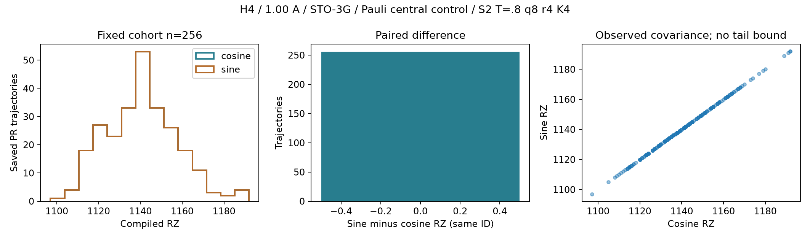

# H4 Pauli-JW central-control A_AXES：両軸費用完成

2026-10-24 JST。**新規sine256/256固有対象が成功、総compile試行256回、技術的中断・回復実行0。** 保存cosine257件とPR index1 sineを再利用し、PR256本＋PF1本のpaired価格を完成した。PR sine平均は **1,140.8046875 RZ**、cosineと全256本で一致。PF sineは **15,028 RZ**。engine＋256 workerのnative exit0・回収と保全照合を完了し、mandatory STOP。

[結果JSON](../artifacts/non_df_h4_a_axes/2026-10-24/result_summary.json)、[paired257行CSV](../artifacts/non_df_h4_a_axes/2026-10-24/run01/paired_costs.csv)、[詳細JSON](../artifacts/non_df_h4_a_axes/2026-10-24/run01/paired_costs.json)、[統計](../artifacts/non_df_h4_a_axes/2026-10-24/run01/statistics.json)、[保存検証](../artifacts/non_df_h4_a_axes/2026-10-24/verification.json)、[証拠入口](../artifacts/non_df_h4_a_axes/2026-10-24/README.md)。

## 固定条件・承認・SOURCE

Linear H4、隣接1.00 Å、STO-3G、system8＋ancilla1（wire8）。Pauli-JW184非identity項、PR prefix27、S2/T=.8/q8/r4/K4、元保存event law・保持規則、D2 central-control規則を維持。Qiskit1.3.0、rz/sx/x/cx、optimization level1、seed17、backend/coupling/layout/routing指定なし。元Hadamard wrapper全体の費用で、状態準備費用を除外する。

DFは同じH4、tol-only1e-8/rank10、PR prefix1＋one-body・raw concatenationの保存native費用を参考引用する。異lawのPauli/DFをindexでpaired sampleにしない。新しいDF生成・sampling・DF compileは0。

| 来歴 | 固定値 |
|---|---|
| 専用branch | `codex/non-df-h4-a-axes-execution-20261024` |
| GitHub取得済み基点 | `7c5e25dce757b7daa165095839ca879ed0bb0c10` |
| 元H4 SOURCE | `0c329b30a81accb35c212be8defa66fee0dd0f12` |
| D2 SOURCE | `74515d8eb4f073c40fc783681a3775dbca89e9b1` |
| A_GATE SOURCE | `ee7d281b5daead1d0d5e81e00c9a0ed4727792b0` |
| A_COHORT_COS SOURCE | `34ef0a7ca2412a61f5215a4ce1192e99f3226b2a` |
| 今回の科学SOURCE | `a37232f85812688c3b9ab957c5073c5ce143b17e` |
| 新規対象 | PR index0,2〜255 sine255本＋PF sine1本 |
| 再利用 | cosine257件＋PR index1 sine1129 RZ |
| 結果commit | `82e188dd4fa239bffcd3b010f7f7ea7e7155e9d7` |
| remote SHA | 認証失敗・GitHub branch検索0件により未取得。[公開状態](../artifacts/non_df_h4_a_axes/2026-10-24/publication_status.json)参照 |

[添付原文](../artifacts/non_df_h4_a_axes/2026-10-24/user_instruction.txt)・[承認](../artifacts/non_df_h4_a_axes/2026-10-24/approval.json)はSHAで結合。[GitHub確認](../artifacts/non_df_h4_a_axes/2026-10-24/github_verification.json)には基点commitとcohort sealの実取得・local Git blob一致を保存した。以前のpush失敗は時点履歴で、今回の基点はGitHub取得済み。

科学SOURCE commit後に[入力manifest](../artifacts/non_df_h4_a_axes/2026-10-24/case_inputs.json)・[seal](../artifacts/non_df_h4_a_axes/2026-10-24/seal.json)・[active contract](../artifacts/non_df_h4_a_axes/2026-10-24/active_contract.json)を固定し、未使用grant `7d5319fe081c8901a8f7521dc52202c9b4db0fb8de587b6842901507addfc666` を一度だけ消費した。元grantは再利用していない。

## Stage A/B：保存bodyの再利用とsine接続

[Adapter](../src/trotterlib/h4_a_axes.py)、[runner](../scripts/run_h4_a_axes.py)、[人工検査](../tests/test_h4_a_axes.py)。元wrapper/compiler、D2並列batch、A_COHORT_COS authority/native launcher/統計関数を再利用。Control flowの再利用差分は新namespace・grant/status名と終了対象数254→256であり、科学的なPauli builder・central-control合成・compilerは変更していない。

Stage AでPF/PRのID、event/trajectory hash、元H4 SOURCE、cosine価格257件、PR index1 sine、input/output QPY・metadata SHA、compiler、旧native receiptを照合した。再利用cosineはPF15028 RZ、PR256平均1140.8046875 RZで、旧結果の価格・IDを保持する。

- PFとPR index0はD2の `controlled_body.qpy` を直接使用。元cosine入力のH–body–H–measurement列と、bodyの全命令・wire・global phaseが一致することを確認した。
- 新cohort index2〜255は保存cosine `input.qpy` から外側Hと最後のH/measurementだけを除き、同じcontrolled body命令列を抽出した。bodyの全global phaseを引き継ぎ、各operationとwire配置をそのままコピーする。
- 元 `hadamard_wrapper(body,'sine',already_controlled=True)` を使い、最後のHの直前にancilla8のSdgを置く。二重control、product/rotation変更、phase再加算、barrier挿入は0。

実QPYからbodyを取り出す処理は新SOURCE/seal/grant固定後に実行した。Pauli body replayやD2変換の再実行はしていない。各targetの `source_binding.json` に直接body/抽出の区分、body/cosineの明示命令signature、phase、wire8、元QPY/価格の対応を保存した。QPYを再利用する対応であり、全H4のmatrix/state/signal評価は行っていない。

## 人工検証・技術的回復の扱い

新人工**14件PASS、failure/error0**。保存controlled bodyの直接利用とcosine抽出、QPY roundtrip、非可換productを含む小回路、global/relative phase・control=0/1 branch、Sdg位置、measurement/wire、barrier/phase不一致拒否、body/central再生成禁止、重複task拒否、grant消費、call前予約、失敗後の次wave/統計停止、人工paired価格の差/共分散を確認した。

既存A_GATE/D2/比較再設計/cohortの**保存済み44件の意味対応証拠**もSHA保全して再利用し、今回再実行したとは扱わない。検査は主agent自身であり、独立別担当reviewやcompiled全回路数値誤差certificateではない。

最初の人工fixtureではtoy sealにruntime_manifest_sha256がなく1件errorとなり、SOURCE前にfixtureだけを補正した。`artificial/fixture_attempt01.{json,log}` を保全した。この人工準備履歴は科学runの中断・compile失敗・回復実行に数えない。

[回復履歴](../artifacts/non_df_h4_a_axes/2026-10-24/recovery_history.json)：**科学run中断0、失敗科学call0、回復run0、256固有対象／256試行。** ユーザーの技術回復承認は保持するが、今回は必要なかった。read-only recovery_planでは原因がTECHNICALと特定され、科学条件変更・未解決の位相/演算不一致がなく、元256対象内の失敗/未完了だけを選ぶ。既に検証された成功は再実行せず、失敗call/旧run/STOPを保全し、新SOURCE/seal/契約/namespace/未使用grantが必要。無条件の自動retryや消費済みrun再開は行わない。

## PR256本：両軸の実測価格

元 `_statistics` とcohortのsummarizeを再利用した1 paired batchで集計。SDはsample ddof1、SE=SD/√256、nominal95はStudent-t(df255)、分位点はnumpy.linear。固定256本の算術平均は正確に算出できる。Nominal CIは厳密な母平均上界・未観測event保証とは扱わない。

| RZ指標 | cosine（既存） | sine（新255＋再利用1） |
|---|---:|---:|
| 平均 | **1140.8046875** | **1140.8046875** |
| exact平均 | 146023/128 | 146023/128 |
| 標本SD | 16.9588006391 | 16.9588006391 |
| SE | 1.05992503995 | 1.05992503995 |
| Nominal t95 | [1138.71736592,1142.89200908] | 同左 |
| 中央値 | 1139.5 | 1139.5 |
| q05 / q25 / q75 / q95 / q99 | 1115 / 1129 / 1151.25 / 1168 / 1189.9 | 同左 |
| 最小／最大 | 1097 / 1192 | 1097 / 1192 |

Paired差（sine−cosine）は全256本でRZ=0、平均0、標本SD/SE=0、nominal95=[0,0]。**RZ/CX/total depth/RZ depth/CX depthはそれぞれ256件一致・0件不一致**であった。価格一致を事前仮定せず、両軸の新しい実測を同じIDへ結合した結果である。Wrapperとinput/output fingerprintは軸を区別して保存し、同一回路・普遍的価格一致とは扱わない。

両軸RZのsample covarianceは **1564549/5440 = 287.60091911764704 RZ²**、定義はΣ(Ccos−mean cos)(Csin−mean sin)/255。後続のpaired費用会計へ渡す観測共分散であり、256本外や未観測order4の価格一致を証明しない。

| 保存PR群 | n | cosine平均RZ | sine平均RZ |
|---|---:|---:|---:|
| order0のみ | 221 | 1139.49321267 | 1139.49321267 |
| order2を含む | 35 | 1149.08571429 | 1149.08571429 |
| order4を含む | 0観測 | **null** | **null** |

Order2群の平均がやや高いのは記述的関連で、label/sign/他のevent/合成応答も異なる。Order2単独の因果効果を断定せず、order4費用を0で補完しない。

## PFと他実装の両軸比較

| PF central実測 | cosine（D2保存） | sine（今回） |
|---|---:|---:|
| RZ | **15028** | **15028** |
| CX | 26768 | 26768 |
| total depth | 35694 | 35694 |
| RZ depth | 9227 | 9227 |
| CX depth | 25200 | 25200 |

PF IDは `d761627d56a4454e644358fef8907b8a7db28c4feeb44130224c20e4e50aae4d`、旧SOURCE・入力・価格・今回sineの関係を保存した。旧generic PFは両軸255500 RZで、固定control実装比較では両軸15028 RZへ低下した。

| 方式 | cosine RZ | sine RZ |
|---|---:|---:|
| Pauli PR central（256平均） | **1140.8046875** | **1140.8046875** |
| Pauli PR generic（旧256平均） | 9321.1015625 | 9321.1015625 |
| Pauli PF central | **15028** | **15028** |
| DF PR native（旧256平均） | 23678.44140625 | 23678.44140625 |
| DF PF native | 135355 | 135355 |

両軸ともPauli central PF/PR平均比は **13.17315765**。PRは同IDの旧generic平均から両軸87.76105292%削減、paired central−generic差の平均は各−8180.296875 RZ。PauliとDFは異なるlawなので、DFとの比較は保存費用のunpaired参考比較である。固定実装ではPauliがPF/PRの両方で低いが、表現だけの普遍的優位性や総費用Gの順位を確定しない。

## 図・保存データ・native監査

[SVG](../artifacts/non_df_h4_a_axes/2026-10-24/run01/paired_costs.svg)、[PDF](../artifacts/non_df_h4_a_axes/2026-10-24/run01/paired_costs.pdf)。左：cosine/sineの保存分布が重なる。中：全paired RZ差は0。右：同じtrajectory IDの両軸価格。図は同じpaired batch内で生成し、統計を別batchで再実行していない。

新256対象の `run01/trajectories/{PF,PR0000,PR0002...PR0255}/` にinput/output QPY、fingerprint/SHA、pre/post histogram、compiler profile、SOURCE/target/axis、source binding、予約・開始・完了記録を保存した。旧controlled bodyやcosine出力・巨大mappingは複製せず、入力manifestで固定参照した。新run保存量は約72.2 MB（decimal）。固定wrapperにcallbackがないためpass traceはnull/NO_CALLBACK_IN_FIXED_WRAPPERであり、formal compiler保証を補完していない。

[Ledger](../artifacts/non_df_h4_a_axes/2026-10-24/run01/call_ledger.json)、[STOP](../artifacts/non_df_h4_a_axes/2026-10-24/run01/STOP.json)、[完了監査](../artifacts/non_df_h4_a_axes/2026-10-24/completion_audit.json)。保存body再利用256・sine wrapper256・compile256・paired統計1batch。Pauli replay/central生成/cosine compile/sampling/state-signal/N_Gは0。各compile callは起動前に非返還予約した。

実際のaffinity64・load・MemAvailable・人工peak RSSから57 workerを選び、57/57/57/57/28の5waveで処理。小行列の多重thread生成を避けるため各compiler processのBLAS/OpenMPは1threadとし、総process並列度は空き資源を使った。最初の予約08:47:43 UTC、engine exit08:49:05 UTC、STOP08:49:07 UTC（17:49:07 JST）、最初の予約からSTOPまで約84秒。engine PID578987と256 taskは全てnative exit0/reaped、記録PID/start_ticksに一致する所有processは残っていない。

[読取専用verifier](../artifacts/non_df_h4_a_axes/2026-10-24/verify_saved_outputs.py)による**21 metadata/SHA/saved-moment検査PASS**。code59、入力1661、runtime6999、旧保全対象5755、run inventory3354のSHA、既存manifest179項目不変を照合した。新QPYの再loadやcompile、CI/分位点の再解析はせず、保存平均・差・共分散のexact sum/moment恒等式を検査した。これは主agent自身の技術監査であり、数値誤差certificateではない。

研究運用§8.4/10.1/10.2を適用し、同ファイルに存在しない§10.3は仮定していない。共有設定・他ユーザーprocess/fileを変更せず、PSIだけで正常workerを止める設計にもしていない。旧SOURCE/raw/結果/grant/ledger/marker/STOPを保全し、**Pauli-PR historical hash FAIL／原因UNKNOWN、元H4 native UNKNOWN、旧N/G null、C/L COMBINATION_BLOCKED、旧compiler MISSING_EVIDENCE、正式certificate未受理**を維持した。

## 主要8問・条件付きC/N/Gへの準備状態

| 問い | 今回の回答 |
|---|---|
| 1 PR sine256平均 | 1140.8046875 RZ（exact146023/128）。 |
| 2 cosineとの差 | 保存平均との差0、全同ID RZ差0。 |
| 3 価格は全256本で一致するか | 測定した5費用指標で256件一致・不一致0。 |
| 4 共分散 | sample1564549/5440=287.60091911764704 RZ²。 |
| 5 PF sine | 15028 RZ/CX26768/depth35694、保存cosineと一致。 |
| 6 PF/PR両軸単価 | 両軸PF/PR平均比13.17315765、PRが低い。 |
| 7 generic/DF比較 | PRの削減がsineでも確認され、両軸の固定単価比較が完成。異law比較はunpaired、G順位保証ではない。 |
| 8 条件付きC/N/G入力は揃ったか | **回路価格側は揃った**（PF1＋PR256 paired=514軸価格、共分散・来歴付き）。残差・tail仮定と既存誤差会計への接続は別作業。 |

[準備状況JSON](../artifacts/non_df_h4_a_axes/2026-10-24/conditional_CNG_readiness.json)。次の限定条件付き解析に使うpaired価格は完成した。compiled残差rho・未観測order4 tail・母平均上界、normalization/bias/C-L証拠との接続を明示し、保証されていない値を仮定で補完して正式certificateへ昇格しない。**必要shot数N・総費用Gは今回計算していない。**

**科学作業はmandatory STOP済み。** 次はユーザーが、今回のpaired価格を既存条件付き誤差会計へ接続する限定C/N/G解析の範囲と仮定を別承認する。Codexは承認後に新SOURCE・契約・grantで実施し、旧N/G/nullを書き換えない。新しい残差診断・formal certificate・D3は別範囲の判断であり、自動進行しない。
