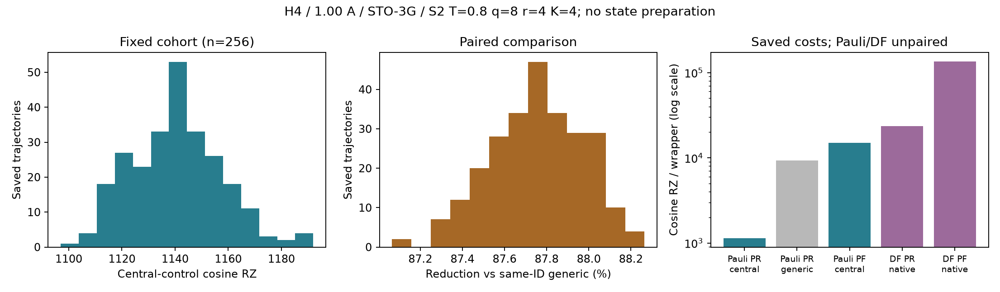

# H4 Pauli-JW PR central-control：保存256 trajectoryのcosine費用

2026-10-24 JST。**新254/254件成功、D2 index0・A_GATE index1を正当に再利用し、保存256本のcosine平均を1,140.8046875 RZ（exact 146023/128）と確定した。** 同じtrajectory IDの旧generic-control平均9,321.1015625 RZから87.76105292%削減。Pauli central PFは15,028 RZで、PF/PR平均比は13.17315765。engineと254 workerのnative exit0・回収、保全照合を完了し、mandatory STOP。

[結果JSON](../artifacts/non_df_h4_a_cohort_cos/2026-10-24/result_summary.json)、[256行CSV](../artifacts/non_df_h4_a_cohort_cos/2026-10-24/run01/cohort_costs.csv)、[固定batchの統計](../artifacts/non_df_h4_a_cohort_cos/2026-10-24/run01/statistics.json)、[保存検証](../artifacts/non_df_h4_a_cohort_cos/2026-10-24/verification.json)、[証拠入口](../artifacts/non_df_h4_a_cohort_cos/2026-10-24/README.md)。

## 固定条件・SOURCE・承認

Linear H4、隣接1.00 Å、STO-3G、system8＋ancilla1（wire8）。Pauli-JW184非identity項・PR prefix27、S2/T=.8/q8/r4/K4、元law・保持規則・保存eventのorder/component/sign/rotation angleを維持。D2 central-control合成規則、元cosine Hadamard wrapper、状態準備費用除外。Qiskit1.3.0、rz/sx/x/cx、optimization level1、seed17、backend/coupling/layout/routing指定なし。

DF比較は同じH4のtol-only1e-8/rank10、PR prefix1＋one-body、raw concatenationの保存native実装値を引用する。DFの新しい生成・compile・samplingは行っていない。

| 来歴 | 固定値 |
|---|---|
| 専用branch | `codex/non-df-h4-a-cohort-cos-execution-20261024` |
| GitHub取得済み基点 | `5eaf32d2f01e95f514634bbbdefd43e971da5d16` |
| 元H4 SOURCE | `0c329b30a81accb35c212be8defa66fee0dd0f12` |
| D2 SOURCE | `74515d8eb4f073c40fc783681a3775dbca89e9b1` |
| A_GATE SOURCE | `ee7d281b5daead1d0d5e81e00c9a0ed4727792b0` |
| 今回の科学SOURCE | `34ef0a7ca2412a61f5215a4ce1192e99f3226b2a` |
| 新規対象 | 元Pauli PR保存cohort index2〜255の254本、cosine各1回 |
| 再利用 | index0=1145 RZ、index1=1129 RZ、いずれも新compile0 |
| 結果commit・remote SHA | [公開状態JSON](../artifacts/non_df_h4_a_cohort_cos/2026-10-24/publication_status.json)参照 |

[添付原文](../artifacts/non_df_h4_a_cohort_cos/2026-10-24/user_instruction.txt)と[承認JSON](../artifacts/non_df_h4_a_cohort_cos/2026-10-24/approval.json)をSHAで結合。[GitHub確認](../artifacts/non_df_h4_a_cohort_cos/2026-10-24/github_verification.json)では基点commitとA_GATE sealを実取得し、Git blobをlocalと照合した。前回のpush失敗は保存時点の履歴であり、今回の基点は現在GitHubから取得できる。

SOURCE commit後に初めて[new seal](../artifacts/non_df_h4_a_cohort_cos/2026-10-24/seal.json)、[active contract](../artifacts/non_df_h4_a_cohort_cos/2026-10-24/active_contract.json)、未使用の[new grant](../artifacts/non_df_h4_a_cohort_cos/2026-10-24/run01/grant.json)を発行した。grant ID `d0190941904047e6dcab8e21de276ba2437168144624ca2c648611a4c7607c7b` は一度消費済み・非返還。旧grantの再利用・retry・resumeなし。

## 実装再利用・適合性・人工検証

[adapter](../src/trotterlib/h4_a_cohort.py)、[runner](../scripts/run_h4_a_cohort_cos.py)、[人工テスト](../tests/test_h4_a_cohort.py)。A_GATE body_only、元D1の保存event/Pauli append、D2 central_control_body、元Hadamard wrapper、D1保存QPY compiler、D2並列batch、CallBudget、native witnessを再利用した。builderやcompiler wrapperを新規再実装していない。新接続は固定index範囲・新grant・同ID価格join・1回の統計への結合を担う。

[既存2件の適合証拠](../artifacts/non_df_h4_a_cohort_cos/2026-10-24/reuse_compatibility.json)でSOURCE、科学条件、compiler profile、保存input/output QPYとmetadata SHA、input fingerprint、trajectory対応、元runのnative STOPを確認した。再利用条件が不成立ならSTOPする設計で、勝手な再compileや補完はしない。

各新taskは使用code・モデル・自身のjoin SHA、元H4 SOURCE、index/ID/event/trajectory hash、label/sign/係数、order/角度/適用順序を確認。A_GATEのbody-onlyを1回だけ呼び、固定SOURCE recipeとの数値primitive token一致後にD2変換を1回適用した。global phaseは集約値だけをancilla相対phaseへ一度転送し、event phaseを重複加算しない。原保持forward/reverseとcontrolled product/rotationを維持する。

新人工**12件PASS、failure/error0**。権限前の量子import禁止、cosine/index2..255のみのscope、cohort重複/欠測拒否、新grant消費・STOP・非返還予算、call前予約、native回収、最初の失敗wave後の停止、SOURCE不一致時のcontrol/compile0、重複task拒否、既知整数のStudent-t統計、小さな人工価格による256行joinと欠測/native失敗gateを確認した。A_GATE12＋D2/比較再設計20の**保存済み32件の意味対応証拠**もSHA保全して再利用し、今回再実行したとは扱わない。検査は主agent自身であり、独立別担当reviewや全compiled回路の数値誤差certificateではない。

## cosine費用統計

既存 `fixed_signal_evaluation._statistics` を呼び出す**1固定batch**で集計。SDはsample ddof1、SEはSD/√n、nominal95はStudent-t(df255)。分位点はnumpy.linear。cohort平均は固定256行の算術平均として正確に計算できる。SD/SE/CIは有限MCから母lawへの推論を意図したnominal指標であり、cohortの未確定幅・厳密な母平均上界・希少event保証とは扱わない。

| 指標 | Central-control cosine RZ |
|---|---:|
| n | 256（新254＋再利用2） |
| 平均 | **1140.8046875**（exact146023/128） |
| 標本標準偏差 | 16.9588006391 |
| 標準誤差 | 1.05992503995 |
| Nominal t95 interval | [1138.71736592, 1142.89200908] |
| 中央値 | 1139.5 |
| q05 / q25 / q75 / q95 / q99 | 1115 / 1129 / 1151.25 / 1168 / 1189.9 |
| 最小／最大 | 1097 / 1192 |

保存cohort内の分布はこの範囲に収まり、極端な高費用trajectoryは観測されていない。未観測order4を含むimplemented law全体のtail費用を0と置く根拠にはならない。

各trajectoryのRZ/CX/total depth/RZ depth/CX depth、hash/ID/order構成/SOURCEと旧generic RZを256行JSON/CSVへ保存。新254本の `run01/trajectories/0002...0255/` にはsource body/input/output QPY、fingerprintとSHA、pre/post histogram、SOURCE token・phase mapping、compiler/runtime対応、call markerを保存した。controlled mappingは別ファイルへ一度保存し、input metadataへ全mappingを重複埋込していない。固定compilerのpass traceは `null / NO_CALLBACK_IN_FIXED_WRAPPER` のまま。

## 同じIDのgenericとのpaired比較

旧Pauli PRの256 IDと完全対応させ、新しいtrajectory選択・samplingを行っていない。旧generic平均は保存原値9321.1015625 RZと一致した。

| 指標 | 結果 |
|---|---:|
| 旧generic平均RZ | 9321.1015625 |
| Central平均RZ | 1140.8046875 |
| Paired差（central−generic）の平均 | −8180.296875 RZ |
| Paired差のnominal t95 | [−8206.24021098, −8154.35353902] |
| 平均価格の削減率 100×(1−mean central/mean generic) | **87.76105292%** |
| 各trajectory削減率の算術平均 | **87.75697617%** |
| 各trajectory削減率の最小／最大 | 87.06592281% / 88.26493880% |

平均価格比の削減率と個別削減率の平均は分母が異なるため、別の指標として保存した。すべての保存trajectoryでcentralのRZが旧genericより小さい。結果は同一event列に対するcontrol実装とcompiler応答の比較であり、Hamiltonian表現だけの因果効果とは扱わない。

## PF/PR・Pauli/DFとorder構造

| 固定実装・cosine | RZ／wrapper |
|---|---:|
| Pauli PR central（保存256平均） | **1140.8046875** |
| Pauli PR generic（旧保存256平均） | 9321.1015625 |
| Pauli PF central（保存固定回路） | **15028** |
| DF PR native（旧保存256平均） | 23678.44140625 |
| DF PF native（保存固定回路） | 135355 |

Central PauliのPF/PR平均比は13.17315765、PR/PF exact比は146023/1923584。PauliのPRはcentralでもPFより低単価である。今回の固定実装ではPauliがPF/PR双方でDFより低い。PauliとDFは異なるrandomization lawであり、同じindexを統計的paired sampleにしていない。control方式・保持分割・law・compiler依存が連動するため、Pauli表現の普遍的優位性や総費用Gの順位を主張しない。

| 保存trajectory群 | n | central平均RZ | 各trajectory削減率の平均 |
|---|---:|---:|---:|
| order0のみ | 221 | 1139.49321267 | 87.76665093% |
| order2を含む | 35 | 1149.08571429 | 87.69588697% |
| order4を含む | 0観測 | **null** | **null** |

order2群では平均がやや高く、削減率がやや小さいという記述的関係がある。component/label/sign・compiler応答も異なり、order2単独の因果効果・全trajectoryでの単調増加を断定しない。order4群は費用0ではなく未観測/nullで、母平均tailは未解決。

## 図表

[SVG](../artifacts/non_df_h4_a_cohort_cos/2026-10-24/run01/cost_comparison.svg)、[PDF](../artifacts/non_df_h4_a_cohort_cos/2026-10-24/run01/cost_comparison.pdf)。左：固定256本のcentral RZ分布。中：旧genericと同IDの個別削減率。右：保存平均/固定回路のRZ、縦軸log、Pauli/DFはunpaired。図は統計batch内で生成し、追加batchで再計算していない。

## 実行・native終了・保全

[Call ledger](../artifacts/non_df_h4_a_cohort_cos/2026-10-24/run01/call_ledger.json)、[STOP](../artifacts/non_df_h4_a_cohort_cos/2026-10-24/run01/STOP.json)、[完了監査](../artifacts/non_df_h4_a_cohort_cos/2026-10-24/completion_audit.json)。body-only254、central254、cosine wrapper254、top-level費用compile254、費用統計1batchを消費。新sampling/RNG、sine compile、generic build、state/signal、N/Gは各0。compileは各task起動前に非返還予約し、marker・実測・native receiptを各対象へ結合した。

利用可能affinity64、観測load約6〜7、MemAvailableと人工peak RSSに基づき57 worker、57/57/57/57/26の5waveで処理した。各processの小行列BLAS/OpenMPは1 threadで多重thread生成を抑制。最初の予約08:01:27 UTC、engine native exit08:02:06 UTC、STOP08:02:08 UTC（17:02:08 JST）。この有限jobは最初の予約からSTOPまで約40秒で完了。engine PID568939＋254taskすべてexit0/reaped、記録PID/start_ticksと一致する所有processは残っていない。

[Verifier](../artifacts/non_df_h4_a_cohort_cos/2026-10-24/verify_saved_outputs.py)は主agentの**20 metadata/SHA/saved-sum検査PASS**。code56、入力362、runtime6999、旧保全対象1895、run inventory3836のbyte SHAと、既存manifest178項目不変を確認。全254件のtoken/phase mapping、QPY、histogram、price ID、compiler、nativeを照合した。QPY再load・compile・CI/分位点の再解析はせず、保存行のexact sumと保存平均の一致だけを会計整合性として確認した。

SOURCE・全入力・runtime・保全対象は実行前後に全照合。各taskは実際に使うcode/model/自身のjoinを照合し、古い全台帳を254回読み直す重複I/Oを避けた。inspectorも各task一度だけ読込む。新runは約194.7 MB（decimal）の必要証拠を保存。無関係worktreeのHEAD/statusを拒否gateにせず、PSI/競合だけで正常workerを停止しない。共有設定・他ユーザーprocess/fileの変更なし。研究運用§8.4/10.1/10.2を適用し、最新版に存在しない§10.3は仮定しない。

旧SOURCE/raw/結果/grant/ledger/marker/STOPは保全。**Pauli-PR historical hash FAIL／原因UNKNOWN、元H4 native UNKNOWN、旧N/G null、C/L COMBINATION_BLOCKED、旧compiler MISSING_EVIDENCE、正式certificate未受理**を維持した。今回のnative PASSやSOURCE対応は新cohort費用評価の範囲だけであり、compiled rho・全回路数値誤差や元監視欠落を解決したとは扱わない。

## Q1〜Q7と次段階

| 問い | 回答 |
|---|---|
| Q1 保存256平均 | 1140.8046875 RZ、exact146023/128。新254成功・2件再利用。 |
| Q2 genericからの削減 | 平均価格比87.76105292%、個別削減率の平均87.75697617%。 |
| Q3 centralでもPRがPFより低いか | PR平均1140.8047対PF15028、PF/PR=13.1732。 |
| Q4 Pauli/DF順位 | 固定native実装ではPF/PRともPauliが低い。異law比較はunpaired、表現単独の因果効果やG順位ではない。 |
| Q5 order0/2 | order0のみ221本1139.4932、order2含む35本1149.0857。記述的関連で、order4は未観測/null。 |
| Q6 分布 | 保存範囲1097〜1192、SD16.9588、q95=1168。母平均tailの保証は残る。 |
| Q7 sine評価の価値 | あり。complex signalのpaired回路単価へ進むために必要で、今回のcosineだけでGを補完しない。 |

**Mandatory STOP済み。** 以下は提案であり、新契約やgrantを有効化・実行していない。

| 次の担当 | 作業と必要な明示承認 |
|---|---|
| ユーザー | A_AXESを進めるか判断。central sineの既存index1を再利用し、残255本を新評価する範囲を承認する。 |
| Codex（承認後） | 保存body/入力から元sine wrapperへ接続する再利用方法を固定し、人工検証・新SOURCE/runtime/input seal・未使用grant・最大255 sine compile・paired統計・native STOPを新契約で実施。今回のcosine結果は再compileしない。 |
| ユーザー／Codex | Paired価格が揃った後に、条件付きC/N/Gの仮定・残差・tailを明示した限定解析を別承認／実施する。今回N/Gは0。 |
| ユーザー | 必要なcompiled残差診断・formal certificate課題は別範囲で判断。DF basis reuseのD3は後順位で別承認。 |

保存256本の価格平均は確定した一方、implemented lawの厳密母平均・未観測order4 tail、異law・実装依存、compiled residualと精度適格性は未確定。A_AXES・条件付きC/N/G・残差・D3へ自動進行しない。
