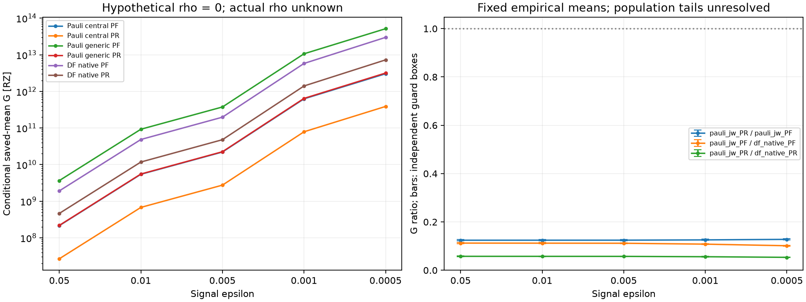

# H4 Pauli central-control：条件付きC/N/G総資源比較

**仮想ρ_new=0では、Pauli central PRの総費用GはPFの12.43〜12.79%。指定15比較は、保存平均価格と独立な方式・軸別残差の固定guard全域で順位反転なし。** Pauli central PF/PRは、それぞれ対応する旧DF-native PF/PRより低い条件付きGとなった。実際のρのguard所属と、PR母平均費用tailは未保証である。

10条件・20主軸・20解析的guard端点・15比較・paired G統計1batchを完了。初回のadapter gate誤りは科学N/G演算前に停止し、原因特定・修正SOURCE・新grantで回復した。保存データからの限定再解析であり、新compile/build/sampling/化学/state/signal/C-L計算・正式certificate受理は0。**科学作業はmandatory STOP済み。**

## 条件・SOURCE・入力

Linear H4、隣接1.00 Å、STO-3G、system8 qubit、Pauli-JW184非identity項・PR prefix27。S2、T=.8、q8/r4/K4。同じ保存state/ray・元event law・256 PR trajectory、PF決定論的1本。固定D2 central control、Qiskit1.3.0、rz/sx/x/cx、optimization1、seed17、routing/backend/layoutなし、状態準備費用を除くfull Hadamard wrapperのcompiled RZを単価とする。DFは同じ固定H4のtol-only1e-8/rank10・prefix1＋one-body・raw concatenationで、異なる分割/law/合成を持つ。Δ窓や保持規則の新探索はない。

基点branch `codex/non-df-h4-a-axes-execution-20261024`、commit `564cd71936fa27225624b00a7d5d1f12dc4cc6dc`。作業branch `codex/non-df-h4-central-conditional-cng-20261024`。今回成功SOURCE **`d96dfe5ca0a6c950a5f1791ff61659e6dc8f1c34`**。初回SOURCE `da979af729f3c90e3cfbd3250e870ed3806cdf57` は失敗証拠として保全した。

[承認原文](../artifacts/non_df_h4_central_conditional_cng/2026-10-24/approval.txt)、[GitHub取得照合](../artifacts/non_df_h4_central_conditional_cng/2026-10-24/github_verification.json)、[seal](../artifacts/non_df_h4_central_conditional_cng/2026-10-24/recovery02/seal.json)、[active contract](../artifacts/non_df_h4_central_conditional_cng/2026-10-24/recovery02/active_contract.json)、[入力manifest](../artifacts/non_df_h4_central_conditional_cng/2026-10-24/recovery02/inputs.json)、[runtime](../artifacts/non_df_h4_central_conditional_cng/2026-10-24/recovery02/runtime.json)、[出力schema](../artifacts/non_df_h4_central_conditional_cng/2026-10-24/recovery02/output_schema.json)。基点と主要5SOURCEをGitHubから実取得し、paired価格・readiness・旧条件付き結果・旧会計コードの4 Git blobをlocalと照合した。過去のpush失敗記録は変更せず、今回の基点がremoteに存在することを確認した。

再利用SOURCE：元H4 `0c329b30a81accb35c212be8defa66fee0dd0f12`、C `e80d7510880f8db993b777c627bb8e95b05a070d`、D2 `74515d8eb4f073c40fc783681a3775dbca89e9b1`、A_COHORT_COS `34ef0a7ca2412a61f5215a4ce1192e99f3226b2a`、A_AXES `a37232f85812688c3b9ab957c5073c5ce143b17e`、既存条件付き会計 `b1984dcde06a874d0fd6e9fe6395b7f3fb7504d8`。C/L/旧compilerの未充足状態は引き継ぐ。

## 再利用と誤差会計

[adapter](../src/trotterlib/h4_central_cng.py)は旧`h4_conditional_cng`の`base_axis`・`shot`・`paired`と`fixed_signal_evaluation._statistics`を再利用する。`fixed_signal_shots`と元`precision_accounting`のguard対応は既存人工16件を再利用し、本番で重複するfloat shot評価は行わない。比較関数も旧処理を再利用し、内部bounds関数だけを今回Pauli端点/保存DF端点への参照に差し替えた。人工mockで比較中のshot呼出を拒否し、旧比較と同じ結果になることを確認した。[runner](../scripts/run_h4_central_cng.py)は旧runtime discovery、durable save/CallBudget/native subreaper・waitを流用し、新namespaceだけを管理する。

C保存`bias_distance.upper`をu_enc、旧signed biasをb0、保存B/log_B上界をそのまま使う。各軸pointer・同一state/ray・尺度を照合し、旧96桁外向きscalar包含と以後の有理数演算を再利用した。Cのreferenceは保存rayの作用から囲まれ、今回Cのsignal/state/normを再計算していない。[各軸のexact証拠・headroom・guard](../artifacts/non_df_h4_central_conditional_cng/2026-10-24/recovery02/run01/axis_results.csv)、[誤差/尺度来歴](../artifacts/non_df_h4_central_conditional_cng/2026-10-24/recovery02/run01/error_scale_provenance.json)。

- ε_axis = float(ε_sig)/√2、α_axis=.025。
- u_axis=u_enc+ρ_new、h_axis=ε_axis−|b0|−u_axis。
- h>0かつu/h≤.01、B_up=max(1,B_saved,exp(saved_log_B_upper))。
- N_axis=ceil(2 B_up² ln(2/.025)/h²)、N_axis<2**52。満たせない場合は理由付きnullを保持する。

新ρは、同じ正規化ray・B_saved尺度でのC encoded meanから新compiled測定期待値までの未保証残差であり、方式・軸別の独立な非負未知変数とする。主評価ρ_new,cos=ρ_new,sin=0は**最低残差を置く仮想感度条件**で、測定値でも保証値でもない。旧generic残差の転用、C totalの項の減算、CとLの無条件加算は行っていない。保存B自体は変えず、PFにも旧log_B marginを残したためB_up>1となる。B_saved PF1/PR1.2873709223899619、B_up表示約PF1.00750723/PR1.28929068。b0/u_encのexact値は全20軸に保存する。

Pauli/DFのreferenceは**各表現のfull Hamiltonianに対応する別の保存値**である。同一ray/T/methodと表現内PF/PR一致を確認し、表現間のHamiltonian hash/丸め信号の同一化を要求しない。[保存reference scope](../artifacts/non_df_h4_central_conditional_cng/2026-10-24/recovery02/run01/reference_scopes.json)。DFの旧bias/normalization定義に基づく保存N/Gを使う比較であり、共通の厳密Hamiltonianへの新しい誤差転送やDF分解誤差補正を認定しない。

一条件の両軸failure budgetは.05で、10条件全体の同時95%保証ではない。価格標本数256は測定shot Nとは別。実際の量子測定は0。

## 必要shot：仮想ρ=0

新compiled残差を0と仮定したときだけの必要数。ideal bias/尺度を同じに保ったため、旧genericの同じ仮想条件のNと一致した。新compiled回路で実際に十分との認定ではない。

| ε_sig | PF N_cos | PF N_sin | PF N_total | PR N_cos | PR N_sin | PR N_total |
|---|---:|---:|---:|---:|---:|---:|
| 0.05 | 7,152 | 7,123 | 14,275 | 11,716 | 11,665 | 23,381 |
| 0.01 | 182,332 | 178,632 | 360,964 | 299,063 | 292,603 | 591,666 |
| 0.005 | 747,622 | 717,383 | 1,465,005 | 1,228,279 | 1,175,390 | 2,403,669 |
| 0.001 | 23,060,803 | 18,521,107 | 41,581,910 | 38,453,786 | 30,410,338 | 68,864,124 |
| 0.0005 | 124,277,764 | 77,182,652 | 201,460,416 | 212,302,030 | 127,078,518 | 339,380,548 |

PRのshot負担は旧同条件と同じPF比約1.6379〜1.6846倍。PRのB²と少し大きいbiasが効く。全10 guard域が非空、主20軸と解析端点20軸のscalar十分不等式が成立し、全ceil区間は単一整数（幅0）、safe integer超過なし。ただしactual_N/actual_G/actual_rho_newは全行nullのままである。

## 単価と総費用G

| 実装 | cosine/sine単価 [RZ/shot] | 標本・定義 |
|---|---:|---|
| Pauli central PF | 15,028 / 15,028 | 決定論的singleton |
| Pauli central PR | 1,140.8046875 / 1,140.8046875 | 保存256平均、146023/128 |
| Pauli generic PF | 255,500 / 255,500 | 旧保存値 |
| Pauli generic PR | 9,321.1015625 / 9,321.1015625 | 同じ256の旧保存平均 |
| DF native PF | 135,355 / 135,355 | 旧保存値 |
| DF native PR | 23,678.44140625 / 23,678.44140625 | 別lawの旧256平均 |

`G_i=N_cos*C_i,cos+N_sin*C_i,sin`のpaired標本を集計した。各trajectoryのID/event/hashと旧generic価格を257本で照合。保存256では両軸価格が全件等しく、sample covariance=1564549/5440 RZ²。この等値をcohort外へ仮定していない。SE²=NᵀS_C N/256とpaired Gの一致を確認し、軸別SEを独立に加えていない。Pauli/DFの同じindexをpaired標本にしていない。

以下は仮想ρ=0、保存平均価格でのG [RZ]。[10条件JSON/CSV](../artifacts/non_df_h4_central_conditional_cng/2026-10-24/recovery02/run01/conditional_results.csv)、[旧generic/DFの無変更引用](../artifacts/non_df_h4_central_conditional_cng/2026-10-24/recovery02/run01/reused_reference_rows.json)。

| ε_sig | central PF G | central PR Ghat | generic PF G（旧） | generic PR Ghat（旧） | DF PF G（旧） | DF PR Ghat（旧） |
|---|---:|---:|---:|---:|---:|---:|
| 0.05 | 2.145247e+08 | 2.667315e+07 | 3.647262e+09 | 2.179367e+08 | 1.908099e+09 | 4.625584e+08 |
| 0.01 | 5.424567e+09 | 6.749753e+08 | 9.22263e+10 | 5.514979e+09 | 4.837669e+10 | 1.172777e+10 |
| 0.005 | 2.20161e+10 | 2.742117e+09 | 3.743088e+11 | 2.240484e+10 | 1.97016e+11 | 4.776339e+10 |
| 0.001 | 6.248929e+11 | 7.856052e+10 | 1.062418e+13 | 6.418895e+11 | 5.781825e+12 | 1.402179e+12 |
| 0.0005 | 3.027547e+12 | 3.871669e+11 | 5.147314e+13 | 3.163401e+12 | 2.984052e+13 | 7.241563e+12 |

Central/generic G比は全精度でPF=3757/63875（約0.058818004）、PR=146023/1193101（約.122389）。両者とも総費用が低下した。PFの改善が相対的に大きいため、PR/PF比は旧generic約.05975〜.06146からcentral約.12434〜.12788へ上がる。PRの単価利益はshot増を含めても維持されるが、PFに対する相対的な優位幅は小さくなった。

## Paired Gの統計的不確かさ

| ε_sig | central PR 標本SD | SE | nominal Student-t95半幅 |
|---|---:|---:|---:|
| 0.05 | 396513.7 | 24782.11 | 48803.67 |
| 0.01 | 1.003395e+07 | 627121.6 | 1234997 |
| 0.005 | 4.076334e+07 | 2547709 | 5017230 |
| 0.001 | 1.167853e+09 | 7.299081e+07 | 1.437416e+08 |
| 0.0005 | 5.755487e+09 | 3.597179e+08 | 7.083963e+08 |

PFのSD/SE/半幅は決定論的に0。PRはn=256、df=255のnominal Student-t95。両軸が同価格のこのcohortでは、Gの相対nominal半幅は価格の約.183%と同じになる。これは母平均の厳密上界でも、未観測order4のcoverageでもない。[trajectory別G_iとID](../artifacts/non_df_h4_central_conditional_cng/2026-10-24/recovery02/run01/paired_G_values.json)と保存exact平均・共分散momentの一致を検証した。新しいtail質量・未観測trajectory・ρの診断は行っていない。

## 指定15比較とguard全域

方式・軸ごとに独立のρ∈[0,ρ_guard]を許し、非負価格とceil単調性により各方式Gの最小/最大を端点で囲む。ρ_guard=.01*(ε_axis−|b0|)/1.01−u_enc。表示用の共通ρ断面だけの比較ではない。Pauli端点は今回評価し、DF端点は旧comparison_regionsの保存G範囲を引用した。DF shot/ceil/G evaluatorは呼んでいない。

次の比は左/右。括弧は独立guard box全域の範囲で、CIではない。[15比較](../artifacts/non_df_h4_central_conditional_cng/2026-10-24/recovery02/run01/comparison_regions.csv)。

| ε_sig | central PR / central PF | central PF / DF PF | central PR / DF PR |
|---|---|---|---|
| 0.05 | 0.124336 [0.121886, 0.126830] | 0.112428 [0.110216, 0.114689] | 0.057664 [0.056527, 0.058821] |
| 0.01 | 0.124429 [0.121978, 0.126930] | 0.112132 [0.109922, 0.114386] | 0.057554 [0.056420, 0.058710] |
| 0.005 | 0.124551 [0.122096, 0.127054] | 0.111748 [0.109546, 0.113994] | 0.057410 [0.056279, 0.058564] |
| 0.001 | 0.125718 [0.123241, 0.128245] | 0.108079 [0.105949, 0.110251] | 0.056027 [0.054924, 0.057154] |
| 0.0005 | 0.127881 [0.125362, 0.130452] | 0.101458 [0.099458, 0.103497] | 0.053465 [0.052411, 0.054539] |

15件すべてでleft_G_max < right_G_min、**保存平均価格と固定guardの下で順位反転なし**。旧genericではPauli PFがDF PFより高かったが、今回central PFはDF PFより低くなる。PR側もcentral PauliがDF-nativeより低い。この比較はHamiltonian分割・保持規則・event粒度・合成・compilerの固定実装を含む。表現自体だけの因果効果、普遍的なPauli/DF優劣、最適方式の一般順位は示さない。

最厳ε=.0005では許容ρ上限はPF cosine2.64900e-6/sine3.36139e-6、PR cosine2.59361e-6/sine3.35232e-6。これらは予算で、実ρ上界の測定値ではない。実ρのguard所属は全軸UNKNOWN。

PR母平均価格μを未知とすると、同じceilを用いる `ΣN_left,a μ_left,a < ΣN_right,a μ_right,a` の真偽は未確定である。母平均tail envelopeがないため、PRを含む比較の母平均順位反転は排除できない。PF/DF-PF比較は決定論的価格なのでPR tailとは独立だが、実ρの所属問題は残る。Nominal t95をtail上界へ格上げしない。

図は承認された1batch内でPNG/SVG/PDFとして保存・目視確認した。点を結ぶ線は表示用で、精度間の新規探索や非整数shotの定義ではない。右の棒は独立guard端点であり統計CIではない。

## 技術停止・回復・終了証拠

初回の`SHARED_REFERENCE`例外はadapterがPauli/DF間のreference全体の一致を要求したため。元`h4_audited_evaluation.py:44`は各adapterのfull Hでreferenceを作り、`h4_pilot_science.py:52`は別のHamiltonian hashを保存する。Pauli reference signalはreal −.16160185891555756/imag .9868560377253799、DFはreal −.1616018589155589/imag .9868560377253792という既存値であり、どちらも書き換えていない。新たな許容誤差を設けて一致扱いにもしていない。各表現内でPF/PR reference一致、全方式で同一state/T/methodを確認するscopeに修正した。

初回grantは消費済み、入力bindingだけ1、N/G/guard/統計/比較batch0。旧STOPはexit1/回収済みのまま保全。科学成功結果0なので、回復は未着手だった同じ有限packageだけ。修正SOURCEを先にcommitし、別namespace/recovery02・新seal/contract/grantを発行した。旧grant再利用・原因不明retry・科学条件変更なし。[回復履歴と旧SOURCE archive](../artifacts/non_df_h4_central_conditional_cng/2026-10-24/recovery02/recovery_history.json)。旧Pauli-PR historical hash FAIL/原因UNKNOWNとは別の技術事象である。

新grant `37a5812aa9787e3a366576fde95fa02176621d449ee928c8d04c47265e288bf2` は一回消費し、4論理batchをcall前に非返還予約。worker PID 592715 はnative exit0/reaped、STOP `2026-10-24T09:19:02.247254+00:00`、all_owned_reaped=true、descendants_terminated=false。今回の終了証拠で元H4 native UNKNOWNを補完していない。[call ledger](../artifacts/non_df_h4_central_conditional_cng/2026-10-24/recovery02/run01/call_ledger.json)、[native](../artifacts/non_df_h4_central_conditional_cng/2026-10-24/recovery02/run01/native/worker_native_exit.json)、[STOP](../artifacts/non_df_h4_central_conditional_cng/2026-10-24/recovery02/run01/STOP.json)。

## 保存検証・保全

[主agent検証](../artifacts/non_df_h4_central_conditional_cng/2026-10-24/recovery02/verification.json)は124項目PASS。既存人工16＋最終新人工16 PASS（回復前14も保存）。code13、入力600、runtime4896、旧証拠9165、出力28fileのSHA/committed SOURCEを確認。旧manifest180行を無変更で維持。保存G_i/ID/exact平均・momentとpaired共分散の恒等式を検証し、新しいshot・統計推定・CI/quantile計算を監査時に呼んでいない。独立した別担当者レビューではない。

初回source/grant/ledger/native/STOP、元SOURCE/raw/入力/結果・旧null・Pauli-PR hash FAIL/原因UNKNOWN・元native UNKNOWN・C/L COMBINATION_BLOCKED・旧compiler MISSING_EVIDENCE・正式certificate未受理は保全。実装ρとpopulation_cost_upper/unconditional_N_Gはnullのままである。新runに実測精度保証を付けていない。

運用は最新版§8.4/10.1/10.2を適用。参照された§10.3は現ファイルに存在しないため規則を補作していない。軽量scalar/I/O中心なので単一workerを使用し、CPU/RAM/affinity上限・共有設定変更・他job操作なし。封印済みruntimeや旧grantは変更していない。

## 支持範囲と次の作業

支持できるのは、固定H4・固定cohort・固定実装・保存bias/normalizationの条件付き会計で、central制御による回路単価低下がshot負担を含むGでも有効であり、指定された15比較の順位は独立guard全域で保たれること。旧generic-PF/DF-PFの順位はcentral実装を選ぶと変わる。新compiled精度や普遍的なアルゴリズム優越性は示さない。

次段階は未実行：

1. **ユーザー**：この条件付き比較を研究上の到達点とするか、実装精度・PR母平均の主張まで求めるか判断する。後者の新数値診断・sampling/compile等には対象と範囲の明示承認が必要。
2. **Codex／精度保証担当**：承認後、D2実装の同一ray/control/phase/B尺度で未被覆のmeasurement残差だけを診断・上界設計する。最厳cosine予算約2.59〜2.65e-6が一つの判断境界。PRは未観測eventを含むlaw全域/重み付き上界が必要で、保存256本だけの小残差では代替できない。
3. **Codex／費用解析担当**：母平均順位を求めるなら、まず未観測order4を含むfull-wrapper費用envelopeを設計する。新sampling/compileの実行は別承認とし、今回のnominal CIや観測最大をtail上界にしない。

公開状態と最終commit/remote SHAは[publication_status](../artifacts/non_df_h4_central_conditional_cng/2026-10-24/publication_status.json)に記録する。**科学作業はmandatory STOP。自動的な次段階実行なし。**

## Commit・公開確認

結果commit `ef5c13d94639c5235cfd6486a17ac998344397f0`。origin pushはHTTPS Usernameを取得できずexit128。
GitHub branch検索0件のため新branchのremote SHAは未取得。基点SHAはGitHubで取得確認済み。
失敗logとユーザー用pushコマンドをpublication_statusに保存。後続local commitは公開監査metadataだけで、科学run/shot/統計の追加なし。

テキスト/コード/JSON/CSVの空白検査・報告リンク23件・JSON49件はPASS。
Matplotlib生成SVGはpath属性の既定末尾空白を含む元byte/SHAを保全し、空白検査から除外した。
