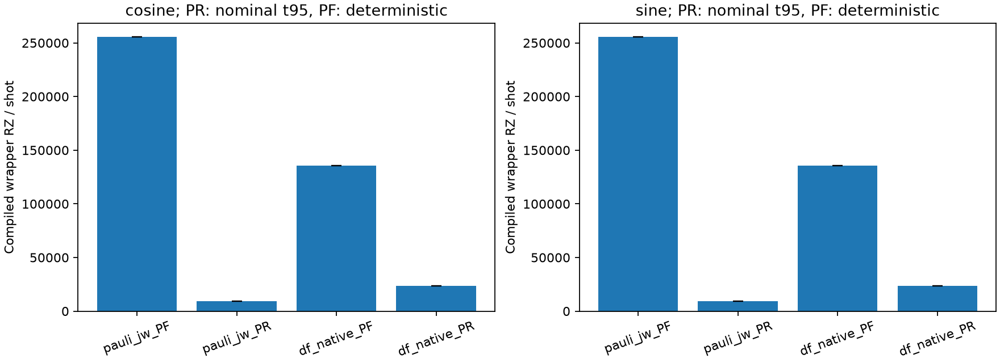
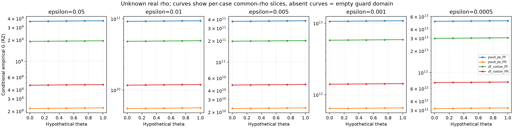
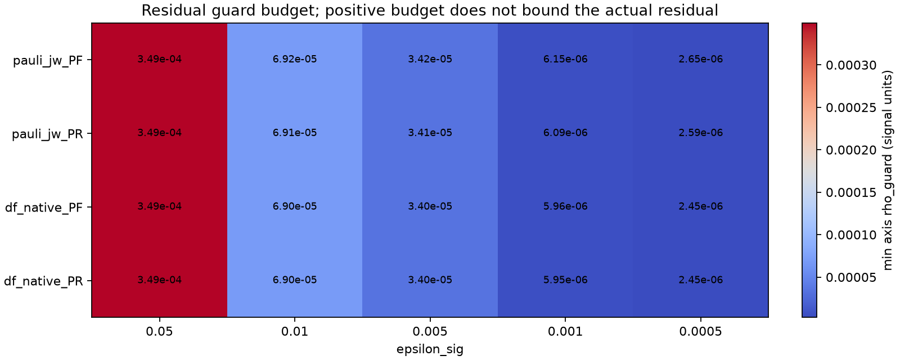

# 固定H4非DF/DF：条件付きC/N/G比較結果

2026-10-24 JST。**20条件すべてで固定guardの許容域が非空。保存価格の平均を固定すると、両表現のPRは全5精度でPFより低費用であり、各方式・各軸のrhoを独立に動かした許容域全体でも逆転しない。** これは未知の実残差が許容域に入る場合の条件付き比較である。母平均費用のtail上界は未確定で、無条件の有限N/G・母平均順位・正式certificateは確定していない。

承認された有限packageを一回実行し、今回のnative exit0・所有worker回収・mandatory STOPを記録した。[成果物入口](../artifacts/non_df_h4_conditional_cng_results/2026-10-24/README.md)。元H4のN/G null、元native UNKNOWN、C/L COMBINATION_BLOCKED、compiler MISSING_EVIDENCEは原本で維持した。

## 固定条件と来歴

Linear H4、隣接1.00 Å、STO-3G、8 system qubit、同じ保存stateのray。Pauli-JW184項・PR prefix27、DF-native tol-only1e-8/rank10・PR prefix1＋one-body。S2、T=.8、q8/r4/K4、ε=.05/.01/.005/.001/.0005、cosine/sine。元Qiskit1.3.0、rz/sx/x/cx、opt1、seed17で保存した、状態準備を除くfull Hadamard wrapperのcompiled RZ数を価格とする。

基点`c8e7ae0f120edd5d4f93e9dad33c4bccefa2ac03`、専用branch `codex/non-df-h4-conditional-cng-results-20261024`。新adapter SOURCEは **`b1984dcde06a874d0fd6e9fe6395b7f3fb7504d8`**。科学SOURCEは元H4 `0c329b30a81accb35c212be8defa66fee0dd0f12`、C `e80d7510880f8db993b777c627bb8e95b05a070d`、L `eb195bf2dedd0aed9d80ad7f84948b59ea53d854`、接続 `0880f4af98b125d62599e970db89fc33634d1b61`のまま。

GitHubから固定commitと計画4資料、C結果2件、L summary、旧精度表・契約、C/L STOPを取得してローカルGit blobと照合した。[取得記録](../artifacts/non_df_h4_conditional_cng_results/2026-10-24/github_verification.json)。旧資料のより広い来歴は基点の27件取得記録を継承し、今回使用する550入力SHAを実行前後に確認した。元の514 price/event/trajectory joinは既存`verify_join`で再検証した。

既存`fixed_signal_shots`、`_statistics`、`verify_join`、durable save/CallBudget/native witnessを再利用した。Guardは元`precision_accounting`と人工入力で照合し、本番ではexact rationalで同じ判定を行った。化学・sampling/compilerをimportするpackage initializerを避け、必要な純関数のみAST抽出した。最初の人工検証では既存package initializerを経由したため、数値実行前にprivate namespaceへ変更した。最終16件PASS、最初の14件・途中15件の成功ログも保持した。すべて主agent自身の検証で、独立科学レビューではない。

## 1. 回路単価C

保存cohortはPF各1本、PR各256本。今回の全trajectoryでcosine/sine価格が等しい。以下のPR誤差幅は有限MC標本によるnominal Student-t95半幅であり、母平均tailの厳密上界ではない。

| 方式 | 両軸の平均C [RZ/shot] | SE | nominal t95半幅 | PR/PF単価比 |
|---|---:|---:|---:|---:|
| Pauli-JW PF | 255,500 | 0 | 0 | — |
| Pauli-JW PR | 9,321.1015625 | 13.8475 | 27.2701 | 0.0364818 |
| DF-native PF | 135,355 | 0 | 0 | — |
| DF-native PR | 23,678.44140625 | 46.7180 | 92.0023 | 0.174936 |

PRの標本平均単価削減はPauli-JW **96.3518%**、DF-native **82.5064%**。観測価格範囲はPauli-PR 8,646–9,958、DF-PR 21,754–25,962。これらの最大値を未観測trajectoryの上界には使わない。

## 2. 誤差・B・必要shot

旧signed bias b0とCの保存`bias_distance.upper`を直接使用し、`u=u_enc+rho`、`h=epsilon_axis-|b0|-u`、`epsilon_axis=epsilon_sig/sqrt(2)`、`alpha_axis=.025`を維持した。実際のrhoは全軸でnull。C totalからの減算やL上界の自動加算はしていない。

| 方式 | b0 cosine / sine | u_enc cosine / sine | 保存B | 新会計B_up（表示丸め） |
|---|---|---|---:|---:|
| Pauli-JW PF | 8.60040e-5 / 1.40526e-5 | 7.58568e-15 / 7.51950e-15 | 1 | 1.00750723 |
| Pauli-JW PR | 9.15986e-5 / 1.49687e-5 | 5.24159e-15 / 8.45520e-15 | 1.28737092 | 1.28929068 |
| DF-native PF | 1.05630e-4 / 1.72517e-5 | 4.84190e-12 / 4.84787e-12 | 1 | 1.00088015 |
| DF-native PR | 1.05820e-4 / 1.72829e-5 | 1.38613e-12 / 1.38719e-12 | 1.17758514 | 1.17821702 |

保存B自体は変更せず、`B_up=max(1,B_saved,exp(saved_log_B_upper))`を新評価版の十分条件に使った。**PFでも旧log_B_upperのmarginがあるためB_upは1より大きい。** PRのB²負担とbias/headroomによって、rho=0の仮想断面でN_totalはPF比Pauli **1.6379–1.6846倍**、DF **1.38576–1.38723倍**となる。Pauliの精度が厳しい側ではPRの少し大きいbiasの影響も増す。

保存binary64はFractionでexactに読み、96桁Decimalの正しく丸められるln/expを隣接decimalで外向き包含し、以後のguard・十分不等式・ceilは有理数で確認した。200軸評価すべてでceil区間は単一整数、既存float evaluatorとのN差は0、最大軸Nは216,569,301で元の`N<2**52`条件内。これはscalar会計の検証であり、実際のrhoやcompilerを保証するcertificateではない。

`N_a=ceil(2*B_up²*ln(2/alpha_a)/h_a²)`を用いる。一条件の複素信号failure budgetは.05で、20条件の同時95%保証ではない。PR費用標本数256と量子shot数Nは別であり、今回量子shotの実行は0。

## 3. 20条件とGの主比較

以下は**θ=0、rho_cos=rho_sin=0という仮想条件**。実装残差の推定ではない。Gは保存cohortのpaired標本平均 `mean(N_cos*C_i,cos+N_sin*C_i,sin)`。表のNは両軸合計、GはRZ数。丸め前のexact値、各軸N、残り80シナリオは[100行JSON/CSV](../artifacts/non_df_h4_conditional_cng_results/2026-10-24/run01/conditional_results.csv)にある。

| 表現 | ε | N PF | N PR | Ghat PF | Ghat PR | Ghat_PR/Ghat_PF |
|---|---:|---:|---:|---:|---:|---:|
| Pauli-JW | .05 | 14,275 | 23,381 | 3.64726e9 | 2.17937e8 | .0597535 |
| Pauli-JW | .01 | 360,964 | 591,666 | 9.22263e10 | 5.51498e9 | .0597983 |
| Pauli-JW | .005 | 1,465,005 | 2,403,669 | 3.74309e11 | 2.24048e10 | .0598566 |
| Pauli-JW | .001 | 41,581,910 | 68,864,124 | 1.06242e13 | 6.41889e11 | .0604178 |
| Pauli-JW | .0005 | 201,460,416 | 339,380,548 | 5.14731e13 | 3.16340e12 | .0614573 |
| DF-native | .05 | 14,097 | 19,535 | 1.90810e9 | 4.62558e8 | .242418 |
| DF-native | .01 | 357,406 | 495,293 | 4.83767e10 | 1.17278e10 | .242426 |
| DF-native | .005 | 1,455,550 | 2,017,168 | 1.97016e11 | 4.77634e10 | .242434 |
| DF-native | .001 | 42,716,009 | 59,217,525 | 5.78183e12 | 1.40218e12 | .242515 |
| DF-native | .0005 | 220,461,185 | 305,829,365 | 2.98405e13 | 7.24156e12 | .242675 |

**単価Cの利益は、固定保存標本を用いる条件付きGでも維持された。** 単価削減の一部はPRのshot増で相殺されるが、この固定構成では相殺しきらない。今回の定義による20条件はすべて非空で、100表示シナリオすべて有限。ただし各行の`actual_rho`、`unconditional_N_G`、20関数の`actual_N/actual_G`はnullを保持する。

共分散を落とさず `SE(Ghat)²=Nᵀ*S_C*N/256`とpaired ZのSEの一致を確認した。価格が両軸同じなので、今回のGのnominal半幅は全シナリオで相対Pauli約.29256%、DF約.38855%。例えばε=.0005/θ0でPauli Ghat=3.16340e12、SE=4.69958e9、半幅=9.25493e9、DF Ghat=7.24156e12、SE=1.42877e10、半幅=2.81370e10。この標本内変動幅ではPR/PFの差を跨がないが、未観測tailの影響を除外するものではない。

図はθ=0,1/4,1/2,3/4,1、`rho_case=theta*min_axis(rho_guard)`という**表示用の共通rho断面**。各方式の同じθが同じ物理残差であるとは限らない。数値表・比較領域はceilを保持し、図の点をつなぐ線によって連続的なshot数を定義しない。

## 4. 独立rho領域・順位反転

固定guard `u/h<=.01`から `rho_guard=.01*(epsilon_axis-|b0|)/1.01-u_enc`。40閾値は正で、20個の2軸boxは非空。厳しいε=.0005では以下の測定信号単位の上限になる。

| 方式 | rho_cos上限 | rho_sin上限 |
|---|---:|---:|
| Pauli-JW PF | 2.64900e-6 | 3.36139e-6 |
| Pauli-JW PR | 2.59361e-6 | 3.35232e-6 |
| DF-native PF | 2.45469e-6 | 3.32972e-6 |
| DF-native PR | 2.45280e-6 | 3.32941e-6 |

ε=.05の最小軸上限は約3.49005e-4–3.49201e-4。これらは**許容予算**であり、実残差の上界を測った値ではない。L保存の296局所/11basis/324supportと一様上界は保全したが、literal control/phase/scale/compiler辺が未接続なのでrhoを狭める根拠には転用していない。

比較は各精度6pair、計30領域（主比較10）で、方式間・軸間のrhoを独立に扱った。非負価格に対するceil関数の単調性を使い、各boxのrho=0での最小と各軸guard面での最大から全域を囲んだ。端点ceilも区間一意。固定guardはNの変動をおおむね2.01%以内に抑えるため、この範囲のrhoでは大きな単価差を覆さない。

| ε | Pauli Ghat_PR/Ghat_PFの独立box範囲 | DF Ghat_PR/Ghat_PFの独立box範囲 |
|---|---|---|
| .05 | [.0585758, .0609521] | [.237648, .247295] |
| .01 | [.0586201, .0610002] | [.237649, .247299] |
| .005 | [.0586772, .0610597] | [.237657, .247307] |
| .001 | [.0592273, .0616322] | [.237736, .247389] |
| .0005 | [.0602464, .0626926] | [.237894, .247553] |

**固定標本平均価格の下では、主比較10件も全30pairも許容域内の反転面は空。** 4方式の経験的条件付き順位は全5精度で `Pauli-PR < DF-PR < DF-PF < Pauli-PF`。DF/Pauliは分割・表現・実装も異なり、DF分解単独の因果効果や最適化済み方式の一般順位とは解釈しない。

母平均価格を未知のmu_aに置き換えると、PRがPFより高くなる領域は厳密に

`N_PR,cos(rho)*mu_PR,cos + N_PR,sin(rho)*mu_PR,sin >= C_PF*(N_PF,cos(rho)+N_PF,sin(rho))`

で与えられる。等号と大小を分け、Nのceilを維持する。各比較JSONにもこの一般的な区分条件を保存した。正当なmu/tail envelopeがない現在はこの母平均反転領域を排除できない。rhoがguardを超える側は固定政策の比較対象外で、有限N/Gや逆転を外挿しない。

## 5. PRの希少event・母平均感度

各PRは8,192保存event。Pauliはorder0/2/4が8,157/35/0、DFは8,167/25/0。Order4 trajectoryは両方式で未観測。Cに保存されたeffective grid probabilityとevent law/成分metadataを照合し、固定IID uniform-word product lawを仮定したtrajectory質量を計算した。PCG64独立性を新たに証明したわけではない。

| 排他的trajectory stratum | Pauli implemented mass | DF implemented mass | 観測trajectory数 Pauli / DF |
|---|---:|---:|---:|
| 何れかのeventがorder4 | 8.31660e-5 | 3.48158e-5 | 0 / 0 |
| order4なし、過去未観測集合Uのcomponentを含む | 0 | .100119041 | 0 / 0 |
| 残り | .999916834 | .899846144 | 256 / 256 |

PauliはU空。DFのUは164 component、effective質量.00327472917。これは**同じ標本から選んだ集合Uに対する記述的診断**であり、事前固定stratumのcoverageではない。「確率約.10なのに256本未観測」という値から、固定Uについての独立試行検定やRNG異常を結論しない。選択されたUのランダム性を無視した検定になる。

Nominalの保存order確率はPauli [.9960625813453219,.003934819613987418,2.5990406907583435e-6]、DF [.9974498244090985,.002549087577779853,1.0880131215414273e-6]で、effectiveのexact有理数とは別項目に保存した。Trajectory質量はeffective側から `p4=1-(1-pi4)^32`、`pU_no4=(1-pi4)^32-[sum_{k=0,2}pi_k*(1-mU)^(k+1)]^32`を用いた。新抽選・replay・law mean計算は0。

各stratumの母平均費用は未知変数。未観測平均を0で埋めず、`mu=sum_h p_h*mu_h`と保持した。今回使える正当なfull-wrapper費用上界はなく、観測最大・eventの加算価格をupperとしていない。

具体的な反転感度として、**θ0という仮想残差条件と、remainderの母平均Zがその標本平均に等しいという追加仮定**の下で、rare union（最初の2stratum）の平均Zがどこまで大きいとPFを上回るかを評価した。

| ε | Pauli rare平均Zの反転閾値 [RZ] | DF rare平均Zの反転閾値 [RZ] |
|---|---:|---:|
| .05 | 4.12350e13 | 1.48958e10 |
| .01 | 1.04264e15 | 3.77654e11 |
| .005 | 4.23137e15 | 1.53800e12 |
| .001 | 1.20029e17 | 4.51314e13 |
| .0005 | 5.80887e17 | 2.32884e14 |

閾値は `(G_PF-p_remainder*mean_Z_remainder)/p_rare`。等価なN加重の平均単価 `mean_Z_rare/N_PR,total`ではPauli約**17.1–17.6億RZ/shot**、DF約**76.15–76.25万RZ/shot**。それぞれ現在のPR平均単価の約183,627–189,206倍、32.16–32.20倍に当たる。これは実tail費用の予測・上界・起こりやすさではなく、上述の仮定付き反転閾値である。

したがって、標本内のnominal SEは小さい一方、**DFの未観測成分を含むtailの費用envelopeの方が、母平均優位性という研究判断に直接関係する残課題**である。Pauliも数学的にtailを排除済みではないが、同じ感度定義で必要な反転費用ははるかに大きい。

## 6. 検証・保全・実行終了

[検証記録](../artifacts/non_df_h4_conditional_cng_results/2026-10-24/verification.json)：人工16件PASS、550入力SHA・4,896 runtime file SHA、514旧join、20関数/100scenario/200軸/40閾値/30比較/主比較10/PR2件を確認。200十分不等式、exact G平均恒等式、paired共分散、30領域の端点ceil、stratum欠測維持を検証した。保存出力検証は新しいshot evaluatorや科学entrypointを呼ばない。

最初の実H4数値演算前にSOURCE/runtime/input/active contractを固定。既存のSciPy環境を読み取り専用で再利用し、package追加0。新grant `666da18d621e07cad9cf966ab684da3825a788a7bb4670c17c88b32f815556cf`を一回消費し、有限な各論理batchをcall前予約した。契約の行数予算は変更せず、実装の論理batchとの対応と最終件数を記録した。`active_contract.grant_id=null`は循環digestを避けるためで、実際のgrant IDと契約SHAは独立の`run01/grant.json`に結合されている。

Native workerは2026-10-24 01:33:01–01:33:13 JSTの約12秒で完了。`native/worker_native_exit.json`にexit0/reaped、`native/STOP.json`にall_owned_reaped=true、descendants_terminated=false、上位`run01/STOP.json`にCOMPLETE_MANDATORY_STOPを保存した。これは**今回の再解析workerだけ**の終了証拠であり、元H4の欠けたnative PASSを補完しない。

Scalar式・514小入力のキャッシュ利用が中心で短時間のため単一workerが実用的であり、CPU/RAM制限・affinity・共有設定変更はしていない。科学runのretry/resume0。新SCF/FCI/DF/state/reference/law mean/bias、C/L再実行、435診断、sampling、RNG replay、compile、正式受理、旧結果変更はすべて0。元のSOURCE/raw/grant/ledger/marker/STOPを保全した。

## 7. 支持できる結論と次の判断

支持できるのは、**この固定H4・4実装で、残差が所定guard内かつ保存価格平均を使う条件付き比較では、PRの回路単価削減がshot増を上回る**こと。独立rhoの許容域を調べたので、単一θ断面だけに依存する順位ではない。今回の20/100/30 packageに空域・scalar未解決・safe integer超過はなかった。

支持できないのは、実際のrhoが許容域内であるとの認定、tailを含む母平均の無条件優位性、全実装certificate、全精度同時95%、最適化済みPR/PF一般の優劣、元PR論文との同一条件比較、エネルギー/QPE精度やT/Toffoli費用への一般化である。

次の担当・最小作業案（未実行）：

1. **ユーザー**：ここで条件付き研究結果を採用するか、実測定への転送・母平均費用の主張まで必要かを判断する。
2. **Codex／保証設計担当**：無条件の精度主張が必要なら、既存C/Lとactual wrapperの未被覆辺だけを対象に、同一ray/control/phase/B尺度のmeasurement残差を上記各軸予算以下へ抑えられる最小証拠設計を作る。ε=.0005ではcosine約2.45–2.65e-6が判断境界。全compiler証明・435件一括診断を自動的な必須工程にしない。新数値診断・正式受理は別の明示承認が必要。
3. **Codex／費用解析担当**：母平均PR優位性を必要とするなら、特にDFの未観測stratumについて、full-wrapperの正当なenvelopeが約76万RZ/shotという仮定付き反転水準を下回るかをまず静的に検討する。Samplingを増やすだけでは未観測tailの上界にならない。必要な場合のみ、事前固定stratum・同じlaw/seed規約・具体的判断幅を持つ最小sampling/compile案を提示して別途承認を得る。今回は実行しない。

Branchのlocal成果と公開状態は[publication_status.json](../artifacts/non_df_h4_conditional_cng_results/2026-10-24/publication_status.json)で管理する。ユーザーの現行共通指示によりcommitはpushまで承認済み。実解析SOURCEと報告保存commitを区別し、認証失敗時は成果物を保全して再実行コマンドを通知する。

**今回の保存データ再解析・比較・検証・保存の範囲は完了。Mandatory STOP。追加科学計算・sampling・compile・正式certificate受理へ進まない。**
