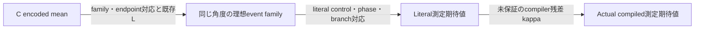

# H4非DF/DF：PR費用tail・実装残差の重点調査

2026-10-24 JST。**既存の固定H4結果は、残差がguard内にあり、保存平均価格を用いる条件付き資源比較として支持できる。今回の調査から追加科学計算が一律に必要とは判断しない。** DF-PRの母平均費用の正当な数値上界と、実compiled測定までの全rho上界は未確立のままである。

優先案は、**固定compilerの費用増加だけを対象にした限定SOURCE証明**、次に**Cとliteralが同じ保存角度を使う辺の接続と、残るcontrol/phaseの小さい診断**。追加256本、435件診断、全compiler意味論証明を既定の工程にはしない。今回、新しい確率・費用・誤差・N/Gの実H4数値評価、sampling、compile、科学grantはすべて0。成果物保存後mandatory STOP。

## 固定範囲・参照来歴

基点branch `codex/non-df-h4-conditional-cng-results-20261024`、commit `5600f0e4b28c140a6a50b8aba47425860972a932`。納品用の専用branchは `codex/non-df-h4-tail-rho-audit-delivery-20261024`。調査着手worktreeでcheckerの別版更新を検出したため、元のfileを上書きせず、[コピー時のSHA記録](../artifacts/non_df_h4_tail_rho_investigation/2026-10-24/delivery_isolation.json)を付けて別worktreeへ保全した。元作業場所や他のprocessは変更・停止していない。[既存条件付き結果](non_df_h4_conditional_cng_results_20261024.md)を改変せず参照する。

Linear H4、隣接1.00 Å、STO-3G、8 system qubit、共通保存stateのray。Pauli-JW184項/PR prefix27、DF-native tol-only1e-8/rank10/PR prefix1＋one-body、S2/T=.8/q8/r4/K4、既存5精度とcosine/sine。価格は元Qiskit1.3.0、rz/sx/x/cx、opt1、seed17で保存した、状態準備を除くfull Hadamard wrapperのcompiled RZ数。H2のS2/Yoshida4系列と混合しない。

| 対象 | 固定SOURCE |
|---|---|
| 元H4 | `0c329b30a81accb35c212be8defa66fee0dd0f12` |
| C | `e80d7510880f8db993b777c627bb8e95b05a070d` |
| L | `eb195bf2dedd0aed9d80ad7f84948b59ea53d854` |
| C/L技術接続 | `0880f4af98b125d62599e970db89fc33634d1b61` |
| 条件付き会計 | `b1984dcde06a874d0fd6e9fe6395b7f3fb7504d8` |

GitHubから基点commitと17資料/SOURCEの全bytesを取得し、Git blob SHA・各固定commit・ローカルbytesを照合した。[取得記録](../artifacts/non_df_h4_tail_rho_investigation/2026-10-24/github_verification.json)。今回、基点5600f0e4が公開されていることを実確認した。旧publication記録の認証失敗は当時の記録として保持する。

最新版運用指示の§8.4/§10と共通AGENTSを適用。手元の2026-10-23版には§10.3見出しがないため、今回の明示指示にある研究判断優先・過剰監査を避ける方針に従った。これは科学実行承認ではない。

## A. DF-native PRの費用tail

### 保存結果として引き継ぐ事実

以下は前回の保存結果の引用で、今回の再集計ではない。DF-PRは256 paired trajectory、平均単価約23,678.44、order4 trajectory観測0、未観測component集合Uは164件。保存implemented lawから前回得た「order4なしでUを含むtrajectory」の質量は約.100119。保存平均価格による条件付きGでは全5精度でPRがPFより低い。

約76万RZ/shotという反転水準は、**rho=0かつremainder母平均が保存標本平均に一致する**という追加仮定の下の希少側平均費用閾値である。実tail費用の推定・upperではない。**全wrapper上界が76万未満だという条件だけで、無条件の母平均優位性が自動的に成立するわけでもない。** Remainder側の母平均不確かさが別に残るためである。

現時点で使えるのは、非負費用、保存有限標本、固定有限event構造、未知stratum平均を残した混合表示である。正当な数値的population upperは保存されていない。有限familyであることと、その全compiled出力に対して利用可能な数値上界が証明済みであることは異なる。

### A1. SOURCEが制約する回路構造

| 構造 | SOURCEと確認内容 | 費用上界への意味 |
|---|---|---|
| Order0/2/4 | `rte._make_event`：order kはk個のproductと最後のrotation、計k+1 application。signとorder位相を保持 | 有限なapplication数。order4を未観測として除外しない |
| 全324 support | Lの`component_support.csv`をC modelのsupport/basis/signへ構造照合 | 有限標本外を含むregistry範囲。支持はZ/ZZ、同じ11 basisを再利用 |
| Basisとreuse | `df_rte_qiskit.QiskitDFRTEEventCircuitBuilder._build`：登録basisを逆順inverse/forwardで挟み、隣接する同一basisを再利用 | Literal命令数はreuseを無視する保守的counterで覆える。compiled費用の単調性は別命題 |
| Product | `_append_central_application`：controlledではsupportごとのCZ、負符号はancilla相対phaseへ集約 | support数によるliteral制約。productの符号phaseも除外しない |
| Rotation | 同関数：signed angleからRZ/RZZを生成してcontrol。CRZは専用定義、RZZのcontrolはgeneric経路 | 1個のliteral命令でもloweringで複数native gateへ増える |
| S2 deterministic half | `df_partial_s2._append_block`：one-body/squared diagonalの共通primitive関数、basis sandwich、両half | RTE eventだけのcounterではfull費用を覆わない |
| Repeated trajectory | `df_partial_s2_repeated._build_raw`。元H4 adapterは`raw_concatenation` | 別の`boundary_optimized`候補へ差し替えない |
| Wrapper | `fixed_signal_evaluation.hadamard_wrapper`：H、既にcontrolledなDF body、sineのSdg、H、measurement | 9 qubit wrapper全体を含め、状態準備は従来どおり除外 |
| Compiled価格 | `rte_compiled_cost.transpile_and_measure_cost`：実`transpile`後の`post_counts['rz']` | 理論counterやpretranspile sizeとは異なる定義 |

全324 supportのqubit/basis/signは[既存CSV](../artifacts/non_df_h4_local_diagnostic/2026-10-23/audit02/component_support.csv)を正本として再利用し、重複した324行表は作らない。

### A2. 導けるsymbolic上界と、まだ導けない上界

既存の`estimate_df_rte_structural_size_upper_bound`と`estimate_df_partial_s2_structural_size_upper_bound`を再利用できる。以下はそのSOURCEからの**記号式**であり、実H4値は代入・評価していない。

Component jのbasis命令数をb_j、support数をs_jとし、

`P=max_j(2*b_j+s_j)`, `R=max_j(2*b_j+1)`

を非identity applicationのliteral product/rotation envelopeとする。Deterministic blockの片half envelopeをDとする。One-body blockには`2*b+n+1`、fragment blockには`2*b+n+n*(n-1)/2+1`を使える。末尾の1はcontrolled diagonalのphase gateを覆う。Full wrapperの外側命令数をw_axisとすると、固定PRのraw構成に対して

`I_literal,axis <= w_axis + q*(2*D + 2 + r*(K*P+R) + 1)`

という保守的なliteral命令数の構成が可能。2はstepのconstant/identity phase、最後の1はRTE occurrenceで集約する相対phaseを覆う。Identity applicationのphaseも集約項に含める。Basis reuseを使わない側で覆い、wrapperとdeterministic halfを落とさない。

**これはcompiled RZ上界ではない。** 例えばCRZはliteralでは1命令でも、保存Qiskit定義は2個のRZと2個のCXを持つ。XXPlusYY、controlled-RZZ、equivalence、再合成まで含める必要がある。

Compiled上界の十分条件は次の小さい証明問題にできる。

1. 発行されるgate/control族に対し、固定native basisへの一様な展開重みを与える。角度・support・phaseを含む全入力範囲で有効にする。
2. 固定default stage/plugin/target条件をSOURCEとruntimeに結合する。Qiskit版・seed・SOURCEの存在だけでは足りない。
3. 各translation/synthesis/optimization段について、全native命令数などの非負potentialの増加率と停止条件を証明する。最後に`RZ_count<=native_instruction_count`を使う経路なら、RZ数自体の単調性は不要。
4. これを上の構造envelopeと合成し、両軸のfull wrapperを覆う。Literal数が小さくなったことやprimitive単体compiled費用の和だけを根拠にしない。

**費用の増加率証明は、全compiler変換が量子的に等価であるとの証明より狭い。** 旧postcompiled program/traceが欠けていても、固定profileの全許容入力に対するsize上界をSOURCEから証明できれば、この費用問題では代替経路になり得る。旧programの復元や量子的保証まで得たことにはならない。

今回はQiskitのlevel1/default plugins、Optimize1qGatesDecomposition、BasisTranslator、HLS/UnitarySynthesis、gate definitionsとaccelerator binaryを固定C runtimeのSHAに照合した。Level1には1Q再合成・inverse cancellation・basis外gateの再translation・depth/sizeのfixed-point loopがある。Pythonの`_substitution_checks`等だけを読んでも、実`run`はaccelerated処理へ渡るため全入力の出力長は未証明。最適化の目標もRZ数単独ではない。旧pass mapは候補経路と実際の旧呼出を区別している。

したがって、**構造envelopeの見込みはあるが、全wrapper compiled RZの正当な数値上界は今回確立していない。** 成立を妨げるのはuniform lowering/translationの重み、accelerated synthesisとloopの増加率/停止、実default構成の完全な結合である。ここを未検証の「compilerは減らすだけ」で埋めない。`native_df_gate_model.py`、repeated/additive cost、order-stratified/cluster/angle-invariance等の既存counterや局所compiled modelも、対象窓の実測・推定・modelのscopeを越えてupperに格上げしない。

### A3. 希少事象・母平均への最小の接続

Order4を含む、order4なしでUを含む、残り、という元の排他的strataを保持する。未観測平均はnull/変数であり0ではない。Uは同じ保存標本から選ばれているため、約10%と観測0件から事前固定事象の独立試行検定を行わない。

次のcost-relevant familyは、観測価格やUを使わずSOURCEから定義できる候補である。

- **F4**：少なくとも1つのorder4 eventを含むtrajectory。
- **FH**：order4なしで、全registryの`2*b_j+s_j`を最大にする集合Hのcomponentを少なくとも1つ含むtrajectory。
- **FR**：order4なし、Hも含まない残り。

Hは観測前にSOURCE/入力registryから定義できるが、今回はHの実メンバー・質量・平均・費用を計算していない。Basis switch、sign、support、deterministic blockとwrapper全体を含むので、FHが実compiled高費用と等しいとはしない。将来samplingを使うなら、このようなfamilyを新標本より前に固定し、正しいconditional implemented lawと重みを検証する必要がある。

既存`rte_order_stratified_cost_validation.py`には再利用可能な層別sampling/集計の資産があるが、K2/order0,2・短いcluster/modelが中心。固定K4/full wrapperの本件へそのまま流用するとscopeが違う。新conditional samplerのfinite-grid丸めや母平均weightを未検証のまま置換しない。

最小の有望経路は、まずdata-independentな`0<=C_a<=U_a`をSOURCEで保証し、**既存256本**へ適用できるか調べること。将来の別承認では、例えばcost専用budget delta_aを定め、

`mu_a <= min(U_a, Cbar_a + U_a*sqrt(log(1/delta_a)/(2*n_MC)))`

という範囲付き平均の十分条件を使う案がある。これは今回実行していない。Costのconfidenceは元のsignal alphaとは別で、両方を95%と呼んでも全体が同時95%になるわけではない。

真のrangeが得られなければ、新しい有限標本だけでは未観測tailの上界は保証できない。代表的な未観測eventのcompileだけでも、全familyの母平均upperにはならない。追加sampling/compileは現時点では実施を勧める既定工程にせず、必要な主張・rangeまたは明示model・判断幅が決まった後に設計する。

## B. rhoの既存証拠と未被覆辺

固定定義は `rho_ca >= |m_actual_compiled,ca - m_C_normalized,ca|`。B_saved適用後、同じnormalized rayの測定期待値単位。実rhoはnull。ε=.0005のcosine許容予算約2.45e-6–2.65e-6も、前回の保存値の引用であり実残差の推定ではない。

### B1. 12項目のscope分類

「数値保証済み」はその行の限定対象についての包含を意味し、全実装certificate受理ではない。機械可読版は[12辺のevidence map](../artifacts/non_df_h4_tail_rho_investigation/2026-10-24/evidence_map.json)。

| 項目 | 現在利用できる証拠 | 分類・残る条件 |
|---|---|---|
| 1. Encoded/有限law | C40軸、finite implemented grid masses、bias_distance | 数値包含済み・IID uniform wordsに条件付き。Literal測定との一致は別 |
| 2. Forward/inverse局所gate | L148+148、同じ保存binary64角度をexact realとする理想gateとの差 | 限定的に数値保証済み。DF局所行列だけでPauli/全compilerへ流用しない |
| 3. DF basis・reuse | L11basis/324support、一様operator bound、逆順adjoint | 数値保証済み部分あり。Collapsed Cとreuse literalのendpoint鎖は未証明 |
| 4. Diagonal角度生成 | Exporterとliteralが共通primitive関数を使用、Cは保存丸め角度でdiagonalを構成 | SOURCE同一値証明が可能な候補。入力/runtime/演算順/time/zero pruningの結合が必要 |
| 5. Controlled decomposition | CRZ/RZZ/controlled-RZZのexact形式恒等式、CRZの直接定義 | 数学的規則は確認済み。実generic RZZ control・float loweringは未証明 |
| 6. Global/relative phase | order・product sign・identity・rotationの形式規則とbuilder SOURCE | Exact理想則は確認済み。binary64 pi、phase蓄積・実lowering誤差は未被覆 |
| 7. Control0/1両branch | Lのideal D=I/符号付きdiagonalの場合、cross transfer lemma | 条件付きで成立。全比較のzero branchを無証明でexact Iにはできない |
| 8. Hadamard wrapper | H-CU-H / H-CU-Sdg-H、Re/Imの形式証明 | 理想則は数学的に成立。Actual body、位相、ancilla初期化が前提 |
| 9. Normalized state/preparation | 固定state hash、C state_norm、共通rayの定義 | 保存bindingと正規化式は利用可能。costに含まれない物理preparationの実証ではない |
| 10. B_saved scale | 二値記録の±B_saved、前回の保守的B_up会計 | 支持集合の数学的事実とscale会計は利用可能。Encoded平均との一致は証明しない |
| 11. Literal→compiled | 既存K pass map・限定SOURCE則 | 一様誤差は未証明、旧program/trace欠測。版・seedだけでは閉じない |
| 12. 固定state probability | 全保存cohort両軸のbefore/after診断、先頭3本のoperator診断、代表order forced check | 経験的に検証済み。全event familyやnorm上界へ格上げしない |

### B2. 再診断を減らせる角度の辺

`h4_legacy_export.build_export`は、DF deterministic primitiveを`one_body_diagonal_primitives` / `df_squared_diagonal_primitives`から保存する。Literal `_append_block`も同じ関数を使う。Cの`primitive_diagonal`は保存global_phase/RZ/RZZ角度そのものをexact realとしてencoded operatorを組み立てる。

したがって、**理想DF係数→binary64 primitive生成の丸めを、全てrhoの新しい差として再度評価する必要があるとは限らない。** その丸めはC encoded側にも既に入っている。必要なのは、同じ準備・runtime・time表現（exporterの`.1/2`と元`T/q/2`）・演算DAG・exact-zero pruningが同じ出力を指すというSOURCE結合である。同名関数だけでは証明完了にしない。

PRもCが保存する3角度と`rte._make_event`のatan経路を結べる候補がある。Signed rotation、`2*angle`、control半角へのdyadic scalingは、対応・範囲・実経路が証明できれば代数的に処理できる。Generic controlの追加演算やphase蓄積は別に残る。今回、実角度の再生成・比較・丸め上界の数値評価はしていない。

このため、旧425 deterministic primitive＋他10項＝435診断は既定の最小案ではない。**まず同じ保存値を両側が使う辺をSOURCEで消し、残った演算だけを診断する。** 条件が成立しなければ診断を自動で拡張せず、scopeへ戻る。

これはDF側の削減候補である。Pauli-JWは`append_pauli_evolution`がPauliEvolutionGateへ係数/timeを渡し、wrapper側でbody全体をgeneric controlする。CのPauli deterministic blockもDFのような保存RZ/RZZ primitive listを使う構成ではないため、DFの共通保存角度の議論をそのまま適用しない。Pauliの係数/timeから合成角度への対応・丸め・generic controlのphaseは独立の未被覆辺で、DFのL証拠は適用外。今回の最小数値案はDF2caseに限定し、Pauliを含む全20条件のactual適格性を閉じる案とはしていない。

### B3. 既存Lと測定残差を結ぶための条件

既存Lの一様basis上界の保存表示はPF約3.68561e-13、PR約4.02067e-13。これはB未適用・同じ角度を持つ理想central Dという限定値である。Basis部分には小さい既存数値証拠がある一方、残りのcontrol/phase/compiler項がguard予算より小さいとの証明はまだない。今回、L値の加減・B乗算・新しい合計やguard比較は計算していない。

SOURCEから組み立てるべき鎖は次の形になる。

各矢印は同じstate/ray・law・phase・測定単位を持つ必要がある。Ideal枝V0/V1のnorm1、実比較枝A0/A1との差eta0/eta1が証明できれば、既存lemmaのcross差 `eta0+eta1+eta0*eta1`を使える。Normalized rayではstate norm nは打ち消され、測定scaleはB_savedを使う。Zero枝をexact Iと証明した場合だけ単純化する。

Cのsaved semantic totalとLを、名前や小ささだけで足さない。C totalからsemanticを引く必要もない。既存bias_distanceを境界として使う。ただしC collapsed familyとliteralのreuseが同じ理想familyに結合されたという証明が必要で、**C/LはCOMBINATION_BLOCKEDのまま**である。

### B4. 既存probability診断の利用範囲

元`h4_audited_evaluation`は同じ保存stateをsystemに置き、ancilla0でliteral/compiledの両軸確率を比較する。保存された`compiled_signal_max_error`はPauli-PF 2.4444890556196697e-12、Pauli-PR 1.3922196728799463e-13、DF-PF 5.0616733027197824e-12、DF-PR 2.2315482794965646e-13。ここでは保存tokenを転記しただけで再計算していない。

この証拠は、固定cohort・固定stateでの経験的整合性を強める。診断は生のancilla probabilityの差であり、その最大値をB_saved適用済みの全law平均rhoや全event operator normへ直接代入できない。Raw state normとnormalized rayの対応も区別する。保存codeではproduction trajectoryのoperator比較は先頭3本のみで、forced order checkも代表componentの非controlled circuitであり、新たな費用標本ではない。

旧QPY/QASM/DAG/pass traceは既知4caseの先行bounded調査で未確認。今回は広域探索も新compileもしていない。新programを作っても旧programの同一性や失われたnative証拠は回復しない。Compilerの一様誤差kappaは未知のまま残す。

## C. 研究判断と最小追加案

| 判断 | 現在支持できる範囲 | 必要になる追加証拠 |
|---|---|---|
| 条件付きPR優位性で十分か | 固定H4でC削減がN増を上回り、保存平均価格なら独立rho guard全域で逆転しない、という研究結果は既に成立 | この条件付き主張だけなら新計算は必須ではない。採用する主張範囲はユーザー判断 |
| DF-PRの母平均優位性 | 標本平均・nominal uncertainty・tail感度まで | 全wrapper rangeまたは正当なtail modelと、母平均の十分な信頼上界。Uの事後選択や観測maxでは代用不可 |
| 実装残差の適格性 | C/Lの部分包含・形式規則・有限cohortの経験的確認まで | 完全なendpoint鎖と未被覆control/phase/compiled誤差の量的制約。小さいLだけでは未達 |
| 優先順位 | 今の定量的な主な残課題はDF費用tail。SOURCEの費用増加率証明は意味論全体より狭く、旧256本を活用できる可能性がある | まず費用envelopeの限定証明。次に同じ角度のSOURCE結合→literal残差。実測定の精度適格性を最優先にする研究目的ならrho側を先行させる |

[非実行契約案](../artifacts/non_df_h4_tail_rho_investigation/2026-10-24/next_contracts_DRAFT.json)を2件だけ作成した。いずれも実装/科学SOURCE/runtime未固定、全実行flag false、grant null、sampling/compile0。Flagの反転だけで実行可能化する契約ではない。

1. **費用envelope→既存cohortの母平均上界**：固定profileの全入力size証明を前提gateにする。将来の明示承認では両軸envelope2、既存DF母平均上界2、保存比較領域による期待G上界確認5を最大予算とする。新Nは計算せず、保存PRのG最大に`max_axis(mu_upper/Cbar)`を掛け、保存PFのG最小と比べれば独立rho boxを保守的に覆える。新cost confidence budgetは提案であり、旧signal alphaを変えない。証明不成立・upperが緩い場合はSTOPし、PR不利と読み替えない。
2. **DF literal残差の限定辺**：同じ保存角度と両branchのSOURCE証明を先行。必要な場合だけ固定128 bitでPR角度scalar辺最大3、PF/PR phase DAG最大2、uniform controlled rounding族最大2、条件付き測定合成1 batch、保存DF20閾値への確認を提案する。2個の代表行列で全角度を代用する案ではなく、uniformな解析的証明が前提。既存C/L・reference/law/biasは再実行しない。成功してもcompiler kappaが未解決なので実rhoはnull、正式受理なし。

**次の結果で研究判断が変わる**：母平均cost upperが固定比較を十分に下回れば、rhoに条件付けた母平均資源優位性を強められる。Cost upperが閾値を跨いでも保守性による判定保留であり、逆転を実測したことにはならない。Literal残差の十分上界が許容予算を跨ぐ場合は、その保証経路では適格性を示せない。小さく収まれば残課題をcompiler側へ限定できるが、それだけでactual compiled適格とはしない。

追加sampling/compileは、rangeがない状態で証明済み母平均優位性を得る手段としては十分でない。経験的研究を強めたい場合に限り、事前固定family、正しいconditional law、判断幅、有限予算と保存programを含む別案を改めて承認する。今回はその実行を提案の既定値にしていない。

## 検証・保全・終了

[静的検証](../artifacts/non_df_h4_tail_rho_investigation/2026-10-24/verification.json)はPASS。17 remote file、固定C runtime由来の13 SOURCE/binary、C modelとLの324 support、旧20精度行nullと条件付き20関数/100行の未確定fieldを構造照合した。既存のstructural counterとphase/measurement lemmaを人工値だけで再利用し6件PASS。主agent自身の検査であり独立科学レビューではない。

[611ファイル保全SHA](../artifacts/non_df_h4_tail_rho_investigation/2026-10-24/preservation_before.json)には旧550入力、直前の条件付き結果一式、既知の旧grant/ledger/STOP等を含む。固定17件とは別に引き継いだ追加取得receipt15行もGit objectへ照合し、既存C/L token checkerと514 price join検証を流用した。最終checkerと人工検証のSHAはverification.jsonへ固定した。今回のfileは専用directoryへ追加し、旧SOURCE/raw/grant/marker/STOP、旧N/G null、C/L BLOCKED、compiler MISSING_EVIDENCE、正式未受理、元native UNKNOWNを維持した。科学entrypoint・Qiskit/NumPy/FLINT等のimportなし、実H4への算術適用なし、科学grant0。共有設定・他ユーザーへの変更0。小さい静的読取処理でありCPU/RAM/workerの人工上限は設けていない。

前回のstatic checker起動は利用上限により自動承認レビューが完了せず実行されなかった。ユーザーの継続指示後に同じ静的検証を実行しexit0を確認した。科学runのretryではない。今回の[STOP記録](../artifacts/non_df_h4_tail_rho_investigation/2026-10-24/STOP.json)は技術調査の終了だけを記録し、旧監視欠落を補完しない。

Local commit・push・remote SHAの状態は[公開記録](../artifacts/non_df_h4_tail_rho_investigation/2026-10-24/publication_status.json)。基点の再pushはせず、今回の新branchのみ公開を試みる。

**次の担当：ユーザー**が条件付き研究成果の採用範囲と、母平均保証・実測定適格性のどちらを強めるかを判断する。**Codex**は選ばれた最小契約への別の明示承認後に限り、専用実装・人工検証・新SOURCE/runtime固定・新grantを準備する。今回は静的調査と非実行案まで完了し、mandatory STOP。新数値解析・sampling・compile・N/G再会計・正式受理へ進まない。
