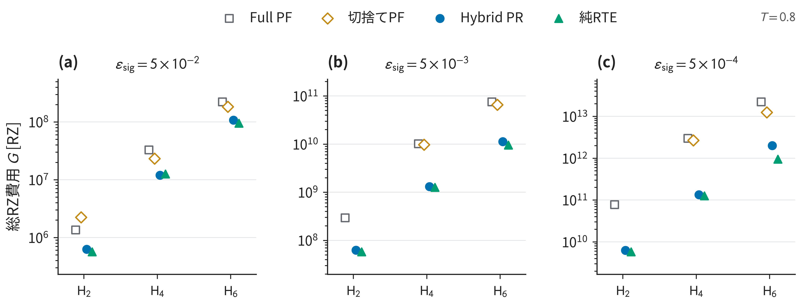
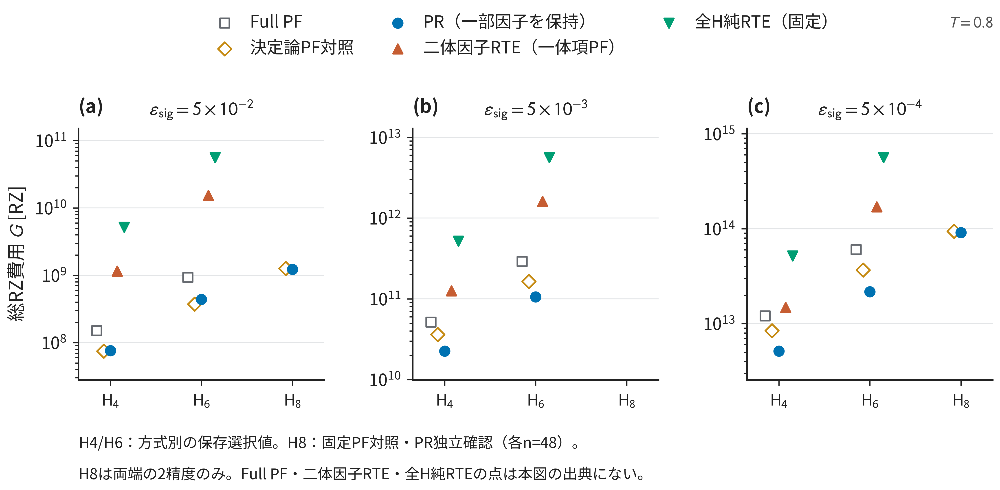
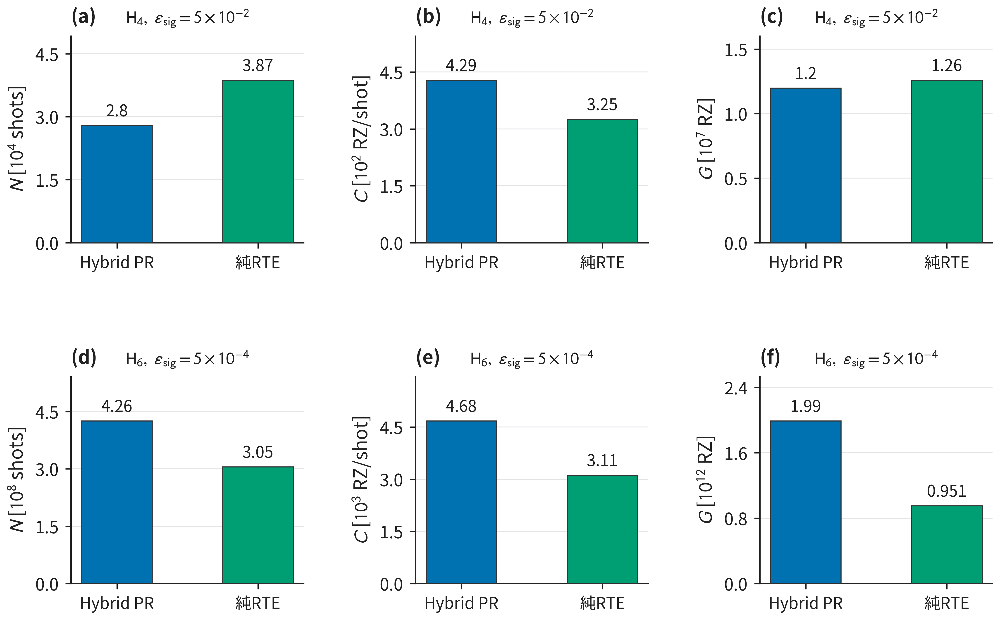
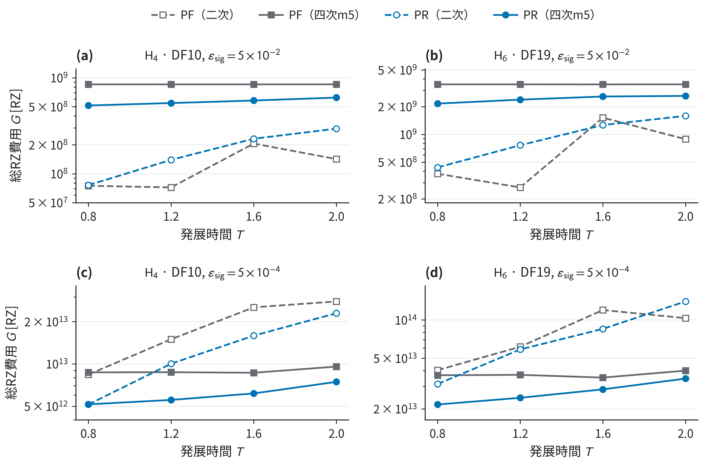
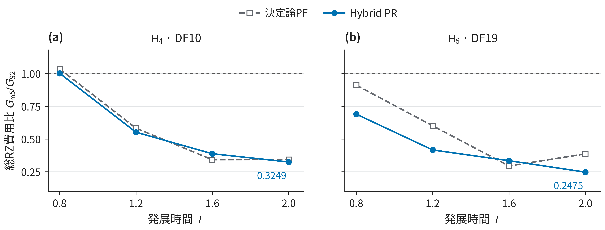
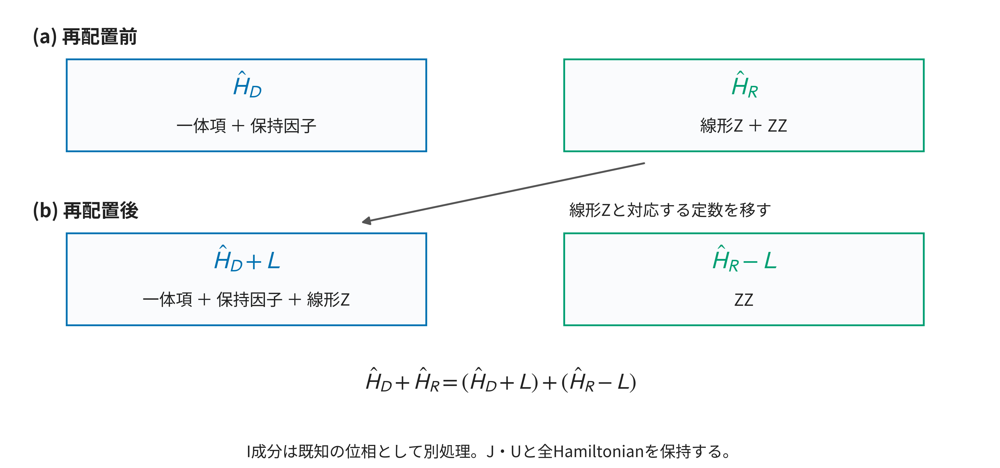
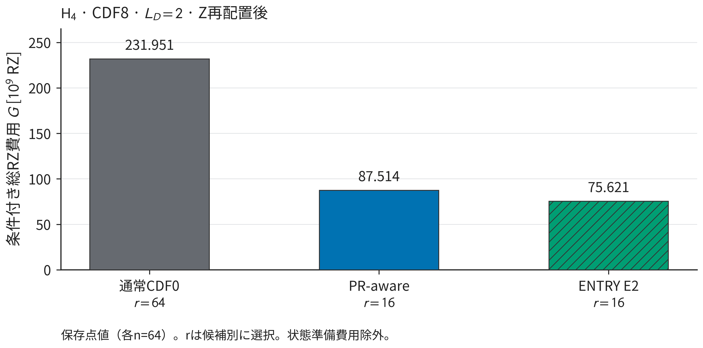
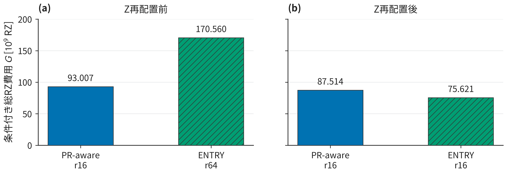
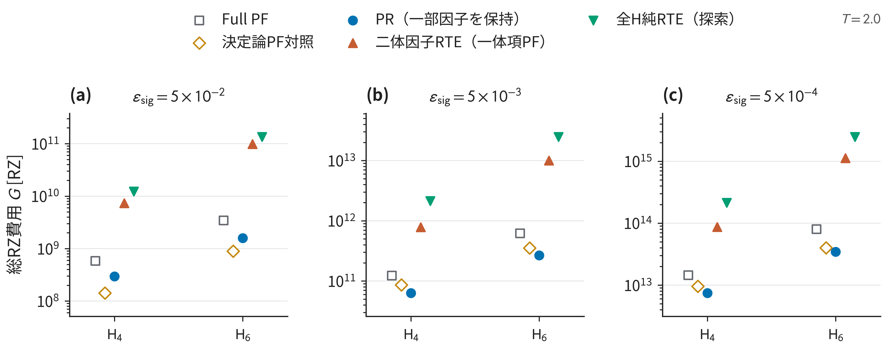
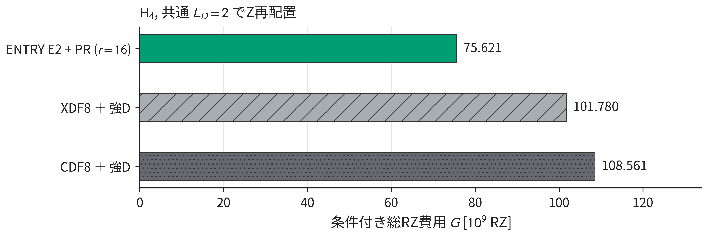

# PR資源評価とDF改良：進捗報告

2026-11-11 JST改訂。研究室向け15〜20分。**本編18枚＋補足4枚、目安の合計20分。**

**編集する原稿はこのMarkdownファイル1つです。** 各頁は投影内容と発表者ノートで構成し、詳しい計算条件・検証上の留保・出典は、その下の折りたたみ欄に保存しています。

## 本編の流れ

| 頁 | 内容 | 目安 |
|---|---|---|
| 1 | Pauli表現：PR・PF・純RTEの費用を要求精度ごとに比べる | 80秒 |
| 2 | DF表現：PF・PR・RTEの費用を保持範囲ごとに比べる | 80秒 |
| 3 | 回路単価・測定回数・総費用を、同じ条件で並べる | 60秒 |
| 4 | Tを0.8〜2.0へ拡大：二次と四次の総費用を直接見る | 70秒 |
| 5 | 高次化の利益を、m5／二次の費用比でも確認する | 30秒 |
| 6 | PR論文からの進展と、研究としての着地点（相談） | 40秒 |
| 7 | PR原論文：時間発展と測定の費用を合わせて構成を選ぶ | 60秒 |
| 8 | 本研究のRPE費用評価：信号からN、compiled回路からCを得る | 90秒 |
| 9 | 最適化方針：最適化変数・固定条件・従属変数・評価量を区別する | 45秒 |
| 10 | 設計変数の効き方：分割・PF幅・減衰許容度がNとCを変える | 45秒 |
| 11 | 最適化の手順：候補schedule全体のN×Cを比較する | 30秒 |
| 12 | 比較の目的：PRと強い決定論PFを同じ推定課題で比べる | 30秒 |
| 13 | 通常CDFの表現と、PRに使うHamiltonianの分割 | 110秒 |
| 14 | 通常CDF・PR-aware・ENTRYは何を最小化するか | 100秒 |
| 15 | PR-awareは写像後の係数、ENTRYはJの成分を抑える | 80秒 |
| 16 | Z再配置：tailの線形Zを、決定論headへ移す | 90秒 |
| 17 | Z再配置後の通常CDF・PR-aware・ENTRYの費用比較 | 90秒 |
| 18 | Z再配置前後で、PR-awareとENTRYの費用順位が変わる | 70秒 |

## 1. Pauli表現：PR・PF・純RTEの費用を要求精度ごとに比べる

目安：80秒。

### 投影内容



- T=.8、要求信号精度ε=.05／.005／.0005の3パネル。
- Full PF・切捨てPF・Hybrid PR・純RTEの**総RZ費用**を比較。低い点ほど低費用。
- 粗い精度のH4ではHybridと純RTEが近く、厳しい精度のH6では純RTEが低い。

**保持部分を増やしても、総費用が下がるとは限らない。**

### 発表者ノート

固定した時間T=.8で、時間発展信号を得る費用を比較します。左から要求精度が厳しくなります。縦軸Gは、必要な測定回数と、1回の回路に含まれるRZゲート数を合わせた総費用です。測定回数は精度から解析的に求めています。今回の費用には状態準備を含めていません。

Full PFは全項、切捨てPFは残した項を積公式で扱います。Hybrid PRは一部をPFで保持して残りをランダム化し、純RTEは定数位相を除く全Pauli項をランダム化します。

粗い精度のH4ではHybridと純RTEが近い一方、厳しい精度のH6では純RTEが低費用です。決定論的に保持する部分を増やすことが、そのまま費用削減にはつながっていません。

<details>
<summary>発表対象外：計算条件・補足説明・出典</summary>

**条件・図注**：直鎖H2/H4/H6・隣接1.00 Å・STO-3G、中性singlet。Pauli非identity項14/184/918、DF rankは非該当。T=.8、S2、δ=.8/q。純RTE L_D=0、Hybridは保存選択prefix。候補別q/r/Kは補足A。状態準備費用を除外。

**固定出典**：[S1：Pauli-JW：純RTEとHybrid](https://github.com/HIROMU1015/Partially-Randomized-Trotter/blob/4591b8d75a2a6a55c74a51225f0c61648023c8ee/docs/research/pauli_h2_h4_h6_paper_evidence_synthesis_20261101.md)

**比較の読み方・質疑用の補足**

ここでの比較は、試した有限候補と回路費用標本の範囲で、コンパイルに伴う追加の信号誤差を0と仮定したものです。未探索の候補を含む最良方式を確定したわけではありません。

</details>

## 2. DF表現：PF・PR・RTEの費用を保持範囲ごとに比べる

目安：80秒。

### 投影内容



- **PR**：一体項と一部の二体因子をPF、残りをRTEで処理。
- **二体因子RTE**：全二体因子をRTE、一体項はPFで処理。
- **全H純RTE**：一体項も含めてRTEで処理。
- 今回の全H純RTEは、同じq/R/Kの二体因子RTEに対して約3.3〜3.8倍の費用。
- 一体項もランダム化すると係数和λ_Rが増え、測定回数が増える。

全H純RTEは事前に固定した候補。H8は保存結果のあるPR・PFの2精度を表示。

### 発表者ノート

次は二重因子分解、DFでの比較です。二体相互作用を因子に分け、その保持範囲を変えます。

青いPRは一体項と一部の因子をPFで扱い、残りをRTEにします。上向き三角は全二体因子をRTEにし、一体項だけをPFに残します。下向き三角の全H純RTEでは、一体項もランダム化します。

今回の全H純RTEは、二体因子RTEと同じq、R、Kに固定した候補です。この比較では総費用が約3.3から3.8倍になります。一体項もランダム化すると、サンプリングする係数和λ_Rが増えます。H4では13.7から21.0へ増え、回路単価の差よりも測定回数の増加が総費用に効いています。

H8は保存されている2精度で、独立確認したPRとPFの結果を加えています。

<details>
<summary>発表対象外：計算条件・補足説明・出典</summary>

**条件・図注**：直鎖H4/H6・1.00 Å・STO-3G、保存tol-only1e-8 DF10/19（H6は保存weighted-Hermitian completionを含む）。T=.8、δ=.8/q、状態準備費用を除外。B3 L_D=0、一体項保持。全H純RTEは、一体項を対角化した \(\hat H_1=\tfrac12\sum_j\mu_j\,I-\sum_j\tfrac{\mu_j}{2}\,UZ_jU^\dagger\)（\(\mu_j\) は一体項の固有値で原報告のε_j、jはspin軌道）の非scalar Z成分（H4 8・H6 12成分）を既存DF tailの末尾へ加え、scalarは定数へ合算する。決定論ブロック0、S2、二体fragment順は保存順。候補は全H純RTEの出力を見る前に、保存B3のT=.8・S2・ε=.0005探索nomineeから固定した（H4 q16/R16/K4、H6 q32/R32/K6）。各n=9の価格標本を3精度で再利用。同じq/R/KのB3対照（制御比較）と、方式ごとに公式・保持数・q/R/Kが異なる保存選択値との比較を区別する（両方の保存比とG±MCSEは補足A）。λ_Rは全H純RTEと同q/R/KのB3の保存値。B2/PFの候補別L_D・PF次数・q・R/Kは補足AのCSVに収録。図は点値のみ。

**H8の条件・図注**：直鎖1.00 Å・STO-3G・tol-only1e-8 DF28、16 spin modes・保存sector4900、元DF順。T=.8、通常signed bias・allowance倍率1、状態準備費用を除外。ε=.05：B2/prefix8/q2/δ.4/r4/K4、固定PF B0I/prefix11/q1/S2。ε=.0005：B2/prefix7/q16/δ.05/r4/K4、固定PF B0I/prefix15/q4/Yoshida4。B2は各独立n48、PFは保存済み直接実測単価と固定shotによる費用。full cosine/sine Hadamard wrapper、scalar一回、Qiskit1.3.0/rz-sx-x-cx/opt1/seed17。探索n8・旧確認n32・条件付き希少pilotとpoolしない。図は保存点値のみで、信頼区間・母平均優位・全候補最適性を示さない。Taylor2/4は両確認群とも未観測。詳細監査の公開receiptによる再検証・外部再現・immutable CI済みとは扱わない。

**固定出典**：[S20：DF全Hamiltonian純RTE：固定代表候補](https://github.com/HIROMU1015/Partially-Randomized-Trotter/blob/9b83b96b83f62142c9d87858dc24a94db7ac5d61/artifacts/resource_applicability/df_full_h_pure_rte_light/2026-11-09/REPORT.md)（[RESULTS.csv](https://github.com/HIROMU1015/Partially-Randomized-Trotter/blob/9b83b96b83f62142c9d87858dc24a94db7ac5d61/artifacts/resource_applicability/df_full_h_pure_rte_light/2026-11-09/RESULTS.csv)・[comparisons.csv](https://github.com/HIROMU1015/Partially-Randomized-Trotter/blob/9b83b96b83f62142c9d87858dc24a94db7ac5d61/artifacts/resource_applicability/df_full_h_pure_rte_light/2026-11-09/comparisons.csv)）、[S3：DF B3：長時間比較](https://github.com/HIROMU1015/Partially-Randomized-Trotter/blob/ebe9e2aa2c83cd71a6da0a885b78f32274bfb6ed/artifacts/resource_applicability/track_a_h46_long_time_b3/2026-10-26/REPORT.md)、[S13：DFの方式別・精度別の保存G](https://github.com/HIROMU1015/Partially-Randomized-Trotter/blob/ebe9e2aa2c83cd71a6da0a885b78f32274bfb6ed/artifacts/resource_applicability/track_a_h46_long_time_b3/2026-10-26/comparisons.csv)、[S24：H8のT=.8・固定候補の独立確認](https://github.com/HIROMU1015/Partially-Randomized-Trotter/blob/e6eea5387a6e84d1e39a9adb3b61975acc74e200/docs/research/track_a_h8_new_pr_confirmation_results_20261019.md)（[comparisons.csv](https://github.com/HIROMU1015/Partially-Randomized-Trotter/blob/e6eea5387a6e84d1e39a9adb3b61975acc74e200/artifacts/resource_applicability/track_a_h8_new_pr_confirmation_results/2026-10-19/comparisons.csv)）

**比較の読み方・質疑用の補足**

PRや決定論PF対照との差は、方式ごとに保存された選択値どうしの比較で、q/R/Kや公式は揃っていません。この固定候補が高費用だったことから、最適化した純RTEが一般に不利だとは言えません。T=2で候補を探索した結果は補足Bに示します。また、Pauli側とDF側では入力表現や候補も異なるので、この2枚だけから費用差の原因をDFの効果に特定することはできません。

H8は同じT=.8で保存されている固定PF対照とPRの2精度だけを示しています。PRは候補を固定して各48標本で独立確認した値で、この2条件ではPFより低い点費用が報告されています。H4・H6の方式別の探索選択値とは標本・候補選択の条件が異なり、同じ探索条件の系サイズ比較ではありません。H8の中央の精度や二体因子RTE・全H純RTEには、今回の図の出典に対応する値がないため点を描いていません。未観測の高次eventの費用も不明で、母平均の優位は保証されていません。

</details>

## 3. 回路単価・測定回数・総費用を、同じ条件で並べる

目安：60秒。

### 投影内容



- 左：予定測定回数 N_cos+N_sin。
- 中央：1回路の平均RZ単価C。
- 右：測定込み総RZ費用G。
- 上段H4・粗精度：純RTEの単価は安いが、測定回数増加を補えない。
- 下段H6・厳精度：純RTEは測定回数も単価も小さく、総費用も下がる。

**単価だけを見ても、総費用の順位は分からない。**

### 発表者ノート

総費用を、測定回数と回路単価に分けます。左が予定測定回数N、中央が1回路あたりの平均RZ数C、右が総費用Gです。

上段のH4・粗い精度では、純RTEは回路を安くできますが、測定回数が増えるため、総費用はHybridより高くなります。下段のH6・厳しい精度では、純RTEは単価も測定回数も小さく、総費用が下がります。

近似誤差が許容誤差をどれだけ使うかによって、測定に残る誤差予算が変わります。回路を短くする利益と、必要な測定回数の両方を見ることが重要です。

<details>
<summary>発表対象外：計算条件・補足説明・出典</summary>

**条件・図注**：Pauli H4/H6・直鎖1.00 Å・STO-3G、184/918項、DF rank非該当。T=.8、S2、δ=.8/q、仮想ρ=0。H4粗ε=.05：Hybrid L_D36/q2/r8/K4、純RTE L_D0/q8/r8/K2。H6厳ε=.0005：Hybrid L_D78/q8/r32/K2、純RTE L_D0/q8/r64/K2。状態準備費用を除外。

**固定出典**：[S1：Pauli-JW：純RTEとHybrid](https://github.com/HIROMU1015/Partially-Randomized-Trotter/blob/4591b8d75a2a6a55c74a51225f0c61648023c8ee/docs/research/pauli_h2_h4_h6_paper_evidence_synthesis_20261101.md)

</details>

## 4. Tを0.8〜2.0へ拡大：二次と四次の総費用を直接見る

目安：70秒。

### 投影内容



- 上段：粗精度ε=.05、下段：厳精度ε=.0005。
- 左H4、右H6。二次PF（S2）／四次PF（m5）それぞれの決定論PFとHybrid PR。
- 粗精度では二次が低費用。
- 厳精度・長時間側では四次m5が低費用になる例がある。

各公式で時間分割数と保持因子数を調整した総費用。

### 発表者ノート

時間Tを.8から2.0まで延ばした結果です。二次S2と四次m5を、決定論PFとHybrid PRで比べています。各公式で時間分割数や保持因子数を調整した費用を示しています。

上段の粗い精度では二次が低費用です。下段の厳しい精度では、時間が長くなると四次m5が低費用になる例があります。高次公式では1回の実行が長くなり得ますが、必要な時間分割を減らせれば総費用で有利になります。

<details>
<summary>発表対象外：計算条件・補足説明・出典</summary>

**条件・図注**：H4/H6・直鎖1.00 Å・STO-3G、tol-only1e-8 DF10/19。T=.8/1.2/1.6/2.0、δ=T/q。S2/m5、各保存選択prefix・R/K。基本q≤16、一部長時間S2のみq32。詳細はplot_values.csvのcandidate・L_D/q/δ/R/K。測定付きfull wrapper、Qiskit1.3.0/opt1/seed17、状態準備費用を除外。

**固定出典**：[S2：H4/H6：長時間・高次PF/PR](https://github.com/HIROMU1015/Partially-Randomized-Trotter/blob/155529e20a8fac39e00786c40b57830b71203c4f/REPORT.md)、[S14：長時間・公式別の保存選択行](https://github.com/HIROMU1015/Partially-Randomized-Trotter/blob/155529e20a8fac39e00786c40b57830b71203c4f/artifacts/resource_applicability/track_a_h46_long_time/2026-10-25/best_configurations.csv)

**比較の読み方・質疑用の補足**

ただし、この図では各公式ごとに時間分割数や保持因子数などを選んでいます。次数だけを同じ構成で入れ替えた効果ではなく、試した候補の中で構成を調整した結果です。線は評価した4つの時間の点を結んでいます。

</details>

## 5. 高次化の利益を、m5／二次の費用比でも確認する

目安：30秒。

### 投影内容



- 厳精度ε=.0005に絞る。1より下ならm5が低費用。
- H4のT=.8は1.0025で、四次PRがわずかに高い。
- T=2のPRではH4 .3249、H6 .2475。
- **長時間・厳しい精度では、四次化の利益が大きくなる。**

### 発表者ノート

厳しい精度でのm5／二次の費用比です。1未満なら四次が安いことを表します。

H4のT=.8ではPRの比が1.0025で、ほぼ同じ費用です。T=2ではH4で.3249、H6で.2475まで下がります。長時間・厳しい精度では、高次化の回路負担を回収できる様子が分かります。

<details>
<summary>発表対象外：計算条件・補足説明・出典</summary>

**条件・図注**：H4/H6・直鎖1.00 Å・STO-3G、DF10/19、ε=.0005、T=.8〜2.0、δ=T/q。S2/m5の保存選択構成、候補域は前頁と同じ。状態準備費用を除外。

**固定出典**：[S2：H4/H6：長時間・高次PF/PR](https://github.com/HIROMU1015/Partially-Randomized-Trotter/blob/155529e20a8fac39e00786c40b57830b71203c4f/REPORT.md)

**比較の読み方・質疑用の補足**

これも各公式に合わせて構成を選んだ結果なので、この比を任意の分子や時間にそのまま適用できる削減率とは扱いません。

</details>

## 6. PR論文からの進展と、研究としての着地点（相談）

目安：40秒。

### 投影内容

**PR論文が示した資源削減の利点を、具体的な回路実装と強い比較対象で検証する。**

| 進展 | PR論文 | 本研究で進めたこと |
|---|---|---|
| **回路費用の具体化** | 要素回路とゲート合成の費用モデルから、Toffoli数・二量子ビットゲート数を見積もる | 測定回路を構成・コンパイルし、得られたRZ数と必要測定回数から総費用を評価する |
| **PRの低コスト性の検証** | 量子化学の例で、PRによる資源削減を示す | 切捨て・高次PF・純RTEまで比較を広げ、**PRが最安にならない例も確認した** |

ここまでに見えたこと：

- 決定論PFの候補を強めると、PRの利点が縮小・消失する例がある。
- Pauliでは、部分的に保持するPRより純RTEが低費用になる例がある。
- 回路単価の削減と、正規化・近似誤差による測定負担の競合が費用を左右する。

**着地点（案）：実装に基づく測定込み費用で、PRの利点が残る範囲と失われる範囲を明らかにする。**

### 発表者ノート

原論文の費用モデルに対し、測定付き回路の構成・コンパイルに基づいて評価しています。比較を切捨て・高次PF・純RTEまで広げ、PRの利点が縮小・消失する例も確認しました。

次は、RPE全体の費用評価と、分割・時間刻み・ランダム化量を調整する方針を説明します。

<details>
<summary>発表対象外：計算条件・補足説明・出典</summary>

**条件・注**：研究の着地点として相談する未採択の案。傾向の根拠は本編1〜5の保存結果であり、モデル・geometry・basis・DF rank・分割・delta窓・候補域・cohort・数値誤差政策は各頁に従う。同じ信号精度での比較は各入力・研究系列内の比較を指す。Pauli/DF間では分割・制御回路・候補域も異なり、表現だけの因果効果を示さない。対象は状態準備を除く固定時間信号のcompiled RZ×解析的shot費用。有限候補・有限標本での条件付き結果で、全RPE費用、母平均の最良、全候補最適性、耐故障資源の優位へは広げない。新規科学計算・統計解析・因果機構の認定は行わない。

**PR論文との対応**：原論文（arXiv:2503.05647v2）§VI・Appendix Eは、回路分解・回転合成・測定負担を含め、Toffoli数や二量子ビットゲート数を見積もっている。Appendix E.3のE21は、決定論・ランダム部分の平均要素費用を測定回数と結合する。本研究では有限RTEの測定付き回路を構成・コンパイルしたRZ数を保存価格標本から評価している。「原論文は回路費用や測定回数を考慮していない」「こちらのRZ費用が原論文のToffoli費用より正確・高い／低い」とは述べない。推定対象も原論文のエネルギー推定と本編1〜5の固定時間信号で異なる。

原論文Appendix D.2にも打切り誤差の検討があるため、打切り対照そのものを本研究の初出とはしない。PRの非優位例は本研究の有限比較域での観測であり、原論文の同条件再現・反証や、「非優位になる確率が大きくなった」という確率的主張ではない。新アルゴリズム開発とは独立した評価研究としての着地点を相談する。

**原論文**：[S34：Güntherら、Phase estimation with partially randomized time evolution（arXiv v2）](https://arxiv.org/pdf/2503.05647v2)（§VI、Appendix D.2・E.1〜E.3）。本研究との比較方針はS25 §2・S26 §7〜8、具体的な回路費用への接続は[先行研究と未解決点](../../../research/先行研究と未解決点.md)§3.4・§4.2も参照。

**固定出典（着地点の案）**：[S30：中心課題Aに基づく論文化の判断用メモ](https://github.com/HIROMU1015/Partially-Randomized-Trotter/blob/3fbf8cac2503722f1e329e079da74a493afdbc3a/docs/research/pr_paper_claim_storyline_20261106/DECISION_BRIEF.md)（§1・§3）、[S26：PRリソース評価研究の全体科学レビュー](https://github.com/HIROMU1015/Partially-Randomized-Trotter/blob/c1dbc38ecd15d04062ba8bd3796a2621965c64a3/docs/reviews/track_a/PR_resource_evaluation_Level1_review_2026-10-23.md)（§0・§7・§10）、[S29：論文化範囲の候補](https://github.com/HIROMU1015/Partially-Randomized-Trotter/blob/3380f6de0d86c0ac1db9aeb6d97ab5d328dd43bd/docs/research/pr_research_paper_evidence_synthesis_20261103/PAPER_SCOPE_OPTIONS.md)（§1・§5）、[S31：Track Aの現在地と研究Cとの関係](https://github.com/HIROMU1015/Partially-Randomized-Trotter/blob/f2e3df45043e874a5a182d856c21c9d96b4073d3/docs/research/track_a_research_c_integration_assessment_20261107.md)（冒頭・§2.1）。比較結果は本編1〜5の固定出典を参照。

</details>

## 7. PR原論文：時間発展と測定の費用を合わせて構成を選ぶ

目安：60秒。

### 投影内容

**Hを決定論部分H_Dとランダム部分H_Rへ分け、RPEの各時間で信号を測定する。**

\[
H=H_D+H_R,\qquad
T_m=\delta 2^m,\qquad
r_m=\kappa_{\mathrm{paper}}\lambda_R^2T_m^2
\]

r_m：ラウンド全体のランダムPauli回転数。共通κ_paperが全ラウンドの回数を結び付ける。

\[
B_m\le e^{1/\kappa_{\mathrm{paper}}},\qquad
N_m=e^{2/\kappa_{\mathrm{paper}}}[11+4(M-m)]
\]

信号減衰の上界から各軸のN_mを配分する。X/Yを合わせた測定回数は2N_m。

\[
\begin{aligned}
C_m^{\mathrm{paper}}&=G_{\mathrm{det}}N_{\mathrm{stage}}L_D\,2^{m-1}
+G_{\mathrm{rand}}r_m,\\
G_{\mathrm{paper}}&=\sum_m2N_mC_m^{\mathrm{paper}}.
\end{aligned}
\]

G_det・G_randは、回転合成・ゲート相殺を考慮した平均ゲート単価。

**保持範囲L_D、ステップ幅δ、ランダム化量κ_paperを通じて、測定回数と回路費用の兼ね合いを評価する。**

### 発表者ノート

まずPR原論文の評価方法です。Hamiltonianを決定論部分とランダム部分に分け、時間を倍々にした各ラウンドで信号を測ります。

ランダム回転数は、全ラウンド共通のκと時間の二乗で設計します。正規化Bの上界から測定回数を配分し、演算回数とゲート単価から1回路の費用を見積もります。両者の積を全ラウンドで合計するのが総費用です。

原論文も、保持範囲、ステップ幅、ランダム化量を扱い、PF誤差係数の数値評価やゲート合成を含めて構成を選んでいます。次は、そのNとCを本研究でどう評価するかです。

<details>
<summary>発表対象外：計算条件・補足説明・出典</summary>

- **PR論文の記法との対応**
  - 原論文（arXiv:2503.05647v2）E.3では、第mラウンドに \(S_2(\delta)^{2^m}\) を使う。δを固定し、PFのステップ数を2^m、発展時間をδ2^mとしている。
  - ランダム回転数は \(r=\kappa\lambda_R^2\delta^2 2^{2m}\)、正規化は \(B\le e^{1/\kappa}\)。本スライドの \(T_m\) で書くと \(r_m=\kappa\lambda_R^2T_m^2\) になる。
  - \(r_m\) は回路全体のランダム回転数で、本研究の \(q_{\mathrm{PF},m}R_{\mathrm{outer},m}\) に対応する（`docs/research/先行研究と未解決点.md` §4.3）。
- **原論文のN_m**
  - \(N_m=N_M+D(M-m)=B^2(11+4(M-m))=e^{2/\kappa}(11+4(M-m))\)（v2、式E21の直後）。
  - \(N_M=11\)、\(D\approx4\) は、robust phase estimationのRMSE解析と数値に基づく、原論文の特定の配分設定である（§B.2、式B30・B31）。
  - Hadamard testは各ラウンドで2N_m標本を使う（X/Y各N_m、本文式(3)・(4)、§B）。両軸を合わせた数はこの2倍。
  - v1の配分 \(B^2(4+11(M-m))\) は使わず、v2を用いる（`docs/rte_source_versions.md`）。


- **原論文の費用**
  - 式E21・E22（Appendix E.3）による。G_det・G_randは、exp(−iδH_l) 1回・Pauli回転1回あたりの平均Toffoli数（または2量子ビットゲート数）。
  - Toffoli数には、回転合成 \(G_{\mathrm{rot}}=1.14\log_2(1/\varepsilon')+9.2\) T（式E6、Toffoli 1個=T 2個）と、合成誤差の配分（式E7〜E9）を含む。
  - 2量子ビットゲート数では、CNOTの縮約（1回転あたり2|P|−3）や、項の順序による相殺に触れている（E.1）。
  - Trotter係数C_gsは数値的に推定している（§VI、式E1・E23）。κとL_Dも最適化している。
  - 第1項の2^{m−1}は、原論文のcontrolled構成（§A.4のhalving）による。本研究の制御方式とは回路が同じではない（`docs/research/先行研究と未解決点.md` §3.4）。


**固定出典**：[S34：PR原論文v2](https://arxiv.org/pdf/2503.05647v2)（Appendix E.3、§VI・Appendix D）。δ・L_D・κの費用評価と、原論文のcontrolled構成を説明する。κ_paperを本研究のκ_Bと同じ定義・同じ数値のパラメータとして扱わない。

</details>

## 8. 本研究のRPE費用評価：信号からN、compiled回路からCを得る

目安：90秒。

### 投影内容

**各候補の発展時間・PFステップ数・RTE event数に対し、NとCを評価する。**

\[
T_m=h2^m,\qquad
T_m=q_{\mathrm{PF},m}\delta_{\mathrm{PF},m},\qquad
E_m=q_{\mathrm{PF},m}R_{\mathrm{outer},m}
\]

q_PF：PFステップ数。R_outer：1ステップ内のRTE event数。E_m：総event数。RPEの倍率2^mとq_PFは別の量。

**N：正規化と近似信号を評価し、Hoeffding不等式へ接続する。**

減衰前の基準半径ρ=1を仮定する簡略形では、

\[
\begin{aligned}
B_m&=B_m(T_m,q_{\mathrm{PF},m},R_{\mathrm{outer},m}),\qquad A_m=B_m^{-1},\\
\varepsilon_{\mathrm{coord},m}&=\frac{A_m\sin\beta_{\mathrm{stat},m}}{\sqrt2},\\
N_{m,a}&=\left\lceil\frac{2}{\varepsilon_{\mathrm{coord},m}^{2}}\log\frac{2}{\alpha_{m,a}}\right\rceil
=\left\lceil\frac{4B_m^2}{\sin^2\beta_{\mathrm{stat},m}}\log\frac{2}{\alpha_{m,a}}\right\rceil.
\end{aligned}
\]

β_statは許容統計位相誤差、αは各軸の許容失敗確率。Nは十分条件によるshot数。

**C：測定付き回路をcompileし、trajectoryごとのRZ数から平均価格を推定する。**

\[
\bar C_{m,a}=\mathbb E_{\omega}[C_{m,a}(\omega)],\qquad
\widehat{\bar C}_{m,a}=\frac1n\sum_{i=1}^{n}C_{m,a}(\omega_i),\qquad
\widehat G_{\mathrm{RPE}}=\sum_{m,a}N_{m,a}\widehat{\bar C}_{m,a}
\]

nは古典的な価格標本数で、量子shot数Nとは別。長い回路の価格モデルは、実compiled価格で校正・検証する。

### 発表者ノート

本研究では、各候補について、有限RTEの信号と正規化を評価します。ここでは減衰前の基準半径を1とする簡略モデルを示しています。減衰後のAと許容統計位相誤差から座標精度を決め、Hoeffding不等式で十分shot数Nを求めます。位相誤差の成立確認や、追加誤差を含む実装式は別に保持します。

回路単価は、抽選したevent列を、制御付き時間発展とX・Y測定を含む回路にして、コンパイル後のRZ数を取得します。n本の標本平均は期待価格の推定で、量子測定回数Nとは区別します。長い回路には、実価格で校正・検証するモデルを接続します。

ここまでの結果図は各Tでの費用です。RPE全体では、目標精度に必要な全ラウンドのNとCを合計します。

<details>
<summary>発表対象外：計算条件・補足説明・出典</summary>

- **PR論文の記法との対応**
  - 原論文（arXiv:2503.05647v2）E.3では、第mラウンドに \(S_2(\delta)^{2^m}\) を使う。δを固定し、PFのステップ数を2^m、発展時間をδ2^mとしている。
  - ランダム回転数は \(r=\kappa\lambda_R^2\delta^2 2^{2m}\)、正規化は \(B\le e^{1/\kappa}\)。本スライドの \(T_m\) で書くと \(r_m=\kappa\lambda_R^2T_m^2\) になる。
  - \(r_m\) は回路全体のランダム回転数で、本研究の \(q_{\mathrm{PF},m}R_{\mathrm{outer},m}\) に対応する（`docs/research/先行研究と未解決点.md` §4.3）。
- **原論文のN_m**
  - \(N_m=N_M+D(M-m)=B^2(11+4(M-m))=e^{2/\kappa}(11+4(M-m))\)（v2、式E21の直後）。
  - \(N_M=11\)、\(D\approx4\) は、robust phase estimationのRMSE解析と数値に基づく、原論文の特定の配分設定である（§B.2、式B30・B31）。
  - Hadamard testは各ラウンドで2N_m標本を使う（X/Y各N_m、本文式(3)・(4)、§B）。両軸を合わせた数はこの2倍。
  - v1の配分 \(B^2(4+11(M-m))\) は使わず、v2を用いる（`docs/rte_source_versions.md`）。
- **簡略式の前提**
  - ρ=1は、減衰前の基準信号半径を1とする仮定である。A_m=1/B_mを掛けるので、RTEによる減衰は含まれる。
  - 実装では、保存referenceと誤差diskから次を使う。
    - \(\rho_{\mathrm{lower}}=A-D_{\mathrm{raw}}\)（D_raw：raw誤差diskの半径）
    - \(\beta_{\mathrm{det}}=\arcsin(D_{\mathrm{raw}}/A)\)、\(\beta_{\mathrm{det}}+\beta_{\mathrm{stat}}\le\beta_{\mathrm{total}}\)
    - \(\varepsilon_{\mathrm{axis}}=\rho_{\mathrm{lower}}\sin\beta_{\mathrm{stat}}/\sqrt2\)
  - raw diskには、PF・有限RTEのsigned bias、座標allowance、reference offset、保存stateの残差×T、normalization marginなどが入る。
  - 数値allowanceは経験的なpolicyで、rigorousな上界ではない。actual implementation・law誤差と厳密なground同定は未資格。
  - 位相誤差の数値信号による確認と、この詳細式は、簡略式と別に扱う。
- **現在の設定**
  - H4/H6の13ラウンド（h=.1、m=0..12）。各方式でα_total=.05を26軸に分ける（α_{m,a}=.05/26）。β_total=.4 rad、β_stat=.2 rad。
  - H4はδ=h=.1なのでq_PF,m=2^mと一致する。H6はδ=1.6なので、m≥4でq_PF,m=2^m/16となる。
- **R_outerへの依存の目安**
  - S2・小さいτの主項では \(\log B_m\approx\lambda_R^2T_m^2/(q_{\mathrm{PF},m}R_{\mathrm{outer},m})\) となる。\(q_{\mathrm{PF}}R_{\mathrm{outer}}=\kappa\lambda_R^2T_m^2\) とおけば、原論文の \(B\approx e^{1/\kappa}\) に対応する。
  - 計算には有限K2の正確な式を使う。整数配分・非可換性・biasがあるため、R_outerを増やせばNが単調に減るとは保証しない。
  - λ_Rの添字Rはランダム部分を表し、R_outerやDFの因子数Rとは別である。
- **検証の範囲**
  - R依存Nは、H4/H6の有限候補でideal条件付きの評価まで行った。Cとは未結合で、総費用や最適なR_outerは判定していない。
- **本編1〜5との関係**
  - 本編1〜5は、1つのTについて信号精度εから決めたN（各軸の余裕 \(\epsilon/\sqrt2-|b_a|-u_a\)）と回路単価の積である。ラウンドを合計したG_RPEではない。
- **NとCの数値を直接比べない**
  - 原論文のN（RMSE目標と経験定数）と本研究のN（位相誤差・失敗確率に対するHoeffding十分条件）は、保証の意味が異なる。
- **出典**：原論文v2（§B.2、Appendix E.3）。本研究は次の3つ。
  - [R依存Nモデル](https://github.com/HIROMU1015/Partially-Randomized-Trotter/blob/71ba49bb28b295aa28e51101bc3b1bf07d500767/docs/research/pr_r_dependent_n_model_20261111/REPORT.md)
  - [P1結果](https://github.com/HIROMU1015/Partially-Randomized-Trotter/blob/71ba49bb28b295aa28e51101bc3b1bf07d500767/docs/research/pr_r_detailed_n_p1_results_20261111/REPORT.md)
  - [固定条件（B統合）](https://github.com/HIROMU1015/Partially-Randomized-Trotter/blob/3b742fff26381514e12c07b51701276b7d1b26ec/docs/research/pf_pr_rpe_cost_integration_20261110/REPORT.md)

- **原論文の費用**
  - 式E21・E22（Appendix E.3）による。G_det・G_randは、exp(−iδH_l) 1回・Pauli回転1回あたりの平均Toffoli数（または2量子ビットゲート数）。
  - Toffoli数には、回転合成 \(G_{\mathrm{rot}}=1.14\log_2(1/\varepsilon')+9.2\) T（式E6、Toffoli 1個=T 2個）と、合成誤差の配分（式E7〜E9）を含む。
  - 2量子ビットゲート数では、CNOTの縮約（1回転あたり2|P|−3）や、項の順序による相殺に触れている（E.1）。
  - Trotter係数C_gsは数値的に推定している（§VI、式E1・E23）。κとL_Dも最適化している。
  - 第1項の2^{m−1}は、原論文のcontrolled構成（§A.4のhalving）による。本研究の制御方式とは回路が同じではない（`docs/research/先行研究と未解決点.md` §3.4）。
- **本研究の価格条件**
  - Qiskit 1.3.0、basis rz/sx/x/cx、opt1、transpiler seed17。測定付きのfull Hadamard wrapperで、DFはsymmetric-directional制御。状態準備費用はP=0とする。
  - RZ数はcompile後のRZ命令数で、非Clifford回転数やT数ではない。原論文のToffoli数・2量子ビットゲート数とは指標が違うので、数値を直接比べない。
- **平均価格**
  - 投影の\(\bar C\)は全lawの期待価格を表す評価目標、\(\widehat{\bar C}\)は有限標本またはモデルからの推定を表す。有限個のpathの平均が期待値に等しいとは置かない。
  - 稀なorder2 eventは通常の標本に現れにくいため、別の診断で扱っている。
  - 価格の標本SE、モデル誤差、係数の不確かさは別の量である。
- **価格モデルの役割**
  - S_aは、軌道ごとに既存の構造会計kernelで数える価格（literal basis cancellation、Z fold、scalar一回、head/tail、signed piece）で、compiled価格そのものではない。
  - θは、同じpathのpairで取ったC−Sの差へのfitで決める。投影の\(\bar S_a\)は同じ有限標本での構造価格の平均。ここへ校正係数の補正を加える。全lawのE[S]を取得したという意味ではない。
  - 固定Rでは、これまでq=1,2の実価格からの一次式（S10の旧H4 DF12系列など）や、H4のMq・H6のAffineモデルを使ってきた。R可変モデルは、それらを別のRへ移植せずに新しく校正している。
- **価格モデルの状態**
  - H4/H6でPhase 1まで進んでいる。3セルで校正し、各系で校正に使わない1点（H4 q_PF16/R8、H6 q_PF2/R32）で独立に検証した。
  - 採用基準は事前に決めておらず、採用前の状態（`qualified_for_candidate=false`）である。
  - 長q・大Rの価格検証は、未承認の計画段階である。
  - 式中のqはq_PF（RPEの2^mではない）。
- **最適化の位置づけ**
  - αとβの配分を固定した既存の独立R選択部品（S40）は、候補評価の再利用先。今回説明する共通κ_B方針では、ラウンドを結び付けたschedule全体を比較する（本編11）。
  - 現状は次のとおり。
    - N(R)：有限候補を評価済み。
    - C(R)：検証中。
    - N×Cの実計算とRの選択：pipelineは人工testのみで、まだ行っていない。
  - 固定δではT=q_PF δなので、価格モデルのq_PF依存はT依存にも対応する。別δへの移送は別に確認する。
  - 同文書§4.3の独立した整数r_m最適化は、共通κ_B型の損失を調べる追加診断の候補であり、今回の主方針と区別する。
  - 旧H4 DF12系列でも、round別のr/Kをモデル費用で再最適化した経緯がある（S10の前提のcoherent opt2）。今回の評価はDF10/DF19・R可変価格モデルで組み立て直しており、旧評価の数値とは混ぜない。
- **出典**：原論文v2（Appendix E.1・E.3、§A.4）。本研究は次の5つ。
  - [R可変価格モデル設計](https://github.com/HIROMU1015/Partially-Randomized-Trotter/blob/f78bbc0d6ab350a2b2534ea6d169565895f0f1dc/docs/research/r_variable_compiled_price_design_20261111/MODEL_DESIGN.md)
  - [Phase 1結果](https://github.com/HIROMU1015/Partially-Randomized-Trotter/blob/2e6a0cdf5a647058cc7afeeb5741bfafa24c974b/docs/research/r_price_phase1_results_20261111/REPORT.md)
  - [長q・大R準備](https://github.com/HIROMU1015/Partially-Randomized-Trotter/blob/f78bbc0d6ab350a2b2534ea6d169565895f0f1dc/docs/research/r_price_longq_largeR_preparation_20261111/REPORT.md)
  - [R選択pipeline](https://github.com/HIROMU1015/Partially-Randomized-Trotter/blob/7dd61438b64a4b015ce0b7a7db81187d9867d8a2/docs/research/rpe_r_selection_20261111/REPORT.md)
  - [S10：旧18-round評価](https://github.com/HIROMU1015/Partially-Randomized-Trotter/blob/3380f6de0d86c0ac1db9aeb6d97ab5d328dd43bd/docs/research/pr_rpe_v3_r1_shared_calibration_sensitivity_20261103/REPORT.md)

**価格モデルの詳細（投影しない）**

\[
\widehat{\bar C}_a(q_{\mathrm{PF}},R_{\mathrm{outer}})
=\bar S_a(q_{\mathrm{PF}},R_{\mathrm{outer}})
+\widehat\theta_{0,a}+\widehat\theta_{q,a}q_{\mathrm{PF}}
+\widehat\theta_{L,a}q_{\mathrm{PF}}R_{\mathrm{outer}}
\]

構造価格の同じ標本での平均に、実compiled価格との差の補正を加える。候補xの探索変数と、校正係数θを混同しない。

</details>

## 9. 最適化方針：最適化変数・固定条件・従属変数・評価量を区別する

目安：45秒。

### 投影内容

**今後の共通κ型探索で、何を動かし、何を固定するか。**

| 区分 | 主な量 | 扱い |
|---|---|---|
| **最適化する** | \(L_D,\ \Delta_{\mathrm{PF}},\ \kappa_B\) | 保持範囲・PF目標幅・共通の減衰許容度を候補間で変える |
| **固定する対象・実装** | H・入力状態、DF表現・rank・係数J/U、PF公式f、K、compiler/control | 同じ対象・実装条件で構成を比較する |
| **固定するRPE条件** | 目標精度ε_E、失敗確率と位相誤差の配分α・β、prior/decoder | 探索中は同じ推定課題・誤差政策を使う |
| **先に決めて固定する** | 基準時間h、最大ラウンド番号M | prior・alias条件と目標精度から設定する |
| **従属する回路量** | \(T_m,\ q_{\mathrm{PF},m},\ \delta_{\mathrm{PF},m},\ R_{\mathrm{outer},m},\ E_m\) | 固定条件と設計変数から生成する |
| **従属する分割・減衰量** | \(H_D,H_R,\lambda_R,B_m,A_m\) | 選んだ分割・回路構成から決まる |
| **計算して評価する量** | 信号の位相誤差、\(N_{m,a},\ \widehat{\bar C}_{m,a},\ \widehat G_{\mathrm{RPE}}\) | 信号評価・価格推定・積和で求める |

**T・q・R・N・Cを全部独立に探索するわけではない。** mは0〜Mのラウンド番号。

### 発表者ノート

まず変数の扱いを区別します。候補間で動かすのはL_D、PF目標幅、共通κです。HamiltonianとDFの係数、公式やcompiler、RPEの精度・誤差配分は固定します。

hとMはpriorや目標精度から先に決め、探索中は固定します。そこから各ラウンドの時間が定まり、設計変数からqやRを生成します。NとCは自由に選ぶ変数ではなく、構成を与えて計算する評価量です。

<details>
<summary>発表対象外：計算条件・補足説明・出典</summary>

**分類の意味**：数学上はN/Cも設計変数に依存するが、ここでは「動かす設計変数」「候補比較の間に固定する条件」「生成する回路構成・分割量」「科学的に評価する出力」を、説明上の四区分として示す。B/Aは有限Kのnormalizerと回路配分から計算する従属量であり、別の自由変数ではない。Nは与えられた誤差政策の下で求める十分shot数で、最小shot数を自由に最適化した結果ではない。

**固定対象**：保存H/state・DFのrankとJ/U・fragment順・scalar規約・signed pieceへの配分規則を固定する。L_D変更は同じDF内の分割の変更で、J/Uの再最適化ではない。PF公式fとKは主比較で固定し、強いPF公式との照合は別の比較候補として扱う。compiler/control、測定付き回路scope、状態準備費用Pの政策も固定する。

**RPE政策**：ε_Eとα_total、各軸α、β_total/β_statの配分、prior/decoder、energy shift等を先に定める。hはpriorとalias条件から、Mは精度条件から決め、今回の探索中には変えない。別の目標精度を扱う場合まで同じh/Mとする趣旨ではない。mは添字であって設計変数ではない。決定手順は本編11の参照欄に示す。

**従属量の詳細**：T_mはhとm、q_PFと実際のδ_PFはT_mとΔ_PF、H_D/H_Rとλ_RはHとL_D、R_outerは共通κ_Bと分割・PF構成から生成する。stageへのr_jはR_outerと固定配分規則から、総event数E_mはq_PF R_outerから決まる。τの式は投影しない。B_mとA_m、信号の誤差・半径は各候補で評価し、これらの自由な調整を別の最適化変数として追加しない。

**実施済み範囲との区別**：今回の表は今後の探索案での変数の扱いを明示したもの。既存の固定L_D/δ/Rの数値結果や実行契約を変更せず、未評価の新分割・幅・Rの成立性、価格モデルの適用資格、最適性を認定しない。

**編集根拠**：利用者提示の `ChatGPT_Partially_10_20261111-1645.md` 内の「最適化する変数としない変数」「従属変数」の議論と、その後のh/Mに関する説明。既存部品の役割と条件はS35・S40・S41。対話中の方針案と検証済み結果を区別する。

</details>

## 10. 設計変数の効き方：分割・PF幅・減衰許容度がNとCを変える

目安：45秒。

### 投影内容

**設計変数は3種類。NやC、各ラウンドの回数は、選んだ構成から評価・生成する。**

\[
\boldsymbol x=(L_D,\Delta_{\mathrm{PF}},\kappa_B)
\]

| 設計変数 | 決めるもの | N・Cへの主な影響 |
|---|---|---|
| L_D | 決定論側に保持する因子数 | headの回路量、tailの係数和・測定負担 |
| Δ_PF | PFの目標ステップ幅 | 近似誤差、反復数、1回路の費用 |
| κ_B | 全ラウンド共通の減衰許容度 | RTE event配分、normalization、測定負担・回路費用 |

\[
\begin{aligned}
H&=H_D(L_D)+H_R(L_D),\\
q_{\mathrm{PF},m}&=\left\lceil\frac{T_m}{\Delta_{\mathrm{PF}}}\right\rceil,
\qquad\delta_{\mathrm{PF},m}=\frac{T_m}{q_{\mathrm{PF},m}},\\
\log B_m^{(K)}(R_{\mathrm{outer},m})&\le\frac1{\kappa_B}.
\end{aligned}
\]

T_mは先に定めたRPE条件から決まり、q_PF・実際のδ・R_outerが従属する。共通κ_Bからラウンド別のR_outerを生成する案。

**主比較ではDF表現・PF公式・K・RPEの誤差配分を固定する。** κ_Bは原論文のκ_paperと区別する。

### 発表者ノート

L_Dを変えると決定論回路とtailの係数和が変わります。PF目標幅は反復数と近似誤差を、共通κは減衰要求とRTE回数を変えます。実際のステップ幅とqは整数化規則で生成します。

Rは各ラウンドで自由に探索せず、共通κの正規化条件から生成する案です。これらの変更がNとCの両方に効きます。

<details>
<summary>発表対象外：計算条件・補足説明・出典</summary>

**位置づけ**：利用者提示の対話記録（2026-11-11、後半の最適化範囲・スライド構成の議論）に基づく、今後の評価方針の説明。共通κ_Bを含む科学条件の正式採択、実装・科学計算の実行許可、最適化結果の認定とは別である。L_Dの探索範囲は主張の強さに合わせて段階的に決める。

**分割**：DFの因子順・rank・表現・入力状態を固定し、一体項と先頭L_D因子をheadへ置く既存分割を基本にする。L_Dでtailの係数和λ_RとPF biasも変わる。LD変更をDF係数J/Uの再最適化と同一視しない。

**PF幅**：Δ_PFは目標幅を表す設計変数、δ_PF,mは整数q_PF,mから得る実際の幅。ceil規則は今回の方針案として示し、既存H6初期ラウンドの別prefix・幅・回数を変更済みとは扱わない。既存の固定δによる結果や凍結taskへこの規則を事後適用しない。R_outerはDF因子数Rと別の量。

**κ_BからR_outerへの生成規則（案）**：PF公式・signed piece・整数配分に適合するRの集合を\(\mathcal R_m\)として、

\[
R_{\mathrm{outer},m}(\boldsymbol x)=
\min\left\{R\in\mathcal R_m:\log B_m^{(K)}(R;L_D,\Delta_{\mathrm{PF}})\le\frac1{\kappa_B}\right\}.
\]

条件を満たす候補がなければ未充足として扱う。有限menuなら「そのmenu内の最小」であり、全整数中の最小とは呼ばない。実行可能な整数を確認する方針で、Rに関する単調性・二分探索の成立は仮定しない。κ_Bが同じでもT、分割、公式、整数配分によりR_outer,mはラウンドごとに異なる。同じ整数scheduleになるκ候補は、同じ科学条件の範囲で重複評価を避けられる。

κ_Bは有限Kのnormalization上限を指定する設計変数で、原論文の回転数倍率κ_paperと同じ定義ではない。κ_paperの参考値をκ_Bの最適値として流用しない。Nやcompiled CのR依存の単調性・最適性も認定しない。B条件だけでは位相・半径・実装誤差条件の成立を保証しない。

**根拠**：原論文の分割・δ・共通κはS34 Appendix E.3。本研究の有限K normalizer・整数配分・Nへの接続はS35、価格の構造依存はS37。S35/S37の既存domainを、別L_D・幅・大Rへ自動移送しない。

</details>

## 11. 最適化の手順：候補schedule全体のN×Cを比較する

目安：30秒。

### 投影内容

**分割・PF幅の候補ごとに共通κ_Bを変え、全ラウンドのscheduleを生成する。**

\[
\boldsymbol x
\longrightarrow\{q_{\mathrm{PF},m},\delta_{\mathrm{PF},m},R_{\mathrm{outer},m}\}_{m=0}^{M}
\longrightarrow\{N_{m,a},\widehat{\bar C}_{m,a}\}
\]

\[
\boxed{
\boldsymbol x^*\in\underset{\boldsymbol x\in\mathcal X_{\mathrm{eligible}}}{\operatorname{argmin}}
\underbrace{\sum_{m=0}^{M}\sum_{a\in\{X,Y\}}
N_{m,a}(\boldsymbol x)\widehat{\bar C}_{m,a}(\boldsymbol x)}_{\widehat G_{\mathrm{RPE}}(\boldsymbol x)}
}
\]

\(\mathcal X_{\mathrm{eligible}}\)：信号の位相・半径条件を満たし、比較に使える価格がある候補集合。

- T_m・ラウンド数は、目標精度とRPE政策から先に決める。
- 共通κ_Bでは、ラウンドごとの最安Rを別々に選んで足すのではなく、schedule全体を比較する。
- N評価・価格評価・集計の既存部品を接続し、費用差と不確かさを確認する。

**候補集合内の最小推定費用を調べる計画であり、最適解を得た結果ではない。**

### 発表者ノート

候補から全ラウンドの構成を生成し、既存のN評価と価格評価を接続して積和を比較します。共通κでR配分が結び付くため、schedule全体を一候補として評価します。価格の欠測や不確かさが残る場合は、費用順位を確定しません。

<details>
<summary>発表対象外：計算条件・補足説明・出典</summary>

**探索の位置づけ**：科学的に許可された有限候補に対する評価の設計案。候補集合の定義・独立確認・必要な適用域検証を先に定める。共通κのschedule生成、任意L_D/幅のN・C評価、探索・再ランキング、新しいG集計を今回実行したものではない。

**固定条件・従属変数・評価量**：H/state・DF表現・PF公式f・K・compiler/control・状態準備費用の扱い・RPE誤差政策を主比較では固定する。qやRは設計変数から生成する回路構成量で、N/Cはその構成を与えて求める評価量。価格モデルの校正係数θは、設計変数\(\boldsymbol x\)とは別の量。

**hとMの決め方**：hは保存priorとalias回避条件・decoderから先に定める。正しい枝を復元でき、総位相誤差をβ_total以下に抑える政策の下で、目標エネルギー精度ε_Eに対し、

\[
M=\min\left\{n\in\mathbb Z_{\ge0}:\frac{\beta_{\mathrm{total}}}{h2^n}\le\varepsilon_E\right\},
\qquad T_m=h2^m.
\]

現在のh/Mの数値を任意の新精度へ固定して移送しない。今回の共通κ案では、先に定めたh/Mとα/β配分を探索中に変更しない。全失敗確率に対する各軸配分の合計と位相復元条件は別に保持する。これは条件付きの精度設計で、現実の実装の成功保証ではない。

**候補の適格性**：位相・半径の不成立、価格の欠測、モデル適用域外、精度未達を区別する。\(\mathcal X_{\mathrm{eligible}}\)だけの最小値を、未評価・未資格候補も含む最良値とは呼ばない。未取得価格を0・無限大で補わず、必要な候補の不足は別に記録する。価格の標本変動・共有校正・長時間へのモデル誤差等によって差が不明なら、順位は未確定とする。

**独立R最適化との区別**：従来のラウンド別R選択基盤は候補評価の部品として再利用できるが、共通κの制約を課した全体探索の代用にはならない。独立Rの選択は、共通κという制約の影響を調べる追加診断の候補であり、主方針に自動追加しない。

**追加診断としての独立R案（主方針とは別）**

\[
\min_{\{R_{\mathrm{outer},m}\}}\widehat G_{\mathrm{RPE}}
=\min_{\{R_{\mathrm{outer},m}\}}\sum_{m,a}
N_{m,a}(R_{\mathrm{outer},m})\widehat{\bar C}_{m,a}(R_{\mathrm{outer},m})
\]

ラウンド間の制約がない独立R選択との比較を将来検討できるが、共通κ_B探索の結果へ読み替えない。

**根拠**：利用者提示の対話記録の、共通κによるschedule全体の探索・変数の区別に関する議論。既存のN/C結合・候補同一性・不確かさの取扱いはS40・S41。h/M・位相/半径条件はS35とその既存RPE接続部品。既存実装がこの共通κ探索を実施済みであるという主張はしない。

</details>

## 12. 比較の目的：PRと強い決定論PFを同じ推定課題で比べる

目安：30秒。

### 投影内容

**PR側とPF側の両方で構成を調整し、同じエネルギー精度・成功確率の費用を比較する。**

\[
\begin{aligned}
\widehat G_{\mathrm{PR}}^{\mathrm{best}}&=
\min_{\boldsymbol x\in\mathcal X_{\mathrm{PR}}}\widehat G_{\mathrm{PR}}(\boldsymbol x),\\
\widehat G_{\mathrm{PF}}^{\mathrm{best}}&=
\min_{\boldsymbol y\in\mathcal X_{\mathrm{PF}}}\widehat G_{\mathrm{PF}}(\boldsymbol y),\qquad
\eta=\frac{\widehat G_{\mathrm{PR}}^{\mathrm{best}}}{\widehat G_{\mathrm{PF}}^{\mathrm{best}}}.
\end{aligned}
\]

- PF側もステップ幅・保持範囲を調整し、Full PF・切捨てPF・代表公式を対照にする。
- ηは各候補集合内での最良推定費用の比。価格の不確かさも含めて比較する。

| 既存の到達点 | 次に明らかにしたいこと |
|---|---|
| Nの有限候補評価、compiled価格の初期検証、N/C統合基盤 | 共通κを含む全RPE探索と、調整したPF対照との費用比較 |

**κ単独や測定回数の削減ではなく、PRの利点が総費用で残る範囲を示すことが目的。**

### 発表者ノート

PF側も保持範囲や時間刻みを調整し、同じ精度と成功確率で費用を比較します。共通κを含む全体探索と最終比較は未完了です。次は、固定したDFから時間発展を選ぶ話から、DF係数J/U自体の改良へ移ります。

<details>
<summary>発表対象外：計算条件・補足説明・出典</summary>

**比較範囲**：期待費用の目標と、有限cohort・モデルからの推定費用を区別する。bestは、明示した候補集合と必要な評価を備えた範囲の最良であって、全整数・全PF公式に対する一般最適性ではない。新しいη、削減率、G、区間、順位をこの資料改訂で計算しない。

**公平なPF対照**：同じ保存H/state・target、目標エネルギー精度、成功確率、RPE政策、compiler/control、測定付き回路scope、状態準備費用の扱いで比較する。PRだけへ調整の機会を与えない。PF側の切捨て誤差を誤差会計から除かず、Fullと切捨てを区別する。主比較の代表公式を固定する方針と、強いPF公式への照合を区別する。

**実施済みと計画**：本編1〜5の固定時間比較、S10の旧DF12条件付き全RPEモデル評価、S35〜S41の新DF10/19の評価部品・有限候補・初期価格検証は、別のdomainの既存成果として保持する。共通κ_B・L_D・Δ_PFを含む新しい全RPE最適化と、公平な最終費用比較を完了したとは述べない。価格の長q/大R適用域、signal/law・数値誤差、候補選択後の比較を目的に応じて確認する必要がある。

**DF改良との階層の違い**：本編9〜12の方針ではDF表現と係数J/Uを固定して時間発展の構成を選ぶ。以後のDF改良は、DF誤差予算の下でJ/Uを変える別の研究系列。両方を同時に最適化した結果として説明しない。

**根拠**：利用者提示の対話記録後半の、強いPF対照・最適化の目的・DF改良との区別に関する議論。既存比較の位置づけはS29・S30、有限Nと価格・統合の実施範囲はS35〜S41。これらの既存SOURCE・raw・STOPや研究方針文書は本改訂では変更しない。

</details>

## 13. 通常CDFの表現と、PRに使うHamiltonianの分割

目安：110秒。

### 投影内容

**元の分子Hamiltonian：一体部分を補正した形で書く。**

\[
\hat H=E_c+\sum_{p,q=1}^{n}\kappa_{pq}\hat E_{pq}
+\frac12\sum_{p,q,r,s=1}^{n}g_{pqrs}\,\hat E_{pq}\hat E_{rs},
\qquad
\kappa_{pq}=h_{pq}-\frac12\sum_{r}g_{prrq}.
\]

\(\hat E_{pq}=\sum_\sigma a^\dagger_{p\sigma}a_{q\sigma}\)。h・gは一電子・二電子積分、\(E_c\) は核間反発の定数。

**二電子積分gを、R個の回転基底Uと係数行列Jで近似する（通常CDF）。**

\[
g_{pqrs}\simeq g^{\mathrm{DF}}_{pqrs}(J,U)
=\sum_{t=0}^{R-1}\sum_{i,j=1}^{n}
U^{(t)}_{pi}U^{(t)}_{qi}\,J^{(t)}_{ij}\,U^{(t)}_{rj}U^{(t)}_{sj},
\qquad
U^{(t)\mathsf T}U^{(t)}=I,\quad J^{(t)}=J^{(t)\mathsf T}.
\]

**二体部分だけを置き換えると、因子ごとの粒子数相互作用になる。**

\[
\hat H_{\mathrm{DF}}=E_c+\sum_{pq}\kappa_{pq}\hat E_{pq}+\sum_{t=0}^{R-1}\hat H_t,
\qquad
\hat H_t=\frac12\sum_{i,j}J^{(t)}_{ij}\hat N^{(t)}_i\hat N^{(t)}_j,
\qquad
\hat N^{(t)}_i=\sum_{pq}U^{(t)}_{pi}U^{(t)}_{qi}\hat E_{pq}.
\]

**先頭L_D因子を決定論側に残し、残りをランダム化する。**

\[
\hat H_{\mathrm{DF}}=
\underbrace{E_c+\sum_{pq}\kappa_{pq}\hat E_{pq}+\sum_{t<L_D}\hat H_t}_{\hat H_D}
+\underbrace{\sum_{t\ge L_D}\hat H_t}_{\hat H_R}.
\]

- \(\hat H_D\) は積公式、\(\hat H_R\) はRTEで時間発展させる。
- κは元のgで作り、\(g^{\mathrm{DF}}\) に合わせて作り直さない。近似で変わるのは二体部分だけ。
- **R=8（因子数）、L_D=2（保持因子数）を固定し、変えるのはJ・Uだけ。**

### 発表者ノート

こちらはDF係数J/Uを改良する研究です。前半の固定したDFでの時間発展の構成探索と分け、得られたDFの費用をRPE全体で評価します。

一番上は元の分子Hamiltonianです。二体部分を並べ替えた際に生じる一体の寄与を、あらかじめ積分hへ取り込んだものがκです。

通常CDFでは、四つの添字を持つ二電子積分gを、因子ごとの直交行列Uと対称行列Jで近似します。Uは軌道の回転、Jは回転基底での相互作用係数です。この近似を二体部分へ代入すると、各因子は粒子数どうしの積の和になります。その基底では対角なので、時間発展を組み立てやすくなります。

最後の式がPRの分割です。一体項と先頭L_D個の因子を決定論側に、残りをランダム側に置きます。今回の比較では因子数Rを8、保持数L_Dを2にそろえ、JとUを最適化します。

<details>
<summary>発表対象外：計算条件・補足説明・出典</summary>

**条件・記号**：研究Cの実数number-CDF規約。p,q,r,s,i,jは空間軌道（n=4）、σはspin、tは因子番号。主比較はH4・直鎖1.00 Å・STO-3G、R=8、元順L_D=2（tail因子はt=2〜7の6個）、Nα=Nβ=2。この分割は線形Z再配置前で、再配置は本編16で扱う。

**固定出典**：[S17：tensor再構成・補正済み一体項・因子Hamiltonianの実装](https://github.com/HIROMU1015/Partially-Randomized-Trotter/blob/5a53d0569b70e4417765c4876616260db911e603/src/trottertracks/c1_stage1.py)（corrected_kappa・fit_onceのtensor再構成・raw_base・raw_frame）、[S9：研究C総括§2](https://github.com/HIROMU1015/Partially-Randomized-Trotter/blob/3eccab64a2672813e479c113c2485219f8479885/docs/research/research_c_final_synthesis_20261107/REPORT.md)、[S16：三候補の固定条件](https://github.com/HIROMU1015/Partially-Randomized-Trotter/blob/776e0a16ac98762631fe9307672725fdfee3b73d/docs/research/research_c_three_method_z_relocated_comparison_20261108/REPORT.md)。

</details>

## 14. 通常CDF・PR-aware・ENTRYは何を最小化するか

目安：100秒。

### 投影内容

**近似で変わるのは二体部分だけ。その差を二つの尺度で測る。**

\[
\hat H-\hat H_{\mathrm{DF}}
=\frac12\sum_{pqrs}\bigl(g-g^{\mathrm{DF}}\bigr)_{pqrs}\,\hat E_{pq}\hat E_{rs}.
\]

\[
f(J,U)=\frac12\bigl\|g-g^{\mathrm{DF}}(J,U)\bigr\|_F^2,
\qquad
e_{\mathcal S}=\bigl\|\Pi_{\mathcal S}(\hat H-\hat H_{\mathrm{DF}})\Pi_{\mathcal S}\bigr\|_2 .
\]

fは最適化に使う係数tensorの誤差。\(e_{\mathcal S}\) は電子数sector内の演算子誤差で、得られた候補ごとにDF誤差予算CA/8と比べる。

**三つの目的関数。変数はJ・U、R=8・L_D=2は固定。**

\[
F_{\mathrm{CDF}}=\frac{f}{f_*},
\qquad
F_{\mathrm{PR}}=\frac{f}{f_*}+\gamma_{\mathrm{PR}}\Bigl(\frac{M_{\epsilon_s}(J)}{M_*}\Bigr)^2,
\qquad
F_{\mathrm{ENTRY}}=\frac{f}{f_*}+\gamma_{\mathrm{ENTRY}}\Bigl(\frac{B_\eta(J)}{B_*}\Bigr)^2.
\]

**罰則：tail因子（t ≥ L_D）の何の絶対値和を抑えるか。** \(\phi_\tau(x)=\sqrt{x^2+\tau^2}\) は |x| の平滑化。

\[
M_{\epsilon_s}(J)=\sum_{t\ge L_D}\Bigl[\sum_a\phi_{\epsilon_s}\bigl(c^{(t)}_{Z_a}\bigr)
+\sum_{a<b}\phi_{\epsilon_s}\bigl(c^{(t)}_{Z_aZ_b}\bigr)\Bigr],
\qquad
B_\eta(J)=\sum_{t\ge L_D}\sum_{i,j}w_{ij}\,\phi_\eta\bigl(J^{(t)}_{ij}\bigr),
\quad w_{ii}=\tfrac54,\ w_{i\ne j}=\tfrac32.
\]

- c：tail因子をZ・ZZのPauli和に展開した係数（Jとの関係は本編15）。平滑化を外した \(M_0\) が、再配置前のRTEのtail係数和 \(\lambda_R\)。
- \(f_*,M_*,B_*\)：初期点の値で固定する尺度。γ：罰則の重み。γ=0なら通常CDF。
- **massを探索の指標とし、得られたDFをRPE総費用で評価する（本編17・18）。**

### 発表者ノート

通常CDFが小さくするのは、二電子積分の近似誤差fです。得られた候補は、電子数を固定した空間での演算子誤差e_Sでも確認し、DF誤差予算と比べます。

三つの目的関数を並べると、通常CDFはfだけ、PR-awareとENTRYはfに罰則項を加えています。変数はJとUです。星付きの量は初期点で決める尺度、γは罰則の重みです。

PR-awareは、ランダム化するtailをZ・ZZのPauli和に展開した係数の絶対値和Mを抑えます。平滑化を外したM_0は、RTEで使う係数和λ_Rに当たり、正規化と測定回数に関係します。

ENTRYは、写像前のJの成分に絶対値を取り、対角に5/4、非対角に3/2の重みを付けて足します。φは絶対値を滑らかにした関数です。どちらも、DF誤差を抑えながら時間発展に有利な係数を得るのが狙いです。最後にRPE総費用で評価します。

<details>
<summary>発表対象外：計算条件・補足説明・出典</summary>

**条件・記号**：H4・直鎖1.00 Å・STO-3G、number CDF8・L_D=2。i,jは空間軌道、a,bは各回転基底のspin軌道（2n=8個）で、tail因子ごとに線形Z 8成分とZZ 28成分の全36成分（0の成分を含む）を和に入れる。identityはmassから除外する。ε_s=1e−8 Haは平滑化幅で、前半の信号許容誤差εとは別。ηは0でのmassをPR-awareとそろえる既存規約（補足A）。保存候補の尺度はf_*=2.184×10^−9 Ha²、M_*=2.209 Ha、B_*=3.741 Ha。本編17の保存P/E2はγ_PR=.1、γ_ENTRY=.03（原報告のγ・β）。目的関数はZ再配置前の分割で定義した。DF予算の受入れはsector残差＋engineering guardによる数値pilotで、厳密な誤差保証とは区別する。保存3候補とも、sector残差とguardはそれぞれ10^−8 Ha未満で、予算0.00019875 Haを満たす（補足A）。

**固定出典**：[S11：PR-awareのcoefficients・smooth_mass・make_value_and_grad・scales](https://github.com/HIROMU1015/Partially-Randomized-Trotter/blob/5a53d0569b70e4417765c4876616260db911e603/src/trottertracks/c_pr_aware_df.py)、[S12：ENTRYのentry_weights・mass・initial_spec](https://github.com/HIROMU1015/Partially-Randomized-Trotter/blob/5a53d0569b70e4417765c4876616260db911e603/src/trottertracks/c_near_objective.py)、[S17：tensor残差と目的値½‖·‖²の対応](https://github.com/HIROMU1015/Partially-Randomized-Trotter/blob/5a53d0569b70e4417765c4876616260db911e603/src/trottertracks/c1_stage1.py)、[S16 §6：三者の目的・固定scale・物理誤差条件](https://github.com/HIROMU1015/Partially-Randomized-Trotter/blob/776e0a16ac98762631fe9307672725fdfee3b73d/docs/research/research_c_three_method_z_relocated_comparison_20261108/REPORT.md)。

</details>

## 15. PR-awareは写像後の係数、ENTRYはJの成分を抑える

目安：80秒。

### 投影内容

**tail因子を、回転基底の量子ビット上でPauli和に書く。** \(\tilde Z_a=I-2\tilde n_a\)、aはspin軌道、i(a)はその空間軌道。

\[
\hat H_t=c^{(t)}_I\,I+\sum_{a}c^{(t)}_{Z_a}\tilde Z_a+\sum_{a<b}c^{(t)}_{Z_aZ_b}\tilde Z_a\tilde Z_b,
\qquad
c^{(t)}_{Z_a}=-\frac12\sum_{j}J^{(t)}_{i(a)\,j},
\qquad
c^{(t)}_{Z_aZ_b}=\frac14J^{(t)}_{i(a)\,i(b)}.
\]

**平滑化を外すと、二つのmassはJで次のように書ける。**

\[
M_0=\sum_{t\ge L_D}\Bigl[
\underbrace{\sum_i\Bigl|\sum_jJ^{(t)}_{ij}\Bigr|}_{\text{linear }Z}
+\underbrace{\frac14\sum_i\bigl|J^{(t)}_{ii}\bigr|+\frac12\sum_{i\ne j}\bigl|J^{(t)}_{ij}\bigr|}_{ZZ}
\Bigr],
\qquad
B_0=\sum_{t\ge L_D}\Bigl[\frac54\sum_i\bigl|J^{(t)}_{ii}\bigr|+\frac32\sum_{i\ne j}\bigl|J^{(t)}_{ij}\bigr|\Bigr].
\]

\[
B_0-M_0=\sum_{t\ge L_D}\sum_i\Bigl(\sum_j\bigl|J^{(t)}_{ij}\bigr|-\Bigl|\sum_jJ^{(t)}_{ij}\Bigr|\Bigr)\ \ge\ 0 .
\]

- 線形Zの係数はJの**行和**。同じ行の正負が打ち消し合えば、PR-awareのmassは小さくなる。
- ENTRYは成分の絶対値を先に取るので、その相殺を評価しない。\(B_0\) は \(M_0\) の上限で、差は行内の相殺量。
- 両者はDF最適化の目的の違い。時間発展はどちらもPR。

### 発表者ノート

PR-awareとENTRYの違いを係数で見ます。tail因子を回転基底の量子ビットで書くと、恒等演算子、線形Z、ZZの和になります。線形Zの係数はJの行和の−1/2倍、ZZの係数はJの成分の1/4です。

これを使うと、二つのmassをJで表せます。PR-awareのM_0には行和の絶対値が入り、ENTRYのB_0は成分の絶対値を足します。

差を取った三つ目の式は、各行で絶対値の和から和の絶対値を引いたものなので0以上です。この差が、行内の正負の相殺量です。PR-awareは相殺を使って線形Zを小さくでき、ENTRYは成分そのものを抑えます。

次に、線形Zをランダム側から移すと、この違いが費用にどう現れるかを見ます。

<details>
<summary>発表対象外：計算条件・補足説明・出典</summary>

**条件・記号**：S11の係数規約（K_ab=J_{i(a)i(b)}/2、c_Za=−Σ_b K_ab/2、c_ZaZb=K_ab/2）をJで書き直した。Jordan–Wigner、各因子の基底回転後の量子ビット。B_0−M_0はS12 mass_diagnosticsのrow_cancellation_gap、M_0=M_ZZ+Z等の恒等式はS18の診断で数値照合済み。H4 number-CDF8/元順L_D2、Z再配置前。

**固定出典**：[S11：PR-aware目的の係数写像](https://github.com/HIROMU1015/Partially-Randomized-Trotter/blob/5a53d0569b70e4417765c4876616260db911e603/src/trottertracks/c_pr_aware_df.py)、[S12：ENTRY目的とrow_cancellation_gap](https://github.com/HIROMU1015/Partially-Randomized-Trotter/blob/5a53d0569b70e4417765c4876616260db911e603/src/trottertracks/c_near_objective.py)、[S18：H4線形Z再配置の保存J mass診断](https://github.com/HIROMU1015/Partially-Randomized-Trotter/blob/d601e0ef4375c37185211aa75685ae0e582f3e64/docs/research/research_c_h4_relocation_execution_20261106.md)

**比較の読み方・質疑用の補足**

どちらが費用に有利かは、この式だけでは決まりません。また、ここまでの目的は、次に説明するZ再配置の前の項の構成に基づいています。

</details>

## 16. Z再配置：tailの線形Zを、決定論headへ移す

目安：90秒。

### 投影内容



**tail因子の線形Zは、一体項と定数に書き直せる。** \(r^{(t)}_i=\sum_jJ^{(t)}_{ij}\)（行和）、\(t\ge L_D\)。

\[
L^{(t)}=\sum_a c^{(t)}_{Z_a}\tilde Z_a=\sum_i r^{(t)}_i\hat N^{(t)}_i-\sum_i r^{(t)}_i .
\]

\[
\text{head: }\quad
\kappa\to\kappa+\sum_{t\ge L_D}U^{(t)}\operatorname{diag}\bigl(r^{(t)}\bigr)U^{(t)\mathsf T},
\qquad
E_c\to E_c-\sum_{t\ge L_D}\sum_i r^{(t)}_i .
\]

**再配置後にランダム化するのはZZだけ。**

\[
\lambda_R^{\mathrm{after}}=M_{ZZ}=\sum_{t\ge L_D}\Bigl[\frac14\sum_i\bigl|J^{(t)}_{ii}\bigr|+\frac12\sum_{i\ne j}\bigl|J^{(t)}_{ij}\bigr|\Bigr],
\qquad
\frac{B_0}{5}\le M_{ZZ}\le\frac{B_0}{3}.
\]

- J・Uは固定。\((\hat H_D+L)+(\hat H_R-L)=\hat H_D+\hat H_R\) で、各候補の全Hamiltonianは変わらない。
- 行和の相殺はtail massに効かなくなる。残るのはJ成分の重み付き和で、重み（1/4・1/2）はENTRY（5/4・3/2）と異なる。
- **Hが同じでも、有限PF/RTEの誤差・減衰・回路費用は変わり得る。**

### 発表者ノート

DFを決めた後に、tailの線形Zを決定論側へ移します。線形Zは、回転基底の粒子数の一次式と定数に書き直せます。元の軌道へ戻して一体項κと定数E_cに加えると、ランダム側にはZZだけが残ります。

移した項を片側に足し、もう片側から引くので、各候補の全Hamiltonianは変わりません。同じJとUを使ったまま、分割を変える操作です。

再配置後の係数和は、Jの成分の絶対値に1/4と1/2の重みを付けた和になります。線形Zがなくなるので、行和の相殺は効かなくなります。これがENTRYのmassの5分の1から3分の1に入ることは、式から分かります。

この分割の変更で、積公式やRTEの誤差と回路費用がどう変わるかを、次の図で確認します。

<details>
<summary>発表対象外：計算条件・補足説明・出典</summary>

**条件・図注**：H4・直鎖1.00 Å・STO-3G、number CDF8、元順L_D2。tail因子F2〜F7の線形Zを既存の一体headへ移し、各因子のframe・I・ZZは保持する。κは元のgで作った補正κにΔκを加える。図の箱の面積は係数massや費用を表さない。

**固定出典**：[S19：線形Z再配置の実装（prepare・raw_generators）](https://github.com/HIROMU1015/Partially-Randomized-Trotter/blob/cfc64b70861a6482dddd042da8a110abebd6ad7a/src/trottertracks/c_h4_relocated_downstream.py)、[S9 §6.3・§10：再配置の規約とM_ZZ](https://github.com/HIROMU1015/Partially-Randomized-Trotter/blob/3eccab64a2672813e479c113c2485219f8479885/docs/research/research_c_final_synthesis_20261107/REPORT.md)、[S18：M_ZZとB_0の関係の診断](https://github.com/HIROMU1015/Partially-Randomized-Trotter/blob/d601e0ef4375c37185211aa75685ae0e582f3e64/docs/research/research_c_h4_relocation_execution_20261106.md)、[S6：H4：Z再配置後のDF比較](https://github.com/HIROMU1015/Partially-Randomized-Trotter/blob/3015d4fb342d4d98b58e41d57553e75539a07655/docs/research/research_c_h4_relocated_downstream_results_20261106.md)

**比較の読み方・質疑用の補足**

決定論側に足した分をランダム側から引くので、各候補の全Hamiltonianは変わりません。JとUを再最適化する操作ではなく、同じDFの分割を変える操作です。ただし、異なる目的で作ったDF候補どうしが同じ近似Hamiltonianになる、という意味ではありません。

</details>

## 17. Z再配置後の通常CDF・PR-aware・ENTRYの費用比較

目安：90秒。

### 投影内容



- 三者ともCDF8＋Z再配置＋PR。図は各64標本による費用。
- 再配置後のtail係数和λ_R［Ha］：通常CDF0 1.125、PR-aware 0.472、ENTRY 0.381。
- **この3候補ではENTRYの費用が最も小さい。**

**通常CDF0とENTRYを、別の128標本ずつで独立確認**

| 候補 | 総RZ費用（RPE費用モデル） |
|---|---:|
| 通常CDF0/r64 | 230,417,040,484 |
| ENTRY E2/r16 | 75,945,497,963 |

差の推定精度は目標の5%以内に到達（区間半幅／ENTRY費用 ≈ 3.9%）。95% WelchモデルでENTRYが低費用。

### 発表者ノート

三つのDF候補を、Z再配置とPRを組み合わせて比べます。図は各64標本の費用で、通常CDF0が約2319.5億RZ、PR-awareが約875.1億RZ、ENTRYが約756.2億RZです。この3候補ではENTRYが最も低費用です。

通常CDF0とENTRYについては、両方で新しい費用標本を128個ずつ取得して独立確認しています。表は図とは別の結果で、総費用は約2304.2億対759.5億RZです。差の区間半幅はENTRY費用の約3.9%で、5%の精度目標を満たしました。95% WelchモデルでもENTRYの低費用を支持しています。

図の64標本の比較では、通常CDF0対ENTRYの精度目標が未達だったため、この新しい確認を分けて示しています。PR-awareには新128標本はなく、図は三者の点比較、表は二者の独立確認です。

<details>
<summary>発表対象外：計算条件・補足説明・出典</summary>

**条件・図注**：H4・直鎖1.00 Å・STO-3G、number CDF8/元順L_D2、共通Z再配置。partial S2/s1/δ=h=.1/K0、m0..12、各候補own-DF ground、状態準備費用を除外。理想finite-RTE IID law・exact native synthesisと、有限bit価格標本をideal-law価格proxyに使う仮定の下での条件付き費用。図：各候補selection32でrを固定、独立final64。図の二つの対ENTRY比較は同じENTRY E2 final64を参照する。三者共通の統計区間はなく、図に共通のエラーバーを付けない。図中の「CDF0–E2：精度目標未達」は旧final64比較の判定。独立二者比較：同じ保存CDF0（J/U SHA256 f3a31410…）とENTRY E2（0e1119df…）、旧selectionで固定したr64/r16を再選択せず、新しいseed namespaceの各fresh128標本でkernel価格だけを取得。保存RPE shots・W・shellを再利用し、総RZ＝W×kernel平均＋shell。名目95% Welch差区間［151,506,248,801.98, 157,436,836,240.02］RZ、登録のskewness・delete-one診断は閾値内。一比較・固定N・旧標本poolなし。λ_Rは再配置後tailのZZ係数の絶対値和（本編16のM_ZZ）で、通常CDF0はS8の保存law、PR-aware/ENTRYはS18の保存J診断の値。

**固定出典**：[S16：通常CDF・PR-aware・ENTRYのZ再配置後三者比較（§4・§6・§7）](https://github.com/HIROMU1015/Partially-Randomized-Trotter/blob/776e0a16ac98762631fe9307672725fdfee3b73d/docs/research/research_c_three_method_z_relocated_comparison_20261108/REPORT.md)。図は同commitの[PNG](https://github.com/HIROMU1015/Partially-Randomized-Trotter/blob/776e0a16ac98762631fe9307672725fdfee3b73d/docs/research/research_c_three_method_z_relocated_comparison_20261108/comparison_total_rz.png)・[SVG](https://github.com/HIROMU1015/Partially-Randomized-Trotter/blob/776e0a16ac98762631fe9307672725fdfee3b73d/docs/research/research_c_three_method_z_relocated_comparison_20261108/comparison_total_rz.svg)を参照し、投影用は同じ保存値を再描画した。独立二者比較は[S22：CDF0対ENTRY独立128標本](https://github.com/HIROMU1015/Partially-Randomized-Trotter/blob/e09f3bea9df5f2f545f1b928e6cf164d4e5d4551/docs/research/research_c_cdf0_entry_independent_price_results_20261108.md)（§4、[summary.json](https://github.com/HIROMU1015/Partially-Randomized-Trotter/blob/e09f3bea9df5f2f545f1b928e6cf164d4e5d4551/artifacts/research_c_independent_price_precision/2026-11-08/publication/summary.json)の`result.comparison`）。一次結果は[S6：Z再配置後のPR-aware/ENTRY](https://github.com/HIROMU1015/Partially-Randomized-Trotter/blob/3015d4fb342d4d98b58e41d57553e75539a07655/docs/research/research_c_h4_relocated_downstream_results_20261106.md)、[S8：通常CDF0 run02（再配置後λ_R）](https://github.com/HIROMU1015/Partially-Randomized-Trotter/blob/cbc517e75ad47054e4246748351f56269dac3a0c/docs/research/research_c_cdf0_z_relocation_rerun02_results_20261108.md)、[S18：PR-aware/ENTRYの再配置後M_ZZ](https://github.com/HIROMU1015/Partially-Randomized-Trotter/blob/d601e0ef4375c37185211aa75685ae0e582f3e64/docs/research/research_c_h4_relocation_execution_20261106.md)。

**比較の読み方・質疑用の補足**

**図（各64標本）の比較ごとの判定**

| 比較 | 原報告の判定 |
|---|---|
| PR-aware 対 ENTRY | 指定の名目97.5%モデルでENTRYが低費用 |
| 通常CDF0 対 ENTRY | 比較精度未達。差区間の半幅／ENTRYは6.09945%で、登録5%目標を超える（図中の「精度目標未達」） |
| 通常CDF0 対 PR-aware | 直接統計比較なし。点値の併記のみ |

新128標本は理想化したRTE法則・有限bit価格proxyを用いる費用モデルの結果。旧64標本とpoolせず、三者全体の統計的順位や、目的関数だけの因果効果を保証する結果とは扱わない。

PR-awareには新しい標本がなく、通常CDF0との直接比較もないので、三者の順位を統計的に保証したわけではありません。最適化履歴も異なり、目的関数だけによる効果や三方式の一般的な順位を確定した比較でもありません。なお、標本は古典的な回路費用の標本で、量子測定の回数ではありません。

</details>

## 18. Z再配置前後で、PR-awareとENTRYの費用順位が変わる

目安：70秒。

### 投影内容



| 保存候補（同じJ/U） | \(B_0\)［Ha］ | 再配置前 \(M_0\)［Ha］（うち線形Z） | 再配置後 \(M_{ZZ}\)［Ha］ | 総RZ［10^9］前 → 後 |
|---|---:|---:|---:|---|
| PR-aware P | 1.557 | 0.499（0.027、5.3%） | 0.472 | 93.007（r16）→ 87.514（r16） |
| ENTRY E2 | 1.238 | 0.944（0.563、59.6%） | 0.381 | 170.560（r64）→ 75.621（r16） |

- PR-awareは行内の相殺で線形Zを小さくしていた。ENTRYは重み付きJ成分和B_0が小さい一方、tail massの約6割が線形Z。
- 線形Zを移すと、tail massの順位も、費用の順位も入れ替わる。
- ENTRYのrは64→16。各候補でrも選んだ前後比較。

### 発表者ノート

Z再配置の前後で、PR-awareとENTRYの費用順位が入れ替わっています。再配置前はPR-awareが低く、再配置後はENTRYが低費用です。

表のmassを見ると、PR-awareは行内の相殺を使って、線形Zをtail全体の約5%まで小さくしています。ENTRYはJ成分の和B_0が小さい一方で、tail massの約6割が線形Zです。

線形Zを移すと、PR-awareのtail massは約.50から.47へ、ENTRYは約.94から.38へ変わります。費用の順位も同じ向きに入れ替わります。

費用は各候補でrも選んだ結果で、ENTRYはr64からr16へ変わっています。ここから、DFを作る際に抑える量と、実際にランダム化する項を対応させることが重要だと分かります。

<details>
<summary>発表対象外：計算条件・補足説明・出典</summary>

**条件・図注**：H4・直鎖1.00 Å・STO-3G、number CDF8/元順L_D2、C0/64更新。S2/s1/h=.1/K0/m0..12、own-DF ground、状態準備費用を除外。左はZ再配置前、右は共通線形Z再配置後。両目的で保存選択γが異なる。各側でrを選び、独立した各64標本で確認。massは平滑化なしの保存値で、P/E2の候補ファイルSHA256はS16の候補identityと一致する。共通r32の組はPR-aware P/r32対ENTRY E1（γ_ENTRY=.1）/r32で、再配置前93,726,889,299.50対191,600,010,354.75（名目98.75%モデルでPR-aware低費用）、再配置後92,464,828,249対86,352,772,151（名目97.5%モデルでENTRY低費用）。

**固定出典**：[S5：H4：元辞書のDF比較](https://github.com/HIROMU1015/Partially-Randomized-Trotter/blob/417fa459b823509be5c2010c5836e58955088282/docs/research/research_c_integrated_h4_100_results_20261106.md)、[S6：H4：Z再配置後のDF比較](https://github.com/HIROMU1015/Partially-Randomized-Trotter/blob/3015d4fb342d4d98b58e41d57553e75539a07655/docs/research/research_c_h4_relocated_downstream_results_20261106.md)、[S16 §8：再配置前との関係](https://github.com/HIROMU1015/Partially-Randomized-Trotter/blob/776e0a16ac98762631fe9307672725fdfee3b73d/docs/research/research_c_three_method_z_relocated_comparison_20261108/REPORT.md)、[S18：保存Jのmass診断](https://github.com/HIROMU1015/Partially-Randomized-Trotter/blob/d601e0ef4375c37185211aa75685ae0e582f3e64/docs/research/research_c_h4_relocation_execution_20261106.md)（[checkpoints.tsv](https://github.com/HIROMU1015/Partially-Randomized-Trotter/blob/d601e0ef4375c37185211aa75685ae0e582f3e64/artifacts/research_c_h4_relocation/2026-11-06/science/run01/checkpoints.tsv)のO・D_diag・Z・M・E・M_ZZ）

**比較の読み方・質疑用の補足**

ただし、両側とも各DF候補に対してRTE内部の分割数rを選んでいて、特にENTRYは再配置前のr64から、再配置後はr16になっています。参考に、rを共通の32に固定し、罰則の重みをどちらも0.1にした別の組でも、再配置前の約937億対1916億RZから、再配置後の約925億対864億RZへ順位が入れ替わっています。それでも、決定論側の一体項や回路の単価、費用を確認した標本も変わるので、左右の費用差すべてをZの移動やtail massだけに帰属させることはできません。

また、元のJとUを固定して再配置しており、再配置後の構成に合わせて目的関数を作り直し、DFを再最適化した比較ではありません。今回分かったのは、このH4の保存候補では、再配置前に観測したPR-awareの優位を、再配置後にもそのまま期待できないということです。

</details>


## 補足A. 図の条件・候補の追跡

### 費用の単位と状態準備

固定時間の信号評価では G=N_cos C_cos+N_sin C_sin。Nは実部・虚部それぞれの必要測定回数、Cは測定用の回路全体のRZ数を表す。DF改善のRPE評価では、異なる時間を使う各roundと測定軸ごとの反復重みW、時間発展部分とその前後の回路費用を合計する。対象となる推定作業が異なるため、前半と後半のGを直接比較しない。

いずれも**状態準備費用を除外**する。会計上の状態準備単価Pを0と置く条件であり、状態準備が物理的に無料という意味ではない。

### Pauliの保存候補

| 系・要求精度 | 純RTE L_D/q/r/K | Hybrid L_D/q/r/K | 価格標本 |
|---|---|---|---|
| H2・.05 | 0/1/4/2 | 1/1/4/4 | 純384、Hybrid96 |
| H2・.005/.0005 | 0/2/2/4 | 1/1/4/4 | 純384、Hybrid96 |
| H4・.05 | 0/8/8/2 | 36/2/8/4 | 純384、Hybrid48 |
| H4・.005/.0005 | 0/8/8/4 | 1/8/8/4 | 純384、Hybrid48 |
| H6・全3精度 | 0/8/64/2 | 78/8/32/2 | 純48、Hybrid64 |

Full PF/切捨てPFのprefix・qはS1 Table S1。切捨てPFの適格保存点がないH2厳精度は欠測として表示し、0を補わない。

### DF-native精度別図の保存構成

原報告のB2は図の「PR（一部因子を保持）」、B3は「二体因子RTE（一体項PF）」に対応する。以下の構成表も同じ表示名を使う。出典・候補ID・保存CSVの系列キーは原報告の表記を保持する。

[選択済み候補のL_D/q/δ/R/K・標本群一覧](figures_v2/df_selected_configs.csv)で、図の各点からS13（全H純RTEはS20）の原候補IDへ対応付けられる。全H純RTEは3精度で同じ固定候補で、各精度で選び直していない。

| 系 | ε | 系列 | L_D | PF | q | δ | R_outer/K |
|---|---:|---|---:|---|---:|---:|---|
| H4 | 0.05 | Full PF | 10 | 2nd | 1 | 0.8 | —/— |
| H6 | 0.05 | Full PF | 19 | 2nd | 1 | 0.8 | —/— |
| H4 | 0.05 | 決定論PF対照 | 5 | 2nd | 1 | 0.8 | —/— |
| H6 | 0.05 | 決定論PF対照 | 7 | 2nd | 1 | 0.8 | —/— |
| H4 | 0.05 | PR（一部因子を保持） | 3 | 2nd | 1 | 0.8 | 4/2 |
| H6 | 0.05 | PR（一部因子を保持） | 7 | 2nd | 1 | 0.8 | 4/4 |
| H4 | 0.05 | 二体因子RTE（一体項PF） | 0 | 2nd | 4 | 0.2 | 64/4 |
| H6 | 0.05 | 二体因子RTE（一体項PF） | 0 | 2nd | 8 | 0.1 | 128/4 |
| H4 | 0.05 | 全H純RTE（固定候補） | 0 | 2nd | 16 | 0.05 | 16/4 |
| H6 | 0.05 | 全H純RTE（固定候補） | 0 | 2nd | 32 | 0.025 | 32/6 |
| H4 | 0.005 | Full PF | 10 | 2nd | 4 | 0.2 | —/— |
| H6 | 0.005 | Full PF | 19 | 2nd | 4 | 0.2 | —/— |
| H4 | 0.005 | 決定論PF対照 | 7 | 2nd | 4 | 0.2 | —/— |
| H6 | 0.005 | 決定論PF対照 | 11 | 2nd | 4 | 0.2 | —/— |
| H4 | 0.005 | PR（一部因子を保持） | 2 | 2nd | 4 | 0.2 | 4/2 |
| H6 | 0.005 | PR（一部因子を保持） | 5 | 2nd | 4 | 0.2 | 4/4 |
| H4 | 0.005 | 二体因子RTE（一体項PF） | 0 | 2nd | 8 | 0.1 | 32/4 |
| H6 | 0.005 | 二体因子RTE（一体項PF） | 0 | 2nd | 16 | 0.05 | 64/6 |
| H4 | 0.005 | 全H純RTE（固定候補） | 0 | 2nd | 16 | 0.05 | 16/4 |
| H6 | 0.005 | 全H純RTE（固定候補） | 0 | 2nd | 32 | 0.025 | 32/6 |
| H4 | 0.0005 | Full PF | 10 | 4th(m5_best) | 1 | 0.8 | —/— |
| H6 | 0.0005 | Full PF | 19 | 4th(m5_best) | 1 | 0.8 | —/— |
| H4 | 0.0005 | 決定論PF対照 | 7 | 2nd | 8 | 0.1 | —/— |
| H6 | 0.0005 | 決定論PF対照 | 11 | 4th(m5_best) | 1 | 0.8 | —/— |
| H4 | 0.0005 | PR（一部因子を保持） | 1 | 2nd | 8 | 0.1 | 4/2 |
| H6 | 0.0005 | PR（一部因子を保持） | 5 | 4th(m5_best) | 1 | 0.8 | 32/2 |
| H4 | 0.0005 | 二体因子RTE（一体項PF） | 0 | 2nd | 16 | 0.05 | 16/4 |
| H6 | 0.0005 | 二体因子RTE（一体項PF） | 0 | 2nd | 32 | 0.025 | 32/6 |
| H4 | 0.0005 | 全H純RTE（固定候補） | 0 | 2nd | 16 | 0.05 | 16/4 |
| H6 | 0.0005 | 全H純RTE（固定候補） | 0 | 2nd | 32 | 0.025 | 32/6 |

### 全H純RTEの比較の区別（本編2）

全H純RTEのG±MCSEと、保存済みの点比（全H純RTE／比較対象）。「同q/R/Kの二体因子RTE」は候補条件をそろえた制御比較、他の列は方式ごとに公式・保持数・q/R/Kが異なる保存選択値との比較である。比較対象は保存探索cohort、全H純RTEは今回のn=9で、独立確認cohortは取得していない。

| 系 | ε | 全H純RTE G±MCSE［RZ］ | 対 同q/R/Kの二体因子RTE | 対 二体因子RTE保存選択 | 対 PR保存選択 | 対 Full PF保存選択 | 対 決定論PF対照 |
|---|---:|---:|---:|---:|---:|---:|---:|
| H4 | 0.05 | 5.176661e9 ± 9.21e7 | 3.7833 | 4.4741 | 67.993 | 34.379 | 69.002 |
| H4 | 0.005 | 5.176589e11 ± 9.21e9 | 3.7578 | 4.1204 | 22.936 | 10.075 | 14.331 |
| H4 | 0.0005 | 5.176615e13 ± 9.21e11 | 3.5008 | 3.5008 | 10.053 | 4.2881 | 6.1519 |
| H6 | 0.05 | 5.624536e10 ± 5.34e8 | 3.4191 | 3.6512 | 128.1 | 60.286 | 150 |
| H6 | 0.005 | 5.624506e12 ± 5.34e10 | 3.4089 | 3.5163 | 53.155 | 19.38 | 34.202 |
| H6 | 0.0005 | 5.624534e14 ± 5.34e12 | 3.308 | 3.308 | 25.953 | 9.3388 | 15.29 |

ε=.0005では、同q/R/Kの二体因子RTEが二体因子RTEの保存選択値そのものになる（候補をこの精度の探索nomineeから固定したため）。MCSEは有限標本の診断で、希少eventを含む母平均保証や統計的順位ではない。ε=.05のH4では、同q/R/Kの二体因子RTEに対して単価C 38,060.2→40,676.6 RZ、測定回数N_cos/N_sin 17,985/17,966→63,632/63,632、λ_R 13.7237→21.0279、B 1.6006→3.0126（いずれも保存値）。[S20 REPORT・RESULTS.csv・comparisons.csv](https://github.com/HIROMU1015/Partially-Randomized-Trotter/blob/9b83b96b83f62142c9d87858dc24a94db7ac5d61/artifacts/resource_applicability/df_full_h_pure_rte_light/2026-11-09/REPORT.md)。

### 長時間・高次PF

基本保持集合：H4 prefix=1/2/3/5/7/9・Full10、H6=3/4/5/7/11/15・Full19。PR R_outerはS2=4/8/16/32/64、m5=16/32/64、K=2/4/6。元実験はYoshida4も含むが本編の曲線はS2/m5に絞る。各点の選択prefix/q/δ/R/Kと元candidate IDは[図の値・固定出典表](figures_v2/plot_values.csv)のselector列で追跡する。

### DF改善の数値条件

H4・直鎖1.00 Å・STO-3G、number CDF8、元順L_D2、Nα=Nβ=2、sector36。own-DF ground oracle、状態準備費用を除外。CA=.00159 Ha、DF reserve CA/8=.00019875 Ha。β_total=π/6、β_stat=π/12、failure=.01/candidate、axis=.01/26。S2/s1/h=.1/K0、m0..12、Qiskit1.3.0/opt1/seed17、rz/sx/x/cx、fenced serial。

### DF改善の三候補と最適化履歴

| 項目 | 通常CDF0 | PR-aware P | ENTRY E2 |
|---|---|---|---|
| 候補 | Stage Aのγ=0最終fit | C0 / strength .1 / 64更新 | C0 / strength .03 / 64更新 |
| 目的 | tensor近似誤差 | 近似誤差＋写像後のtail mass罰則 | 近似誤差＋重み付きJ entry mass罰則 |
| 開始点 | Stage Aの初期x0 | 共通neutral C0 | 同じC0 |
| 最適化の実履歴 | L-BFGS-B 97反復 | 64受理U更新＋J最適化 | 同じ有限更新手順、ENTRYの目的を使用 |
| 収束状態 | 相対目的減少で停止。十分な一次収束は未認定 | J一次診断は達成、U一次診断は未達 | J一次診断は達成、U一次診断は未達 |
| 保存r | 64 | 16 | 16 |
| 終端tensor誤差 ‖g−g^DF‖_F | 5.61×10^−9 | 2.74×10^−9 | 2.38×10^−9 |
| sector残差 ê_S／guard u_eng［Ha］ | 7.02×10^−9／3.28×10^−9 | 4.65×10^−9／3.22×10^−9 | 2.32×10^−9／3.32×10^−9 |
| 再配置後tail mass λ_R［Ha］ | 1.125（S8） | 0.472（S18） | 0.381（S18） |

C0はStage Aの初期snapshotに基づく共通起点で、通常CDF0の最終fitそのものではない。通常CDF0は停止条件・反復数・開始点が他の二候補と異なる保存fitで（十分な一次収束は未認定）、その終端tensor誤差は通常CDFで到達できる最小値を表すものではない。三候補ともZ再配置前の目的で最適化したJ/Uを使用し、その後にZを再配置している。共通の物理DF誤差予算は数値pilotでPASSしているが、最適化の履歴・探索機会・十分な収束を三者でそろえた比較ではない。

三者比較図と候補来歴の固定出典は[S16 §2・§6](https://github.com/HIROMU1015/Partially-Randomized-Trotter/blob/776e0a16ac98762631fe9307672725fdfee3b73d/docs/research/research_c_three_method_z_relocated_comparison_20261108/REPORT.md)。図（各final64）の登録判定はPR-aware P対ENTRY E2が`NOMINAL_MODEL_ENTRY_LOWER`、通常CDF0対ENTRY E2が`UNRESOLVED_PRECISION_TARGET`（半幅／ENTRY 6.0994520364%）。この二比較は同じ保存E2 final64を用いる。その後の通常CDF0/r64対ENTRY E2/r16の独立二者比較（双方fresh128、旧標本poolなし、同じJ/U・r）は半幅／新ENTRY 3.904502305672512%で`NOMINAL_MODEL_ENTRY_LOWER`（[S22](https://github.com/HIROMU1015/Partially-Randomized-Trotter/blob/e09f3bea9df5f2f545f1b928e6cf164d4e5d4551/docs/research/research_c_cdf0_entry_independent_price_results_20261108.md)、S16 §7）。旧64比較の判定は書き換えず、別の正式結果として併記する。PR-aware Pの新しい価格標本はなく、S16の確認範囲では通常CDF0対PR-aware Pの直接統計比較は見つかっていない。

### 一体補正・平滑化幅・物理DF誤差の規約

補正済み一体項は、元の分子積分h・gから作る。

\[
\kappa_{pq}=h_{pq}-\frac12\sum_r g_{prrq},
\qquad
\sum_{pq}\kappa_{pq}\hat E_{pq}=\sum_{pq\sigma}\kappa_{pq}
a^\dagger_{p\sigma}a_{q\sigma}.
\]

DF候補に合わせてgをg_DFへ置き換えてκを作り直す規約ではない。[S17](https://github.com/HIROMU1015/Partially-Randomized-Trotter/blob/5a53d0569b70e4417765c4876616260db911e603/src/trottertracks/c1_stage1.py)のcorrected_kappa・raw_baseに対応。

ENTRYの平滑化幅は、Jが全て0のときのmassをPR-awareとそろえる既存の定義。

\[
\eta=\epsilon_s\frac{2n+1}{\frac32 n-\frac14},
\qquad \epsilon_s=10^{-8}\ \mathrm{Ha},\quad n=4.
\]

0でのmassをそろえる条件であり、二つの平滑化関数が全てのJで等しいという条件ではない。[S12](https://github.com/HIROMU1015/Partially-Randomized-Trotter/blob/5a53d0569b70e4417765c4876616260db911e603/src/trottertracks/c_near_objective.py)のentry_epsilonに対応。

物理的なDF誤差は、電子数を固定したsector内のHamiltonian残差で確認する。

\[
e_{\mathcal S}=\left\|
\Pi_{\mathcal S}(\hat H-\hat H_{\mathrm{DF}})\Pi_{\mathcal S}
\right\|_2,
\qquad
\widehat e_{\mathcal S}+u_{\mathrm{eng}}
\le\epsilon_{\mathrm{DF}}=\frac{CA}{8}=0.00019875\ \mathrm{Ha}.
\]

\(\Pi_{\mathcal S}\) はNα=Nβ=2のsectorへの射影。\(\widehat e_{\mathcal S}\) は保存された数値推定、\(u_{\mathrm{eng}}\) はengineering guard。これは登録数値pilotの受入れ条件で、厳密丸めenclosureではない。tensor loss fの最小化、optimizerの収束、実装全体でのchemical accuracy達成とは区別する。三候補の保存値は上の候補表のとおりで、いずれもPASS。[S16 §6・§7](https://github.com/HIROMU1015/Partially-Randomized-Trotter/blob/776e0a16ac98762631fe9307672725fdfee3b73d/docs/research/research_c_three_method_z_relocated_comparison_20261108/REPORT.md)。

## 補足B. T=2.0：全H純RTEのq/R/K探索



本編2の全H純RTEはT=.8の事前固定候補だった。ここでは同じ全H純RTEについて、T=2.0でq/R/Kを探索した結果を示す。二体因子RTEのT=2.0・S2格子（q1〜64・R4〜512・K2/4/6、各系192構成）に、下限K0と局所・境界のR（192〜768の中間値、1024、H6 K0の2048）を加えて545候補のsignalを評価し、そのうち10候補の回路価格を各n=9で取得した。表の値は**価格取得候補内の点最良**で、全域最適ではない。未価格化の535候補の劣位は確定していない。

| 系 | ε | 点最良 q/R/K | G±MCSE［RZ］ | 対 二体因子RTE保存選択 | 対 PR保存選択 | 対 Full PF保存選択 | 対 決定論PF対照 |
|---|---:|---|---:|---:|---:|---:|---:|
| H4 | 0.05 | 8/256/0 | 1.223818e10 ± 8.93e7 | 1.66031 | 41.4444 | 21.0121 | 85.9559 |
| H4 | 0.005 | 8/448/2 | 2.136044e12 ± 9.08e9 | 2.73602 | 33.7998 | 17.4107 | 24.7213 |
| H4 | 0.0005 | 8/448/2 | 2.136056e14 ± 9.08e11 | 2.46132 | 28.6311 | 14.7372 | 22.2893 |
| H6 | 0.05 | 32/224/0 | 1.347131e11 ± 4.17e8 | 1.36907 | 84.6482 | 39.3001 | 151.544 |
| H6 | 0.005 | 32/448/2 | 2.473561e13 ± 4.12e10 | 2.46027 | 92.429 | 39.9844 | 69.9943 |
| H6 | 0.0005 | 32/448/2 | 2.473573e15 ± 4.12e12 | 2.21172 | 71.4275 | 30.8992 | 61.8701 |

- 比は保存済みの点比（全H純RTE／比較対象）。比較対象は各方式の保存選択値で、公式・保持数・q/R/Kは方式ごとに異なる。点最良と同じq/R/Kの二体因子RTE保存価格は0/10件で、T=2.0では同条件の二体因子RTE制御比較がない。
- K0は有限Taylor biasが大きい一方でnormalizationが小さく、緩い精度で選ばれた。厳しい精度ではK2。総step数s=qRを増やすと測定回数は減るが回路単価は増える。
- T=.8の固定q/R/KをT=2.0へそのまま移した実測対照に対し、ε=.0005の点最良は約22,504.9分の1（H4）、約15,502.5分の1（H6）の保存点比。T=.8で固定した候補を別の時間へ流用できない例であり、T=.8の固定候補とT=2.0の探索結果を、同じ最適化条件の時間依存曲線としては扱わない。
- H4の独立確認は、純RTE内部のR448とR512（q8/K2、ε=.0005）だけを取得前に固定し、各n=33の別cohortで比べたもの。G比R448/R512=0.98688438、差−2.819023×10^12 ± 7.97×10^11（MCSE）、正規近似95%の有限標本診断区間［−4.380×10^12, −1.258×10^12］で、探索時の点方向が再現した。PR/二体因子RTE/PFに対する方式間優位の確認ではなく、希少eventを含む母平均費用の保証でもない。H6とK0候補の価格は探索n=9のみ。

この結果からも、最適化した純RTEが一般に不利とは結論しない。T=2.0の点最良は、この格子・価格取得範囲でPR・決定論PF対照・二体因子RTEの保存選択値より高い点値だった、という記述にとどめる。

条件：直鎖H4/H6・1.00 Å・STO-3G、保存tol-only DF10/19（H6は保存weighted-Hermitian completionを維持）。T=2.0、S2、決定論ブロック0、一体項の非scalar成分をsampling。共通u floor 1e−9・alpha_axis=.025・headroom政策は既存の経験的会計。測定付きcos/sin full Hadamard wrapper、Qiskit1.3.0/opt1/seed17、rz/sx/x/cx、状態準備費用を除外。比較対象の二体因子RTE/PR/PFの値はS13のT=2.0保存選択値と一致する。

**固定出典**：[S21：DF全Hamiltonian純RTE：T=2.0最適化](https://github.com/HIROMU1015/Partially-Randomized-Trotter/blob/7a8bc7f132e166390c943e6b32c92cc6abe1baf4/artifacts/resource_applicability/df_full_h_pure_rte_t20_opt/2026-11-09/REPORT.md)（[best_configurations.csv](https://github.com/HIROMU1015/Partially-Randomized-Trotter/blob/7a8bc7f132e166390c943e6b32c92cc6abe1baf4/artifacts/resource_applicability/df_full_h_pure_rte_t20_opt/2026-11-09/best_configurations.csv)・[comparisons.csv](https://github.com/HIROMU1015/Partially-Randomized-Trotter/blob/7a8bc7f132e166390c943e6b32c92cc6abe1baf4/artifacts/resource_applicability/df_full_h_pure_rte_t20_opt/2026-11-09/comparisons.csv)・[confirmation_summary.json](https://github.com/HIROMU1015/Partially-Randomized-Trotter/blob/7a8bc7f132e166390c943e6b32c92cc6abe1baf4/artifacts/resource_applicability/df_full_h_pure_rte_t20_opt/2026-11-09/confirmation_summary.json)）、[S13：比較対象の保存G](https://github.com/HIROMU1015/Partially-Randomized-Trotter/blob/ebe9e2aa2c83cd71a6da0a885b78f32274bfb6ed/artifacts/resource_applicability/track_a_h46_long_time_b3/2026-10-26/comparisons.csv)

## 補足C. 保存CDF8/XDF8の強い決定論対照



ここでは、DFに対して部分ランダム化を使う方式と、全因子を決定論的に時間発展させる方式を比べる。通常CDF0＋PRとの比較とは異なる対照である。ENTRY E2＋PR/r16は75,621,395,471 RZ、共通LD2再配置XDF8＋決定論PFは101,780,388,260、CDF8＋決定論PFは108,561,283,488。固定した2つの決定論候補との、理想化したモデルの下での条件付き点値比較。

条件：H4・直鎖1.00 Å・STO-3G、CDF8/XDF8、共通元順L_D2再配置。決定論対照は全因子を所定の順序で扱うS2/s1/h=.1/m0..12、各候補の近似DF Hamiltonianの基底状態を使用、状態準備費用を除外。全実装の誤差保証や、他のDF候補を含む最良費用を確定した比較ではない。

**固定出典**：[S7：H4：再配置した強D対照](https://github.com/HIROMU1015/Partially-Randomized-Trotter/blob/91417fb3ef75e7eec0849ad39f0649d170754664/docs/research/research_c_h4_strong_d_relocation_results_20261107.md)

## 補足D. 出典と図の再利用

| ID | 資料 | 固定snapshot |
|---|---|---|
| S1 | [Pauli-JW：純RTEとHybrid](https://github.com/HIROMU1015/Partially-Randomized-Trotter/blob/4591b8d75a2a6a55c74a51225f0c61648023c8ee/docs/research/pauli_h2_h4_h6_paper_evidence_synthesis_20261101.md) | 4591b8d75a2a6a55c74a51225f0c61648023c8ee |
| S2 | [H4/H6：長時間・高次PF/PR](https://github.com/HIROMU1015/Partially-Randomized-Trotter/blob/155529e20a8fac39e00786c40b57830b71203c4f/REPORT.md) | 155529e20a8fac39e00786c40b57830b71203c4f |
| S3 | [DF B3：長時間比較](https://github.com/HIROMU1015/Partially-Randomized-Trotter/blob/ebe9e2aa2c83cd71a6da0a885b78f32274bfb6ed/artifacts/resource_applicability/track_a_h46_long_time_b3/2026-10-26/REPORT.md) | ebe9e2aa2c83cd71a6da0a885b78f32274bfb6ed |
| S4 | [H8：高次PRの独立確認](https://github.com/HIROMU1015/Partially-Randomized-Trotter/blob/eb07156a37b1938ed3aed95c13abbb545466c573/docs/research/h8_stage_c_execution_20261105/REPORT.md) | eb07156a37b1938ed3aed95c13abbb545466c573 |
| S5 | [H4：元辞書のDF比較](https://github.com/HIROMU1015/Partially-Randomized-Trotter/blob/417fa459b823509be5c2010c5836e58955088282/docs/research/research_c_integrated_h4_100_results_20261106.md) | 417fa459b823509be5c2010c5836e58955088282 |
| S6 | [H4：Z再配置後のDF比較](https://github.com/HIROMU1015/Partially-Randomized-Trotter/blob/3015d4fb342d4d98b58e41d57553e75539a07655/docs/research/research_c_h4_relocated_downstream_results_20261106.md) | 3015d4fb342d4d98b58e41d57553e75539a07655 |
| S7 | [H4：再配置した強D対照](https://github.com/HIROMU1015/Partially-Randomized-Trotter/blob/91417fb3ef75e7eec0849ad39f0649d170754664/docs/research/research_c_h4_strong_d_relocation_results_20261107.md) | 91417fb3ef75e7eec0849ad39f0649d170754664 |
| S8 | [通常CDF0：11/8 run02](https://github.com/HIROMU1015/Partially-Randomized-Trotter/blob/cbc517e75ad47054e4246748351f56269dac3a0c/docs/research/research_c_cdf0_z_relocation_rerun02_results_20261108.md) | cbc517e75ad47054e4246748351f56269dac3a0c |
| S9 | [研究C：11/7までの総括](https://github.com/HIROMU1015/Partially-Randomized-Trotter/blob/3eccab64a2672813e479c113c2485219f8479885/docs/research/research_c_final_synthesis_20261107/REPORT.md) | 3eccab64a2672813e479c113c2485219f8479885 |
| S10 | [18-round RPEの不確かさ](https://github.com/HIROMU1015/Partially-Randomized-Trotter/blob/3380f6de0d86c0ac1db9aeb6d97ab5d328dd43bd/docs/research/pr_rpe_v3_r1_shared_calibration_sensitivity_20261103/REPORT.md) | 3380f6de0d86c0ac1db9aeb6d97ab5d328dd43bd |
| S11 | [PR-aware目的の実装](https://github.com/HIROMU1015/Partially-Randomized-Trotter/blob/5a53d0569b70e4417765c4876616260db911e603/src/trottertracks/c_pr_aware_df.py) | 5a53d0569b70e4417765c4876616260db911e603 |
| S12 | [ENTRY目的の実装](https://github.com/HIROMU1015/Partially-Randomized-Trotter/blob/5a53d0569b70e4417765c4876616260db911e603/src/trottertracks/c_near_objective.py) | 5a53d0569b70e4417765c4876616260db911e603 |
| S13 | [DFの方式別・精度別の保存G](https://github.com/HIROMU1015/Partially-Randomized-Trotter/blob/ebe9e2aa2c83cd71a6da0a885b78f32274bfb6ed/artifacts/resource_applicability/track_a_h46_long_time_b3/2026-10-26/comparisons.csv) | ebe9e2aa2c83cd71a6da0a885b78f32274bfb6ed |
| S14 | [長時間・公式別の保存選択行](https://github.com/HIROMU1015/Partially-Randomized-Trotter/blob/155529e20a8fac39e00786c40b57830b71203c4f/artifacts/resource_applicability/track_a_h46_long_time/2026-10-25/best_configurations.csv) | 155529e20a8fac39e00786c40b57830b71203c4f |
| S15 | [H8固定対照・探索群・確認群の保存値](https://github.com/HIROMU1015/Partially-Randomized-Trotter/blob/eb07156a37b1938ed3aed95c13abbb545466c573/artifacts/resource_applicability/track_a_h8_long_time/2026-11-05/confirmation.json) | eb07156a37b1938ed3aed95c13abbb545466c573 |
| S16 | [通常CDF・PR-aware・ENTRYのZ再配置後三者比較（独立128標本の追記版）](https://github.com/HIROMU1015/Partially-Randomized-Trotter/blob/776e0a16ac98762631fe9307672725fdfee3b73d/docs/research/research_c_three_method_z_relocated_comparison_20261108/REPORT.md) | 776e0a16ac98762631fe9307672725fdfee3b73d（初版 709813805d41e470676e311cd63a740af23bf33c） |
| S17 | [CDFのtensor再構成・補正済み一体項・因子Hamiltonianの実装](https://github.com/HIROMU1015/Partially-Randomized-Trotter/blob/5a53d0569b70e4417765c4876616260db911e603/src/trottertracks/c1_stage1.py) | 5a53d0569b70e4417765c4876616260db911e603 |
| S18 | [H4線形Z再配置：保存Jのmass診断](https://github.com/HIROMU1015/Partially-Randomized-Trotter/blob/d601e0ef4375c37185211aa75685ae0e582f3e64/docs/research/research_c_h4_relocation_execution_20261106.md)（[checkpoints.tsv](https://github.com/HIROMU1015/Partially-Randomized-Trotter/blob/d601e0ef4375c37185211aa75685ae0e582f3e64/artifacts/research_c_h4_relocation/2026-11-06/science/run01/checkpoints.tsv)） | d601e0ef4375c37185211aa75685ae0e582f3e64 |
| S19 | [線形Z再配置の実装（行和・Δκ・scalar）](https://github.com/HIROMU1015/Partially-Randomized-Trotter/blob/cfc64b70861a6482dddd042da8a110abebd6ad7a/src/trottertracks/c_h4_relocated_downstream.py) | cfc64b70861a6482dddd042da8a110abebd6ad7a |
| S20 | [DF全Hamiltonian純RTE：T=.8の固定代表候補](https://github.com/HIROMU1015/Partially-Randomized-Trotter/blob/9b83b96b83f62142c9d87858dc24a94db7ac5d61/artifacts/resource_applicability/df_full_h_pure_rte_light/2026-11-09/REPORT.md)（[RESULTS.csv](https://github.com/HIROMU1015/Partially-Randomized-Trotter/blob/9b83b96b83f62142c9d87858dc24a94db7ac5d61/artifacts/resource_applicability/df_full_h_pure_rte_light/2026-11-09/RESULTS.csv)・[comparisons.csv](https://github.com/HIROMU1015/Partially-Randomized-Trotter/blob/9b83b96b83f62142c9d87858dc24a94db7ac5d61/artifacts/resource_applicability/df_full_h_pure_rte_light/2026-11-09/comparisons.csv)） | 9b83b96b83f62142c9d87858dc24a94db7ac5d61 |
| S21 | [DF全Hamiltonian純RTE：T=2.0のq/R/K探索](https://github.com/HIROMU1015/Partially-Randomized-Trotter/blob/7a8bc7f132e166390c943e6b32c92cc6abe1baf4/artifacts/resource_applicability/df_full_h_pure_rte_t20_opt/2026-11-09/REPORT.md)（[best_configurations.csv](https://github.com/HIROMU1015/Partially-Randomized-Trotter/blob/7a8bc7f132e166390c943e6b32c92cc6abe1baf4/artifacts/resource_applicability/df_full_h_pure_rte_t20_opt/2026-11-09/best_configurations.csv)・[comparisons.csv](https://github.com/HIROMU1015/Partially-Randomized-Trotter/blob/7a8bc7f132e166390c943e6b32c92cc6abe1baf4/artifacts/resource_applicability/df_full_h_pure_rte_t20_opt/2026-11-09/comparisons.csv)・[confirmation_summary.json](https://github.com/HIROMU1015/Partially-Randomized-Trotter/blob/7a8bc7f132e166390c943e6b32c92cc6abe1baf4/artifacts/resource_applicability/df_full_h_pure_rte_t20_opt/2026-11-09/confirmation_summary.json)） | 7a8bc7f132e166390c943e6b32c92cc6abe1baf4 |
| S22 | [通常CDF0対ENTRY：独立128標本×2](https://github.com/HIROMU1015/Partially-Randomized-Trotter/blob/e09f3bea9df5f2f545f1b928e6cf164d4e5d4551/docs/research/research_c_cdf0_entry_independent_price_results_20261108.md)（[summary.json](https://github.com/HIROMU1015/Partially-Randomized-Trotter/blob/e09f3bea9df5f2f545f1b928e6cf164d4e5d4551/artifacts/research_c_independent_price_precision/2026-11-08/publication/summary.json)） | e09f3bea9df5f2f545f1b928e6cf164d4e5d4551 |
| S23 | [H8：二次・四次PF/PRの探索報告](https://github.com/HIROMU1015/Partially-Randomized-Trotter/blob/eb07156a37b1938ed3aed95c13abbb545466c573/docs/research/h8_long_time_execution_20261103/EXPLORATION_RESULTS_20261104.md)（[全19候補のcompiled_costs.csv](https://github.com/HIROMU1015/Partially-Randomized-Trotter/blob/eb07156a37b1938ed3aed95c13abbb545466c573/artifacts/resource_applicability/track_a_h8_long_time/2026-11-04/compiled_costs.csv)） | eb07156a37b1938ed3aed95c13abbb545466c573 |
| S24 | [H8：T=.8・B2の固定候補を独立48標本で確認](https://github.com/HIROMU1015/Partially-Randomized-Trotter/blob/e6eea5387a6e84d1e39a9adb3b61975acc74e200/docs/research/track_a_h8_new_pr_confirmation_results_20261019.md)（[comparisons.csv](https://github.com/HIROMU1015/Partially-Randomized-Trotter/blob/e6eea5387a6e84d1e39a9adb3b61975acc74e200/artifacts/resource_applicability/track_a_h8_new_pr_confirmation_results/2026-10-19/comparisons.csv)） | e6eea5387a6e84d1e39a9adb3b61975acc74e200 |
| S25 | [PRリソース評価：論文の位置づけ・主張・必要検証に関するGPT科学レビュー（2026-10-19）](https://github.com/HIROMU1015/Partially-Randomized-Trotter/blob/c1dbc38ecd15d04062ba8bd3796a2621965c64a3/docs/PR_resource_publication_scientific_review_GPT_20261019.md) | c1dbc38ecd15d04062ba8bd3796a2621965c64a3 |
| S26 | [PRリソース評価研究：全体科学レビュー（Level 1、2026-10-23）](https://github.com/HIROMU1015/Partially-Randomized-Trotter/blob/c1dbc38ecd15d04062ba8bd3796a2621965c64a3/docs/reviews/track_a/PR_resource_evaluation_Level1_review_2026-10-23.md) | c1dbc38ecd15d04062ba8bd3796a2621965c64a3 |
| S27 | [研究全体の科学的到達点と証拠の地図（2026-11-01）](https://github.com/HIROMU1015/Partially-Randomized-Trotter/blob/60515a33ce6231e9ff4ffdb40124ed845373351c/docs/research/pr_repository_scientific_landscape_20261101.md) | 60515a33ce6231e9ff4ffdb40124ed845373351c |
| S28 | [PR研究：主張・直接証拠・未解決課題の対応表（2026-11-01）](https://github.com/HIROMU1015/Partially-Randomized-Trotter/blob/60515a33ce6231e9ff4ffdb40124ed845373351c/docs/research/pr_repository_claim_evidence_gap_matrix_20261101.md) | 60515a33ce6231e9ff4ffdb40124ed845373351c |
| S29 | [PR研究の成果・主張・証拠と論文化候補（2026-11-03、11-05追補）](https://github.com/HIROMU1015/Partially-Randomized-Trotter/blob/3380f6de0d86c0ac1db9aeb6d97ab5d328dd43bd/docs/research/pr_research_paper_evidence_synthesis_20261103/RESEARCH_SYNTHESIS.md)（[論文化範囲の候補](https://github.com/HIROMU1015/Partially-Randomized-Trotter/blob/3380f6de0d86c0ac1db9aeb6d97ab5d328dd43bd/docs/research/pr_research_paper_evidence_synthesis_20261103/PAPER_SCOPE_OPTIONS.md)・[必要十分性の整理](https://github.com/HIROMU1015/Partially-Randomized-Trotter/blob/3380f6de0d86c0ac1db9aeb6d97ab5d328dd43bd/docs/research/pr_research_paper_evidence_synthesis_20261103/STATUS_AND_OPEN_QUESTIONS.md)） | 3380f6de0d86c0ac1db9aeb6d97ab5d328dd43bd |
| S30 | [中心課題Aに基づく論文化：判断用メモ（2026-11-06）](https://github.com/HIROMU1015/Partially-Randomized-Trotter/blob/3fbf8cac2503722f1e329e079da74a493afdbc3a/docs/research/pr_paper_claim_storyline_20261106/DECISION_BRIEF.md)（[構成候補S1/S2/S3](https://github.com/HIROMU1015/Partially-Randomized-Trotter/blob/3fbf8cac2503722f1e329e079da74a493afdbc3a/docs/research/pr_paper_claim_storyline_20261106/NARRATIVE_OPTIONS.md)・[DF・Pauliの寄与](https://github.com/HIROMU1015/Partially-Randomized-Trotter/blob/3fbf8cac2503722f1e329e079da74a493afdbc3a/docs/research/pr_paper_claim_storyline_20261106/DF_PAULI_CONTRIBUTION.md)） | 3fbf8cac2503722f1e329e079da74a493afdbc3a（内容は3213820428f4e0ed2bd8a8f9661e9c8be3da8730と同一blob） |
| S31 | [Track Aの現在地と研究Cとの関係：原稿構成の静的調査（2026-11-07）](https://github.com/HIROMU1015/Partially-Randomized-Trotter/blob/f2e3df45043e874a5a182d856c21c9d96b4073d3/docs/research/track_a_research_c_integration_assessment_20261107.md) | f2e3df45043e874a5a182d856c21c9d96b4073d3 |
| S32 | [H4：保持部分をそろえたPauli/DFの条件付きN/G会計（P3 Stage 4）](https://github.com/HIROMU1015/Partially-Randomized-Trotter/blob/a1d3f32aba6416fd1e200cd66a97d1a825b5dd73/artifacts/df_pauli_matched_partition_validation/2026-11-02/stage4/run01/REPORT.md) | a1d3f32aba6416fd1e200cd66a97d1a825b5dd73 |
| S33 | [H6 Pauli：複素biasの原因分離（P1）](https://github.com/HIROMU1015/Partially-Randomized-Trotter/blob/bfb4ca75437a9b3605a8f57b5f82100615dd034f/artifacts/pauli_pure_rte_mechanism_validation/2026-11-01/bias/REPORT.md)・[固定programの部品価格（P2）](https://github.com/HIROMU1015/Partially-Randomized-Trotter/blob/c9073274daee69c9b69d8db3dc332bf6132c2259/artifacts/pauli_pure_rte_mechanism_validation/2026-11-01/cost/REPORT.md) | bfb4ca75437a9b3605a8f57b5f82100615dd034f／c9073274daee69c9b69d8db3dc332bf6132c2259 |
| S34 | [PR原論文：Phase estimation with partially randomized time evolution](https://arxiv.org/pdf/2503.05647v2)（§VI、Appendix D.2・E） | arXiv:2503.05647v2 |
| S35 | [R依存Nモデル](https://github.com/HIROMU1015/Partially-Randomized-Trotter/blob/71ba49bb28b295aa28e51101bc3b1bf07d500767/docs/research/pr_r_dependent_n_model_20261111/REPORT.md) | 71ba49bb28b295aa28e51101bc3b1bf07d500767 |
| S36 | [R依存N：P1の実施範囲](https://github.com/HIROMU1015/Partially-Randomized-Trotter/blob/71ba49bb28b295aa28e51101bc3b1bf07d500767/docs/research/pr_r_detailed_n_p1_results_20261111/REPORT.md) | 71ba49bb28b295aa28e51101bc3b1bf07d500767 |
| S37 | [R可変compiled価格モデル設計](https://github.com/HIROMU1015/Partially-Randomized-Trotter/blob/f78bbc0d6ab350a2b2534ea6d169565895f0f1dc/docs/research/r_variable_compiled_price_design_20261111/MODEL_DESIGN.md) | f78bbc0d6ab350a2b2534ea6d169565895f0f1dc |
| S38 | [R可変価格：Phase 1の検証範囲](https://github.com/HIROMU1015/Partially-Randomized-Trotter/blob/2e6a0cdf5a647058cc7afeeb5741bfafa24c974b/docs/research/r_price_phase1_results_20261111/REPORT.md) | 2e6a0cdf5a647058cc7afeeb5741bfafa24c974b |
| S39 | [長q・大R価格の検証準備](https://github.com/HIROMU1015/Partially-Randomized-Trotter/blob/f78bbc0d6ab350a2b2534ea6d169565895f0f1dc/docs/research/r_price_longq_largeR_preparation_20261111/REPORT.md) | f78bbc0d6ab350a2b2534ea6d169565895f0f1dc |
| S40 | [R選択pipelineの構成](https://github.com/HIROMU1015/Partially-Randomized-Trotter/blob/7dd61438b64a4b015ce0b7a7db81187d9867d8a2/docs/research/rpe_r_selection_20261111/REPORT.md) | 7dd61438b64a4b015ce0b7a7db81187d9867d8a2 |
| S41 | [PF/PRのRPE費用pipeline統合](https://github.com/HIROMU1015/Partially-Randomized-Trotter/blob/3b742fff26381514e12c07b51701276b7d1b26ec/docs/research/pf_pr_rpe_cost_integration_20261110/REPORT.md) | 3b742fff26381514e12c07b51701276b7d1b26ec |

投影図の保存値・固定出典は[figure_values.csv](figures_paper/figure_values.csv)から追跡できる。元の描画値と表の数値は[plot_values.csv](figures_v2/plot_values.csv)にも保全している。図の出典snapshotと科学SOURCEは別で、S4実行SOURCE82fdbdd098e9d3edae01a930437e3d76c1f8bf36、S6 cfc64b70861a6482dddd042da8a110abebd6ad7a、S7 e6652ab841aae5ae700286bf1ab249ad4fb85461、S8 bde646c2b0d275c66d9890eee835d4692f55cafbを保持する。S1は元の分子別SOURCEへ進む統合文書。

S18はS9索引のPOST10に当たる保存J診断（科学SOURCE 052941ab7ce680f57b0b5ba9ef27ef8cdd4937c1）で、PF/RTE・費用は含まない。S19はS6の科学SOURCE commit上の実装で、式の規約確認にだけ使う。

S16は既存結果の統合資料で、本資料は独立128標本の結果を§7へ別記した後続版776e0a16aを参照する。旧三者の点値・§4表・図は初版709813805のまま保たれ、PNG/SVG・描画scriptは初版と同じbyte列である（figures_v2.pyで照合）。投影用の三者図は、この同じ3点をfigures_paper/へ再描画した。元の引用画像はfigures_v2/に保全する。科学実行のSOURCEはS6/S8/S22等の原記録を参照し、S16の公開commitを新しい科学計算のSOURCEとは扱わない。

S20の実行SOURCEはac33da5f0cb038a780a447746a38e478bb0cec61（比較対象の保存値はS3/S13のebe9e2aa2c83cd71a6da0a885b78f32274bfb6ed）。S21の計算時commitは9d599b7c7b3befaa8d2928d1cd352c0d9398e514で、同commitのEXECUTION_SOURCE.bundleに履歴を保持し、公開commitとは区別する。S22の科学コードcommitは4f73bec3184523207777ce7f09c75c7cdfd3cb31。図・表に用いた比較対象のB3/B2/PF保存値は、S20/S21の比較表とS13で候補IDとGが一致する（figures_v2.pyで照合）。

S24の科学SOURCEは745a674546f2cb6258526fbfde1d9a00601689f8。本編2のH8はprimary行のPR平均G・固定PF Gをそのまま引用し、secondary評価や旧探索標本を混ぜない。S4/S15/S23のT1.6の値は保存CSVと出典表に保持するが、現在の本編図には使わない。

本編13〜15は数式で説明し、本編16は模式図と数式を併用する。本編16の模式図の箱の大きさや色は定量的な科学数値を表さない。本編15〜18のmassの式は、S11・S12・S19の係数・再配置規約をJで書き直したもので、S18の恒等式検査（M=M_ZZ+Z、E−M=行内相殺量、E/5≤M_ZZ≤E/3）と一致する。

本編6の方針・論文化の検討はS25〜S31、比較結果はS1〜S3・S10・S20・S32・S33による。本編7の原論文はS34、本編8の評価部品はS35〜S41による。本編10〜12は利用者提示の対話記録に基づく最適化方針の説明で、完了した数値結果ではない。S35〜S41は評価手順と既存の実施範囲を説明するために引用し、今回の新しい数値結果として扱わない。方針資料は次のように位置づけ、日付が新しいことやbranchの先端にあることを正本の理由にしない。GPTの科学レビュー（S25・S26）と、Codexの技術調査・統合（S27〜S31）を区別する。

| ID | 対象研究 | 作成時点 | 性格 | 後続結果との関係 |
|---|---|---|---|---|
| S25 | PR資源評価（当時のTrack A。H4/H6/H8 DF、T=.8が中心） | 2026-10-19 | GPTのLevel 1科学レビュー。研究方針の正式採択・実行承認ではないと本文に明記 | 共通588候補（10/22）、長時間PR・二体因子RTE（10/25〜26）、Pauli統合（11/01）、全H純RTE（11/09）は未反映。本編では位置づけ（評価研究、新規性を狭く書く、必須と任意の切り分け）だけを引用し、表の数値は使わない |
| S26 | PR資源評価（共通588候補、C/N/G、H8希少event、新H2） | 2026-10-23 | 同上。ユーザーの正式採択を代行しないと明記 | 長時間・二体因子RTE・Pauli・全H純RTEは未反映。新手法を必須にしない、先行論文の反証としない、必須にしない事項の判断を引用 |
| S27・S28 | リポジトリ全体（DF・Pauli・RPE・Track B） | 2026-11-01 | Codexの技術調査。中心claim・方針の採択ではない | 後続にRPE再解析（S10、11/03）、H8固定確認（11/05）、全H純RTE（S20・S21、11/09）。二体因子RTEが全H純RTEではないという境界はS20・S21で一部補われた |
| S29 | PR資源評価の論文化候補（DF・Pauli・RPE・Track B） | 2026-11-03、11-05追補 | Codexの証拠統合。範囲案と必要十分性の整理で、正式採択ではない | 全H純RTE（S20・S21）は未反映 |
| S30 | 同上、中心課題Aに沿う構成 | 2026-11-06 | Codexの構成メモ。S1/S2/S3はいずれも未採択 | 全H純RTEは未反映 |
| S31 | PR資源評価（Track A）と研究C（DF改良）の関係 | 2026-11-07 | Codexの静的調査。論文化のGO/NO-GOではない | 研究Cの後続結果（S8・S16・S22）は未反映 |
| S32・S33 | Pauli・DFの限定対照（実行済み結果） | 2026-11-01〜02 | 条件付きの数値結果 | S29で統合済み |

資料名の「Track A」は時期によって対象が異なる。S25・S26・S31のTrack AはPR資源・適用可能性評価を指す。一方、2026-11-09の静的調査（162f3d3f0f42973048fd14a7a6624e147a1e961a、`docs/research/track_a_algo_improvement_survey_20261109/`）が扱う「元Track A」は、11/06〜08のアルゴリズム改善系列（O1-M1、O1-M2、B2-P1、C-S V0）である。S31 §3.2に現れるB2-P1・強PF接続も同じ系列で、本編6〜12の根拠には使わない。

<details>
<summary>発表対象外：資料の充足状況・残る制約</summary>

## 資料の充足状況と残る制約

研究Cの三者比較図・DF最適化条件・候補来歴は[S16](https://github.com/HIROMU1015/Partially-Randomized-Trotter/blob/776e0a16ac98762631fe9307672725fdfee3b73d/docs/research/research_c_three_method_z_relocated_comparison_20261108/REPORT.md)、DFの全Hamiltonian純RTEはS20・S21、通常CDF0対ENTRYの独立比較はS22にそろっており、本編2・17と補足A・Bで扱う。区分は次の3つで書き分ける。

- **資料が存在しない**：本資料で参照した固定出典に、その比較・値がない。
- **結果はあるが判定未達**：比較は実施されたが、登録した精度目標などを満たさず正式判定が未解決。
- **条件付き結果はあるが一般化できない**：結果・判定はあるが、候補・条件・仮定に依存し、一般的な優位や因果には広げられない。

### 今回の追加資料で解消した不足

| 以前の不足 | 解消した資料 | 解消後も残る扱い（区分） |
|---|---|---|
| DFの全Hamiltonian純RTEの費用比較資料がない | S20：T=.8の事前固定候補（H4/H6各n=9）、同q/R/KのB3対照と各方式の保存選択値との比較。S21：T=2.0のq/R/K探索と保存選択値との比較、H4のR448対R512の独立確認 | **条件付き結果はあるが一般化できない**。S20は精度別最適化ではなく、S21は価格取得候補内の点最良で全域最適ではない。方式間優位を独立確認した比較は0件。「最適な純RTEが一般に不利」とは結論しない。T=.8とT=2.0を同じ最適化条件の時間依存曲線として扱わない |
| 通常CDF0対ENTRYについて、登録精度を達成した比較結果がない | S22：双方fresh128の独立二者比較で半幅／新ENTRY 3.9045%、`NOMINAL_MODEL_ENTRY_LOWER` | **条件付き結果はあるが一般化できない**。理想化したRTE法則・有限bit価格proxy・保存候補・固定rに条件付く名目モデルの結果で、目的関数の因果効果・他分子・実CA達成・ハードウェア/FT資源には広げない。旧64標本の`UNRESOLVED_PRECISION_TARGET`（**結果はあるが判定未達**）は履歴として残す |

### 残る制約

| 欲しい比較・主張 | 区分 | 現在の固定資料にあるもの | 足りないもの／扱い |
|---|---|---|---|
| 目的関数だけの因果効果を切り分ける、最適化条件を統一した三者比較 | **資料が存在しない** | S16で三候補の点値・最適化履歴・候補来歴を統合済み。CDF0対ENTRYはS22でも確認 | 通常CDF0と正則化候補の最適化履歴・探索機会・停止条件が異なり、統一条件の三者比較は未確定。保存候補の比較にとどめ、目的だけの因果効果や十分収束した三方式の一般的な順位は言わない |
| 通常CDF0対PR-awareの直接統計比較 | **資料が存在しない** | S16に両候補の保存点値（各64標本） | 確認した資料の範囲では直接比較の区間・判定はない。PR-awareの新128標本もない。点値の併記にとどめ、三者の統計的順位保証にしない |
| PR-aware対ENTRY、CDF0対ENTRYの判定を三者の順位へまとめたい | **条件付き結果はあるが一般化できない** | 二つの対ENTRY比較の判定（S16 §7、S22） | 比較ごとに標本・信頼水準・family・cohortが異なる。旧三者図の一部を新128標本の点値へ差し替えず、三者同時の統計比較とは扱わない |
| H8でH4/H6と同じ長時間・精度格子の費用曲線 | **資料が存在しない** | T=.8・ε=.05/.0005の固定PF対B2確認（S24）。別研究にT1.6・ε=.0005の探索価格（S23）と固定PF対高次PR確認（S4/S15） | 入力・候補・cohortの違う結果を連結して同条件の曲線にしない。本編2にはT=.8の確認2精度だけを載せる |
| Z再配置前後の費用差を、tail massの変化で説明したい | **条件付き結果はあるが一般化できない** | S18の保存mass（再配置前M・線形Z・再配置後M_ZZ）、S5/S6の前後費用、共通r32のP/E1組 | massと費用の順位は同じ向きに入れ替わるが、同じJ/U・同じr・同じ価格標本で再配置の有無だけを変えた費用比較は、本資料で参照した固定出典にない（共通r32の組も前後で価格標本・決定論側が異なる）。観察された対応として扱い、因果的な寄与とは言わない |
| 通常CDF0の再配置前後を並べたい | **資料が存在しない** | 再配置後のλ_Rと費用（S8、S22） | 同じ通常CDF0候補の、本編18と同条件での再配置前の費用・massは本資料で参照した固定出典に含まれていないため、前後比較はPR-aware・ENTRYだけで示す |

投影に必要な費用図・説明図は既存資料に基づいて用意している。上の項目は各図から言える範囲の制約であり、原稿の完成に追加科学計算を要するという意味ではない。

本編6の着地点は研究方針の相談事項で、上の区分の対象外とした。本編7〜12はRPE費用の評価方法と今後の最適化方針を説明し、R可変価格モデルの採用や全体最適化の達成を認定しない。根拠にした方針資料の対象・時点・性格は補足Dに記す。

</details>

## 制作・出典管理（発表対象外）

本編7〜15は本文のLaTeX数式を使い、本編9は変数の分類表を中心に示す。本編16は模式図と数式を併用する。投影用の図10点はfigures_paper/のSVG・600 dpi PNGへ統一した。[図一覧](figures_paper/overview.png)で確認できる。文字・線幅・マーカー・色・単位表記をそろえ、図内の長い説明は本文の図注で示す。元のfigures/・figures_v2/と描画スクリプトは保持する。

投影用の再描画は[figures_paper.py](figures_paper.py)。固定した描画値CSVだけを読み、研究用コードや統計処理を呼ばない。

```bash
MPLCONFIGDIR=/tmp/pr-figure-cache .venv311/bin/python 'docs/progress/overall/2026-11-08_PR資源評価とDF改良_進捗報告/figures_paper.py'
```

元の保存値の取込経路は[figures_v2.py](figures_v2.py)に保持する。本編2の全H純RTEはS20、補足BのT=2.0はS21とS13を参照する。本編17の旧三者図と、S22の独立128標本の二者比較表は別のまま保持し、値・標本・統計判定を混合していない。13〜15枚目には参照用の模式図を使わない。

研究用moduleはimportせず、固定Git snapshotのCSV/JSON/Markdownを読み取って描画する。既存G/N/C/SE・保存比・既存判定・既存区間を引用し、分数の小数化、軸の桁表示、保存両軸Nの和、億RZ等への桁換算だけを表示上の変換として行う。表に載せた比・区間・判定はいずれも原記録の値で、plot_values.csvのdf_full_h_ratio_table・df_full_h_t20_ratio_table・df_full_h_t20_confirmation・df_cdf0_entry_independent128行から原記録へ戻れる。新しいG、削減率、統計推定・区間・検定、候補順位の計算や候補の再選抜は行っていない。

本編は結果・数式の意味・相談の論点を中心に構成し、全18頁の詳しい計算条件・検証上の留保・固定出典は各頁の折りたたみ欄に保持する。発表に必要なT・ε、方式の定義、固定候補、標本群の違いは投影内容・図・ノートに残す。本編1〜5は固定時間の信号費用、本編7は原論文、本編8は本研究のN/C評価、本編9〜12は変数の分類・設計変数の効き方・候補探索・PF比較の方針、本編13〜18はDF改良とそのRPE費用として説明する。参照欄を投影・読み上げる必要はない。

目安の合計は1200秒（20分）。発表者ノートは本編合計4,430字（改行を除く）で、1分330字なら約13.4分の発話に相当する。本編5は前頁の費用比を30秒で確認し、本編7〜12に計5分を割り当てた圧縮配分とする。本編9の一覧で分類を説明し、10〜12のノートではその定義を繰り返さない。式の詳細を逐一説明する場合はこの目安を超えるため、詳細は質疑用の参照欄へ回す。図や数式の指示、スライドの切替えを含め、通し読みで確認する。

発表者ノートは聴衆に話す説明として記載し、制作上の情報はこの節に置く。PowerPoint/PDFへの改訂出力は行わない。

最適化の説明は、利用者提示の `ChatGPT_Partially_10_20261111-1645.md` 後半の議論を構成上の根拠とする。対話中の方針案を、原レビューの直接読了・研究条件の正式採択・検証済みの最適化結果へ格上げしない。対話記録そのものは公開対象に追加しない。

今回の資料反映によって既存の科学SOURCE・raw・契約・STOPは変更していない。追加の科学レビューや計算には進まない。

今後の編集はこのファイルに集約し、版番号付きの作業用Markdownは増やさない。旧原稿・旧PowerPoint/PDF・配布ZIPはローカルに保管しており、この公開原稿の更新を含まない。
