# PR資源評価：発表用スライド構成案（14枚基本・12枚圧縮・補足8枚）

作成：2026-10-22 JST。**本編14枚／圧縮版12枚、発表用補足S1–S8。**

この文書は投影内容を選ぶための発表用版。[詳細版](PR資源評価_詳細スライド構成案_14枚基本・12枚圧縮_2026-10-21_説明意図明確化版.md)は変更せず、A.1–A.9・B.1–B.23の全32節を研究記録として残す。各スライドの「投影内容」だけを画面へ載せ、問い・結論はタイトル／短い導入に使う。「発表者ノート」「詳細資料」は投影しない。新しい科学計算・数値再解析・作図は行っていない。

## 0. 構成と使い方

**全体で答える問い：同じ要求信号精度でPRは決定論的PFより低費用になるのか。その費用差は何から生じ、別標本でどこまで再現するのか。**

後続の承認済み変更を含む現行詳細版を基準とする。本編8–9は7系列の探索A、本編10は別条件outer32の高次PR内部比較である。古い3精度の本編構成へ戻さない。1–5で方法、6–7で単価取得の影響、8–10で保存探索、11でH8確認の費用分解、12でH4の標本変動、13で独立確認、14で結論と限界を示す。6–7・10・12は対象を限定した補助検証で、主比較や母平均優位の保証には使わない。

|区分|投影枚数・用途|
|---|---|
|本編|以下の1–14。図・科学数値・候補・判定は現行詳細版を維持|
|[圧縮版](#compressed-12)|12枚。2＋3を統合、高次PRの別探索10は補足S8／詳細B.12から案内|
|[発表用補足](#presentation-supplements)|S1–S8の8枚。質問に応じて1枚ずつ選ぶ。両版共通番号|
|[詳細版](PR資源評価_詳細スライド構成案_14枚基本・12枚圧縮_2026-10-21_説明意図明確化版.md)|元の32節、導出、過去系列、技術照合、感度解析、論文化の残作業。投影枚数に含めない|
|[Codex参照メモ](2026-10-22_PR資源評価_発表用補足8枚_Codex参照メモ.md)|新旧32節対応、選図理由、固定commit・来歴、未確認事項。投影しない|

|14枚版|内容|発表用補足|
|---:|---|---|
|1|比較対象と精度|S1・S5|
|2|回路単価|S2・S4・S7|
|3|必要shot数と総費用|S1・S3|
|4|分割・探索条件とA/P|S2・S5・S8|
|5|PF方式と候補集合|S2・S3・S7|
|6|理論／compiled費用|S4|
|7|PF総費用の単価政策感度|S7|
|8|緩い精度ε=.05の7系列比較|S3・S5|
|9|厳しい精度ε=.0005の7系列比較|S3・S5|
|10|別条件の高次PR内部比較|S8|
|11|H8独立n48の費用分解|S1・S5|
|12|H4のMC平均費用推定値の揺れ|S6|
|13|独立確認8条件|S5|
|14|知見と限界|S3・S5–S8|

用語：MC標本数nは抽選回路の本数、量子測定shot数Nは信号精度から求める必要測定回数。cos/sinの対応する2回路は1本のpaired trajectoryであり、2n独立標本とは数えない。探索Aは候補選択、独立確認Pは候補・対照・条件を固定した後の別標本で、状態準備費用P=0とは別の記号である。

S3は中間精度ε=.005を選び、本編8–9の両端2精度を重複投影しない。S4はH4 legacy DF12の保存表、S5は固定条件表、S6は保存SE、S7は450軸の単価誤差、S8は同一nativeのm5部分集合比較を使う。本編の図と同一内容の再掲を避ける。詳しい説明は元資料へのリンクで確認する。

## 1. スライド1：比較対象と精度の意味

**確かめたいこと：PRとPFを、何の精度に対する、どの資源で比較するのか？**

**伝えたい結論：各系で同じDFモデル・状態・時間・要求信号精度を使い、測定回数を含む回路資源を比較する。**

### 投影内容

同じ計算課題への費用を比べるため、対象信号・要求精度・費用の単位を先にそろえる。

$$
z_{\rm ref}(T)=\langle\psi|e^{-iH_{\rm DF}T}|\psi\rangle.
$$

|項目|主結果の条件|
|---|---|
|対象|直鎖H2／H4／H6／H8、隣接1.00 Å、STO-3G|
|DFモデル|tol-only 1e-8、実rankは順に3／10／19／28。各系の保存状態を方式間で固定|
|時間と精度|T=0.8、要求複素信号精度は0.05／0.01／0.005／0.001／0.0005|
|費用|必要shot数を掛けた総RZ数。状態準備費用はP=0|

$\epsilon_{\rm sig}$は無次元で、小さいほど厳しい要求。単一固有状態・信号半径1・既知の位相の枝などの換算条件とTを固定すれば、対応するエネルギー精度要件にも同じ費用会計を使う。条件付きの換算式は補足S1に置く。

**結果は精度・系ごとに読み、探索Aと独立確認Pを分ける。H2の両端2精度は独立確認の有限標本結果として受入済み。** H4 legacy rank12は今回のH-chain図には含めない。

### 発表者ノート

「PRが安いかを判断するには、同じ信号を同じ精度で得る費用を比べる必要があります。今回は各系の固定時間信号を対象に、測定回数を含むRZ費用を比べます。条件付きのエネルギー精度換算にも同じ会計を使えますが、RPE全体の費用ではありません。また、状態の生成規則や候補域には系ごとの差があるため、系間の差をサイズだけの効果とはしません。まず、1回路の単価を求めます。」

発表用補足：[S1](#s1)・[S5](#s5)。詳細資料：[詳細B.1](PR資源評価_詳細スライド構成案_14枚基本・12枚圧縮_2026-10-21_説明意図明確化版.md#b-1)・[詳細B.5](PR資源評価_詳細スライド構成案_14枚基本・12枚圧縮_2026-10-21_説明意図明確化版.md#b-5)・[詳細B.16](PR資源評価_詳細スライド構成案_14枚基本・12枚圧縮_2026-10-21_説明意図明確化版.md#b-16)・[詳細B.18](PR資源評価_詳細スライド構成案_14枚基本・12枚圧縮_2026-10-21_説明意図明確化版.md#b-18)。

## 2. スライド2：1回路の費用をコンパイルから求める

**確かめたいこと：実際に使う回路1本の費用を、どのように取得するのか？**

**伝えたい結論：回路全体をコンパイルしてゲート数を数え、PRは抽選した回路の平均を単価にする。**

### 投影内容

部品の費用を単純に足すだけでは、回路をつないだ際のゲート削減を反映できない場合があるため、使う回路全体を数える。

単価Cの単位はRZ/回路。状態準備を除く、進化・制御・位相・測定を含む回路全体を数える。

- 全因子の積公式（full PF）とコンパイル済み打切りPF：出力回路のゲート数を使う。
- PR：保持部分とランダム部分を含む回路を抽選し、各回路をコンパイルしたゲート数を平均する。
- 旧比較の未コンパイル打切りPF候補：回路全体の固定RZ費用モデルで補う。主比較8–9のH6/H8は、保存済み直接単価置換版を使う。

$$
\widehat C_{{\rm RZ},a}=\frac1n\sum_{j=1}^{n}
\#\,\mathrm{RZ}\,[\mathrm{transpile}(W_a(\omega_j))].
$$

### 発表者ノート

「回路をつなぐと隣接する基底変換などが削減される場合があるので、回路全体のcompile後のゲート数を使います。PRでは抽選ごとに回路が変わるため、その平均を単価にします。主比較の探索図は各n8、高次PRの別探索は候補別本数、独立確認は条件ごとの固定本数で、これは量子測定のshot数Nとは別です。単価だけでは総費用が決まらないため、次に必要な測定回数を求めます。」

発表用補足：[S2](#s2)・[S4](#s4)・[S7](#s7)。詳細資料：[詳細A.1](PR資源評価_詳細スライド構成案_14枚基本・12枚圧縮_2026-10-21_説明意図明確化版.md#a-1)・[詳細A.2](PR資源評価_詳細スライド構成案_14枚基本・12枚圧縮_2026-10-21_説明意図明確化版.md#a-2)・[詳細A.9](PR資源評価_詳細スライド構成案_14枚基本・12枚圧縮_2026-10-21_説明意図明確化版.md#a-9)・[詳細B.16](PR資源評価_詳細スライド構成案_14枚基本・12枚圧縮_2026-10-21_説明意図明確化版.md#b-16)・[詳細B.19](PR資源評価_詳細スライド構成案_14枚基本・12枚圧縮_2026-10-21_説明意図明確化版.md#b-19)。

## 3. スライド3：必要shot数と総費用

**確かめたいこと：同じ信号精度に達するまでに、回路を何回実行し、総費用はいくらになるのか？**

**伝えたい結論：必要shot数も方式・候補に依存するため、回路単価Cに軸別の必要回数Nを掛けて総費用Gを比べる。**

### 投影内容

回路単価が低くても、同じ信号精度に必要なshot数が多ければ総費用は増える。

実部・虚部の各軸aで、近似信号の誤差と数値誤差の余裕を引き、残りを統計誤差へ割り当てる。

$$
h_a=\frac{\epsilon_{\rm sig}}{\sqrt2}-|b_a|-u_a,
\qquad
N_a=\left\lceil\frac{2B_{\rm upper}^{\,2}\log(2/\alpha_a)}{h_a^2}\right\rceil
\quad(h_a>0).
$$

- $b$：正規化補正した近似信号と参照との差を古典数値評価。$u$：経験的な数値誤差の余裕。
- $B_{\rm upper}$：有限RTEの正規化を反映する量。$\alpha_a$：各軸の許容失敗確率。
- $h_a\le0$なら、この会計では要求精度を満たす候補として採用できない。

$$
\widehat G_{\rm RZ}=\sum_{a\in\{\cos,\sin\}}N_a\widehat C_{{\rm RZ},a}.
$$

**Cは回路のゲート計数・標本平均・固定モデル、Nは数値入力を十分条件へ代入して求める。**

### 発表者ノート

「同じ信号精度でも、近似誤差や正規化が異なると必要shot数が変わります。そのため、単価の小ささだけで優劣を判断せず、両軸のN×Cを足します。実部・虚部へ$\epsilon_{\rm sig}/\sqrt2$ずつ配る十分条件を使いますが、biasや数値誤差の余裕には評価上の留保があります。N shotsを実機実行した結果ではありません。次に、この会計をどのPR候補へ適用したかを示します。」

発表用補足：[S1](#s1)・[S3](#s3)。詳細資料：[詳細B.2](PR資源評価_詳細スライド構成案_14枚基本・12枚圧縮_2026-10-21_説明意図明確化版.md#b-2)・[詳細B.6](PR資源評価_詳細スライド構成案_14枚基本・12枚圧縮_2026-10-21_説明意図明確化版.md#b-6)・[詳細B.7](PR資源評価_詳細スライド構成案_14枚基本・12枚圧縮_2026-10-21_説明意図明確化版.md#b-7)・[詳細B.10](PR資源評価_詳細スライド構成案_14枚基本・12枚圧縮_2026-10-21_説明意図明確化版.md#b-10)。

## 4. スライド4：分割規則・探索パラメータ・独立確認

**確かめたいこと：PRの設定をどの範囲で比較し、探索で選んだ結果をどう確かめるのか？**

**伝えたい結論：保存DF列の保持数と回路設定を有限候補内で比較し、選んだ候補を別標本で確認した。**

### 投影内容

保持数や回路設定で費用が変わるため、候補の比較範囲を明示し、選択に使った標本と確認用の標本を分ける。

保存DF列の先頭L_D個を保持し、残りをTailとする。探索変数は保持数L_D、時間分割q（δ=T/q）、RTE反復r、Taylor打切りK。主比較8–9のPR外側PFは二次S2、K=4は四次PFを意味しない。高次PR10は別のouter32系列で、H2/H4/H6のprefix1/3/5・K4を固定し、各公式のq1/2/4/8を比較した追加探索である。

|系|採用したPR探索域の要約|
|---|---|
|H2：66候補|L_D=0/1/2、q=1/2/4/8/16、K=2/4。r=4は全q、r=2/8はq=1/4/16|
|H4 DF10：50候補|L_D=1/2/3・r=4、およびL_D=2・r=2/8。q=1/2/4/8/16、K=2/4|
|H6：16候補|L_D=3/4/5、q/r/Kを組み合わせた登録16組|
|H8：16候補|L_D=6/7/8、q/r/Kを組み合わせた登録16組|

H6/H8はq=16やr=8も含む疎な候補集合で、全直積ではない。完全な組合せは詳細資料B.16に置く。

**探索A → 候補・PF対照・確認条件を固定 → 別標本の独立確認P。** 主比較8–9の探索図の採用PRは各n8。独立確認は両端精度のH2/H4/H6/H8計8条件。本数と保存判定はスライド13に示す。H2は追加2条件として表示し、既存論文主表6条件と区別する。

共通会計は両軸$\epsilon_{\rm sig}/\sqrt2$、$\alpha_{\rm axis}=0.025$。保持数は登録候補内で比較した値であり、全順序・全分割の最適化ではない。

### 発表者ノート

「保持数などを変えた有限候補を比較するので、結果はこの候補域に条件付きです。さらに、候補を選ぶ探索と、別の抽選でも同じ方向かを見る独立確認を分けます。確認では候補と対照を新しい抽選の前に固定し、探索標本とは合算しません。表は最終的に採用した範囲で、全範囲が研究開始時から登録されていたわけではありません。次に、PF側の比較範囲もそろえて示します。」

発表用補足：[S2](#s2)・[S5](#s5)・[S8](#s8)。詳細資料：[詳細B.3](PR資源評価_詳細スライド構成案_14枚基本・12枚圧縮_2026-10-21_説明意図明確化版.md#b-3)・[詳細B.12](PR資源評価_詳細スライド構成案_14枚基本・12枚圧縮_2026-10-21_説明意図明確化版.md#b-12)・[詳細B.16](PR資源評価_詳細スライド構成案_14枚基本・12枚圧縮_2026-10-21_説明意図明確化版.md#b-16)・[詳細B.18](PR資源評価_詳細スライド構成案_14枚基本・12枚圧縮_2026-10-21_説明意図明確化版.md#b-18)。

## 5. スライド5：B0・B0+I・full PFと比較候補集合

**確かめたいこと：PRを、Tailの扱いと積公式の設定が異なるどのPF候補と比べるのか？**

**伝えたい結論：PRを、Tailの処理と二次・四次の設定を含む、各系で採用した決定論的PF集合と比較する。**

### 投影内容

PRの相対費用は比較相手にも依存するため、PF側の方式と候補範囲を明示する。

|方式|保持・近似する部分|
|---|---|
|打切り（B0）|共通項と保持prefixを残し、選んだTail全体を落とす|
|打切り＋既知位相（B0+I）|同じ保持部分に、落としたTailの既知identity由来の位相を戻す|
|全因子PF（二次／四次）|DFの全因子を有限stepの積公式で扱う|
|PR（主比較は二次）|保持prefix＋有限RTEによるTail補完。別条件の高次探索は本編10|

共通項・保持prefixに含まれるidentityは、B0でも保持する。PFの候補1つは方式・保持数・q・次数の組合せ。

|系・PF候補数|B0/B0+Iの保持数：二次／四次|全因子PFの保持数|q|
|---|---|---:|---|
|H2：70|0–2／0–2|3|1/2/4/8/16|
|H4 DF10：190|1–9／1–9|10|1/2/4/8/16|
|H6：136|5–15／11–15|19|1/2/4/8|
|H8：184|7–21／15–21|28|1/2/4/8|

全因子PFは各系で二次・四次を含む。主比較8–9は各PF方式・次数の保存適格候補内の最小費用を別系列で示し、独立確認は確認前に固定したPFを使う。主比較8–9のH6/H8は保存済み単価置換版で、旧比較のモデル単価をそのまま使った図とは区別する。候補数と直接compile件数は異なり、全候補を同一runtimeで再compileしたとは扱わない。

### 発表者ノート

「PRが低費用という結果は、どのPF候補と比べたかまで含めて読む必要があります。そこで、打切り・既知位相の回収・全因子PFと、二次・四次の候補域を示します。B0+Iが戻すのは捨てたTailの既知位相です。候補集合は今回の比較条件で、段階的な追加履歴は補足に残します。ここまでで方法をそろえたので、まず理論的な費用とcompile後の費用がどれほど対応するかを見ます。」

発表用補足：[S2](#s2)・[S3](#s3)・[S7](#s7)。詳細資料：[詳細A.1](PR資源評価_詳細スライド構成案_14枚基本・12枚圧縮_2026-10-21_説明意図明確化版.md#a-1)・[詳細A.3](PR資源評価_詳細スライド構成案_14枚基本・12枚圧縮_2026-10-21_説明意図明確化版.md#a-3)・[詳細B.4](PR資源評価_詳細スライド構成案_14枚基本・12枚圧縮_2026-10-21_説明意図明確化版.md#b-4)・[詳細B.16](PR資源評価_詳細スライド構成案_14枚基本・12枚圧縮_2026-10-21_説明意図明確化版.md#b-16)・[詳細B.19](PR資源評価_詳細スライド構成案_14枚基本・12枚圧縮_2026-10-21_説明意図明確化版.md#b-19)。

## 6. スライド6：理論期待費用とcompiled費用の比較

**確かめたいこと：理論的に数えた費用は、compile後の費用とどれくらい対応するのか？**

**伝えたい結論：固定H6候補では、同じ保存shot数を使ってもcompiled総費用が理論期待総費用より小さく、単価の取得方法で評価値が変わった。**

### 投影内容

理論上の費用をそのままcompile後の資源と読む前に、単価の違いが総費用へどう現れるかを確認する。

使用する図：**H6の理論／compiled絶対RZ総費用図、allowance倍率1。図内の長文だけを図外へ移した表示用コピーを大きく掲載する。**

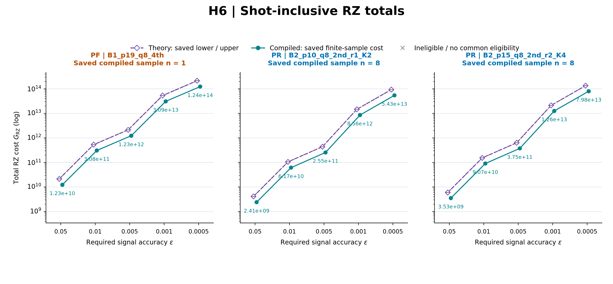

- 横軸：要求信号精度。縦軸：両軸のshot込み総RZ費用（対数）。各候補の保存shot数を、理論側・compiled側で共通に使う。
- **左：全因子四次PF。中央・右：設定が異なる二次PRの2候補。** 探索／独立確認を左右に分けた図ではない。
- **紫の白抜き菱形：理論期待費用の保存lower/upper。青緑の丸：compiled保存費用。** この白抜き菱形は、主比較8–9のPF次数S4を表す白抜き記号や、補足の従来図でPFモデル推定を表す白抜き四角と区別する。

この固定H6の候補ではcompiled総費用が理論期待総費用より小さい。PRは有限標本平均を使うため、差をcompiler最適化だけの効果とはしない。

条件：H6・1 Å・STO-3G・tol-only DF19・T=.8、通常signed bias・倍率1・P=0。左は全因子S4、中央・右は異なるS2 PR候補（旧探索各n8）。全候補q8・δ=.1。完全な設定・compiler・元の単価表は詳細資料A.9。

### 発表者ノート

「理論的な費用見積もりだけでcompile後の費用を読めるかを確認するための図です。固定H6候補では、保存shot数を共通にしてもcompiled側が低くなっています。PR側は探索n8の平均なので、差をcompile最適化だけの効果とはしません。中央と右はPR自身の比較です。次は別の補助検証として、PFのモデル単価を直接compile値へ置き換えたとき、保存条件のPR/PF比較が変わるかを見ます。」

発表上の注意：理論lower/upperはCIではない。固定候補内の比較で、全候補の最良値ではない。原論文のQPE総資源式・FT資源の直接検証や、Tailだけの費用比較とはしない。次のH-chain図とは候補・標本が異なる。

発表用補足：[S4](#s4)。詳細資料：[詳細A.8](PR資源評価_詳細スライド構成案_14枚基本・12枚圧縮_2026-10-21_説明意図明確化版.md#a-8)・[詳細A.9](PR資源評価_詳細スライド構成案_14枚基本・12枚圧縮_2026-10-21_説明意図明確化版.md#a-9)。

## 7. スライド7：PF費用モデルの置換は、推定総費用にどの程度影響するか？

**確かめたいこと：PFのモデル単価を直接compile値へ置き換えると、費用やPR/PF比較の結論は変わるのか？**

**伝えたい結論：保存PF費用には増減があり、H8の候補変更例では約0.283%増えたが、保存100 scopeのPR/PFの点費用の優劣は変わらなかった。**

### 投影内容

一部のPF候補にモデル単価を使っているため、単価政策の置換が比較へ与える影響を保存条件で確認する。

**PF総費用の変化率図を大きく掲載する。** 各点は、モデル・実測混在単価政策から保存直接compile単価政策へ置き換えた前後の、最良PF総費用の保存変化率。

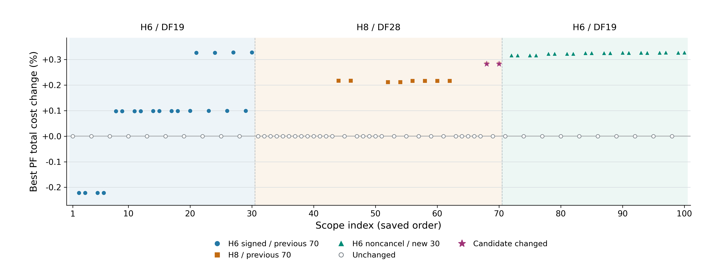

- **正はPF費用の増加、負は減少、0は不変。** 横軸は保存順のscope番号で、費用順や分子サイズではない。白抜き点は不変、色付き点は非ゼロの変化、星は候補変更例。
- 保存点には**−0.221699%**の減少や**＋0.327685%**の増加もある。全体を「0.3%以内」とまとめず、100点をそのまま読む。

**星のH8例：B0+Iの保持数p16 → p15、q4・四次PFは不変。** pは保持DF因子数L_D。H8 DF28・経験的非相殺bias・ε=.0005・拡張184候補の同じ物理条件で、allowance倍率だけを変えた2 scope。

|allowance倍率|置換前の最良PF総費用|置換後の最良PF総費用|変化率|
|---:|---:|---:|---:|
|1|1.100424×10¹⁴|1.103538×10¹⁴|+0.283003%|
|10|1.100437×10¹⁴|1.103551×10¹⁴|+0.282968%|

単位はshot込みRZ、費用欄は保存値の表示丸め。exact値は詳細資料B.19。これは**単価政策を変えた前後の最小費用の変化**で、p15へ切り替えたことだけによる改善量ではない。**100 scope全体で保存PR/PF優劣の逆転は0件**で、このH8例も前後ともPF低費用。

条件：直鎖H6/H8・1 Å・STO-3G・tol-only DF19/28・T=.8・P=0。100 scopeは重複を含む固有40条件で、独立100実験ではない。PRは旧union8／union6各n32。登録prefix・q・δ、bias・精度・allowance条件は詳細資料B.19。

### 発表者ノート

「PFの一部にモデル単価が残るため、置換後も比較の方向が保たれるかを確認します。保存条件ではPF費用が増減し、星のH8例では候補が16から15へ変わり、政策間の最小費用は約0.283%増えました。一方、PR/PFの優劣は全100 scopeで不変です。旧n32の政策置換感度で、モデル固有誤差の保証ではありません。単価の扱いを確認した上で、次に現行H-chainの費用比較を示します。」

発表用補足：[S7](#s7)。詳細資料：[詳細B.19](PR資源評価_詳細スライド構成案_14枚基本・12枚圧縮_2026-10-21_説明意図明確化版.md#b-19)・[詳細B.23](PR資源評価_詳細スライド構成案_14枚基本・12枚圧縮_2026-10-21_説明意図明確化版.md#b-23)。

## 8. スライド8：緩い精度での絶対費用—ε=0.05

**確かめたいこと：PRはfull PFより低費用でも、打切りPFと比べて低費用なのか？**

**伝えたい結論：H6ではPRがfull PFを下回る一方、打切りPFはPRより低費用だった。比較相手の方式を分けて読む必要がある。**

### 投影内容

PFを1本にまとめると比較相手が見えないため、まず緩い精度で方式・次数別の位置関係を見る。

**保存済みの7系列の探索比較図を1枚、大きく掲載する。** PR、full PF・B0・B0+Iの各S2/S4を表示する。

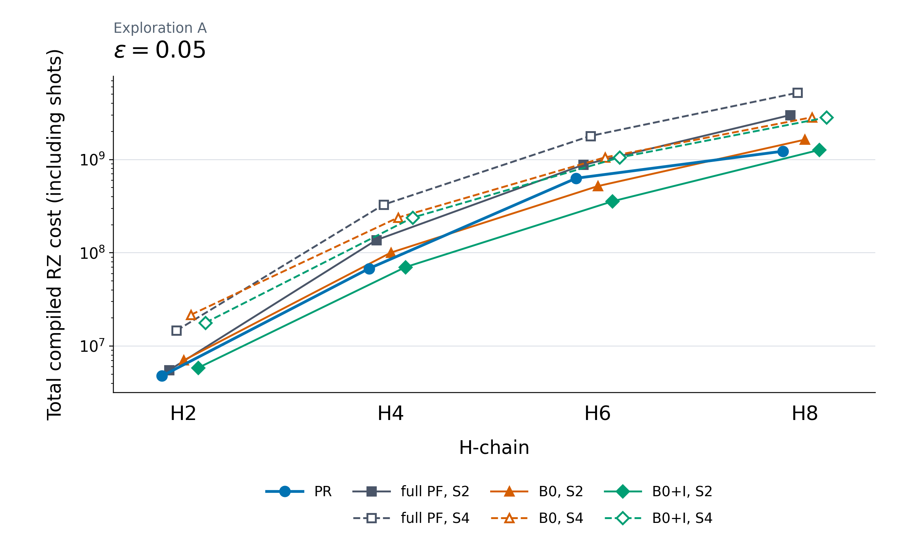

- 横軸：水素原子数。縦軸：shot込み総RZ費用（対数）。同じ系では下の点ほど低費用。
- 青丸はPR。灰四角はfull PF、橙三角はB0、緑菱形はB0+I。PFの実線・塗りはS2、破線・白抜きはS4。
- **H6ではfull PFとの比較だけではPRが有利に見えるが、B0/B0+IのS2はさらに低費用。**

条件：直鎖・1.00 Å・STO-3G・tol-only DF3/10/19/28、T=.8・P=0、通常signed bias・allowance倍率1、両軸ε/√2・α_axis=.025。PRは探索Aの採用各n8、PFは保存適格候補の方式・次数別最小値。H6/H8は保存済み直接単価置換版。独立確認Pは含めない。

### 発表者ノート

「何を比較相手にしたかを見えるように、PFを方式と次数に分けました。H6ではPRはfull PFより安い一方、打切りPFの方がさらに安くなっています。これは探索n8の比較で、独立確認の判定とは分けます。次に厳しい精度で、この位置関係と次数の違いがどう変わるかを見ます。」

表示上の注意：7系列の凡例を読める大きさで残す。白抜きはS4で、従来P/A図のモデル単価記号とは意味が異なる。横の小さなずらしは重なりを避ける表示上のもの。線は離散点のguideで、fitや普遍的なサイズscalingを表さない。

発表用補足：[S3](#s3)・[S5](#s5)。詳細資料：[詳細B.16](PR資源評価_詳細スライド構成案_14枚基本・12枚圧縮_2026-10-21_説明意図明確化版.md#b-16)・[詳細B.18](PR資源評価_詳細スライド構成案_14枚基本・12枚圧縮_2026-10-21_説明意図明確化版.md#b-18)。

## 9. スライド9：厳しい精度での絶対費用—ε=0.0005

**確かめたいこと：要求精度を厳しくすると、PFの次数とPRの費用差はどう変わるのか？**

**伝えたい結論：H4/H6/H8のfull PFではS4がS2より低費用となり、H8ではPRと打切りS4が近い。次数と方式を合わせて比較する。**

### 投影内容

厳しい精度では高次PFが比較相手として効くため、PFをまとめずS2/S4を分けて読む。

**ε=0.0005の7系列の探索比較図を1枚、大きく掲載する。** 独立確認Pの結果は本編13でまとめる。

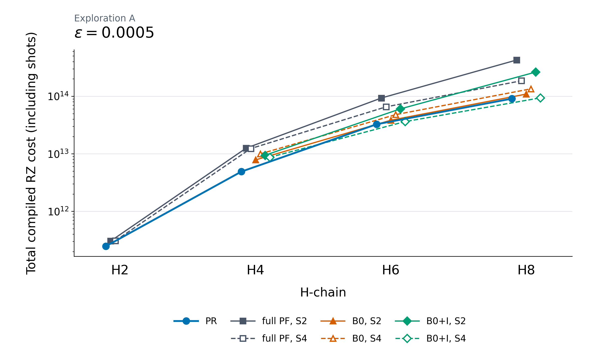

- H4/H6/H8のfull PFでは、S4がS2を下回る。次数を上げればすべての方式で低費用になる、という関係ではない。
- 保存探索のPRは表示PFより低いが、H8のB0+I S4との差は小さい。点差を母平均の有意差と解釈しない。
- H2のB0/B0+I両次数には適格な保存点がなく、full PFとの比較を示す。

条件：本編8と同じ物理条件・単価政策、ε=.0005。PRはすべて探索n8で、n12/78/104/48の独立確認Pへ読み替えない。各系の固定候補は詳細資料B.16。

### 発表者ノート

「厳しい精度ではfull PFの四次が二次より安くなり、H8では打切り四次PFとPRが近づきます。ここまでの2図は探索結果で、全候補や母平均の最適性は示しません。次に、条件を分けた追加検証として、同じouter32系列内でPRの次数とqを変えた保存探索を見ます。」

表示上の注意：共通の凡例は本編8と同じ。PRは外側S2で、PF側のS4やTaylor打切りK=4と混同しない。独立確認の候補・対照・判定を単価置換版で選び直さない。

発表用補足：[S3](#s3)・[S5](#s5)。詳細資料：[詳細B.16](PR資源評価_詳細スライド構成案_14枚基本・12枚圧縮_2026-10-21_説明意図明確化版.md#b-16)・[詳細B.17](PR資源評価_詳細スライド構成案_14枚基本・12枚圧縮_2026-10-21_説明意図明確化版.md#b-17)・[詳細B.18](PR資源評価_詳細スライド構成案_14枚基本・12枚圧縮_2026-10-21_説明意図明確化版.md#b-18)。

## 10. スライド10：別条件の追加探索：高次PRで費用は下がるか

**確かめたいこと：RTEの細分化政策をそろえた系列内で、PRの外側PF次数とqの選択により費用は下がるのか？**

**伝えたい結論：outer32の保存探索では、厳しい精度で高次PRが同系列S2より低費用だった。旧強化PFに対する優位や独立確認を示す図ではない。**

### 投影内容

主比較ではPRを二次に固定したため、追加検証として、同じouter32系列内で次数とqを選ぶ効果を見る。

**高次PR図Bの通常signed・ε=0.0005の相対費用図を1枚、大きく掲載する。** 青丸がPR S2、桃の逆三角がYoshida4、紫の十字が保存係数版m5_best。

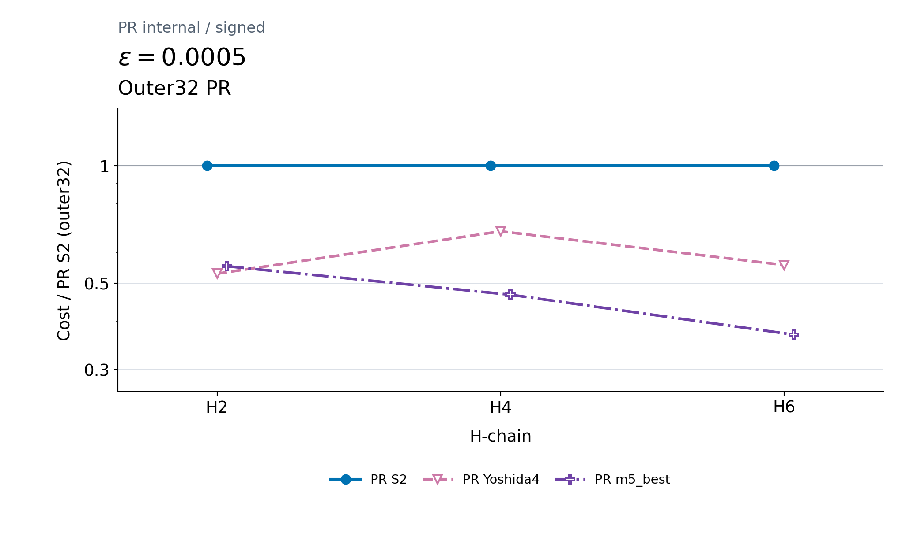

- **1は各系の同じouter32 PR S2、1未満はそれより低費用。** 各公式でq1/2/4/8内の保存採用点を比べる。
- ε=.0005の保存削減率は、H2のYoshida4で約47%、H4/H6のm5_bestで約53%／63%。分母は旧7系列図のPRではない。
- 緩い精度ε=.05の保存比較では3系ともS2が低費用。高次が常に安いという結果ではない。

条件：直鎖H2/H4/H6・1.00 Å・STO-3G・tol-only DF3/10/19、保持prefix1/3/5・T=.8・P=0・K4。outer32は1外側stepの全piece合計32 RTE short stepsを使う政策。通常signed・経験的allowance倍率1・両軸ε/√2・α_axis=.025。nは候補別で、旧n8・pilot・確認標本を合算しない。採用q・δ・nは詳細資料B.12。

### 発表者ノート

「ここは主比較と条件を分けた、PR内部の追加探索です。同じouter32のS2を1にすると、厳しい精度では高次側が低費用になりました。ただし保持数を含む条件は旧主図と異なり、次数ごとにqも選んでいます。旧PFへの削減率や独立確認とは読みません。次は主比較側へ戻り、二次PRのH8独立確認n48の費用差を分解します。」

表示上の注意：新しい高次PR図Bは、本編7の旧変更件数図Bとは別図。同じouter32でのS2基準を必ず投影する。H8は本系列に保存点がない。旧7系列図との直接overlay・比は未結合で、別パネルの高次PR図Aを本編の置換図には使わない。

発表用補足：[S8](#s8)。詳細資料：[詳細B.12](PR資源評価_詳細スライド構成案_14枚基本・12枚圧縮_2026-10-21_説明意図明確化版.md#b-12)。

## 11. スライド11：H8のshot数と実効回路単価の費用分解

**確かめたいこと：H8でPRが低費用となったのは、回路単価が小さいためか、必要shot数が少ないためか？**

**伝えたい結論：2つの固定n48比較では、shot数と実効回路単価の異なる組合せでPRが低費用となった。**

### 投影内容

総費用の差だけでは低費用になった理由が分からないため、探索図とは別標本のH8独立確認n48の結果を、shot数と実効回路単価へ分ける。

既存のFigure 2Bの**上段2パネルを、長い総題・説明を図外へ移した表示用コピーで大きく掲載する。** 横軸の3項目は、必要shot総数・実効回路単価・総RZ費用のPR/PF比。**1は同じ値、1未満はPR側が小さい。**

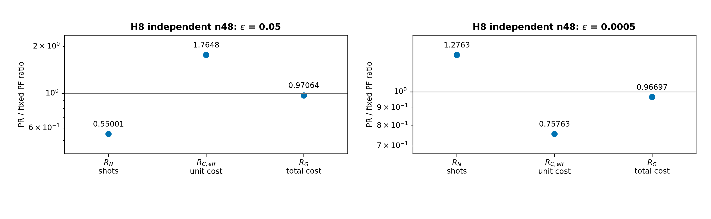

- **左（ε=0.05）：shot数が少ない。** 実効回路単価は高いが、総費用はPRが低い。
- **右（ε=0.0005）：実効回路単価が低い。** shot数は多いが、総費用はPRが低い。

$$
R_G=R_N\,R_{C,\mathrm{eff}}.
$$

実効回路単価は「総費用÷（実部・虚部の合計shot数）」。各方式のshot配分を反映する平均で、回路構造だけの単価ではない。左右は縦軸範囲が異なるので、基準1と数値で読む。

条件：H8・1.00 Å・STO-3G・tol-only DF28・T=.8、通常signed bias・倍率1、各n48。共通会計は本編1・3、固定L_D/q/r/K・δとPF対照は補足S5・詳細資料B.17。左右で候補・対照が異なり、精度だけを変えた因果比較ではない。

### 発表者ノート

「ここでは追加探索と区別し、主比較側の二次PRのH8独立確認n48へ戻り、回路の小ささだけで説明できるかを見るため総費用を分解します。左では実効単価が高くてもshot数が少なく、右ではshot数が多くても実効単価が低く、総費用はどちらもPRが低くなっています。左右で候補と対照も異なるため、精度だけの因果効果とはしません。同じ確認結果の内訳を読んだものです。次に、PR費用の見積もり自体にある標本由来の揺れを確認します。」

発表用補足：[S1](#s1)・[S5](#s5)。詳細資料：[詳細B.2](PR資源評価_詳細スライド構成案_14枚基本・12枚圧縮_2026-10-21_説明意図明確化版.md#b-2)・[詳細B.7](PR資源評価_詳細スライド構成案_14枚基本・12枚圧縮_2026-10-21_説明意図明確化版.md#b-7)・[詳細B.17](PR資源評価_詳細スライド構成案_14枚基本・12枚圧縮_2026-10-21_説明意図明確化版.md#b-17)。

## 12. スライド12：H4：MC標本数によるPR平均費用推定値の揺れ

**確かめたいこと：有限本の抽選回路から見積もったPR平均費用は、標本の選び方によってどれくらい揺れるのか？**

**伝えたい結論：PR費用の標本平均には揺れがあり、H4の固定候補では保存データの選び直しによる平均費用の分位帯がnとともに狭くなる。ただし、各系の費用差の確かさを直接判定する図ではない。**

### 投影内容

PR/PFの費用差を読む際には、PR費用を有限標本から見積もっていることにも注意が必要である。その揺れをH4の例で示す。

**図C1を大きく掲載する。** 左はε=.05、右はε=.0005のH4固定候補。横軸nはMC軌道数、縦軸はshot込みPR平均RZ費用推定値。

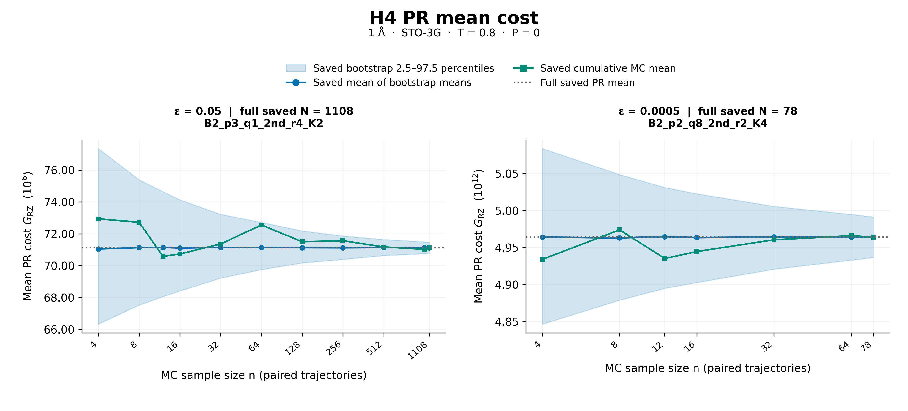

- **青帯を中心に読む：保存標本を選び直したときの平均費用のばらつき（ブートストラップ分布の中央95%区間）。** 灰点線は全保存標本の平均を示す基準線。
- 青丸・青線は再標本化で得た平均値の平均。緑線は保存順に先頭n本を使う累積平均の一例で、形は順序に依存する。両者の定義は詳細資料B.20へ置き、緑線を一般的な収束の根拠には使わない。
- **帯は母平均の厳密な信頼区間ではなく、未観測の希少Taylor eventの費用は分からない。**

この図は費用推定に伴う揺れを説明する補助検証であり、H8などの数％の費用差がその揺れを超えるかや、他系の標本数が十分かは判断できない。

図中の「full saved N=1108／78」は全保存MC標本数を指す。本発表の量子測定shot数Nとは別。各条件のshot数は固定され、nに応じて再計算していない。

### 発表者ノート

「PRが数％安いという結果を読むときには、有限標本による費用見積もりの揺れも気にする必要があります。その問題をH4で具体化した図です。青帯は標本を選び直したときの平均費用の広がりで、nを増やすと狭くなります。ただし、保存データにない希少事象やH8の費用差の確かさまでは分かりません。緑線は順序依存の一例なので収束の根拠にはしません。次に、各系で実施した別標本の確認結果を整理します。」

発表用補足：[S6](#s6)。詳細資料：[詳細A.7](PR資源評価_詳細スライド構成案_14枚基本・12枚圧縮_2026-10-21_説明意図明確化版.md#a-7)・[詳細B.9](PR資源評価_詳細スライド構成案_14枚基本・12枚圧縮_2026-10-21_説明意図明確化版.md#b-9)・[詳細B.20](PR資源評価_詳細スライド構成案_14枚基本・12枚圧縮_2026-10-21_説明意図明確化版.md#b-20)。

## 13. スライド13：独立確認8条件：低費用側と再現判定

**確かめたいこと：探索後に固定した費用比較の方向は、別の標本でも再現したのか？**

**伝えたい結論：独立確認では、PR低費用の再現だけでなく、PF低費用の再現とPR低費用の非再現も記録された。**

### 投影内容

主比較8–9で見た探索の比較方向が別標本でも再現するかを確かめるため、固定候補の独立確認を「低費用側」と「事前指定方向の再現」に分けて整理する。

**図Dを大きく掲載する。** H2/H4/H6/H8×両端2精度。各セルは保存点の低費用側・方向判定・MC標本数nを示す。

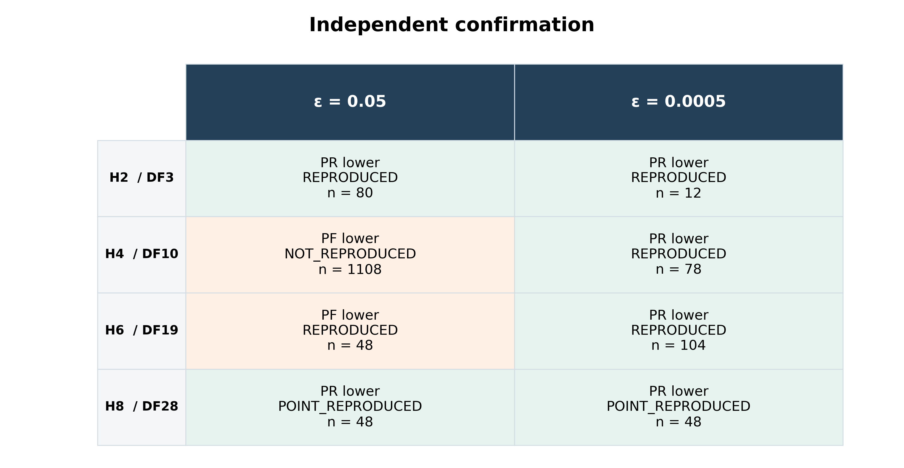

**緩い精度ではH2/H8がPR、H4/H6がPF低費用。厳しい精度では4系ともPR低費用を再現した。**

**REPRODUCEDは事前指定方向の再現で、PR低費用と同義ではない。** H6の粗精度はPF低費用を再現し、H4の粗精度は探索のPR低費用を再現しなかった。H8は保存のPOINT_REPRODUCEDという判定を保つ。

H2の追加2条件は正式受入済みの有限標本結果。図Dは詳細資料B.18に保全した従来A1/A2の左Pと同じ証拠で、追加の独立確認ではない。主比較8–9の7系列を再探索した結果でもない。高次PR10のouter32系列は固定資料では確認準備段階で、この図Dの確認対象ではない。既存論文主表6条件を8条件へ正式に差し替えたものではなく、PF単価置換によって確認判定を更新していない。

### 発表者ノート

「ここでは主比較の候補と対照を固定して得た別標本8条件を整理します。別条件のouter32高次PRを確認した図ではありません。H4とH6の粗精度はともにPF低費用ですが、H4はPR低費用を再現せず、H6はPF低費用を再現したという違いがあります。再現はPRが勝つことと同義ではありません。H2の受入済み結果とH8の点再現という判定を保ち、追加の証拠や母平均の証明とは数えません。最後に、答えられた問いと限界をまとめます。」

発表用補足：[S5](#s5)。詳細資料：[詳細B.16](PR資源評価_詳細スライド構成案_14枚基本・12枚圧縮_2026-10-21_説明意図明確化版.md#b-16)・[詳細B.18](PR資源評価_詳細スライド構成案_14枚基本・12枚圧縮_2026-10-21_説明意図明確化版.md#b-18)。

## 14. スライド14：研究の到達点・得られた知見・限界

**確かめたいこと：同じ信号精度でのPR/PF比較について、何が分かり、どこまで主張できるのか？**

**伝えたい結論：低費用な方式は系・要求精度に依存し、回路単価とshot数の組合せが費用差を決める。その方向が別標本で再現した範囲を、有限候補・有限標本の結果として報告する。**

### 投影内容

冒頭の「PRは低費用になるか、なぜか、どこまで再現するか」という問いに、今回の証拠で答えられる範囲をまとめる。

- **比較するPFの方式・次数まで分けて読む。** 探索の粗精度H6では、PRがfull PFより安くても打切りPFがさらに安い。厳精度ではfull PFのS4も有力な比較相手となる。別条件のouter32探索でも、PRの次数とqの選択で費用が変わった。
- **探索と別標本の確認を分ける。** 固定候補の独立確認では、粗精度はH2/H8がPR、H4/H6がPF低費用。厳精度は4系ともPRの低い点費用を再現。
- **回路単価と必要shot数の両方が総費用を決める。** H8の費用分解、固定H4/H6の理論／compiled照合、旧H6/H8の単価置換感度を区別して示した。別の回路単価診断は[補足S7](#s7)に置く。
- **費用差と推定の限界を一緒に報告する。** H4の非再現、MC平均推定値の揺れ、未観測希少eventを含む母平均保証の不足を残す。新outer32の独立確認は準備段階である。

適用範囲：固定時間の複素信号、有限候補・有限標本、shot込みcompiled RZ比較。状態準備・実機費用・FT論理資源・energy/RPE全体の資源は含まない。原子数による並びは入力生成規則・候補域の差も含み、普遍的なサイズscalingを主張しない。

### 発表者ノート

「同じ精度でPRが安いかという問いには、系と精度によって低費用側が異なると答えます。費用差には回路単価とshot数の両方が関わり、主比較で別標本再現を確認した範囲と、高次PRの追加探索は分けます。ただし、単価置換やH4のMC図は対象を限定した補助検証で、全結果の保証ではありません。論文ではこの区別を保ちます。H2の主表採用は未決定で、論文化までの残作業は詳細資料B.21に残します。」

発表用補足：[S3](#s3)・[S5](#s5)・[S6](#s6)・[S7](#s7)・[S8](#s8)。詳細資料：[詳細B.9](PR資源評価_詳細スライド構成案_14枚基本・12枚圧縮_2026-10-21_説明意図明確化版.md#b-9)・[詳細B.12](PR資源評価_詳細スライド構成案_14枚基本・12枚圧縮_2026-10-21_説明意図明確化版.md#b-12)・[詳細B.15](PR資源評価_詳細スライド構成案_14枚基本・12枚圧縮_2026-10-21_説明意図明確化版.md#b-15)・[詳細B.21](PR資源評価_詳細スライド構成案_14枚基本・12枚圧縮_2026-10-21_説明意図明確化版.md#b-21)・[詳細B.23](PR資源評価_詳細スライド構成案_14枚基本・12枚圧縮_2026-10-21_説明意図明確化版.md#b-23)。

## 15. 12枚へ圧縮する場合

14枚版の2＋3を以下の統合原稿へまとめ、高次PR内部比較10を本編から外す。高次PRの質問には補足S8を使い、内部比較図・説明・ノートの原稿は[詳細B.12](PR資源評価_詳細スライド構成案_14枚基本・12枚圧縮_2026-10-21_説明意図明確化版.md#b-12)から参照する。中間精度はS3の代表1図を使い、他の精度・従来P/A図は詳細資料に保全する。補足は両版ともS1–S8の8枚で、追加の投影ページを暗黙に作らない。

図・投影文・ノートは次表の対応で読み替える。14枚版10への参照は「別探索（補足S8／詳細B.12）」へ替える。14枚版の補足参照はそのまま使用できる。

|12枚版|14枚版の原稿|内容|発表用補足|
|---:|---|---|---|
|1|1|対象・精度|S1・S5|
|2|2＋3|下記の統合原稿|S1・S2・S7|
|3|4|探索域・A/P。独立確認13への参照は12枚版11|S2・S5・S8|
|4|5|PF方式・候補域|S2・S3・S7|
|5|6|固定H6の理論／compiled図|S4|
|6|7|PF総費用の単価政策感度|S7|
|7|8|ε=.05。次の厳精度は12枚版8|S3・S5|
|8|9|ε=.0005。ノート末尾を「次は、二次PRのH8独立確認n48で費用差の内訳を見ます」へ替える|S3・S5|
|9|11|H8の費用分解。冒頭を「ここでは主比較側の二次PRのH8独立確認n48で費用差を分解します」へ替える|S1・S5|
|10|12|H4のMC変動|S6|
|11|13|8条件の独立確認。主比較8–9への参照は12枚版7–8|S5|
|12|14|知見・限界。高次PRは補足S8／詳細B.12の別探索として案内|S3・S5–S8|

### 12枚版スライド2：回路単価から測定込み総費用へ

**確かめたいこと：同じ信号精度に対する総費用を、回路からどう見積もるのか？**

**伝えたい結論：回路単価だけでは総費用が決まらないため、回路から取得するCと信号精度から求めるNを掛け合わせる。**

### 投影内容

PR/PFを同じ精度で比べるため、1回路の費用と、その回路が必要になる測定回数をそれぞれ求める。

- **単価C**：測定回路全体をcompileしたRZ数。PRは抽選回路の平均。旧比較の未compile候補には固定モデルを使い、7系列探索図のH6/H8は保存済み単価置換版を使う。
- **回数N**：両軸ε/√2から数値biasと経験的allowanceを引き、正規化・許容失敗確率を含む十分条件へ代入する。
- 要求精度に対する余裕が残らなければ、その候補はこの会計では不適格。

$$
\widehat G_{\rm RZ}=\sum_{a\in\{\cos,\sin\}}N_a\widehat C_{{\rm RZ},a}.
$$

MC標本数nと量子測定の必要shot数Nは別。総費用は保存入力による会計値で、実機でN shotsを実行した結果ではない。

### 発表者ノート

「回路が小さくても必要な測定回数が多ければ、総費用は小さくなりません。同じ精度で比べるため、単価は回路から、回数は信号評価と精度要件から求めて掛け合わせます。PR単価の有限標本平均と、必要回数の数値入力には留保があります。次に、どの分割と回路設定を比較したかを示します。」

発表用補足：[S1](#s1)・[S2](#s2)・[S7](#s7)。十分shot条件の詳細式と候補域は[詳細A.1](PR資源評価_詳細スライド構成案_14枚基本・12枚圧縮_2026-10-21_説明意図明確化版.md#a-1)・[詳細B.2](PR資源評価_詳細スライド構成案_14枚基本・12枚圧縮_2026-10-21_説明意図明確化版.md#b-2)・[詳細B.16](PR資源評価_詳細スライド構成案_14枚基本・12枚圧縮_2026-10-21_説明意図明確化版.md#b-16)。他の11枚は上表の本編原稿を使い、補足番号は両版共通。

## 16. 発表用補足：S1–S8

各節は投影1枚分。「投影内容」は主図1枚、または簡潔な表1つと短文に限定する。ノートと参照先を同時に画面へ詰め込まない。S3・S4・S5・S6・S7・S8は本編と対象・目的が異なる既存表示を選んでおり、新たな独立証拠を増やすものではない。

### S1 比較条件・精度・総費用の定義

**伝えたい内容：比較する課題と会計を固定し、信号精度に対する費用として読む。**

#### 投影内容

|固定するもの|主比較の条件|
|---|---|
|モデル・状態|直鎖H2/H4/H6/H8、1.00 Å、STO-3G。tol-only 1e-8、DF rank3/10/19/28。各系の保存状態を方式間で共通化|
|時間・精度|T=.8。実部・虚部へ各ε_sig/√2、各軸α=.025|
|費用会計|保存bias・有限RTE正規化・経験的数値余裕を使用。状態準備費用P=0|

$$
\widehat G_{\rm RZ}=\sum_{a\in\{\cos,\sin\}}N_a\widehat C_{{\rm RZ},a}.
$$

単一固有状態・半径1・既知の位相の枝、$0\le\epsilon_{\rm sig}<1$では、条件付きで $|\Delta E|\le\arcsin(\epsilon_{\rm sig})/T$。一般の混合信号やRPE全roundのエネルギー精度へ、そのまま読み替えない。

#### 発表者ノート

「Cはcompile後のゲート計数や標本平均、Nは精度要件と数値入力を十分条件へ代入した必要shot数です。biasは参照との差の古典数値評価、数値余裕も経験的で、厳密certificateではありません。条件付き換算とTを固定すれば、対応するエネルギー要件でも同じ費用会計ですが、RPE全体は評価していません。」

元資料：[詳細B.1](PR資源評価_詳細スライド構成案_14枚基本・12枚圧縮_2026-10-21_説明意図明確化版.md#b-1)・[詳細B.2](PR資源評価_詳細スライド構成案_14枚基本・12枚圧縮_2026-10-21_説明意図明確化版.md#b-2)・[詳細B.5](PR資源評価_詳細スライド構成案_14枚基本・12枚圧縮_2026-10-21_説明意図明確化版.md#b-5)・[詳細B.16](PR資源評価_詳細スライド構成案_14枚基本・12枚圧縮_2026-10-21_説明意図明確化版.md#b-16)。固定条件の導出・headroom・状態生成規則は詳細版で確認する。

### S2 PR・full PF・B0・B0+Iは何を残すか

**伝えたい内容：B0+Iは、切り捨てたTailの既知identity位相だけを回収する。**

#### 投影内容

|方式|Tailの扱い|
|---|---|
|PR|保持prefixに、有限RTEで近似したTailを補う|
|full PF（S2/S4）|DF全因子を積公式で扱う|
|B0|選んだTail全体を落とす。共通項・保持prefixのidentityは残る|
|B0+I|B0と同じ保持部分に、捨てたTail由来の既知identity位相を戻す|

$$
H_R=C_R I+H_R^{\rm non-I},\qquad
z_{\rm B0+I}(T)=e^{-iTC_R}z_{\rm B0}(T).
$$

採用PF域はH2：70、H4：190、H6：136、H8：184候補。候補は方式・保持数p・q・次数の組合せで、compile件数ではない。

#### 発表者ノート

「DF因子ごとにidentity成分が残る表現なので、Tailの選び方で捨てるidentity係数も変わります。必ず非ゼロのidentityがTailへ入るわけではなく、係数相殺や空Tailなら0です。位相は二重加算しません。主比較のPRは外側S2で、Taylor打切りK4と四次PFを区別します。保持因子の順序は固定し、全順序を最適化した結果ではありません。」

元資料：[詳細A.1](PR資源評価_詳細スライド構成案_14枚基本・12枚圧縮_2026-10-21_説明意図明確化版.md#a-1)・[詳細A.2](PR資源評価_詳細スライド構成案_14枚基本・12枚圧縮_2026-10-21_説明意図明確化版.md#a-2)・[詳細B.4](PR資源評価_詳細スライド構成案_14枚基本・12枚圧縮_2026-10-21_説明意図明確化版.md#b-4)・[詳細B.16](PR資源評価_詳細スライド構成案_14枚基本・12枚圧縮_2026-10-21_説明意図明確化版.md#b-16)。候補の全組合せと段階的追加履歴は詳細資料に残す。

### S3 中間精度でもPFの方式・次数を分けて比べる

**伝えたい内容：ε=.005の保存探索ではPRが表示PFを下回るが、H2の打切りPFは不適格で比較点がない。**

#### 投影内容

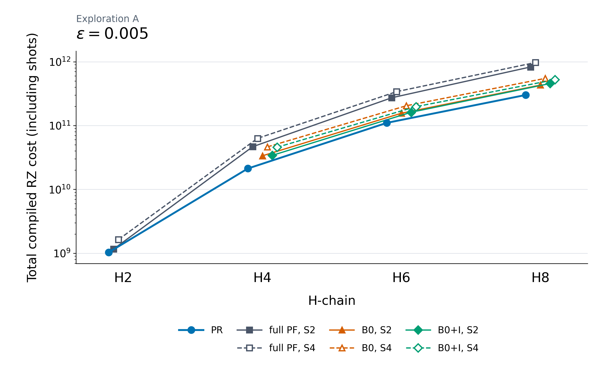

- PRは探索Aの各n8。full PF・B0・B0+IのS2/S4を別系列で示す。
- 下の点ほど低費用。H2のB0/B0+Iは不適格で、欠けた点を費用0と読まない。

#### 発表者ノート

「本編の両端精度を繰り返さず、中間精度の代表を示します。この保存探索ではPRが表示PFより低費用です。H2は全方式との比較ではありません。直鎖1 Å・STO-3G・tol-only DF3/10/19/28・T=.8・P=0、通常signed・余裕倍率1です。H6/H8はALL_SAVED458単価政策で、同一runtimeの全候補実compileではありません。独立確認Pや大域最適性へ読み替えません。」

元資料：[詳細B.6](PR資源評価_詳細スライド構成案_14枚基本・12枚圧縮_2026-10-21_説明意図明確化版.md#b-6)・[詳細B.7](PR資源評価_詳細スライド構成案_14枚基本・12枚圧縮_2026-10-21_説明意図明確化版.md#b-7)・[詳細B.10](PR資源評価_詳細スライド構成案_14枚基本・12枚圧縮_2026-10-21_説明意図明確化版.md#b-10)・[詳細B.16](PR資源評価_詳細スライド構成案_14枚基本・12枚圧縮_2026-10-21_説明意図明確化版.md#b-16)・[図の保存条件](figures/all_methods_hchain_20261022/README.md)。他4精度の図・旧系列C/N/G表は詳細版に保全。

### S4 H4固定例：理論とcompiledで費用比が異なる

**伝えたい内容：単価の取得方法が変わると、固定候補のPR/PF費用比の向きも変わり得る。**

#### 投影内容

|費用の評価|PF費用を100%としたPR費用|この固定比較で低費用なのは|
|---|---:|---|
|宣言した理論分解モデルの期待費用|約87.2%|PR|
|保存実compileの標本費用|約103.9%|PF|

100%は同費用、100%未満はPR、100%超はPFが低費用。

条件：H4・1 Å・STO-3G・**legacy DF12**、T=.8、ε=.05、通常signed・余裕倍率1・P=0。PR p3/q8/S2/r2/K4（n32）とfull PF p12/q1/S4。同じ保存shot数を使用。

#### 発表者ノート

「本編6のH6とは別の固定H4例です。理論期待値とcompiled有限標本平均を比べるため、差にはevent構成も入り、compile最適化だけに帰属させません。symmetric-directional、Qiskit1.3.0・rz/sx/x/cx・opt1・seed17・topologyなし、δはPR .1／PF .8です。現行H4 DF10の最良候補比較や、原論文QPE/Toffoli式の直接検証ではありません。」

元資料：[詳細A.8](PR資源評価_詳細スライド構成案_14枚基本・12枚圧縮_2026-10-21_説明意図明確化版.md#a-8)・[詳細A.9](PR資源評価_詳細スライド構成案_14枚基本・12枚圧縮_2026-10-21_説明意図明確化版.md#a-9)。上表は詳細A.8の保存表をそのまま使用。元の費用比図・同一event照合・全固定条件は同節を参照。

### S5 独立確認は、どの固定候補で何を再現したか

**伝えたい内容：低費用側と、事前指定した方向の再現を分けて読む。**

#### 投影内容

PRの外側PFは全行S2。PR欄はp/q/r/K、PF欄は方式・p/q・次数。

|系・ε|固定PR|固定PF|MC標本n|低費用側・方向判定|
|---|---|---|---:|---|
|H2・.05|1/1/2/4|full 3/1/S2|80|PR・再現|
|H2・.0005|1/4/2/4|full 3/4/S2|12|PR・再現|
|H4・.05|3/1/4/2|B0+I 5/1/S2|1108|PF・非再現|
|H4・.0005|2/8/2/4|B0 7/8/S2|78|PR・再現|
|H6・.05|4/2/4/2|B0+I 7/1/S2|48|PF・再現|
|H6・.0005|4/8/4/2|B0+I 11/4/S4|104|PR・再現|
|H8・.05|8/2/4/4|B0+I 11/1/S2|48|PR・点再現|
|H8・.0005|7/16/4/4|B0+I 15/4/S4|48|PR・点再現|

H4の粗精度はPR低費用を再現せず、H6の粗精度はPF低費用を再現した。

#### 発表者ノート

「候補・PF対照・shot・本数を別標本の抽選前に固定しています。直鎖1 Å・STO-3G・tol-only DF3/10/19/28・T=.8、δ=.8/q、通常signed・余裕倍率1・P=0です。表の再現／非再現／点再現は保存REPRODUCED／NOT_REPRODUCED／POINT_REPRODUCEDを区別します。H2の2条件は有限標本として受入済みで、論文主表への追加は未決定。H8の公開詳細receipt・原profile bytesの未照合は残ります。本編13と同じ8条件で、新しい確認結果ではありません。」

元資料：[詳細B.13](PR資源評価_詳細スライド構成案_14枚基本・12枚圧縮_2026-10-21_説明意図明確化版.md#b-13)・[詳細B.16](PR資源評価_詳細スライド構成案_14枚基本・12枚圧縮_2026-10-21_説明意図明確化版.md#b-16)・[詳細B.17](PR資源評価_詳細スライド構成案_14枚基本・12枚圧縮_2026-10-21_説明意図明確化版.md#b-17)・[詳細B.18](PR資源評価_詳細スライド構成案_14枚基本・12枚圧縮_2026-10-21_説明意図明確化版.md#b-18)。費用exact値・δ・監査範囲は詳細版に保全。高次PRのouter32確認とは別系列。

### S6 H4の費用推定：標本数と保存標準誤差

**伝えたい内容：平均費用の推定に揺れがあることを、H4の固定2候補の保存SEで確認する。**

#### 投影内容

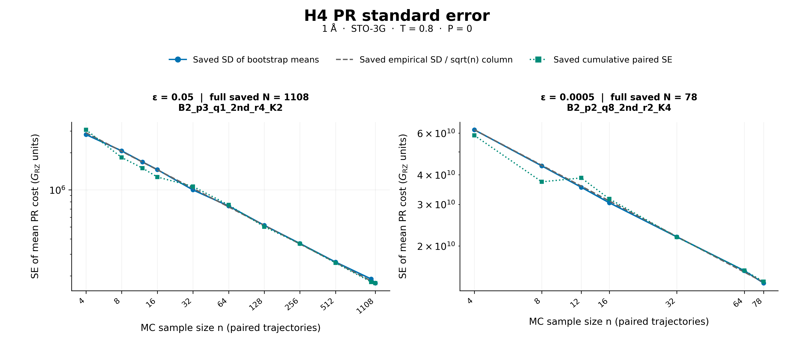

- 縦軸は平均費用推定値の標準誤差（SE）。青は保存bootstrap平均のSD、灰は保存SD/√n、緑は保存順の累積paired SE。
- 横軸nはMC標本数。量子測定shot数Nは固定で、nを増やしても再計算していない。

#### 発表者ノート

「本編12は平均推定値と分位帯、ここは同じ保存データのSEを見ます。H4 DF10・1 Å・STO-3G・T=.8、通常signed・倍率1・P=0。左p3/q1/S2/r4/K2・δ=.8・全1108本、右p2/q8/S2/r2/K4・δ=.1・全78本です。緑は順序依存の一例です。未観測の希少Taylor eventの費用・分散は不明で、SEや帯を母平均の厳密CIとしません。他系のnやH8の数％差の十分性も判定しません。」

元資料：[詳細A.7](PR資源評価_詳細スライド構成案_14枚基本・12枚圧縮_2026-10-21_説明意図明確化版.md#a-7)・[詳細B.9](PR資源評価_詳細スライド構成案_14枚基本・12枚圧縮_2026-10-21_説明意図明確化版.md#b-9)・[詳細B.20](PR資源評価_詳細スライド構成案_14枚基本・12枚圧縮_2026-10-21_説明意図明確化版.md#b-20)。C1の青帯は保存再標本化平均の2.5–97.5分位であり、C2と同じ確認標本の別表示。保存SE・分位の再計算は行わない。

### S7 PFのモデル単価は直接compile値とどれくらい違うか

**伝えたい内容：比較できた450軸では単価の差は2%未満だったが、総費用感度とは別の診断である。**

#### 投影内容

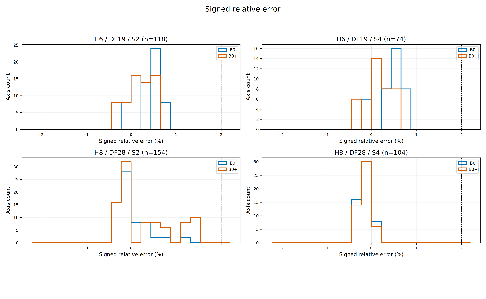

- 正は単価予測が過大、負は過小。分母は直接compile RZ数。比較できた450軸で絶対相対誤差2%未満。
- 450軸は225設定×cos/sinの対。本編7の100 scope（固有40条件）の総費用置換とは別の集合・問い。

#### 発表者ノート

「直鎖H6/H8・1 Å・STO-3G・tol-only DF19/28・T=.8・P=0、B0/B0+IのS2/S4、q1/2/4/8、δ=.8/qです。prefixは保存照合点に限ります。図のsignedは単価誤差の正負で、bias会計の名前とは別です。338軸は本診断対象外で、profile/runtime差、S4仮説、初回最終gate欠測は残ります。2%未満だから総費用の優劣が変わらなかった、と因果づけません。」

元資料：[詳細A.3](PR資源評価_詳細スライド構成案_14枚基本・12枚圧縮_2026-10-21_説明意図明確化版.md#a-3)・[詳細A.5](PR資源評価_詳細スライド構成案_14枚基本・12枚圧縮_2026-10-21_説明意図明確化版.md#a-5)・[詳細B.19](PR資源評価_詳細スライド構成案_14枚基本・12枚圧縮_2026-10-21_説明意図明確化版.md#b-19)・[詳細B.23](PR資源評価_詳細スライド構成案_14枚基本・12枚圧縮_2026-10-21_説明意図明確化版.md#b-23)。100 scopeの件数図・exact費用・元図は詳細B.19、他の単価診断図は詳細B.23に保全。モデル固有誤差だけを分離した検証や全域保証にはしない。

### S8 高次PRを同一系列のm5決定論部分集合と比べる

**伝えたい内容：高次PRの比較は、保存identityが結合済みのH4/H6・m5部分集合に限定する。**

#### 投影内容

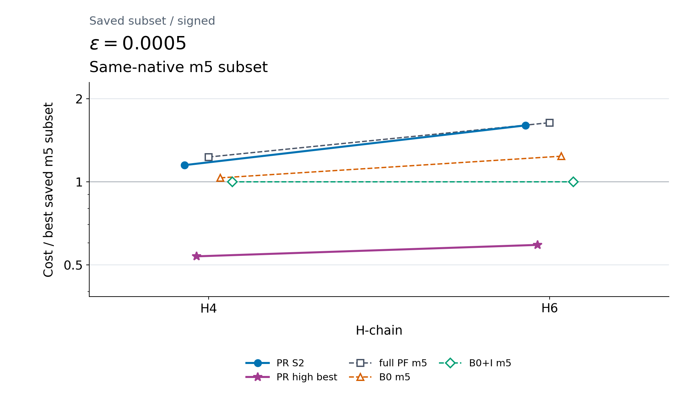

- **1は保存m5部分集合の最良費用。** 紫の高次PR bestはその下にあり、同系列S2との比較とは分母が異なる。
- 旧強化PF全体との比ではない。新outer32の独立確認は採用固定資料では準備段階。

#### 発表者ノート

「本編10はPR内部、この図は同じnativeに結合した限定的PF対照との探索比較です。H4/H6・1 Å・STO-3G・tol-only DF10/19、PR prefix3/5・K4・T=.8・P=0、q1/2/4/8のouter32、通常signed・倍率1です。m5は保存係数の四次公式です。旧D190/136等との完全identity結合は未実施で、旧全方式と直接overlayしません。H2の同系列決定論signalとH8 outer32は未保存・未結合です。旧H6の独立確認済み3.75%は別系列として詳細B.12に残します。」

元資料：[詳細B.12](PR資源評価_詳細スライド構成案_14枚基本・12枚圧縮_2026-10-21_説明意図明確化版.md#b-12)・[高次PR図の案内](figures/all_methods_hchain_with_higher_pr_20261022/README.md)。12枚版では高次PRの質問をこの1枚で扱い、PR内部比較の元図・採用q/δ/n・非相殺の欠測・確認準備は詳細B.12へリンクする。追加の投影ページとして数えない。

## 17. 投影しない資料と確認範囲

A.1–A.9／B.1–B.23は、[原本の詳細版](PR資源評価_詳細スライド構成案_14枚基本・12枚圧縮_2026-10-21_説明意図明確化版.md)にすべて保全した。A.4の回路照合、A.6の旧pair/triple、B.3の旧履歴、B.8の時間依存、B.11のβ、B.14のα、B.15のbias感度、B.21の論文化の残作業、B.22の編集履歴は投影用補足へ縮小転載しない。必要な科学的留保は本編・各Sのノート・詳細版で維持する。

新しい最良S2 PR／最良S2 PFの理論・compiled比較図は完了・採用を確認できないため追加しない。S4は既存A.8の表だけを使う。高次PRouter32の準備段階を確認完了へ変更しない。旧H6確認の完了や主比較8条件のP結果で代用しない。

[新旧32節の対応・固定出典・技術確認](2026-10-22_PR資源評価_発表用補足8枚_Codex参照メモ.md)・[文書検証記録](2026-10-22_PR資源評価_発表用補足8枚_文書検証.json)。文書編集者による技術自己確認であり、詳細科学レビュー・外部再現・最終evidence freezeではない。今回の対象は文書編集・保存・ローカルcommitまで。新規push・公開は行わず、ここでmandatory STOPとする。
