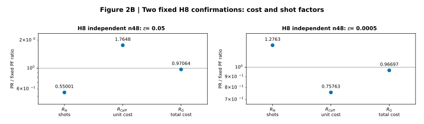
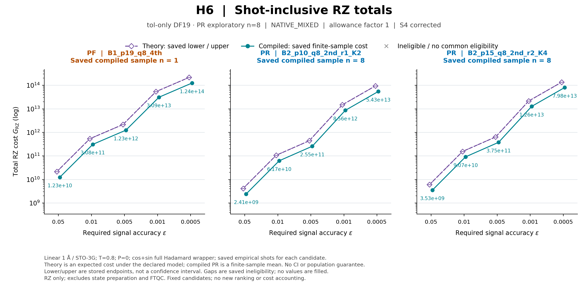
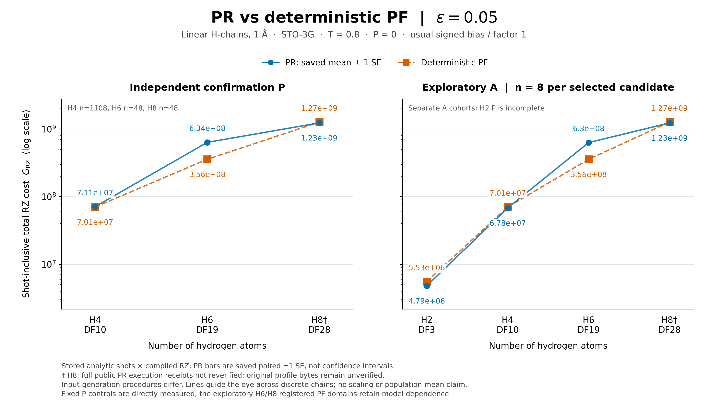
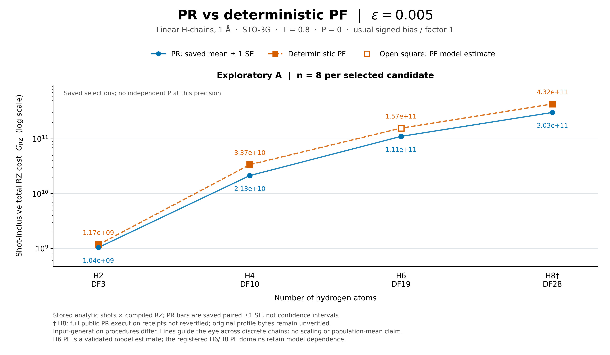
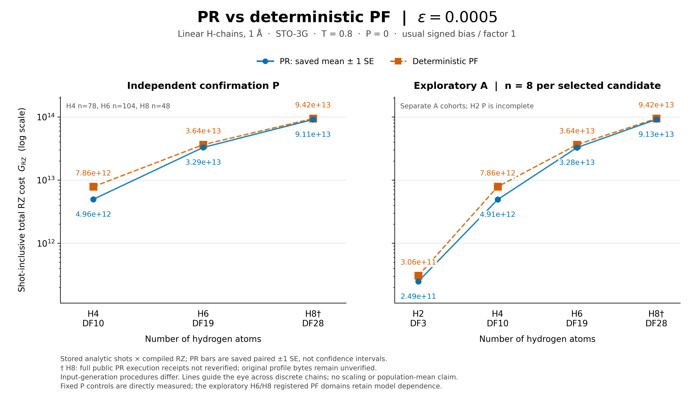
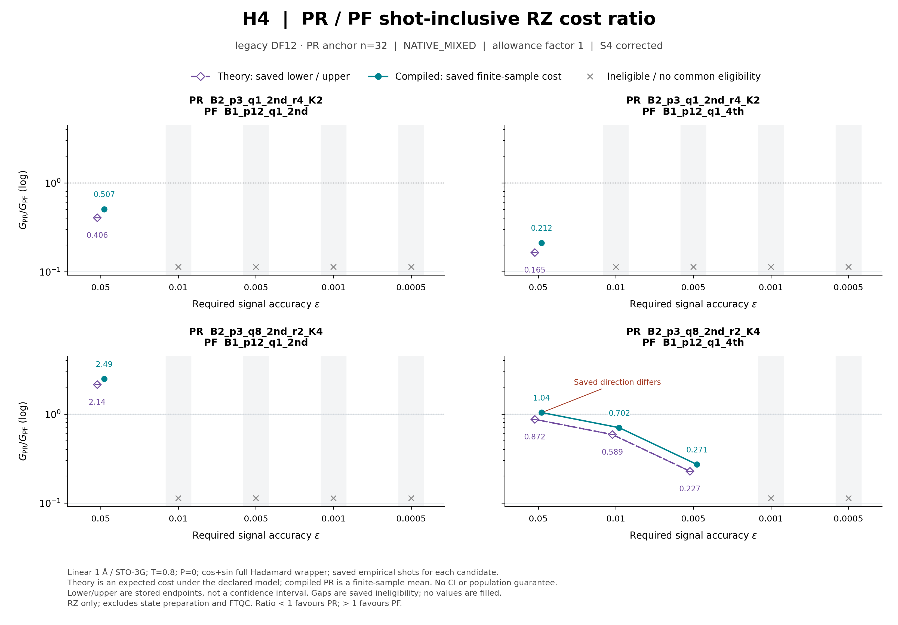
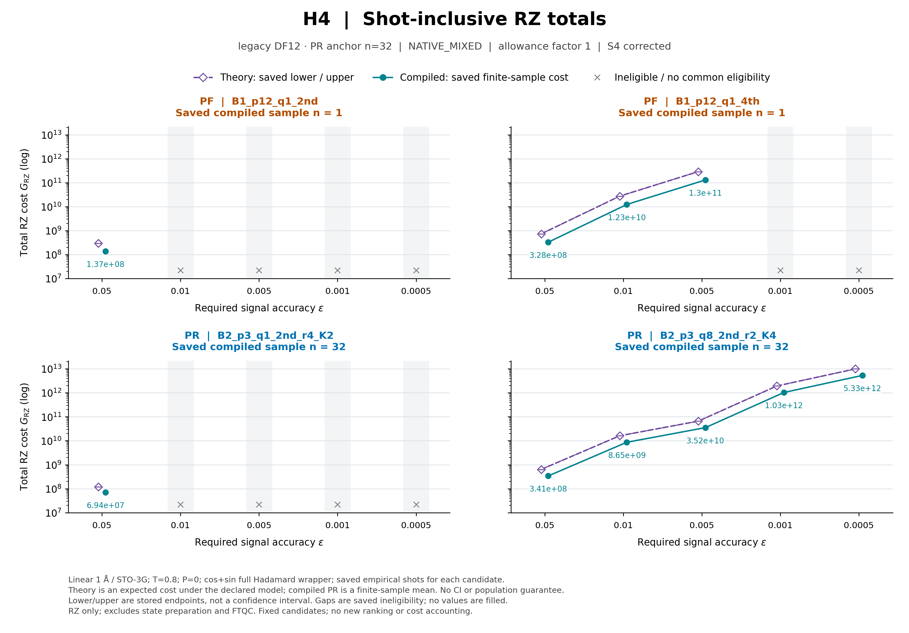
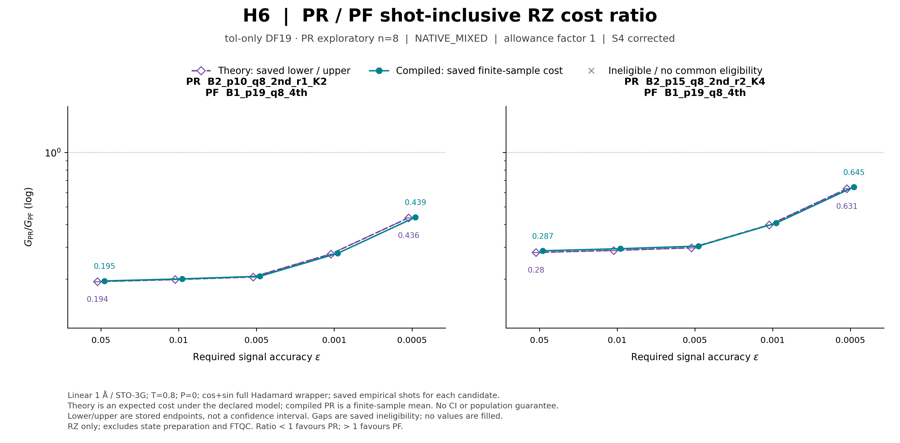
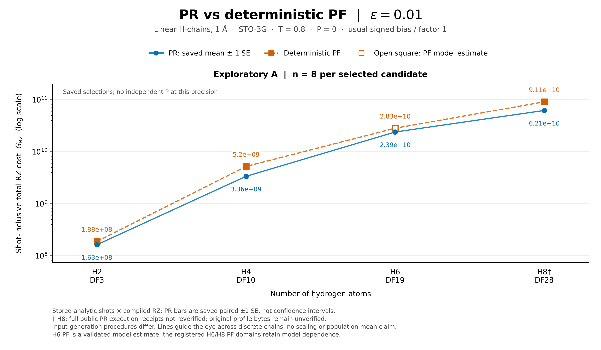
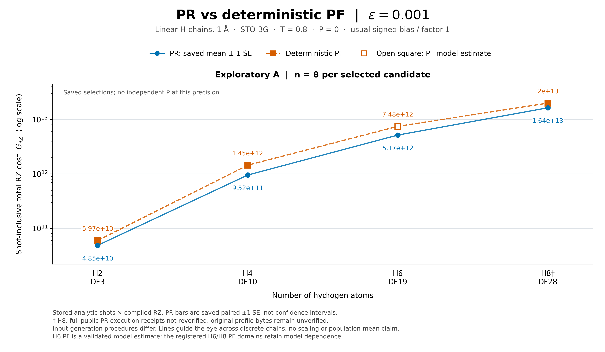

# PR資源評価パート：詳細スライド構成案

作成日：2026-10-18（JST）／改訂日：2026-10-20（JST）

構成：本編12枚／11枚への圧縮案付き

対象：Track A、直鎖H2/H4/H6/H8の固定距離・有限時間複素信号に対する資源評価。H2は探索のみ。理論・compiled照合には別の固定H4/H6系列を使う。

## 0. この構成案の使い方

本編の各枚は、結論・目的・投影内容・発表者ノートで構成する。画面に載せるのは「伝えたい結論」と「投影内容」。発表者ノートは、その場で口頭で補う数文に絞った。

|置き場所|用途|
|---|---|
|本編1–12|スライドに載せる文章・数式・既存図と、短い口頭説明|
|補足資料A・B|質疑で参照する詳しい説明・条件・数式・保存結果。本編の枚数には含めない|
|[Codex向け参照メモ](2026-10-18_PR資源評価_スライド構成案_Codex参照メモ.md)|原資料・既存図の所在、固定commit、実装・検証履歴、編集時の注意|

PRの概念紹介は前のパートで説明済みとする。Track B・N3・新しいアルゴリズムの設計・採択は扱わない。高次PRの別条件比較は補足に置く。結果は作成済みの5精度の絶対費用図を使用し、新しい図は生成しない。図はローカル保存済みで、本編と補足のMarkdownプレビューに表示する。

|番号|タイトル|その枚の役割|
|---|---|---|
|1|比較対象と精度の意味|対象信号・共通条件・費用指標と精度の意味を定める|
|2|1回路の費用をコンパイルから求める|回路単価Cの取得方法を説明する|
|3|必要shot数の算出と総費用の合成|信号の数値評価からNを求め、Cと掛け合わせる|
|4|分割規則と探索したパラメータ|採用したPR候補域と、探索A・独立確認Pを区別する|
|5|B0・B0+I・full PFと比較候補集合|方式と、採用した決定論的PFの候補域を示す|
|6|H8の費用差：shot数と実効回路単価|独立n48の2条件を、既存の費用分解図で読む|
|7|理論期待総費用とコンパイル後の総費用|固定H6候補のshot込みGを既存図で比較する|
|8|緩い精度での絶対費用：ε=0.05|H-chainに沿ったPR/PF費用を、PとAの別パネルで示す|
|9|中間精度での絶対費用：ε=0.005|探索で得た費用差と、独立確認の欠測を示す|
|10|厳しい精度での絶対費用：ε=0.0005|H4/H6/H8の独立確認と、H2を含む探索を示す|
|11|独立確認で再現したこと・しなかったこと|6条件の保存判定と、有限標本の限界を整理する|
|12|到達点と論文化に向けた残作業|得られた知見、投稿用の整理、評価範囲をまとめる|

12枚版の目安は18–20分、11枚版は15–17分。最初の5枚は評価方法・条件の説明として維持し、使用する入力と候補集合を最新プロトコルv2の保存結果へ合わせる。11枚版は2＋3だけを統合する。

図は1枚を大きく使う。5精度のうち本編にはε=0.05／0.005／0.0005の3枚を配置し、ε=0.01／0.001の2枚は補足B.16に各1枚で置く。全5精度の掲載先を同補足にまとめる。異なる精度の図では縦軸範囲が異なるため、点の高さだけを見比べない。

用語：測定回路（wrapper）は状態準備を除く1回の回路、抽選回路（trajectory）はPRの抽選で決まる1本の回路。MC標本数nは費用評価の本数、shot数Nは量子測定の必要回数。Aは候補探索、Pは候補とPF対照を固定した後の別標本による独立確認であり、状態準備費用P=0の記号とは区別する。

## 1. スライド1：比較対象と精度の意味

**伝えたい結論：各系で同じDFモデル・状態・時間・要求信号精度を使い、測定回数を含む回路資源を比較する。**

目的：比較対象・費用の単位・結果図の精度の意味を最初にそろえる。

### 投影内容

$$
z_{\rm ref}(T)=\langle\psi|e^{-iH_{\rm DF}T}|\psi\rangle.
$$

|項目|主結果の条件|
|---|---|
|対象|直鎖H2／H4／H6／H8、隣接1.00 Å、STO-3G|
|DFモデル|tol-only 1e-8、実rankは順に3／10／19／28。各系の保存状態を方式間で固定|
|時間と精度|T=0.8、要求複素信号精度は0.05／0.01／0.005／0.001／0.0005|
|費用|必要shot数を掛けた総RZ数。状態準備費用はP=0|

$\epsilon_{\rm sig}$は無次元で、小さいほど厳しい要求。単一固有状態・信号半径1・既知の位相の枝などの換算条件とTを固定すれば、対応するエネルギー精度要件にも同じ費用会計を使う。条件付きの換算式は補足B.5に置く。

**結果は精度・系ごとに読み、探索Aと独立確認Pを分ける。H2は独立確認未完了。** H4 legacy rank12は今回のH-chain図には含めない。

### 発表者ノート

「今回は固定時間の複素信号について、測定回数まで含めたRZ費用を比べます。信号精度とエネルギー精度の条件付き換算は同じ費用会計につながりますが、ここで示すのは有限時間信号の資源です。DF政策はそろえていますが、状態solverなどの入力生成規則や候補域には系ごとの差があり、分子サイズだけの効果とは断定しません。まず1回路の単価の取得方法を説明します。」

補足資料：B.1・B.5・B.16。

## 2. スライド2：1回路の費用をコンパイルから求める

**伝えたい結論：回路全体をコンパイルしてゲート数を数え、PRは抽選した回路の平均を単価にする。**

目的：回路単価Cをどう取得したかを明確にする。

### 投影内容

単価Cの単位はRZ/回路。状態準備を除く、進化・制御・位相・測定を含む回路全体を数える。

- 全因子の積公式（full PF）とコンパイル済み打切りPF：出力回路のゲート数を使う。
- PR：保持部分とランダム部分を含む回路を抽選し、各回路をコンパイルしたゲート数を平均する。
- H6/H8の未コンパイル打切りPF候補：回路全体の固定RZ費用モデルで補う。

$$
\widehat C_{{\rm RZ},a}=\frac1n\sum_{j=1}^{n}
\#\,\mathrm{RZ}\,[\mathrm{transpile}(W_a(\omega_j))].
$$

### 発表者ノート

「隣接する基底変換を共有できる場合があるため、実際に使う回路全体を数えます。今回の探索図のPRは各n8、独立確認は条件ごとに固定した本数で、量子測定のshot数Nとは別です。次に、この単価に何回分を掛けるかを信号精度から決めます。」

補足資料：A.1–A.9・B.16。Aの旧系列の費用表と現行図のcohortは区別する。

## 3. スライド3：必要shot数の算出と総費用の合成

**伝えたい結論：信号の数値評価から必要回数Nを求め、軸別のN×Cを足して総費用Gとする。**

目的：回路単価と測定回数を同じ要求精度の会計へ接続する。

### 投影内容

実部・虚部の各軸aで、近似信号の誤差と数値誤差の余裕を引き、残りを統計誤差へ割り当てる。

$$
h_a=\frac{\epsilon_{\rm sig}}{\sqrt2}-|b_a|-u_a,
\qquad
N_a=\left\lceil\frac{2B_{\rm upper}^{\,2}\log(2/\alpha_a)}{h_a^2}\right\rceil
\quad(h_a>0).
$$

- $b$：正規化補正した近似信号と参照との差を古典数値評価。$u$：経験的な数値誤差の余裕。
- $B_{\rm upper}$：有限RTEの正規化を反映する量。$\alpha_a$：各軸の許容失敗確率。
- $h_a\le0$なら、この会計では要求精度を満たす候補として採用できない。

$$
\widehat G_{\rm RZ}=\sum_{a\in\{\cos,\sin\}}N_a\widehat C_{{\rm RZ},a}.
$$

**Cは回路のゲート計数・標本平均・固定モデル、Nは数値入力を十分条件へ代入して求める。**

### 発表者ノート

「実部と虚部へ精度を$\epsilon_{\rm sig}/\sqrt2$ずつ配り、各軸で必要な測定回数を求めます。式は解析的な十分条件ですが、入力するbiasや数値誤差の余裕には数値評価上の留保があります。必要なN shotsを実機で実行した値ではありません。この会計を、次の分割と回路設定に適用しました。」

補足資料：B.2・B.16。旧系列のC・N・Gの具体例はB.6・B.7・B.10。

## 4. スライド4：分割規則と探索したパラメータ

**伝えたい結論：保存DF列を固定して候補を探索し、選んだ候補を別標本で確認した。**

目的：今回使用するPRの候補域と、探索A・独立確認Pの役割を示す。

### 投影内容

保存DF列の先頭L_D個を保持し、残りをTailとする。探索変数は保持数L_D、時間分割q（δ=T/q）、RTE反復r、Taylor打切りK。本編のPR外側PFは二次S2、K=4は四次PFを意味しない。

|系|採用したPR探索域の要約|
|---|---|
|H2：66候補|L_D=0/1/2、q=1/2/4/8/16、K=2/4。r=4は全q、r=2/8はq=1/4/16|
|H4 DF10：50候補|L_D=1/2/3・r=4、およびL_D=2・r=2/8。q=1/2/4/8/16、K=2/4|
|H6：16候補|L_D=3/4/5、q/r/Kを組み合わせた登録16組|
|H8：16候補|L_D=6/7/8、q/r/Kを組み合わせた登録16組|

H6/H8はq=16やr=8も含む疎な候補集合で、全直積ではない。完全な組合せは補足B.16に置く。

**探索A → 候補・PF対照・確認条件を固定 → 別標本の独立確認P。** 探索図の採用PRは各n8。独立確認は両端精度のH4/H6/H8計6条件で、本数はスライド11に示す。H2は探索のみ。

共通会計は両軸$\epsilon_{\rm sig}/\sqrt2$、$\alpha_{\rm axis}=0.025$。保持数は登録候補内で比較した値であり、全順序・全分割の最適化ではない。

### 発表者ノート

「最終的に採用した候補域を条件として示しています。実験は段階的に進めており、すべてが研究開始時から事前登録されていたという意味ではありません。独立確認では、候補と対照を新しい抽選の前に固定し、探索標本とは合算していません。次に、比較するPF側の方式と候補域を示します。」

補足資料：B.3の旧履歴、B.12の別条件高次PR、現行の完全な候補域はB.16。

## 5. スライド5：B0・B0+I・full PFと比較候補集合

**伝えたい結論：Tailの処理が異なる方式を、各系で採用した決定論的PF集合と比較する。**

目的：比較方式と、結果図で使うPF対照の候補域を明示する。

### 投影内容

|方式|保持・近似する部分|
|---|---|
|打切り（B0）|共通項と保持prefixを残し、選んだTail全体を落とす|
|打切り＋既知位相（B0+I）|同じ保持部分に、落としたTailの既知identity由来の位相を戻す|
|全因子PF（二次／四次）|DFの全因子を有限stepの積公式で扱う|
|PR（本編は二次）|保持prefix＋有限RTEによるTail補完|

共通項・保持prefixに含まれるidentityは、B0でも保持する。PFの候補1つは方式・保持数・q・次数の組合せ。

|系・PF候補数|B0/B0+Iの保持数：二次／四次|全因子PFの保持数|q|
|---|---|---:|---|
|H2：70|0–2／0–2|3|1/2/4/8/16|
|H4 DF10：190|1–9／1–9|10|1/2/4/8/16|
|H6：136|5–15／11–15|19|1/2/4/8|
|H8：184|7–21／15–21|28|1/2/4/8|

全因子PFは各系で二次・四次を含む。探索図では保存済みの選択PF、独立確認図では確認前に固定したPFを使用。H6/H8の集合にはモデル単価が残り、候補数と直接compile件数は異なる。

### 発表者ノート

「B0+Iで戻すのは、捨てたTailに由来する既知のスカラー位相だけです。表の候補集合を今回の比較条件として使い、段階的な追加の履歴は補足に残します。図を作るために候補を選び直してはいません。次に、H8の独立確認2条件で、shot数と実効回路単価の組合せを見ます。」

補足資料：B.4・B.6・B.7・B.10の履歴、現行集合はB.16。単価の取得方法はA.1・A.3。

## 6. スライド6：H8の費用差：shot数と実効回路単価

**伝えたい結論：2つの固定n48比較では、shot数と実効回路単価の異なる組合せでPRが低費用となった。**

目的：スライド3の費用会計を、後のH-chain図に使うH8独立確認の保存結果で読む。

### 投影内容

既存のFigure 2Bから**上段2パネルを大きく掲載する。** 横軸の3項目は、必要shot総数・実効回路単価・総RZ費用のPR/PF比。**1は同じ値、1未満はPR側が小さい。**

- **左（ε=0.05）：shot数が少ない。** 実効回路単価は高いが、総費用はPRが低い。
- **右（ε=0.0005）：実効回路単価が低い。** shot数は多いが、総費用はPRが低い。

$$
R_G=R_N\,R_{C,\mathrm{eff}}.
$$

実効回路単価は「総費用÷（実部・虚部の合計shot数）」。各方式のshot配分を反映する平均で、回路構造だけの単価ではない。左右は縦軸範囲が異なるので、基準1と数値で読む。

条件：直鎖H8・1.00 Å・STO-3G・tol-only DF rank28、T=.8、通常signed bias・allowance倍率1・両軸ε/√2・α_axis=.025・P=0。PRは各48本の独立確認MC標本。左はPR p8/q2/S2/r4/K4対B0+I p11/q1/S2、右はPR p7/q16/S2/r4/K4対B0+I p15/q4/S4（δ=T/q）。PFは直接compile単価。左右で候補・対照が異なり、精度だけを変えた因果比較ではない。

### 発表者ノート

「両方ともPRの点費用が低い結果ですが、左では必要shot数の少なさ、右では実効回路単価の小ささが組み合わさっています。n48は費用評価に使う抽選回路の本数で、必要shot数Nとは別です。この2点は後のH-chain図のH8独立確認と同じ証拠で、母平均での優位の保証ではありません。次に、単価を理論で数える場合とcompiled回路で数える場合の違いを見ます。」

補足資料：B.2・B.17。Figure 2Bの全体図と正規化・headroomの説明はB.17、旧n32の例はB.7に残す。

## 7. スライド7：理論期待総費用とコンパイル後の総費用

**伝えたい結論：同じ候補・同じ保存shot数でも、理論期待値とcompiled値で総RZ費用に差が出る。**

目的：理論的に数えた回路単価とcompiled単価の違いが、shot込みの費用へどう現れるかを示す。

### 投影内容

使用する既存図：**H6の理論／compiled絶対RZ総費用図、allowance倍率1を大きく掲載する。**

- 横軸：要求信号精度。縦軸：両軸のshot込み総RZ費用（対数）。各候補の保存shot数を、理論側・compiled側で共通に使う。
- **左：全因子四次PF。中央・右：設定が異なる二次PRの2候補。** 探索／独立確認を左右に分けた図ではない。
- **紫の白抜き菱形：理論期待費用の保存lower/upper。青緑の丸：compiled保存費用。** この白抜き菱形は、後のH-chain図のPFモデル推定を表す白抜き四角と区別する。

この固定H6の候補ではcompiled総費用が理論期待総費用より小さい。PRは有限標本平均を使うため、差をcompiler最適化だけの効果とはしない。

条件：直鎖H6・隣接1 Å・STO-3G・tol-only DF19、T=.8、状態準備費用P=0、通常signed bias・allowance倍率1。全候補q8・δ=.1。左PFは全因子p19/S4、中央PRはp10/S2/r1/K2、右PRはp15/S2/r2/K4。PRは旧探索各n8、PFは固定回路の計数値。full cos/sin Hadamard wrapper、symmetric-directional、Qiskit1.3.0・rz/sx/x/cx・opt1・seed17・topologyなし。

### 発表者ノート

「同じ候補では保存shot数を変えず、単価を理論モデルで求めた場合とcompiled回路で求めた場合の総費用を比べます。中央と右はPR自身の理論・compiled比較で、PR/PF比を描いたものではありません。PRのcompiled値には探索n8の平均を使い、同じ抽選列にそろえた比較とは区別します。次は、現行の候補集合と独立確認を使ったH-chain図へ進みます。」

発表上の注意：理論lower/upperはCIではない。固定候補内の比較で、全候補の最良値ではない。原論文のQPE総資源式・FT資源の直接検証や、Tailだけの費用比較とはしない。次のH-chain図とは候補・標本が異なる。

補足資料：A.9に1回路単価Cの元表、同一抽選列の照合、H4の絶対費用図と全8図への参照。A.8にH4のPR/PF費用比図を置く。

## 8. スライド8：緩い精度での絶対費用—ε=0.05

**伝えたい結論：独立確認の点費用はH4/H6でPFが低く、H8でPRが低かった。**

目的：原子数に対する総費用の桁と、探索A・独立確認Pで得た結果を同じ精度で読む。

### 投影内容

使用する既存図：**ε=0.05のPR/PF絶対費用図を1枚、大きく掲載する。** 左が独立確認P（H4/H6/H8）、右が探索A（H2/H4/H6/H8、各n8）。両パネルは共通の縦軸範囲。

- 横軸：水素原子数。縦軸：shot込み総RZコスト（対数）。同じ系では下の点ほど低費用。
- 青丸：PR、橙四角：決定論的PF。PRのerror barは保存paired ±1 SEで、信頼区間ではない。
- H4は探索でのPR低費用が独立確認で再現せず、H6はPF低費用の方向を再現。H8はPR低費用の点比較を再現。

共通条件：直鎖・隣接1 Å・STO-3G、tol-only DF rankはH2/H4/H6/H8で3/10/19/28、T=.8、P=0、通常signed bias・倍率1、両軸ε/√2・α_axis=.025。H2のP点は未完了のため描かない。

### 発表者ノート

「まず緩い精度です。対数軸なので費用の桁を見てから、同じ原子数で青と橙の上下を読みます。左は確認前に候補と対照を固定した結果で、探索とは別標本です。H4の非再現を含む確認結果の一覧は、厳しい精度の結果を見た後にまとめます。」

表示上の注意：原図の凡例・n・脚注を残し、横に大きい表を追加しない。線は離散点の視認性補助で、fitやサイズscaling則を表さない。H8の公開詳細実行監査・原profile bytesには未照合事項が残る。

補足資料：B.16の図・保存費用・確認条件。

## 9. スライド9：中間精度での絶対費用—ε=0.005

**伝えたい結論：中間3精度の保存探索点ではPRが低費用だったが、今回の図には独立確認の比較がない。**

目的：中間精度の費用差を示し、探索だけの結果を確認済みと読まないようにする。

### 投影内容

使用する既存図：**ε=0.005の探索Aの絶対費用図を1枚、大きく掲載する。** H2/H4/H6/H8の各採用PRはn8。ε=0.01と0.001の既存図は補足B.16に各1枚で掲載する。

- 同じ系でPRの点がPFの点より下にあり、保存探索点の総費用はPRが低い。
- H6の白抜き四角はPFの検証済みモデル推定。H2/H4/H8の表示PF点は直接compile単価。
- ε=0.01／0.001でも保存探索点ではPRが低費用。ただし、中間3精度を独立確認Pの結果として示さない。

共通の物理・会計条件はスライド8と同じ。精度ごとに選択候補と縦軸範囲が変わるため、図間の見た目だけで倍率を読まない。

### 発表者ノート

「中間精度は代表として0.005を大きく見せます。他の2精度も補足で同じ形式を確認できます。ここでは全表示点でPRが低費用ですが、候補探索に使ったn8の点比較なので、独立確認された優位とは言いません。次に、独立確認もある最も厳しい精度を示します。」

表示上の注意：3図を縮小して並べない。H6の白抜き記号を残す。±1 SEは未観測の希少層や候補選択の影響を含む母平均保証ではない。

補足資料：B.16。希少層の留保はA.7・B.9。

## 10. スライド10：厳しい精度での絶対費用—ε=0.0005

**伝えたい結論：この精度では、H4/H6/H8の独立確認でPRの低い点費用が再現された。**

目的：厳しい精度における絶対費用と、別標本で再現した範囲を示す。

### 投影内容

使用する既存図：**ε=0.0005のPR/PF絶対費用図を1枚、大きく掲載する。** 左が独立確認P、右が探索A。H2は右の探索パネルだけに置く。

- 独立確認のPR標本数はH4が78、H6が104、H8が48。各条件の固定PF対照は直接compile単価。
- 左の3系ではPRの保存点費用がPFより低い。母平均の厳密な順位保証とは区別する。
- H6/H8は、選択PFが直接compileでも、比較に用いたPF候補集合の他候補にモデル単価が残る。

共通の物理・会計条件はスライド8と同じ。主結果のPRは二次S2で、独立確認の具体的なL_D/q/r/KとPF対照は補足B.16に示す。

### 発表者ノート

「厳しい精度では、独立確認した3系ともPRの点費用が低くなっています。H2はまだ探索だけであり、左に点を補っていません。本数が異なるのは各確認で条件を固定したためで、n48を共通の基準にはしていません。次に、緩い精度での非再現も含めて確認結果を整理します。」

表示上の注意：原図の2パネルと脚注を保つ。H8の公開詳細監査・原profile bytesは未照合事項が残り、SEだけで希少eventを含む全supportの費用を保証しない。

補足資料：B.13・B.16。

## 11. スライド11：独立確認で再現したこと・しなかったこと

**伝えたい結論：候補を固定した独立確認では、PR低費用の再現だけでなく、PF低費用の再現と非再現も得られた。**

目的：探索結果の選択と、別標本で確認できた範囲を分ける。

### 投影内容

|系・DF|要求精度|確認n|独立確認で低い点費用|保存判定の読み方|
|---|---:|---:|---|---|
|H4 DF10|0.05|1108|PF|探索のPR低費用を再現せず|
|H4 DF10|0.0005|78|PR|PR低費用の方向を再現|
|H6 DF19|0.05|48|PF|事前のPF低費用の方向を再現|
|H6 DF19|0.0005|104|PR|PR低費用の方向を再現|
|H8 DF28|0.05|48|PR|PR低費用の点比較を再現|
|H8 DF28|0.0005|48|PR|PR低費用の点比較を再現|

**独立確認の「再現」は、PRが有利という意味ではない。** 探索Aと確認P、旧n32と新Pを合算しない。H2のPと中間3精度のPは今回の図に含めない。

全行は隣接1 Å・STO-3G・T=.8・通常signed bias・倍率1・状態準備費用P=0。保存判定は各元契約の範囲に限る。有限標本の点費用・paired SEから、希少eventを含む母平均の優位や全候補最適性へ広げない。

### 発表者ノート

「探索で選んだ候補を別標本で確認し、再現しなかった結果もそのまま採用しています。H6の緩い精度は、PFが低費用という予想の方向を再現した結果です。H8は固定n48での点比較の再現で、母平均の優位を確定した結果ではありません。この範囲を保って論文化へまとめます。」

補足資料：B.16。H8の詳細公開receiptの未照合、各系の入力生成規則の差、母平均保証の限界も同補足に残す。

## 12. スライド12：到達点と論文化に向けた残作業

**伝えたい結論：同一信号精度での総費用と、その結果が独立標本で再現した範囲を定量的に報告する。**

目的：現在の知見と、投稿用の資料整備を結び付ける。

### 投影内容

**到達点**

- 系・要求精度ごとのPR/PF総費用を示し、H8の独立確認2条件ではshot数と実効回路単価へ分けて読んだ。
- 固定H4/H6系列では、理論期待費用とcompiled費用の対応と差を確認した。
- 独立確認では、厳しい精度のPR低費用に加え、緩い精度のPF低費用やH4の非再現も記録した。
- 中間精度とH2は探索段階の点比較として区別した。

|論文化までの整理|具体的な内容|
|---|---|
|掲載データの固定|採用候補域・選択履歴・探索A・独立確認P・出典を対応づける。H2の図示と論文主表への追加採用は別に扱う|
|費用差の説明|保存C・N・normalization・bias/headroomと既存機構説明を、対応するcohortに限って結び付ける|
|主張と証拠|実compile／モデル、再現／非再現、欠測・不適格・未照合事項を明示する|

適用範囲は、固定時間の複素信号に対する有限候補・有限標本のshot込みcompiled RZ比較。母平均・希少eventの厳密保証、状態準備・実機費用・FT資源・RPE全体は評価範囲外。原子数を横軸に並べるが、入力生成規則と候補域の差を含むため、普遍的なサイズscalingは主張しない。

### 発表者ノート

「論文では、どの条件でどちらが低費用となり、その方向が独立確認でどこまで再現したかを中心にします。候補集合は比較条件として示し、段階的な追加の履歴は残します。H8の両端2条件は本編6で費用分解を示しました。機構説明は対応する標本に限って使い、ほかの確認標本へ移送しません。bias会計などの別条件の感度結果は補足から参照できます。」

補足資料：B.9・B.15–B.17、確認事項は本書§16。

## 13. 11枚へ圧縮する場合

12枚版のスライド2と3を「回路単価から測定込み総費用へ」に統合する。最初の方法説明の内容、スライド6のH8費用分解図、スライド7の理論・compiled総費用図、3精度の結果図、独立確認の整理、論文化方針を維持する。統合した枚ではshot十分条件の詳細式を補足B.2へ置く。

|11枚版の番号|12枚版との対応|内容|
|---|---|---|
|1|1|比較対象と精度の意味|
|2|2＋3|回路単価から測定込み総費用へ|
|3|4|分割・PR探索域・独立確認|
|4|5|対照方式と採用PF候補集合|
|5|6|H8の費用差：shot数と実効回路単価|
|6|7|理論期待総費用とcompiled総費用|
|7|8|ε=0.05の絶対費用図|
|8|9|ε=0.005の絶対費用図|
|9|10|ε=0.0005の絶対費用図|
|10|11|独立確認で再現したこと・しなかったこと|
|11|12|到達点と論文化に向けた残作業|

### 11枚版スライド2：回路単価から測定込み総費用へ

**伝えたい結論：回路から取得する単価Cと、信号精度から求める必要回数Nを掛け合わせる。**

目的：回路単価と必要shot数の役割を、短い1枚で説明する。

### 投影内容

- **単価C**：測定回路全体をcompileしたRZ数。PRは抽選回路の平均、未compileの打切りPF候補には固定モデルを使う。
- **回数N**：両軸ε/√2から数値biasと経験的allowanceを引き、正規化・許容失敗確率を含む十分条件へ代入する。
- 要求精度に対する余裕が残らなければ、その候補はこの会計では不適格。

$$
\widehat G_{\rm RZ}=\sum_{a\in\{\cos,\sin\}}N_a\widehat C_{{\rm RZ},a}.
$$

MC標本数nと量子測定の必要shot数Nは別。総費用は保存入力による会計値で、実機でN shotsを実行した結果ではない。

### 発表者ノート

「単価は回路から、必要回数は信号の数値評価と精度要件から求めます。PRの単価は有限標本平均で、必要回数の入力にも数値評価上の留保があります。次に、どの分割と回路設定へこの会計を適用したかを説明します。」

補足資料：A.1・B.2・B.16。ほかの10枚は12枚版の対応する投影内容・発表者ノートを使い、文中のスライド番号は上表に従って11枚版番号へ読み替える。

## 14. 補足資料A：回路単価の取得方法と検証

回路単価・基底変換の共有・希少層・理論モデルとの比較に関する詳細説明である。A.1の旧cohort別取得表や各局所検証は元の範囲を保つ。現行の新H4/H6確認とH2を含む図の条件・単価区分はB.16を優先する。本編12枚／圧縮11枚には含めず、質疑や詳しい説明が必要な場合に使う。A.1–A.9は補足の項目であり、それぞれを独立したスライドにする指定ではない。

### A.1 方式・分子・単価取得方法の詳細

進化回路に、cosineではH/U/H、sineではH/U/Sdg/Hとancilla測定を加えた測定回路全体をtranspileし、出力回路のRZ/CXを数える。

パラメータの定義：外側の反復がq、その1 step内のRTE event数がr、各eventの最大Taylor次数がK。L_Dは決定論側へ保持するDF因子数で、表中のpはその略記。T=qδ、R=qr。

|旧比較・既存検証の対象|単価を数える範囲|保存値・固定モデルの選択|
|---|---|---|
|H4 固定1.00 ÅのPR／全因子PF／追加B0・B0+I|native full measured wrapper|旧固定16の保存実compile単価・PR各n32の標本平均に、打切り対照8構成16軸の直接compileを追加。未取得88候補はモデルで補わず比較外|
|H6 全因子S2/S4|全因子PFのwhole measured wrapper|旧取得の実compile単価を再利用。打切りPFモデルで補っていない|
|H8 全因子S2/S4|全因子PFのwhole measured wrapper|旧実compile単価を再利用。旧取得環境の再現性には留保がある。適格なfull PFの単価がなければ、モデルで埋めず欠測として扱う|
|H6 登録B0/B0+I S2|各prefixのwhole measured wrapper|B0は保存実compile、B0+Iは取得済み実compile単価と旧pilot単価の宣言付き再利用。全条件不適格でcompileを省略した候補は未取得のまま|
|H6 拡張B0/B0+I S2/S4|追加設定のwhole measured wrapper|直接取得した単価を優先し、未取得設定には保存済みの固定モデル単価。各精度で選択された対照の来歴はB.6に併記|
|H8 B0/B0+I S2（旧32／拡張184の後続会計）|各prefixのwhole measured wrapper|実compile単価を優先し、未取得軸にはS2固定モデル。B0/B0+Iと測定軸ごとに係数を固定|
|H8 B0/B0+I S4（拡張候補）|非結合3段scheduleのwhole measured wrapper|実compile単価を優先し、未取得軸にはS4構造モデル。wrapper/scalarは一回|
|H6/H8 旧PR確認集合|各trajectoryのprefix＋Tailを含むwhole measured wrapper|独立n32の実compile標本平均を保存値から再利用。H6 union8／H8 union6を区別し、探索n8を混合しない|
|H8 新PR確認2候補|各trajectoryのprefix＋Tailを含むwhole measured wrapper|各n48の保存実compile標本平均。旧n32・探索n8とは別集計。旧compiler出力との完全同一性は未検証で、記録された設定と留保はB.13に示す|

「保存値の再利用」は、既に取得した単価を使うことを指す。元が実compile値か、標本平均か、モデル値かという違いは、再利用するときも区別して表示する。

PRの単価推定は次の形であり、prefix部分のモデル費用とTail部分のモデル費用を独立に足す式ではない。

$$
C_{{\rm RZ},a}(\omega)
=\#\,{\rm RZ}\!\left[{\rm transpile}\bigl(W_a(\omega)\bigr)\right],
\qquad
\widehat C_{{\rm RZ},a}
=\frac1n\sum_{j=1}^{n}C_{{\rm RZ},a}(\omega_j).
$$

$W_a$は進化回路・制御・ancilla位相・測定を含む対象wrapperで、状態準備費用は除く。固定compilerはQiskit1.3.0、basis rz/sx/x/cx、optimization1、seed17、no topology。RZは出力回路のRZゲート数であり、回転合成後のT数や実機時間ではない。

**計数値と標本数の解釈**

- 「実測」は固定compilerの出力から数えた値。hardware測定や実機runtimeを意味しない。
- nはcompileしたPR trajectoryの標本数。cosine/sineは対応あり標本であり、32本×2軸を64独立標本と数えない。
- DF因子の重み和と、RTE成分係数のL1ノルムは異なる。抽選法則には後者を使う。
- model単価を使った候補には表示を付ける。実compileした候補と混ぜて「全候補実測」と呼ばない。
- 分子名だけでモデル適用を決めない。full PF、B0/B0+I、PR、PF次数、軸、単価来歴を対応付ける。PRの決定論prefix部分へH8の打切りPFモデルを自動適用しない。

### A.2 PRの抽選規則と、主表に使わない部品費用モデル

PRの抽選規則は、別途scalarとして処理するidentityを抽出した後のsample対象Tailの実係数から決まる。下式だけはこの部分をH_R,sampleと書き、§5のidentityを含むTail全体と区別する：

$$
H_{R,\rm sample}=\sum_jc_jV_j,\quad
\lambda_{R,\rm exact}=\sum_j|c_j|,\quad
p_j=|c_j|/\lambda_{R,\rm exact},\quad
\tau=\lambda_{R,\rm exact}\frac{T}{qr}.
$$

次数kとcomponentを法則どおり抽選して回路列を作る。K=2ならk=0,2、K=4ならk=0,2,4。次数kはevent内のproduct数であり、その後のrotation applicationを別に伴う。k=0を恒等回路・費用0と解釈しない。これは古典的Monte Carloで、回路を量子実機に投入した実験ではない。法則どおり抽選した通常標本に選択確率を再度掛けない。ゼロTail等には上の確率式を機械適用しない。

旧H4/RPEのpair/tripleモデルは、短いRTE event列を一体compileした費用から長列を予測する履歴上の別モデルである。本編H6/H8のPR単価は、抽選したprefix＋Tailを含むwhole measured wrapperを直接compileして取得しており、この旧モデルやH8打切りPFモデルに置き換えていない。未観測のTaylor層の費用は、どちらのモデルでも0補完しない。基底変換の共有はスライド2の口頭補足、希少層はスライド11の留保に対応する。

### A.3 H8打切りPFの固定モデルと単価の選択

H8の対照拡張は、一部候補の実compile結果で費用モデルを固定し、モデルと既存実測単価を用いて比較候補を増やす段階計画を採った。未compileのB0/B0+Iについて、S2とS4で次のモデルを使う。モデル化するのは**打切りPFの測定回路全体のRZ単価**であり、PRのprefix部分や全因子PFへ適用する式ではない。

$$
C_{\rm model}^{\rm S2}(L_D,q)=a+bq+dL_Dq,\qquad
C_{\rm model}^{\rm S4}(L_D,q)=a+3bq+3dL_Dq.
$$

係数a・b・dはH8自身の保存anchorから、B0/B0+I×cosine/sineの4層ごとに固定した。S4は非結合3段schedule、wrapper/scalar一回の構造を反映したモデルで、S2回路全体の単純な3倍ではない。係数をH6から移したものではない。

H8では実compile単価を優先し、取得していないB0/B0+I候補だけを固定モデルで補う。主要3構成6軸は直接compileした単価へ更新済みだが、集合全体のモデル誤差は比較に残る。係数・検証範囲の詳細表は補足A.5、候補集合と結果は§5・10に対応する。

### A.4 回路が意図した信号を再現するかの照合

下表は、構築したB0+I回路の信号等を保存済み数値参照と照合した、回路実装の確認結果である。差は信号等の数値差であり、ゲート数の差やPR回路単価のモンテカルロ推定誤差ではない。

|照合対象（B0+I）|検査した構成数|保存参照との最大数値差（報告値）|許容差との比較|
|---|---|---:|---|
|H6の測定回路|新規6構成|5.55433×10⁻¹⁴以下|許容10⁻⁸内|
|H8の測定回路|8構成|1.14530×10⁻¹³|許容10⁻⁸内|

分子・DF・距離等は§1のH6/H8主系列条件に従い、取得済みのq・prefixに対する照合である。制御の動作やX/Y測定の信号等を、限られた保存状態・検査入力で数値参照と比較した。全状態での同値性、full-DF厳密時間発展への近似誤差、biasの厳密certificateを示す表ではない。

### A.5 未compile候補の費用モデルの照合

H8の費用モデルは、主要3構成6軸で直接compileした単価と比較し、相対差0.827036%／0.215874%／0.216902%を報告している。ここで比較したのは回路のゲート数であり、上の信号照合とは別の検査である。対象外の全格子へこの数値を保証値として移送しない。値は既存報告の転記で、新しい回路検証・予測は実行していない。

固定H8条件・compilerの指定3構成について、両軸の実compile単価と保存model検証誤差を示す。後続§9の比較に使われた主要単価で、全184候補を直接compileした表ではない。

|既存H8候補|両軸の実compile RZ/回路|保存modelとの相対差|
|---|---:|---:|
|B0+I p11/q1/S2|42,268|0.827036%|
|B0 p15/q4/S2|223,940|0.215874%|
|B0+I p15/q4/S4|668,636|0.216902%|

主系列のHamiltonian・DF・state・距離・時間は§1、compiler条件は補足A.1に従う。未測定格子のmodel誤差保証へ拡張しない。

H8未compile決定論候補のモデルは、旧pair/tripleモデルとは別である。S2の $a+bq+dL_Dq$ に対し、S4は非mergeの3段scheduleとwrapper/scalar一回を反映した $a+3bq+3dL_Dq$ という構造モデルを使用した。S4単価を単純にS2全体の3倍にしたものではない。後続の直接compile値を優先して比較へ反映したが、全184候補を直接compileしたわけではない。

H8自身の保存anchorに対する既存fitと検査の内訳は次のとおり。

|model層|既存fit・検査の入力|保存された結果と限界|
|---|---|---|
|B0／cosine・sineを別々にfit|training：p14q1・p21q1・p14q8、holdout：p21q8|各軸のholdout誤差0%。一つの独立holdoutで全格子の保証ではない|
|B0+I／cosine・sineを別々にfit|p14/21×q1/2/4/8の8点を各軸のtrainingに使用|全training残差0%。新しい独立holdoutはない|
|4層の保存係数|各層が独立fitの結果として同じ値|(a,b,d)=(1592,1314,25271/7)。共通係数を仮定してpoolした結果ではない|

表は既存の保存値である。S4のモデルは一部候補の直接compileで確認されているが、未測定格子全体の保証ではない。training残差0%をS4や外挿prefix全体の誤差0%へ読み替えない。

### A.6 基底変換の共有と旧pair/tripleモデル

部品を別々に数えた費用と、共有を含む回路全体の費用が一致しない場合を、次の式で表す：

$$
C(\omega_1\circ\omega_2)\ne C(\omega_1)+C(\omega_2).
$$

回路構築ではPF blockごとに基底変換を閉じる一方、RTE occurrence内では同じ基底の隣接利用を許す。whole-wrapperのtranspileはその実列全体への処理であり、理論モデルで仮定する全PF境界相殺を実装済みと呼ばない。本編PRのprefixとTailは一体でcompileしており、部品モデルの足し算で単価を取得していない。H8条件付きn8はn32へ足さない。旧pair/triple式、H6局所補正、H8条件付き平均は別条件の説明用であり、主表へ補正を加える指示ではない。

旧階層費用モデルの例：

$$
\widehat C_L^{(2)}=(2-L)C_1+(L-1)C_2,
\qquad
\widehat C_L^{(3)}=(3-L)C_2+(L-2)C_3.
$$

これは短列平均から長列を予測する旧モデルの例で、全L・全系で成立する保証ではない。

**用語と適用範囲**

- pair/tripleはHamiltonianを2項・3項残すという意味ではない。
- 小確率と小期待費用寄与は同義ではない。標本SEが小さくても、未観測supportの寄与を保証しない。
- 小文字s2（Taylor次数の条件付き層）と大文字S2（対称2次PF）を注記で区別する。
- nativeのbasis政策は混合的：PF blockは閉じる構成、RTEはoccurrence内で同一basisの隣接再利用。仮想モデルのPF相殺を実装済みとしない。closed occurrenceを跨ぐ相殺も勝手に仮定しない。
- H8強化決定論候補の固定モデルと、旧pair/tripleモデルを同じ「近似」で一括りにしない。

### A.7 希少Taylor層と条件付き検証

通常標本で未観測の次数・列も、母平均への寄与は未知として残る。以下は既存の条件付き検証と説明用の層分けであり、主表を新たに補正する指示ではない。

|論点|確認できていること|残る限界|
|---|---|---|
|旧H4のpair/triple|2個・3個の連続RTE eventを一体compileし、非加法的費用をモデル化|本編H6/H8のPR単価を計算するモデルではない|
|H6/H8 PR|抽選されたwhole measured wrapperを実compile|抽選されなかった列の費用は未取得の場合がある|
|H6 s2 pilot|p5/q8/r2/K2の条件付きn8、旧比較への局所点補正約+0.00734%を保存報告で確認|H6主表の全点補正ではなく、H8へ移送不可|
|H8 s2 pilot|p7/r4/K4のq4・q8に各条件付きn8。各軸平均RZは127,062.125／255,555.875|実現標本は全てorder2が1個。複数order2・order4を網羅した上界ではない|

$$
C(\omega_1\circ\omega_2)\ne C(\omega_1)+C(\omega_2),
\qquad
\mathbb E[C]=\sum_j\pi_j\,\mathbb E[C\mid S_j].
$$

層S_jは互いに重ならず全対象を覆うよう定義する。例えば「全order-0」「order-4を含まずorder-2がちょうど1個」「order-4を含まずorder-2が複数」「order-4を1個以上含む」の区分は説明用の設計例であり、新しい集計結果ではない。既知π_jだけでは未知の条件付き費用は埋まらない。

### A.8 理論モデルと実compileで費用の優劣が異なる例

**伝えたい結論**：固定したゲート分解モデルと実compileの標本費用で、PR/PFの比較の向きが異なる例がある。

**目的**：回路単価を実compileで確認する意味を、固定候補の保存比較で示す。

#### 投影内容

|費用の評価|PF費用を100%としたPR費用|この固定比較で低費用なのは|
|---|---:|---|
|宣言した理論分解モデルの期待費用|約87.2%|PR|
|保存実compileの標本費用|約103.9%|PF|

100%なら同費用、100%未満ならPRが低費用、100%超ならPFが低費用。

条件：直鎖H4・1.00 Å・STO-3G・legacy DF rank12、T=.8、通常bias・allowance倍率1・ε_sig=.05・P=0。PRはp3/q8/δ=.1/r2/K4/S2、PFは全因子p12/q1/δ=.8/S4。symmetric-directional control、状態準備を除く測定回路全体、固定Qiskit1.3.0・rz/sx/x/cx・opt1・seed17・topologyなし。PRのcompiled費用は保存anchor n32、PFは固定回路の計数値で、同じ保存shotを使う。

理論の期待費用とcompiled有限標本平均の比較であり、差にはcompiler処理と標本のevent構成差が含まれる。compiler最適化単独の効果や、母平均での順位逆転を示す結果とはしない。理論値は厳密なcompiled費用上界ではない。

#### 既存のPR/PF費用比図：H4・allowance倍率1

右下パネルのε=.05が上表の例。基準線1未満ならPR、1超ならPFが低費用。灰色×は共通適格性なしで、費用0や両候補同時不適格とは限らない。PR/PFの比であり、compiled/theory比とは異なる。現行H-chain図の採用候補を選び直した比較ではない。

#### 発表者ノート

この固定候補では、理論モデルと保存compiled費用で比較の向きが異なります。同じ保存shotを使っているので、単価の取得方法が比較に影響することを示す例です。期待値と有限標本平均の違いも含むため、compiler最適化だけに差を帰属させません。

### A.9 PRの理論期待費用・保存MC平均・同一抽選列の照合

**本編7の詳説。** 本編ではshot込み総費用Gを図示し、この節では1回路単価C、同一抽選列、保存総費用の図を分けて説明する。PRのランダム部分を理論的に平均する処理と、回路全体のcompiled標本平均を区別する。

#### 1回路単価Cの比較：元の本編表

理論期待値と保存compiled平均を比較した、実部測定回路1回あたりのRZ数。比率はcompiled平均÷理論期待値。本編7の総費用Gや、後述の同一列の値とは混ぜない。

|固定したPRの例|理論期待RZ数|compiled平均RZ数|比率|
|---|---:|---:|---:|
|H4 legacy DF12、n32|44,073.294483|23,582.1875|0.535068|
|H6 DF19、探索n8|292,499.631054|170,411.25|0.582603|

直鎖・隣接1 Å・STO-3G・T=.8・P=0、外側S2、q8・δ=.1。H4はlegacy DF12・p3/r2/K4・旧anchor n32、H6はtol-only DF19・p10/r1/K2・旧探索n8。symmetric-directionalのcosine測定wrapper、Qiskit1.3.0・rz/sx/x/cx・opt1・seed17・topologyなし。比率はPR回路全体であり、Tailだけの比率ではない。

#### 理論値で平均しているもの

本編で使う理論モデルは、保持prefixの分解、閉じたRTEブロック内の厳密に同じ隣接基底の共有、scalar・制御・wrapperの規約を固定したもの。概念的には、固定部分と確率で重み付けしたTailの費用を合わせる。

$$
C_{\rm theory}
=C_{\rm fixed}^{\rm model}
+\sum_{\omega}p_{\omega}\,C_{\rm tail}^{\rm model}(\omega).
$$

$\omega$は有限RTE法則に従う列、$p_{\omega}$はその確率。Tail費用はq反復を含む対象範囲で、固定部分には保持回路・既知scalar・wrapperを含む。これは固定した境界・ゲート分解規約の説明であり、compiled回路の費用が常にこの加法形になるという主張ではない。

対するcompiled値は、法則どおり抽選した保存trajectoryについて、prefixとTailを含む回路全体をtranspileした標本平均である。この節の単価表のH4は旧anchor n32、H6は旧探索n8。cos/sinは対応する同じtrajectoryを使う。単価表はcosine/RZだけを抜粋し、本編の総費用図は両軸の保存会計を使う。

#### 同じ保存抽選列をそろえた比較

単価表と本編7の総費用図は、理論期待値と有限標本平均に基づく費用の比較なので、event構成の差も含む。次の表は各候補1つの保存列にそろえた別の照合である。平均の表と混ぜない。

|PR候補・実部回路|同一列の理論RZ数|構築回路の明示分解RZ数|compiled RZ数|
|---|---:|---:|---:|
|H4 p3/q8/S2/r2/K4|45,269|45,269|24,069|
|H6 p10/q8/S2/r1/K2|292,509|292,509|170,441|

条件はこの節の単価表と同じ固定系・距離・basis・DF政策・T・δ・制御・compiler。各行は保存列1本で、n32/n8平均でも新しい独立確認でもない。修正版では固定7候補・両軸・RZ/CXの28行で理論モデルとnative明示分解のcount一致が報告されている。この28行全体をPRだけの比較件数とは呼ばない。

同じ列でもcompiled値との差が残る。差には明示分解とQiskit lowering＋opt1の違いが含まれ、loweringとopt1の寄与は個別に分離されていない。全gate列のbit同一性、母平均費用の保証、他compilerへの普遍的換算係数を示すものではない。

#### 原論文との関係と、ここで示していないこと

この検証は、PRのランダム処理を確率的な期待資源として数え、具体的なDF回路のRZ/CX数とcompiled値へ結び付けた既存結果である。原論文のどの式・仮定・定数がcounterの各量に対応するかを網羅的に検証したものとしては扱わない。原論文のQPE/RPE全roundの総資源式、公開分子例の最適化込み数値、FT T/Toffoli数との直接比較は別範囲。

また、単価表のcompiled/theory比率はPR回路全体のもので、Tailだけの比率ではない。未観測Taylor層を含むcompiled母平均や、現行H4 DF10・H6の新独立確認・H8へ、この固定例の比率をそのまま移送しない。修正前の旧SVGは本編へ転用しない。今回使うPNGはS4修正後の保存結果から作成された別の図である。

#### 保存済み総費用プロットの一覧

全図はNATIVE_MIXED・RZ、5精度の保存値を使う。主表示はallowance倍率1。倍率10は別に保存された条件で、倍率1から再計算したものではない。

|系|allowance倍率|絶対総RZ費用|PR/PF総費用比|配置|
|---|---:|---|---|---|
|H6|1|[図を開く](figures/h46_theory_compiled_totals_20261019/h6_absolute_rz_factor_1.png)|[図を開く](figures/h46_theory_compiled_totals_20261019/h6_ratio_rz_factor_1.png)|絶対費用は本編7、費用比は本補足|
|H4|1|[図を開く](figures/h46_theory_compiled_totals_20261019/h4_absolute_rz_factor_1.png)|[図を開く](figures/h46_theory_compiled_totals_20261019/h4_ratio_rz_factor_1.png)|絶対費用は本補足、費用比はA.8|
|H6|10|[図を開く](figures/h46_theory_compiled_totals_20261019/h6_absolute_rz_factor_10.png)|[図を開く](figures/h46_theory_compiled_totals_20261019/h6_ratio_rz_factor_10.png)|別条件の参照用|
|H4|10|[図を開く](figures/h46_theory_compiled_totals_20261019/h4_absolute_rz_factor_10.png)|[図を開く](figures/h46_theory_compiled_totals_20261019/h4_ratio_rz_factor_10.png)|別条件の参照用|

#### 補足図：H4の絶対費用・allowance倍率1

上段は全因子二次／四次PF、下段は二次PRの2候補。H4は旧legacy DF12、PR各n32で、現行H-chainのH4 DF10とは別系列。各候補で同じ保存shot数を理論／compiledへ適用したGを表示する。不適格は空欄・灰色×で、0費用ではない。

#### 補足図：H6のPR/PF費用比・allowance倍率1

基準線1未満がPR低費用。表示対象は固定PR2候補と全因子PF p19/q8/S4で、強化136候補の最良PFとの比較ではない。PRは旧探索n8で、後続の独立確認を含まない。

全図の理論lower/upperは保存期待費用の端点で、CIや全不確かさの厳密上界ではない。compiled PRには有限標本平均を使用し、新しいSE/CIは付けていない。絶対費用図の各パネルは同じ縦軸範囲。横軸の5精度はカテゴリ表示、線は視認性補助で、左右に少しずらした理論／compiled markerは同じεを示す。

## 15. 補足資料B：評価条件・数式・保存結果の詳細

現行の図・独立確認の条件はB.1・B.16、会計式はB.2に置く。旧系列の結果表と検証履歴は元の数値・条件のまま保持する。本編8–10の現行図へ旧値を混ぜず、質疑で比較の来歴を説明するために使う。本編6のH8独立n48は現行H-chain図のH8 Pと同じ2条件で、費用分解の全体図をB.17に置く。本編7の旧H4/H6理論・compiled照合と、B.7の旧H8 n32は別系列として区別する。

|項目|対応する本編・用途|内容|
|---|---|---|
|B.1|1|現行図の対象モデル・状態・共通条件|
|B.2|3・6|shot数の入力・十分条件・総費用|
|B.3|4の履歴|旧探索・旧独立確認と、別系列の配分検証|
|B.4|5の詳説・履歴|Tail位相処理とH8候補集合の登録履歴|
|B.5|1の詳説|信号精度からエネルギー精度への条件付き接続|
|B.6|旧比較の保存|H6旧union8/n32と登録／拡張対照、C・N・G|
|B.7|旧比較の保存|H8旧union6/n32、単価・C・N・G、旧本編の表示用比|
|B.8|条件の質疑|固定構成の時間依存性|
|B.9|10・11|有限標本・状態準備・補助解析の範囲|
|B.10|旧系列の保存|H4 legacy DF12の固定距離・5精度比較|
|B.11|配分の質疑|旧H4/RPE：β配分の費用感度|
|B.12|別条件の質疑|H4/H6高次PRとH6の独立確認|
|B.13|6・8・10のH8来歴|H8追加探索から独立n48確認まで|
|B.14|3の質疑|H6/H8の総α感度|
|B.15|11の質疑|旧H8のbias会計感度|
|B.16|1・4・5・8–11|現行v2の全5図・候補域・独立確認6条件・欠測と限界|
|B.17|6・12|H8独立n48の費用分解全体図・実効単価の定義・説明の範囲|

### B.1 現行図の対象モデル・状態・共通条件

現行のH-chain図は、直鎖H2/H4/H6/H8・隣接1.00 Å・STO-3Gの保存tol-only DF Hamiltonianと保存状態を用いる。実rankは3/10/19/28。各系で方式間の入力を固定するが、状態solver等の全生成規則の同一性は認定しない。詳しい条件、候補、確認本数はB.16。

$$
z_{\rm ref}(T)=\langle\psi|e^{-iH_{\rm DF}T}|\psi\rangle,
\qquad
G_{\rm RZ}=\sum_{a\in\{\cos,\sin\}}N_a\widehat C_{{\rm RZ},a}.
$$

T=.8、状態準備費用P=0、通常signed bias・allowance倍率1、両軸ε/√2・α_axis=.025。εは無次元の信号精度、Nは保存された解析的な十分shot予算。RZ数をFT T/Toffoli数や実機時間と同一視しない。

旧H4 legacy DF12、H6旧union8/n32、H8旧union6/n32は別cohortとして補足に保全する。現行の探索A n8・独立Pとpoolingしない。H8のB.13と現行Pは同じ証拠であり、重ねて独立確認と数えない。

### B.2 shot数の入力・十分条件・総費用

CとNは総費用Gを組み立てる2つの入力である。N側は信号の古典数値評価を必要とし、解析だけでbiasを決めたわけではない。raw信号のattenuation補正はBを通じてshot側へ入る。掲載点は、経験的uを差し引いたheadroomが正の保存行である。必要shotの一括実行・実機測定はしていない。

|量・工程|取得・評価の方法|解析式／数値評価／実compileの区分|
|---|---|---|
|回路単価 $C_a,\widehat C_a$|スライド2で説明した出力ゲート数、PR標本平均、または固定モデル|実compileによる計数／MC標本平均／モデル推定|
|RTE正規化 $B_{\rm upper}$|有限Taylor次数とTail係数の法則から既存会計で評価|既知の係数・有限和を用いる解析的会計の数値評価|
|軸別bias $b_a$|固定state・Tにおける近似信号とfull-DF数値参照の差|古典計算による信号の数値評価。compile費用でも量子実機測定でもない|
|数値allowance $u_a$|保存された経験的数値誤差の扱い|経験的な数値allowance。厳密certificateではない|
|必要shot数 $N_a$|B、bias、u、要求精度、許容失敗確率を十分条件へ代入|解析的な確率不等式に基づく算術。N shotsの実行結果ではない|
|総費用 $\widehat G$|軸別Nと軸別Cの積和|保存入力からの資源会計。総費用全体を実測した値ではない|

$$
h_a=\frac{\epsilon_{\rm sig}}{\sqrt2}-|b_a|-u_a,\qquad
N_a=
\left\lceil\frac{2B_{\rm upper}^{\,2}\log(2/\alpha_a)}{h_a^2}\right\rceil,
\quad h_a>0,
$$

$$
\alpha_{\cos}=\alpha_{\sin}=0.025
\quad\text{（今回掲載するH6/H8主表の規約）}.
$$

$h_a\le0$なら、その候補は既定会計で不適格。shot数を増やして採用biasを消せるわけではない。

biasの定義は、raw測定平均ではなく、会計のnormalizationで補正した近似信号と数値参照の差とする。

$$
z_{\rm corr}=B\,z_{\rm raw},\qquad
b_{\cos}=\operatorname{Re}(z_{\rm corr}-z_{\rm ref}),\qquad
b_{\sin}=\operatorname{Im}(z_{\rm corr}-z_{\rm ref}).
$$

有限RTEのB_Kは1 event単位で、同一event法則の主系列では全R=qrにわたるnormalizationを用いる。shot式のB_upperはその会計入力であり、B_Kをそのまま全trajectoryのBと置かない。決定論対照ではB=1。実装の入力biasは各軸の絶対値で、上式ではsigned差を定義してから絶対値を取っている。

十分shot式は独立な有界Hadamard出力等の仮定と、入力bias/u/Bの正しさに条件付けた関係である。数値的に未確定な点は、不適格や0費用として扱わない。掲載点には既存の整数shot値を使う。

$$
\widehat G_{\rm RZ}
=\underbrace{N_{\cos}}_{\text{解析的な十分予算}}
 \underbrace{\widehat C_{{\rm RZ},\cos}}_{\text{compile標本平均／単価モデル}}
+\underbrace{N_{\sin}}_{\text{解析的な十分予算}}
 \underbrace{\widehat C_{{\rm RZ},\sin}}_{\text{compile標本平均／単価モデル}}.
$$

決定論回路が直接compile済みならCはその回路の計数値、PRならCは有限標本平均、未compile決定論候補ならCはモデル推定値となる。実係数がBやbiasに反映されることと、分割順序を最適化したことは分ける。

### B.3 旧系列の分割・探索・独立確認と、配分検証の履歴

以下は旧H6/H8の探索・確認unionの記録で、現行候補域はB.16を参照する。この節の「主表」は当時の保存表を指す。固定T=.8・対称座標配分・α_axis=.025。T依存性はH6/δ=.2/固定5構成という別の比較、β配分は旧H4/RPEの別検証である。旧H4では配分比較と回路条件・shot数との同時探索まで行われており、重要な結果をB.11にまとめる。後続のH6/H8の総α感度はB.14に分ける。これらは両軸εの非対称最適化を意味しない。主結果の探索rと、確認unionに実際に残ったrも区別して読む。

|量|H6/H8主系列での扱い|結論の範囲|
|---|---|---|
|DF表現・因子順序|tol-only保存DF、signed generation order固定|表現・順序の最適化なし|
|L_D|旧gridはH6=5/10/15、H8=7/14/21。追加H8探索・新確認はB.13|全prefix・任意部分集合の最適化なし|
|q|旧gridは1/2/4/8。新H8確認にはq16を含む|実行した候補外の最適性なし|
|r、R|r=1/2/4、R=qr|外側step数qとRTE細分化rを分ける|
|K|2/4|全Taylor cutoffの探索ではない|
|PF次数|本編のPRはS2、full PFはS2/global Yoshida S4。別系列の高次PR探索比較はB.12|本編と高次PRでcontrol・RTE細分化・標本が異なる|
|T|掲載主表はT=.8。別系列ではH6のT=.4/.8/1.6を評価済み|主表の固定条件と、研究全体の検証履歴を分ける|
|Re/Imへの座標精度配分|掲載主表は両軸ε/√2|この主表では非対称配分の最適化なし|
|α|掲載主表はα_cos=α_sin=.025。後続の総α=.01/.05/.10の比較はB.14|総α感度・旧H4/RPEのround配分・本編の固定条件を区別する|
|目的関数|主にP=0のshot込みRZ|CX/depthとの同時最適化ではない|
|標本|旧探索n8→旧確認n32。追加H8探索n8→固定2候補の独立n48|H6 union8、H8旧union6と新2候補を別々に集計。poolingなし|
|拡張した決定論対照集合|H6は二次・四次の打切りPFを追加。H8は旧32＋追加152＝184候補|PRの主gridや元の登録対照と混ぜない|

$$
D(L_D)=\{0,\ldots,L_D-1\},\qquad
R(L_D)=\{L_D,\ldots,L_{\rm DF}-1\}.
$$

旧H4の一部系列には$w_\ell=|\lambda_\ell|\|G_\ell\|_F^2$等の重み降順prefixがある。H6/H8 native系列は元index順prefixで、実験ごとの重みソートを行っていない。両者は別の分割規則である。

生成順が実際にどの程度重み順に近いかは、保存因子重みの列を示さなければ断定できない。今回、その列の新計算は行っていない。

#### 固定条件と別系列の感度検証

|変える条件|既存の別検証|主表との関係|
|---|---|---|
|Tの変更|H6・固定δ=.2・固定5構成でT=.4/.8/1.6、すなわちq=2/4/8を比較済み。T=.8は旧確認32を再利用、T=.4/1.6は各32本|固定5構成の時間依存性。各Tで候補を選び直した主結果ではない|
|位相誤差予算βの変更|旧H4/RPEで総β=.40 radの5配分を比較。後続では両手法の配分調整の効果を分け、β・回路条件・shot数を同時探索。重要な結果はB.11|PF/RTE/統計への**位相予算**の配分。主表のRe/Imへのε/√2と同じ変数ではない|
|失敗確率αの変更|旧H4/RPEのround配分比較に加え、H6/H8で総α=.01/.05/.10を両軸均等に配った比較が完了。結果はB.14|総αの変更では絶対費用も変わる。掲載主表はα_axis=.025を固定|
|Re/Imへのε配分そのもの|今回取得した上記配分文書はβとround/axis別αを変えた検証。H6/H8で実部・虚部の非対称ε配分をsweepした結果は今回未確認|掲載主表は対称配分。非対称配分の結果は今回未取得|

確認集合は探索grid全体ではない。旧確認は、H6がp5・q1/2/4ではr4、q8ではr2・各K2/4のunion8、H8がp7・q2/4/8・r4・各K2/4のunion6である。新H8確認はp8/q2とp7/q16、どちらもr4/K4・各n48である。未確認候補へn32やn48を付けない。

掲載主系列の対称ε/√2配分は確認済みである。H6/H8で実部・虚部の精度を非対称に配分した既存検証結果は今回未取得であり、別の場所にも結果がないとは断定しない。

H6のT依存性は、各Tで全候補を選び直す探索ではなく、固定5構成の比較である。厳精度でS4への逆転やPR不適格があり、T=.8の主表の削減率をそのまま移送しない。

### B.4 Tailの位相処理とH8の候補集合の登録履歴

Tailをidentityと非identityへ分けたときの信号の関係：

$$
H_R=C_R I+H_R^{\rm non-I},\qquad
z_{B0+I}(T)=e^{-iTC_R}z_{B0}(T).
$$

identityは各DF因子の一部なので、並びやsplitが変わるとTail側のCも変わる。B0では保持側のconstant・one-body・prefixのphaseは残る。B0+Iは参照を回転せず近似信号とnative scalarだけへTail由来Cを戻す。184は方法・prefix・qを組み合わせた候補数で、compiler呼出数ではない。

|方法|保持する部分|落とす／近似する部分|
|---|---|---|
|B0（discard）|共通constant・one-body correction・保持prefix全体（それらに含まれるidentityも保持）|選んだTail全体。そのTailに含まれるidentityも復元しない|
|B0+I|同prefix＋Tailの既知full-Fock identity|非identity Tail|
|full PF S2/S4|保存DFの全因子|有限stepのPF近似|
|PR（B2）|決定論prefix＋有限RTEによるTail補完|PF・有限RTEの近似と正規化負担|

#### 保持prefixとTailの位相処理

DF因子をF_ℓ、保存順序で決めた保持集合をD、Tail集合をRとすると、

$$
H=H_{\rm common}+\sum_{\ell\in D}F_\ell+\sum_{\ell\in R}F_\ell,
\qquad
F_\ell=C_\ell I+\widetilde F_\ell.
$$

B0は $H_{\rm common}+\sum_{\ell\in D}F_\ell$ を保持する。したがって、共通のconstantやone-body、保持DF因子に由来するidentityを全部削除するわけではない。落としたTailについては

$$
C_R=\sum_{\ell\in R}C_\ell,\qquad
H_R=C_R I+\sum_{\ell\in R}\widetilde F_\ell
$$

をまとめて落とし、B0+Iはこのうち $C_R I$ だけを戻す。

**DFの並びが変わればD/RとC_Rも変わる。** 「選んだTail全体を捨てる」というB0の規則は同じだが、失われるidentity係数は並び・分割に依存する。Tailのidentity寄与が相殺してC_R=0なら、identityを戻す差はない。Tailが空の場合も同様である。「必ず非ゼロのidentityを捨てる」「大きなidentity項を並びに関係なく捨てる」という意味ではない。

保持部分をH_D、Tail由来のidentity係数をCとした表記：

$$
H=H_D+C I+H_R^{\rm non-I},\qquad
z_{B0+I}(T)=e^{-iTC}z_{B0}(T).
$$

full-H参照z_refは固定したまま比較する。したがってRe/Im別bias、headroom、必要shot数は変わり得る。必ず改善するという主張ではない。

H8で用いたTailのidentity係数の既存定義：

$$
C=\sum_{\ell\in\mathrm{Tail}}\frac{\lambda_\ell}{4}
\left[(\operatorname{Tr}G_\ell)^2+\operatorname{Tr}(G_\ell^2)\right].
$$

これは保存DF表現の**full-Fock identity**であり、固定電子数sectorの平均エネルギーやsector traceに置換しない。共通のconstantと、追加するTail identityを二重計上しない。H8 nativeでは最終scalar位相へ一度だけ加える。

#### 比較する決定論候補の範囲

決定論対照は、方法・prefix・q・PF次数の候補集合として定義する。拡張比較ではこの集合を増やし、保存された適格最小費用と同じPR確認集合を比較する。

|H8の集合|候補の中身|候補数|
|---|---|---:|
|元の登録集合|B0/B0+Iのp7/14/21・S2・各q1/2/4/8（24候補）＋full p28のS2/S4・各q（8候補）|32|
|追加S2|B0/B0+I、p8〜20のうち既存p14を除く、各q1/2/4/8|96|
|追加の打切りS4|B0/B0+I、p15〜21、各q1/2/4/8|56|
|拡張集合（enhanced baselines）|旧32＋追加96＋追加56|184|

追加S4には、prefixまでをS4で発展させて残りをdiscardする対照が含まれる。「184候補」は184回のcompileを意味しない。適格性の評価・モデル単価・直接compileの範囲は別に表示する。

### B.5 信号精度からエネルギー精度への条件付き接続

現在の$\epsilon_{\rm sig}$は複素信号の誤差尺度で無次元である。理想の単一固有状態に対する位相・エネルギーの関係は、実際の固定state・複数成分信号にはそのまま適用できない。

|現在の主結果|エネルギー評価で追加して固定・評価すべきもの|
|---|---|
|固定Tの複素信号biasとshot数|複数roundの時刻・誤差配分・失敗確率|
|固定stateに対する信号|対象固有状態とのoverlapと混合信号の扱い|
|finite-RTE正規化・数値allowance|位相bias・減衰・信号半径・branch/alias解決|
|P=0のwrapper費用|全roundの状態準備・readout・simulation費用|

$$
z(T)=\sum_j|c_j|^2e^{-iE_jT}.
$$

一般の混合信号のarg zを−E_0Tと置くことはできない。一方、厳密単一固有状態、理想半径1、既知branch、ℏ=1を仮定し、$|\widetilde z-e^{-iET}|\le\epsilon_{\rm sig}<1$なら、既存の説明関係として

$$
|\Delta\phi|\le\arcsin(\epsilon_{\rm sig}),\qquad
|\Delta E|\le\frac{\arcsin(\epsilon_{\rm sig})}{T}
$$

を示せる。H6/H8についてこの条件を満たすとの認定はなく、本書の横軸は固定信号精度である。半径が$\rho_\star$なら、$\epsilon_{\rm sig}<\rho_\star$と位相の対応条件の下で$\arcsin(\epsilon_{\rm sig}/\rho_\star)$型の評価が必要となる。

$$
G_{\rm RPE}=\sum_m\sum_aN_{m,a}\,\mathbb E[C_{m,a}]
$$

は接続先の会計の形を示すものであり、今回の完成済み数値結果ではない。

### B.6 H6旧確認union8/n32：結果とC・N・Gの内訳

この節は旧確認union8/n32の保存比較であり、現行A16・新独立Pの結果ではない。同じ旧確認union8と、登録対照／拡張対照を分けた点比較。以下の登録対照の代表点ではPRの必要shotは増えるが、保存平均単価が低くGが下がる。拡張対照では緩い精度で優劣が逆転する。費用選択後の標本SEは母平均winner保証ではない。

#### 方式別の保存最小費用：H6 ε_sig=.05

旧H6系列（B.3）、通常bias・factor1・α_axis=.025・P=0。現行の本編8–11とはcohortが異なる。決定論は各登録familyの適格点最良、PRは確認union8/n32内の点最良。各方式のprefix/qが異なり、同一構成のidentity効果だけを測る表ではない。

|方式|選択された設定|保存G_RZ|
|---|---|---:|
|B0|B0 p15 q1 S2|701,170,470|
|B0+I|B0+I p10 q1 S2|571,037,172|
|全因子S2|全因子PF p19 q1 S2|877,049,350|
|全因子S4|全因子PF p19 q1 S4|1,790,822,626|
|PR|PR p5 q1 S2 r4 K4|403,423,200.0|

|ε_sig|登録内の決定論的点最良|確認PR点最良（全てp5/S2）|決定論G_RZ|PR G_RZ点推定|PR削減率|
|---:|---|---|---:|---:|---:|
|0.05|B0+I p10 q1 S2|q1/r4/K4|571,037,172|403,423,200.0|29.35%|
|0.01|B0+I p15 q2 S2|q2/r4/K2|38,854,513,278|19,549,158,739.0|49.69%|
|0.005|B0+I p15 q4 S2|q4/r4/K2|217,936,448,114|101,836,339,182.65625|53.27%|
|0.001|B0+I p15 q8 S2|q8/r2/K2|11,733,932,954,004|5,146,731,715,972.781|56.14%|
|0.0005|full p19 q4 S4|q8/r2/K2|65,737,570,406,690|32,627,743,438,156.03|50.37%|

$$
\rho_G(\epsilon)=
\frac{\min_{\theta\in\mathcal P_{\rm conf},\,eligible}\widehat G_\theta(\epsilon)}
{\min_{d\in\mathcal D_{\rm reg},\,eligible}G_d(\epsilon)},
\qquad \text{削減率}=100(1-\rho_G)\%.
$$

$\mathcal D_{\rm reg}$は登録B0/B0+I/full S2/full S4、$\mathcal P_{\rm conf}$はH6 union8・各32 trajectory。主表示は通常bias・allowance倍率1・P=0。

代表点ε=.05の保存値を、単価C・回数N・総費用Gへ対応付ける：

|量|登録決定論的点最良|確認PR点最良|
|---|---:|---:|
|設定|B0+I p10 q1 S2|PR p5 q1 S2 r4 K4|
|N_cos（real）|11,203|13,450|
|N_sin（imag）|16,938|16,950|
|N_total|28,141|30,400|
|C_cos：RZ/whole wrapper|20,292（実compile）|13,270.5（確認n32平均）|
|C_sin：RZ/whole wrapper|20,292（実compile）|13,270.5（確認n32平均）|
|G_RZ：保存point|571,037,172|403,423,200.0|
|Gの標本SE|適用なし（決定論）|3,883,686.3572243215（paired、CIではない）|

この代表点ではPR側のNは多いが、確認標本の平均Cが小さく、保存Gは低い。上表はそれぞれ取得されたC・N・Gの保存値の対応である。

#### 拡張対照を加えた保存比較

直鎖H6・1.00 Å・STO-3G・tol-only DF rank19、T=.8、通常signed bias・allowance倍率1・α_axis=.025・P=0。PRは上の登録対照表と同じ確認union8/n32で、新探索n8を加えていない。二次・四次の打切りPFを含む拡張集合の保存選択を使う。

|ε_sig|拡張側の選択対照|PR削減率|選択対照の単価|
|---:|---|---:|---|
|0.05|B0+I p7 q1 S2|−13.29%|直接実compile|
|0.01|B0 p11 q2 S2|30.89%|固定モデル|
|0.005|B0 p11 q4 S2|34.97%|固定モデル|
|0.001|B0+I p11 q2 S4|31.17%|固定モデル|
|0.0005|B0+I p11 q4 S4|10.33%|直接実compile|

ε=.05の保存総費用は、PRが403,423,200、拡張側B0+Iが356,097,424 RZ。登録側B0+Iの571,037,172 RZから比較相手が変わったことで、PRの費用の方が高くなる。固定モデルを使う3点はこの旧表に†を付ける。全拡張集合の直接compile最良、母平均の優位、独立した新PR確認の結果とはしない。

### B.7 H8の旧結果・単価の取得方法・C・N・Gの内訳

以下は旧確認union6/n32の保存比較で、旧本編6の説明例もここへ保持する。現行本編6の独立n48とは別候補・別標本であり、対応する費用分解はB.17に置く。本編8–10の現行図にはこの旧PR列を使用しない。ε=.05では登録側との比較は低費用、拡張側との比較は高費用になる。拡張側で選ばれた対照の単価は4精度で実compile、ε=.001は固定モデルである。登録側にもモデル単価を使う点があり、内訳を以下に示す。新n48の結果はB.13へ分ける。

#### 厳精度の代表点：H8 ε_sig=.0005

条件はlinear H8/1.00 Å/STO-3G、保存tol-only DF rank28、生成順prefix、T=.8、同じ固定native/compiler、通常signed bias、allowance倍率1、α_axis=.025、P=0。PRは確認union6/n32内の保存点最良、対照は拡張184内の保存点最良。PRはp7/q8/δ=.1/r4/K4/S2、対照はB0+I p15/q4/δ=.2/S4である。

|量|PR|拡張184対照の点最良|
|---|---:|---:|
|設定|PR p7 q8 S2 r4 K4|B0+I p15 q4 S4|
|N_cos|113,330,663|70,266,715|
|N_sin|448,137,937|70,606,670|
|C_cos：RZ/回路|253,005.8125（確認n32平均）|668,636（直接compile）|
|C_sin：RZ/回路|253,005.8125（確認n32平均）|668,636（直接compile）|
|保存G_RZ|142,054,819,336,237.5|94,193,016,652,860|
|PR側Gのpaired標本SE|420,613,978,705.5152|適用なし|

この点ではPRの1回路単価が小さくても、特にsine軸の必要shotが多く、保存総費用は対照より高い。これは表のC/N/Gの対応の説明であり、bias・normalizationの各寄与率を新しく分解した結果ではない。PR側の保存headroomはreal=0.0002880986256995173、imag=0.00014488020297066486、両軸u=1.8204274643430862e-10。対照側headroom・bias・Bの対応はこの費用出力の該当行に収録されていないため、逆算・0補完をしない。

旧本編で用いた表示用の比も、同じ旧n32の例として残す。対照を1倍としたPRの値であり、丸めた目安。

|比べる量|PR／決定論対照|
|---|---:|
|1回路の平均RZ数|約0.38倍|
|必要shot数（実部・虚部の合計）|約4.0倍|
|shot込み総RZ費用|約1.51倍|

回路単価の小ささだけでは、必要shot数の増加を補えなかった旧比較である。現行n48の費用分解へこの比を流用しない。

#### 方式別の保存最小費用：H8元32対照、ε_sig=.05

旧H8系列（B.3）、通常bias・factor1・α_axis=.025・P=0。以下は元32対照のfamily別結果で、拡張184のfamily最小値ではない。

|方式|元32対照の選択設定|保存G_RZ|
|---|---|---:|
|B0|B0 p21 q1 S2|2,261,990,465|
|B0+I|B0+I p14 q1 S2|1,921,883,184|
|全因子S2|全因子PF p28 q1 S2|2,995,124,544|
|全因子S4|全因子PF p28 q1 S4|5,196,898,455|
|PR|PR p7 q2 S2 r4 K2|1,368,998,259.84375|

この方式別表は元32対照の保存結果である。主結果表の拡張184列と比較候補の範囲を混ぜない。

|ε_sig|元の登録対照に対するPR削減率|拡張184対照に対するPR削減率|拡張集合の通常bias winner単価|
|---:|---:|---:|---|
|0.05|28.77%|−8.02%|実compile：B0+I p11 q1 S2|
|0.01|52.72%|33.24%|実compile：B0 p15 q4 S2|
|0.005|52.73%|31.45%|実compile：B0 p15 q4 S2|
|0.001|56.12%|22.96%|固定モデル：B0 p15 q8 S2|
|0.0005|23.83%|−50.81%|実compile：B0+I p15 q4 S4|

同じ分子・信号・費用指標でも、分母の候補集合が異なる。拡張184は元32＋追加152の決定論候補。PRは確認union6・各n32を使用する。表の右列は通常signed-bias会計・主要6軸の実compile反映後・allowance倍率1の既存値である。

登録32対照にもモデル単価を使う点がある。各精度で選ばれた候補の単価を次のように区別する：

|ε_sig|登録側winner|採用した単価|
|---:|---|---|
|.05|B0+I p14 q1 S2|実compile単価|
|.01／.005|B0 p21 q4 S2|固定モデル推定|
|.001|B0 p21 q8 S2|実compile単価|
|.0005|全因子PF p28 q4 S4|実compile単価|

登録32全体を直接compileした比較ではない。元32列は登録比較の保存値、拡張184列は主要単価を更新した後の保存値である。

モデル依存の説明に使える既存単価：

|構成|実compile RZ／軸（cos/sin同値）|役割|
|---|---:|---|
|B0+I p11 q1 S2|42,268|ε=.05の拡張対照winner|
|B0 p15 q4 S2|223,940|ε=.01/.005の拡張対照winner|
|B0+I p15 q4 S4|668,636|ε=.0005の拡張対照winner|

ε=.05で、同じPR保存点と2種類の対照を比較するための内訳：

|量|確認PR|登録32対照の点最良|拡張184対照の点最良|
|---|---:|---:|---:|
|設定|PR p7 q2 S2 r4 K2|B0+I p14 q1 S2|B0+I p11 q1 S2|
|N_cos（real）|9,847|10,062|9,623|
|N_sin（imag）|11,354|25,896|20,360|
|C_cos：RZ/whole wrapper|64,572.34375（確認n32平均）|53,448（実compile）|42,268（主要6軸の実compile）|
|C_sin：RZ/whole wrapper|64,572.34375（確認n32平均）|53,448（実compile）|42,268（主要6軸の実compile）|
|保存G_RZ|1,368,998,259.84375|1,921,883,184|1,267,321,444|

PRのGのpaired標本SEは保存値7,437,430.524100032。上表は同じPR保存点と2種類の対照の対応を示す。総費用の再算出や対照の再選択は行わない。

同じPR点に対し、対照集合の変更で比較が変わる。選択された代表対照が直接compileであっても、拡張集合の他候補にはモデル単価が含まれる。

### B.8 固定構成の時間依存性

固定T=.8の主表の時間方向の適用範囲は、次の保存表で説明する。条件はlinear H6/1.00 Å/STO-3G/rank19、δ=.2、B0 p15/S2、B0+I p15/S2、full p19/S2、full p19/S4、PR p5/r4/K2/S2の固定5構成、通常bias・allowance factor1・α_axis=.025・P=0。主結果とは異なり、各Tで候補を再探索した比較ではない。

|ε_sig|T=.4/q2|T=.8/q4|T=1.6/q8|
|---:|---:|---:|---:|
|.05|0.453740|0.467465|0.497423|
|.01|0.453702|0.467396|0.497245|
|.005|0.453658|0.467275|0.496910|
|.001|0.452914|1.756787|不適格|
|.0005|6.869224|不適格|不適格|

表の数値はPR／この固定対照内の適格最小費用の**保存比**で、1未満がPR低費用。主結果表の削減率へ新変換せず、この補助資料は元の費用比を維持する。Tごとにqが変わり、固定δを保つ。各Tで全候補を再探索した結果ではない。T=.8の旧独立確認n32を再利用し、他2時刻は各独立n32。探索n8をpoolしない。不適格は費用0や実行失敗を意味しない。

本編スライド12の固定時間という適用範囲に関する質疑で参照する。この表は固定構成の時間比較であり、H6/H8主表の削減率へ接続する表ではない。

### B.9 有限標本・状態準備・既存補助解析の範囲

限界は「結果がない」という意味にしない。有限標本の点比較はある一方、全supportの母平均保証・選択後同時保証・厳密な数値certificateはない。未観測層の費用は未知とし、0で補わない。保存補助解析はその違いを整理する材料であり、足りない層を埋めたデータではない。P感度は仮想共通加算なので実状態準備の費用を測った結果とは分ける。

|確認できた範囲|そこからは言えないこと|
|---|---|
|固定DF・生成順prefix・有限gridの点比較|PRに最適な分割・順序や、全決定論的方法との優劣|
|旧独立確認n32と新H8確認n48の標本平均・標本SE|希少層込みの厳密母平均・選択後同時winner保証|
|経験的uと倍率感度|厳密bias certificate・丸め誤差保証|
|一部主要軸の直接compile|H8強化184集合全体の実測最良|
|P=0のshot込みRZ|状態準備込みの実資源・物理runtime・energy/RPE総費用|
|H6/H8の個別事例|DF政策・比較集合等を統制した一般的size scaling|

状態準備について保存されている仮想共通加算の会計は、次の形である：

$$
G_\theta(P)=G_\theta(0)+(N_{\cos,\theta}+N_{\sin,\theta})P.
$$

Pは全方式共通の仮想per-shot費用で、RZ会計ではRZ/shotを単位とする。Pの増加で候補再選択や順位変更があり得る。実状態準備費用を測定した結果ではない。既存のP感度を載せる場合も、registeredとenhancedのどの集合かを固定する。

後続の補助解析として、H8 p7/r4/K4・q4/q8の未観測multi-order2・order4費用を未知変数として扱った条件付き感度解析と、確認union6/n32・通常bias・倍率1・元4精度の探索的再抽選診断がある。既存報告のbootstrapは2,000回だが、経験分位範囲を厳密95%CI・同時coverageへ格上げしない。ε=.0005の選択解析は未実施である。これらは本編主表の修正値ではない。

時間依存性の保存表はB.8に掲載した。主結果の「各精度で候補を選ぶ表」とは別の比較である。旧H4/RPEのβ配分の重要な結果はB.11に掲載する。この配分検証を、本編のH4/H6/H8主結果がRPE向けに最適化済みという根拠にはしない。

### B.10 旧H4 legacy DF12・固定1.00 Å：取得済み対照との資源比較

#### 対象と会計条件

|項目|H4の掲載条件|
|---|---|
|分子・基底|linear H4、隣接1.00 Å、STO-3G|
|DF・状態|legacy固定DF rank12、保存Hamiltonian・state・full-H参照を再利用|
|system／sector|8 modes、sector次元36|
|時間・幅|T=.8、q1/2/4/8、δ=.8/.4/.2/.1|
|回路|native symmetric-directional、測定を含む回路全体、状態準備P=0|
|compiler|Qiskit1.3.0、rz/sx/x/cx、opt1、seed17、topologyなし|
|掲載会計|通常signed bias、allowance倍率1、両軸ε_sig/√2、α_axis=.025|
|費用と保証|保存整数shot×保存RZ単価。PR各n32の有限標本平均。母平均・厳密bias保証なし|

H6/H8のtol-only DFと同じ生成政策ではない。固定距離の個別事例として扱い、同条件の分子サイズ依存性を認定する表にはしない。

#### 比較に含む候補

|区分|取得済みの候補|
|---|---|
|PR|固定p3、(q,r)=(1,4)/(2,4)/(4,4)/(8,2)、各K2/4の8構成・各n32。外側PFはS2|
|全因子PF|full p12、q1/2/4/8×S2/S4の8構成。旧固定16に含まれる保存単価|
|追加B0+I|p4/q1/S2、p9/q1・q2・q4/S2、p9/q2・q4/S4の6構成|
|追加B0|p9/q2・q4/S2の2構成|

追加対照のsignal評価対象は、B0/B0+I×prefix2/3/4/6/9/11×q1/2/4/8×S2/S4の96候補。事前固定のscreening規則で8構成を選び、16軸の回路単価を直接取得した。screening用proxyは実測対象を選ぶ規則であり、最終費用モデルとして未取得88候補を埋めるものではない。

費用比較は旧16＋取得済み追加8の範囲に限定する。96候補全体の費用最小値は未取得であり、新しいPR候補のsignal適格性だけを調べた別検証も、この費用集合へ加えていない。

#### 5精度の保存比較

|ε_sig|選択された決定論対照|選択されたPR|対照G_RZ|PR G_RZ|PR削減率|
|---:|---|---|---:|---:|---:|
|0.05|B0+I p4 q1 S2|PR p3 q1 S2 r4 K2|86,045,388.0|69,398,839.8125|19.35%|
|0.01|B0 p9 q2 S2|PR p3 q2 S2 r4 K2|6,523,645,968.0|3,386,304,016.59375|48.09%|
|0.005|B0 p9 q4 S2|PR p3 q4 S2 r4 K4|42,602,298,697.0|21,259,185,298.125|50.10%|
|0.001|B0+I p9 q2 S4|PR p3 q8 S2 r2 K2|1,835,103,650,289.0|1,032,439,306,763.4375|43.74%|
|0.0005|B0+I p9 q4 S4|PR p3 q8 S2 r2 K2|11,241,349,628,381.0|5,324,645,133,503.6875|52.63%|

値は保存済み比較行の転記で、各精度の候補を新しく選び直していない。百分率は保存された削減率の表示形式をそろえたもの。0%が同費用、正がPR低費用である。

#### 代表点ε_sig=.05の保存G・shot数

|量|決定論対照|PR|
|---|---:|---:|
|設定|B0+I p4 q1 S2|PR p3 q1 S2 r4 K2|
|N_cos|18,758|12,305|
|N_sin|8,148|8,258|
|N_total|26,906|20,563|
|C_cos／C_sin：RZ/回路|3,198／3,198（直接compile）|比較要約から未取得|
|G_RZ|86,045,388.0|69,398,839.8125|
|Gのpaired標本SE|適用なし|1,024,317.1167223547（厳密CIではない）|

PRの軸別平均Cは今回取得した比較要約に収録されておらず、総費用やshot数から逆算していない。追加対照の実compile RZと、PRの有限標本平均・paired標本SEは異なる種類の値である。

#### 確認範囲

追加対照8構成16軸の取得は正常終了・最終gate PASSの保存receiptで確認できる。これは全96候補の最良性や外部独立再現を示すものではない。旧16のPR標本を再利用しており、H6/H8の探索n8→独立確認n32と同じ履歴とはしない。今回の資料作成でsampling・compile・費用再計算は行っていない。

### B.11 旧H4/RPE：β配分の費用感度と公平な比較

質疑用の補足1枚。本編12枚／11枚の数には含めない。

**伝えたい結論**：旧H4/RPEではβ配分が費用に大きく影響した。PRと決定論法を比較するときは、両方に適用可能な配分調整を同等に与える。

**目的**：総位相誤差予算を固定しても、その内訳によって必要shot数と費用が変わることを示す。

#### 投影内容

βは、PF近似・RTE近似・測定統計へ割り当てる位相誤差の予算である。

$$
\beta_{\mathrm{PF}}+\beta_{\mathrm{RTE}}+\beta_{\mathrm{stat}}
=\beta_{\mathrm{RPE}}=0.40\ \mathrm{rad}.
$$

**同じ回路条件・一様αで、βの内訳だけを変えた比較例：**

|$\beta_{\mathrm{PF}}$|$\beta_{\mathrm{RTE}}$|$\beta_{\mathrm{stat}}$|4 round合計のRZ費用推定|
|---:|---:|---:|---:|
|0.08|0.08|0.24|$7.4848\times10^7$|
|0.02|0.02|0.36|$3.4159\times10^7$|

- 近似誤差が割当予算に収まる条件で、統計側の許容幅を広げると必要shot数が減り、費用が下がった。
- 後続のH4比較でも、PR・決定論法に共通する費用改善の最大要因はβの再配分だった。両手法へ公平に配分調整を与える必要がある。

表の条件：H4直鎖・1.00 Å・STO-3G・8 qubit・DF rank12、$L_D=3$、$\delta=.1$、$r=4$、$K=2$、$q=1,2,4,8$。総$\alpha=.05$を8測定軸へ一様配分し、状態準備を除く。$q=1,2,4$の保存compile平均単価と$q=8$の検証済みモデル単価を固定して比較した。

適用範囲：経験的な近似誤差入力を用いた旧H4/RPEの配分感度。本編の固定時間信号の主表とは別系列であり、総β自体を変えた比較や、厳密保証付きの最終RPE資源評価を示すものではない。

#### 発表者ノート

この表は回路単価とαを固定しているため、βの内訳によるshot予算の違いを読めます。下段は経験的な余裕条件から選んだ配分例で、一般的な最適値としては扱いません。後続の別条件のH4比較でも両手法に配分調整が効いたため、PRと決定論法の比較には共通して適用します。本編の主表とは条件が異なるので、RPEへ展開するときの注意として説明します。

### B.12 H4/H6高次PR：探索とH6の独立確認

**伝えたい結論**：H6ではYoshida4/q2の対S2/q8の低い点費用が、独立確認でも再現した。確認時の削減率は約3.75%。

**目的**：高次PRの探索結果と、H6の事前固定した2比較の独立確認を分けて示す。

#### 投影内容

**H6の独立確認：事前固定した2比較**

|比較|独立確認の標本数|保存点費用の差|
|---|---|---|
|S2/q8 と Yoshida4/q2|13本／45本|Yoshida4/q2が3.75%低費用（分母S2/q8）|
|Yoshida4/q4 と Yoshida4/q2|45本／45本|Yoshida4/q4が1.75%高費用（分母q2）|

合計103軌道・206軸。探索n8を混ぜず、確認結果に応じたqの再選択もしていない。点順位の再現が主判定で、母平均の順位・全q格子の最適性は未確立。保存された正規近似の補助区間は両比較とも0を含まないが、厳密なcoverage保証ではない。

確認条件：直鎖H6・1.00 Å・STO-3G・tol-only DF rank19・prefix5、T=.8、ε_sig=.001、両軸ε/√2、α_axis=.025、経験的allowance 1e-9、log_B margin 1e-12、P=0。K4、outer当たり32 RTE short steps。q8/q2/q4のδは.1/.4/.2。ordinary control・explicit XXPlusYY/number Phase分解、Qiskit1.3.0・rz/sx/x/cx・opt1・seed17・topologyなし。保存bias・normalization・shotを再利用した。

全候補でorder4・複数order2のtrajectoryは未観測で、未知層の費用・母分散上界は未取得。本編のsymmetric-directional／r2・r4系列とは実装・細分化が異なる別比較である。

**先行する探索n8の比較（確認標本とは別）**

|方式と選択されたq|H4：2次PRに対する削減率|H6：2次PRに対する削減率|
|---|---:|---:|
|2次PR・q8|基準|基準|
|Yoshida4 PR・q2|29.45%|3.29%|
|new_2・元8桁版・q1〔参考〕|58.80%|57.48%|

各方式のq1/2/4/8を評価し、18適格群すべてに費用が揃った。2次PRの選択点は旧代表点q4からq8へ変わった。各群n8の探索標本による点比較である。

探索条件：直鎖H4/H6・1.00 Å・STO-3G・H4 legacy固定DF12／H6 tol-only DF19・保持prefix3/5、T=.8、ε_sig=.001、両軸ε/√2、α_axis=.025、P=0。K4、外側1 step当たりRTE short steps32（全体32q）、δ=T/q=.8/.4/.2/.1。ordinary control・explicit XY/number Phase分解、Qiskit1.3.0・rz/sx/x/cx・opt1・seed17・topologyなし。

new_2の元8桁係数は厳密4次条件を満たさず、Yoshida4とは区別する。H6のq4対q2の約0.97%差は探索n8時点の値で、上の独立確認1.75%と混ぜない。H4・new_2は今回のH6確認に含めず、q>8や希少次数込みの母平均優位も保証していない。

#### 発表者ノート

H6では、探索後に固定した2つの点順位が独立標本でも再現し、Yoshida4/q2はS2/q8より約3.75%低費用でした。これは本編とRTE細分化・制御実装が異なる別条件の確認です。H4と元8桁new_2は探索結果として分け、希少層込みの母平均順位までは認定しません。

### B.13 H8追加PR探索と独立n48確認

**伝えたい結論**：追加探索で固定したH8の2候補は、各n48の独立確認でも固定PF対照より低い標本点費用を再現した。

**目的**：本編8・10・11に含むH8 Pの来歴として、旧確認・追加探索・新確認の対応と限界を示す。

#### 投影内容

|ε_sig|旧確認PR n32の削減率|新探索PR n8の削減率|新確認PR n48の削減率|
|---:|---:|---:|---:|
|.05|−8.02%|3.11%|2.94%|
|.0005|−50.81%|3.12%|3.30%|

0%なら同費用、正ならPRが低費用。各行は同じPF対照に対する保存比較で、旧確認union6/n32、新探索16候補・各n8、新確認2候補・各n48を別々に集計している。新確認後の候補差替え、旧n32・探索n8・条件付きpilotとのpoolingは行っていない。

条件：直鎖H8・1.00 Å・STO-3G・tol-only DF rank28、T=.8、通常signed bias・allowance倍率1・両軸ε/√2・α_axis=.025・P=0。元のS2 PR・無条件finite-RTE law・保存state・生成順を維持。新候補はp8/q2/r4/K4（δ=.4）とp7/q16/r4/K4（δ=.05）。full-Fock scalar一回適用・reference不回転・ordinary ancilla、測定回路全体、Qiskit1.3.0・rz/sx/x/cx・opt1・seed17。旧compiler出力の完全同一性は未検証。

比較するPFはε=.05でB0+I p11/q1/S2、ε=.0005でB0+I p15/q4/S4。拡張184集合の保存選択から新確認前に固定した対照で、単価は各軸42,268／668,636 RZの直接compile値を再利用。集合の他の候補にはモデル単価が残る。

**独立n48の保存費用（詳細）**

|ε_sig|PR平均G_RZ|paired標本SE|
|---:|---:|---:|
|.05|1,230,113,850.125|3,175,066.35|
|.0005|91,082,200,598,761.833…|144,211,830,223.72|

合計96軌道・192軸。保存shotを固定し、同じtrajectoryの両軸を組にしてGを評価した結果である。SEは回路費用のMC平均に対する値で、量子測定shotの標準誤差ではない。CI・p値は未取得。

新確認で観測したeventはp8でTaylor0が384、p7で3072、Taylor2/4は両候補とも0。未知の高次層の費用を0とはせず、点費用の再現と希少層込みの母平均優位を区別する。全184候補の実測最良、実機測定、energy/RPE全体の資源は認定していない。

先行する追加探索はH4/H6/H8各16候補・各n8で、保存shotとの結合も完了している。H4ではε=.005/.001/.0005で新探索点が旧PRより低費用、H6の通常5精度では旧PRの方が低費用だった。この別系の探索結果をH8の独立確認へ合算しない。

#### 発表者ノート

追加探索で得た2候補を事前固定し、各n48で低い点費用を再現しました。旧確認・探索・新確認は別の標本で、同じ平均へ合算していません。高次Taylor層は新確認でも未観測なので、母平均の優位性は未確定として残します。

### B.14 H6/H8の総α感度：絶対費用と比較順位

**伝えたい結論**：総αの変更で絶対費用は変わるが、今回の確定比較ではPR/PFの順位と選択候補は変わらなかった。

**目的**：失敗確率の要件が絶対費用と方式間比較に与える影響を分けて示す。

#### 投影内容

|総α（両軸へ均等配分）|同じ候補の費用倍率：総α=.05を基準とした連続近似|
|---:|---:|
|.01|約1.36728倍|
|.05|1倍|
|.10|約0.84182倍|

- 基準α=.05から他2値への確定34比較で、PR/PFの順位変更は0。
- 選択候補の変更も0。PR削減率の最大変化は約0.0047パーセントポイント。

条件：直鎖H6/H8・1.00 Å・STO-3G・tol-only DF rank19/28、T=.8・P=0。PRはp5の確認union8／p7の確認union6・各n32で、各構成のq/r/KはB.3と同じ。決定論はq1/2/4/8、δ=.8〜.1。H6の5精度とH8の6精度について、候補・bias・allowance倍率1・正規化・保存単価を固定し、通常／経験的非相殺を分けた。新探索n8や高次PRを含めない。

整数shotの切上げにより、実際の費用倍率にはわずかな差がある。比較66件のうちH6非相殺の15件は欠測を残した未確定であり、順位不変という結論は確定した比較に限る。総αは単一複素信号の両軸の失敗確率配分で、候補選択後やRPE全roundの成功保証を示す検証ではない。

#### 発表者ノート

厳しい失敗確率を指定すると必要shot数と絶対費用は増えます。同じαを両方式へ適用するため、今回の固定条件では費用比と選択候補がほぼ安定していました。欠測のある比較は未確定のまま残しています。

### B.15 H8：bias会計による比較結果の感度

**伝えたい結論**：旧H8確認集合では、通常signedと経験的非相殺の会計で選択対照と費用の優劣が変わった。

**目的**：旧H8 union6/n32の費用比較が依存する誤差会計を、別の感度比較として示す。

#### 投影内容

|bias会計|PR費用削減率|選ばれたPF対照|PFの単価|
|---|---:|---|---|
|通常signed bias|−8.02%|B0+I p11/q1/S2|直接compile|
|経験的非相殺bias|16.62%|B0+I p15/q1/S2|固定モデル|

条件：直鎖H8・1.00 Å・STO-3G・tol-only DF rank28・T=.8・ε_sig=.05・allowance倍率1・両軸ε/√2・α_axis=.025・P=0。旧確認PR union6/n32と決定論184候補を、それぞれの会計で選択した保存比較。PRの選択点は両行ともp7/q2/S2/r4/K2（δ=.4）、PFはどちらもq1（δ=.8）。

同じ物理系・候補集合に対する別の誤差会計であり、必要shot数・適格性・選択対照の変化を含む。固定した同一回路対に対するbias単独の効果量とは扱わない。経験的非相殺も厳密な誤差上界ではない。

この表は旧PR n32の感度結果で、新PR n48の結果へ置き換えない。独立標本による点費用の再現、非相殺会計、希少層込みの母平均保証は、それぞれ別の確認事項である。

#### 発表者ノート

同じ候補集合でも、採用する誤差会計により必要回数や選択対照が変わります。この例では比較相手のprefixも変わり、非相殺側はモデル単価なので、biasだけの効果を測った表ではありません。本編の現行図は通常signed会計にそろえ、この旧n32の感度の数値例は本補足に保持します。

### B.16 現行v2：H-chain絶対費用図・候補域・独立確認

この節が本編1・4・5・8–12の現行条件である。B.3・B.6・B.7・B.10の旧系列の値を、ここへ混ぜない。使用するのは既存の5精度図と保存比較であり、今回新しい科学計算・作図・候補選択は行わない。

#### 5精度の図と配置

|精度|既存図|掲載場所|表示する証拠段階|
|---:|---|---|---|
|0.05|[図を開く](figures/pr_pf_absolute_cost_v2_20261019/absolute_rz_eps_0p05.png)|本編8、原図1枚を大きく|左P：H4/H6/H8、右A：H2/H4/H6/H8|
|0.01|[図を開く](figures/pr_pf_absolute_cost_v2_20261019/absolute_rz_eps_0p01.png)|補足、原図1枚を独立掲載|Aのみ、H6のPFはモデル単価|
|0.005|[図を開く](figures/pr_pf_absolute_cost_v2_20261019/absolute_rz_eps_0p005.png)|本編9、原図1枚を大きく|Aのみ、H6のPFはモデル単価|
|0.001|[図を開く](figures/pr_pf_absolute_cost_v2_20261019/absolute_rz_eps_0p001.png)|補足、原図1枚を独立掲載|Aのみ、H6のPFはモデル単価|
|0.0005|[図を開く](figures/pr_pf_absolute_cost_v2_20261019/absolute_rz_eps_0p0005.png)|本編10、原図1枚を大きく|左P：H4/H6/H8、右A：H2/H4/H6/H8|

共通の図の読み方：横軸は水素原子数、縦軸はshot込み総RZコストの対数。青丸・実線がPR、橙四角・破線がPF。白抜き四角はPFモデル推定。線は離散点の視認性補助で、fit・補間値・scaling則を示さない。PRのerror barは同じcohortの保存paired ±1 SEで、新しいCIではない。

両端2精度はP/Aで同じ縦軸範囲を使う。異なる精度では縦軸範囲が変わる。原図の凡例・n・注記・脚注を保ち、PとAを1本の系列へつながない。中間3精度にPの点を補わない。全5図は保存26比較・52点で、欠測を0とした点は作らない。

#### 補足図：ε=0.01

探索Aのみ。H6のPFはモデル単価。独立確認Pの点を含めない。

#### 補足図：ε=0.001

探索Aのみ。H6のPFはモデル単価。独立確認Pの点を含めない。

#### 共通条件と入力の相違

線形H-chain、隣接1.00 Å、STO-3G、tol-only threshold1e-8・cutoff0、T=.8、状態準備費用P=0、通常signed bias、allowance倍率1、両軸ε/√2・α_axis=.025。full cos/sin Hadamard wrapper、symmetric_directional、元constant＋tail identity一回、reference不回転。

|系|実DF rank|system qubits／sector次元|保存状態生成の記録|
|---|---:|---|---|
|H2|3|4／4、Nα=Nβ=1|dense eigh、位相固定|
|H4新tol-only|10|8／36、Nα=Nβ=2|dense eigh、位相固定|
|H6|19|12／400、Nα=Nβ=3|eigsh、HF初期vector、保存正規化・残差gate|
|H8|28|16／4900、Nα=Nβ=4|eigsh、HF初期vector、保存正規化・残差gate|

各系のPR/PFは同じ保存Hamiltonianと状態を使う。系間でsolver、正規化工程、残差gate等の差があり、全入力生成規則の同一性は未認定。旧H4 legacy DF12と旧H2の別sector入力を含めない。

compilerの記録はQiskit1.3.0、rz/sx/x/cx、opt1、seed17、topology指定なし。optionsの一致と実runtime/provider/profile bytesの一致は別である。Gは両軸のcompiled RZ×保存解析shotの合計で、実quantum shotsやenergy/RPE全round・FT費用ではない。

#### 探索AとPF候補集合

H2 D70/A66、H4 DF10 D190/A50、H6 D136/A16、H8 D184/A16を採用した保存比較を使う。PFの候補域は本編5、H2/H4のPR域は本編4のとおり。

H6/H8のPR16候補は次の組合せであり、表の各行の範囲だけを使う。全行で外側S2。pは保持数L_D。行同士を直積にしない。

|系|p|q|r|K|
|---|---|---|---|---|
|H6|3/4|2/4/8|4|2/4|
|H6|5|4/8|8|4|
|H6|5|16|2|2|
|H6|4|8|8|4|
|H8|6/8|2/4/8|4|2/4|
|H8|7|4/8|8|4|
|H8|7|16|4|4|
|H8|6|8|8|4|

H4の登録A50には保存FP1候補n32と新49候補n8の区別がある。今回の5精度図で採用されたH4のPRはすべて新n8。H2のFP n1、旧PR/旧union n32、新A n8、独立Pは合算しない。探索の保存winnerを引用し、図示のために新しいargminや全cohortのunion最良を作らない。

H2のfull-rank B0/B0+I aliasは重複登録せず、空TailのPRを除外する。H6/H8は選ばれたPFが直接compileの点でも、候補集合全体にはモデル単価が残る。有限候補内の保存選択を、全格子実測最良や大域最適性と呼ばない。

#### 独立確認Pの6比較

本編11の判定は次の保存条件に限る。独立Pでは候補・PF・方向・endpoint・shot・nを新sampling前に固定した。確認後にPFを選び直していない。

|系・精度|固定PR（p/q/外側PF/r/K）|δ|n|固定PF|保存判定|
|---|---|---:|---:|---|---|
|H4・.05|3/1/S2/4/2|.8|1108|B0+I p5/q1/S2|PR低費用を再現せず、点費用はPFが低い|
|H4・.0005|2/8/S2/2/4|.1|78|B0 p7/q8/S2|PR低費用を再現|
|H6・.05|4/2/S2/4/2|.4|48|B0+I p7/q1/S2|PF低費用の方向を再現|
|H6・.0005|4/8/S2/4/2|.1|104|B0+I p11/q4/S4|PR低費用を再現|
|H8・.05|8/2/S2/4/4|.4|48|B0+I p11/q1/S2|PR低費用の点比較を再現|
|H8・.0005|7/16/S2/4/4|.05|48|B0+I p15/q4/S4|PR低費用の点比較を再現|

各固定PFは直接compile単価。H4/H6の保存判定と、H8の固定n48における点再現は同じ保証強度としない。nはtrajectory本数で、対応するcos/sinを2n独立標本と数えない。両端のH8 PはB.13と同じ証拠で、別の追加独立確認として数えない。

閲覧用に保存された費用表示を以下へ転記する。図の桁を確認するための値で、今回mean・SE・比・順位を再計算していない。

|系|精度|保存PR総RZ費用の表示|保存PF総RZ費用の表示|
|---|---:|---:|---:|
|H4 DF10|.05|71128344.9|70108214|
|H6 DF19|.05|634050918|356097424|
|H8 DF28|.05|1.23011385e+09|1.26732144e+09|
|H4 DF10|.0005|4.96406682e+12|7.856558e+12|
|H6 DF19|.0005|3.28756265e+13|3.63847204e+13|
|H8 DF28|.0005|9.10822006e+13|9.41930167e+13|

H2はA66と標本数設計S_STATSの完了が記録されているが、独立Pは未完了。保存提案n80/12を完了本数と扱わない。H4/H6/H8の中間3精度には、今回採用した図のP比較がない。探索値を確認パネルへ移さず、欠測として残す。発表でH2の探索図を用いることは、論文主表・Methods・CEMへH2を新規採用する判断ではない。

#### 検証範囲と候補追加の履歴

H6/H8では決定論対照を32から136／184へ段階的に広げ、PRにも旧探索とは別のA16を設けた。旧結果と順序はB.3・B.4・B.6・B.7・B.13へ保持する。H4 legacy DF12からtol-only DF10への移行は入力変更を伴う別系列で、同じ比較の候補追加とは扱わない。最終集合の比較条件と、各P直前の固定を、研究開始時からの全候補事前登録と混同しない。

保存SEは、候補選択の影響や未観測Taylor層まで含む母平均保証ではない。H8ではPR完了報告を保持する一方、公開詳細receiptによる全seed除外・grant消費・runtime/provider/input bytes・worker終了等の再照合と原profile bytesの照合は未完了。非再現やPR不利を技術失敗として消さず、公開receiptで未照合の項目も実行失敗とは断定しない。

bias会計の別条件比較はB.15、旧H4/RPEのβはB.11、総αはB.14。これらの旧cohortの結果や既存機構説明を、現行P全6条件の検証済み説明へ自動的に移送しない。H8独立n48の2条件に直接対応する費用分解だけを、同じcohortの結果としてB.17に示す。

### B.17 H8独立n48：費用分解の全体図と実効回路単価

本編6で使う上段2パネルの元図。下段の正規化・headroom等の因子は質疑用としてここに置き、本編で一度に説明しない。既存図の保存値・軸・注記を維持している。

#### 条件と保存値

直鎖H8・隣接1.00 Å・STO-3G・tol-only 1e-8 DF rank28、保存DF生成順prefix、T=.8、状態準備費用P=0、通常signed bias・allowance倍率1・両軸ε/√2・α_axis=.025。各比較でPRは固定候補の独立48軌道、PFは固定回路の直接compile単価を用いる。探索n8・旧確認n32と合算しない。

|信号精度|PRの固定設定|固定PF対照|
|---:|---|---|
|.05|p8/q2/S2/r4/K4、δ=.4|B0+I p11/q1/S2、δ=.8|
|.0005|p7/q16/S2/r4/K4、δ=.05|B0+I p15/q4/S4、δ=.2|

回路単価はfull cosine/sine Hadamard wrapperのRZ数。取得compilerはQiskit1.3.0・rz/sx/x/cx・opt1・seed17・topologyなし。各軌道の対応するcos/sinを2つの独立軌道と数えない。

以下は既存報告の表示小数の転記。原図のラベルとは表示桁数が異なる。丸めた表示値の積に厳密一致を要求せず、保存exact比の会計恒等式と区別する。

|信号精度|必要shot総数比 $R_N$|実効回路単価比 $R_{C,\mathrm{eff}}$|総RZ費用比 $R_G$|
|---:|---:|---:|---:|
|.05|0.550012|1.764764|0.970641|
|.0005|1.276307|0.757634|0.966974|

いずれもPR/PF比で、1未満ならPR側が小さい。両条件で総費用比は1未満だが、shot数比と実効単価比が1を挟む方向は異なる。これは保存された2つの固定比較の読み方であり、精度だけを変えた因果効果ではない。

#### 実効回路単価の意味

方式 $m$ ごとに、cos/sin軸を $a$ として、

$$
G_m=\sum_a N_{m,a}C_{m,a},\qquad
N_{m,\mathrm{total}}=N_{m,\cos}+N_{m,\sin},\qquad
C_{m,\mathrm{eff}}=\frac{G_m}{N_{m,\mathrm{total}}}.
$$

$$
R_N=\frac{N_{\mathrm{PR},\mathrm{total}}}{N_{\mathrm{PF},\mathrm{total}}},\qquad
R_{C,\mathrm{eff}}=\frac{C_{\mathrm{PR},\mathrm{eff}}}{C_{\mathrm{PF},\mathrm{eff}}},\qquad
R_G=\frac{G_{\mathrm{PR}}}{G_{\mathrm{PF}}}=R_N R_{C,\mathrm{eff}}.
$$

$C_{m,\mathrm{eff}}$ はその方式のshot数を重みにした軸別単価の平均である。単純なcos/sin平均や、共通のshot配分にそろえた単価ではない。実効単価比からcompiler最適化の寄与率や、回路構造だけの効果を読み取らない。Nは解析的十分条件に数値入力を代入して得た必要回数であり、実機でN shotsを実行した実績ではない。

#### 下段の見方

|図のラベル|説明|
|---|---|
|Nominal norm²|名目normalizationの二乗比|
|Empirical margin exp|経験的log marginを指数へ戻した正規化補正の比。allowanceそのものの二乗ではない|
|Headroom²|統計誤差へ残る余裕の比 $(h_{\mathrm{PF}}/h_{\mathrm{PR}})^2$|
|Alpha log|失敗確率に由来する対数因子の比|
|Integer rounding|連続shot条件から保存整数shot数への丸め因子の比|

cosineは青丸、sineは橙四角。保存説明では、ε=.05のnormalization因子は1を超え、headroom因子は両軸とも1未満。ε=.0005では両因子とも1を超える。下段は軸別の因子で、上段の合計shot数比にそのまま置き換えない。左右の縦軸範囲は上段・下段とも異なり、点の高さをパネル間で直接比較しない。

このH8独立n48の2条件は、B.13・B.16および本編8・10のH8 Pと同じ証拠である。図の追加を新たな独立確認として数えず、H4/H6の新Pへ説明を移送しない。exactな費用恒等式と、binary64/logによる条件付きの説明整合性を区別する。経験的allowanceは厳密certificateではなく、高次event未観測・母平均優位未確定・公開詳細receipt等の未照合という留保も維持する。

## 16. 確認できた範囲と、残る未検証事項

|事項|説明での扱い|
|---|---|
|理論期待費用とcompiled費用|本編7は固定H6のshot込みGを既存図で表示。元のH4/H6単価C表と同一列照合はA.9、PR/PF比はA.8・A.9。別々の比較単位を混ぜない|
|現行のH-chain図|既存v2の5精度・26比較・52点を使用。本編は3図、残る2図は補足B.16。図の新規生成・保存値の再評価なし|
|入力系列|現行はH2/H4/H6/H8のtol-only DF rank3/10/19/28。旧H4 DF12の結果は別系列の補足に保全|
|候補範囲|D70/190/136/184とA66/50/16/16の保存選択を引用。全系共通格子・全候補実測最良・大域最適性は未認定|
|独立確認|H4/H6/H8の両端計6条件。H4粗精度の非再現とH6粗精度のPF有利方向の再現を含める。各n・PF・条件はB.16|
|H2と中間3精度|H2は探索のみ。中間3精度の今回の図に独立Pの該当比較なし。探索をPへ昇格させず、提案nを完了標本としない|
|単価の証拠|固定PのPFは直接compile。中間3精度の探索H6 PFはモデル。H6/H8のPF集合全体にはモデル単価が残る|
|shot数と実効単価の分解|本編6はH8独立n48の2条件で、現行H-chain図のH8 Pと同じ証拠。全体図・定義・条件はB.17。旧n32のC・N・G例と表示用比はB.7に保持し、混合しない|
|PRの次数|現行図の外側PFはS2。高次PRの別条件比較はB.12。Taylor cutoff KとPF次数を区別|
|bias会計・α・β|通常signed・倍率1の現行図とは別条件の補足B.11・B.14・B.15。会計変更時の対照変化をbias単独効果とは呼ばない|
|非対称なRe/Im精度配分|本編は対称配分。非対称配分の既存結果は今回未取得|
|希少層・選択後保証|有限標本と保存paired SEの範囲。全supportの母平均・選択後同時保証は未確立|
|H8の公開詳細監査|PR完了報告と固定P結果を保持。公開詳細receipt・原profile bytes等の未照合はB.16に明示|
|入力と数値保証|状態solver・正規化・残差gateに差が残る。経験的allowanceを厳密certificateとせず、原子数だけの因果効果やscalingを主張しない|
|B0/B0+Iの差|方式別の最良費用差をidentity回収だけの効果とはしない。純粋な固定条件対の有無は個別資料の範囲で扱う|
|評価範囲外|状態準備・実機時間・FT論理資源・energy/RPE全体。現行のH2図示は論文主表への追加採用を意味しない|

## 17. 資料の状態と次の段階

2026-10-20の改訂では、本編6をH8独立n48の費用分解図へ差し替えた。Figure 2Bの上段2パネルを大きく使用し、全体図と実効回路単価の定義・下段の説明を新しい補足B.17に置いた。原PNG/SVGをそのままローカルへコピーし、本編用SVGは上段を表示するviewportだけを変更した。データ・軸・ラベルの描き直しはない。旧n32の説明例と表示用比はB.7に保持し、12枚基本／11枚圧縮を維持する。

2026-10-19の先行改訂では、提供された修正後の総費用プロットを採用し、本編7を単価Cの表からshot込みGのH6絶対費用図へ変更した。元の単価表はA.9、H4のPR/PF比図はA.8、H4絶対費用図・H6比図と倍率10を含む全8図への参照はA.9に置く。PNG8枚をローカルへそのまま取得し、新しい計算や作図は行っていない。12枚基本／11枚圧縮と既存のH-chain図を維持する。

先行改訂でPRの理論期待費用とcompiled費用を比較する本編7を追加し、12枚基本／11枚圧縮へ更新した。最初の5枚と既存図・保存結果を維持し、以前の結果スライド7–11は8–12へ繰り下げた。A.9に同一抽選列の照合と原論文との対応範囲を記録した。ファイル名は従来の参照を保つため変更していない。

2026-10-19の先行改訂では、方法説明1–5の役割を維持し、入力と候補域を正式プロトコルv2の保存条件へ更新した。旧H4 rank12を現行図のrank10へ読み替えず、旧結果は補足へ保全した。

先行改訂で本編8–10を分子別の削減率表から、要求精度ごとのH-chain絶対費用図へ変更した。ε=.05／.005／.0005を各1枚で大きく置き、.01／.001は補足に各1枚で置く。探索Aと独立確認P、PF実compileとモデルを原図の表示どおりに区別する。本編11は6条件の再現・非再現の整理、本編12は到達点と論文化の整理とした。候補追加の経緯は補足とCodexメモに残し、主要成果の見せ方は総費用と独立確認へ移した。

先行改訂で補足B.16に現行の図一覧・条件・候補域・確認結果を追加した。今回のH8費用分解は、その同じ独立確認2条件に対応するB.17へ分けた。既存の旧系列の数値表、β・α・bias感度、高次PR、希少層、理論／compiled比較は保持する。各本編の発表者ノートは短い口頭説明とし、原資料path・固定commit・編集履歴はCodex向け参照メモに集約する。

構成改訂ではMarkdownの構成・文章・参照を変更し、既存図を発表資料用にコピーした。本編6用のSVGは表示範囲だけを変更し、元図も併せて保存した。既存数値・科学的判定・原結果は変更していない。科学moduleの実行、新しいtrajectory・compile・signal・shot・資源会計・統計・順位の計算、詳細科学レビュー、データからの新規プロット・PowerPointの生成、commit・pushは行っていない。

次の段階（提案・未着手）：ユーザーが発表時間に合わせて12枚版／11枚版を選ぶ。スライド制作を依頼する場合は、Codexが採用版の投影内容と既存図を配置し、投影時の文字サイズを確認する。今回はその制作には進まない。
