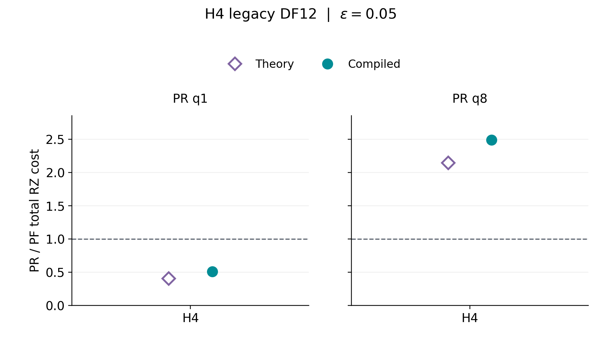
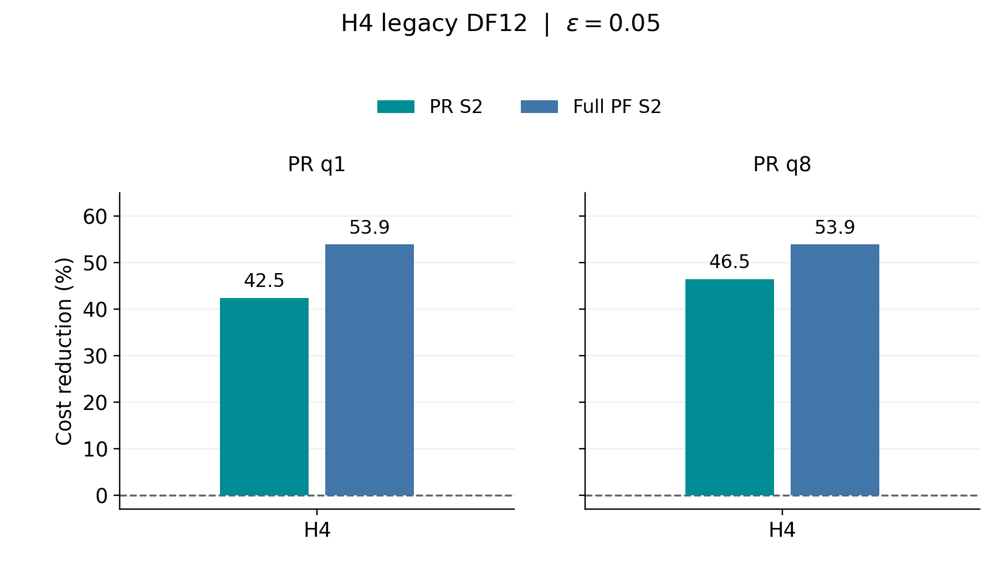

# 2次PR・2次PF：理論／compiled総費用の照合と参考図

**現行最良S2同士の主比較は、対応する理論総費用の不足により作成できなかった。**
指定固定資料の範囲で成立する、旧H4・legacy DF12・ε=.05の固定S2候補2組について参考図A/Bを作成した。
現行20条件の充足性を表で保存し、空の主図は作成していない。

|図|内容|出力|
|---|---|---|
|参考A|同じ固定候補対による理論／compiled PR/PF総費用比|[PNG](reference_A_H4_legacy_DF12_eps_0p05.png) / [SVG](reference_A_H4_legacy_DF12_eps_0p05.svg) / [PDF](reference_A_H4_legacy_DF12_eps_0p05.pdf)|
|参考B|固定PR S2と固定Full PF S2の理論→compiled総費用削減率|[PNG](reference_B_H4_legacy_DF12_eps_0p05.png) / [SVG](reference_B_H4_legacy_DF12_eps_0p05.svg) / [PDF](reference_B_H4_legacy_DF12_eps_0p05.pdf)|





2図×PNG/SVG/PDFの6出力。左右panelはPR q1とPR q8の別固定候補で、PFは同じ1候補を使う。
**このFull PFは、打切りを含む現行最良PFの代わりではない。**
現行主比較ではFull/B0/B0+IのS2を照合対象とし、19条件の選択を保存結果から固定できた。
H4・ε=.001だけはS2限定の保存採用結果がなく、新しいargminは禁止されているため未確定とした。

## 条件と出典

参考図はH4 linear chain・隣接1 Å・STO-3G・legacy固定DF12・T=.8・P=0・通常signed bias・numerical allowance倍率1。
PRは外側S2、p3/q1/δ=.8/r4/K2（旧anchor n32）、p3/q8/δ=.1/r2/K4（旧anchor n32）。
PFはFull S2、p12/q1/δ=.8（固定回路n1）。symmetric-directional control、元scalarとtailを1回回収する保存規約、
cosine/sine両軸のfull Hadamard wrapper RZ×保存shot総費用。
Qiskit1.3.0、rz/sx/x/cx、opt1、seed17、topologyなしの保存条件を保持する。

理論モデルはNATIVE_MIXED / explicit_rz_sx_x_cx_v1。
PRは固定prefix分解とclosed finite-RTE tailの法則期待値、PFは同じnative分解規約の決定論値。
Toffoli論理資源ではなく、compiled費用の厳密上界でもない。
PR理論期待値とcompiled有限標本平均を区別し、同一event列の比較や母平均優位性とは呼ばない。

- 現行compiled候補・費用：`5d53698534a1f325c8b7ed7be1bca6fa5192a77d` の全方式図と固定SOURCE。
- 参考図の保存G・shot・pair：`6e2b7eb6a0afc4ee2c5f57d3b7baf89b4ed237e1` のstage3正本。
- 実counter SOURCE：PRおよびS2は`98e5c9e61f245dbb9faf381d835a3846ee7e9bf3`。
  保存再会計SOURCE：`da8eb64ba8e88c219a6b707e1c72d130f5f37fcb`。compiled旧anchor起点SOURCE：`217c971dd537b1cc7fbc13742bc0f6c263ff7f45`。
- 理論結果の説明報告は指定RESULT commitには存在しないため、報告作成commit `f15752625613956d087bab221e48f1ce7dd59fef` の固定blobを併読した。
- 現行スライド6・補足A.8/A.9：`12efc52b8387182df3063a3523c7099e6bc1bfec` を読取専用で照合。A.8の方向逆転例はS4対照なので今回は図へ入れない。
- PF単価置換：`3983fe4f1ede003953735e757d2c098c12b4644f`。ALL_SAVED458の保存順位・価格だけを参照。
  そこにある旧固定n32 PRやnoncancellationのStage Bを、現行signed探索Aへ結合していない。

全48固定blobのpath・commit・Git blob・SHA256は[input_sources.json](input_sources.json)、
各点の元record・SOURCE・候補ID・cohort・shot・保存Gは[figure_data.json](figure_data.json) / [CSV](figure_data.csv)に記録する。

## 充足性と欠測

[現行20条件の表](coverage_matrix.md)・[CSV](coverage_matrix.csv)・[詳細監査JSON](coverage_audit.json)。
[方式別80条件](coverage_methods.csv)にはPR / Full S2 / B0 S2 / B0+I S2の費用を個別に保持する。
[旧S2候補25条件](historical_coverage.csv)では適格17／不適格8を区別する。

現行H2/H4/H6/H8の採用PR・PFに対応する理論総費用は、確認した固定資料にない。
特にB0/B0+Iのnative理論総費用はない。q依存compiled単価モデルや直接単価から理論Gを作ることはしていない。
H4 legacy DF12と現行DF10はHamiltonian・state・DF・cohortが異なり、同名candidateでも結合しない。
H6/H8の旧PR候補・n8/n32と現行探索Aは区別し、公開された新A CSVにないshot数も復元しない。
H6に保存された決定論的理論対照はS4のみで、二次比較の今回の対象外。
H4の固定Full S2はε=.05だけ適格なので、参考A/Bはこの精度だけとした。

## 図から直接読めること

|固定PR|理論PR/PF比|compiled PR/PF比|PR削減率|PF削減率|
|---|---:|---:|---:|---:|
|B2_p3_q1_2nd_r4_K2|0.405603|0.506631|42.451736|53.927590|
|B2_p3_q8_2nd_r2_K4|2.143530|2.489386|46.493855|53.927590|

削減率の単位は%。q1の固定比較ではPRが理論・compiledとも低費用だが、PR/PF比は約.406から.507へ増える。
q8の固定比較では理論段階からPFが低費用で、比は約2.144から2.489へ増える。
両固定比較とも、PFの理論→compiled削減率はPRより大きい。
これは旧Full S2固定対照での観察であり、現行最良B0/B0+Iの仮説A/Bを採択した結果ではない。
差をcompiler最適化だけへ帰属せず、PRの法則期待値と有限標本平均の違い、保存runtime/profileの留保を保持する。

## 作成・検証・保存

[caption](captions_ja.md)・[notes](figure_notes_ja.md)・[図とrecordの対応](figure_mapping.md)・
[provenance](provenance.json)・[技術検証](verification.json)・[表示確認](display_check.json)・[STOP](STOP.json)。
専用branch `codex/pr-pf-theory-compiled-ratios-20261022`、基点 `ee160395e87ed6d46cd4993572457afd0aa18590`。既存スライド・論文本文・原図・主表・SOURCE・raw・result・grant・ledger・marker・STOPを変更しない。

```bash
python build_figures.py --check
python verify_packet.py --check
```

再描画が必要な場合はrequirements.txtのMatplotlibを使い、引数なしのbuild_figures.pyを実行する。
入力blobの再取得はacquire_sources.pyで行える。元の科学runnerをimportしない。
今回実施した数値処理は保存Gの除算と100×(1−compiled/theory)という表示用算術だけで、shotや総費用は掛け直していない。
保存順位の読取以外の新しい科学的ランキング・argminは0。

**ローカルcommitまで。今回の指示でpush・公開は未承認のため実施しない。**
技術自己確認であり、独立した詳細科学レビュー・新しい科学stage・最終evidence freezeではない。
不足解消を希望する場合の次段はユーザーが範囲と追加計算の要否を別途判断する。Codexは自動実行せずmandatory STOP。
