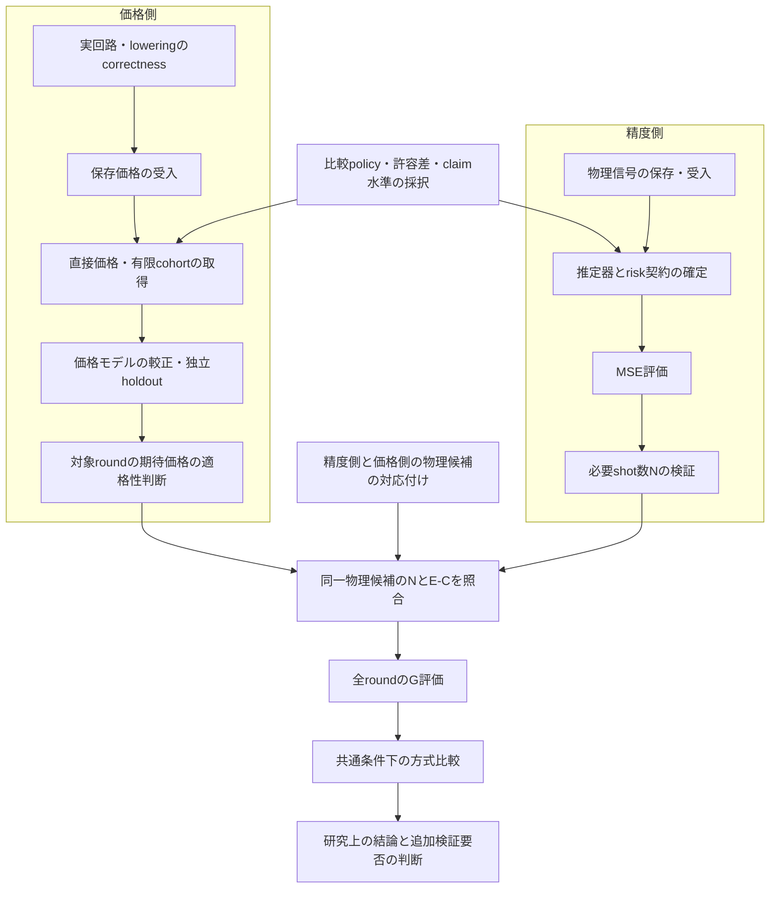

# 統合研究ロードマップ

Repository：`HIROMU1015/Partially-Randomized-Trotter`。最新確認：**2026-11-14 23時台 JST**（`git fetch origin` 後の全remote branchを対象）。

この文書は、研究の目的・現在地・不足している証拠・次の進行順序を一か所で把握するための入口である。科学的な結果・SOURCE・検証内容の正本は、リンク先の個別REPORTである。本書は新しい科学計算・数値再解析・採択を含まない。

## 0. 現在地サマリー

**研究全体**
- 研究は「リソース評価」と「アルゴリズム改善」の二系列からなる（§2）。
- リソース評価は、固定された有限taskでの資源地図（H4/H6/H8、DF/Pauli、有限時間）までは多くの証拠がある。一方、**RPE全roundの総資源を共通条件で方式比較した結果は、まだ一つも確定していない**。
- 現在の作業の中心は、H4（DF10）でのRPE全13roundの総資源 G の比較である（§3）。5方式（PR-DF、PR-Pauli、Full PF、Truncated PF、Full-H pure RTE）を対象に、精度側（信号→推定器→MSE→N）と価格側（実回路→直接価格→価格モデル→E[C]）を別々に積み上げている。

**最も重要な未解決事項**
1. **どの方式にも、根拠付きの shot 数 N がない。** Z1＋T1/Q3 の推定器・risk契約は診断用のopt-inで、正式採択は未定である。
2. **どの方式にも、全13roundで資格のある期待価格 E[C] がない。** 決定論PFは較正・holdoutの取得前、RTE系は単一pathまたは少数cohortの段階である。
3. **同じ物理候補について N と E[C] が揃っていない。** 例：Truncated PF は、信号が S2・幅0.1、価格shortlistが S2・幅16h/7 等で、候補が一致しない（§5）。
4. 比較policy、holdoutの許容差と分母、claim水準は未採択である。

**直近の優先作業**（いずれもユーザーの判断または実行許可が前提。§10）
- 比較policyとholdout許容差の採択 → 決定論PFの較正20価格（D）。
- Z1＋T1/Q3 の契約判断 → 必要Nの有限検証（B）。
- Full PF の全13round信号の照合（A/C）。
- 精度側と価格側で使う物理候補の対応付け。

**G・winner はすべての方式で未確定（null）である。**

## 1. 文書の役割

| 文書 | 役割 |
|---|---|
| 本書（RESEARCH_ROADMAP.md） | 研究目的・進捗・不足・依存関係・次の手順 |
| [PROJECT_MAP.md][MAP] | 実装・研究資料・成果物への入口 |
| [RESEARCH_RESULTS_INDEX.md][INDEX] | 過去の研究系列と原結果への索引 |
| [VALIDATION_STATUS.md][VS] | 検証結果の状態と利用制約（このcheckoutに登録された範囲） |
| 個別REPORT | 科学的結果・SOURCE・検証内容の正本 |

**読むときの注意**
- `main`（`546bca7ed`、2026-11-04）は11月5日以降の成果を含まない。それ以降の成果は各研究branchにあり、本書は固定commitのURLで参照する。
- リンク先の「現在」「次段階」は、その報告の作成時点の記述である。最新の状態は本書の§5・§10と、そこから辿る最新報告で確認する。
- 本書の数値は元報告からの転記であり、条件は必ずリンク先で確認する。

## 2. 研究全体の目的と構造

**全体の目的**：Hamiltonianの一部を決定論的な積公式（PF）で、残りを有限のランダム化Taylor展開（RTE）で実装する部分ランダム化（PR）について、同じ精度・成功条件の位相／エネルギー推定を、どの条件でどれだけ安く実行できるかを明らかにする。単回の回路の短さではなく、PFのbias、finite-RTEのbias、normalizationによる減衰、必要shot数、全roundの回路価格を接続して評価する（[研究目的][GOAL]、[方法][METHOD]）。

### 2.1 研究の階層

```text
研究全体（repository）
├─ リソース評価
│   ├─ 有限時間の資源地図：H4/H6/H8 DF、Pauli-JW、長時間B2/B3（〜11/02）
│   ├─ RPE全roundの総資源：H4 DF10の5方式比較（11/10〜、現在の中心）
│   └─ 一般性：H6/H8への条件移送（保存成果あり、現比較とは別契約）
└─ アルゴリズム改善
    ├─ return集約・sampling・推定器（Track B／O2）
    ├─ 表現・分割（元Track A／A-O1、研究C）
    ├─ Closed P3・共同選択（Track C／C-O3）
    ├─ Reference／control（Track D／D8）
    └─ 適応readout（新A）
```

- 11月1日時点の全体像は[科学的到達点と証拠の地図][LAND]と[主張・証拠・未解決課題の対応表][GAPS]にある。
- 11月10日時点の系列間の接続は[PR＋RPE共同最適化への統合調査][INTEG]と[対応表][INTEGM]にある。
- 本書はこれらを再利用し、11月10日以降の進展を加える。

### 2.2 同じ名前で別のものを指す語

| 名前 | 指すもの |
|---|---|
| 作業担当 A／B／C／D（11/13〜） | H4総資源比較の役割分担。A：物理信号・Full-H・Pauli。B：RPE推定器・MSE・必要N。C：価格・モデル・証拠受入。D：実回路価格 |
| 旧Track A（〜10/26） | 既知PRの資源評価（リソース評価系列）。PR-2 M1/M2、H4/H6/H8、長時間B2/B3 |
| 元Track A／A-O1（11/06〜08） | アルゴリズム改善。辞書変更（O1-M1）、core＋residual（O1-M2）、B2-P1 |
| 新A | PR Reference／適応readout（V6、Q3、Q4） |
| Track B（B/O2） | return集約・局所生成・有限bit・sampling |
| 研究B／B2-D | D内部PF・outer分割。Track Bとは別 |
| Track C（C-O3） | Closed P3、joint basis、h／resolution／αの共同選択 |
| 研究C（RC） | Hamiltonian表現・PR-aware DF（CDF、ENTRY）。Track Cとは別 |
| Track D（D8） | Reference／control。固定CDF8条件の13round条件付き会計 |
| 方式名 B0／B0I／B2／B3 | DFの方式ラベル（下表）。作業担当Bとは無関係 |

| 方式ラベル | 内容 |
|---|---|
| Full PF | 一体項と全DF fragmentを決定論PFで保持 |
| B0／B0I（Truncated PF） | prefixを保持し、tailを捨てる。B0Iは捨てたtailのidentity成分をscalarへ一回戻す |
| B2（PR-DF） | 一体項＋非空prefixを保持し、tailをfinite RTEで補う |
| B3 | 二体prefix 0。一体項は保持する。全Hの純RTEではない |
| PR-Pauli（DF head＋Pauli tail） | DF prefixを保持し、tailをPauli辞書のRTEで補う |
| Full-H pure RTE | 一体項を含む全Hをランダム化する。B3とは別方式 |

## 3. H4リソース評価の最終目的

### 3.1 評価対象

状態準備を除いた、RPE全roundの総計算資源を評価する。

$$
G=\sum_{m=0}^{M}\sum_{a\in\{X,Y\}} N_{m,a}\,\mathbb E[C_{m,a}]
$$

- $N_{m,a}$：対象精度・推定器・誤差契約の下で使うshot数。
- $\mathbb E[C_{m,a}]$：対象lawに対する、1 shot当たりの測定付きfull Hadamard wrapperの期待compiled RZ数。制御付き時間発展、scalar（総時間に一回）、X/Yの基底変換、測定を含む。
- 古典の価格標本数 n と normalization B は、N や C に重ねて掛けない。

**現行の検証で共通に使っている条件**（[4方式menu][MENU4]、[ベースライン設計][BASEOPT]。報告上は「案・初期shell」であり、正式採択の有無は各報告で確認する）

| 項目 | 内容 |
|---|---|
| 系 | Linear H4、1.00 Å、STO-3G、保存tol-only 1e−8 DF10（weighted-Hermitian completion）、sector (2,2)・36次元 |
| target | 保存したfull DF-Hの基底エネルギー。DF前のHamiltonianへは変更しない |
| RPE | h=0.1、M=12（13 round、$T_m=h\,2^m$）、状態準備費 P=0 |
| 目標精度（既存案） | $\varepsilon_E=0.00159360010199040$ Ha |
| compiler | Qiskit 1.3.0、basis rz/sx/x/cx、opt1、seed17。lowering IDも価格の条件として一致させる |

### 3.2 比較方式：正式採択と検証用shortlistの区別

| 区分 | 内容 |
|---|---|
| 方式の集合 | PR-DF、PR-Pauli、Full PF、Truncated PF、Full-H pure RTE。作業はこの5方式で進んでいる |
| 候補（schedule）の集合 | **正式採択された候補集合はない。** 11/13の11 schedule案は提案であり、最適候補群でもない（[4方式menu][MENU4]） |
| 現在の検証用候補 | §5の表の各行。信号・価格の取得や接続が済んだ物理候補であり、採択された最終候補ではない |
| 価格のshortlist（決定論PF） | S2・幅16h/7、Y4・幅16h/3、M5・幅16h（[D 保存4件binding][D_SAVED4]）。Full PFの局所予算内候補（[A追加5点][A_FPF_FU]）に基づく検証用の集合 |

### 3.3 二つの比較水準

| 水準 | N の意味 | 現状 |
|---|---|---|
| 第1水準 $G_{\mathrm{paper}}$ | 原論文型のnominal shot数 $\lceil B_m^2[11+4(M-m)]\rceil$。経験的な名目値で、精度の保証ではない | 会計の実装は人工値でPASS（[C 価格経路][C_ROUTES]）。実データでの計算は0件 |
| 第2水準 $G_{\mathrm{qualified}}$ | 採択した精度条件の下で根拠のあるshot数 | 推定器・risk契約が未採択。根拠付きNは0件 |

**nominal N を十分 N として扱わない。** 両水準の出力は別fieldで管理されている。

## 4. 研究課題と実装・検証の対応

実装pathは、併記した固定commitに存在することを確認した。`main` には無いものが多い。

### 4.1 量子回路実装（実回路・loweringのcorrectness）

| 項目 | 内容 |
|---|---|
| 研究上の問い | 価格を測る回路が、意図した制御付き時間発展・scalar一回・X/Y測定を正しく実装しているか |
| 実装 | D `acea1118a`：`src/trottertracks/pauli_tail_price_connection.py`、`scripts/run_full_pf_shortlist_prices.py`、`scripts/run_truncated_p7_prices.py`、`scripts/run_pauli_ld1_m0_pilot.py`。A `7a0c9468b`：`scripts/run_full_h_kappa2_p1.py`。新ZZ lowering：`26d4f23e7`の`src/trottertracks/efficient_controlled_zz.py` |
| 検証 | [Full-H P-1再検証][A_P1]（ancilla命令列の完全一致など23条件）、[Pauli B0 run02][A_B0]（固定の実H4数値gate）、[p7保存回路のX/Y識別][C_ADM]（保存QPYのfingerprint）、[PR-DF P2 direct pilot][D_P2] |
| 到達点 | 各方式で少なくとも1つの実回路が作用・配線の検査を通過した。PR-DF：LD1 m0/m6。PR-Pauli：LD1 m0。Full-H：κ2 m3。決定論PF：保存M5/m4 |
| 科学的資格 | 検査したpath・cellに限った配線の証拠。価格の期待値や他roundの正しさは示さない |
| 不足 | PR-Pauli LD2の配線。長いroundは直接確認がなく、モデルと外挿に依存する |
| 次の作業 | Pauli B1-W（LD2 m0、提案）。新規cellを取得する際は同じgateを使う |
| 担当・依存 | D（取得）、A（設計・検証）、C（guard受入） |
| 完了条件 | 価格を使う全ての回路族について、少なくとも代表cellの配線証拠がある |

### 4.2 物理信号

| 項目 | 内容 |
|---|---|
| 研究上の問い | 各方式・各roundの平均信号（raw、補正後、normalization）は何か |
| 実装 | A `714247619`：`src/trottertracks/pr_rpe_signal_provider.py`、`df_head_pauli_tail_p0.py`／`_p1.py`／`_completion.py`、`pf_effective_hamiltonian.py`、`scripts/run_h4_full_pf_heff_scan.py`。A `7a0c9468b`：`baseline_signal_pipeline.py`、`baseline_signal_numerics.py`、`scripts/run_truncated_fullh_signals.py`、`scripts/run_full_h_kappa2_signals.py` |
| 検証 | [PR-DF 26round][A_PRDF]、[PR-Pauli 26round][A_PAULI]、[B0I p7・Full-H R448 各13round][A_TRSIG]、[Full-H κ2 13round][A_S1]、[Full PF H_eff格子][A_FPF_SCAN]・[追加5点][A_FPF_FU]、[Truncated T1][T1]・[T2][T2] |
| 到達点 | PR-DF、PR-Pauli、Truncated（B0I p7・S2・幅0.1）、Full-H（κ2、R448）は全13roundのraw信号を保存済み。Full PFはH_effの固有値シフトと二時点の平均まで |
| 科学的資格 | 保存した数値stateとideal finite-K lawに条件付いた解析的平均。基底状態の認証と、実samplerのlawへの移送は未取得 |
| 不足 | **Full PFの正式な全13round raw packetは、確認したSOURCE内では未同定**（[B 適用一覧][B_SIGAPP]）。価格shortlistの候補（幅16h/7等）に対応する全round信号 |
| 次の作業 | Full PFの一次記録の照合。受入できないroundだけを新規計算の候補にする（別承認） |
| 担当・依存 | A（信号）、C（baseline metadata）、B（受入） |
| 完了条件 | 比較に使う各物理候補について、全13roundの信号packetがSOURCE付きで受入済みである |

### 4.3 誤差評価（推定器・MSE）

| 項目 | 内容 |
|---|---|
| 研究上の問い | 与えたshot配分の下で、エネルギー推定の誤差（MSE）はどこまで抑えられるか |
| 実装 | B `999304918`：`src/trottertracks/rpe_total_decoder.py`、`rpe_total_risk.py`、`rpe_deterministic_risk.py`、`rpe_total_binding.py`、`rpe_c_interfaces.py`、`pr_rpe_rmse_controller.py`。test：`tests/check_rpe_total_decoder_risk.py` |
| 検証 | [精度契約W0][B_W0]、[全関数推定量Z1＋T1とQ3][B_Z1]、[PR-DFの部分decoder DP][B_DP]、[Pauli Z1＋T1/Q3 限定2評価][B_Q3] |
| 到達点 | PR-Pauli LD1/LD2：1つのcontrol vectorに対するモデルMSEの上下界を保存。PR-DF：旧部分decoder契約での上界（未解決事象のlossが支配的）。Full-H κ2・Truncated p7：metadata接続のみ |
| 科学的資格 | 保存proxy energy・ideal finite-K raw・IIDに条件付いたモデル診断。物理的な精度保証ではない。Z1＋T1は診断用のopt-in |
| 不足 | 推定器・target・loss・閾値・law・数値scopeの正式な契約。PR-DFは旧固定gridを保つdecoder-only bridge。Full PFは入力そのもの |
| 次の作業 | 契約の判断（ユーザー）。その後、承認された範囲でMSE評価（B） |
| 担当・依存 | B。信号（§4.2）に依存 |
| 完了条件 | 採択した契約の下で、比較する全候補のMSE評価が同じclaim水準で揃う |

### 4.4 必要shot数 N

| 項目 | 内容 |
|---|---|
| 研究上の問い | 目標精度を満たすために、各round・各軸で何shot必要か |
| 実装 | B `999304918`：`src/trottertracks/rpe_shot_allocation.py`、`pr_rpe_rmse.py`（nominal）、`rpe_total_binding.py`の`evaluate`入口。C `855573064`：`paper_nominal_cost.py`の`nominal_packet` |
| 検証 | [必要Nの有限計画][B_NPLAN]（未実行の提案）、[B 準備報告][B_N] |
| 到達点 | Pauliの評価に使ったcontrol vectorはユーザー指定の値で、nominal・十分N・最適Nのいずれでもない。`sufficient_N`は全方式でnull |
| 科学的資格 | なし（未資格） |
| 不足 | 契約採択後の有限検証。提案は、Pauliで共通scale 3/4の2評価、Full-H κ2とp7で各1評価 |
| 次の作業 | §4.3の契約判断の後、ユーザーが範囲を承認した場合に実行 |
| 担当・依存 | B。§4.3に依存。価格とは独立に進められる |
| 完了条件 | 各候補について、採択した契約で閾値を満たすwhole-vectorが、根拠とともに保存される |

### 4.5 compiled価格（直接価格・有限cohort）

| 項目 | 内容 |
|---|---|
| 研究上の問い | 各round・各軸の回路を実際にcompileしたときのRZ数はいくつか |
| 実装 | D `acea1118a`（実装SOURCEは`22ccf3972`）：§4.1のcaller。C `855573064`：`src/trottertracks/price_implementation_guard.py`、`rpe_d_price_connection.py`、`rpe_optimization_pipeline.py`（`price_context`） |
| 検証 | [Full PF保存価格の受入][C_FULLADM]、[p7保存価格の受入][C_ADM]、[D 保存4件binding][D_SAVED4]、[Full-H P-1][A_P1]、[Pauli B0][A_B0]、[PR-DF coverage][C_PRDFCOV] |
| 到達点 | 決定論PF：M5・m4のX/Y計4価格を受入済み（Full PF 各85,960 RZ、p7 B0I 各60,950 RZ）。Full-H：κ2 m3の単一path（各92,448 RZ）。Pauli：LD1 m0の単一path（各1,380 RZ）。PR-DF：LD1 m0/m6の少数path |
| 科学的資格 | 決定論PFの4件は直接価格として利用可能。RTE系の値は同一trajectoryの直接価格であり、lawの平均ではない |
| 不足 | 決定論PFの新規32件（較正20、holdout12）。RTE系の較正用cell。PR-DF LD2とPauli LD2 |
| 次の作業 | Stage 1（較正20件）。開始条件は§10 |
| 担当・依存 | D（取得）、C（受入）。比較policyと許容差の採択に依存 |
| 完了条件 | 価格モデルの較正とholdoutに必要なcellが、受入検査を通って揃う |

### 4.6 期待価格モデル（E[C]）

| 項目 | 内容 |
|---|---|
| 研究上の問い | 直接compileできない長いroundを含めて、全roundの期待価格をどの根拠で与えるか |
| 実装 | C `855573064`：`src/trottertracks/price_model_validation.py`（fit・holdout・refitなし）、`rpe_mean_price_model.py`（構造＋残差）。A `7a0c9468b`：`finite_price_design.py`（取得前の識別可能性検査） |
| 検証 | [価格検証計画][C_PVPLAN]、[CELL_PLAN_V2][C_CELLPLAN]、[PR-DF検証計画][C_PRDFPLAN]、[Full-H P-2・Pauli B1設計][A_DESIGN]、[PR-DF構造期待値][C_ES] |
| 到達点 | 決定論PF：12モデル（方式2×公式3×軸2）の技術経路。実fitは0件。PR-DF：LD1の構造期待値E[S]が26軸。Full-H：現行P-2案は較正設計のrankが不足し、修正案を提案済み |
| 科学的資格 | 資格のあるE[C]は全方式で0件。E[S]は構造期待値であり、E[C]ではない。有限cohort平均もE[C]ではない |
| 不足 | 較正価格、係数の凍結、独立holdout、許容差。RTE系はさらに、境界の加法性、sampler lawとの距離、低頻度eventの寄与、外挿範囲 |
| 次の作業 | 決定論PF：較正→fit・凍結→holdout。RTE系：設計の採否判断 |
| 担当・依存 | C（モデル・判定）、D（取得）、A（RTE系の設計）。§4.5に依存 |
| 完了条件 | 事前に宣言した許容差でholdoutを通過し、使用するroundの範囲での適格性が判断されている |

### 4.7 総資源会計（G）

| 項目 | 内容 |
|---|---|
| 研究上の問い | 同じ物理候補のNとE[C]を掛け合わせた全roundの総資源はいくつか。方式間の関係はどうか |
| 実装 | C `855573064`：`src/trottertracks/paper_nominal_cost.py`（第1水準）、`rpe_optimization_pipeline.py`（`plan`／`compare`／`select`）。B `999304918`：`pr_rpe_rmse_controller.py`（`assess`／`cost`／`select`） |
| 検証 | [C 価格経路][C_ROUTES]、[Pauli physical-ID bridge][C_BRIDGE]（人工値のテスト）、[B total/Q3 canonical統合][B_TOTAL] |
| 到達点 | 会計・guard・欠測の扱いは人工のN・価格でPASS。実データのG計算は0件 |
| 科学的資格 | なし。人工テストのPASSは科学的な比較結果ではない |
| 不足 | §4.4のNと§4.6のE[C]。同一候補の照合。比較policy |
| 次の作業 | §8の統合段階。上流が揃うまで着手しない |
| 担当・依存 | B・C。全項目に依存 |
| 完了条件 | 全方式について、同じclaim水準のNとE[C]から、欠測なしでGが計算される |

## 5. 物理候補ごとの進捗

**方式が同じでも、物理候補（prefix、公式、時間幅、K、κ、round、law、SOURCE）が違えば別の行である。** 別の行の N と E[C] を掛け合わせて G を作ってはならない。

状態の語は§6の区分を使う。IDは先頭8桁の略記で、全桁はリンク先にある。

| 物理候補 | 信号 | 推定器・MSE | 必要N | 実compiled価格 | E[C] | G |
|---|---|---|---|---|---|---|
| **PR-DF** LD1（`a4dda8f7`）／LD2（`1fa33556`）。S2、幅0.1、K2、元κ | 数値保存：各13round（[報告][A_PRDF]） | 旧部分decoder契約のDP上界を保存（[報告][B_DP]）。Z1＋T1は旧固定gridのbridgeが無く未適用 | 未資格 | LD1のm0・m6だけ有限cohort（P1 n2、P2 fresh n4。新ZZ）。他round・LD2は調査範囲で欠測（[coverage][C_PRDFCOV]） | 未資格。LD1のE[S] 26軸は構造期待値 | 未確定 |
| **PR-Pauli** LD1（`d905d219`）／LD2（`d7dd4f52`）。DF head＋Pauli tail、S2、幅0.1、K2、元κ | 数値保存：各13round（[報告][A_PAULI]） | Z1＋T1/Q3の限定2評価を保存。モデルMSE上界は約4.72e−7 Ha²（[報告][B_Q3]）。条件付きモデル診断 | 未資格（評価に使ったvectorは十分Nではない） | LD1 m0の単一path（[B0][A_B0]）。LD2は欠測 | 未資格。B1計画は提案（[設計][A_DESIGN]） | 未確定 |
| **Full PF** S2・幅0.1（prefix10） | H_effのm0・m12のみ。全13round packetは未同定（[適用一覧][B_SIGAPP]） | 人工13roundで経路のみ確認 | 未資格 | 旧catalogに直接価格があるが、13roundのscheduleの大半は保存gridの外（[4方式menu][MENU4]） | 未資格 | 未確定 |
| **Full PF** shortlist：S2・幅16h/7、Y4・幅16h/3、M5・幅16h | H_effの固有値シフトが局所予算内（[追加5点][A_FPF_FU]）。全13roundの信号packetは未同定 | 未着手 | 未資格 | M5・m4のX/Yを受入済み（各85,960 RZ）。新規較正10・holdout 6は承認待ち（[D][D_SAVED4]） | 未資格。モデルは技術経路のみ | 未確定 |
| **Truncated PF** B0I p7、S2・幅0.1（`e6754564`） | 数値保存：13round（[報告][A_TRSIG]）。[T2][T2]の照合も通過 | metadata接続PASS（[適用一覧][B_SIGAPP]） | 未資格 | **この候補の価格は無い** | 未資格 | 未確定 |
| **Truncated PF** B0I p7 shortlist：S2・幅16h/7、Y4・幅16h/3、M5・幅16h | H_effの固有値シフト（[T2][T2]、42 cell）。全13roundの信号は、確認した範囲で無い | 未着手 | 未資格 | M5・m4のX/Yを受入済み（各60,950 RZ、[C][C_ADM]）。新規較正10・holdout 6は承認待ち | 未資格 | 未確定 |
| **Full-H pure RTE** κ2、K2、q=2^m（`54ac3eb3`） | 数値保存：13round（[S-1][A_S1]） | metadata接続PASS | 未資格 | m3（q8、R71）の単一path（[P-1][A_P1]）。配線の証拠 | 未資格。P-2は設計修正案の段階（[設計][A_DESIGN]） | 未確定 |
| **Full-H pure RTE** R448、K2、q=2^m（`cfa6aee3`） | 数値保存：13round（[報告][A_TRSIG]） | 確認した範囲で接続の記録なし | 未資格 | 確認した範囲で無し | 未資格 | 未確定 |

**この表から読み取れる対応の欠落**
- **Truncated PF**：信号がある候補（S2・幅0.1）と、価格を取得している候補（幅16h/7等）が別である。どちらかに揃える必要がある。
- **Full PF**：価格shortlistの3候補には、全13roundの信号がまだ無い。幅0.1の候補には、対応する価格が少ない。
- **Full-H**：κ2とR448は、R・event数・normalizer・rawが別物である。κ2の価格をR448へ、またはその逆へ使わない。
- **PR-DFとPR-Pauli**：tailの表現とlawが違う。DF tailのE[S]や旧C1価格をPauliへ使わない。
- 推定器の版が変わると、canonical IDが変わる。価格の再束縛には版付きのbridgeが必要である（[bridge仕様][C_BRIDGE]）。

round×X/Y×cohortの明細は、[CELL_PLAN_V2][C_CELLPLAN]（決定論PFの36価格）、[PR_DF_COVERAGE][C_PRDFCSV]（PR-DFの52軸）、[READINESS][B_READY]（Bの接続状態）にある。

## 6. 証拠の状態の区分

| 区分 | 意味 | 例 |
|---|---|---|
| 実装済み | コードがある | 第1水準の会計 |
| 人工・回帰テストPASS | 架空の入力で動作を確認した | guard、bridge、価格モデルの検査 |
| 実物理条件での検証PASS | 実H4の回路・数値でgateを通過した | P-1再検証、Pauli B0 |
| 科学的数値結果の保存あり | 承認された実行の結果が固定SOURCE付きで保存されている | 各方式の13round信号、Pauli Q3の2評価 |
| 特定条件下で利用可能 | 明示された条件の範囲で使える | 決定論PFの保存4価格 |
| 最終比較へは未資格 | 値はあるが、最終比較に必要な資格が無い | 単一path価格、E[S]、control vectorでのMSE |
| 調査済み範囲では欠測 | 確認した範囲に記録が無い | PR-DF LD2の価格 |
| 原本・同等性が未確認 | あるかどうか、同じ条件かどうかを判断できていない | Full PFの全13round信号 |
| STOP中 | 個別契約のmandatory STOPが有効 | 各担当の最新報告すべて |
| 次段階の承認待ち | 提案済みで、ユーザーの判断・許可を待っている | Stage 1、P-2、B1、必要N |

**区別を保つ点**
- 人工テストのPASSは、科学的な検証の完了ではない。
- **有限cohortの平均、構造期待値 E[S]、compiled期待価格 E[C] は別の量である。**
- 単一pathの観測を、lawの期待値として扱わない。
- 旧SOURCEの科学的資格を、新SOURCEへ自動で移さない。
- 「確認した範囲で未同定」は「未実施」ではない。

## 7. 未解決課題と、解くと何が判断できるか

| 課題 | 種別 | 解決すると判断できること | 重複照合（§10.5）の状況 |
|---|---|---|---|
| 比較policy、holdoutの許容差・分母、claim水準の採択 | 方針・契約の採択 | 価格取得を開始できる。holdoutの合否基準が決まる | 該当なし |
| Z1＋T1/Q3の契約（推定量、target、loss、閾値、law、数値scope） | 方針・契約の採択 | 第2水準の「根拠付きN」の定義が決まる | 該当なし |
| 決定論PFの較正20価格 | 実回路compile | 12モデルの係数が識別できる（各groupでm4・m5の2点） | 保存4件を再利用し、新規対象から除外済み。32件は確認した範囲で重複なし（[D][D_SAVED4]） |
| 12モデルのfitと独立holdout 12価格 | 新しい数値評価＋compile＋holdout | m6でaffineモデルが成り立つかどうか。m7以降の外挿は別の判断 | 同上 |
| Full PFの全13round信号 | 既存成果の照合。不足分は新しい数値評価 | Full PFを第2水準の比較に載せられるか | 一次記録の照合が未了。未同定を未実施と数えない |
| 精度側と価格側の候補の対応付け | 既存成果の照合と、方針の採択 | どの候補でGを構成するか | 候補ごとに条件を展開して照合する |
| PR-DFのdecoder-only bridge | 技術実装・人工テスト | 保存信号を再取得せずに、新推定器で評価できるか | 保存13rawを再利用する |
| PR-DFのE[C] | compile＋モデル較正＋holdout | PR-DFを比較に載せられるか | E[S]・P1・P2・旧C1の役割と範囲を保全（[C][C_ADM]） |
| Full-H P-2 | 実回路compile（提案はD7：24 compile） | 全13roundのE[C]モデルが識別できるか。group境界の加法性 | 予定cellは保存記録なし、または条件が異なる（[設計][A_DESIGN]） |
| PR-Pauli B1 | 実回路compile（B1-W 2、B1-CAL 辞書あたり24） | LD2の配線。Pauli tailの全round価格モデル | B0はLD1 m0のpath0として部分的に再利用できる |
| 必要Nの有限検証 | 新しい数値評価 | 縮小したshot配分がモデル閾値を満たすか | Pauliの完了2件と保存信号を再利用する（[計画][B_NPLAN]） |
| 基底状態の認証、sampler lawの移送、数値certificate | 独立検証。claim水準による | 条件付き観測を超える主張ができるか | 必要性はclaim水準の採択で決まる |
| H6/H8への移送 | 将来の一般性検証 | H4の結論が他の系でも成り立つか | 今回のH4比較には不要。保存成果は§9.2 |

新しい科学計算・compile・実験を行う前には、共通運用指示§10.5の重複照合を行う。照合の完了は実行の許可ではない。

## 8. 依存関係と進行順序



**現在の位置**
- 精度側：信号の保存・受入は、Full PFを除いてほぼ済んでいる。次は「推定器とrisk契約の確定」で、ユーザーの判断を待っている。
- 価格側：決定論PFは「保存価格の受入」まで済み、「直接価格の取得」の開始条件を待っている。RTE系は「correctness」の段階で、較正の設計が提案されている。
- 統合：未着手。

**並列に進められる部分**
- 精度側と価格側は、互いの結果を待たずに進められる。
- 価格側の中では、決定論PF、PR-DF、PR-Pauli、Full-Hが互いに独立である。
- 精度側の中では、方式ごとのMSE評価が互いに独立である。
- 候補の対応付け（M）は、どちらの取得よりも先に決めると、無駄な取得を避けられる。

**直列になる部分**
- 較正 → fit・係数凍結 → holdout。holdoutの値を見てからモデルを変えない。
- 契約の採択 → MSE評価 → Nの検証。

## 9. アルゴリズム改善系列とその他の資源評価

### 9.1 アルゴリズム改善系列

詳細は[11/01の全体地図][LAND]、[対応表][GAPS]、[11/10の統合調査][INTEG]にある。ここでは目的・到達点・残課題と、リソース評価への接続だけを示す。

| 系列 | 目的 | 主な到達点 | 残課題 | H4総資源比較への接続 |
|---|---|---|---|---|
| Track B／O2（return集約・sampling） | 同じ平均を安い回路・少ないshotで実現する | G6〜G10の構成、Closed P3/P5、固定syntheticでの資源交換、H4 C1の3方式1024path（[全体地図][LAND]§4）。11/08までのO2の成果は[O2統合][O2] | 独立した新規性と、認証N・native総資源での優位は未確立 | Closed P3はTrack Cへ接続済み。現在の5方式比較には入っていない |
| 元Track A／A-O1（表現・分割） | 辞書やcore＋residualで単価やλを下げる | O1-M1は単価低下を長roundの減衰が相殺する負結果。B2-P1は18roundの条件付きshot会計（[HP報告][A_HP]、[後続調査][ASURVEY]） | O1-M2のmodel適格性。H4のLD4〜7等は未実行 | PR-Pauliの[準備][A_PAULI_PREP]で、O1-M1とP3のSOURCEを照合している。旧結果の数値は現比較へ移していない |
| Track C／C-O3（Closed P3・共同選択） | h・resolution・α・整数shotを全roundで共同選択する | DF12・18roundで強Full／Truncatedと比較。最適化したClosed PRは強Fullより高価という結果（[共同選択][C_O3]、[統合報告][C_O3INT]） | 別条件（DF10、h=0.1、13round）への移送は未資格 | 強い決定論対照を落とさないという比較方針の根拠。数値順位は現比較へ混ぜない |
| Track D／D8（Reference／control） | whole-pathのReference構成でCX・depthを下げる | 固定CDF8条件で13roundの条件付き会計まで接続（[総計][D8_TOTAL]）。r16の有限価格校正（[報告][D8_R16]） | 絶対費用の大半が長qのproxy。全体CIとactual成功は未資格 | 測定同値性・十分shot・価格の三接続の型を再利用できる。A/F/S価格モデルは別条件へ移さない |
| 新A（適応readout） | 適応的な読み出しでshotを減らす | canonical条件で固定モデル内の保証と18roundのnative費用（[Q3][NEWA_Q3]）。Q4-1は実装と人工検証まで（[準備][NEWA_Q4]） | 強Full／Truncated／Closedへの公平な移送 | shot数の削減を直接扱う。現5方式のNには未接続 |
| 研究C（表現・PR-aware DF） | Hamiltonian表現を変えてλや誤差を下げる | CDF／ENTRYの3方式比較（[報告][RC]） | own-DFの結果を元Hのgroundへ移す根拠 | 未接続。target・stateの資格が先に必要 |
| C-α、閾値反射（元Track Aの後続） | gate lawの資格化、中心化による改善 | 固定gate lawで18roundの条件付きshot会計（[C-α][CALPHA]）。中心化は数学的な差を確認、総費用は未評価（[報告][THRESH]） | 全roundのcompiled期待価格 | 未接続 |

**接続できる可能性があることと、科学的資格を得て統合済みであることは別である。** 上表の「接続」は前者を述べている。異なる科学契約・STOPを統合していない。

### 9.2 H4以外・過去のリソース評価

| 対象 | 保存成果 | 現比較との関係 |
|---|---|---|
| 有限時間の資源地図（旧Track A、Pauli-JW、長時間B2/B3） | [全体地図][LAND]§2・§5 | 単一時刻の N×C。全RPEの比較ではない。決定論PFの保存4価格（`155529e20`）の出所でもある |
| H4 DF10の旧13round N、H4/H6のN/C coverage | [N batch][H4_NBATCH]、[coverage][H46_COV] | 旧契約の条件付きN。現在の比較のNへは流用しない（[4方式menu][MENU4]の方針） |
| H6 DF19のRPE m7信号と条件付きshot | [報告][H6_M7] | 一般性検証の入力候補。今回のH4比較には不要 |
| Full-H pure RTEのH4/H6/H8有限時間 | [T2最適化][FH_T2]、[H8][FH_H8] | 現κ2 scheduleの設計の出発点。旧loweringの価格は使わない |
| 実装監査・技術修正 | [repo全体監査][AUDIT] | 中核の物理・統計計算に、科学的結論を変える不具合は報告されていない。正式なG比較の前の注意点として、Full-Hの旧lowering価格とPRの新lowering価格を直接比べないこと、Gの大半を占めるm10〜m12の価格は直接測れない規模であることを挙げている |

## 10. 実験・研究計画の管理欄

**正式採択・承認済みの範囲**：下表の「現在の状態」に書いた完了済みの実行だけである。それ以外は提案であり、ユーザーの判断・実行許可を待っている。**各担当の最新報告は、すべてmandatory STOPで終わっている。**

| 課題 | 担当 | 現在の状態 | 実施条件 | 完了時に得られる判断 |
|---|---|---|---|---|
| 決定論PFの新規較正20価格 | D | Stage 0の技術準備が完了。保存4件はbinding済み。**未実行、STOP**（[D][D_SAVED4]、[手順][D_NEXT]） | 比較policyの採択。holdout許容差・分母の採択。ユーザーの科学実行許可。実行直前の重複再照合 | 12 groupそれぞれで、m4・m5の2点が揃う |
| 12モデルのfitと係数凍結 | C | 技術経路のみ。実fitは0件 | 較正24価格（保存4＋新規20）の公開。別途の科学実行承認 | holdoutの前に、係数・design・許容差が固定される |
| 独立holdout 12価格とその判定 | D（取得）、C（判定） | 未実行 | 凍結modelの公開。承認。判定は事前宣言の許容差で行い、失敗してもrefitしない | m6でaffineモデルが成り立つか。m7〜m12の外挿は別の判断 |
| PR-DF期待価格の資格付け | C、D | LD1のE[S] 26軸、m0・m6の少数path。資格付きE[C]は0／52軸（[C][C_ADM]） | [検証計画][C_PRDFPLAN]の採否。許容差。承認 | PR-DFのE[C]を比較に使えるか |
| PR-Pauli B1の価格検証 | A（設計）、D（取得）、C（受入） | B0（LD1 m0、1 path）のみ。B1-W／B1-V／B1-CALは**提案**（[A2][A_B1PLAN]） | Dのcaller拡張。許容差。承認 | LD2の配線。価格モデル（rank 3）の識別 |
| Full-H P-2の較正設計修正・価格検証 | A（設計）、D（取得）、C（受入） | 現行案は較正のrankが2で実行できない。D7（24 compile）とD6（22）を**提案**（[A1][A_P2PLAN]） | Dのcaller拡張（cell指定・seed連結）。許容差。承認 | 全13roundのE[C]モデルの識別。境界加法性の直接検査 |
| Z1＋T1/Q3の正式契約判断 | ユーザー（判断）、B | 診断用opt-in。Pauliの2評価は完了（[報告][B_Q3]） | 推定量、target、loss、閾値、law、数値scopeの採択 | 第2水準のNの定義 |
| 必要Nの有限検証 | B | **提案**：Pauliで共通scale 3/4の2評価。Full-H κ2・p7で各1評価（[計画][B_NPLAN]） | 上の契約判断。科学実行許可 | 縮小したwhole-vectorがモデル閾値を満たすか |
| Full PF信号の不足分照合 | A、C（Bが受入） | 正式な全13round packetは、確認したSOURCE内で未同定 | 対象候補の確定。一次記録の照合（技術作業）。不足分の新規計算は別承認 | Full PFを第2水準に載せられるか |
| 同一候補のN・価格統合 | B、C | 未着手。Truncated PFとFull PFで候補の不一致がある（§5） | 候補の対応付けの方針。候補・幅・公式・round・law・SOURCEの照合 | Gを構成できる候補の集合 |
| 最終G比較 | B、C → ユーザー | G・winnerは全方式でnull | 全方式について、同じclaim水準のNとE[C]。比較policy | 共通条件下の方式比較と、追加検証の要否 |

**他担当への取込みで残っている技術作業**（科学実行ではない）
- Bのprice guard bindingを、Pauli bridgeを含むCのcommitへ再pinする（[C][C_BRIDGE]）。
- 推定器の版を変える場合の、canonical IDのbridge。

## 11. 出典不足・確認できなかった事項

- **Full PFの全13round信号**：Bが確認したSOURCE内では未同定である。本書の作成でも、該当するpacketを特定できなかった。未実施とは断定しない。
- **後続報告の有無**：Full-H P-2の設計修正とPR-Pauli B1計画は、固定報告`7a0c9468b`を確認した。作業開始時点で、A・B・C・Dの各branchに、本書に記載したcommitより新しいcommitは無かった。
- **正式採択の範囲**：H4比較の共通条件（h、M、εE等）と候補集合について、ユーザーの正式採択を示す一次記録は特定していない。本書では報告の表現（案・初期shell・提案）のまま記載した。
- **アルゴリズム改善系列**：§9.1は、11/01と11/10の横断調査と、各branchの最新報告の冒頭に基づく。各系列の全artifactを読み直してはいない。
- **`main`との差**：11月5日以降の成果は`main`に無い。本書から固定commitで参照できるが、`main`のcheckoutだけでは実装pathを開けない。
- `VALIDATION_STATUS.md`と`validation_manifest.json`は変更していない。本書の追加は、科学的なstatusを変えない。

## 12. 更新規則

**更新する契機**
- 新しい固定科学結果の公開。
- 他担当による成果の正式な受入。
- 重要な検証のPASS／FAIL／UNKNOWN。
- 科学的資格・適用範囲の変更。
- ユーザーによる研究方針・比較policyの採択。
- STOP条件や依存関係の変更。

**更新の仕方**
- 影響する行（§0、§5、§7、§10）と依存関係（§8）だけを直す。元REPORTと固定commitをリンクに加える。
- 冒頭の最新確認日を更新する。
- 日々の小さなテストやcommitのたびに全体を書き換えない。
- 過去の状態は個別REPORTに残っているので、本書に履歴を積み上げない。
- 管理用のシステム、データベース、常駐の同期処理、承認の証明基盤は作らない。

---

作成：2026-11-14 JST、Claude Code（主agentのみ。独立レビューではない）。branch `codex/research-roadmap-integration-20261114`（基点 `main` `546bca7ed`）。実施したのは、公開済み資料・SOURCEの読取、Markdownの作成、リンクの確認だけである。新しい科学計算、保存値の再解析、sampling、回路build/compile、MSE・N・E[C]・Gの計算、採択は行っていない。**mandatory STOP**：本書を根拠に、科学計算・compile・価格取得・方針変更・`main`への統合へは自動で進まない。

<!-- links -->
<!-- 固定commitの参照。科学実行のSOURCEは各REPORTの記載を使う。 -->
[GAPS]: pr_repository_claim_evidence_gap_matrix_20261101.md
[GOAL]: 研究目的・研究課題.md
[INDEX]: RESEARCH_RESULTS_INDEX.md
[LAND]: pr_repository_scientific_landscape_20261101.md
[MAP]: ../../PROJECT_MAP.md
[METHOD]: 研究方法・解析手順.md
[VS]: ../../VALIDATION_STATUS.md
[ASURVEY]: https://github.com/HIROMU1015/Partially-Randomized-Trotter/blob/162f3d3f0f42973048fd14a7a6624e147a1e961a/docs/research/track_a_algo_improvement_survey_20261109/README.md
[AUDIT]: https://github.com/HIROMU1015/Partially-Randomized-Trotter/blob/51d324ea9c83bc12f1e866da0fa409cef926f74a/docs/research/pr_resource_repo_wide_audit_20261114/REPORT.md
[A_B0]: https://github.com/HIROMU1015/Partially-Randomized-Trotter/blob/00f74f86d16cc6878e1d4c5977eb9abd9ce9c076/docs/research/d_pauli_ld1_m0_pilot_results_20261114/RECOVERY_REPORT.md
[A_B1PLAN]: https://github.com/HIROMU1015/Partially-Randomized-Trotter/blob/7a0c9468b2499fac9fa1cd279ae2980c9dab048e/docs/research/a_full_h_p2_pauli_b1_price_design_20261114/A2_PAULI_B1_PLAN.md
[A_DESIGN]: https://github.com/HIROMU1015/Partially-Randomized-Trotter/blob/7a0c9468b2499fac9fa1cd279ae2980c9dab048e/docs/research/a_full_h_p2_pauli_b1_price_design_20261114/REPORT.md
[A_FPF_FU]: https://github.com/HIROMU1015/Partially-Randomized-Trotter/blob/714247619afb4714fd663eb15c0470ef32bdc7af/docs/research/h4_full_pf_followup_results_20261114/REPORT.md
[A_FPF_SCAN]: https://github.com/HIROMU1015/Partially-Randomized-Trotter/blob/714247619afb4714fd663eb15c0470ef32bdc7af/docs/research/h4_full_pf_heff_scan_results_20261114/REPORT.md
[A_HP]: https://github.com/HIROMU1015/Partially-Randomized-Trotter/blob/e162ef708d7f721cd9c95ae07a833f7301d2b449/docs/research/track_a_b2_p1_hp_branch_shots_20261107/REPORT.md
[A_P1]: https://github.com/HIROMU1015/Partially-Randomized-Trotter/blob/a04470c0ad489eea1798856e648f863f9092cfb1/docs/research/d_full_h_kappa2_p1_results_20261114/run02_revalidation01/REPORT.md
[A_P2PLAN]: https://github.com/HIROMU1015/Partially-Randomized-Trotter/blob/7a0c9468b2499fac9fa1cd279ae2980c9dab048e/docs/research/a_full_h_p2_pauli_b1_price_design_20261114/A1_FULL_H_P2_PLAN.md
[A_PAULI]: https://github.com/HIROMU1015/Partially-Randomized-Trotter/blob/714247619afb4714fd663eb15c0470ef32bdc7af/docs/research/df_head_pauli_tail_all_round_results_20261114/REPORT.md
[A_PAULI_PREP]: https://github.com/HIROMU1015/Partially-Randomized-Trotter/blob/714247619afb4714fd663eb15c0470ef32bdc7af/docs/research/df_head_pauli_tail_preparation_20261114/REPORT.md
[A_PRDF]: https://github.com/HIROMU1015/Partially-Randomized-Trotter/blob/714247619afb4714fd663eb15c0470ef32bdc7af/docs/research/pr_rpe_first_signal_results_20261113/REPORT.md
[A_S1]: https://github.com/HIROMU1015/Partially-Randomized-Trotter/blob/ce6aacfaca8249c510baa2d958849cffc7649cdc/docs/research/d_full_h_kappa2_s1_results_20261114/REPORT.md
[A_TRSIG]: https://github.com/HIROMU1015/Partially-Randomized-Trotter/blob/7a0c9468b2499fac9fa1cd279ae2980c9dab048e/docs/research/truncated_fullh_signal_results_20261114/REPORT.md
[BASEOPT]: https://github.com/HIROMU1015/Partially-Randomized-Trotter/blob/331a6ffebe551577eb9574aca354e76175697743/docs/research/rpe_baseline_optimization_design_20261113/REPORT.md
[B_DP]: https://github.com/HIROMU1015/Partially-Randomized-Trotter/blob/99930491819cabd94609c42005a8637ac06a787d/docs/research/h4_dp_risk_fixed_results_20261114/REPORT.md
[B_N]: https://github.com/HIROMU1015/Partially-Randomized-Trotter/blob/99930491819cabd94609c42005a8637ac06a787d/docs/research/rpe_required_n_cross_method_preparation_20261114/REPORT.md
[B_NPLAN]: https://github.com/HIROMU1015/Partially-Randomized-Trotter/blob/99930491819cabd94609c42005a8637ac06a787d/docs/research/rpe_required_n_cross_method_preparation_20261114/FINITE_N_PLAN.md
[B_Q3]: https://github.com/HIROMU1015/Partially-Randomized-Trotter/blob/caf1417ef20d0a5ab2030a2d957ee4f09443be43/docs/research/pauli_total_q3_accelerated_results_20261114/REPORT.md
[B_READY]: https://github.com/HIROMU1015/Partially-Randomized-Trotter/blob/99930491819cabd94609c42005a8637ac06a787d/docs/research/rpe_required_n_cross_method_preparation_20261114/READINESS.json
[B_SIGAPP]: https://github.com/HIROMU1015/Partially-Randomized-Trotter/blob/99930491819cabd94609c42005a8637ac06a787d/docs/research/rpe_required_n_cross_method_preparation_20261114/SIGNAL_APPLICABILITY.md
[B_TOTAL]: https://github.com/HIROMU1015/Partially-Randomized-Trotter/blob/99930491819cabd94609c42005a8637ac06a787d/docs/research/b_total_q3_canonical_integration_20261114/REPORT.md
[B_W0]: https://github.com/HIROMU1015/Partially-Randomized-Trotter/blob/104dacdc64eb01c7f1b5207a32c4a4d1c6a83a37/docs/research/rpe_accuracy_contract_w0_20261114/REPORT.md
[B_Z1]: https://github.com/HIROMU1015/Partially-Randomized-Trotter/blob/f3c84aa854583e78a88b9cbf260cce709325d342/docs/research/rpe_total_decoder_q3_risk_20261114/REPORT.md
[CALPHA]: https://github.com/HIROMU1015/Partially-Randomized-Trotter/blob/e03824a2a76f0067844043d25a23ec8dd79cb91e/docs/research/track_a_calpha_h4_step1_20261110/SAMPLING_LAW_RPE_RESULT.md
[C_ADM]: https://github.com/HIROMU1015/Partially-Randomized-Trotter/blob/855573064b2c17cfe20eb94a01ece1a554141b0b/docs/research/truncated_p7_admission_pr_df_evidence_20261114/REPORT.md
[C_BRIDGE]: https://github.com/HIROMU1015/Partially-Randomized-Trotter/blob/c628e9e8447c11c984064b922cbce6c52dc72d48/docs/research/paper_g_price_routes_20261114/PAULI_BRIDGE.md
[C_CELLPLAN]: https://github.com/HIROMU1015/Partially-Randomized-Trotter/blob/855573064b2c17cfe20eb94a01ece1a554141b0b/docs/research/truncated_p7_admission_pr_df_evidence_20261114/CELL_PLAN_V2.json
[C_ES]: https://github.com/HIROMU1015/Partially-Randomized-Trotter/blob/855573064b2c17cfe20eb94a01ece1a554141b0b/docs/research/h4_structural_schedule_results_20261113/REPORT.md
[C_FULLADM]: https://github.com/HIROMU1015/Partially-Randomized-Trotter/blob/855573064b2c17cfe20eb94a01ece1a554141b0b/docs/research/m5_m4_receipt_admission_20261114/REPORT.md
[C_O3]: https://github.com/HIROMU1015/Partially-Randomized-Trotter/blob/c5a3c102199fe97f4d5c21837c059ae2684f5ef2/docs/research/track_c_closed_p3_joint_opt_20261108/REPORT.md
[C_O3INT]: https://github.com/HIROMU1015/Partially-Randomized-Trotter/blob/b3c81c2677988c7b9491eeee31fbcc0f9b29b078/docs/research/track_c_o3_integrated_20261108/TRACK_C_O3_INTEGRATED_REPORT.md
[C_PRDFCOV]: https://github.com/HIROMU1015/Partially-Randomized-Trotter/blob/855573064b2c17cfe20eb94a01ece1a554141b0b/docs/research/truncated_p7_admission_pr_df_evidence_20261114/REPORT.md
[C_PRDFCSV]: https://github.com/HIROMU1015/Partially-Randomized-Trotter/blob/855573064b2c17cfe20eb94a01ece1a554141b0b/docs/research/truncated_p7_admission_pr_df_evidence_20261114/PR_DF_COVERAGE.csv
[C_PRDFPLAN]: https://github.com/HIROMU1015/Partially-Randomized-Trotter/blob/855573064b2c17cfe20eb94a01ece1a554141b0b/docs/research/truncated_p7_admission_pr_df_evidence_20261114/PR_DF_VALIDATION_PLAN.md
[C_PVPLAN]: https://github.com/HIROMU1015/Partially-Randomized-Trotter/blob/c628e9e8447c11c984064b922cbce6c52dc72d48/docs/research/paper_g_price_routes_20261114/PRICE_VALIDATION_PLAN.md
[C_ROUTES]: https://github.com/HIROMU1015/Partially-Randomized-Trotter/blob/c628e9e8447c11c984064b922cbce6c52dc72d48/docs/research/paper_g_price_routes_20261114/REPORT.md
[D8_R16]: https://github.com/HIROMU1015/Partially-Randomized-Trotter/blob/d68cf3c19685da586ceadbbac8193f55b9ba0fa0/docs/research/track_d_r16_price_calibration_20261110/REPORT.md
[D8_TOTAL]: https://github.com/HIROMU1015/Partially-Randomized-Trotter/blob/8828b298975c88a2c0d1fd57ff6ed905233840f5/docs/research/track_d_bc_total_20261108/REPORT.md
[D_NEXT]: https://github.com/HIROMU1015/Partially-Randomized-Trotter/blob/acea1118a4df4e727e13398ce0f8ae11511c7396/docs/research/d_pf_price_saved4_revision_20261114/NEXT_EXECUTION.md
[D_P2]: https://github.com/HIROMU1015/Partially-Randomized-Trotter/blob/26d4f23e79e91385087669d4ee091632efa0c87c/docs/research/d_p2_direct_pilot_20261113/REPORT.md
[D_SAVED4]: https://github.com/HIROMU1015/Partially-Randomized-Trotter/blob/acea1118a4df4e727e13398ce0f8ae11511c7396/docs/research/d_pf_price_saved4_revision_20261114/ADMISSION_UPDATE.md
[FH_H8]: https://github.com/HIROMU1015/Partially-Randomized-Trotter/blob/605d78e8501411592b678f53e2a12824fa40d2db/artifacts/resource_applicability/df_h8_full_h_pure_rte_light/2026-11-10/parallel_v1/REPORT.md
[FH_T2]: https://github.com/HIROMU1015/Partially-Randomized-Trotter/blob/7a8bc7f132e166390c943e6b32c92cc6abe1baf4/artifacts/resource_applicability/df_full_h_pure_rte_t20_opt/2026-11-09/REPORT.md
[H46_COV]: https://github.com/HIROMU1015/Partially-Randomized-Trotter/blob/4cb61ef4633467446122954ed6cc43462e0306a9/docs/research/h6_provider_integration_nc_coverage_20261111/REPORT.md
[H4_NBATCH]: https://github.com/HIROMU1015/Partially-Randomized-Trotter/blob/89c91c692e1d35de94d2e7afbe890aabe6d80b7e/docs/research/h4_df10_rpe_batch_results_20261110/REPORT.md
[H6_M7]: https://github.com/HIROMU1015/Partially-Randomized-Trotter/blob/14c4f871fb9e8d4a23a6cc3244f5435ebc65a7ce/docs/research/h6_df19_rpe_m7_results_20261110/REPORT.md
[INTEG]: https://github.com/HIROMU1015/Partially-Randomized-Trotter/blob/20b3c6b10f7195ea847afae31d2989076a2aaffc/docs/research/pr_rpe_joint_integration_20261110/REPORT.md
[INTEGM]: https://github.com/HIROMU1015/Partially-Randomized-Trotter/blob/20b3c6b10f7195ea847afae31d2989076a2aaffc/docs/research/pr_rpe_joint_integration_20261110/INTEGRATION_MATRIX.md
[MENU4]: https://github.com/HIROMU1015/Partially-Randomized-Trotter/blob/51500b724a75f9535a2c831d50bcfe09eabb9326/docs/research/h4_four_method_minimal_menu_20261113/REPORT.md
[NEWA_Q3]: https://github.com/HIROMU1015/Partially-Randomized-Trotter/blob/08f9cbe77456ec29d50a992d7165c4d726df7bf7/docs/research/pr_reference_feedback_q3cd_20261110/REPORT.md
[NEWA_Q4]: https://github.com/HIROMU1015/Partially-Randomized-Trotter/blob/d5bc47f762cc2dcbf0839fc0c8c6445356b43293/docs/research/pr_reference_feedback_q4_1_20261110/PREPARATION_REPORT.md
[O2]: https://github.com/HIROMU1015/Partially-Randomized-Trotter/blob/d28164b5d51e0ca5a0ade74ded8ff176b443dab8/docs/research/o2_research_results_integration_20261108/REPORT.md
[RC]: https://github.com/HIROMU1015/Partially-Randomized-Trotter/blob/776e0a16ac98762631fe9307672725fdfee3b73d/docs/research/research_c_three_method_z_relocated_comparison_20261108/REPORT.md
[T1]: https://github.com/HIROMU1015/Partially-Randomized-Trotter/blob/7a0c9468b2499fac9fa1cd279ae2980c9dab048e/docs/research/truncated_pf_t1_results_20261114/REPORT.md
[T2]: https://github.com/HIROMU1015/Partially-Randomized-Trotter/blob/7a0c9468b2499fac9fa1cd279ae2980c9dab048e/docs/research/truncated_pf_t2_results_20261114/REPORT.md
[THRESH]: https://github.com/HIROMU1015/Partially-Randomized-Trotter/blob/ecafc5deaba250ad170a4324cf1be48b14e56a9d/docs/research/track_a_threshold_centering_square_avoidance_20261110/REPORT.md
