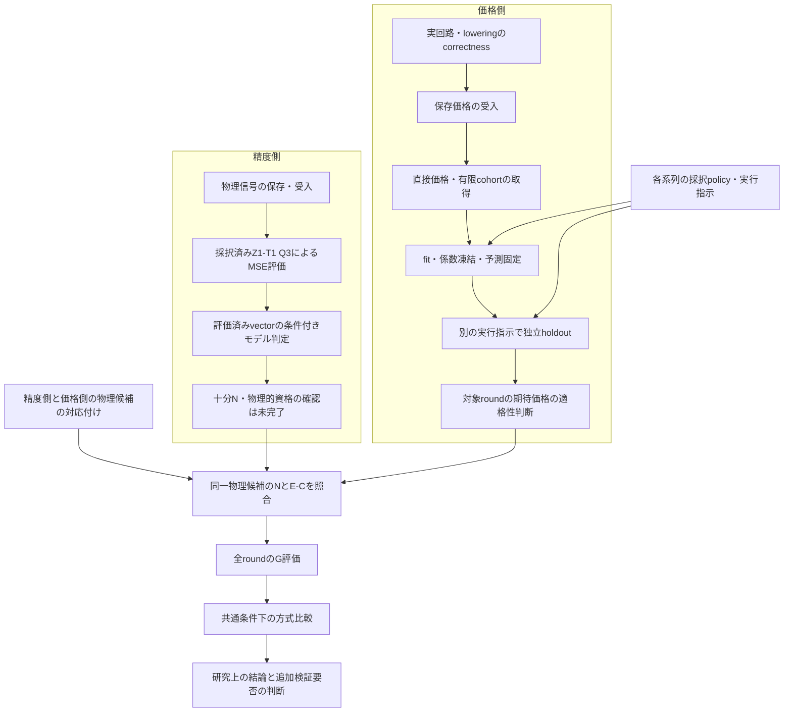

# 統合研究ロードマップ

Repository：`HIROMU1015/Partially-Randomized-Trotter`。最新確認：**2026-11-15 JST**（統合branchのremote HEAD `686a179ae` を基点に、決定論PF・PR-DF LD1・Full-H κ2 D7の固定REPORT/HANDOFFと後続公開状況を照合。その他の系列は既存記載を保全）。

この文書は、研究の目的・現在地・不足している証拠・次の進行順序を一か所で把握するための入口である。科学的な結果・SOURCE・検証内容の正本は、リンク先の個別REPORTである。本書は新しい科学計算・数値再解析・採択を含まない。

## 0. 現在地サマリー

**研究全体**
- 研究は「リソース評価」と「アルゴリズム改善」の二系列からなる（§2）。
- リソース評価は、固定された有限taskでの資源地図（H4/H6/H8、DF/Pauli、有限時間）までは多くの証拠がある。一方、**RPE全roundの総資源を共通条件で方式比較した結果は、まだ一つも確定していない**。
- 現在の作業の中心は、H4（DF10）でのRPE全13roundの総資源 G の比較である（§3）。5方式（PR-DF、PR-Pauli、Full PF、Truncated PF、Full-H pure RTE）を対象に、精度側（信号→推定器→MSE→N）と価格側（実回路→直接価格→価格モデル→E[C]）を別々に積み上げている。

**確認済みの進捗と採択**
- 主精度評価は、**Z1＋T1 total decoderによる保存DF10 solver energy proxyへのQ3直接モデルMSE**を採択済み。保存ideal finite-K raw・IID二項モデルを前提とし、閾値は $\tau=(0.00159360010199040\,\mathrm{Ha})^2$（§3）。旧REPORTの「未採択」は当時の履歴である。
- **5方式に固定配分での条件付きQ3モデル閾値適合がある。** Full PF・B0I p7各3候補は全13round・B intake6/6完成、共通固定shotで6/6適合（[A][A_PF_COMPLETE]、[B][B_PF_FIXED]）。Pauli LD1/LD2は3/4配分2件（[B][B_PAULI_3Q]）、PR-DF LD1/LD2は固定control各1件（[B][B_PRDF_FULLH]）、Full-H κ2は2倍配分1件で適合（[B][B_FULLH_2X]）。Full-Hの元controlは閾値超過であり、2倍配分とは別結果である。PF6件は**保存componentから科学的再計算なしで判定を復元、実行記録は部分保存**。その最終API return・CPU・peak RAM欠測は保持する。
- 決定論PF：m6に続き、**m9独立holdoutも新規12 compile・モデルPASS/FAIL/UNKNOWN＝12/0/0、全軸で固定予測と観測RZが完全一致**（[D m9 HANDOFF][D_PF_M9_RESULT]）。m0も新規12 compile・有効12軸、モデル判定なし（[D][D_PF_M0]）。m0完了時の72/156軸に、その後公開されたm1/m2の新規24 compile・有効24軸を加え、**直接価格は96/156軸**（m0〜m6・m9が各12軸）。m1/m2にもモデル判定はない（[D][D_PF_M12]）。m3保存12軸はC受入済みで、較正・holdoutへ付け替えていない（[C][C_PF_M3]）。各取得完了後mandatory STOP。
- PR-DF LD1：E[S]26/26・m0/m6有限価格接続に続き、**m3取得 → Cの軸別2モデル・m4予測2件の事前凍結 → D2の独立m4取得・比較 → C受入まで完了**。m4 fresh4 path・X/Y計8 compile、Cはreceipt8/8・比較2/2受入、保留0。X/Yとも観測平均129,692.5 RZ、(P−O)/O≈−0.544502%、**DESCRIPTIVE_COMPLETE、数値許容差・モデルPASS/FAILなし**（[C最終HANDOFF][C_PRDF_M4_ADMISSION]）。PR-Pauli LD2：m5/m6独立holdoutは3 fresh path・6 compile、4/4比較単位が有効、**DESCRIPTIVE_COMPLETE**。符号付き相対誤差はm5 X/Y各+0.044612%、m6 X/Y各+0.157666%。モデルの数値許容差・PASS/FAILはない（[D2][D2_HOLDOUT]）。

**最も重要な未解決事項と現在の依存関係**
1. **物理的に十分なN、global RMSE保証は未確定。** 上記の固定配分での条件付きモデル閾値適合を、十分N・最適Nや物理保証に昇格させない。BのPF評価の最終API return・CPU・peak RAMは欠測であり、それを埋める再実行を残作業にはしない。
2. **全13roundで資格のあるE[C]は、どの方式にも揃っていない。** 決定論PFの直接価格は96/156軸まで完成、未取得はm7/m8/m10〜m12の60軸。m6・m9のモデルPASSは当該点のみで、m0/m1/m2の直接価格にモデル判定を付けず、他roundの外挿資格へ移さない。残る取得・資格付けの範囲は別判断・別指示である。
3. PR-DF LD1のm3取得・fit・m4比較・C受入待ちは解消。D2・Cとも完了後STOP。Pauli LD2とも区別し、**有限cohortの記述的比較を全law E[C]・CI・長round移送へ昇格させない**。モデル判定は `NOT_ASSESSED_NO_ADOPTED_TOLERANCE`、許容差nullを保持する。
4. Full-H κ2 D7は**全5 cell・9 path・18実compile・D1最終検査PASS18、FAIL/未取得0、10較正record引渡し完了**（[D1][D1_FINAL]）。G36223最終検証で再利用した4 compileは18件の内数、追加0。後続[C固定HANDOFF][C_FULLH_HANDOFF]で**10 record受入・保留0、軸別3係数の2モデルfit、m5/m6×X/Yの4予測凍結も完了**を確認した。D1/Cは完了後STOP。C2の[観測前記述的比較規則案][C2_FULLH_RULE]は公開済み・ユーザー採択待ち。次は**規則採択と別途のD1実行指示 → 固定予測受領・独立holdout6 compile**。取得/検査PASS・モデル凍結を価格モデルPASSとせず、旧部分報告・STOPも保全する。

**G・winner はすべての方式で未確定（null）である。**

## 1. 文書の役割

| 文書 | 役割 |
|---|---|
| 本書（RESEARCH_ROADMAP.md） | 研究目的・進捗・不足・依存関係・次の手順 |
| [PROJECT_MAP.md][MAP] | 実装・研究資料・成果物への入口 |
| [RESEARCH_RESULTS_INDEX.md][INDEX] | 過去の研究系列と原結果への索引 |
| [VALIDATION_STATUS.md][VS] | 検証結果の状態と利用制約（このcheckoutに登録された範囲） |
| 個別REPORT | 科学的結果・SOURCE・検証内容の正本 |

**読むときの注意**
- `main`（`546bca7ed`、2026-11-04）は11月5日以降の成果を含まない。それ以降の成果は各研究branchにあり、本書は固定commitのURLで参照する。
- リンク先の「現在」「次段階」は、その報告の作成時点の記述である。最新の状態は本書の§5・§10と、そこから辿る最新報告で確認する。
- 本書の数値は元報告からの転記であり、条件は必ずリンク先で確認する。

## 2. 研究全体の目的と構造

**全体の目的**：Hamiltonianの一部を決定論的な積公式（PF）で、残りを有限のランダム化Taylor展開（RTE）で実装する部分ランダム化（PR）について、同じ精度・成功条件の位相／エネルギー推定を、どの条件でどれだけ安く実行できるかを明らかにする。単回の回路の短さではなく、PFのbias、finite-RTEのbias、normalizationによる減衰、必要shot数、全roundの回路価格を接続して評価する（[研究目的][GOAL]、[方法][METHOD]）。

### 2.1 研究の階層

```text
研究全体（repository）
├─ リソース評価
│   ├─ 有限時間の資源地図：H4/H6/H8 DF、Pauli-JW、長時間B2/B3（〜11/02）
│   ├─ RPE全roundの総資源：H4 DF10の5方式比較（11/10〜、現在の中心）
│   └─ 一般性：H6/H8への条件移送（保存成果あり、現比較とは別契約）
└─ アルゴリズム改善
    ├─ return集約・sampling・推定器（Track B／O2）
    ├─ 表現・分割（元Track A／A-O1、研究C）
    ├─ Closed P3・共同選択（Track C／C-O3）
    ├─ Reference／control（Track D／D8）
    └─ 適応readout（新A）
```

- 11月1日時点の全体像は[科学的到達点と証拠の地図][LAND]と[主張・証拠・未解決課題の対応表][GAPS]にある。
- 11月10日時点の系列間の接続は[PR＋RPE共同最適化への統合調査][INTEG]と[対応表][INTEGM]にある。
- 本書はこれらを再利用し、11月10日以降の進展を加える。

### 2.2 同じ名前で別のものを指す語

| 名前 | 指すもの |
|---|---|
| 作業担当 A／B／C／D（11/13〜） | H4総資源比較の役割分担。A：物理信号・Full-H・Pauli設計。B：RPE推定器・MSE・必要N。C：価格・モデル・証拠受入。価格担当はD：決定論PF、D1：Full-H、D2：PR-Pauliと後続PR-DF LD1の取得。各branch・SOURCE・科学契約は区別する |
| 旧Track A（〜10/26） | 既知PRの資源評価（リソース評価系列）。PR-2 M1/M2、H4/H6/H8、長時間B2/B3 |
| 元Track A／A-O1（11/06〜08） | アルゴリズム改善。辞書変更（O1-M1）、core＋residual（O1-M2）、B2-P1 |
| 新A | PR Reference／適応readout（V6、Q3、Q4） |
| Track B（B/O2） | return集約・局所生成・有限bit・sampling |
| 研究B／B2-D | D内部PF・outer分割。Track Bとは別 |
| Track C（C-O3） | Closed P3、joint basis、h／resolution／αの共同選択 |
| 研究C（RC） | Hamiltonian表現・PR-aware DF（CDF、ENTRY）。Track Cとは別 |
| Track D（D8） | Reference／control。固定CDF8条件の13round条件付き会計 |
| 方式名 B0／B0I／B2／B3 | DFの方式ラベル（下表）。作業担当Bとは無関係 |

| 方式ラベル | 内容 |
|---|---|
| Full PF | 一体項と全DF fragmentを決定論PFで保持 |
| B0／B0I（Truncated PF） | prefixを保持し、tailを捨てる。B0Iは捨てたtailのidentity成分をscalarへ一回戻す |
| B2（PR-DF） | 一体項＋非空prefixを保持し、tailをfinite RTEで補う |
| B3 | 二体prefix 0。一体項は保持する。全Hの純RTEではない |
| PR-Pauli（DF head＋Pauli tail） | DF prefixを保持し、tailをPauli辞書のRTEで補う |
| Full-H pure RTE | 一体項を含む全Hをランダム化する。B3とは別方式 |

## 3. H4リソース評価の最終目的

### 3.1 評価対象

状態準備を除いた、RPE全roundの総計算資源を評価する。

$$
G=\sum_{m=0}^{M}\sum_{a\in\{X,Y\}} N_{m,a}\,\mathbb E[C_{m,a}]
$$

- $N_{m,a}$：対象精度・推定器・誤差契約の下で使うshot数。
- $\mathbb E[C_{m,a}]$：対象lawに対する、1 shot当たりの測定付きfull Hadamard wrapperの期待compiled RZ数。制御付き時間発展、scalar（総時間に一回）、X/Yの基底変換、測定を含む。
- 古典の価格標本数 n と normalization B は、N や C に重ねて掛けない。

**現行の検証で共通に使っている条件**（物理条件の出所は[4方式menu][MENU4]・[ベースライン設計][BASEOPT]。主精度評価の現在の採択状態は、ユーザー確認と[Bの固定REPORT][B_PF_FIXED]・[Pauli REPORT][B_PAULI_3Q]による。全候補集合・最終比較policyの採択とは区別する）

| 項目 | 内容 |
|---|---|
| 系 | Linear H4、1.00 Å、STO-3G、保存tol-only 1e−8 DF10（weighted-Hermitian completion）、sector (2,2)・36次元 |
| target | 保存DF10 full DF-Hのsolver energy proxy。厳密ground energyの包含・state誤差は未認証。DF前のHamiltonianへは変更しない |
| RPE | h=0.1、M=12（13 round、$T_m=h\,2^m$）、状態準備費 P=0 |
| 採択済み主精度評価 | Z1＋T1 total decoderのQ3直接モデルMSE。保存ideal finite-K raw・IID二項モデル、閾値 $\tau=(0.00159360010199040\,\mathrm{Ha})^2$。物理的なglobal RMSE保証とは別 |
| compiler | Qiskit 1.3.0、basis rz/sx/x/cx、opt1、seed17。lowering IDも価格の条件として一致させる |

### 3.2 比較方式：正式採択と検証用shortlistの区別

| 区分 | 内容 |
|---|---|
| 方式の集合 | PR-DF、PR-Pauli、Full PF、Truncated PF、Full-H pure RTE。作業はこの5方式で進んでいる |
| 候補（schedule）の集合 | **正式採択された候補集合はない。** 11/13の11 schedule案は提案であり、最適候補群でもない（[4方式menu][MENU4]） |
| 現在の検証用候補 | Cの5方式・14 schedule・364軸の[固定対応表][C_ALIGNMENT]と§5。対応表完成は、最終候補選定や適格N・E[C]の完成を意味しない |
| 価格のshortlist（決定論PF） | S2・幅16h/7、Y4・幅16h/3、M5・幅16h（[D 保存4件binding][D_SAVED4]）。Full PFの局所予算内候補（[A追加5点][A_FPF_FU]）に基づく検証用の集合 |

### 3.3 二つの比較水準

| 水準 | N の意味 | 現状 |
|---|---|---|
| 第1水準 $G_{\mathrm{paper}}$ | 原論文型のnominal shot数 $\lceil B_m^2[11+4(M-m)]\rceil$。経験的な名目値で、精度の保証ではない | 会計の実装は人工値でPASS（[C 価格経路][C_ROUTES]）。実データでの計算は0件 |
| 第2水準 $G_{\mathrm{qualified}}$ | 採択した精度条件の下で根拠のあるshot数 | 主精度のQ3直接モデルMSEは採択済み。5方式の特定候補に固定配分での条件付き適合はあるが、物理的に十分なN・global RMSE・正式Gは未確定 |

**nominal N を十分 N として扱わない。** 両水準の出力は別fieldで管理されている。

## 4. 研究課題と実装・検証の対応

実装pathは、併記した固定commitに存在することを確認した。`main` には無いものが多い。

### 4.1 量子回路実装（実回路・loweringのcorrectness）

| 項目 | 内容 |
|---|---|
| 研究上の問い | 価格を測る回路が、意図した制御付き時間発展・scalar一回・X/Y測定を正しく実装しているか |
| 実装 | D `acea1118a`：`src/trottertracks/pauli_tail_price_connection.py`、`scripts/run_full_pf_shortlist_prices.py`、`scripts/run_truncated_p7_prices.py`、`scripts/run_pauli_ld1_m0_pilot.py`。A `7a0c9468b`：`scripts/run_full_h_kappa2_p1.py`。新ZZ lowering：`26d4f23e7`の`src/trottertracks/efficient_controlled_zz.py` |
| 検証 | [Full-H P-1再検証][A_P1]（ancilla命令列の完全一致など23条件）、[Pauli B0 run02][A_B0]（固定の実H4数値gate）、[p7保存回路のX/Y識別][C_ADM]（保存QPYのfingerprint）、[PR-DF P2 direct pilot][D_P2] |
| 到達点 | PR-DF：LD1 m0/m6に続きm3・m4のreceipt接続を完了、m4のC受入8/8・比較2/2（[C][C_PRDF_M4_ADMISSION]）。新しい数値作用gateは元P2 fresh同様未実施。PR-Pauli：LD1 m0、LD2 B1-Wに加えCAL18 compile・独立m5/m6 holdout6 compileの対象pathで実装gateを確認（[D2 CAL][D2_CAL]、[holdout][D2_HOLDOUT]）。決定論PF：m9・m0・m1/m2も元作用gate・C implementation guardを通過（[D m9][D_PF_M9_RESULT]、[m0][D_PF_M0]、[m1/m2][D_PF_M12]）。Full-H：D7全18軸のD1最終検査PASS、Cも10較正record・元18軸の保存証拠を受入済み。index0の7数値gateをindex1へ拡張していない（[D1][D1_FINAL]、[C][C_FULLH_FREEZE]） |
| 科学的資格 | 検査したpath・cellに限った配線の証拠。価格の期待値や他roundの正しさは示さない |
| 不足 | PR-Pauli LD2のorder2 product・非自明event位相は未観測UNKNOWN。長いroundの直接検査・モデル外挿資格は未確定 |
| 次の作業 | 完了した配線・取得の証拠を再利用する。Pauliの記述的holdout完了を未観測eventへ一般化しない。各取得系列の後続範囲は§8・§10による |
| 担当・依存 | D（決定論PF）、D1（Full-H）、D2（Pauli・PR-DF LD1の別取得系列）、A（設計・検証）、C（guard受入）を区別する |
| 完了条件 | 価格を使う全ての回路族について、少なくとも代表cellの配線証拠がある |

### 4.2 物理信号

| 項目 | 内容 |
|---|---|
| 研究上の問い | 各方式・各roundの平均信号（raw、補正後、normalization）は何か |
| 実装 | A `714247619`：`src/trottertracks/pr_rpe_signal_provider.py`、`df_head_pauli_tail_p0.py`／`_p1.py`／`_completion.py`、`pf_effective_hamiltonian.py`、`scripts/run_h4_full_pf_heff_scan.py`。A `7a0c9468b`：`baseline_signal_pipeline.py`、`baseline_signal_numerics.py`、`scripts/run_truncated_fullh_signals.py`、`scripts/run_full_h_kappa2_signals.py` |
| 検証 | [PR-DF 26round][A_PRDF]、[PR-Pauli 26round][A_PAULI]、[B0I p7・Full-H R448 各13round][A_TRSIG]、[Full-H κ2 13round][A_S1]、[Full PF H_eff格子][A_FPF_SCAN]・[追加5点][A_FPF_FU]、[Truncated T1][T1]・[T2][T2]、[決定論PF shortlist6候補完成][A_PF_COMPLETE] |
| 到達点 | 上記の既存packetを保全。加えてFull PF・B0I p7の各3候補が各13round完成（保存30再利用、新規48 PASS）、B intake6/6 PASS。[科学SOURCE][A_PF_SOURCE] `fb9a1878b`、[raw carrier][A_PF_RAW] `06a15ee45`、[packet索引][A_PF_PACKETS]と[HANDOFF][A_PF_HANDOFF]を参照 |
| 科学的資格 | 保存した数値stateとideal finite-K lawに条件付いた解析的平均。基底状態の認証と、実samplerのlawへの移送は未取得 |
| 不足 | 今回のshortlist6候補について信号不足・B受入待ちは解消。補助候補Full PF S2・幅0.1の未完備状態は別候補として維持する |
| 次の作業 | 完成packetを再利用する。Aの取得作業はmandatory STOP。追加meanの取得をこの文書から指示しない |
| 担当・依存 | A（信号）、C（baseline metadata）、B（受入） |
| 完了条件 | 比較に使う各物理候補について、全13roundの信号packetがSOURCE付きで受入済みである |

### 4.3 誤差評価（推定器・MSE）

| 項目 | 内容 |
|---|---|
| 研究上の問い | 与えたshot配分の下で、エネルギー推定の誤差（MSE）はどこまで抑えられるか |
| 実装 | B `999304918`：`src/trottertracks/rpe_total_decoder.py`、`rpe_total_risk.py`、`rpe_deterministic_risk.py`、`rpe_total_binding.py`、`rpe_c_interfaces.py`、`pr_rpe_rmse_controller.py`。test：`tests/check_rpe_total_decoder_risk.py` |
| 検証 | [精度契約W0][B_W0]、[Z1＋T1/Q3][B_Z1]、[PR-DF旧部分decoder DP][B_DP]、[Pauli元control2評価][B_Q3]、[Pauli3/4配分2評価][B_PAULI_3Q]、[決定論PF固定shot6評価][B_PF_FIXED]、[PR-DF/Full-H固定評価][B_PRDF_FULLH]、[Full-H κ2・2倍配分][B_FULLH_2X] |
| 到達点 | Full PF/B0I p7各3候補は共通 `[59,55,51,47,43,39,35,31,27,23,19,15,11]` で6/6適合。保存componentから科学的再計算なしで判定を復元、実行記録は部分保存、最終API return・CPU・peak RAM欠測。Pauli LD1/LD2の3/4配分2件、PR-DF LD1/LD2の固定control2件、Full-H κ2の2倍配分1件も適合し、5方式に条件付きモデル閾値適合がある。Full-H元controlはMSE下界も閾値超過で、2倍配分とは別成果 |
| 科学的資格 | 採択済みQ3直接モデルMSEでの条件付き適合。保存solver proxy・ideal raw・IID・未認証allowanceの範囲に限る。物理的な精度保証・十分Nではない。PFの科学worker完了とdriver記録UNKNOWNを区別する |
| 不足 | 物理的な資格・必要N最適化は未完了。Full-H R448・補助候補・未評価vectorへ結果を移さない。PR-DF/Full-H新評価のAPI・資源記録は保存済みだが、PF6件の欠測を補うものではない |
| 次の作業 | [PF HANDOFF][B_PF_HANDOFF]、[PR-DF/Full-H HANDOFF][B_PRDF_FULLH_HANDOFF]、[κ2・2倍配分HANDOFF][B_FULLH_2X_HANDOFF]の保存結果を再利用する。PFの記録欠測を埋める再実行は要求しない。追加vectorの評価は別判断・別実行指示 |
| 担当・依存 | B。信号（§4.2）に依存 |
| 完了条件 | 採択した契約の下で、比較する全候補のMSE評価が同じclaim水準で揃う |

### 4.4 必要shot数 N

| 項目 | 内容 |
|---|---|
| 研究上の問い | 目標精度を満たすために、各round・各軸で何shot必要か |
| 実装 | B `999304918`：`src/trottertracks/rpe_shot_allocation.py`、`pr_rpe_rmse.py`（nominal）、`rpe_total_binding.py`の`evaluate`入口。C `855573064`：`paper_nominal_cost.py`の`nominal_packet` |
| 検証 | 旧[有限計画][B_NPLAN]・[準備報告][B_N]を履歴として保持。完了成果は[Pauli3/4配分][B_PAULI_3Q]、[PF6候補][B_PF_FIXED]、[PR-DF固定control][B_PRDF_FULLH]、[Full-H κ2・2倍配分][B_FULLH_2X] |
| 到達点 | 各vectorは両軸共通。PFは§4.3の6件、Pauli3/4は `[48,45,42,39,36,33,29,26,23,19,16,13,9]` で2件、PR-DF LD1/LD2は `[64,60,56,52,47,43,38,34,30,25,21,17,12]` で2件、Full-H κ2は `[128,120,112,104,94,86,76,68,60,50,42,34,24]` で1件が条件付き適合。Full-H元control（PR-DFと同じvector）は閾値超過。十分N・最適Nではなく、`sufficient_N`は全方式でnull |
| 科学的資格 | 評価済み配分の条件付きモデル閾値適合のみ。物理的に十分なN・global RMSE保証は未資格 |
| 不足 | 未評価vectorへの補間、最小N、cost-aware配分、物理的誤差・law移送の資格。旧有限計画全体が実行済みになったわけではない |
| 次の作業 | Bはmandatory STOP。追加の有限配分検証が必要か、どの範囲かは別判断。完了した各固定配分評価を再実行しない |
| 担当・依存 | B。§4.3に依存。価格とは独立に進められる |
| 完了条件 | 各候補について、採択した契約で閾値を満たすwhole-vectorが、根拠とともに保存される |

### 4.5 compiled価格（直接価格・有限cohort）

| 項目 | 内容 |
|---|---|
| 研究上の問い | 各round・各軸の回路を実際にcompileしたときのRZ数はいくつか |
| 実装 | D `acea1118a`（実装SOURCEは`22ccf3972`）：§4.1のcaller。C `855573064`：`src/trottertracks/price_implementation_guard.py`、`rpe_d_price_connection.py`、`rpe_optimization_pipeline.py`（`price_context`） |
| 検証 | [決定論PF m3受入][C_PF_M3]・[較正][D_STAGE1]・[m6][D_PF_M6]・[m9][D_PF_M9_RESULT]・[m0][D_PF_M0]・[m1/m2][D_PF_M12]、[PR-DF LD1 m3][D2_PRDF_M3]・[m4 C受入][C_PRDF_M4_ADMISSION]、[Pauli CAL][D2_CAL]・[holdout][D2_HOLDOUT]、[Full-H最終引渡し][D1_FINAL]・[C受入][C_FULLH_FREEZE]。旧[P-1][A_P1]・[Pauli B0][A_B0]も保全 |
| 到達点 | 決定論PFは96/156直接価格（m0〜m6・m9各12軸）。m0完了時72にm1/m2の24軸を追加。PR-DF LD1はm0/m6受入に続きm3 fresh4 path・8 compile、m4独立fresh4 path・8 compileとC受入を完了。Pauli LD2はCAL18 compile・10 recordと、独立m5/m6の3 fresh path・6 compileを公開。Full-H D7は5 cell・9 path・18 compile・D1最終検査PASS18、10較正recordを引渡し済み |
| 科学的資格 | 決定論PFのm3は保存直接観測、m4/m5は較正、m6/m9は独立holdout、m0/m1/m2はモデル判定なしの直接価格。RTE系の有限path・cohort価格は全law期待値ではない。Full-Hの18軸PASSは取得・検査の結果。G36223最終検証で再利用した4 compileは18件の内数、追加compile0。paired P2R566は親G566と相関する |
| 不足 | 決定論PFの未取得60軸（m7/m8/m10〜m12）とモデルdomain資格。Full-HのC受入・fit・予測凍結は完了、残る独立m5/m6 holdout6 compileは規則採択・別実行指示待ち。PR-DF m4取得・比較・C受入待ちは解消。Pauliの記述的holdoutは完了したが全round E[C]・未観測eventの資格は未取得 |
| 次の作業 | Full-H：C2の公開規則案をユーザーが採択し、別途のD1実行指示後に固定4予測を受領・照合して独立holdout6 compile。決定論PFの残る範囲・PR-DFの追加資格付けは別判断。完了価格の再取得や新規実行を本書から指示しない |
| 担当・依存 | 決定論PFはD/C、PR-DF LD1はD2（取得）/C（fit・凍結・受入）。D1のFull-H、D2/C2のPauliとは別branch・SOURCE・契約。各完了後STOPと後続の限定実行指示を区別する |
| 完了条件 | 価格モデルの較正とholdoutに必要なcellが、受入検査を通って揃う |

### 4.6 期待価格モデル（E[C]）

| 項目 | 内容 |
|---|---|
| 研究上の問い | 直接compileできない長いroundを含めて、全roundの期待価格をどの根拠で与えるか |
| 実装 | C `855573064`：`src/trottertracks/price_model_validation.py`（fit・holdout・refitなし）、`rpe_mean_price_model.py`（構造＋残差）。A `7a0c9468b`：`finite_price_design.py`（取得前の識別可能性検査） |
| 検証 | [決定論PF係数凍結][C_FREEZE]・[m6 holdout][D_PF_M6]・[m9判定][D_PF_M9_RESULT]、[PR-DF軸別モデル凍結][C_PRDF_FREEZE]・[m4 C受入][C_PRDF_M4_ADMISSION]、[Pauli CAL][D2_CAL]・[C2凍結モデル][D2_FROZEN_MODELS]・[独立holdout][D2_HOLDOUT_HANDOFF]、[Full-H C受入・fit・予測凍結][C_FULLH_FREEZE] |
| 到達点 | 決定論PFの12個別モデルはm6・m9で各12/12 PASS、両roundとも固定予測と観測RZが全軸完全一致。m0/m1/m2はモデル未判定。Pauli LD2はC2のX/Y2モデル・m5/m6予測固定後に記述的比較を完了。PR-DF LD1は軸別2モデル・m4予測2件を事前凍結し、独立4 pathのm4比較・C受入までDESCRIPTIVE_COMPLETE。Full-Hは10 record受入・保留0、X/Y各3係数の2モデルfitとm5/m6×X/Yの4予測凍結完了（結果b5165f11b）。C側で元D1 metadata readerの固定JSON読取も確認済み |
| 科学的資格 | 全roundの適格E[C]は全方式で未完備。決定論PFのm6/m9 PASSは当該点のみで、元凍結結果の `qualified_for_candidate=false` を書き換えない。PR-DF LD1・Pauli LD2は `DESCRIPTIVE_COMPLETE / NOT_ASSESSED_NO_ADOPTED_TOLERANCE`、許容差null。E[S]と有限cohort平均はいずれも全law E[C]ではない |
| 不足 | 決定論PFは未観測round・モデルdomainの資格。m9限定2%規則を短roundやRTEへ移送しない。RTE系はlaw差・rare寄与・境界加法性・統計区間・長q外挿が未確定。PR-DFのC比較2/2受入、Pauliの4/4有効比較はモデルPASSではない。Full-HはCALIBRATED_UNVALIDATED・qualified_for_candidate=false、独立holdout未評価。C2記述的規則案は公開済み・採択待ち、数値許容差やモデルPASS/FAILを追加していない |
| 次の作業 | Full-H：規則採択＋別途のD1実行指示 → 固定4予測の受領・照合 → 独立m5/m6の6 compile。C側reader確認はD1自身の受領・実行確認とは別。既存PF/Pauliの規則を流用しない。PR-DFはC受入完了、Pauliは従来の記述的比較完了の範囲でSTOP。決定論PFの未完備部分は別判断 |
| 担当・依存 | C（モデル・判定）、D/D1/D2（各独立系列の取得）、A（RTE系の設計）。§4.5に依存 |
| 完了条件 | 採択した系列別規則で独立比較を完了し、使用するround・lawの範囲で適格性が別途判断されている。記述的比較の完了だけをE[C]の資格付与としない |

### 4.7 総資源会計（G）

| 項目 | 内容 |
|---|---|
| 研究上の問い | 同じ物理候補のNとE[C]を掛け合わせた全roundの総資源はいくつか。方式間の関係はどうか |
| 実装 | C `855573064`：`src/trottertracks/paper_nominal_cost.py`（第1水準）、`rpe_optimization_pipeline.py`（`plan`／`compare`／`select`）。B `999304918`：`pr_rpe_rmse_controller.py`（`assess`／`cost`／`select`） |
| 検証 | [C 価格経路][C_ROUTES]、[Pauli physical-ID bridge][C_BRIDGE]（人工値のテスト）、[B total/Q3 canonical統合][B_TOTAL] |
| 到達点 | 会計・guard・欠測の扱いは人工のN・価格でPASS。実データのG計算は0件 |
| 科学的資格 | なし。人工テストのPASSは科学的な比較結果ではない |
| 不足 | §4.4のNと§4.6のE[C]。同一候補の照合。比較policy |
| 次の作業 | §8の統合段階。上流が揃うまで着手しない |
| 担当・依存 | B・C。全項目に依存 |
| 完了条件 | 全方式について、同じclaim水準のNとE[C]から、欠測なしでGが計算される |

## 5. 物理候補ごとの進捗

**方式が同じでも、物理候補（prefix、公式、時間幅、K、κ、round、law、SOURCE）が違えば別の行である。** 別の行の N と E[C] を掛け合わせて G を作ってはならない。

状態の語は§6の区分を使う。IDは先頭8桁の略記で、全桁はリンク先にある。

| 物理候補 | 信号 | 推定器・MSE | 必要N | 実compiled価格 | E[C] | G |
|---|---|---|---|---|---|---|
| **PR-DF** LD1（`a4dda8f7`）／LD2（`1fa33556`）。S2、幅0.1、K2、元κ | 数値保存：各13round（[報告][A_PRDF]） | 旧部分decoder DPは保全。新total Q3はLD1/LD2各1回、固定control2/2がモデル閾値適合（[B][B_PRDF_FULLH]） | 条件付き適合vectorあり（§4.4）。十分N・最適N・物理保証は未資格 | LD1 m0/m6 P1各2・P2 fresh各4 pathの受入を保全。新m3・独立m4は各fresh4 path・X/Y8 compile。m4はC receipt8/8・比較2/2受入、保留0（[C最終HANDOFF][C_PRDF_M4_ADMISSION]）。他round・LD2へ移送しない | 未資格。LD1 E[S]26/26接続、軸別2モデル・m4予測2件凍結後に記述的比較・C受入完了。X/YともO=129,692.5 RZ、(P−O)/O≈−0.544502%。DESCRIPTIVE_COMPLETE、モデル判定NOT_ASSESSED_NO_ADOPTED_TOLERANCE・許容差null。全law E[C]・CI・長round移送は未認定 | 未確定 |
| **PR-Pauli** LD1（`d905d219`）／LD2（`d7dd4f52`）。DF head＋Pauli tail、S2、幅0.1、K2、元κ | 数値保存：各13round（[報告][A_PAULI]） | 元control2評価を保全。別成果の3/4配分でLD1/LD2各1回、2/2が採択Q3モデル閾値適合（[B][B_PAULI_3Q]） | 条件付き適合vectorあり。十分N・最適N・物理保証は未資格 | LD1 B0、LD2 B1-Wを保全。LD2は[CAL18 compile][D2_CAL]と、独立m5/m6の3 fresh path・6 compile・4/4有効比較を取得（[D2][D2_HOLDOUT]） | 全law E[C]・統計区間は未資格。LD2 holdoutはDESCRIPTIVE_COMPLETE、数値許容差・モデルPASS/FAILなし。符号付き相対誤差はm5 X/Y各+0.044612%、m6 X/Y各+0.157666%。order2 product・非自明位相は未観測UNKNOWN。LD1へ移送しない | 未確定 |
| **Full PF** S2・幅0.1（prefix10） | H_effのm0・m12のみ。全13round packetは未同定（[適用一覧][B_SIGAPP]） | 人工13roundで経路のみ確認 | 未資格 | 旧catalogに直接価格があるが、13roundのscheduleの大半は保存gridの外（[4方式menu][MENU4]） | 未資格 | 未確定 |
| **Full PF** shortlist：S2・幅16h/7、Y4・幅16h/3、M5・幅16h | 3候補各13round完成、B intake PASS（[A][A_PF_COMPLETE]） | 共通固定shotで各1回。3/3の保存DP上界が採択閾値以下（[B][B_PF_FIXED]）。最終API return・CPU・peak RAM欠測、保存componentから再計算なしで判定復元 | 条件付き適合のみ。十分N・最適Nは未資格 | m0〜m6・m9が完成、p7と合わせ96/156軸。m0完了時72からm1/m2の24軸を追加（[m0][D_PF_M0]、[m1/m2][D_PF_M12]、[m9][D_PF_M9_RESULT]）。m3保存価格はC受入済み、実幅・役割を保全 | p7と合わせ12モデルのm6・m9は各12/12 PASS、固定予測と観測RZが完全一致。m0/m1/m2はモデル未判定。未取得60軸・全round E[C]・モデルdomainは未資格。完了後STOP | 未確定 |
| **Truncated PF** B0I p7、S2・幅0.1（`e6754564`） | 数値保存：13round（[報告][A_TRSIG]）。[T2][T2]の照合も通過 | metadata接続PASS（[適用一覧][B_SIGAPP]） | 未資格 | m3/m4の旧価格locatorは存在するが、現行wrapper receiptとして未受入（[C対応表][C_ALIGNMENT]）。shortlistとは別候補 | 未資格 | 未確定 |
| **Truncated PF** B0I p7 shortlist：S2・幅16h/7、Y4・幅16h/3、M5・幅16h | 3候補各13round完成、B intake PASS（[A][A_PF_COMPLETE]） | Fullと同じ固定shotで各1回。3/3の保存DP上界が閾値以下（[B][B_PF_FIXED]）。実行記録の部分保存はFullと同じ | 条件付き適合のみ。十分N・最適Nは未資格 | m0〜m6・m9が完成、Fullと合わせ96/156軸（[m0][D_PF_M0]、[m1/m2][D_PF_M12]、[m9][D_PF_M9_RESULT]）。m3保存価格のC受入・保存cohortを保全 | Fullと合わせ12モデルのm6・m9は各12/12 PASS。m0/m1/m2は有効直接価格のみ・モデル未判定。未取得60軸・全round E[C]は未資格。完了後STOP | 未確定 |
| **Full-H pure RTE** κ2、K2、q=2^m（`54ac3eb3`） | 数値保存：13round（[S-1][A_S1]） | 元controlはMSE下界も閾値超過。2倍配分1回は採択Q3モデル閾値適合（[B][B_FULLH_2X]） | 条件付き適合vectorあり（§4.4）。十分N・最適Nは未資格 | D7全5 cell・9 path・18実compile、D1最終検査PASS18、FAIL/未取得0。Cは10較正record・元18軸の保存証拠を受入、保留0（[D1][D1_FINAL]、[C][C_FULLH_FREEZE]）。G36223保存4 compileの再利用は内数・追加0。pairedは親と非独立 | 未資格。軸別3係数の2モデルfit・m5/m6の4予測凍結完了（[C HANDOFF][C_FULLH_HANDOFF]）。CALIBRATED_UNVALIDATED、qualified_for_candidate=false。C2記述的規則案は公開・採択待ち（[案][C2_FULLH_RULE]）。採択・別実行指示後のD1独立holdout6 compile待ち。D1/Cは完了後STOP、モデルPASSなし | 未確定 |
| **Full-H pure RTE** R448、K2、q=2^m（`cfa6aee3`） | 数値保存：13round（[報告][A_TRSIG]） | [C対応表][C_ALIGNMENT]で独立total metadata受入を確認。新MSE/Nは未評価 | 未資格 | 確認した範囲で無し | 未資格 | 未確定 |

**候補対応で解消した点と残る不足**
- **決定論PF shortlist6候補**：直接価格は96/156軸（m0〜m6・m9各12軸）。m3保存12軸は `SAVED_M3_DIRECT_OBSERVATION_NOT_CALIBRATION_OR_HOLDOUT`、m4/m5は較正24軸、m6/m9は各12軸の独立holdout。m0/m1/m2は計36軸の直接価格でモデル判定なし。m9は固定予測と別に取得した12観測がモデルPASSした成果である（[D][D_PF_M9_RESULT]）。全round E[C]・十分N・Gの資格は別である。
- **S2・幅0.1の補助候補**：shortlistへ全scheduleを流用しない。C対応表の旧locator・受入不足はその候補の状態として保持する。
- **Full-H**：κ2とR448は、R・event数・normalizer・rawが別物である。κ2の価格をR448へ、またはその逆へ使わない。
- **PR-DFとPR-Pauli**：tailの表現とlawが違う。DF tailのE[S]や旧C1価格をPauliへ使わない。
- 推定器の版が変わると、canonical IDが変わる。価格の再束縛には版付きのbridgeが必要である（[bridge仕様][C_BRIDGE]）。

round×X/Y×cohortの候補対応は[Cの14 schedule・364軸][C_ALIGNMENT]、完成信号は[Aのpacket索引][A_PF_PACKETS]、PFの固定配分結果は[B HANDOFF][B_PF_HANDOFF]にある。決定論PFの旧[CELL_PLAN_V2][C_CELLPLAN]の36価格（較正24＋holdout12）は完了し、m3保存直接12軸は別の役割でC受入済み。後続m9・m0・m1/m2も固定HANDOFFの実績だけを追加した。PR-DFは旧[52軸coverage][C_PRDFCSV]に対し、LD1の[m0/m6接続][C_PRDF_ADMISSION]・[m3取得][D2_PRDF_M3]・[m4最終受入][C_PRDF_M4_ADMISSION]を参照し、LD2へ移送しない。計画・予測行を取得済みと数えない。

## 6. 証拠の状態の区分

| 区分 | 意味 | 例 |
|---|---|---|
| 実装済み | コードがある | 第1水準の会計 |
| 人工・回帰テストPASS | 架空の入力で動作を確認した | guard、bridge、価格モデルの検査 |
| 実物理条件での検証PASS | 実H4の回路・数値でgateを通過した | P-1再検証、Pauli B0 |
| 科学的数値結果の保存あり | 承認された実行の結果が固定SOURCE付きで保存されている | 各方式の13round信号、Pauli Q3の2評価 |
| 特定条件下で利用可能 | 明示された条件の範囲で使える | 決定論PFのm0〜m6・m9直接価格96軸、評価済みvectorでの条件付きモデル閾値適合 |
| 最終比較へは未資格 | 値はあるが、最終比較に必要な資格が無い | 単一path価格、E[S]、control vectorでのMSE |
| 調査済み範囲では欠測 | 確認した範囲に記録が無い | PR-DF LD2の価格 |
| 原本・同等性が未確認 | あるかどうか、同じ条件かどうかを判断できていない | 補助候補の旧価格locatorと現行wrapper receiptの対応 |
| 科学結果保存・実行記録部分保存 | 保存componentで科学的判定を確認できるが、完全な実行記録はない | PF固定shot6件。最終API return・CPU・peak RAM欠測を併記し、再実行しない |
| 指示作成／送付／実行／成果受領 | 各段階を確認できた記録に従い区別する | PF m1/m2の24軸、Full-H C受入・fit・4予測凍結は固定完了成果を受領。C2規則案は公開済み・ユーザー採択待ち |
| モデル凍結／独立比較完了 | 観測前の係数・予測固定と、後続の独立比較を分ける | PF m6/m9、PR-DF m4は比較完了。Full-Hは凍結完了・独立比較待ち。元凍結JSONのstatusを遡及変更しない |
| 記述的比較完了・モデル判定なし | 有効な独立観測と予測差を報告し、数値許容差によるモデル判定は行わない | PR-DF LD1 m4のC比較2/2受入とPauli LD2の4/4有効比較はいずれもDESCRIPTIVE_COMPLETE。モデルPASSではない |
| STOP中 | 個別契約のmandatory STOPを保全する | A信号、B固定配分、C各固定成果、D m9・m0・m1/m2、D1 D7最終引渡し、D2各独立取得の完了。旧STOPも保全 |
| 次段階の別判断・実行指示待ち | 今回の完了・指示では範囲に含まれない | Full-H規則案の採択と別途実行指示後のD1独立holdout6 compile。PFの残60軸やRTEの追加資格へ自動進行しない |

**区別を保つ点**
- 人工テストのPASSは、科学的な検証の完了ではない。
- **有限cohortの平均、構造期待値 E[S]、compiled期待価格 E[C] は別の量である。**
- 単一pathの観測を、lawの期待値として扱わない。
- 旧SOURCEの科学的資格を、新SOURCEへ自動で移さない。
- 「確認した範囲で未同定」は「未実施」ではない。
- D2の過去の[SCOPE_DEVIATION.md][D2_SCOPE]に記録された範囲外数値検査は保全し、W・CAL・今回のholdoutの科学的証拠・資格には採用しない。各観測pathのgate PASSと、その過去記録を混同しない。

## 7. 未解決課題と、解くと何が判断できるか

| 課題 | 種別 | 解決すると判断できること | 重複照合（§10.5）の状況 |
|---|---|---|---|
| 最終5方式比較のclaim水準・未採択policy | 方針・契約の採択 | 条件付きモデル結果と正式Gの主張範囲が決まる | Q3主精度と決定論PF H-bは採択済み。RTE系へ条件を自動移送しない |
| 決定論PFの残る直接価格とモデルdomain | m6/m9の各12/12 PASS、m0〜m6・m9の直接96/156軸は完了。未取得60軸はm7/m8/m10〜m12 | 全roundの価格をどの範囲で適格に使えるか | [m9完了][D_PF_M9_RESULT]、[m0][D_PF_M0]、[m1/m2][D_PF_M12]の実績を再利用。短roundにモデル判定なし、未観測roundへの移送・追加取得は別判断 |
| 同一候補の条件付きモデル結果・適格価格の接続 | 既存成果の照合、必要な科学資格の確認 | 将来どの候補で正式Gを構成できるか | [C対応表][C_ALIGNMENT]とA/Bの完成成果で候補対応は解消。十分N・全round E[C]は未資格 |
| PR-DF LD1の全law E[C]・CI・長round移送 | m3取得・2モデル/2予測凍結・m4独立比較・C受入は完了。残る科学的資格は別判断 | 有限cohortの記述的差を超えて何を認定できるか | [C最終受入][C_PRDF_M4_ADMISSION]は比較2/2・receipt8/8、保留0。I/Q差・rare・小標本/係数・共有不確かさは未評価。再fit・事後許容差なし、LD2へ移送しない |
| Full-H規則採択・D1独立m5/m6 holdout | D1較正引渡し・Cの10 record受入・2モデルfit・4予測凍結は完了、各担当STOP。C2案公開済み・採択待ち | 観測前固定済み予測を独立6 compileで記述的に比較するか | [C固定HANDOFF][C_FULLH_HANDOFF]と[C2規則案][C2_FULLH_RULE]を使用。規則採択とD1実行許可は別。D1自身の受領・実行確認は未取得。paired親子依存・index0/1の元gate範囲と全law未資格を保つ |
| PR-Pauli LD2の全law E[C]・未観測event | CAL・予測凍結・記述的holdoutは完了、D2 mandatory STOP。追加資格は別判断 | order2/非自明位相、rare寄与、統計区間・長qモデルの資格 | [独立holdout][D2_HOLDOUT]は4/4有効・DESCRIPTIVE_COMPLETE。数値許容差なし、モデルPASS/FAILなし。有限cohortを期待値・CIへ昇格しない |
| 物理的に十分なN・追加有限配分の要否 | 科学的資格・範囲の別判断 | 条件付き適合を超えて何を主張できるか | 5方式の評価済み固定配分を再利用。Full-H元controlの閾値超過も保全。PFの記録欠測を埋める再実行は不要 |
| 基底状態の認証、sampler lawの移送、数値certificate | 独立検証。claim水準による | 条件付き観測を超える主張ができるか | 必要性はclaim水準の採択で決まる |
| H6/H8への移送 | 将来の一般性検証 | H4の結論が他の系でも成り立つか | 今回のH4比較には不要。保存成果は§9.2 |

新しい科学計算・compile・実験を行う前には、共通運用指示§10.5の重複照合を行う。照合の完了は実行の許可ではない。

## 8. 依存関係と進行順序



**現在の位置**
- 精度側：5方式の特定候補に固定配分Q3モデル閾値適合がある（§4.3・§4.4）。Bは各完了成果でmandatory STOP。Full-H元controlの閾値超過とκ2の2倍配分適合は別結果、R448へ移送しない。十分N・global RMSEは未確定。PF6件の最終API return・CPU・peak RAM欠測を埋める再実行はしない。
- 決定論PF価格：**24較正価格 → C係数・予測凍結 → m6独立holdout12/12 PASS → 元係数のm9予測・規則固定 → D m9新規12 compile・モデル12/12 PASS**まで完了（[m9 HANDOFF][D_PF_M9_RESULT]）。m3保存12軸のC受入を保持し、m0新規12軸で72/156、その後m1/m2新規24軸の固定完了報告により**96/156軸**（[D][D_PF_M12]）。m0/m1/m2はモデル判定なし。Dは各完了後STOP。未取得m7/m8/m10〜m12の60軸と全roundモデル資格は別判断・別指示であり、次の実行を本書から割り当てない。
- PR-DF LD1価格：**E[S]26/26・m0/m6接続 → D2 m3 fresh4 path/8 compile → C軸別2モデル・m4予測2件の事前凍結 → D2 m4独立fresh4 path/8 compile・記述的比較 → C receipt8/8・比較2/2受入、保留0**まで完了（[m3][D2_PRDF_M3]、[凍結][C_PRDF_FREEZE]、[D2 m4][D2_PRDF_M4]、[C最終受入][C_PRDF_M4_ADMISSION]）。各担当は完了後STOP。X/YのO=129,692.5 RZ、(P−O)/O≈−0.544502%は保存比較の転記。DESCRIPTIVE_COMPLETE、モデル判定NOT_ASSESSED_NO_ADOPTED_TOLERANCE・許容差null。全law E[C]・CI・長round移送は未認定、追加取得・再fitへ自動進行しない。
- Full-H価格（D1/C/C2）：**D7全5 cell・9 path・18 compileの最終検査・10較正record引渡し → C受入10/10・保留0、軸別3係数の2モデルfit・m5/m6の4予測凍結まで完了、D1/C STOP**（[D1][D1_FINAL]、[C HANDOFF][C_FULLH_HANDOFF]）。結果 `b5165f11b`、科学SOURCE `f46fa120b`。G36223最終検証で再利用した保存4 compileは18件の内数・追加0、P2R566は親G566と非独立。旧[部分報告][D1_PARTIAL]・[検査中追補][D1_CONTINUATION]・STOPは保全する。C2は[観測前記述的比較規則案][C2_FULLH_RULE]を公開してSTOP、**ユーザー採択待ち**。次は**規則採択＋別途D1実行指示 → D1が固定4予測を受領・照合 → 独立m5/m6の6 compile・比較**。C側の元D1 metadata reader読取確認を、D1担当自身の受領・実行とは数えない。モデルはCALIBRATED_UNVALIDATED・qualified_for_candidate=false、許容差・モデルPASS/FAILは未追加。独立holdoutは未評価で、全law E[C]・CI・長時間移送は未資格。
- PR-Pauli LD2価格（D2/C2）：**CAL5 cell・18 compile → C2 X/Y2モデル・m5/m6予測凍結 → D2独立holdout3 fresh path・6 compile → 4/4有効比較・DESCRIPTIVE_COMPLETE、mandatory STOP**。数値許容差・モデルPASS/FAILなし。期待価格・統計区間、order2/非自明位相の実観測は未確定。LD1や追加取得へ自動移送しない（[D2 HANDOFF][D2_HOLDOUT_HANDOFF]）。
- 統合：Cの5方式・14 schedule・364軸の候補対応を維持し、各後続成果をSOURCE付きで参照する。固定配分の条件付きMSE適合、有限cohortの価格、全law E[C]を分離し、正式G・winnerは未確定である。

**並列に進められる部分**
- 精度側と価格側は、互いの結果を待たずに進められる。
- 価格側の中では、決定論PF、PR-DF、PR-Pauli、Full-Hが互いに独立である。
- 精度側の中では、方式ごとのMSE評価が互いに独立である。
- Cの固定対応表とA/B/Dの後続成果のSOURCEを照合し、候補の取り違えと完了済み項目の重複取得を避ける。

**直列になる部分**
- 較正 → fit・係数凍結・予測固定 → 固定成果の受領 → 別指示で独立比較。観測後にモデルを変えない。決定論PFの2%判定とPR-DF/Pauliの記述的比較、Full-Hの未完了モデルは別の規則・実行範囲である。
- 主精度契約の採択・評価済みvectorのモデル判定と、物理的に十分なN・最小N・未評価vectorの資格を分離する。

## 9. アルゴリズム改善系列とその他の資源評価

### 9.1 アルゴリズム改善系列

詳細は[11/01の全体地図][LAND]、[対応表][GAPS]、[11/10の統合調査][INTEG]にある。ここでは目的・到達点・残課題と、リソース評価への接続だけを示す。

| 系列 | 目的 | 主な到達点 | 残課題 | H4総資源比較への接続 |
|---|---|---|---|---|
| Track B／O2（return集約・sampling） | 同じ平均を安い回路・少ないshotで実現する | G6〜G10の構成、Closed P3/P5、固定syntheticでの資源交換、H4 C1の3方式1024path（[全体地図][LAND]§4）。11/08までのO2の成果は[O2統合][O2] | 独立した新規性と、認証N・native総資源での優位は未確立 | Closed P3はTrack Cへ接続済み。現在の5方式比較には入っていない |
| 元Track A／A-O1（表現・分割） | 辞書やcore＋residualで単価やλを下げる | O1-M1は単価低下を長roundの減衰が相殺する負結果。B2-P1は18roundの条件付きshot会計（[HP報告][A_HP]、[後続調査][ASURVEY]） | O1-M2のmodel適格性。H4のLD4〜7等は未実行 | PR-Pauliの[準備][A_PAULI_PREP]で、O1-M1とP3のSOURCEを照合している。旧結果の数値は現比較へ移していない |
| Track C／C-O3（Closed P3・共同選択） | h・resolution・α・整数shotを全roundで共同選択する | DF12・18roundで強Full／Truncatedと比較。最適化したClosed PRは強Fullより高価という結果（[共同選択][C_O3]、[統合報告][C_O3INT]） | 別条件（DF10、h=0.1、13round）への移送は未資格 | 強い決定論対照を落とさないという比較方針の根拠。数値順位は現比較へ混ぜない |
| Track D／D8（Reference／control） | whole-pathのReference構成でCX・depthを下げる | 固定CDF8条件で13roundの条件付き会計まで接続（[総計][D8_TOTAL]）。r16の有限価格校正（[報告][D8_R16]） | 絶対費用の大半が長qのproxy。全体CIとactual成功は未資格 | 測定同値性・十分shot・価格の三接続の型を再利用できる。A/F/S価格モデルは別条件へ移さない |
| 新A（適応readout） | 適応的な読み出しでshotを減らす | canonical条件で固定モデル内の保証と18roundのnative費用（[Q3][NEWA_Q3]）。Q4-1は実装と人工検証まで（[準備][NEWA_Q4]） | 強Full／Truncated／Closedへの公平な移送 | shot数の削減を直接扱う。現5方式のNには未接続 |
| 研究C（表現・PR-aware DF） | Hamiltonian表現を変えてλや誤差を下げる | CDF／ENTRYの3方式比較（[報告][RC]） | own-DFの結果を元Hのgroundへ移す根拠 | 未接続。target・stateの資格が先に必要 |
| C-α、閾値反射（元Track Aの後続） | gate lawの資格化、中心化による改善 | 固定gate lawで18roundの条件付きshot会計（[C-α][CALPHA]）。中心化は数学的な差を確認、総費用は未評価（[報告][THRESH]） | 全roundのcompiled期待価格 | 未接続 |

**接続できる可能性があることと、科学的資格を得て統合済みであることは別である。** 上表の「接続」は前者を述べている。異なる科学契約・STOPを統合していない。

### 9.2 H4以外・過去のリソース評価

| 対象 | 保存成果 | 現比較との関係 |
|---|---|---|
| 有限時間の資源地図（旧Track A、Pauli-JW、長時間B2/B3） | [全体地図][LAND]§2・§5 | 単一時刻の N×C。全RPEの比較ではない。決定論PFの保存4価格（`155529e20`）の出所でもある |
| H4 DF10の旧13round N、H4/H6のN/C coverage | [N batch][H4_NBATCH]、[coverage][H46_COV] | 旧契約の条件付きN。現在の比較のNへは流用しない（[4方式menu][MENU4]の方針） |
| H6 DF19のRPE m7信号と条件付きshot | [報告][H6_M7] | 一般性検証の入力候補。今回のH4比較には不要 |
| Full-H pure RTEのH4/H6/H8有限時間 | [T2最適化][FH_T2]、[H8][FH_H8] | 現κ2 scheduleの設計の出発点。旧loweringの価格は使わない |
| 実装監査・技術修正 | [repo全体監査][AUDIT] | 中核の物理・統計計算に、科学的結論を変える不具合は報告されていない。正式なG比較の前の注意点として、Full-Hの旧lowering価格とPRの新lowering価格を直接比べないこと、Gの大半を占めるm10〜m12の価格は直接測れない規模であることを挙げている |

## 10. 実験・研究計画の管理欄

**状態の読み方**：成果受領済みの範囲は固定REPORT/HANDOFFによる（2026-11-15）。決定論PFのm9・m0、PR-DF LD1のm4比較/C受入、Full-H D7最終引渡しに加え、確認中に公開されたPF m1/m2完了、Full-H C受入・2fit/4予測凍結、C2規則案を反映した。m1/m2の24軸は固定完了報告に基づく72→96/156の差分。Full-HはC受入・fit・凍結完了、規則案作成・公開完了/採択待ち、D1独立holdout未評価を区別する。指示作成・送付・開始だけで取得実績を加えず、旧REPORT・STOPも変更しない。

| 課題 | 担当 | 現在の状態 | 実施条件 | 完了時に得られる判断 |
|---|---|---|---|---|
| 決定論PF shortlist信号 | A、B intake | **成果受領済み、A mandatory STOP**。Full/p7各3候補、保存30再利用・新48 PASS、6×13round完成、B intake6/6 PASS（[A][A_PF_COMPLETE]） | 科学SOURCE `fb9a1878b`、carrier `06a15ee45`。旧S2L原本も保全 | shortlist6候補の信号不足・B受入待ちは解消。再取得不要 |
| 決定論PFの固定shot Q3評価 | B | **科学worker6/6各1回完了、保存DP6/6閾値適合、mandatory STOP**。保存componentから科学的再計算なしで判定を復元、実行記録は部分保存（[B][B_PF_FIXED]） | 共通vectorは§4.3。最終API return・CPU・peak RAMは欠測/UNKNOWN。完全なAPI実行PASSへ昇格しない | 固定配分の条件付きモデル適合。記録欠測を埋める科学再実行は残作業にしない |
| Pauli LD1/LD2の3/4配分 | B | **2件完了・閾値適合、mandatory STOP**（[B][B_PAULI_3Q]）。PF6件・元Pauli control2件とは別成果 | 採択Q3、全13round、§4.4の固定vector。十分N・最適Nではない | 当該2vectorの条件付き適合。追加探索は別判断 |
| PR-DF LD1/LD2・Full-H κ2のQ3固定配分 | B | **PR-DF2件適合、Full-H元controlは閾値超過、その後κ2の2倍配分1件適合、mandatory STOP**（[固定評価][B_PRDF_FULLH]、[2倍配分][B_FULLH_2X]） | §4.4の固定vector、各1回。API・資源記録は保存済み。PF6件の記録欠測とは独立 | 5方式に固定配分での条件付きモデル適合がある。R448・未評価vector・十分Nへ拡張しない |
| 5方式の物理候補対応 | C | **成果受領済み**：14 schedule・364軸（[C][C_ALIGNMENT]）。A/B/Dの後続成果はその候補へ対応付けて参照する | 物理ID、元/total ID、round/軸、law、SOURCE、cohortを区別 | 対応表完成と適格N・E[C]・G完成を分離する |
| 決定論PFの新規較正20価格 | D | **Stage 1成果受領済み、mandatory STOP**。新20/20 compile PASS・C guard受理。保存4と合わせ24較正価格（[D][D_STAGE1]） | Full PF10＋B0I p7 10を新規取得。12 model_group各m4/m5。保存cohortの付け替えなし | 較正入力は完成しC fit・m6独立holdoutへ接続済み。Stage 1を再実行しない |
| 12モデルのfit・係数凍結・m6予測固定 | C | **12/12完了・mandatory STOP**（[REPORT][C_FREEZE]）、結果 `12372fa6b`、保留group0 | [Dの24価格][D_STAGE1]のみで個別fit。係数・m6予測と[HANDOFF][C_FREEZE_HANDOFF]を公開。元凍結結果のCALIBRATED_UNVALIDATED・qualified_for_candidate=falseは不変 | 後続D m6判定は別REPORTとして参照。元artifactを遡及変更しない |
| m6独立holdout12件と判定 | D | **新規12 compile・12/12 PASS、FAIL/UNKNOWN0、mandatory STOP**（[REPORT/HANDOFF][D_PF_M6_HANDOFF]）。全12軸で観測値＝凍結予測、相対誤差0 | 元C凍結結果を使用。観測価格分母の相対誤差2%以内・全12個別PASS。較正・refitへの流用なし | m6指定点でのモデル適合。m7以降の外挿資格ではない |
| 決定論PF m3保存直接価格受入 | C | **12軸受入、保留0・mandatory STOP**（[C][C_PF_M3]）。後続m0/m1/m2/m9を含む全直接価格は96/156軸 | m3は保存直接観測、較正/holdoutではない。model_group=null、実幅と元cohortを保全 | 受入済みm3を再取得・較正へ付け替えない。後続D文書だけでC受入待ちに戻さない |
| m9予測固定・独立取得 | C → D | **成果受領済み、新規12 compile・有効直接価格12、モデルPASS/FAIL/UNKNOWN＝12/0/0、mandatory STOP**。全軸で観測前固定予測と観測RZが完全一致（[最終HANDOFF][D_PF_M9_RESULT]） | 元係数・予測不変、観測価格分母の相対誤差2%以内・全12個別PASS。Full/p7の実行SOURCEを区別、refit0 | 指定m9点のみのモデル判定。直接価格12軸追加とモデルPASSを別成果として扱い、他roundを資格しない |
| 決定論PF m0直接価格 | D → C | **新規12 compile・有効12軸、再利用0・保留/欠測0、mandatory STOP**（[HANDOFF][D_PF_M0]）。完了時coverage72/156 | 同じ6候補×X/Y、m0/T.1/q1/実幅.1。元作用gate・C implementation guardを通過。モデル判定なし | 当該m0の直接価格。m6/m9モデル規則を短roundへ流用しない |
| 決定論PF m1/m2直接価格 | D → C | **新しい固定完了成果を受領、新規24 compile・有効24軸、再利用0・保留/欠測0、mandatory STOP**（[HANDOFF][D_PF_M12]）。m1/m2各12軸、72/156→96/156 | 指示作成/送付/開始と完了を区別し、今回は公開された実績だけを加算。元作用gate・C implementation guard通過、モデル判定なし | m0〜m6・m9の96軸は直接価格完成。未取得m7/m8/m10〜m12の60軸と全domain資格は別 |
| PR-DF LD1のE[S]・有限価格接続 | C | **E[S]26/26、m0/m6各X/YでP1各2 path・P2 fresh各4 pathを受入、保留0、mandatory STOP**（[REPORT/HANDOFF][C_PRDF_ADMISSION]） | E[S]とcompiled価格を区別。replayは参照専用、P1/P2のcohort・SOURCEを保全。LD2へ移送しない | 接続待ちは解消。全law適格E[C]はLD1 0/26軸、期待値・統計区間は未資格 |
| PR-DF LD1 m3較正入力・m4予測凍結 | D2 → C | **m3 fresh4 path・8 compile取得完了、C軸別2モデル・m4予測2件の観測前凍結完了、各担当STOP**（[m3 HANDOFF][D2_PRDF_M3]、[凍結REPORT][C_PRDF_FREEZE]） | m0/m6保存P2 fresh＋新m3で軸別fit。SOURCE `d83737b6d`、凍結結果 `3cac53da1`。P1/replayをpoolせず、元入力/receipt/科学SOURCEを保全 | m3取得待ち・fit待ちは解消。較正残差0をモデル資格とせず、後続の独立比較を別記する |
| PR-DF LD1 m4独立比較・C最終受入 | D2 → C | **fresh4 path・X/Y8 compileと比較完了。C receipt8/8・軸別比較2/2受入、保留0、各担当STOP**（[D2結果][D2_PRDF_M4]、[C最終HANDOFF][C_PRDF_M4_ADMISSION]） | X/YともO=129,692.5 RZ、(P−O)/O≈−0.544502%。DESCRIPTIVE_COMPLETE、モデル判定NOT_ASSESSED_NO_ADOPTED_TOLERANCE、許容差null。full-wrapper statevector=falseを保持 | m4比較・C受入待ちは解消。有限cohortの保存比較であり、全law E[C]・CI・長round移送・Gを認定しない |
| PR-Pauli LD2 B1-W | D2、C guard | **成果受領済み、mandatory STOP**。m0 1 path、X/Y各RZ2,236・CX960・depth1,416。観測path gateと公開SOURCE束縛guard PASS（[D2][D2_W]、[HANDOFF][D2_HANDOFF]） | order0 component34/40のみ観測。order2 product・非自明位相はUNKNOWN。過去の[範囲逸脱記録][D2_SCOPE]を保全し科学証拠に採用しない | Wの限定した配線・観測価格の完了。期待価格・統計区間ではない |
| PR-Pauli LD2 CAL・C2予測凍結 | D2 → C2 | **CAL5 cell・18 compile・10 record公開、X/Y2モデルとm5/m6の4予測凍結済み**（[CAL REPORT][D2_CAL]、[固定モデル][D2_FROZEN_MODELS]） | CALとWは別cohort。保存親event直接連結を維持し、予測は独立観測前に固定 | 較正・凍結待ちは解消。数値許容差なし、全law E[C]は未資格 |
| PR-Pauli LD2 m5/m6独立holdout | D2、C2引渡し | **成果受領済み、DESCRIPTIVE_COMPLETE・mandatory STOP**。3 fresh path・6 compile、4/4比較単位有効（[REPORT][D2_HOLDOUT]、[HANDOFF][D2_HOLDOUT_HANDOFF]） | m5 X/Y各+0.044612%、m6 X/Y各+0.157666%（予測−観測、観測分母）。モデル数値許容差・PASS/FAILなし。scope逸脱記録は科学証拠に不採用 | 有限cohortの記述的差のみ。期待価格・統計区間・長q・order2/非自明位相の資格を与えない |
| Full-H D7初回 | D1 | **科学実行前STOPの成果受領済み**。18予定・実行0・未取得18（[初回REPORT][D1_STOP]、[HANDOFF][D1_STOP_HANDOFF]） | rank3・seed・SOURCE・保存入力照合はPASS。停止原因は親event再samplingと非configuration較正5 cellの空implementation evidence | 科学的FAILではなく固定callerの適合性不足。旧STOPを保全 |
| Full-H D7 CALIBRATION最終引渡し | D1 → C | **5 cell・9 path・18実compile、D1最終検査PASS18/FAIL0/未取得0、10較正record引渡し済み、mandatory STOP**（[最終HANDOFF][D1_FINAL]） | G36223最終検証は保存4 compile再利用・追加0、4件は18件の内数。P2R566はG566保存親event2本の連結で親と非独立。旧部分公開・検査中・STOP記録を保全 | D7取得・最終検査待ちは解消。18軸PASSは取得/検査の状態で、価格モデルPASSではない |
| Full-H軸別3係数モデル・m5/m6予測固定 | C → D1 | **10 record受入・保留0、X/Y別2fit・4予測凍結完了、C mandatory STOP**（[HANDOFF][C_FULLH_HANDOFF]）。科学SOURCE `f46fa120b`、結果 `b5165f11b` | 各軸5 cell等重み・rank3・3係数のexact最小二乗。paired依存と元index0/1 gate範囲を保持。C側で元D1 metadata readerから公開JSON読取確認、D1自身の受領/実行は未確認 | CALIBRATED_UNVALIDATED、qualified_for_candidate=false。fit/予測固定待ちは解消、独立holdoutは未評価 |
| Full-H比較規則案・独立holdout | C2 → ユーザー → D1 | **規則案作成・公開完了、ユーザー採択待ち、C2 mandatory STOP**（[PROPOSAL][C2_FULLH_RULE]）。m5/m6取得・開封・比較は未実行 | 第一案は4件の記述的比較、数値許容差・モデルPASS/FAILなし。規則採択と別途実行指示後にD1が固定4予測を受領・照合し、m5各軸2 path＋m6各軸1 path＝6 compile。PF/Pauli規則を流用しない | Full-Hモデルの限定比較。規則公開やD7検査PASSを実行許可・モデルPASS・全law E[C]/CI・長q資格としない |
| 主精度評価契約 | ユーザー採択、B | **Z1＋T1 total decoderのQ3直接モデルMSEを採択済み**。旧REPORTの未採択表記は履歴 | 保存DF10 solver proxy、ideal finite-K raw・IID二項、$\tau=(0.00159360010199040\,\mathrm{Ha})^2$ | モデル閾値適合の意味を固定。十分N・物理的global RMSEを自動認定しない |
| 追加のN検証・正式G接続 | B、C | 固定配分の条件付き成果は完了。十分N、全round適格E[C]、正式Gは未確定 | 完了済み結果を再利用し、新しい配分・科学評価・比較範囲は別判断・別指示 | 同一候補・同一claim水準でGを構成できるか |
| 最終G比較 | B、C → ユーザー | G・winnerは全方式でnull | 全方式について、同じclaim水準のNとE[C]。比較policy | 共通条件下の方式比較と、追加検証の要否 |

**既存引渡しの利用**（新しい担当指示ではない）
- Cの[候補対応表][C_ALIGNMENT]に対するAの完成packetと[Bの固定結果索引][B_PF_HANDOFF]、[Dの24価格][D_STAGE1]の対応を保持する。元configuration/physical IDとtotal-view IDを単純に付け替えない。
- 旧REPORTの「接続待ち」はその固定時点の状態である。完了したintake・metadata bridgeを再実装せず、新しい価格の受入では既存guardとSOURCE/cohort条件を保つ。

## 11. 出典不足・確認できなかった事項

- **今回の確認範囲**：統合branchのremote HEAD `686a179ae`、D `6e110c083`（m9 `0a3510191`・m0 `c95353a44`・m1/m2完了）、C `81596ce7c`（PR-DF凍結 `3cac53da1`・m4受入 `9edfa5d32`、Full-H凍結結果 `b5165f11b`・HANDOFF）、PR-DF取得D2 `063f2b3b6`（m3 `2592d442a`・m4結果）、D1 `e628c0d69`（D7最終引渡し）、C2 `f0765067a`（Full-H規則案公開）を固定文書で確認した。Full-H規則のユーザー採択・D1 holdout実行は未確認。A/B・Pauli LD2・§9の既存成果は再調査・更新していない。全repositoryや非公開作業の不存在を証明したものではない。
- **信号不足の解消範囲**：価格shortlistのFull PF/B0I p7各3候補は完成packetとB intakeを確認済み。補助Full PF S2・幅0.1は別候補であり、この完成を流用しない。
- **指示作成・送付・成果の区別**：PF m1/m2は固定完了HANDOFF公開を確認し、72軸から24軸だけを追加した。PR-DFは取得/凍結/m4比較/C受入まで公開成果で確認。Full-Hは初回STOP・部分14軸・G36223検査中の履歴を保全し、全18軸完了と後続Cの2fit/4予測凍結を現在地とする。C2規則案は公開済みでも採択・実行許可を意味せず、C側D1 reader確認もD1担当自身の受領・実行ではない。各processの監視・再投入は行っていない。
- **Bの実行記録**：PF6候補の科学worker完了と条件付きモデル判定は保存componentで確認できる。最終API return・CPU・peak RAMは欠測であり、完全なAPI returnや性能値を復元したとは主張しない。再実行は残作業に加えない。
- **正式採択の範囲**：Q3主精度、決定論PFの個別holdout規則、PR-DF LD1のm3較正入力から独立m4記述的比較への方針、Pauli LD2の記述的比較を区別する。旧REPORTの未採択記述は改変しない。5方式全体の最終候補選定・比較policy・物理的保証まで採択済みと広げない。
- **アルゴリズム改善系列**：§9.1は、11/01と11/10の横断調査と、各branchの最新報告の冒頭に基づく。各系列の全artifactを読み直してはいない。
- **`main`との差**：11月5日以降の成果は`main`に無い。本書から固定commitで参照できるが、`main`のcheckoutだけでは実装pathを開けない。
- `VALIDATION_STATUS.md`と`validation_manifest.json`は変更していない。本書の追加は、科学的なstatusを変えない。
- 今回の更新は固定文書とユーザー確認状況の統合のみ。新しい科学レビュー・数値再解析・fit・compile、holdoutの開封/実行、担当への新規指示、`main`への統合は行っていない。

## 12. 更新規則

**更新責任と引渡し**

- A/B/C/D等の個別研究担当は、自分の固定REPORT・SOURCEを公開し、原結果を保全する。作業完了時に、研究目的への達成状況、実装・検証の進捗、科学的資格・適用範囲、未解決課題、次に必要な作業、依存関係・担当、正式採択・実行承認・STOPへの重要な影響を判断する。
- 重要な影響がある場合、最終報告または既存REPORTに、変更すべき研究課題、完了した実装・検証、新しい証拠と固定SOURCE・REPORT、解消した課題、残る未解決事項、次の作業・依存関係・承認要否を簡潔に示す。これは統合担当への引渡しであり、管理専用の新しいファイル・台帳は不要である。
- 本書は、統合担当として明示的に割り当てられたCodexが各固定REPORT・SOURCEを照合し、重要な変更だけを更新する。個別担当は、別途明示指示がない限り本書を直接編集しない。
- 更新は重要な成果が揃った時点でまとめて行ってよい。個別担当の作業完了条件に、本書の即時編集を追加しない。同一文書への競合編集を避ける。

**更新する契機**

- 新しい固定科学結果の公開。
- 他担当による成果の正式な受入。
- 重要な検証のPASS／FAIL／UNKNOWN。
- 科学的資格・適用範囲の変更。
- ユーザーによる研究方針・比較policyの採択。
- STOP条件や依存関係の変更。
- 軽微なバグ修正、人工・回帰テストの追加、同じ結論の再確認、研究上の進捗に影響しない文書修正、実行条件・科学的資格を変えない内部整理では、原則として本書の更新は不要である。必要なら最終報告で「ロードマップ更新不要」と示す。

**更新の仕方**

- 原則として、影響する行（§0：現在地、§5：進捗、§7：未解決課題、§10：計画管理）と依存関係（§8）だけを直す。元REPORTと固定SOURCE・commitへのリンクを加える。
- 必要な場合は冒頭の最新確認日時を、実際に確認した範囲に合わせて更新する。運用規則の整備だけを、研究状況を再確認したこととして扱わない。
- 日々の小さなテストやcommitのたびに全体を書き換えない。
- 過去の状態は個別REPORTに残っているので、本書に履歴を積み上げない。
- 管理用のシステム、データベース、常駐の同期処理、承認の証明基盤は作らない。

**科学的な資格と実行状態**

- §6の区分を維持し、実装済み／科学的検証済み、人工テストPASS／実物理条件でのPASS、保存結果あり／最終比較に使用可能、有限標本の観測／期待値・保証を区別する。
- 提案／正式採択、実行準備完了／実行承認／実行完了、未取得／所在未確認／科学的同等性未確認、mandatory STOP／再開条件成立も区別する。本書の記載変更だけで、科学的資格・実行許可・STOPが自動的に変わることはない。

**本書と個別証拠の関係**

- 本書は研究全体の管理・判断の入口であり、科学的結果の正本である各REPORT・raw・固定SOURCEを要約で置き換えない。異なる研究系列、物理候補、科学契約、SOURCEを無条件に統合しない。
- 個別REPORT・検証文書・研究ノートは各担当が維持する。研究全体の概要・索引は必要な場合に限り、manifestは科学的な証拠の構成・状態が変化した場合に更新し、既存契約で必須の文書更新を保つ。各作業のたびに全体を全面更新しない。
- 新しい科学計算・compile・実験の前には、共通運用指示 `research_project_instructions_unified_2026-11-14.md` §10.5の既存成果との重複照合を適用する。ロードマップの更新は、その実行承認や科学的な方針・契約の変更を代行しない。

---

作成：2026-11-14 JST、Claude Code（主agentのみ。独立レビューではない）。branch `codex/research-roadmap-integration-20261114`（基点 `main` `546bca7ed`）。実施したのは、公開済み資料・SOURCEの読取、Markdownの作成、リンクの確認だけである。新しい科学計算、保存値の再解析、sampling、回路build/compile、MSE・N・E[C]・Gの計算、採択は行っていない。**mandatory STOP**：本書を根拠に、科学計算・compile・価格取得・方針変更・`main`への統合へは自動で進まない。

<!-- links -->
<!-- 固定commitの参照。科学実行のSOURCEは各REPORTの記載を使う。 -->
[GAPS]: pr_repository_claim_evidence_gap_matrix_20261101.md
[GOAL]: 研究目的・研究課題.md
[INDEX]: RESEARCH_RESULTS_INDEX.md
[LAND]: pr_repository_scientific_landscape_20261101.md
[MAP]: ../../PROJECT_MAP.md
[METHOD]: 研究方法・解析手順.md
[VS]: ../../VALIDATION_STATUS.md
[A_PF_COMPLETE]: https://github.com/HIROMU1015/Partially-Randomized-Trotter/blob/1adb7e65a9e7c3adc32491d853f31d124393ead7/docs/research/pf_shortlist_mean_completion_20261115/REPORT.md
[A_PF_SOURCE]: https://github.com/HIROMU1015/Partially-Randomized-Trotter/blob/fb9a1878b677b7ee116b52e804e5a01cdaa96004/scripts/run_pf_shortlist_mean_completion.py
[A_PF_RAW]: https://github.com/HIROMU1015/Partially-Randomized-Trotter/blob/06a15ee45beb177c018f6260ea4a5ac8cf66cfe6/docs/research/pf_shortlist_mean_completion_20261115/run01/RESULT.json
[A_PF_PACKETS]: https://github.com/HIROMU1015/Partially-Randomized-Trotter/blob/1adb7e65a9e7c3adc32491d853f31d124393ead7/docs/research/pf_shortlist_mean_completion_20261115/PACKET_INDEX.json
[A_PF_HANDOFF]: https://github.com/HIROMU1015/Partially-Randomized-Trotter/blob/1adb7e65a9e7c3adc32491d853f31d124393ead7/docs/research/pf_shortlist_mean_completion_20261115/HANDOFF_C.md
[B_PF_FIXED]: https://github.com/HIROMU1015/Partially-Randomized-Trotter/blob/8dba096dc39788b8948af9eafe394f03d386c520/docs/research/pf_shortlist_q3_fixed_results_20261115/REPORT.md
[B_PF_HANDOFF]: https://github.com/HIROMU1015/Partially-Randomized-Trotter/blob/8dba096dc39788b8948af9eafe394f03d386c520/docs/research/pf_shortlist_q3_fixed_results_20261115/HANDOFF.md
[B_PAULI_3Q]: https://github.com/HIROMU1015/Partially-Randomized-Trotter/blob/50be68b803a90fd893a1499ebce74e033225144d/docs/research/pauli_q3_three_quarter_20261115/REPORT.md
[B_PRDF_FULLH]: https://github.com/HIROMU1015/Partially-Randomized-Trotter/blob/a82b0f0ec7f0f11d9981ddb2343fcd5378a87503/docs/research/pr_df_fullh_q3_fixed_results_20261115/REPORT.md
[B_PRDF_FULLH_HANDOFF]: https://github.com/HIROMU1015/Partially-Randomized-Trotter/blob/a82b0f0ec7f0f11d9981ddb2343fcd5378a87503/docs/research/pr_df_fullh_q3_fixed_results_20261115/HANDOFF.md
[B_FULLH_2X]: https://github.com/HIROMU1015/Partially-Randomized-Trotter/blob/422db93fc7bb599a7ea46c5b58e5dec0fda9ef08/docs/research/full_h_kappa2_scale2_q3_results_20261115/REPORT.md
[B_FULLH_2X_HANDOFF]: https://github.com/HIROMU1015/Partially-Randomized-Trotter/blob/422db93fc7bb599a7ea46c5b58e5dec0fda9ef08/docs/research/full_h_kappa2_scale2_q3_results_20261115/HANDOFF.md
[C_PRDF_ADMISSION]: https://github.com/HIROMU1015/Partially-Randomized-Trotter/blob/8eef0ad7a9b04e04d766f5e05b3b32eee50a794e/docs/research/pr_df_ld1_q3_price_admission_20261115/REPORT.md
[C_PRDF_HANDOFF]: https://github.com/HIROMU1015/Partially-Randomized-Trotter/blob/8eef0ad7a9b04e04d766f5e05b3b32eee50a794e/docs/research/pr_df_ld1_q3_price_admission_20261115/HANDOFF.md
[C_PRDF_NEXT]: https://github.com/HIROMU1015/Partially-Randomized-Trotter/blob/8eef0ad7a9b04e04d766f5e05b3b32eee50a794e/docs/research/pr_df_ld1_q3_price_admission_20261115/NEXT_VALIDATION_PLAN.md
[D2_PRDF_M3]: https://github.com/HIROMU1015/Partially-Randomized-Trotter/blob/2592d442ae8f36f71e42820a26e847b1fa38b59d/docs/research/d_pr_df_ld1_m3_results_20261115/HANDOFF_C.md
[C_PRDF_FREEZE]: https://github.com/HIROMU1015/Partially-Randomized-Trotter/blob/3cac53da1a4a8b2228245593c74c1ff9ec1f5212/docs/research/pr_df_ld1_residual_freeze_20261115/REPORT.md
[D2_PRDF_M4]: https://github.com/HIROMU1015/Partially-Randomized-Trotter/blob/063f2b3b6ea271a179a469be91252fa4e5a7d096/docs/research/d_pr_df_ld1_m4_holdout_results_20261115/HANDOFF_C.md
[C_PRDF_M4_ADMISSION]: https://github.com/HIROMU1015/Partially-Randomized-Trotter/blob/9edfa5d3201f22c23dd77569d102801be80dacf3/docs/research/pr_df_ld1_m4_holdout_admission_20261115/HANDOFF.md
[C_PF_M3]: https://github.com/HIROMU1015/Partially-Randomized-Trotter/blob/3b1301738507d612694bf865d904b9376e038f69/docs/research/pf_m3_saved_price_admission_20261115/REPORT.md
[C_PF_M9]: https://github.com/HIROMU1015/Partially-Randomized-Trotter/blob/04a68f5932f53377595b2d69bbf8f46e02e82a01/docs/research/pf_m9_prediction_freeze_20261115/REPORT.md
[C_PF_M9_HANDOFF]: https://github.com/HIROMU1015/Partially-Randomized-Trotter/blob/04a68f5932f53377595b2d69bbf8f46e02e82a01/docs/research/pf_m9_prediction_freeze_20261115/HANDOFF_D.md
[D_PF_M6]: https://github.com/HIROMU1015/Partially-Randomized-Trotter/blob/a55813373b84b9128cbd10c6812c0d26143a4280/docs/research/d_pf_stage2_holdout_20261115/REPORT.md
[D_PF_M6_HANDOFF]: https://github.com/HIROMU1015/Partially-Randomized-Trotter/blob/a55813373b84b9128cbd10c6812c0d26143a4280/docs/research/d_pf_stage2_holdout_20261115/HANDOFF.md
[D_PF_M9_EXEC]: https://github.com/HIROMU1015/Partially-Randomized-Trotter/blob/c02e2416ad8ffd63b800a4d1039e8ec1e6cc75aa/docs/research/d_pf_m9_holdout_20261115/EXECUTION.md
[D_PF_M9_PROGRESS]: https://github.com/HIROMU1015/Partially-Randomized-Trotter/blob/7ed93d24dbd2c9d49d8951549c976c9eb463d4e5/docs/research/d_pf_m9_holdout_20261115/ACCELERATION.md
[D_PF_M9_RESULT]: https://github.com/HIROMU1015/Partially-Randomized-Trotter/blob/0a35101914c6833244b6e0bad7bc2767a49b5a47/docs/research/d_pf_m9_holdout_20261115/HANDOFF.md
[D_PF_M0]: https://github.com/HIROMU1015/Partially-Randomized-Trotter/blob/c95353a44b4ce99ed86e949e408d522d6ad7e7fe/docs/research/d_pf_m0_direct_prices_20261115/HANDOFF.md
[D_PF_M12]: https://github.com/HIROMU1015/Partially-Randomized-Trotter/blob/6e110c083ec2db2530cdda3f7b5c84d2a7d3f31c/docs/research/d_pf_m1_m2_direct_prices_20261115/HANDOFF.md
[D1_PARTIAL]: https://github.com/HIROMU1015/Partially-Randomized-Trotter/blob/4768ca3cd8a89684650d0af90900457d54ed2a77/docs/research/d_full_h_p2_calibration_resume_20261115/REPORT.md
[D1_PARTIAL_HANDOFF]: https://github.com/HIROMU1015/Partially-Randomized-Trotter/blob/4768ca3cd8a89684650d0af90900457d54ed2a77/docs/research/d_full_h_p2_calibration_resume_20261115/HANDOFF_C.md
[D1_CONTINUATION]: https://github.com/HIROMU1015/Partially-Randomized-Trotter/blob/6376e8fddc0828e274989a66f707638e9b8b0e3d/docs/research/d_full_h_p2_calibration_resume_20261115/CONTINUE.md
[D1_FINAL]: https://github.com/HIROMU1015/Partially-Randomized-Trotter/blob/e628c0d69c7da559369d99f323e3656a96c0728a/docs/research/d_full_h_p2_calibration_resume_20261115/HANDOFF_C.md
[C_FULLH_FREEZE]: https://github.com/HIROMU1015/Partially-Randomized-Trotter/blob/81596ce7c561d7b75890cfe2758a0d4a12fb6b47/docs/research/full_h_d7_model_freeze_20261115/REPORT.md
[C_FULLH_HANDOFF]: https://github.com/HIROMU1015/Partially-Randomized-Trotter/blob/81596ce7c561d7b75890cfe2758a0d4a12fb6b47/docs/research/full_h_d7_model_freeze_20261115/HANDOFF_D1.md
[C2_FULLH_RULE]: https://github.com/HIROMU1015/Partially-Randomized-Trotter/blob/f0765067a5a8b39888e36f3a8b80f1bdbda69223/docs/research/full_h_d7_holdout_rule_proposal_20261115/PROPOSAL.md
[D2_CAL]: https://github.com/HIROMU1015/Partially-Randomized-Trotter/blob/5dac74959ed9ea49465d393fc792ef5b4727edba/docs/research/d_pauli_ld2_b1_cal_results_20261115/REPORT.md
[D2_FROZEN_MODELS]: https://github.com/HIROMU1015/Partially-Randomized-Trotter/blob/b74e4e536392c2bbe94cd371436615fc56c0564f/docs/research/d_pauli_ld2_b1_cal_results_20261115/c2_freeze/run01/FROZEN_MODELS.json
[D2_HOLDOUT]: https://github.com/HIROMU1015/Partially-Randomized-Trotter/blob/705f59ea863e1b9fe90e023f1cb1057d00366b16/docs/research/d_pauli_ld2_b1_holdout_results_20261115/REPORT.md
[D2_HOLDOUT_HANDOFF]: https://github.com/HIROMU1015/Partially-Randomized-Trotter/blob/705f59ea863e1b9fe90e023f1cb1057d00366b16/docs/research/d_pauli_ld2_b1_holdout_results_20261115/HANDOFF_C2.md
[C_ALIGNMENT]: https://github.com/HIROMU1015/Partially-Randomized-Trotter/blob/0b4b2d941cd669aaa45231e1236bc2d3158a9d12/docs/research/h4_five_method_candidate_alignment_20261115/REPORT.md
[C_FREEZE]: https://github.com/HIROMU1015/Partially-Randomized-Trotter/blob/f0fc056464b63551d8f7795766bc0983d5863f95/docs/research/pf_stage1_model_freeze_20261115/REPORT.md
[C_FREEZE_HANDOFF]: https://github.com/HIROMU1015/Partially-Randomized-Trotter/blob/f0fc056464b63551d8f7795766bc0983d5863f95/docs/research/pf_stage1_model_freeze_20261115/HANDOFF_D.md
[C_FROZEN_MODELS]: https://github.com/HIROMU1015/Partially-Randomized-Trotter/blob/12372fa6b53c878dc5dd124e036572ba0cd82061/docs/research/pf_stage1_model_freeze_20261115/run01/FROZEN_MODELS.json
[D_STAGE1]: https://github.com/HIROMU1015/Partially-Randomized-Trotter/blob/b190bd815c886446291fac8b281c3c7df7343372/docs/research/d_pf_stage1_calibration_20261115/HANDOFF_C.md
[D_STAGE1_REPORT]: https://github.com/HIROMU1015/Partially-Randomized-Trotter/blob/b190bd815c886446291fac8b281c3c7df7343372/docs/research/d_pf_stage1_calibration_20261115/REPORT.md
[D1_STOP]: https://github.com/HIROMU1015/Partially-Randomized-Trotter/blob/df0e11fd1e8d0f09166db71646d3df101ab13233/docs/research/d_full_h_p2_calibration_20261115/REPORT.md
[D1_STOP_HANDOFF]: https://github.com/HIROMU1015/Partially-Randomized-Trotter/blob/df0e11fd1e8d0f09166db71646d3df101ab13233/docs/research/d_full_h_p2_calibration_20261115/HANDOFF_C.md
[D1_RESUME]: https://github.com/HIROMU1015/Partially-Randomized-Trotter/blob/d323fee1ca8cd6893c4b705f990cdc931bdb5c87/docs/research/d_full_h_p2_calibration_resume_20261115/SOURCE_PREPARATION.md
[D2_W]: https://github.com/HIROMU1015/Partially-Randomized-Trotter/blob/1e2639a1be46ebea618b15591fb1e886bc499d33/docs/research/d_pauli_ld2_b1_w_results_20261115/REPORT.md
[D2_HANDOFF]: https://github.com/HIROMU1015/Partially-Randomized-Trotter/blob/1e2639a1be46ebea618b15591fb1e886bc499d33/docs/research/d_pauli_ld2_b1_w_results_20261115/HANDOFF_C.md
[D2_SCOPE]: https://github.com/HIROMU1015/Partially-Randomized-Trotter/blob/1a7eed91dd96992cc6abcbfa1cd473a2044db16c/docs/research/d_pauli_b1_caller_preparation_20261114/SCOPE_DEVIATION.md
[ASURVEY]: https://github.com/HIROMU1015/Partially-Randomized-Trotter/blob/162f3d3f0f42973048fd14a7a6624e147a1e961a/docs/research/track_a_algo_improvement_survey_20261109/README.md
[AUDIT]: https://github.com/HIROMU1015/Partially-Randomized-Trotter/blob/51d324ea9c83bc12f1e866da0fa409cef926f74a/docs/research/pr_resource_repo_wide_audit_20261114/REPORT.md
[A_B0]: https://github.com/HIROMU1015/Partially-Randomized-Trotter/blob/00f74f86d16cc6878e1d4c5977eb9abd9ce9c076/docs/research/d_pauli_ld1_m0_pilot_results_20261114/RECOVERY_REPORT.md
[A_B1PLAN]: https://github.com/HIROMU1015/Partially-Randomized-Trotter/blob/7a0c9468b2499fac9fa1cd279ae2980c9dab048e/docs/research/a_full_h_p2_pauli_b1_price_design_20261114/A2_PAULI_B1_PLAN.md
[A_DESIGN]: https://github.com/HIROMU1015/Partially-Randomized-Trotter/blob/7a0c9468b2499fac9fa1cd279ae2980c9dab048e/docs/research/a_full_h_p2_pauli_b1_price_design_20261114/REPORT.md
[A_FPF_FU]: https://github.com/HIROMU1015/Partially-Randomized-Trotter/blob/714247619afb4714fd663eb15c0470ef32bdc7af/docs/research/h4_full_pf_followup_results_20261114/REPORT.md
[A_FPF_SCAN]: https://github.com/HIROMU1015/Partially-Randomized-Trotter/blob/714247619afb4714fd663eb15c0470ef32bdc7af/docs/research/h4_full_pf_heff_scan_results_20261114/REPORT.md
[A_HP]: https://github.com/HIROMU1015/Partially-Randomized-Trotter/blob/e162ef708d7f721cd9c95ae07a833f7301d2b449/docs/research/track_a_b2_p1_hp_branch_shots_20261107/REPORT.md
[A_P1]: https://github.com/HIROMU1015/Partially-Randomized-Trotter/blob/a04470c0ad489eea1798856e648f863f9092cfb1/docs/research/d_full_h_kappa2_p1_results_20261114/run02_revalidation01/REPORT.md
[A_P2PLAN]: https://github.com/HIROMU1015/Partially-Randomized-Trotter/blob/7a0c9468b2499fac9fa1cd279ae2980c9dab048e/docs/research/a_full_h_p2_pauli_b1_price_design_20261114/A1_FULL_H_P2_PLAN.md
[A_PAULI]: https://github.com/HIROMU1015/Partially-Randomized-Trotter/blob/714247619afb4714fd663eb15c0470ef32bdc7af/docs/research/df_head_pauli_tail_all_round_results_20261114/REPORT.md
[A_PAULI_PREP]: https://github.com/HIROMU1015/Partially-Randomized-Trotter/blob/714247619afb4714fd663eb15c0470ef32bdc7af/docs/research/df_head_pauli_tail_preparation_20261114/REPORT.md
[A_PRDF]: https://github.com/HIROMU1015/Partially-Randomized-Trotter/blob/714247619afb4714fd663eb15c0470ef32bdc7af/docs/research/pr_rpe_first_signal_results_20261113/REPORT.md
[A_S1]: https://github.com/HIROMU1015/Partially-Randomized-Trotter/blob/ce6aacfaca8249c510baa2d958849cffc7649cdc/docs/research/d_full_h_kappa2_s1_results_20261114/REPORT.md
[A_TRSIG]: https://github.com/HIROMU1015/Partially-Randomized-Trotter/blob/7a0c9468b2499fac9fa1cd279ae2980c9dab048e/docs/research/truncated_fullh_signal_results_20261114/REPORT.md
[BASEOPT]: https://github.com/HIROMU1015/Partially-Randomized-Trotter/blob/331a6ffebe551577eb9574aca354e76175697743/docs/research/rpe_baseline_optimization_design_20261113/REPORT.md
[B_DP]: https://github.com/HIROMU1015/Partially-Randomized-Trotter/blob/99930491819cabd94609c42005a8637ac06a787d/docs/research/h4_dp_risk_fixed_results_20261114/REPORT.md
[B_N]: https://github.com/HIROMU1015/Partially-Randomized-Trotter/blob/99930491819cabd94609c42005a8637ac06a787d/docs/research/rpe_required_n_cross_method_preparation_20261114/REPORT.md
[B_NPLAN]: https://github.com/HIROMU1015/Partially-Randomized-Trotter/blob/99930491819cabd94609c42005a8637ac06a787d/docs/research/rpe_required_n_cross_method_preparation_20261114/FINITE_N_PLAN.md
[B_Q3]: https://github.com/HIROMU1015/Partially-Randomized-Trotter/blob/caf1417ef20d0a5ab2030a2d957ee4f09443be43/docs/research/pauli_total_q3_accelerated_results_20261114/REPORT.md
[B_READY]: https://github.com/HIROMU1015/Partially-Randomized-Trotter/blob/99930491819cabd94609c42005a8637ac06a787d/docs/research/rpe_required_n_cross_method_preparation_20261114/READINESS.json
[B_SIGAPP]: https://github.com/HIROMU1015/Partially-Randomized-Trotter/blob/99930491819cabd94609c42005a8637ac06a787d/docs/research/rpe_required_n_cross_method_preparation_20261114/SIGNAL_APPLICABILITY.md
[B_TOTAL]: https://github.com/HIROMU1015/Partially-Randomized-Trotter/blob/99930491819cabd94609c42005a8637ac06a787d/docs/research/b_total_q3_canonical_integration_20261114/REPORT.md
[B_W0]: https://github.com/HIROMU1015/Partially-Randomized-Trotter/blob/104dacdc64eb01c7f1b5207a32c4a4d1c6a83a37/docs/research/rpe_accuracy_contract_w0_20261114/REPORT.md
[B_Z1]: https://github.com/HIROMU1015/Partially-Randomized-Trotter/blob/f3c84aa854583e78a88b9cbf260cce709325d342/docs/research/rpe_total_decoder_q3_risk_20261114/REPORT.md
[CALPHA]: https://github.com/HIROMU1015/Partially-Randomized-Trotter/blob/e03824a2a76f0067844043d25a23ec8dd79cb91e/docs/research/track_a_calpha_h4_step1_20261110/SAMPLING_LAW_RPE_RESULT.md
[C_ADM]: https://github.com/HIROMU1015/Partially-Randomized-Trotter/blob/855573064b2c17cfe20eb94a01ece1a554141b0b/docs/research/truncated_p7_admission_pr_df_evidence_20261114/REPORT.md
[C_BRIDGE]: https://github.com/HIROMU1015/Partially-Randomized-Trotter/blob/c628e9e8447c11c984064b922cbce6c52dc72d48/docs/research/paper_g_price_routes_20261114/PAULI_BRIDGE.md
[C_CELLPLAN]: https://github.com/HIROMU1015/Partially-Randomized-Trotter/blob/855573064b2c17cfe20eb94a01ece1a554141b0b/docs/research/truncated_p7_admission_pr_df_evidence_20261114/CELL_PLAN_V2.json
[C_ES]: https://github.com/HIROMU1015/Partially-Randomized-Trotter/blob/855573064b2c17cfe20eb94a01ece1a554141b0b/docs/research/h4_structural_schedule_results_20261113/REPORT.md
[C_FULLADM]: https://github.com/HIROMU1015/Partially-Randomized-Trotter/blob/855573064b2c17cfe20eb94a01ece1a554141b0b/docs/research/m5_m4_receipt_admission_20261114/REPORT.md
[C_O3]: https://github.com/HIROMU1015/Partially-Randomized-Trotter/blob/c5a3c102199fe97f4d5c21837c059ae2684f5ef2/docs/research/track_c_closed_p3_joint_opt_20261108/REPORT.md
[C_O3INT]: https://github.com/HIROMU1015/Partially-Randomized-Trotter/blob/b3c81c2677988c7b9491eeee31fbcc0f9b29b078/docs/research/track_c_o3_integrated_20261108/TRACK_C_O3_INTEGRATED_REPORT.md
[C_PRDFCOV]: https://github.com/HIROMU1015/Partially-Randomized-Trotter/blob/855573064b2c17cfe20eb94a01ece1a554141b0b/docs/research/truncated_p7_admission_pr_df_evidence_20261114/REPORT.md
[C_PRDFCSV]: https://github.com/HIROMU1015/Partially-Randomized-Trotter/blob/855573064b2c17cfe20eb94a01ece1a554141b0b/docs/research/truncated_p7_admission_pr_df_evidence_20261114/PR_DF_COVERAGE.csv
[C_PRDFPLAN]: https://github.com/HIROMU1015/Partially-Randomized-Trotter/blob/855573064b2c17cfe20eb94a01ece1a554141b0b/docs/research/truncated_p7_admission_pr_df_evidence_20261114/PR_DF_VALIDATION_PLAN.md
[C_PVPLAN]: https://github.com/HIROMU1015/Partially-Randomized-Trotter/blob/c628e9e8447c11c984064b922cbce6c52dc72d48/docs/research/paper_g_price_routes_20261114/PRICE_VALIDATION_PLAN.md
[C_ROUTES]: https://github.com/HIROMU1015/Partially-Randomized-Trotter/blob/c628e9e8447c11c984064b922cbce6c52dc72d48/docs/research/paper_g_price_routes_20261114/REPORT.md
[D8_R16]: https://github.com/HIROMU1015/Partially-Randomized-Trotter/blob/d68cf3c19685da586ceadbbac8193f55b9ba0fa0/docs/research/track_d_r16_price_calibration_20261110/REPORT.md
[D8_TOTAL]: https://github.com/HIROMU1015/Partially-Randomized-Trotter/blob/8828b298975c88a2c0d1fd57ff6ed905233840f5/docs/research/track_d_bc_total_20261108/REPORT.md
[D_NEXT]: https://github.com/HIROMU1015/Partially-Randomized-Trotter/blob/acea1118a4df4e727e13398ce0f8ae11511c7396/docs/research/d_pf_price_saved4_revision_20261114/NEXT_EXECUTION.md
[D_P2]: https://github.com/HIROMU1015/Partially-Randomized-Trotter/blob/26d4f23e79e91385087669d4ee091632efa0c87c/docs/research/d_p2_direct_pilot_20261113/REPORT.md
[D_SAVED4]: https://github.com/HIROMU1015/Partially-Randomized-Trotter/blob/acea1118a4df4e727e13398ce0f8ae11511c7396/docs/research/d_pf_price_saved4_revision_20261114/ADMISSION_UPDATE.md
[FH_H8]: https://github.com/HIROMU1015/Partially-Randomized-Trotter/blob/605d78e8501411592b678f53e2a12824fa40d2db/artifacts/resource_applicability/df_h8_full_h_pure_rte_light/2026-11-10/parallel_v1/REPORT.md
[FH_T2]: https://github.com/HIROMU1015/Partially-Randomized-Trotter/blob/7a8bc7f132e166390c943e6b32c92cc6abe1baf4/artifacts/resource_applicability/df_full_h_pure_rte_t20_opt/2026-11-09/REPORT.md
[H46_COV]: https://github.com/HIROMU1015/Partially-Randomized-Trotter/blob/4cb61ef4633467446122954ed6cc43462e0306a9/docs/research/h6_provider_integration_nc_coverage_20261111/REPORT.md
[H4_NBATCH]: https://github.com/HIROMU1015/Partially-Randomized-Trotter/blob/89c91c692e1d35de94d2e7afbe890aabe6d80b7e/docs/research/h4_df10_rpe_batch_results_20261110/REPORT.md
[H6_M7]: https://github.com/HIROMU1015/Partially-Randomized-Trotter/blob/14c4f871fb9e8d4a23a6cc3244f5435ebc65a7ce/docs/research/h6_df19_rpe_m7_results_20261110/REPORT.md
[INTEG]: https://github.com/HIROMU1015/Partially-Randomized-Trotter/blob/20b3c6b10f7195ea847afae31d2989076a2aaffc/docs/research/pr_rpe_joint_integration_20261110/REPORT.md
[INTEGM]: https://github.com/HIROMU1015/Partially-Randomized-Trotter/blob/20b3c6b10f7195ea847afae31d2989076a2aaffc/docs/research/pr_rpe_joint_integration_20261110/INTEGRATION_MATRIX.md
[MENU4]: https://github.com/HIROMU1015/Partially-Randomized-Trotter/blob/51500b724a75f9535a2c831d50bcfe09eabb9326/docs/research/h4_four_method_minimal_menu_20261113/REPORT.md
[NEWA_Q3]: https://github.com/HIROMU1015/Partially-Randomized-Trotter/blob/08f9cbe77456ec29d50a992d7165c4d726df7bf7/docs/research/pr_reference_feedback_q3cd_20261110/REPORT.md
[NEWA_Q4]: https://github.com/HIROMU1015/Partially-Randomized-Trotter/blob/d5bc47f762cc2dcbf0839fc0c8c6445356b43293/docs/research/pr_reference_feedback_q4_1_20261110/PREPARATION_REPORT.md
[O2]: https://github.com/HIROMU1015/Partially-Randomized-Trotter/blob/d28164b5d51e0ca5a0ade74ded8ff176b443dab8/docs/research/o2_research_results_integration_20261108/REPORT.md
[RC]: https://github.com/HIROMU1015/Partially-Randomized-Trotter/blob/776e0a16ac98762631fe9307672725fdfee3b73d/docs/research/research_c_three_method_z_relocated_comparison_20261108/REPORT.md
[T1]: https://github.com/HIROMU1015/Partially-Randomized-Trotter/blob/7a0c9468b2499fac9fa1cd279ae2980c9dab048e/docs/research/truncated_pf_t1_results_20261114/REPORT.md
[T2]: https://github.com/HIROMU1015/Partially-Randomized-Trotter/blob/7a0c9468b2499fac9fa1cd279ae2980c9dab048e/docs/research/truncated_pf_t2_results_20261114/REPORT.md
[THRESH]: https://github.com/HIROMU1015/Partially-Randomized-Trotter/blob/ecafc5deaba250ad170a4324cf1be48b14e56a9d/docs/research/track_a_threshold_centering_square_avoidance_20261110/REPORT.md
