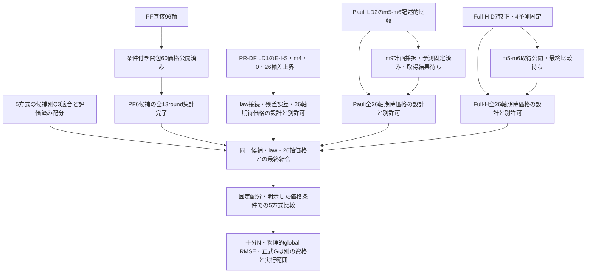

# 統合研究ロードマップ

Repository：`HIROMU1015/Partially-Randomized-Trotter`。最新確認：**2026-11-15 JST**（統合branchのremote HEAD `518377f1771f7950289127f086bde04a0bc3796d` を基点に、5方式・14 scheduleの固定成果と依存関係を棚卸し。確認中に公開されたCのPF60価格、B2の全13round集計、BのFull-H κ2・1.5倍配分完了も反映。確認範囲は§11）。

この文書は、研究の目的・現在地・不足している証拠・次の進行順序を一か所で把握するための入口である。科学的な結果・SOURCE・検証内容の正本は、リンク先の個別REPORTである。本書は新しい科学計算・数値再解析・採択を含まない。

## 0. 現在地サマリー

研究はリソース評価とアルゴリズム改善の二系列からなる（§2）。現在の中心はH4 DF10・5方式の全13round資源比較である。**直近の到達点は、各方式のQ3適合済み候補と実際に評価した固定shot配分を使う条件付き比較**（§3.4）。十分N・物理的global RMSE・正式Gの比較とは分ける。

- **精度側**：主評価は採択済みZ1＋T1 total decoderの保存DF10 solver energy proxyに対するQ3直接モデルMSE、保存ideal finite-K raw・IID二項モデル、閾値 $\tau=(0.00159360010199040\,\mathrm{Ha})^2$。PF6候補、PR-DF LD1/LD2、Pauli LD1/LD2に評価済み固定配分での適合がある。**Full-H κ2は固定1.5倍配分も1回評価完了・適合・mandatory STOP**（[B][B_FULLH_3O2]）。初回比較の第一候補はこの1.5倍配分とする。元control不適合・保存2倍適合は別成果として保全する。配分一覧は§4.4。
- **決定論PFの初回総額は完成**：6候補の直接価格96軸（m0〜m6・m9）と、ユーザー採択済み閉包条件による導出60軸（m7/m8/m10〜m12）を区別。**Cの60価格公開・B2の156軸結合と固定配分全13round集計まで完了**（[C HANDOFF][C_PF60]、[B2 HANDOFF][B2_PF_TOTAL]）。初回比較に使う方式内最小はFull PF S2・幅16h/7＝**838,693,580 RZ**、B0I p7 S2・幅16h/7＝**593,555,352 RZ**。いずれも閉包条件付き総額の転記であり、未観測60軸の誤差上界・CI・2%保証はない。C/B2は完了後STOP、価格表待ち・集計待ちは解消。
- **PR-DF LD1**：保存構造期待値 E_I[S] は26/26軸接続済み。m0/m3/m6の有限較正と独立m4記述的比較・C受入に加え、全13round計画、F0のC受入、**26軸の条件付き期待残差差上界を公開済み**（[D2計画][D2_PRDF_EC_PLAN]、[C F0][C_PRDF_F0]、[D2上界HANDOFF][D2_PRDF_RANGE]）。ただし実PCG64のseed ensemble/joint lawとIID格子lawの接続、有限残差推定・長round移送は未確定。E_I[S]・有限観測・条件付き上界をE[C]と同一視しない。LD2の同条件価格は確認範囲で未同定。
- **PR-Pauli LD2**：5 cell較正・2モデル凍結・m5/m6の4件の記述的比較は完了。後続m9案Bは採択され、**X/Y2予測の観測前凍結と技術準備を公開済み**（[C2][PAULI_M9_PREP]）。fresh2 path・最大4 compileの取得開始・結果公開は固定成果で未確認。全13roundの対象law期待価格・CIは未資格。LD1はm0のB0 1 pathに限る。
- **Full-H κ2価格**：D7全5 cell・9 path・18実compileの較正、C受入10 record・2モデル・m5/m6の4予測凍結は完了。D1 holdoutは指示送付済み・作業中というユーザー確認に加え、**m5 fresh2 path・4 compileの取得/必要gate PASSを固定公開**（[D1 m5][D1_M5_STATUS]）。m6 fresh1 path・2 compileも取得/必要gate PASSを固定公開済み（[D1 m6][D1_M6_STATUS]）。最終4比較の完了報告は未確認。較正/取得gateのPASS、記述的比較、26軸E[C]資格は別である。

**不足と並行作業**：第一比較に向けた価格側の不足はランダム化3方式の同一候補・対象law・26軸E[C]。PR-DF自身のlaw/残差評価計画、Pauli/Full-Hの全26軸価格根拠の設計は、PF総額や取得中holdoutを待たずに進められる（§8.2）。最終結合だけが各価格表を待つ。新しい価格精度・確率モデル・条件付き利用範囲の採択と科学実行は別途必要であり、本書は採択・指示送付を行わない。

**十分N・物理的global RMSE保証・5方式の正式G・winnerは未確定（null）。** PF6件のQ3は保存componentから再計算なしで判定を復元した部分保存のまま（最終API return・CPU・peak RAM欠測）。欠測補完の再実行は残作業に加えない。

## 1. 文書の役割

| 文書 | 役割 |
|---|---|
| 本書（RESEARCH_ROADMAP.md） | 研究目的・進捗・不足・依存関係・次の手順 |
| [PROJECT_MAP.md][MAP] | 実装・研究資料・成果物への入口 |
| [RESEARCH_RESULTS_INDEX.md][INDEX] | 過去の研究系列と原結果への索引 |
| [VALIDATION_STATUS.md][VS] | 検証結果の状態と利用制約（このcheckoutに登録された範囲） |
| 個別REPORT | 科学的結果・SOURCE・検証内容の正本 |

**読むときの注意**
- `main`（`546bca7ed`、2026-11-04）は11月5日以降の成果を含まない。それ以降の成果は各研究branchにあり、本書は固定commitのURLで参照する。
- リンク先の「現在」「次段階」は、その報告の作成時点の記述である。最新の状態は本書の§5・§10と、そこから辿る最新報告で確認する。
- 本書の数値は元報告からの転記であり、条件は必ずリンク先で確認する。

## 2. 研究全体の目的と構造

**全体の目的**：Hamiltonianの一部を決定論的な積公式（PF）で、残りを有限のランダム化Taylor展開（RTE）で実装する部分ランダム化（PR）について、同じ精度・成功条件の位相／エネルギー推定を、どの条件でどれだけ安く実行できるかを明らかにする。単回の回路の短さではなく、PFのbias、finite-RTEのbias、normalizationによる減衰、必要shot数、全roundの回路価格を接続して評価する（[研究目的][GOAL]、[方法][METHOD]）。

### 2.1 研究の階層

```text
研究全体（repository）
├─ リソース評価
│   ├─ 有限時間の資源地図：H4/H6/H8 DF、Pauli-JW、長時間B2/B3（〜11/02）
│   ├─ RPE全roundの総資源：H4 DF10の5方式比較（11/10〜、現在の中心）
│   └─ 一般性：H6/H8への条件移送（保存成果あり、現比較とは別契約）
└─ アルゴリズム改善
    ├─ return集約・sampling・推定器（Track B／O2）
    ├─ 表現・分割（元Track A／A-O1、研究C）
    ├─ Closed P3・共同選択（Track C／C-O3）
    ├─ Reference／control（Track D／D8）
    └─ 適応readout（新A）
```

- 11月1日時点の全体像は[科学的到達点と証拠の地図][LAND]と[主張・証拠・未解決課題の対応表][GAPS]にある。
- 11月10日時点の系列間の接続は[PR＋RPE共同最適化への統合調査][INTEG]と[対応表][INTEGM]にある。
- 本書はこれらを再利用し、11月10日以降の進展を加える。

### 2.2 同じ名前で別のものを指す語

| 名前 | 指すもの |
|---|---|
| 作業担当 A／B／C／D（11/13〜） | H4総資源比較の役割分担。A：物理信号・Full-H・Pauli設計。B：RPE推定器・MSE・必要N。C：価格・モデル・証拠受入。価格担当はD：決定論PF、D1：Full-H、D2：PR-Pauliと後続PR-DF LD1の取得。各branch・SOURCE・科学契約は区別する |
| 旧Track A（〜10/26） | 既知PRの資源評価（リソース評価系列）。PR-2 M1/M2、H4/H6/H8、長時間B2/B3 |
| 元Track A／A-O1（11/06〜08） | アルゴリズム改善。辞書変更（O1-M1）、core＋residual（O1-M2）、B2-P1 |
| 新A | PR Reference／適応readout（V6、Q3、Q4） |
| Track B（B/O2） | return集約・局所生成・有限bit・sampling |
| 研究B／B2-D | D内部PF・outer分割。Track Bとは別 |
| Track C（C-O3） | Closed P3、joint basis、h／resolution／αの共同選択 |
| 研究C（RC） | Hamiltonian表現・PR-aware DF（CDF、ENTRY）。Track Cとは別 |
| Track D（D8） | Reference／control。固定CDF8条件の13round条件付き会計 |
| 方式名 B0／B0I／B2／B3 | DFの方式ラベル（下表）。作業担当Bとは無関係 |

| 方式ラベル | 内容 |
|---|---|
| Full PF | 一体項と全DF fragmentを決定論PFで保持 |
| B0／B0I（Truncated PF） | prefixを保持し、tailを捨てる。B0Iは捨てたtailのidentity成分をscalarへ一回戻す |
| B2（PR-DF） | 一体項＋非空prefixを保持し、tailをfinite RTEで補う |
| B3 | 二体prefix 0。一体項は保持する。全Hの純RTEではない |
| PR-Pauli（DF head＋Pauli tail） | DF prefixを保持し、tailをPauli辞書のRTEで補う |
| Full-H pure RTE | 一体項を含む全Hをランダム化する。B3とは別方式 |

## 3. H4リソース評価の最終目的

### 3.1 評価対象

状態準備を除いた、RPE全roundの総計算資源を評価する。

$$
G=\sum_{m=0}^{M}\sum_{a\in\{X,Y\}} N_{m,a}\,\mathbb E[C_{m,a}]
$$

- $N_{m,a}$：対象精度・推定器・誤差契約の下で使うshot数。
- $\mathbb E[C_{m,a}]$：対象lawに対する、1 shot当たりの測定付きfull Hadamard wrapperの期待compiled RZ数。制御付き時間発展、scalar（総時間に一回）、X/Yの基底変換、測定を含む。
- 古典の価格標本数 n と normalization B は、N や C に重ねて掛けない。

**現行の検証で共通に使っている条件**（物理条件の出所は[4方式menu][MENU4]・[ベースライン設計][BASEOPT]。主精度評価の現在の採択状態は、ユーザー確認と[Bの固定REPORT][B_PF_FIXED]・[Pauli REPORT][B_PAULI_3Q]による。全候補集合・最終比較policyの採択とは区別する）

| 項目 | 内容 |
|---|---|
| 系 | Linear H4、1.00 Å、STO-3G、保存tol-only 1e−8 DF10（weighted-Hermitian completion）、sector (2,2)・36次元 |
| target | 保存DF10 full DF-Hのsolver energy proxy。厳密ground energyの包含・state誤差は未認証。DF前のHamiltonianへは変更しない |
| RPE | h=0.1、M=12（13 round、$T_m=h\,2^m$）、状態準備費 P=0 |
| 採択済み主精度評価 | Z1＋T1 total decoderのQ3直接モデルMSE。保存ideal finite-K raw・IID二項モデル、閾値 $\tau=(0.00159360010199040\,\mathrm{Ha})^2$。物理的なglobal RMSE保証とは別 |
| compiler | Qiskit 1.3.0、basis rz/sx/x/cx、opt1、seed17。lowering IDも価格の条件として一致させる |

### 3.2 比較方式：正式採択と検証用shortlistの区別

| 区分 | 内容 |
|---|---|
| 方式の集合 | PR-DF、PR-Pauli、Full PF、Truncated PF、Full-H pure RTE。作業はこの5方式で進んでいる |
| 候補（schedule）の集合 | **正式採択された候補集合はない。** 11/13の11 schedule案は提案であり、最適候補群でもない（[4方式menu][MENU4]） |
| 現在の検証用候補 | Cの5方式・14 schedule・364軸の[固定対応表][C_ALIGNMENT]と§5。対応表完成は、最終候補選定や適格N・E[C]の完成を意味しない |
| 価格のshortlist（決定論PF） | S2・幅16h/7、Y4・幅16h/3、M5・幅16h（[D 保存4件binding][D_SAVED4]）。Full PFの局所予算内候補（[A追加5点][A_FPF_FU]）に基づく検証用の集合 |

### 3.3 二つの比較水準

| 水準 | N の意味 | 現状 |
|---|---|---|
| 第1水準 $G_{\mathrm{paper}}$ | 原論文型のnominal shot数 $\lceil B_m^2[11+4(M-m)]\rceil$。経験的な名目値で、精度の保証ではない | 会計の実装は人工値でPASS（[C 価格経路][C_ROUTES]）。実データでの計算は0件 |
| 第2水準 $G_{\mathrm{qualified}}$ | 採択した精度条件の下で根拠のあるshot数 | 主精度のQ3直接モデルMSEは採択済み。5方式の特定候補に固定配分での条件付き適合はあるが、物理的に十分なN・global RMSE・正式Gは未確定 |

**nominal N を十分 N として扱わない。** 両水準の出力は別fieldで管理されている。

### 3.4 直近の到達点：評価済み固定配分での全13round比較

各方式から少なくとも1つのQ3適合済み物理候補を使い、その候補で**実際に評価した** $N_X,N_Y$ とm0〜m12・X/Y計26軸の測定付きfull controlled Hadamard wrapperのcompiled RZ価格を結合する。これは第1水準のnominal Nでも、十分Nを認定する第2水準でもない。既存の二水準の定義は変更しない。

決定論PFでは直接価格と採択済み条件付き閉包価格を区別して総額が公開済み（[B2][B2_PF_TOTAL]）。ランダム化方式では対象lawの期待価格、その評価誤差・適用条件が不足する。有限path平均・凍結予測・期待残差差の上界はそのまま別種の証拠として示し、互いを置換して同じ期待総額や順位を確定しない。別の条件付きモデルシナリオや上界による比較を採用するなら、law・26軸の根拠・不確かさと主張範囲を先に明示し、別判断を受ける。

状態準備P=0、候補/round/axis/law/compiler/lowering/scalarの束縛を維持する。十分Nの認定や物理的global RMSE保証を、この最初の比較の前提として追加しない。一方、固定配分でのモデル適合を物理保証・正式G・5方式のwinnerへ昇格しない。

## 4. 研究課題と実装・検証の対応

実装pathは、併記した固定commitに存在することを確認した。`main` には無いものが多い。

### 4.1 量子回路実装（実回路・loweringのcorrectness）

| 項目 | 内容 |
|---|---|
| 研究上の問い | 価格を測る回路が、意図した制御付き時間発展・scalar一回・X/Y測定を正しく実装しているか |
| 実装 | D `acea1118a`：`src/trottertracks/pauli_tail_price_connection.py`、`scripts/run_full_pf_shortlist_prices.py`、`scripts/run_truncated_p7_prices.py`、`scripts/run_pauli_ld1_m0_pilot.py`。A `7a0c9468b`：`scripts/run_full_h_kappa2_p1.py`。新ZZ lowering：`26d4f23e7`の`src/trottertracks/efficient_controlled_zz.py` |
| 検証 | [Full-H P-1再検証][A_P1]（ancilla命令列の完全一致など23条件）、[Pauli B0 run02][A_B0]（固定の実H4数値gate）、[p7保存回路のX/Y識別][C_ADM]（保存QPYのfingerprint）、[PR-DF P2 direct pilot][D_P2] |
| 到達点 | PR-DF：LD1 m0/m6に続きm3・m4のreceipt接続を完了、m4のC受入8/8・比較2/2（[C][C_PRDF_M4_ADMISSION]）。新しい数値作用gateは元P2 fresh同様未実施。PR-Pauli：LD1 m0、LD2 B1-Wに加えCAL18 compile・独立m5/m6 holdout6 compileの対象pathで実装gateを確認（[D2 CAL][D2_CAL]、[holdout][D2_HOLDOUT]）。決定論PF：m9・m0・m1/m2も元作用gate・C implementation guardを通過（[D m9][D_PF_M9_RESULT]、[m0][D_PF_M0]、[m1/m2][D_PF_M12]）。Full-H：D7全18軸のD1最終検査PASS、Cも10較正record・元18軸の保存証拠を受入済み。index0の7数値gateをindex1へ拡張していない（[D1][D1_FINAL]、[C][C_FULLH_FREEZE]） |
| 科学的資格 | 検査したpath・cellに限った配線の証拠。価格の期待値や他roundの正しさは示さない |
| 不足 | PR-Pauli LD2のorder2 product・非自明event位相は未観測UNKNOWN。長いroundの直接検査・モデル外挿資格は未確定 |
| 次の作業 | 完了した配線・取得の証拠を再利用する。Pauliの記述的holdout完了を未観測eventへ一般化しない。各取得系列の後続範囲は§8・§10による |
| 担当・依存 | D（決定論PF）、D1（Full-H）、D2（Pauli・PR-DF LD1の別取得系列）、A（設計・検証）、C（guard受入）を区別する |
| 完了条件 | 価格を使う全ての回路族について、少なくとも代表cellの配線証拠がある |

### 4.2 物理信号

| 項目 | 内容 |
|---|---|
| 研究上の問い | 各方式・各roundの平均信号（raw、補正後、normalization）は何か |
| 実装 | A `714247619`：`src/trottertracks/pr_rpe_signal_provider.py`、`df_head_pauli_tail_p0.py`／`_p1.py`／`_completion.py`、`pf_effective_hamiltonian.py`、`scripts/run_h4_full_pf_heff_scan.py`。A `7a0c9468b`：`baseline_signal_pipeline.py`、`baseline_signal_numerics.py`、`scripts/run_truncated_fullh_signals.py`、`scripts/run_full_h_kappa2_signals.py` |
| 検証 | [PR-DF 26round][A_PRDF]、[PR-Pauli 26round][A_PAULI]、[B0I p7・Full-H R448 各13round][A_TRSIG]、[Full-H κ2 13round][A_S1]、[Full PF H_eff格子][A_FPF_SCAN]・[追加5点][A_FPF_FU]、[Truncated T1][T1]・[T2][T2]、[決定論PF shortlist6候補完成][A_PF_COMPLETE] |
| 到達点 | 上記の既存packetを保全。加えてFull PF・B0I p7の各3候補が各13round完成（保存30再利用、新規48 PASS）、B intake6/6 PASS。[科学SOURCE][A_PF_SOURCE] `fb9a1878b`、[raw carrier][A_PF_RAW] `06a15ee45`、[packet索引][A_PF_PACKETS]と[HANDOFF][A_PF_HANDOFF]を参照 |
| 科学的資格 | 保存した数値stateとideal finite-K lawに条件付いた解析的平均。基底状態の認証と、実samplerのlawへの移送は未取得 |
| 不足 | 今回のshortlist6候補について信号不足・B受入待ちは解消。補助候補Full PF S2・幅0.1の未完備状態は別候補として維持する |
| 次の作業 | 完成packetを再利用する。Aの取得作業はmandatory STOP。追加meanの取得をこの文書から指示しない |
| 担当・依存 | A（信号）、C（baseline metadata）、B（受入） |
| 完了条件 | 比較に使う各物理候補について、全13roundの信号packetがSOURCE付きで受入済みである |

### 4.3 誤差評価（推定器・MSE）

| 項目 | 内容 |
|---|---|
| 研究上の問い | 与えたshot配分の下で、エネルギー推定の誤差（MSE）はどこまで抑えられるか |
| 実装 | B `999304918`：`src/trottertracks/rpe_total_decoder.py`、`rpe_total_risk.py`、`rpe_deterministic_risk.py`、`rpe_total_binding.py`、`rpe_c_interfaces.py`、`pr_rpe_rmse_controller.py`。test：`tests/check_rpe_total_decoder_risk.py` |
| 検証 | [精度契約W0][B_W0]、[Z1＋T1/Q3][B_Z1]、[PR-DF旧部分decoder DP][B_DP]、[Pauli元control][B_Q3]・[3/4配分][B_PAULI_3Q]、[PF固定6評価][B_PF_FIXED]、[PR-DF/Full-H元control][B_PRDF_FULLH]、[Full-H κ2・2倍][B_FULLH_2X]・[1.5倍][B_FULLH_3O2] |
| 到達点 | PF共通固定shot6/6、Pauli3/4配分2件、PR-DF固定control2件が適合。Full-H κ2は元control不適合・固定1.5倍適合・保存2倍適合の3成果がある（[B][B_FULLH_3O2]）。1.5倍は1 call完了・mandatory STOP、原API/資源記録保存済み。PF6件は保存componentから判定復元、実行記録部分保存・最終API return/CPU/peak RAM欠測のまま |
| 科学的資格 | 採択済みQ3直接モデルMSEでの条件付き適合。保存solver proxy・ideal raw・IID・未認証allowanceの範囲に限る。物理的な精度保証・十分Nではない。PFの科学worker完了とdriver記録UNKNOWNを区別する |
| 不足 | 物理的な資格・必要N最適化は未完了。Full-H R448・補助候補・未評価vectorへ結果を移さない。PR-DF/Full-H新評価のAPI・資源記録は保存済みだが、PF6件の欠測を補うものではない |
| 次の作業 | 各固定REPORT/HANDOFFを再利用。Full-H初回比較は1.5倍配分を使い、追加shot探索・Q3再評価を必要作業に加えない。PFの記録欠測を埋める再実行も要求しない。未評価vectorや物理的資格は別判断 |
| 担当・依存 | B。信号（§4.2）に依存 |
| 完了条件 | 採択した契約の下で、比較する全候補のMSE評価が同じclaim水準で揃う |

Full-H κ2の3配分の保存結果（[B REPORT][B_FULLH_3O2]からの表示値の転記、Ha²）。採否は元REPORTのexact端点で判定済みであり、本書で再計算していない。

| 配分 | 保存MSE区間（概数） | 採択済みQ3閾値への適合 |
|---|---|---|
| 元control | [1.6244310×10⁻⁴, 1.6336187×10⁻⁴] | 不適合 |
| 固定1.5倍 | [2.0984341×10⁻⁶, 2.1058026×10⁻⁶] | 適合・初回比較の第一候補 |
| 保存2倍 | [7.6023913×10⁻⁷, 7.6038351×10⁻⁷] | 適合・保存参照 |

### 4.4 必要shot数 N

| 項目 | 内容 |
|---|---|
| 研究上の問い | 目標精度を満たすために、各round・各軸で何shot必要か |
| 実装 | B `999304918`：`src/trottertracks/rpe_shot_allocation.py`、`pr_rpe_rmse.py`（nominal）、`rpe_total_binding.py`の`evaluate`入口。C `855573064`：`paper_nominal_cost.py`の`nominal_packet` |
| 検証 | 旧[有限計画][B_NPLAN]・[準備報告][B_N]を履歴として保持。完了成果は[Pauli3/4配分][B_PAULI_3Q]、[PF6候補][B_PF_FIXED]、[PR-DF固定control][B_PRDF_FULLH]、[Full-H κ2・2倍配分][B_FULLH_2X]・[1.5倍配分][B_FULLH_3O2] |
| 到達点 | X/Y各軸共通、m0〜m12順。PF6候補＝`[59,55,51,47,43,39,35,31,27,23,19,15,11]`（[B][B_PF_FIXED]）。Pauli LD1/LD2＝`[48,45,42,39,36,33,29,26,23,19,16,13,9]`（[B][B_PAULI_3Q]）。PR-DF LD1/LD2＝`[64,60,56,52,47,43,38,34,30,25,21,17,12]`（[B][B_PRDF_FULLH]）。**Full-H κ2の初回比較＝1.5倍 `[96,90,84,78,71,65,57,51,45,38,32,26,18]`、allocation `FULL_H_KAPPA2_TOTAL_Q3_USER_SCALE_3O2_01`**（[B HANDOFF][B_FULLH_3O2_HANDOFF]）。保存2倍 `[128,120,112,104,94,86,76,68,60,50,42,34,24]` も適合。元control（PR-DFと同じvector）は不適合。十分N・最適Nではなく`sufficient_N=null` |
| 科学的資格 | 評価済み配分の条件付きモデル閾値適合のみ。物理的に十分なN・global RMSE保証は未資格 |
| 不足 | 未評価vectorへの補間、最小N、cost-aware配分、物理的誤差・law移送の資格。旧有限計画全体が実行済みになったわけではない |
| 次の作業 | Bは各固定評価の完了後mandatory STOP。Full-H初回比較に追加倍率・round別探索は不要。1.5倍は全round/両軸で2倍よりshot数が少なく両者適合だが、未評価vectorのMSE単調性・最小Nは推論しない。後続は同じκ2の価格26軸との結合 |
| 担当・依存 | B。§4.3に依存。価格とは独立に進められる |
| 完了条件 | 各候補について、採択した契約で閾値を満たすwhole-vectorが、根拠とともに保存される |

### 4.5 compiled価格（直接価格・有限cohort）

| 項目 | 内容 |
|---|---|
| 実装・受入 | Dの既存caller、C `price_implementation_guard` / `rpe_d_price_connection` / `price_context`を再利用。固定compiler/loweringとfull measured wrapper/P=0の束縛を保つ |
| 決定論PF | [m3受入][C_PF_M3]、[較正][D_STAGE1]、[m6][D_PF_M6]、[m9][D_PF_M9_RESULT]、[m0][D_PF_M0]、[m1/m2][D_PF_M12]で**直接96/156軸**。残60軸は新compileしておらず、[Cの条件付き導出表][C_PF60_TABLE]で埋めた。m0/m1/m2はモデル判定なし、m6/m9の各12/12 PASSは指定点だけ |
| PR-DF | LD1 m0/m6 P1各2・P2 fresh各4 pathと、m3較正/独立m4各fresh4 pathの有限価格。m4はC receipt8/8・比較2/2受入、保留0（[C][C_PRDF_M4_ADMISSION]）。LD2の同条件compiled価格は確認範囲で未同定 |
| PR-Pauli | LD1 B0のm0 X/Y各1 pathはwiring専用。LD2 W m0 X/Y各1 path、CAL5非configuration cell・18 compile、独立m5/m6の3 fresh path・6 compileは公開済み（[W][D2_W]、[CAL][D2_CAL]、[holdout][D2_HOLDOUT]）。m9は予測固定済み、取得開始/結果公開未確認（[準備][PAULI_M9_PREP]） |
| Full-H κ2 | D7較正5 cell・9 path・18 compile、D1検査PASS18・C受入10 record完了（[D1][D1_FINAL]、[C][C_FULLH_HANDOFF]）。新holdoutはm5のfresh2 path・4 compile・取得/必要gate PASSを公開済み（[D1][D1_M5_STATUS]）。m6 fresh1 path・2 compileも取得/必要gate PASSを公開済み（[D1][D1_M6_STATUS]）。最終4比較の完了は未確認。旧P-1 m3はwiring専用 |
| 科学的資格 | RTEの各有限cohortは観測価格。X/Yは同pathの2応答で標本数を二倍にしない。Pauli/Full-H較正の非configuration cellを通常13roundの軸価格へ付け替えない。Full-H G36223の保存4 compile再利用は18の内数・追加0、paired P2R566は親G566と非独立 |
| 次・完了条件 | 既取得の再compileは不要。取得中の限定holdoutの固定成果だけを後続受入へ渡す。全26軸期待価格の資格・計画は§4.6/§8で別管理する |

### 4.6 期待価格モデル（E[C]）

| 項目 | 到達点・不足・次の依存 |
|---|---|
| 決定論PF | [C推奨][C_PF60_REC]の閉包条件はユーザー採択済み、[60価格公開][C_PF60]、[B2全13round集計][B2_PF_TOTAL]まで完了。60軸のclassificationはMODEL_PREDICTION、evidence_kindはFIXED_COMPILER_CLOSURE_DERIVATION_CONDITIONAL。障壁/反復/終端構造の持続、installed Rustと参照sourceの対応、未調査規模分岐の前提に限る。無条件QUALIFIED_MODEL・直接観測にはしない。2%保証・誤差上界・CIはnull、元モデルqualified_for_candidate=falseを保全 |
| PR-DF LD1 | E_I[S]26/26、m0/m3/m6による軸別残差2モデルとm4予測2件の凍結・記述的比較/C受入は完了。全13roundの[計画][D2_PRDF_EC_PLAN]・[F0受入][C_PRDF_F0]・[26軸条件付き残差差上界][D2_PRDF_RANGE]を追加。上界は保存binary64 ideal weightのlaw Iと**独立一様53-bit格子law**の間のTV×SOURCE envelopeによる差の絶対上界であり、符号付き補正・有限標本誤差・モデル誤差ではない。実PCG64のseed ensemble/joint streamへの接続は未確定、actual PCG64 price shiftはnull。新26上界のC受入は未確認 |
| PR-DF LD2 | 同条件の構造期待値・compiled価格・凍結モデルは確認範囲で未同定。LD1の数値を移送せず、LD2の保存候補/辞書/入口に合うkernel・価格設計の技術照合はLD1/PFを待たずに可能 |
| Pauli LD2 | 2モデル凍結後のm5/m6は4/4有効・DESCRIPTIVE_COMPLETE。m9案B採択・同係数のX/Y2予測凍結公開済み、取得開始/結果未確認。長qの有限cohort比較を増やしても、母law平均・有限標本/共有係数誤差・未観測round移送は別に残る。Pauli LD1へ係数/辞書を移植しない |
| Full-H κ2 | D7の軸別3係数2モデル・m5/m6の4予測は凍結済み、CALIBRATED_UNVALIDATED・qualified_for_candidate=falseを維持（[C][C_FULLH_HANDOFF]）。m5・m6は取得公開、最終比較は未確認（[m6][D1_M6_STATUS]）。対象law・全26軸の期待価格根拠、有限cohort/paired依存・共有不確かさ・長round移送は未資格。1.5倍shot適合は価格資格を付与しない |
| 共通の境界 | PR-DF m4・Pauli m5/m6・Full-H採択規則は数値許容差null・モデルPASS/FAILなし。決定論PFの2%を移さない。希少イベント単独の追加調査は今回の優先作業から外し、後続の期待価格設計では全supportを含める必要を保持する |
| 担当・完了条件 | C/C2（モデル・受入）、D/D1/D2（別契約の取得）、A等の理論/設計担当。独立比較完了と全round/lawの価格資格は別判断。今できる静的準備と新しい科学実行の境界は§8.2 |

### 4.7 総資源会計（G）

| 項目 | 内容 |
|---|---|
| 既存実装 | C `paper_nominal_cost` / `rpe_optimization_pipeline`、Bのbinding/会計に加え、[B2固定配分集計][B2_PF_TOTAL]の`allround.py`・入力`43f87397a`。新しい管理システムは不要 |
| 到達点 | PF6候補は同一固定Q3配分で直接96＋条件付き60軸を結合し、全13round総compiled RZ数・条件付き順位を公開済み。既知8round小計[540b54ab2][B_PF_PARTIAL]を入力として再利用。C価格公開待ち・B2集計待ちは解消、各担当STOP |
| 不足 | 他3方式は同一物理候補・対象lawの26軸期待価格と不確かさ/適用範囲。初回比較の評価済み配分は既にある。十分N・物理的global RMSE・正式G/5方式winnerは別の未解決事項 |
| 次・依存 | ランダム化各方式の期待価格計画・候補/軸/配分metadata照合は先行できる。各方式の価格表公開を待つのは数値の最終結合であり、全準備を一括待機させない。PR-DFとPFの差額比較には双方の同じclaim水準の総額が必要だが、PF側総額は今回受領済み |
| 資格 | PFの条件付き固定配分総額を第2水準Gへ昇格しない。他方式の有限path平均・点予測・条件付き上界を同じE[C]として混在させず、欠測0補完・新許容差の事後採択をしない |

## 5. 物理候補ごとの進捗

### 5.1 初回固定配分総額の入力棚卸し

起点は[Cの14 schedule・364軸対応表][C_ALIGNMENT]。IDは先頭8桁、全桁・元/total ID・各roundのphysical IDは同表と各固定HANDOFFにある。表のQ3/配分は各候補で評価済みのものを指す（全vectorは§4.4）。価格quantityは§3.1のwrapper/P=0のcompiled RZ。**同方式でも異なる候補・辞書・law・SOURCEのN/価格を流用しない。**

| 方式・物理候補/schedule | 採択Q3・実際に評価した配分 | m0〜m12・X/Yの価格証拠と種類 | 固定配分全13round総額への不足／次の担当・実際の依存 |
|---|---|---|---|
| **Full PF** S2 16h/7 `11cf8ca6`、標準Y4 16h/3 `a799697f`、M5 16h `70f7b317` | 全13round信号・intake完了。PF共通配分で各適合（[A][A_PF_COMPLETE]、[B][B_PF_FIXED]）。PFの実行記録部分保存を維持 | 各候補でm0〜m6・m9のX/Yは直接compiled価格、m7/m8/m10〜m12のX/Yは採択済み条件付き閉包価格（[C表][C_PF60_TABLE]）。Full/p7全体で96直接＋60条件付き＝156軸 | **初回の条件付き総額は[B2][B2_PF_TOTAL]で完成**。S2 838,693,580、Y4 1,089,674,842、M5 1,343,396,772 RZ（転記）。価格公開/集計待ちなし、C/B2 STOP。無条件価格資格・十分Nは後続 |
| **B0I p7** S2 16h/7 `a6e55777`、標準Y4 16h/3 `defc5e88`、M5 16h `424eecbf` | PF共通配分で各適合、13round信号/intake完成（[A][A_PF_COMPLETE]、[B][B_PF_FIXED]） | 上行と同じround区分で直接/条件付き価格を保持、候補ごとに全26軸対応 | **初回の条件付き総額完成**。S2 593,555,352、Y4 765,902,758、M5 951,282,896 RZ（[B2][B2_PF_TOTAL]）。待ちなし。Full/p7とも元実幅・m3保存cohort・m4の保存4価格の役割を保持 |
| **PR-DF LD1** `a4dda8f7`、S2幅0.1/K2/元κ | PR-DF固定配分で適合（[B][B_PRDF_FULLH]） | E_I[S]26/26。m0/m6 X/Y P2 fresh各4 path（P1各2・replay各1は参照）、m3 X/Y fresh4較正、m4 X/Y fresh4独立holdout/C受入。m4 X/YともO=129,692.5 RZ、差約−0.544502%、記述的比較のみ（[C][C_PRDF_M4_ADMISSION]）。通常round有限価格は{0,3,4,6}、他{1,2,5,7,8,9,10,11,12}は同候補の観測/保存新点予測なし（[D2計画][D2_PRDF_EC_PLAN]）。26軸残差差上界は**条件付き上界**、価格表ではない | 対象ideal law Iでの26軸E[C]・有限残差誤差・共有モデル/長q移送根拠が不足。Cの新上界受入とA/D2の実PCG64 joint-law接続・価格計画は**PF総額を待たず**先行可能（§8.2）。PFとの差額比較だけが両価格の整備後 |
| **PR-DF LD2** `1fa33556`、S2幅0.1/K2/元κ | PR-DF固定配分で適合（[B][B_PRDF_FULLH]） | 全13round信号/metadataあり。同条件E[S]・compiled価格・凍結予測は確認範囲で未同定（[対応表][C_ALIGNMENT]、[coverage][C_PRDFCSV]）。LD1表は代用不可 | 26軸の構造/価格入力と独立検証設計が不足。A/C/D2のLD2保存入力・既存kernel適合性の静的調査はLD1/PFを待たず可能。新26軸E[S]計算や較正compileには別scope/許可が必要。最初の比較を早めるかは§8.2の代替候補調査で判断 |
| **PR-Pauli LD2** `d7dd4f52`、DF head＋Pauli tail/S2幅0.1/K2 | 3/4配分で適合（[B][B_PAULI_3Q]） | W m0 X/Y各1 pathはwiring。CAL5 cell/18 compileはm=Noneの設計cellで26軸の通常価格ではない。m5 X/Y fresh2 path・m6 X/Y fresh1 pathで4/4記述的比較、差はm5各+0.044612%、m6各+0.157666%（[D2][D2_HOLDOUT]）。m9はX/Y2予測凍結済み、取得開始/結果未確認（[C2][PAULI_M9_PREP]）。他roundの対象law価格表は未公開 | m9は既存の採択/実行scopeで結果待ち、重複割当しない。全26軸の対象law平均・有限標本/係数誤差・未観測round移送の設計はC/Aが先行可能。m9比較が完了してもこれらは自動解消しない |
| **PR-Pauli LD1** `d905d219`、DF head＋Pauli tail/S2幅0.1/K2 | 3/4配分で適合（[B][B_PAULI_3Q]） | [B0][A_B0] m0 X/Y各1 pathの直接観測・wiringのみ。その他通常round・較正/凍結モデル・対象law期待価格は確認範囲で未同定 | LD1固有の辞書/頭部・較正/期待価格設計が不足。静的な最小設計比較はLD2 m9を待たずに可能。LD2係数/価格の移送不可、追加compile件数は未採択。現時点でLD2より早く揃う証拠はない |
| **Full-H pure RTE κ2** `54ac3eb3`、K2/q=2^m | **1.5倍配分適合・初回比較の第一候補**（[B HANDOFF][B_FULLH_3O2_HANDOFF]）。元control不適合、保存2倍適合を別記。Q3再評価不要 | P-1 m3 X/Y各1 pathはwiring。D7較正5 cell/9 path/18軸・C受入10 recordは非configuration cell。2モデルの通常m5/m6 X/Y4予測は観測前凍結済み（[C][C_FULLH_HANDOFF]）。m5 fresh2 path/X/Y4 compileとm6 fresh1 path/X/Y2 compileは取得/必要gate PASS公開、最終4比較は未確認（[m5][D1_M5_STATUS]、[m6][D1_M6_STATUS]）。その他通常roundの価格表は未公開 | 同じκ2・対象lawの全26軸E[C]・不確かさ/長round移送根拠が不足。D1最終比較の固定報告を待つ一方、C/Aの26軸価格計画・B/Cの1.5倍allocationへのmetadata結合準備は先行可能。追加shot探索は初回比較の必要作業から外す |
| **Full PF補助** S2幅0.1 `f2d58f32` | 13round packet/intake未完備、新Q3適合配分なし（[B][B_SIGAPP]） | 旧m3/m4 locatorはあるが現行guard未受入（[C][C_ALIGNMENT]）。shortlistの96/60軸を移さない | 信号・評価配分・現行価格受入が必要。shortlistで初回総額完成のため初回比較の優先対象外 |
| **B0I p7補助** S2幅0.1 `e6754564` | 13round信号あり、total metadata接続済み。新Q3適合配分未評価 | m3/m4の旧価格locatorあり、現行wrapper receipt未受入（[C][C_ALIGNMENT]） | 新Q3・26軸価格が必要。別幅shortlistへ全scheduleを流用せず、今回優先しない |
| **Full-H R448補助** `cfa6aee3` | 13round信号・独立total metadataあり、新Q3適合配分なし | 同条件価格は確認範囲で未同定（[C][C_ALIGNMENT]） | κ2とはR/event law/normalizer/rawが別。κ2に適合済み1.5倍があるため初回比較では後続候補 |

### 5.2 最初の比較に使う候補

| 方式 | 既存証拠から最も近い候補 | 選択を左右する不足・範囲 |
|---|---|---|
| Full PF | S2 16h/7 `11cf8ca6` | B2公開の3候補内で条件付き総額最小。初回入力完成、十分Nでの最適性ではない |
| B0I p7 | S2 16h/7 `a6e55777` | 同じ条件で方式内最小。全6候補内でも最小という[B2の保存結果][B2_PF_TOTAL]を転記。5方式winnerではない |
| PR-DF | LD1 `a4dda8f7` が証拠整備では近い | LD2には同条件価格が未同定で**価格優位は選べない**。選択を左右する不足はLD2の同law・26軸価格根拠。LD1のE_I[S]/m4/F0/上界はその優位を証明しない |
| PR-Pauli | LD2 `d7dd4f52` が証拠整備では近い | LD1はwiringのみ。価格での選択を左右する不足はLD1の同law価格モデル/26軸評価の根拠。LD2 m9結果をLD1へ移さない |
| Full-H pure RTE | κ2 `54ac3eb3`・評価済み1.5倍配分 | ユーザー指定の第一候補。2倍より各軸shot数が少なく両者Q3適合。価格26軸が不足、R448や未評価倍率の最適性は判断しない |

価格cohort n、量子shot N、normalization Bは別量。X/Yが同pathであること、PR-DFとPauliの辞書/lowering差、元canonical IDとtotal-view IDの版付きbridgeを保つ。旧STOPと[D2の範囲逸脱記録][D2_SCOPE]を保存し、後者を科学証拠には採用しない。

## 6. 証拠の状態の区分

| 区分 | 意味 | 例 |
|---|---|---|
| 実装済み | コードがある | 第1水準の会計 |
| 人工・回帰テストPASS | 架空の入力で動作を確認した | guard、bridge、価格モデルの検査 |
| 実物理条件での検証PASS | 実H4の回路・数値でgateを通過した | P-1再検証、Pauli B0 |
| 科学的数値結果の保存あり | 承認された実行の結果が固定SOURCE付きで保存されている | 各方式の13round信号、Pauli Q3の2評価 |
| 特定条件下で利用可能 | 明示された条件の範囲で使える | 決定論PFのm0〜m6・m9直接価格96軸、評価済みvectorでの条件付きモデル閾値適合 |
| 最終比較へは未資格 | 値はあるが、最終比較に必要な資格が無い | 単一path価格、E[S]、control vectorでのMSE |
| 調査済み範囲では欠測 | 確認した範囲に記録が無い | PR-DF LD2の価格 |
| 原本・同等性が未確認 | あるかどうか、同じ条件かどうかを判断できていない | 補助候補の旧価格locatorと現行wrapper receiptの対応 |
| 科学結果保存・実行記録部分保存 | 保存componentで科学的判定を確認できるが、完全な実行記録はない | PF固定shot6件。最終API return・CPU・peak RAM欠測を併記し、再実行しない |
| 指示作成／送付／実行／成果受領 | 各段階を確認できた記録に従い区別する | PF60価格・B2集計は公開完了。Full-H m5/m6取得公開と最終比較待ちを区別。Pauli m9は案採択・予測固定公開、取得開始/結果未確認 |
| モデル凍結／独立比較完了 | 観測前の係数・予測固定と後続の独立比較を分ける | PF m6/m9・PR-DF m4・Pauli m5/m6は比較完了。Full-Hは4予測固定・m5/m6取得公開、最終比較未確認。Pauli m9は予測固定のみ。元凍結JSONは遡及変更しない |
| 記述的比較完了・モデル判定なし | 有効な独立観測と予測差を報告し、数値許容差によるモデル判定は行わない | PR-DF LD1 m4のC比較2/2受入とPauli LD2の4/4有効比較はいずれもDESCRIPTIVE_COMPLETE。モデルPASSではない |
| STOP記録の保全 | 個別契約の完了後STOPと後続作業を区別する | A/B/Cの完了成果、D m9・m0・m1/m2、D1 D7較正、D2各取得の旧STOPを保全。後続の限定holdout・計画/F0/上界公開はそれぞれ別scopeとして記録する |
| 次段階の別判断・実行指示待ち | 現在の指示の範囲に含まれない | RTEの全26軸期待価格評価・追加取得/fit、正式G。Full-H holdout・Pauli m9の限定scopeは既に別指示あり。PF60価格公開/集計待ちは解消 |

**区別を保つ点**
- 人工テストのPASSは、科学的な検証の完了ではない。
- **有限cohortの平均、構造期待値 E[S]、compiled期待価格 E[C] は別の量である。**
- 単一pathの観測を、lawの期待値として扱わない。
- 旧SOURCEの科学的資格を、新SOURCEへ自動で移さない。
- 「確認した範囲で未同定」は「未実施」ではない。
- D2の過去の[SCOPE_DEVIATION.md][D2_SCOPE]に記録された範囲外数値検査は保全し、W・CAL・今回のholdoutの科学的証拠・資格には採用しない。各観測pathのgate PASSと、その過去記録を混同しない。

## 7. 未解決課題と、解くと何が判断できるか

| 課題 | 種別 | 解決すると判断できること | 重複照合（§10.5）の状況 |
|---|---|---|---|
| 最終5方式比較のclaim水準・未採択policy | 方針・契約の採択 | 条件付きモデル結果と正式Gの主張範囲が決まる | Q3主精度と決定論PF H-bは採択済み。RTE系へ条件を自動移送しない |
| 決定論PFの条件付き閉包と無条件domain資格 | 直接96＋条件付き60軸の価格公開・B2集計完了 | 初回固定配分の条件付き総額は比較可能。無条件E[C]資格・十分Nは別 | [C][C_PF60]・[B2][B2_PF_TOTAL]を再利用、追加60compileは必要作業としない。条件破綻時は影響domain保留 |
| 同一候補の条件付きモデル結果・適格価格の接続 | 既存成果の照合、必要な科学資格の確認 | 将来どの候補で正式Gを構成できるか | [C対応表][C_ALIGNMENT]とA/Bの完成成果で候補対応は解消。十分N・全round E[C]は未資格 |
| PR-DF LD1の全law E[C]・CI・長round移送 | m4比較/C受入、全13round計画、F0受入・26軸条件付き残差差上界は公開済み | Iと実PCG64の接続・残差推定/モデル誤差を区別し26軸価格へ進めるか | [F0受入][C_PRDF_F0]・[上界][D2_PRDF_RANGE]を再利用。上界はIID格子lawを前提、actual seed ensemble/joint law未確定。PF総額を待つ必要なし |
| Full-H D1独立m5/m6 holdoutと26軸価格 | 較正・凍結完了、m5 fresh2 path/4 compile・m6 fresh1 path/2 compile取得公開、最終4比較完了未確認 | 指定有限cohortの記述的差、後続の全law価格設計 | [C凍結][C_FULLH_HANDOFF]・[m5公開][D1_M5_STATUS]・[m6公開][D1_M6_STATUS]。取得gate PASSをモデルPASSとせず、全26軸E[C]は別資格。1.5倍Q3完了は[B][B_FULLH_3O2] |
| PR-Pauli LD2の長round比較・全law E[C] | m5/m6記述的比較完了、m9計画採択/2予測固定公開、取得開始/結果未確認 | m9で長qの有限観測と予測差を記述できる。全law平均/CIは別 | [既存比較][D2_HOLDOUT]・[m9準備][PAULI_M9_PREP]を再利用、数値許容差/モデルPASSなし。未観測eventの追加単独調査は初回比較の優先外 |
| 物理的に十分なN・global RMSE | 科学的資格・範囲の別判断 | 条件付きモデル適合を超える精度主張 | 全方式の評価済み配分とFull-H1.5倍完了を再利用。初回比較に追加shot探索不要。最小N/物理保証は未認定、PF記録欠測の再実行不要 |
| 基底状態の認証、sampler lawの移送、数値certificate | 独立検証。claim水準による | 条件付き観測を超える主張ができるか | 必要性はclaim水準の採択で決まる |
| H6/H8への移送 | 将来の一般性検証 | H4の結論が他の系でも成り立つか | 今回のH4比較には不要。保存成果は§9.2 |

新しい科学計算・compile・実験を行う前には、共通運用指示§10.5の重複照合を行う。照合の完了は実行の許可ではない。

## 8. 依存関係と進行順序

### 8.1 最初の全13round比較まで



図のholdout→期待価格は**最終的な根拠の結合順序**であり、全26軸のlaw/誤差設計の着手条件ではない。PF6候補の総額は完成したが、ランダム化3方式の有限cohort/点予測/条件付き上界を期待価格に置き換える条件は未確定である。

### 8.2 今すぐ並行して割り当てられる作業案（未割当・未送付）

以下は推奨であり新しい実行指示ではない。確認した公開範囲で同等の担当作業は未同定。次の着手時には§10.5の**差分だけ**を照合し、既に同等作業が指示/進行/公開済みなら重複割当しない。優先度は5方式の最初の比較に必要な不足を減らす順で、希少イベントの追加調査を優先しない。

| 優先・作業 | 推奨担当／対象 | 使う固定入力 | 取り除く不足・完了成果 | 実際の待ち・判断/想定許可範囲 |
|---|---|---|---|---|
| 1：PR-DF LD1のlaw接続と期待残差評価の具体化 | A等の理論担当＋D2/C／LD1 | [全13round計画][D2_PRDF_EC_PLAN]、[F0受入][C_PRDF_F0]、[26軸上界][D2_PRDF_RANGE]、[m4受入][C_PRDF_M4_ADMISSION] | 実PCG64でどのseed ensembleを主張するか、IID格子とのjoint-law接続が既存根拠でどこまで可能かを静的に確認。保存ideal law Iのまま26軸E[C]を評価する残差/共有係数誤差の手順と不足を1案に絞る。新上界のC受入・束縛確認も併行可能。成果はlaw/価格資格の境界と有限scopeの後続計画 | **PF総額待ちなし**。現在のB targetはIであり再採択不要。actual seed確率モデル・価格誤差/信頼性・条件付き利用範囲の新採択が必要なら判断点を具体化。今回と同様の静的照合を先行し、新しい26軸科学上界/価格算出・samplingは別許可。上界を精密化するだけで有限標本誤差が消えるとはしない |
| 1：RTE価格の26軸評価計画を先行整備 | C/Aの価格設計担当／Pauli LD2、Full-H κ2を別契約で扱う | [Pauli固定モデル][D2_FROZEN_MODELS]・[既存holdout][D2_HOLDOUT]・[m9準備][PAULI_M9_PREP]、[Full-H固定モデル/4予測][C_FULLH_HANDOFF]・[m5公開][D1_M5_STATUS]、各Q3のlaw/候補 | 26軸の通常roundの特徴量・law・wrapperと非configuration較正を対応付け、有限path残差/共有モデル誤差/長round移送の不足を明示。対象law E[C]又は別判断する条件付きモデル価格表を作るための最小手順・必要精度と実行scopeを提示。m9又はm6の少数観測だけでE[C]/CIを認定しない | **設計はPauli m9/Full-H最終比較を待たない**。holdout結果が必要なのは検証根拠の最終受入。静的な適用範囲整理を先行し、新26軸予測/期待価格算出・再fit・追加compileは別許可。元の数値許容差null/モデル判定なしを維持 |
| 2：初回比較の結合準備 | B2/B＋C／§5.2の5候補と評価済み配分 | [PF全13round結果][B2_PF_TOTAL]、[候補対応表][C_ALIGNMENT]、各固定Q3、Full-H[1.5倍26軸join][B_FULLH_3O2_JOIN] | 既存reader/版付きbridgeでcandidate/m/axis/law・価格種別のmetadata照合と、足りない価格表の入口を特定。成果は各26軸表を受け取って最終結合できる状態。別の台帳や管理frameworkを作らない | **準備は価格取得待ちなし**。RTE3方式の最終積和はその価格表と許されたclaimを待つ。新しいN/G/総額の数値集計は別実行範囲。PFの完成集計をやり直さない |
| 3：別候補で短縮できるかの限定技術調査 | A/C/D2／PR-DF LD2とPauli LD1を個別に照合 | [14候補表][C_ALIGNMENT]、[LD2 coverage][C_PRDFCSV]、[Pauli LD1 B0][A_B0]、各固定Q3と既存kernel/runner | 保存同条件価格・構造kernel/小さい較正設計を再利用できるかを確認し、LD1/LD2本線より早まる具体的根拠がある時だけ後続案を示す。成果は最小追加scope又は本線優先という判断材料 | **PR-DF LD1/Pauli LD2を待つ必要なし**。別候補でも実sampler-law課題は自動解消しない。新26軸E[S]・較正/holdoutの件数は未採択、科学実行には対象候補/入力/件数の別許可。既存Q3は再評価不要 |

最初の比較に対し、十分N探索・物理的ground RMSE認証・H6/H8移送・希少イベント単独追加検査は後続に置く。ただし正式Gへ進む際は、保存state/targetとgroundの関係、実samplerとideal signalのlaw移送、数値保証、採択精度を満たすN、26軸期待価格と共有不確かさを接続する必要がある。新しい許容差・95%等の水準や研究条件はここで採択しない。

### 8.3 指示済み・進行/公開済みと、実際に待つ成果

| 系列 | 確認済み状態 | 待つ固定成果／先行できる部分 |
|---|---|---|
| PF60価格のC公開 → B2全13round集計 | 作成指示に加え、C公開`e4458cd75`/HANDOFF`c383105b1`、B2集計`1002f1dfe`まで受領・各完了後STOP | **待ち解消**。PF差額比較の相手側だけが未整備。追加60compileは決定/要求しない |
| Full-H1.5倍Q3 | B結果`6c5569c34`で1 call完了・適合・mandatory STOP | **待ち解消**。1.5倍を初回に使う。追加倍率評価・Q3再評価を要求しない |
| PR-DF LD1の既指示の調査系列 | D2計画→F0公開/C受入→26軸差上界公開まで受領、各scopeのSTOPを保全 | 新上界のC受入完了報告は未確認。次のlaw/期待価格計画は§8.2、PF総額に依存しない |
| Pauli LD2 m9 | 案B採択・固定係数からX/Y2予測公開、SOURCE準備済み。fresh2 path・最大4 compileのscope。取得開始/結果公開は未確認 | m9の取得receipt・記述的比較の固定REPORT。既指示scopeを未割当として重複させない。全26軸期待価格計画は並行可 |
| Full-H D1独立holdout | 採択済み記述的規則、指示送付済み・ユーザー確認で作業中。固定成果ではm5 fresh2 path/4 compileとm6 fresh1 path/2 compileの取得・必要gate PASSを受領 | m5/m6×X/Y最終4比較の固定REPORT/HANDOFF。取得済みm5/m6を再compileしない。途中の件数を推定しない。全26軸期待価格計画とallocation照合は並行可 |
| 初回5方式の最終結合 | PF2方式の条件付き総額と5方式の評価済み配分あり | PR-DF LD1（代替LD2ならその候補）、Pauli LD2（代替LD1ならその候補）、Full-H κ2の**同law・各26軸価格表と適用条件**を待つ。全準備ではなく最後の数値結合が依存 |

元の係数/予測を観測後に変えず、較正→予測固定→独立取得/比較の順を維持する。個別SOURCE・raw・STOPと、別指示による後続scopeは分離する。本書から担当への実行指示を送付していない。

## 9. アルゴリズム改善系列とその他の資源評価

### 9.1 アルゴリズム改善系列

詳細は[11/01の全体地図][LAND]、[対応表][GAPS]、[11/10の統合調査][INTEG]にある。ここでは目的・到達点・残課題と、リソース評価への接続だけを示す。

| 系列 | 目的 | 主な到達点 | 残課題 | H4総資源比較への接続 |
|---|---|---|---|---|
| Track B／O2（return集約・sampling） | 同じ平均を安い回路・少ないshotで実現する | G6〜G10の構成、Closed P3/P5、固定syntheticでの資源交換、H4 C1の3方式1024path（[全体地図][LAND]§4）。11/08までのO2の成果は[O2統合][O2] | 独立した新規性と、認証N・native総資源での優位は未確立 | Closed P3はTrack Cへ接続済み。現在の5方式比較には入っていない |
| 元Track A／A-O1（表現・分割） | 辞書やcore＋residualで単価やλを下げる | O1-M1は単価低下を長roundの減衰が相殺する負結果。B2-P1は18roundの条件付きshot会計（[HP報告][A_HP]、[後続調査][ASURVEY]） | O1-M2のmodel適格性。H4のLD4〜7等は未実行 | PR-Pauliの[準備][A_PAULI_PREP]で、O1-M1とP3のSOURCEを照合している。旧結果の数値は現比較へ移していない |
| Track C／C-O3（Closed P3・共同選択） | h・resolution・α・整数shotを全roundで共同選択する | DF12・18roundで強Full／Truncatedと比較。最適化したClosed PRは強Fullより高価という結果（[共同選択][C_O3]、[統合報告][C_O3INT]） | 別条件（DF10、h=0.1、13round）への移送は未資格 | 強い決定論対照を落とさないという比較方針の根拠。数値順位は現比較へ混ぜない |
| Track D／D8（Reference／control） | whole-pathのReference構成でCX・depthを下げる | 固定CDF8条件で13roundの条件付き会計まで接続（[総計][D8_TOTAL]）。r16の有限価格校正（[報告][D8_R16]） | 絶対費用の大半が長qのproxy。全体CIとactual成功は未資格 | 測定同値性・十分shot・価格の三接続の型を再利用できる。A/F/S価格モデルは別条件へ移さない |
| 新A（適応readout） | 適応的な読み出しでshotを減らす | canonical条件で固定モデル内の保証と18roundのnative費用（[Q3][NEWA_Q3]）。Q4-1は実装と人工検証まで（[準備][NEWA_Q4]） | 強Full／Truncated／Closedへの公平な移送 | shot数の削減を直接扱う。現5方式のNには未接続 |
| 研究C（表現・PR-aware DF） | Hamiltonian表現を変えてλや誤差を下げる | CDF／ENTRYの3方式比較（[報告][RC]） | own-DFの結果を元Hのgroundへ移す根拠 | 未接続。target・stateの資格が先に必要 |
| C-α、閾値反射（元Track Aの後続） | gate lawの資格化、中心化による改善 | 固定gate lawで18roundの条件付きshot会計（[C-α][CALPHA]）。中心化は数学的な差を確認、総費用は未評価（[報告][THRESH]） | 全roundのcompiled期待価格 | 未接続 |

**接続できる可能性があることと、科学的資格を得て統合済みであることは別である。** 上表の「接続」は前者を述べている。異なる科学契約・STOPを統合していない。

### 9.2 H4以外・過去のリソース評価

| 対象 | 保存成果 | 現比較との関係 |
|---|---|---|
| 有限時間の資源地図（旧Track A、Pauli-JW、長時間B2/B3） | [全体地図][LAND]§2・§5 | 単一時刻の N×C。全RPEの比較ではない。決定論PFの保存4価格（`155529e20`）の出所でもある |
| H4 DF10の旧13round N、H4/H6のN/C coverage | [N batch][H4_NBATCH]、[coverage][H46_COV] | 旧契約の条件付きN。現在の比較のNへは流用しない（[4方式menu][MENU4]の方針） |
| H6 DF19のRPE m7信号と条件付きshot | [報告][H6_M7] | 一般性検証の入力候補。今回のH4比較には不要 |
| Full-H pure RTEのH4/H6/H8有限時間 | [T2最適化][FH_T2]、[H8][FH_H8] | 現κ2 scheduleの設計の出発点。旧loweringの価格は使わない |
| 実装監査・技術修正 | [repo全体監査][AUDIT] | 中核の物理・統計計算に、科学的結論を変える不具合は報告されていない。正式なG比較の前の注意点として、Full-Hの旧lowering価格とPRの新lowering価格を直接比べないこと、Gの大半を占めるm10〜m12の価格は直接測れない規模であることを挙げている |

## 10. 実験・研究計画の管理欄

**状態の読み方**：2026-11-15の固定REPORT/HANDOFFとユーザー確認を区別する。最新の候補別入力は§5、並行する未割当案と正確な待ち先は§8。今回、PF60価格公開・B2集計とFull-H1.5倍Q3の完了を受領し、旧待機記載を解消した。Pauli m9は採択/予測固定まで、Full-H holdoutはm5/m6の取得公開までを固定成果に基づき記録する。原案の当時の採択待ち・旧STOP・元モデルstatusは保全する。

| 課題 | 担当 | 現在の状態 | 実施条件 | 完了時に得られる判断 |
|---|---|---|---|---|
| 決定論PF shortlist信号 | A、B intake | **成果受領済み、A mandatory STOP**。Full/p7各3候補、保存30再利用・新48 PASS、6×13round完成、B intake6/6 PASS（[A][A_PF_COMPLETE]） | 科学SOURCE `fb9a1878b`、carrier `06a15ee45`。旧S2L原本も保全 | shortlist6候補の信号不足・B受入待ちは解消。再取得不要 |
| 決定論PFの固定shot Q3評価 | B | **科学worker6/6各1回完了、保存DP6/6閾値適合、mandatory STOP**。保存componentから科学的再計算なしで判定を復元、実行記録は部分保存（[B][B_PF_FIXED]） | 共通vectorは§4.3。最終API return・CPU・peak RAMは欠測/UNKNOWN。完全なAPI実行PASSへ昇格しない | 固定配分の条件付きモデル適合。記録欠測を埋める科学再実行は残作業にしない |
| Pauli LD1/LD2の3/4配分 | B | **2件完了・閾値適合、mandatory STOP**（[B][B_PAULI_3Q]）。PF6件・元Pauli control2件とは別成果 | 採択Q3、全13round、§4.4の固定vector。十分N・最適Nではない | 当該2vectorの条件付き適合。追加探索は別判断 |
| PR-DF LD1/LD2・Full-H κ2のQ3固定配分 | B | PR-DF2件適合、Full-H元control不適合・保存2倍適合に加え、**固定1.5倍1 call完了・適合・mandatory STOP**（[B][B_FULLH_3O2_HANDOFF]） | 初回Full-Hは§4.4の1.5倍、原API/資源記録保存済み。PF6件の欠測とは独立 | 追加shot探索/Q3再評価不要。十分N・最小N・物理保証は未認定 |
| 5方式の物理候補対応 | C | **成果受領済み**：14 schedule・364軸（[C][C_ALIGNMENT]）。A/B/Dの後続成果はその候補へ対応付けて参照する | 物理ID、元/total ID、round/軸、law、SOURCE、cohortを区別 | 対応表完成と適格N・E[C]・G完成を分離する |
| 決定論PFの新規較正20価格 | D | **Stage 1成果受領済み、mandatory STOP**。新20/20 compile PASS・C guard受理。保存4と合わせ24較正価格（[D][D_STAGE1]） | Full PF10＋B0I p7 10を新規取得。12 model_group各m4/m5。保存cohortの付け替えなし | 較正入力は完成しC fit・m6独立holdoutへ接続済み。Stage 1を再実行しない |
| 12モデルのfit・係数凍結・m6予測固定 | C | **12/12完了・mandatory STOP**（[REPORT][C_FREEZE]）、結果 `12372fa6b`、保留group0 | [Dの24価格][D_STAGE1]のみで個別fit。係数・m6予測と[HANDOFF][C_FREEZE_HANDOFF]を公開。元凍結結果のCALIBRATED_UNVALIDATED・qualified_for_candidate=falseは不変 | 後続D m6判定は別REPORTとして参照。元artifactを遡及変更しない |
| m6独立holdout12件と判定 | D | **新規12 compile・12/12 PASS、FAIL/UNKNOWN0、mandatory STOP**（[REPORT/HANDOFF][D_PF_M6_HANDOFF]）。全12軸で観測値＝凍結予測、相対誤差0 | 元C凍結結果を使用。観測価格分母の相対誤差2%以内・全12個別PASS。較正・refitへの流用なし | m6指定点でのモデル適合。m7以降の外挿資格ではない |
| 決定論PF m3保存直接価格受入 | C | **12軸受入、保留0・mandatory STOP**（[C][C_PF_M3]）。後続m0/m1/m2/m9を含む全直接価格は96/156軸 | m3は保存直接観測、較正/holdoutではない。model_group=null、実幅と元cohortを保全 | 受入済みm3を再取得・較正へ付け替えない。後続D文書だけでC受入待ちに戻さない |
| m9予測固定・独立取得 | C → D | **成果受領済み、新規12 compile・有効直接価格12、モデルPASS/FAIL/UNKNOWN＝12/0/0、mandatory STOP**。全軸で観測前固定予測と観測RZが完全一致（[最終HANDOFF][D_PF_M9_RESULT]） | 元係数・予測不変、観測価格分母の相対誤差2%以内・全12個別PASS。Full/p7の実行SOURCEを区別、refit0 | 指定m9点のみのモデル判定。直接価格12軸追加とモデルPASSを別成果として扱い、他roundを資格しない |
| 決定論PF m0直接価格 | D → C | **新規12 compile・有効12軸、再利用0・保留/欠測0、mandatory STOP**（[HANDOFF][D_PF_M0]）。完了時coverage72/156 | 同じ6候補×X/Y、m0/T.1/q1/実幅.1。元作用gate・C implementation guardを通過。モデル判定なし | 当該m0の直接価格。m6/m9モデル規則を短roundへ流用しない |
| 決定論PF m1/m2直接価格 | D → C | **新しい固定完了成果を受領、新規24 compile・有効24軸、再利用0・保留/欠測0、mandatory STOP**（[HANDOFF][D_PF_M12]）。m1/m2各12軸、72/156→96/156 | 指示作成/送付/開始と完了を区別し、今回は公開された実績だけを加算。元作用gate・C implementation guard通過、モデル判定なし | m0〜m6・m9の96軸は直接価格完成。未取得m7/m8/m10〜m12の60軸と全domain資格は別 |
| 決定論PF残60軸の閉包・価格公開・全13round集計 | D → C → B2 | 監査/推奨、ユーザーの条件付き採択、**C60価格公開・保留0、B2固定配分集計まで完了・各STOP**（[C][C_PF60]、[B2][B2_PF_TOTAL]） | 直接96軸とMODEL_PREDICTION60軸を分離。条件破綻時は影響domain保留、2%保証なし・誤差上界/CI=nullを維持 | 6候補の条件付き総額と順位。C公開/B2集計待ちは解消。5方式正式G/winnerではない |
| PR-DF LD1のE[S]・有限価格接続 | C | **E[S]26/26、m0/m6各X/YでP1各2 path・P2 fresh各4 pathを受入、保留0、mandatory STOP**（[REPORT/HANDOFF][C_PRDF_ADMISSION]） | E[S]とcompiled価格を区別。replayは参照専用、P1/P2のcohort・SOURCEを保全。LD2へ移送しない | 接続待ちは解消。全law適格E[C]はLD1 0/26軸、期待値・統計区間は未資格 |
| PR-DF LD1 m3較正入力・m4予測凍結 | D2 → C | **m3 fresh4 path・8 compile取得完了、C軸別2モデル・m4予測2件の観測前凍結完了、各担当STOP**（[m3 HANDOFF][D2_PRDF_M3]、[凍結REPORT][C_PRDF_FREEZE]） | m0/m6保存P2 fresh＋新m3で軸別fit。SOURCE `d83737b6d`、凍結結果 `3cac53da1`。P1/replayをpoolせず、元入力/receipt/科学SOURCEを保全 | m3取得待ち・fit待ちは解消。較正残差0をモデル資格とせず、後続の独立比較を別記する |
| PR-DF LD1 m4独立比較・C最終受入 | D2 → C | **fresh4 path・X/Y8 compileと比較完了。C receipt8/8・軸別比較2/2受入、保留0、各担当STOP**（[D2結果][D2_PRDF_M4]、[C最終HANDOFF][C_PRDF_M4_ADMISSION]） | X/YともO=129,692.5 RZ、(P−O)/O≈−0.544502%。DESCRIPTIVE_COMPLETE、モデル判定NOT_ASSESSED_NO_ADOPTED_TOLERANCE、許容差null。full-wrapper statevector=falseを保持 | m4比較・C受入待ちは解消。有限cohortの保存比較であり、全law E[C]・CI・長round移送・Gを認定しない |
| PR-DF LD1全13round E[C]評価計画・F0・残差差上界 | D2 → C | [計画][D2_PRDF_EC_PLAN]・[F0 C受入][C_PRDF_F0]・[26軸上界公開][D2_PRDF_RANGE]を受領、各STOP。新上界C受入は未確認 | IID格子lawとの条件付き差上界。actual PCG64 seed ensemble/joint law・有限残差/係数誤差・長round移送は未確定 | 既存調査待ちは解消。期待価格への次の計画は§8.2、PF総額を待たない |
| PR-Pauli LD2 B1-W | D2、C guard | **成果受領済み、mandatory STOP**。m0 1 path、X/Y各RZ2,236・CX960・depth1,416。観測path gateと公開SOURCE束縛guard PASS（[D2][D2_W]、[HANDOFF][D2_HANDOFF]） | order0 component34/40のみ観測。order2 product・非自明位相はUNKNOWN。過去の[範囲逸脱記録][D2_SCOPE]を保全し科学証拠に採用しない | Wの限定した配線・観測価格の完了。期待価格・統計区間ではない |
| PR-Pauli LD2 CAL・C2予測凍結 | D2 → C2 | **CAL5 cell・18 compile・10 record公開、X/Y2モデルとm5/m6の4予測凍結済み**（[CAL REPORT][D2_CAL]、[固定モデル][D2_FROZEN_MODELS]） | CALとWは別cohort。保存親event直接連結を維持し、予測は独立観測前に固定 | 較正・凍結待ちは解消。数値許容差なし、全law E[C]は未資格 |
| PR-Pauli LD2 m5/m6独立holdout | D2、C2引渡し | **成果受領済み、DESCRIPTIVE_COMPLETE・mandatory STOP**。3 fresh path・6 compile、4/4比較単位有効（[REPORT][D2_HOLDOUT]、[HANDOFF][D2_HOLDOUT_HANDOFF]） | m5 X/Y各+0.044612%、m6 X/Y各+0.157666%（予測−観測、観測分母）。モデル数値許容差・PASS/FAILなし。scope逸脱記録は科学証拠に不採用 | 有限cohortの記述的差のみ。期待価格・統計区間・長q・order2/非自明位相の資格を与えない |
| PR-Pauli LD2 m9長round比較 | C2/取得担当 | 案B採択・X/Y2予測固定と技術準備公開（[SOURCE準備][PAULI_M9_PREP]）。取得開始/結果公開は未確認 | fresh2 path・最大4 compile、元係数維持、数値許容差/モデルPASSなし | m9有限cohortの記述的比較。全law期待価格/CIは別課題、重複割当しない |
| Full-H D7初回 | D1 | **科学実行前STOPの成果受領済み**。18予定・実行0・未取得18（[初回REPORT][D1_STOP]、[HANDOFF][D1_STOP_HANDOFF]） | rank3・seed・SOURCE・保存入力照合はPASS。停止原因は親event再samplingと非configuration較正5 cellの空implementation evidence | 科学的FAILではなく固定callerの適合性不足。旧STOPを保全 |
| Full-H D7 CALIBRATION最終引渡し | D1 → C | **5 cell・9 path・18実compile、D1最終検査PASS18/FAIL0/未取得0、10較正record引渡し済み、mandatory STOP**（[最終HANDOFF][D1_FINAL]） | G36223最終検証は保存4 compile再利用・追加0、4件は18件の内数。P2R566はG566保存親event2本の連結で親と非独立。旧部分公開・検査中・STOP記録を保全 | D7取得・最終検査待ちは解消。18軸PASSは取得/検査の状態で、価格モデルPASSではない |
| Full-H軸別3係数モデル・m5/m6予測固定 | C → D1 | **10 record受入・保留0、X/Y別2fit・4予測凍結完了、C STOP**（[C][C_FULLH_HANDOFF]）。後続m5/m6取得は別固定成果 | 科学SOURCE f46fa120b、凍結結果b5165f11b。paired依存・gate範囲・元モデルstatusを保持 | 凍結待ちは解消。CALIBRATED_UNVALIDATED / qualified_for_candidate=falseを保全し、26軸E[C]資格と分ける |
| Full-H採択済み記述的比較・独立holdout | D1 | 指示送付済み・ユーザー確認で作業中。**m5 fresh2 path・4 compileの取得/必要gate PASSを公開**（[固定状態][D1_M5_STATUS]）。m6のfresh1 path・2 compileも取得/必要gate PASS公開（[m6][D1_M6_STATUS]）。最終4比較は未確認 | 計画はm5 fresh2＋m6 fresh1、計6 compile/比較4件、固定4予測。数値許容差null・モデルPASSなし | m5の取得PASSをモデルPASSとしない。最終比較REPORTを待ち、26軸期待価格計画は並行可能 |
| 主精度評価契約 | ユーザー採択、B | **Z1＋T1 total decoderのQ3直接モデルMSEを採択済み**。旧REPORTの未採択表記は履歴 | 保存DF10 solver proxy、ideal finite-K raw・IID二項、$\tau=(0.00159360010199040\,\mathrm{Ha})^2$ | モデル閾値適合の意味を固定。十分N・物理的global RMSEを自動認定しない |
| 追加のN検証・正式G接続 | B、C | 5方式の評価済み配分とFull-H1.5倍完了あり、PF条件付き総額も完成。十分N・全round適格E[C]・正式Gは未確定 | 初回固定配分比較と正式Gを分離。新しい精度契約・追加科学実行は別判断 | 初回比較に追加shot探索を課さず、物理的global RMSE等の課題を後続として保持 |
| 最終G比較 | B、C → ユーザー | G・winnerは全方式でnull | 全方式について、同じclaim水準のNとE[C]。比較policy | 共通条件下の方式比較と、追加検証の要否 |

**既存引渡しの利用**（新しい担当指示ではない）
- Cの[候補対応表][C_ALIGNMENT]に対するAの完成packetと[Bの固定結果索引][B_PF_HANDOFF]、[Dの24価格][D_STAGE1]の対応を保持する。元configuration/physical IDとtotal-view IDを単純に付け替えない。
- 旧REPORTの「接続待ち」はその固定時点の状態である。完了したintake・metadata bridgeを再実装せず、新しい価格の受入では既存guardとSOURCE/cohort条件を保つ。

## 11. 出典不足・確認できなかった事項

- **今回の確認範囲**：統合remote `518377f1771f7950289127f086bde04a0bc3796d` と現行本文、[14候補表][C_ALIGNMENT]、各固定Q3/価格/モデル/計画/HANDOFFを静的照合した。対象公開先端としてD PF `606881b04`、D2 PR-DF `dcf905fc5`、D1 `b5fac0ee4`（m5 `c511f6b4f`、m6 `b5fac0ee4`の取得公開）、Pauli C2 `3f6e6604a`、D2既存holdout `705f59ea8`を確認。確認中の新公開C `c383105b1`、B2 `1002f1dfe`、B `6c5569c34`も取り込み、固定リンクで参照する。全サーバー/非公開作業の不存在は主張しない。§9の別系列は再調査していない。
- **作成/送付/実行/成果受領**：PF60価格・B2全13round集計は固定完了成果を受領した。Full-H1.5倍はBの1 call完了・適合・STOPを受領。D1 holdoutは送付済み/作業中というユーザー確認と、m5/m6取得公開と未確認の最終比較を区別。Pauli m9は公開準備文書で採択/実行scopeを確認し予測固定を受領、取得開始/結果公開は未確認。PR-DF26軸上界の新C受入完了は未確認。各process監視・停止/再投入・担当への指示送付は行っていない。
- **確認範囲で価格未同定**：PR-DF LD2、Pauli LD1のm0以外、補助候補の同条件価格/受入不足は、未実施の断定ではない。旧locator/別loweringを0価格・新候補価格・現行受入済みに置き換えない。
- **Bの記録と資格**：PF6件は保存componentで判定復元、最終API return/CPU/peak RAMは欠測のまま。Full-H1.5倍の完全保存はPF欠測を補うものではない。既評価配分から最小N・MSEの単調性・未評価vectorの適否を推論せず、追加Q3を本書から要求しない。
- **科学的採択の範囲**：Q3主精度、PFの個別holdout2%規則、PF閉包の条件付き価格利用、PR-DF m4・Pauli m5/m6・m9・Full-Hの各記述的比較を区別。初回Full-H1.5倍の選択はユーザー追送指示による。全law E[C]、新しい数値許容差/信頼水準、正式候補集合・物理保証・5方式winnerを採択していない。
- **law/価格の境界**：保存ideal lawの構造量、独立53-bit格子仮定での差上界、実PCG64 seed ensemble、有限cohort平均、期待compiled価格は別。表の件数・価格・MSEは固定資料からの転記で、新しい科学計算/価格再集計ではない。
- **保全**：`main`・個別branch・固定SOURCE/raw・凍結モデル・REPORT・旧STOP、`VALIDATION_STATUS.md`・manifestは無変更。別のレビューMDや管理台帳は作成しない。新規科学レビュー、数値再解析、Q3 call、fit、sampling、回路build/compile、価格算出、N/G集計、holdout開封/実行は行っていない。

## 12. 更新規則

**更新責任と引渡し**

- A/B/C/D等の個別研究担当は、自分の固定REPORT・SOURCEを公開し、原結果を保全する。作業完了時に、研究目的への達成状況、実装・検証の進捗、科学的資格・適用範囲、未解決課題、次に必要な作業、依存関係・担当、正式採択・実行承認・STOPへの重要な影響を判断する。
- 重要な影響がある場合、最終報告または既存REPORTに、変更すべき研究課題、完了した実装・検証、新しい証拠と固定SOURCE・REPORT、解消した課題、残る未解決事項、次の作業・依存関係・承認要否を簡潔に示す。これは統合担当への引渡しであり、管理専用の新しいファイル・台帳は不要である。
- 本書は、統合担当として明示的に割り当てられたCodexが各固定REPORT・SOURCEを照合し、重要な変更だけを更新する。個別担当は、別途明示指示がない限り本書を直接編集しない。
- 更新は重要な成果が揃った時点でまとめて行ってよい。個別担当の作業完了条件に、本書の即時編集を追加しない。同一文書への競合編集を避ける。

**更新する契機**

- 新しい固定科学結果の公開。
- 他担当による成果の正式な受入。
- 重要な検証のPASS／FAIL／UNKNOWN。
- 科学的資格・適用範囲の変更。
- ユーザーによる研究方針・比較policyの採択。
- STOP条件や依存関係の変更。
- 軽微なバグ修正、人工・回帰テストの追加、同じ結論の再確認、研究上の進捗に影響しない文書修正、実行条件・科学的資格を変えない内部整理では、原則として本書の更新は不要である。必要なら最終報告で「ロードマップ更新不要」と示す。

**更新の仕方**

- 原則として、影響する行（§0：現在地、§5：進捗、§7：未解決課題、§10：計画管理）と依存関係（§8）だけを直す。元REPORTと固定SOURCE・commitへのリンクを加える。
- 必要な場合は冒頭の最新確認日時を、実際に確認した範囲に合わせて更新する。運用規則の整備だけを、研究状況を再確認したこととして扱わない。
- 日々の小さなテストやcommitのたびに全体を書き換えない。
- 過去の状態は個別REPORTに残っているので、本書に履歴を積み上げない。
- 管理用のシステム、データベース、常駐の同期処理、承認の証明基盤は作らない。

**科学的な資格と実行状態**

- §6の区分を維持し、実装済み／科学的検証済み、人工テストPASS／実物理条件でのPASS、保存結果あり／最終比較に使用可能、有限標本の観測／期待値・保証を区別する。
- 提案／正式採択、実行準備完了／実行承認／実行完了、未取得／所在未確認／科学的同等性未確認、mandatory STOP／再開条件成立も区別する。本書の記載変更だけで、科学的資格・実行許可・STOPが自動的に変わることはない。

**本書と個別証拠の関係**

- 本書は研究全体の管理・判断の入口であり、科学的結果の正本である各REPORT・raw・固定SOURCEを要約で置き換えない。異なる研究系列、物理候補、科学契約、SOURCEを無条件に統合しない。
- 個別REPORT・検証文書・研究ノートは各担当が維持する。研究全体の概要・索引は必要な場合に限り、manifestは科学的な証拠の構成・状態が変化した場合に更新し、既存契約で必須の文書更新を保つ。各作業のたびに全体を全面更新しない。
- 新しい科学計算・compile・実験の前には、共通運用指示 `research_project_instructions_unified_2026-11-14.md` §10.5の既存成果との重複照合を適用する。ロードマップの更新は、その実行承認や科学的な方針・契約の変更を代行しない。

---

作成：2026-11-14 JST、Claude Code（主agentのみ。独立レビューではない）。branch `codex/research-roadmap-integration-20261114`（基点 `main` `546bca7ed`）。実施したのは、公開済み資料・SOURCEの読取、Markdownの作成、リンクの確認だけである。新しい科学計算、保存値の再解析、sampling、回路build/compile、MSE・N・E[C]・Gの計算、採択は行っていない。**mandatory STOP**：本書を根拠に、科学計算・compile・価格取得・方針変更・`main`への統合へは自動で進まない。

<!-- links -->
<!-- 固定commitの参照。科学実行のSOURCEは各REPORTの記載を使う。 -->
[GAPS]: pr_repository_claim_evidence_gap_matrix_20261101.md
[GOAL]: 研究目的・研究課題.md
[INDEX]: RESEARCH_RESULTS_INDEX.md
[LAND]: pr_repository_scientific_landscape_20261101.md
[MAP]: ../../PROJECT_MAP.md
[METHOD]: 研究方法・解析手順.md
[VS]: ../../VALIDATION_STATUS.md
[A_PF_COMPLETE]: https://github.com/HIROMU1015/Partially-Randomized-Trotter/blob/1adb7e65a9e7c3adc32491d853f31d124393ead7/docs/research/pf_shortlist_mean_completion_20261115/REPORT.md
[A_PF_SOURCE]: https://github.com/HIROMU1015/Partially-Randomized-Trotter/blob/fb9a1878b677b7ee116b52e804e5a01cdaa96004/scripts/run_pf_shortlist_mean_completion.py
[A_PF_RAW]: https://github.com/HIROMU1015/Partially-Randomized-Trotter/blob/06a15ee45beb177c018f6260ea4a5ac8cf66cfe6/docs/research/pf_shortlist_mean_completion_20261115/run01/RESULT.json
[A_PF_PACKETS]: https://github.com/HIROMU1015/Partially-Randomized-Trotter/blob/1adb7e65a9e7c3adc32491d853f31d124393ead7/docs/research/pf_shortlist_mean_completion_20261115/PACKET_INDEX.json
[A_PF_HANDOFF]: https://github.com/HIROMU1015/Partially-Randomized-Trotter/blob/1adb7e65a9e7c3adc32491d853f31d124393ead7/docs/research/pf_shortlist_mean_completion_20261115/HANDOFF_C.md
[B_PF_FIXED]: https://github.com/HIROMU1015/Partially-Randomized-Trotter/blob/8dba096dc39788b8948af9eafe394f03d386c520/docs/research/pf_shortlist_q3_fixed_results_20261115/REPORT.md
[B_PF_HANDOFF]: https://github.com/HIROMU1015/Partially-Randomized-Trotter/blob/8dba096dc39788b8948af9eafe394f03d386c520/docs/research/pf_shortlist_q3_fixed_results_20261115/HANDOFF.md
[B_PAULI_3Q]: https://github.com/HIROMU1015/Partially-Randomized-Trotter/blob/50be68b803a90fd893a1499ebce74e033225144d/docs/research/pauli_q3_three_quarter_20261115/REPORT.md
[B_PRDF_FULLH]: https://github.com/HIROMU1015/Partially-Randomized-Trotter/blob/a82b0f0ec7f0f11d9981ddb2343fcd5378a87503/docs/research/pr_df_fullh_q3_fixed_results_20261115/REPORT.md
[B_PRDF_FULLH_HANDOFF]: https://github.com/HIROMU1015/Partially-Randomized-Trotter/blob/a82b0f0ec7f0f11d9981ddb2343fcd5378a87503/docs/research/pr_df_fullh_q3_fixed_results_20261115/HANDOFF.md
[B_FULLH_2X]: https://github.com/HIROMU1015/Partially-Randomized-Trotter/blob/422db93fc7bb599a7ea46c5b58e5dec0fda9ef08/docs/research/full_h_kappa2_scale2_q3_results_20261115/REPORT.md
[B_FULLH_2X_HANDOFF]: https://github.com/HIROMU1015/Partially-Randomized-Trotter/blob/422db93fc7bb599a7ea46c5b58e5dec0fda9ef08/docs/research/full_h_kappa2_scale2_q3_results_20261115/HANDOFF.md
[C_PRDF_ADMISSION]: https://github.com/HIROMU1015/Partially-Randomized-Trotter/blob/8eef0ad7a9b04e04d766f5e05b3b32eee50a794e/docs/research/pr_df_ld1_q3_price_admission_20261115/REPORT.md
[C_PRDF_HANDOFF]: https://github.com/HIROMU1015/Partially-Randomized-Trotter/blob/8eef0ad7a9b04e04d766f5e05b3b32eee50a794e/docs/research/pr_df_ld1_q3_price_admission_20261115/HANDOFF.md
[C_PRDF_NEXT]: https://github.com/HIROMU1015/Partially-Randomized-Trotter/blob/8eef0ad7a9b04e04d766f5e05b3b32eee50a794e/docs/research/pr_df_ld1_q3_price_admission_20261115/NEXT_VALIDATION_PLAN.md
[D2_PRDF_M3]: https://github.com/HIROMU1015/Partially-Randomized-Trotter/blob/2592d442ae8f36f71e42820a26e847b1fa38b59d/docs/research/d_pr_df_ld1_m3_results_20261115/HANDOFF_C.md
[C_PRDF_FREEZE]: https://github.com/HIROMU1015/Partially-Randomized-Trotter/blob/3cac53da1a4a8b2228245593c74c1ff9ec1f5212/docs/research/pr_df_ld1_residual_freeze_20261115/REPORT.md
[D2_PRDF_M4]: https://github.com/HIROMU1015/Partially-Randomized-Trotter/blob/063f2b3b6ea271a179a469be91252fa4e5a7d096/docs/research/d_pr_df_ld1_m4_holdout_results_20261115/HANDOFF_C.md
[C_PRDF_M4_ADMISSION]: https://github.com/HIROMU1015/Partially-Randomized-Trotter/blob/9edfa5d3201f22c23dd77569d102801be80dacf3/docs/research/pr_df_ld1_m4_holdout_admission_20261115/HANDOFF.md
[C_PF_M3]: https://github.com/HIROMU1015/Partially-Randomized-Trotter/blob/3b1301738507d612694bf865d904b9376e038f69/docs/research/pf_m3_saved_price_admission_20261115/REPORT.md
[C_PF_M9]: https://github.com/HIROMU1015/Partially-Randomized-Trotter/blob/04a68f5932f53377595b2d69bbf8f46e02e82a01/docs/research/pf_m9_prediction_freeze_20261115/REPORT.md
[C_PF_M9_HANDOFF]: https://github.com/HIROMU1015/Partially-Randomized-Trotter/blob/04a68f5932f53377595b2d69bbf8f46e02e82a01/docs/research/pf_m9_prediction_freeze_20261115/HANDOFF_D.md
[D_PF_M6]: https://github.com/HIROMU1015/Partially-Randomized-Trotter/blob/a55813373b84b9128cbd10c6812c0d26143a4280/docs/research/d_pf_stage2_holdout_20261115/REPORT.md
[D_PF_M6_HANDOFF]: https://github.com/HIROMU1015/Partially-Randomized-Trotter/blob/a55813373b84b9128cbd10c6812c0d26143a4280/docs/research/d_pf_stage2_holdout_20261115/HANDOFF.md
[D_PF_M9_EXEC]: https://github.com/HIROMU1015/Partially-Randomized-Trotter/blob/c02e2416ad8ffd63b800a4d1039e8ec1e6cc75aa/docs/research/d_pf_m9_holdout_20261115/EXECUTION.md
[D_PF_M9_PROGRESS]: https://github.com/HIROMU1015/Partially-Randomized-Trotter/blob/7ed93d24dbd2c9d49d8951549c976c9eb463d4e5/docs/research/d_pf_m9_holdout_20261115/ACCELERATION.md
[D_PF_M9_RESULT]: https://github.com/HIROMU1015/Partially-Randomized-Trotter/blob/0a35101914c6833244b6e0bad7bc2767a49b5a47/docs/research/d_pf_m9_holdout_20261115/HANDOFF.md
[D_PF_M0]: https://github.com/HIROMU1015/Partially-Randomized-Trotter/blob/c95353a44b4ce99ed86e949e408d522d6ad7e7fe/docs/research/d_pf_m0_direct_prices_20261115/HANDOFF.md
[D_PF_M12]: https://github.com/HIROMU1015/Partially-Randomized-Trotter/blob/6e110c083ec2db2530cdda3f7b5c84d2a7d3f31c/docs/research/d_pf_m1_m2_direct_prices_20261115/HANDOFF.md
[D1_PARTIAL]: https://github.com/HIROMU1015/Partially-Randomized-Trotter/blob/4768ca3cd8a89684650d0af90900457d54ed2a77/docs/research/d_full_h_p2_calibration_resume_20261115/REPORT.md
[D1_PARTIAL_HANDOFF]: https://github.com/HIROMU1015/Partially-Randomized-Trotter/blob/4768ca3cd8a89684650d0af90900457d54ed2a77/docs/research/d_full_h_p2_calibration_resume_20261115/HANDOFF_C.md
[D1_CONTINUATION]: https://github.com/HIROMU1015/Partially-Randomized-Trotter/blob/6376e8fddc0828e274989a66f707638e9b8b0e3d/docs/research/d_full_h_p2_calibration_resume_20261115/CONTINUE.md
[D1_FINAL]: https://github.com/HIROMU1015/Partially-Randomized-Trotter/blob/e628c0d69c7da559369d99f323e3656a96c0728a/docs/research/d_full_h_p2_calibration_resume_20261115/HANDOFF_C.md
[C_FULLH_FREEZE]: https://github.com/HIROMU1015/Partially-Randomized-Trotter/blob/81596ce7c561d7b75890cfe2758a0d4a12fb6b47/docs/research/full_h_d7_model_freeze_20261115/REPORT.md
[C_FULLH_HANDOFF]: https://github.com/HIROMU1015/Partially-Randomized-Trotter/blob/81596ce7c561d7b75890cfe2758a0d4a12fb6b47/docs/research/full_h_d7_model_freeze_20261115/HANDOFF_D1.md
[C2_FULLH_RULE]: https://github.com/HIROMU1015/Partially-Randomized-Trotter/blob/f0765067a5a8b39888e36f3a8b80f1bdbda69223/docs/research/full_h_d7_holdout_rule_proposal_20261115/PROPOSAL.md
[D2_CAL]: https://github.com/HIROMU1015/Partially-Randomized-Trotter/blob/5dac74959ed9ea49465d393fc792ef5b4727edba/docs/research/d_pauli_ld2_b1_cal_results_20261115/REPORT.md
[D2_FROZEN_MODELS]: https://github.com/HIROMU1015/Partially-Randomized-Trotter/blob/b74e4e536392c2bbe94cd371436615fc56c0564f/docs/research/d_pauli_ld2_b1_cal_results_20261115/c2_freeze/run01/FROZEN_MODELS.json
[D2_HOLDOUT]: https://github.com/HIROMU1015/Partially-Randomized-Trotter/blob/705f59ea863e1b9fe90e023f1cb1057d00366b16/docs/research/d_pauli_ld2_b1_holdout_results_20261115/REPORT.md
[D2_HOLDOUT_HANDOFF]: https://github.com/HIROMU1015/Partially-Randomized-Trotter/blob/705f59ea863e1b9fe90e023f1cb1057d00366b16/docs/research/d_pauli_ld2_b1_holdout_results_20261115/HANDOFF_C2.md
[C_ALIGNMENT]: https://github.com/HIROMU1015/Partially-Randomized-Trotter/blob/0b4b2d941cd669aaa45231e1236bc2d3158a9d12/docs/research/h4_five_method_candidate_alignment_20261115/REPORT.md
[C_FREEZE]: https://github.com/HIROMU1015/Partially-Randomized-Trotter/blob/f0fc056464b63551d8f7795766bc0983d5863f95/docs/research/pf_stage1_model_freeze_20261115/REPORT.md
[C_FREEZE_HANDOFF]: https://github.com/HIROMU1015/Partially-Randomized-Trotter/blob/f0fc056464b63551d8f7795766bc0983d5863f95/docs/research/pf_stage1_model_freeze_20261115/HANDOFF_D.md
[C_FROZEN_MODELS]: https://github.com/HIROMU1015/Partially-Randomized-Trotter/blob/12372fa6b53c878dc5dd124e036572ba0cd82061/docs/research/pf_stage1_model_freeze_20261115/run01/FROZEN_MODELS.json
[D_STAGE1]: https://github.com/HIROMU1015/Partially-Randomized-Trotter/blob/b190bd815c886446291fac8b281c3c7df7343372/docs/research/d_pf_stage1_calibration_20261115/HANDOFF_C.md
[D_STAGE1_REPORT]: https://github.com/HIROMU1015/Partially-Randomized-Trotter/blob/b190bd815c886446291fac8b281c3c7df7343372/docs/research/d_pf_stage1_calibration_20261115/REPORT.md
[D1_STOP]: https://github.com/HIROMU1015/Partially-Randomized-Trotter/blob/df0e11fd1e8d0f09166db71646d3df101ab13233/docs/research/d_full_h_p2_calibration_20261115/REPORT.md
[D1_STOP_HANDOFF]: https://github.com/HIROMU1015/Partially-Randomized-Trotter/blob/df0e11fd1e8d0f09166db71646d3df101ab13233/docs/research/d_full_h_p2_calibration_20261115/HANDOFF_C.md
[D1_RESUME]: https://github.com/HIROMU1015/Partially-Randomized-Trotter/blob/d323fee1ca8cd6893c4b705f990cdc931bdb5c87/docs/research/d_full_h_p2_calibration_resume_20261115/SOURCE_PREPARATION.md
[D2_W]: https://github.com/HIROMU1015/Partially-Randomized-Trotter/blob/1e2639a1be46ebea618b15591fb1e886bc499d33/docs/research/d_pauli_ld2_b1_w_results_20261115/REPORT.md
[D2_HANDOFF]: https://github.com/HIROMU1015/Partially-Randomized-Trotter/blob/1e2639a1be46ebea618b15591fb1e886bc499d33/docs/research/d_pauli_ld2_b1_w_results_20261115/HANDOFF_C.md
[D2_SCOPE]: https://github.com/HIROMU1015/Partially-Randomized-Trotter/blob/1a7eed91dd96992cc6abcbfa1cd473a2044db16c/docs/research/d_pauli_b1_caller_preparation_20261114/SCOPE_DEVIATION.md
[ASURVEY]: https://github.com/HIROMU1015/Partially-Randomized-Trotter/blob/162f3d3f0f42973048fd14a7a6624e147a1e961a/docs/research/track_a_algo_improvement_survey_20261109/README.md
[AUDIT]: https://github.com/HIROMU1015/Partially-Randomized-Trotter/blob/51d324ea9c83bc12f1e866da0fa409cef926f74a/docs/research/pr_resource_repo_wide_audit_20261114/REPORT.md
[A_B0]: https://github.com/HIROMU1015/Partially-Randomized-Trotter/blob/00f74f86d16cc6878e1d4c5977eb9abd9ce9c076/docs/research/d_pauli_ld1_m0_pilot_results_20261114/RECOVERY_REPORT.md
[A_B1PLAN]: https://github.com/HIROMU1015/Partially-Randomized-Trotter/blob/7a0c9468b2499fac9fa1cd279ae2980c9dab048e/docs/research/a_full_h_p2_pauli_b1_price_design_20261114/A2_PAULI_B1_PLAN.md
[A_DESIGN]: https://github.com/HIROMU1015/Partially-Randomized-Trotter/blob/7a0c9468b2499fac9fa1cd279ae2980c9dab048e/docs/research/a_full_h_p2_pauli_b1_price_design_20261114/REPORT.md
[A_FPF_FU]: https://github.com/HIROMU1015/Partially-Randomized-Trotter/blob/714247619afb4714fd663eb15c0470ef32bdc7af/docs/research/h4_full_pf_followup_results_20261114/REPORT.md
[A_FPF_SCAN]: https://github.com/HIROMU1015/Partially-Randomized-Trotter/blob/714247619afb4714fd663eb15c0470ef32bdc7af/docs/research/h4_full_pf_heff_scan_results_20261114/REPORT.md
[A_HP]: https://github.com/HIROMU1015/Partially-Randomized-Trotter/blob/e162ef708d7f721cd9c95ae07a833f7301d2b449/docs/research/track_a_b2_p1_hp_branch_shots_20261107/REPORT.md
[A_P1]: https://github.com/HIROMU1015/Partially-Randomized-Trotter/blob/a04470c0ad489eea1798856e648f863f9092cfb1/docs/research/d_full_h_kappa2_p1_results_20261114/run02_revalidation01/REPORT.md
[A_P2PLAN]: https://github.com/HIROMU1015/Partially-Randomized-Trotter/blob/7a0c9468b2499fac9fa1cd279ae2980c9dab048e/docs/research/a_full_h_p2_pauli_b1_price_design_20261114/A1_FULL_H_P2_PLAN.md
[A_PAULI]: https://github.com/HIROMU1015/Partially-Randomized-Trotter/blob/714247619afb4714fd663eb15c0470ef32bdc7af/docs/research/df_head_pauli_tail_all_round_results_20261114/REPORT.md
[A_PAULI_PREP]: https://github.com/HIROMU1015/Partially-Randomized-Trotter/blob/714247619afb4714fd663eb15c0470ef32bdc7af/docs/research/df_head_pauli_tail_preparation_20261114/REPORT.md
[A_PRDF]: https://github.com/HIROMU1015/Partially-Randomized-Trotter/blob/714247619afb4714fd663eb15c0470ef32bdc7af/docs/research/pr_rpe_first_signal_results_20261113/REPORT.md
[A_S1]: https://github.com/HIROMU1015/Partially-Randomized-Trotter/blob/ce6aacfaca8249c510baa2d958849cffc7649cdc/docs/research/d_full_h_kappa2_s1_results_20261114/REPORT.md
[A_TRSIG]: https://github.com/HIROMU1015/Partially-Randomized-Trotter/blob/7a0c9468b2499fac9fa1cd279ae2980c9dab048e/docs/research/truncated_fullh_signal_results_20261114/REPORT.md
[BASEOPT]: https://github.com/HIROMU1015/Partially-Randomized-Trotter/blob/331a6ffebe551577eb9574aca354e76175697743/docs/research/rpe_baseline_optimization_design_20261113/REPORT.md
[B_DP]: https://github.com/HIROMU1015/Partially-Randomized-Trotter/blob/99930491819cabd94609c42005a8637ac06a787d/docs/research/h4_dp_risk_fixed_results_20261114/REPORT.md
[B_N]: https://github.com/HIROMU1015/Partially-Randomized-Trotter/blob/99930491819cabd94609c42005a8637ac06a787d/docs/research/rpe_required_n_cross_method_preparation_20261114/REPORT.md
[B_NPLAN]: https://github.com/HIROMU1015/Partially-Randomized-Trotter/blob/99930491819cabd94609c42005a8637ac06a787d/docs/research/rpe_required_n_cross_method_preparation_20261114/FINITE_N_PLAN.md
[B_Q3]: https://github.com/HIROMU1015/Partially-Randomized-Trotter/blob/caf1417ef20d0a5ab2030a2d957ee4f09443be43/docs/research/pauli_total_q3_accelerated_results_20261114/REPORT.md
[B_READY]: https://github.com/HIROMU1015/Partially-Randomized-Trotter/blob/99930491819cabd94609c42005a8637ac06a787d/docs/research/rpe_required_n_cross_method_preparation_20261114/READINESS.json
[B_SIGAPP]: https://github.com/HIROMU1015/Partially-Randomized-Trotter/blob/99930491819cabd94609c42005a8637ac06a787d/docs/research/rpe_required_n_cross_method_preparation_20261114/SIGNAL_APPLICABILITY.md
[B_TOTAL]: https://github.com/HIROMU1015/Partially-Randomized-Trotter/blob/99930491819cabd94609c42005a8637ac06a787d/docs/research/b_total_q3_canonical_integration_20261114/REPORT.md
[B_W0]: https://github.com/HIROMU1015/Partially-Randomized-Trotter/blob/104dacdc64eb01c7f1b5207a32c4a4d1c6a83a37/docs/research/rpe_accuracy_contract_w0_20261114/REPORT.md
[B_Z1]: https://github.com/HIROMU1015/Partially-Randomized-Trotter/blob/f3c84aa854583e78a88b9cbf260cce709325d342/docs/research/rpe_total_decoder_q3_risk_20261114/REPORT.md
[CALPHA]: https://github.com/HIROMU1015/Partially-Randomized-Trotter/blob/e03824a2a76f0067844043d25a23ec8dd79cb91e/docs/research/track_a_calpha_h4_step1_20261110/SAMPLING_LAW_RPE_RESULT.md
[C_ADM]: https://github.com/HIROMU1015/Partially-Randomized-Trotter/blob/855573064b2c17cfe20eb94a01ece1a554141b0b/docs/research/truncated_p7_admission_pr_df_evidence_20261114/REPORT.md
[C_BRIDGE]: https://github.com/HIROMU1015/Partially-Randomized-Trotter/blob/c628e9e8447c11c984064b922cbce6c52dc72d48/docs/research/paper_g_price_routes_20261114/PAULI_BRIDGE.md
[C_CELLPLAN]: https://github.com/HIROMU1015/Partially-Randomized-Trotter/blob/855573064b2c17cfe20eb94a01ece1a554141b0b/docs/research/truncated_p7_admission_pr_df_evidence_20261114/CELL_PLAN_V2.json
[C_ES]: https://github.com/HIROMU1015/Partially-Randomized-Trotter/blob/855573064b2c17cfe20eb94a01ece1a554141b0b/docs/research/h4_structural_schedule_results_20261113/REPORT.md
[C_FULLADM]: https://github.com/HIROMU1015/Partially-Randomized-Trotter/blob/855573064b2c17cfe20eb94a01ece1a554141b0b/docs/research/m5_m4_receipt_admission_20261114/REPORT.md
[C_O3]: https://github.com/HIROMU1015/Partially-Randomized-Trotter/blob/c5a3c102199fe97f4d5c21837c059ae2684f5ef2/docs/research/track_c_closed_p3_joint_opt_20261108/REPORT.md
[C_O3INT]: https://github.com/HIROMU1015/Partially-Randomized-Trotter/blob/b3c81c2677988c7b9491eeee31fbcc0f9b29b078/docs/research/track_c_o3_integrated_20261108/TRACK_C_O3_INTEGRATED_REPORT.md
[C_PRDFCOV]: https://github.com/HIROMU1015/Partially-Randomized-Trotter/blob/855573064b2c17cfe20eb94a01ece1a554141b0b/docs/research/truncated_p7_admission_pr_df_evidence_20261114/REPORT.md
[C_PRDFCSV]: https://github.com/HIROMU1015/Partially-Randomized-Trotter/blob/855573064b2c17cfe20eb94a01ece1a554141b0b/docs/research/truncated_p7_admission_pr_df_evidence_20261114/PR_DF_COVERAGE.csv
[C_PRDFPLAN]: https://github.com/HIROMU1015/Partially-Randomized-Trotter/blob/855573064b2c17cfe20eb94a01ece1a554141b0b/docs/research/truncated_p7_admission_pr_df_evidence_20261114/PR_DF_VALIDATION_PLAN.md
[C_PVPLAN]: https://github.com/HIROMU1015/Partially-Randomized-Trotter/blob/c628e9e8447c11c984064b922cbce6c52dc72d48/docs/research/paper_g_price_routes_20261114/PRICE_VALIDATION_PLAN.md
[C_ROUTES]: https://github.com/HIROMU1015/Partially-Randomized-Trotter/blob/c628e9e8447c11c984064b922cbce6c52dc72d48/docs/research/paper_g_price_routes_20261114/REPORT.md
[D8_R16]: https://github.com/HIROMU1015/Partially-Randomized-Trotter/blob/d68cf3c19685da586ceadbbac8193f55b9ba0fa0/docs/research/track_d_r16_price_calibration_20261110/REPORT.md
[D8_TOTAL]: https://github.com/HIROMU1015/Partially-Randomized-Trotter/blob/8828b298975c88a2c0d1fd57ff6ed905233840f5/docs/research/track_d_bc_total_20261108/REPORT.md
[D_NEXT]: https://github.com/HIROMU1015/Partially-Randomized-Trotter/blob/acea1118a4df4e727e13398ce0f8ae11511c7396/docs/research/d_pf_price_saved4_revision_20261114/NEXT_EXECUTION.md
[D_P2]: https://github.com/HIROMU1015/Partially-Randomized-Trotter/blob/26d4f23e79e91385087669d4ee091632efa0c87c/docs/research/d_p2_direct_pilot_20261113/REPORT.md
[D_SAVED4]: https://github.com/HIROMU1015/Partially-Randomized-Trotter/blob/acea1118a4df4e727e13398ce0f8ae11511c7396/docs/research/d_pf_price_saved4_revision_20261114/ADMISSION_UPDATE.md
[FH_H8]: https://github.com/HIROMU1015/Partially-Randomized-Trotter/blob/605d78e8501411592b678f53e2a12824fa40d2db/artifacts/resource_applicability/df_h8_full_h_pure_rte_light/2026-11-10/parallel_v1/REPORT.md
[FH_T2]: https://github.com/HIROMU1015/Partially-Randomized-Trotter/blob/7a8bc7f132e166390c943e6b32c92cc6abe1baf4/artifacts/resource_applicability/df_full_h_pure_rte_t20_opt/2026-11-09/REPORT.md
[H46_COV]: https://github.com/HIROMU1015/Partially-Randomized-Trotter/blob/4cb61ef4633467446122954ed6cc43462e0306a9/docs/research/h6_provider_integration_nc_coverage_20261111/REPORT.md
[H4_NBATCH]: https://github.com/HIROMU1015/Partially-Randomized-Trotter/blob/89c91c692e1d35de94d2e7afbe890aabe6d80b7e/docs/research/h4_df10_rpe_batch_results_20261110/REPORT.md
[H6_M7]: https://github.com/HIROMU1015/Partially-Randomized-Trotter/blob/14c4f871fb9e8d4a23a6cc3244f5435ebc65a7ce/docs/research/h6_df19_rpe_m7_results_20261110/REPORT.md
[INTEG]: https://github.com/HIROMU1015/Partially-Randomized-Trotter/blob/20b3c6b10f7195ea847afae31d2989076a2aaffc/docs/research/pr_rpe_joint_integration_20261110/REPORT.md
[INTEGM]: https://github.com/HIROMU1015/Partially-Randomized-Trotter/blob/20b3c6b10f7195ea847afae31d2989076a2aaffc/docs/research/pr_rpe_joint_integration_20261110/INTEGRATION_MATRIX.md
[MENU4]: https://github.com/HIROMU1015/Partially-Randomized-Trotter/blob/51500b724a75f9535a2c831d50bcfe09eabb9326/docs/research/h4_four_method_minimal_menu_20261113/REPORT.md
[NEWA_Q3]: https://github.com/HIROMU1015/Partially-Randomized-Trotter/blob/08f9cbe77456ec29d50a992d7165c4d726df7bf7/docs/research/pr_reference_feedback_q3cd_20261110/REPORT.md
[NEWA_Q4]: https://github.com/HIROMU1015/Partially-Randomized-Trotter/blob/d5bc47f762cc2dcbf0839fc0c8c6445356b43293/docs/research/pr_reference_feedback_q4_1_20261110/PREPARATION_REPORT.md
[O2]: https://github.com/HIROMU1015/Partially-Randomized-Trotter/blob/d28164b5d51e0ca5a0ade74ded8ff176b443dab8/docs/research/o2_research_results_integration_20261108/REPORT.md
[RC]: https://github.com/HIROMU1015/Partially-Randomized-Trotter/blob/776e0a16ac98762631fe9307672725fdfee3b73d/docs/research/research_c_three_method_z_relocated_comparison_20261108/REPORT.md
[T1]: https://github.com/HIROMU1015/Partially-Randomized-Trotter/blob/7a0c9468b2499fac9fa1cd279ae2980c9dab048e/docs/research/truncated_pf_t1_results_20261114/REPORT.md
[T2]: https://github.com/HIROMU1015/Partially-Randomized-Trotter/blob/7a0c9468b2499fac9fa1cd279ae2980c9dab048e/docs/research/truncated_pf_t2_results_20261114/REPORT.md
[THRESH]: https://github.com/HIROMU1015/Partially-Randomized-Trotter/blob/ecafc5deaba250ad170a4324cf1be48b14e56a9d/docs/research/track_a_threshold_centering_square_avoidance_20261110/REPORT.md
[B_FULLH_3O2]: https://github.com/HIROMU1015/Partially-Randomized-Trotter/blob/6c5569c3479013b080b2ba53842585f1d670d3c9/docs/research/full_h_kappa2_scale3o2_q3_results_20261115/REPORT.md
[B_FULLH_3O2_HANDOFF]: https://github.com/HIROMU1015/Partially-Randomized-Trotter/blob/6c5569c3479013b080b2ba53842585f1d670d3c9/docs/research/full_h_kappa2_scale3o2_q3_results_20261115/HANDOFF.md
[B_FULLH_3O2_JOIN]: https://github.com/HIROMU1015/Partially-Randomized-Trotter/blob/6c5569c3479013b080b2ba53842585f1d670d3c9/docs/research/full_h_kappa2_scale3o2_q3_results_20261115/C_RESULT_JOIN.json
[C_PF60_REC]: https://github.com/HIROMU1015/Partially-Randomized-Trotter/blob/c3f761f0af5b21207e64051c9c619858064450fe/docs/research/pf_closure_price_recommendation_20261115/HANDOFF.md
[C_PF60]: https://github.com/HIROMU1015/Partially-Randomized-Trotter/blob/c383105b16db7004db39b1ae270b220627d0f3b4/docs/research/pf_closure_prices_20261115/HANDOFF_B.md
[C_PF60_TABLE]: https://github.com/HIROMU1015/Partially-Randomized-Trotter/blob/e4458cd7548977e6e11a5a7b0c8dca0d049535d4/docs/research/pf_closure_prices_20261115/run01/PRICES.json
[B2_PF_TOTAL]: https://github.com/HIROMU1015/Partially-Randomized-Trotter/blob/1002f1dfea34de439ca1b704a0192bca473c5387/docs/research/pf6_allround_cost_20261115/HANDOFF.md
[B_PF_PARTIAL]: https://github.com/HIROMU1015/Partially-Randomized-Trotter/blob/540b54ab2aa01a164f913d5b18497e711ae4a29c/docs/research/pf6_eight_round_cost_20261115/REPORT.md
[D2_PRDF_EC_PLAN]: https://github.com/HIROMU1015/Partially-Randomized-Trotter/blob/950577f416c17a20d309a8053a4bb016027b724d/docs/research/d_pr_df_ld1_ec_plan_20261115/REPORT.md
[C_PRDF_F0]: https://github.com/HIROMU1015/Partially-Randomized-Trotter/blob/259a0b2d7357d740502d6837db2cf3c2a8b75c5e/docs/research/pr_df_ld1_f0_admission_20261115/HANDOFF.md
[D2_PRDF_RANGE]: https://github.com/HIROMU1015/Partially-Randomized-Trotter/blob/dcf905fc5c0abb05966019bcae8b0206af9aa952/docs/research/d_pr_df_ld1_f0_rz_range_20261115/HANDOFF_C.md
[PAULI_M9_PLAN]: https://github.com/HIROMU1015/Partially-Randomized-Trotter/blob/2d513c2755cfd88cfcf30cba4352a6075d9a9c4b/docs/research/pauli_ld2_next_price_evidence_20261115/HANDOFF.md
[PAULI_M9_PREP]: https://github.com/HIROMU1015/Partially-Randomized-Trotter/blob/3f6e6604a4877dc882fd1ee7538a854464160a5b/docs/research/d_pauli_ld2_m9_longpoint_results_20261115/SOURCE_PREPARATION.md
[D1_M5_STATUS]: https://github.com/HIROMU1015/Partially-Randomized-Trotter/blob/c511f6b4f521f0e1dd7853bea02e0b0058272640/docs/research/d_full_h_d7_holdout_20261115/run01/M5_ROUND/AXIS_STATUS.json
[D1_M5_INPUTS]: https://github.com/HIROMU1015/Partially-Randomized-Trotter/blob/c511f6b4f521f0e1dd7853bea02e0b0058272640/docs/research/d_full_h_d7_holdout_20261115/run01/M5_ROUND/C_INPUTS.json
[D1_M6_STATUS]: https://github.com/HIROMU1015/Partially-Randomized-Trotter/blob/b5fac0ee4eac83f027f883e5ea5630623a98bf29/docs/research/d_full_h_d7_holdout_20261115/run01/M6_ROUND/AXIS_STATUS.json
