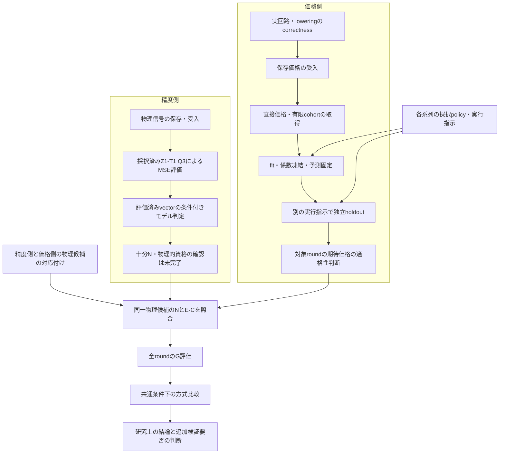

# 統合研究ロードマップ

Repository：`HIROMU1015/Partially-Randomized-Trotter`。最新確認：**2026-11-15 JST**（統合branchのremote HEAD `07a6e0095` を基点に、§10・§11の対象branch・固定REPORT/HANDOFFと、ユーザー確認済みの指示送付状況を照合。§9の別系列は今回更新していない）。

この文書は、研究の目的・現在地・不足している証拠・次の進行順序を一か所で把握するための入口である。科学的な結果・SOURCE・検証内容の正本は、リンク先の個別REPORTである。本書は新しい科学計算・数値再解析・採択を含まない。

## 0. 現在地サマリー

**研究全体**
- 研究は「リソース評価」と「アルゴリズム改善」の二系列からなる（§2）。
- リソース評価は、固定された有限taskでの資源地図（H4/H6/H8、DF/Pauli、有限時間）までは多くの証拠がある。一方、**RPE全roundの総資源を共通条件で方式比較した結果は、まだ一つも確定していない**。
- 現在の作業の中心は、H4（DF10）でのRPE全13roundの総資源 G の比較である（§3）。5方式（PR-DF、PR-Pauli、Full PF、Truncated PF、Full-H pure RTE）を対象に、精度側（信号→推定器→MSE→N）と価格側（実回路→直接価格→価格モデル→E[C]）を別々に積み上げている。

**確認済みの進捗と採択**
- 主精度評価は、**Z1＋T1 total decoderによる保存DF10 solver energy proxyへのQ3直接モデルMSE**を採択済み。保存ideal finite-K raw・IID二項モデルを前提とし、閾値は $\tau=(0.00159360010199040\,\mathrm{Ha})^2$（§3）。旧REPORTの「未採択」は当時の履歴である。
- A：Full PFとB0I p7の各3候補は、保存30 round再利用＋新規48 roundで各13round完成。B intakeも6/6 PASS（[REPORT][A_PF_COMPLETE]）。B：この6候補を共通固定shot vectorで各1回評価し、保存DP結果では6/6がモデル閾値適合。**保存componentから科学的再計算なしで判定を復元、実行記録は部分保存**（[REPORT][B_PF_FIXED]）。Pauli LD1/LD2の3/4配分2件の適合は別成果（[REPORT][B_PAULI_3Q]）。
- D：決定論PF Stage 1の新規20/20 compile PASS、新規20価格はC guard受理済み。保存4価格と合わせ、12 model_groupのm4・m5に対応する24較正価格が揃った（[HANDOFF][D_STAGE1]）。C：候補対応表（5方式・14 schedule・364軸）に加え、今回より新しい[固定REPORT][C_FREEZE] `f0fc05646` で12/12モデルのfit・係数凍結・m6予測固定とD向け引渡し資料の公開を確認した。

**最も重要な未解決事項と現在の依存関係**
1. **物理的に十分なN、global RMSE保証は未確定。** 上記の固定配分での条件付きモデル閾値適合を、十分N・最適Nや物理保証に昇格させない。BのPF評価の最終API return・CPU・peak RAMは欠測であり、それを埋める再実行を残作業にはしない。
2. **全13roundで資格のあるE[C]は、どの方式にも揃っていない。** 決定論PFはCの12モデル・m6予測が[結果commit `12372fa6b`][C_FROZEN_MODELS]で凍結済み。次はDによる固定結果の受領確認 → 別の実行指示でm6独立holdout 12件の取得・判定。観測価格を分母とする相対誤差2%以内、全12モデルの個別PASSがcampaign成功条件である。C側での既存D reader読取PASSと、D担当の受領・科学実行は区別する。
3. Full-H D7は初回18予定・実行0で科学実行前STOP。限定修正・同条件の較正再開指示は送付済み。後続固定SOURCE `d323fee1c` で修正・人工確認まで公開されたが、較正再開・価格取得の成果報告は未受領（[初回STOP][D1_STOP]、[修正SOURCE準備][D1_RESUME]）。決定論PFとは独立に、D7較正 → Cの3係数fit・凍結 → 別指示のholdout 6 compileと進む。
4. PR-Pauli LD2 B1-Wはm0の1 path・X/Y各1 compileとC guard接続まで完了しSTOP。期待価格・統計区間は未確定、order2 product・非自明位相の実LD2観測はUNKNOWN。B1-V/CALは未実行で、CAL移行は別判断（[REPORT][D2_W]）。PR-DF等の新しい科学結果は今回取得・推定していない。

**G・winner はすべての方式で未確定（null）である。**

## 1. 文書の役割

| 文書 | 役割 |
|---|---|
| 本書（RESEARCH_ROADMAP.md） | 研究目的・進捗・不足・依存関係・次の手順 |
| [PROJECT_MAP.md][MAP] | 実装・研究資料・成果物への入口 |
| [RESEARCH_RESULTS_INDEX.md][INDEX] | 過去の研究系列と原結果への索引 |
| [VALIDATION_STATUS.md][VS] | 検証結果の状態と利用制約（このcheckoutに登録された範囲） |
| 個別REPORT | 科学的結果・SOURCE・検証内容の正本 |

**読むときの注意**
- `main`（`546bca7ed`、2026-11-04）は11月5日以降の成果を含まない。それ以降の成果は各研究branchにあり、本書は固定commitのURLで参照する。
- リンク先の「現在」「次段階」は、その報告の作成時点の記述である。最新の状態は本書の§5・§10と、そこから辿る最新報告で確認する。
- 本書の数値は元報告からの転記であり、条件は必ずリンク先で確認する。

## 2. 研究全体の目的と構造

**全体の目的**：Hamiltonianの一部を決定論的な積公式（PF）で、残りを有限のランダム化Taylor展開（RTE）で実装する部分ランダム化（PR）について、同じ精度・成功条件の位相／エネルギー推定を、どの条件でどれだけ安く実行できるかを明らかにする。単回の回路の短さではなく、PFのbias、finite-RTEのbias、normalizationによる減衰、必要shot数、全roundの回路価格を接続して評価する（[研究目的][GOAL]、[方法][METHOD]）。

### 2.1 研究の階層

```text
研究全体（repository）
├─ リソース評価
│   ├─ 有限時間の資源地図：H4/H6/H8 DF、Pauli-JW、長時間B2/B3（〜11/02）
│   ├─ RPE全roundの総資源：H4 DF10の5方式比較（11/10〜、現在の中心）
│   └─ 一般性：H6/H8への条件移送（保存成果あり、現比較とは別契約）
└─ アルゴリズム改善
    ├─ return集約・sampling・推定器（Track B／O2）
    ├─ 表現・分割（元Track A／A-O1、研究C）
    ├─ Closed P3・共同選択（Track C／C-O3）
    ├─ Reference／control（Track D／D8）
    └─ 適応readout（新A）
```

- 11月1日時点の全体像は[科学的到達点と証拠の地図][LAND]と[主張・証拠・未解決課題の対応表][GAPS]にある。
- 11月10日時点の系列間の接続は[PR＋RPE共同最適化への統合調査][INTEG]と[対応表][INTEGM]にある。
- 本書はこれらを再利用し、11月10日以降の進展を加える。

### 2.2 同じ名前で別のものを指す語

| 名前 | 指すもの |
|---|---|
| 作業担当 A／B／C／D（11/13〜） | H4総資源比較の役割分担。A：物理信号・Full-H・Pauli設計。B：RPE推定器・MSE・必要N。C：価格・モデル・証拠受入。現在の価格担当はD：決定論PF、D1：Full-H、D2：PR-Pauliの独立系列として区別する |
| 旧Track A（〜10/26） | 既知PRの資源評価（リソース評価系列）。PR-2 M1/M2、H4/H6/H8、長時間B2/B3 |
| 元Track A／A-O1（11/06〜08） | アルゴリズム改善。辞書変更（O1-M1）、core＋residual（O1-M2）、B2-P1 |
| 新A | PR Reference／適応readout（V6、Q3、Q4） |
| Track B（B/O2） | return集約・局所生成・有限bit・sampling |
| 研究B／B2-D | D内部PF・outer分割。Track Bとは別 |
| Track C（C-O3） | Closed P3、joint basis、h／resolution／αの共同選択 |
| 研究C（RC） | Hamiltonian表現・PR-aware DF（CDF、ENTRY）。Track Cとは別 |
| Track D（D8） | Reference／control。固定CDF8条件の13round条件付き会計 |
| 方式名 B0／B0I／B2／B3 | DFの方式ラベル（下表）。作業担当Bとは無関係 |

| 方式ラベル | 内容 |
|---|---|
| Full PF | 一体項と全DF fragmentを決定論PFで保持 |
| B0／B0I（Truncated PF） | prefixを保持し、tailを捨てる。B0Iは捨てたtailのidentity成分をscalarへ一回戻す |
| B2（PR-DF） | 一体項＋非空prefixを保持し、tailをfinite RTEで補う |
| B3 | 二体prefix 0。一体項は保持する。全Hの純RTEではない |
| PR-Pauli（DF head＋Pauli tail） | DF prefixを保持し、tailをPauli辞書のRTEで補う |
| Full-H pure RTE | 一体項を含む全Hをランダム化する。B3とは別方式 |

## 3. H4リソース評価の最終目的

### 3.1 評価対象

状態準備を除いた、RPE全roundの総計算資源を評価する。

$$
G=\sum_{m=0}^{M}\sum_{a\in\{X,Y\}} N_{m,a}\,\mathbb E[C_{m,a}]
$$

- $N_{m,a}$：対象精度・推定器・誤差契約の下で使うshot数。
- $\mathbb E[C_{m,a}]$：対象lawに対する、1 shot当たりの測定付きfull Hadamard wrapperの期待compiled RZ数。制御付き時間発展、scalar（総時間に一回）、X/Yの基底変換、測定を含む。
- 古典の価格標本数 n と normalization B は、N や C に重ねて掛けない。

**現行の検証で共通に使っている条件**（物理条件の出所は[4方式menu][MENU4]・[ベースライン設計][BASEOPT]。主精度評価の現在の採択状態は、ユーザー確認と[Bの固定REPORT][B_PF_FIXED]・[Pauli REPORT][B_PAULI_3Q]による。全候補集合・最終比較policyの採択とは区別する）

| 項目 | 内容 |
|---|---|
| 系 | Linear H4、1.00 Å、STO-3G、保存tol-only 1e−8 DF10（weighted-Hermitian completion）、sector (2,2)・36次元 |
| target | 保存DF10 full DF-Hのsolver energy proxy。厳密ground energyの包含・state誤差は未認証。DF前のHamiltonianへは変更しない |
| RPE | h=0.1、M=12（13 round、$T_m=h\,2^m$）、状態準備費 P=0 |
| 採択済み主精度評価 | Z1＋T1 total decoderのQ3直接モデルMSE。保存ideal finite-K raw・IID二項モデル、閾値 $\tau=(0.00159360010199040\,\mathrm{Ha})^2$。物理的なglobal RMSE保証とは別 |
| compiler | Qiskit 1.3.0、basis rz/sx/x/cx、opt1、seed17。lowering IDも価格の条件として一致させる |

### 3.2 比較方式：正式採択と検証用shortlistの区別

| 区分 | 内容 |
|---|---|
| 方式の集合 | PR-DF、PR-Pauli、Full PF、Truncated PF、Full-H pure RTE。作業はこの5方式で進んでいる |
| 候補（schedule）の集合 | **正式採択された候補集合はない。** 11/13の11 schedule案は提案であり、最適候補群でもない（[4方式menu][MENU4]） |
| 現在の検証用候補 | Cの5方式・14 schedule・364軸の[固定対応表][C_ALIGNMENT]と§5。対応表完成は、最終候補選定や適格N・E[C]の完成を意味しない |
| 価格のshortlist（決定論PF） | S2・幅16h/7、Y4・幅16h/3、M5・幅16h（[D 保存4件binding][D_SAVED4]）。Full PFの局所予算内候補（[A追加5点][A_FPF_FU]）に基づく検証用の集合 |

### 3.3 二つの比較水準

| 水準 | N の意味 | 現状 |
|---|---|---|
| 第1水準 $G_{\mathrm{paper}}$ | 原論文型のnominal shot数 $\lceil B_m^2[11+4(M-m)]\rceil$。経験的な名目値で、精度の保証ではない | 会計の実装は人工値でPASS（[C 価格経路][C_ROUTES]）。実データでの計算は0件 |
| 第2水準 $G_{\mathrm{qualified}}$ | 採択した精度条件の下で根拠のあるshot数 | 主精度のQ3直接モデルMSEは採択済み。PF6候補・Pauli3/4配分2件の条件付き適合はあるが、物理的に十分なN・global RMSE・正式Gは未確定 |

**nominal N を十分 N として扱わない。** 両水準の出力は別fieldで管理されている。

## 4. 研究課題と実装・検証の対応

実装pathは、併記した固定commitに存在することを確認した。`main` には無いものが多い。

### 4.1 量子回路実装（実回路・loweringのcorrectness）

| 項目 | 内容 |
|---|---|
| 研究上の問い | 価格を測る回路が、意図した制御付き時間発展・scalar一回・X/Y測定を正しく実装しているか |
| 実装 | D `acea1118a`：`src/trottertracks/pauli_tail_price_connection.py`、`scripts/run_full_pf_shortlist_prices.py`、`scripts/run_truncated_p7_prices.py`、`scripts/run_pauli_ld1_m0_pilot.py`。A `7a0c9468b`：`scripts/run_full_h_kappa2_p1.py`。新ZZ lowering：`26d4f23e7`の`src/trottertracks/efficient_controlled_zz.py` |
| 検証 | [Full-H P-1再検証][A_P1]（ancilla命令列の完全一致など23条件）、[Pauli B0 run02][A_B0]（固定の実H4数値gate）、[p7保存回路のX/Y識別][C_ADM]（保存QPYのfingerprint）、[PR-DF P2 direct pilot][D_P2] |
| 到達点 | PR-DF：LD1 m0/m6。PR-Pauli：LD1 m0に加え、LD2 m0のB1-W 1 pathでcorrectness gate・X/Y compile・SOURCE束縛C guard PASS（[D2][D2_W]）。Full-H：κ2 m3。決定論PF：Stage 1の新規20 wrapperもPASS（[D][D_STAGE1_REPORT]） |
| 科学的資格 | 検査したpath・cellに限った配線の証拠。価格の期待値や他roundの正しさは示さない |
| 不足 | PR-Pauli LD2のorder2 product・非自明event位相は未観測UNKNOWN。長いroundの直接検査・モデル外挿資格は未確定 |
| 次の作業 | B1-Wを追加取得せず保全。B1-V/CALへの移行は別判断。観測pathのPASSを未観測eventへ一般化しない |
| 担当・依存 | D（決定論PF）、D1（Full-H）、D2（Pauli）の取得系列、A（設計・検証）、C（guard受入）を区別する |
| 完了条件 | 価格を使う全ての回路族について、少なくとも代表cellの配線証拠がある |

### 4.2 物理信号

| 項目 | 内容 |
|---|---|
| 研究上の問い | 各方式・各roundの平均信号（raw、補正後、normalization）は何か |
| 実装 | A `714247619`：`src/trottertracks/pr_rpe_signal_provider.py`、`df_head_pauli_tail_p0.py`／`_p1.py`／`_completion.py`、`pf_effective_hamiltonian.py`、`scripts/run_h4_full_pf_heff_scan.py`。A `7a0c9468b`：`baseline_signal_pipeline.py`、`baseline_signal_numerics.py`、`scripts/run_truncated_fullh_signals.py`、`scripts/run_full_h_kappa2_signals.py` |
| 検証 | [PR-DF 26round][A_PRDF]、[PR-Pauli 26round][A_PAULI]、[B0I p7・Full-H R448 各13round][A_TRSIG]、[Full-H κ2 13round][A_S1]、[Full PF H_eff格子][A_FPF_SCAN]・[追加5点][A_FPF_FU]、[Truncated T1][T1]・[T2][T2]、[決定論PF shortlist6候補完成][A_PF_COMPLETE] |
| 到達点 | 上記の既存packetを保全。加えてFull PF・B0I p7の各3候補が各13round完成（保存30再利用、新規48 PASS）、B intake6/6 PASS。[科学SOURCE][A_PF_SOURCE] `fb9a1878b`、[raw carrier][A_PF_RAW] `06a15ee45`、[packet索引][A_PF_PACKETS]と[HANDOFF][A_PF_HANDOFF]を参照 |
| 科学的資格 | 保存した数値stateとideal finite-K lawに条件付いた解析的平均。基底状態の認証と、実samplerのlawへの移送は未取得 |
| 不足 | 今回のshortlist6候補について信号不足・B受入待ちは解消。補助候補Full PF S2・幅0.1の未完備状態は別候補として維持する |
| 次の作業 | 完成packetを再利用する。Aの取得作業はmandatory STOP。追加meanの取得をこの文書から指示しない |
| 担当・依存 | A（信号）、C（baseline metadata）、B（受入） |
| 完了条件 | 比較に使う各物理候補について、全13roundの信号packetがSOURCE付きで受入済みである |

### 4.3 誤差評価（推定器・MSE）

| 項目 | 内容 |
|---|---|
| 研究上の問い | 与えたshot配分の下で、エネルギー推定の誤差（MSE）はどこまで抑えられるか |
| 実装 | B `999304918`：`src/trottertracks/rpe_total_decoder.py`、`rpe_total_risk.py`、`rpe_deterministic_risk.py`、`rpe_total_binding.py`、`rpe_c_interfaces.py`、`pr_rpe_rmse_controller.py`。test：`tests/check_rpe_total_decoder_risk.py` |
| 検証 | [精度契約W0][B_W0]、[Z1＋T1/Q3][B_Z1]、[PR-DF旧部分decoder DP][B_DP]、[Pauli元control2評価][B_Q3]、[Pauli3/4配分2評価][B_PAULI_3Q]、[決定論PF固定shot6評価][B_PF_FIXED] |
| 到達点 | Full PF/B0I p7の各3候補は、両軸共通 `[59,55,51,47,43,39,35,31,27,23,19,15,11]` で各1回評価し、保存DP上界6/6が採択閾値以下。保存componentから科学的再計算なしで判定を復元、実行記録は部分保存。最終API return・CPU・peak RAMは欠測。Pauli LD1/LD2の3/4配分2件も閾値適合し、元controlの2件とは別成果 |
| 科学的資格 | 採択済みQ3直接モデルMSEでの条件付き適合。保存solver proxy・ideal raw・IID・未認証allowanceの範囲に限る。物理的な精度保証・十分Nではない。PFの科学worker完了とdriver記録UNKNOWNを区別する |
| 不足 | 物理的な資格・必要N最適化は未完了。PR-DFのtotal metadata bridgeは[C対応表][C_ALIGNMENT]で確認済みだが新total MSEは未評価。Full-Hもmetadata接続からの新MSEは未報告 |
| 次の作業 | [B HANDOFF][B_PF_HANDOFF]の保存結果を再利用する。API/資源記録の欠測を埋める再実行は要求しない。追加vector・他方式の評価は別判断・別実行指示 |
| 担当・依存 | B。信号（§4.2）に依存 |
| 完了条件 | 採択した契約の下で、比較する全候補のMSE評価が同じclaim水準で揃う |

### 4.4 必要shot数 N

| 項目 | 内容 |
|---|---|
| 研究上の問い | 目標精度を満たすために、各round・各軸で何shot必要か |
| 実装 | B `999304918`：`src/trottertracks/rpe_shot_allocation.py`、`pr_rpe_rmse.py`（nominal）、`rpe_total_binding.py`の`evaluate`入口。C `855573064`：`paper_nominal_cost.py`の`nominal_packet` |
| 検証 | 旧[有限計画][B_NPLAN]・[準備報告][B_N]を履歴として保持。完了成果は[Pauli3/4配分][B_PAULI_3Q]と[PF6候補の固定shot評価][B_PF_FIXED] |
| 到達点 | Pauli3/4 vector `[48,45,42,39,36,33,29,26,23,19,16,13,9]` の2件と、§4.3のPF共通vector6件で条件付きモデル閾値適合。USER_SUPPLIED controlであり、十分N・最適Nではない。`sufficient_N`は全方式でnull |
| 科学的資格 | 評価済み配分の条件付きモデル閾値適合のみ。物理的に十分なN・global RMSE保証は未資格 |
| 不足 | 未評価vectorへの補間、最小N、cost-aware配分、物理的誤差・law移送の資格。旧有限計画全体が実行済みになったわけではない |
| 次の作業 | Bはmandatory STOP。追加の有限配分検証が必要か、どの範囲かは別判断。完了した2件・6件を再実行しない |
| 担当・依存 | B。§4.3に依存。価格とは独立に進められる |
| 完了条件 | 各候補について、採択した契約で閾値を満たすwhole-vectorが、根拠とともに保存される |

### 4.5 compiled価格（直接価格・有限cohort）

| 項目 | 内容 |
|---|---|
| 研究上の問い | 各round・各軸の回路を実際にcompileしたときのRZ数はいくつか |
| 実装 | D `acea1118a`（実装SOURCEは`22ccf3972`）：§4.1のcaller。C `855573064`：`src/trottertracks/price_implementation_guard.py`、`rpe_d_price_connection.py`、`rpe_optimization_pipeline.py`（`price_context`） |
| 検証 | [Full PF保存価格の受入][C_FULLADM]、[p7保存価格の受入][C_ADM]、[D 保存4件binding][D_SAVED4]、[Full-H P-1][A_P1]、[Pauli B0][A_B0]、[PR-DF coverage][C_PRDFCOV] |
| 到達点 | 決定論PF：保存4＋新規20＝m4/m5の24較正価格、12 model_groupが完成。新規20/20 compile PASS・C guard受理（[D][D_STAGE1]）。Pauli LD2 B1-Wはm0の1 pathをX/Y個別compileし、各RZ 2,236・CX 960・depth 1,416（[D2][D2_W]）。Full-H κ2 m3・Pauli LD1 m0・PR-DF LD1 m0/m6の従来証拠は保全 |
| 科学的資格 | 決定論PFは較正用の直接価格。RTE系は有限path観測でありlaw期待値ではない。LD2 Wの期待価格・統計区間は未確定 |
| 不足 | 決定論PF m6独立holdout 12件。Full-H D7較正18件の取得結果。PR-Pauli B1-V/CAL。PR-DFの既存価格coverageの不足は変わらない |
| 次の作業 | Cが12モデルとm6予測を固定 → Dが固定結果を受領 → 別の実行指示でDがm6独立holdout12件を取得・判定 |
| 担当・依存 | 決定論PFはD（Stage 1完了・STOP、次は凍結成果受領）とC（12モデル凍結・HANDOFF公開済み・STOP）。D1のFull-H、D2のPauliとは独立 |
| 完了条件 | 価格モデルの較正とholdoutに必要なcellが、受入検査を通って揃う |

### 4.6 期待価格モデル（E[C]）

| 項目 | 内容 |
|---|---|
| 研究上の問い | 直接compileできない長いroundを含めて、全roundの期待価格をどの根拠で与えるか |
| 実装 | C `855573064`：`src/trottertracks/price_model_validation.py`（fit・holdout・refitなし）、`rpe_mean_price_model.py`（構造＋残差）。A `7a0c9468b`：`finite_price_design.py`（取得前の識別可能性検査） |
| 検証 | [価格検証計画][C_PVPLAN]、[CELL_PLAN_V2][C_CELLPLAN]、[PR-DF検証計画][C_PRDFPLAN]、[Full-H P-2・Pauli B1設計][A_DESIGN]、[PR-DF構造期待値][C_ES] |
| 到達点 | 決定論PF：24較正価格から12/12個別fit・係数とm6予測凍結が完了（[C][C_FREEZE]）。科学SOURCE `79c951b38`、凍結結果 `12372fa6b`、[D向けHANDOFF][C_FREEZE_HANDOFF]公開済み。PR-DFのE[S]26軸は従来の構造証拠。Full-HはD7 rank3を採択済みだが、初回STOP後の修正SOURCE準備までで較正価格成果は未受領 |
| 科学的資格 | 資格のあるE[C]は全方式で0件。E[S]は構造期待値であり、E[C]ではない。有限cohort平均もE[C]ではない |
| 不足 | 決定論PF：独立holdout。凍結済み12モデルは `CALIBRATED_UNVALIDATED / qualified_for_candidate=false`、m7〜m12外挿資格なし。H-bは観測価格分母の相対誤差2%以内・12モデル個別全PASSを採択済み。RTE系の境界加法性、law差、低頻度event寄与、外挿資格は未解決で、決定論PFの2%規則を自動流用しない |
| 次の作業 | 決定論PF：DがCの凍結成果を受領 → 別指示でD holdout。Cによる固定D readerの技術読取PASSはD担当の受領確認とは別。Full-H：限定修正SOURCE → D1 D7較正 → Cの3係数fit・凍結 → 別指示でholdout6 compile。Pauli CALは別判断 |
| 担当・依存 | C（モデル・判定）、D/D1/D2（各独立系列の取得）、A（RTE系の設計）。§4.5に依存 |
| 完了条件 | 事前に宣言した許容差でholdoutを通過し、使用するroundの範囲での適格性が判断されている |

### 4.7 総資源会計（G）

| 項目 | 内容 |
|---|---|
| 研究上の問い | 同じ物理候補のNとE[C]を掛け合わせた全roundの総資源はいくつか。方式間の関係はどうか |
| 実装 | C `855573064`：`src/trottertracks/paper_nominal_cost.py`（第1水準）、`rpe_optimization_pipeline.py`（`plan`／`compare`／`select`）。B `999304918`：`pr_rpe_rmse_controller.py`（`assess`／`cost`／`select`） |
| 検証 | [C 価格経路][C_ROUTES]、[Pauli physical-ID bridge][C_BRIDGE]（人工値のテスト）、[B total/Q3 canonical統合][B_TOTAL] |
| 到達点 | 会計・guard・欠測の扱いは人工のN・価格でPASS。実データのG計算は0件 |
| 科学的資格 | なし。人工テストのPASSは科学的な比較結果ではない |
| 不足 | §4.4のNと§4.6のE[C]。同一候補の照合。比較policy |
| 次の作業 | §8の統合段階。上流が揃うまで着手しない |
| 担当・依存 | B・C。全項目に依存 |
| 完了条件 | 全方式について、同じclaim水準のNとE[C]から、欠測なしでGが計算される |

## 5. 物理候補ごとの進捗

**方式が同じでも、物理候補（prefix、公式、時間幅、K、κ、round、law、SOURCE）が違えば別の行である。** 別の行の N と E[C] を掛け合わせて G を作ってはならない。

状態の語は§6の区分を使う。IDは先頭8桁の略記で、全桁はリンク先にある。

| 物理候補 | 信号 | 推定器・MSE | 必要N | 実compiled価格 | E[C] | G |
|---|---|---|---|---|---|---|
| **PR-DF** LD1（`a4dda8f7`）／LD2（`1fa33556`）。S2、幅0.1、K2、元κ | 数値保存：各13round（[報告][A_PRDF]） | 旧部分decoder契約のDP上界を保存（[報告][B_DP]）。[C対応表][C_ALIGNMENT]では旧gridを保つtotal metadata bridgeを確認済みだが、新total MSEは未評価。今回新しい科学結果はない | 未資格 | LD1のm0・m6だけ有限cohort（P1 n2、P2 fresh n4。新ZZ）。他round・LD2は調査範囲で欠測（[coverage][C_PRDFCOV]） | 未資格。LD1のE[S] 26軸は構造期待値 | 未確定 |
| **PR-Pauli** LD1（`d905d219`）／LD2（`d7dd4f52`）。DF head＋Pauli tail、S2、幅0.1、K2、元κ | 数値保存：各13round（[報告][A_PAULI]） | 元controlの2評価（[報告][B_Q3]）を保全。別成果として3/4配分でLD1/LD2各1回、2/2が採択Q3モデル閾値適合（[B][B_PAULI_3Q]） | 条件付き適合vectorあり。十分N・最適N・物理保証は未資格 | LD1 m0のB0に加え、LD2 m0 B1-Wの1 path・X/Y各RZ 2,236、CX 960、depth 1,416。gate・SOURCE束縛guard PASS（[D2][D2_W]） | 未資格、期待価格・統計区間は未確定。Wは有限1 path。order0成分34/40のみ観測、order2 product・非自明位相はUNKNOWN。V/CAL未実行 | 未確定 |
| **Full PF** S2・幅0.1（prefix10） | H_effのm0・m12のみ。全13round packetは未同定（[適用一覧][B_SIGAPP]） | 人工13roundで経路のみ確認 | 未資格 | 旧catalogに直接価格があるが、13roundのscheduleの大半は保存gridの外（[4方式menu][MENU4]） | 未資格 | 未確定 |
| **Full PF** shortlist：S2・幅16h/7、Y4・幅16h/3、M5・幅16h | 3候補各13round完成、B intake PASS（[A][A_PF_COMPLETE]） | 共通固定shotで各1回。3/3の保存DP上界が採択閾値以下（[B][B_PF_FIXED]）。最終API return・CPU・peak RAM欠測、保存componentから再計算なしで判定復元 | 条件付き適合のみ。十分N・最適Nは未資格 | Stage 1完了、各公式・X/Yのm4/m5較正価格を保存・guard受理。保存M5/m4も再利用（[D][D_STAGE1]） | 各公式X/Yの係数・m6予測は[Cで凍結済み][C_FREEZE]。独立holdout未評価、全round E[C]未資格 | 未確定 |
| **Truncated PF** B0I p7、S2・幅0.1（`e6754564`） | 数値保存：13round（[報告][A_TRSIG]）。[T2][T2]の照合も通過 | metadata接続PASS（[適用一覧][B_SIGAPP]） | 未資格 | m3/m4の旧価格locatorは存在するが、現行wrapper receiptとして未受入（[C対応表][C_ALIGNMENT]）。shortlistとは別候補 | 未資格 | 未確定 |
| **Truncated PF** B0I p7 shortlist：S2・幅16h/7、Y4・幅16h/3、M5・幅16h | 3候補各13round完成、B intake PASS（[A][A_PF_COMPLETE]） | Fullと同じ固定shotで各1回。3/3の保存DP上界が閾値以下（[B][B_PF_FIXED]）。実行記録の部分保存はFullと同じ | 条件付き適合のみ。十分N・最適Nは未資格 | Stage 1完了、各公式・X/Yのm4/m5較正価格を保存・guard受理。保存M5/m4も再利用（[D][D_STAGE1]） | Fullと合わせた12個別モデルが[Cで凍結済み][C_FREEZE]。独立holdout未評価、全round E[C]未資格 | 未確定 |
| **Full-H pure RTE** κ2、K2、q=2^m（`54ac3eb3`） | 数値保存：13round（[S-1][A_S1]） | metadata接続PASS、新MSE評価は未報告 | 未資格 | m3（q8、R71）の単一path（[P-1][A_P1]）を保全。D7較正は初回18予定・実行0でSTOP（[D1][D1_STOP]）、後続修正SOURCE公開済みだが取得成果未受領 | 未資格。D7 rank3は確認済み。較正 → Cの3係数fit・凍結 → 別指示のholdout6 compileが未完了（[準備][D1_RESUME]） | 未確定 |
| **Full-H pure RTE** R448、K2、q=2^m（`cfa6aee3`） | 数値保存：13round（[報告][A_TRSIG]） | [C対応表][C_ALIGNMENT]で独立total metadata受入を確認。新MSE/Nは未評価 | 未資格 | 確認した範囲で無し | 未資格 | 未確定 |

**候補対応で解消した点と残る不足**
- **決定論PF shortlist6候補**：同じ物理候補の信号・B受入・固定配分Q3評価・m4/m5較正価格が揃った。信号不足とB受入待ちは解消済み（[A→C/D][A_PF_HANDOFF]、[B→C][B_PF_HANDOFF]、[D→C][D_STAGE1]）。全round E[C]・十分N・Gの資格は別である。
- **S2・幅0.1の補助候補**：shortlistへ全scheduleを流用しない。C対応表の旧locator・受入不足はその候補の状態として保持する。
- **Full-H**：κ2とR448は、R・event数・normalizer・rawが別物である。κ2の価格をR448へ、またはその逆へ使わない。
- **PR-DFとPR-Pauli**：tailの表現とlawが違う。DF tailのE[S]や旧C1価格をPauliへ使わない。
- 推定器の版が変わると、canonical IDが変わる。価格の再束縛には版付きのbridgeが必要である（[bridge仕様][C_BRIDGE]）。

round×X/Y×cohortの候補対応は[Cの14 schedule・364軸][C_ALIGNMENT]、完成信号は[Aのpacket索引][A_PF_PACKETS]、PFの固定配分結果は[B HANDOFF][B_PF_HANDOFF]、24較正価格は[D HANDOFF][D_STAGE1]にある。旧[CELL_PLAN_V2][C_CELLPLAN]（決定論PFの36価格＝較正24＋holdout12）の計画と、[PR_DF_COVERAGE][C_PRDFCSV]（52軸）は保持し、計画行を取得済みと数えない。

## 6. 証拠の状態の区分

| 区分 | 意味 | 例 |
|---|---|---|
| 実装済み | コードがある | 第1水準の会計 |
| 人工・回帰テストPASS | 架空の入力で動作を確認した | guard、bridge、価格モデルの検査 |
| 実物理条件での検証PASS | 実H4の回路・数値でgateを通過した | P-1再検証、Pauli B0 |
| 科学的数値結果の保存あり | 承認された実行の結果が固定SOURCE付きで保存されている | 各方式の13round信号、Pauli Q3の2評価 |
| 特定条件下で利用可能 | 明示された条件の範囲で使える | 決定論PFの24較正価格、評価済みvectorでの条件付きモデル閾値適合 |
| 最終比較へは未資格 | 値はあるが、最終比較に必要な資格が無い | 単一path価格、E[S]、control vectorでのMSE |
| 調査済み範囲では欠測 | 確認した範囲に記録が無い | PR-DF LD2の価格 |
| 原本・同等性が未確認 | あるかどうか、同じ条件かどうかを判断できていない | 補助候補の旧価格locatorと現行wrapper receiptの対応 |
| 科学結果保存・実行記録部分保存 | 保存componentで科学的判定を確認できるが、完全な実行記録はない | PF固定shot6件。最終API return・CPU・peak RAM欠測を併記し、再実行しない |
| 指示送付済み・完了未確認 | ユーザーが依頼済みでも、実行や成果受領を推定しない | D1は修正SOURCE準備のみ公開、較正取得成果未受領。Cの12モデル固定は後続固定REPORTで完了確認済み |
| モデル凍結済み・独立検証待ち | 較正から係数・予測を固定したが、予測精度を独立検証していない | Cの12モデルはCALIBRATED_UNVALIDATED。較正残差0をholdout PASSとしない |
| STOP中 | 個別契約のmandatory STOPを保全する | A信号完成、B固定配分評価、D Stage 1、D2 B1-W。D1初回STOPと後続再開指示は区別する |
| 次段階の別判断・実行指示待ち | 今回の完了・指示では範囲に含まれない | 凍結後のD m6 holdout、Full-H holdout、Pauli V/CAL |

**区別を保つ点**
- 人工テストのPASSは、科学的な検証の完了ではない。
- **有限cohortの平均、構造期待値 E[S]、compiled期待価格 E[C] は別の量である。**
- 単一pathの観測を、lawの期待値として扱わない。
- 旧SOURCEの科学的資格を、新SOURCEへ自動で移さない。
- 「確認した範囲で未同定」は「未実施」ではない。
- D2の過去の[SCOPE_DEVIATION.md][D2_SCOPE]に記録された範囲外数値検査は保全し、今回のB1-Wの科学的証拠・資格には採用しない。観測pathのgate PASSと、その過去記録を混同しない。

## 7. 未解決課題と、解くと何が判断できるか

| 課題 | 種別 | 解決すると判断できること | 重複照合（§10.5）の状況 |
|---|---|---|---|
| 最終5方式比較のclaim水準・未採択policy | 方針・契約の採択 | 条件付きモデル結果と正式Gの主張範囲が決まる | Q3主精度と決定論PF H-bは採択済み。RTE系へ条件を自動移送しない |
| 決定論PFの凍結成果受領と独立検証 | Cの12モデル・m6予測固定は完了、次はDの受領確認 | 凍結済み予測で独立holdoutへ進めるか | [結果 `12372fa6b`][C_FROZEN_MODELS]と[HANDOFF][C_FREEZE_HANDOFF]を使用。fit・較正compileの再実行は不要 |
| Dのm6独立holdout 12件 | 凍結後、別の実行指示によるcompile・判定 | 観測価格分母の相対誤差2%以内を全12モデル個別で満たすか。m7以降の外挿資格は別 | m6は未取得。較正には使用しない。FAIL時の自動refitなし |
| 同一候補の条件付きモデル結果・適格価格の接続 | 既存成果の照合、必要な科学資格の確認 | 将来どの候補で正式Gを構成できるか | [C対応表][C_ALIGNMENT]とA/Bの完成成果で候補対応は解消。十分N・全round E[C]は未資格 |
| PR-DFのtotal MSE | 新しい数値評価には別指示が必要 | 旧partial結果と区別して採択Q3で判定できるか | C対応表で旧gridを保つmetadata bridgeを確認。保存13rawを再利用し、新total科学評価は未報告 |
| PR-DFのE[C] | compile＋モデル較正＋holdout | PR-DFを比較に載せられるか | E[S]・P1・P2・旧C1の役割と範囲を保全（[C][C_ADM]） |
| Full-H D7の較正取得と3係数モデル | 限定修正・同条件最大18 compileの再開指示済み。修正SOURCE公開、取得成果未受領 | rank3のモデルを較正・凍結し、別指示のholdout6 compileへ進めるか | [初回STOP][D1_STOP]を保存。後続[修正SOURCE準備][D1_RESUME]を別に参照。旧P-1価格は較正へ転用しない |
| PR-Pauli B1-V/CALと未観測event | 次段階の別判断 | order2/非自明位相の実LD2観測、価格の変動・全roundモデルの資格 | [B1-W][D2_W]の1 pathを元cohortのまま保全。独立標本や期待価格へ昇格しない。CAL移行は別判断 |
| 物理的に十分なN・追加有限配分の要否 | 科学的資格・範囲の別判断 | 条件付き適合を超えて何を主張できるか | PF6候補とPauli3/4配分2件は完了・再利用。Bの記録欠測を埋める再実行は不要 |
| 基底状態の認証、sampler lawの移送、数値certificate | 独立検証。claim水準による | 条件付き観測を超える主張ができるか | 必要性はclaim水準の採択で決まる |
| H6/H8への移送 | 将来の一般性検証 | H4の結論が他の系でも成り立つか | 今回のH4比較には不要。保存成果は§9.2 |

新しい科学計算・compile・実験を行う前には、共通運用指示§10.5の重複照合を行う。照合の完了は実行の許可ではない。

## 8. 依存関係と進行順序



**現在の位置**
- 精度側：Aの決定論PF6候補は全13round・B intake完了。採択Q3によるPF固定shot6件と、Pauli3/4配分2件の条件付き閾値適合が完了している。十分N・global RMSEは未確定。PFの最終API return・CPU・peak RAM欠測は保存componentの判定と分離し、再実行しない（[B][B_PF_HANDOFF]）。
- 決定論PF価格：D Stage 1完了・STOP → **Cの12モデルfit・係数凍結・m6予測固定は完了・STOP（結果 `12372fa6b`、報告 `f0fc05646`） → Dが固定結果を受領 → 別の実行指示でDがm6独立holdout12件を取得・判定**。C側の既存D reader確認はPASSだが、D担当の受領・実行確認ではない。観測価格分母で相対誤差2%以内、全12モデル個別PASSが成功条件（[C HANDOFF][C_FREEZE_HANDOFF]）。
- Full-H価格（D1）：**初回科学実行前STOPを保全 → 限定修正・再開指示送付済み → 修正SOURCE `d323fee1c` 公開・人工確認済み → D7較正（最大18 compile、再開・取得成果未受領） → Cの3係数fit・凍結 → 別指示でholdout6 compile**。修正準備の固定成果を、科学実行済みとは扱わない。
- PR-Pauli価格（D2）：LD2 B1-Wの1 pathは取得・SOURCE束縛guard完了、mandatory STOP。期待価格・統計区間、order2/非自明位相の実観測は未確定。V/CALへ自動進行しない。
- 統合：Cの5方式・14 schedule・364軸の候補対応は完成。Bの新しい固定配分成果とDの較正価格をSOURCE付きで参照できるが、正式G・winnerは未確定である。

**並列に進められる部分**
- 精度側と価格側は、互いの結果を待たずに進められる。
- 価格側の中では、決定論PF、PR-DF、PR-Pauli、Full-Hが互いに独立である。
- 精度側の中では、方式ごとのMSE評価が互いに独立である。
- Cの固定対応表とA/B/Dの後続成果のSOURCEを照合し、候補の取り違えと完了済み項目の重複取得を避ける。

**直列になる部分**
- 較正 → fit・係数凍結・予測固定 → 固定成果の受領 → 別指示でholdout。holdoutの値を見てからモデルを変えない。決定論PFとFull-Hは別の較正・モデル・実行指示である。
- 主精度契約の採択・評価済みvectorのモデル判定と、物理的に十分なN・最小N・未評価vectorの資格を分離する。

## 9. アルゴリズム改善系列とその他の資源評価

### 9.1 アルゴリズム改善系列

詳細は[11/01の全体地図][LAND]、[対応表][GAPS]、[11/10の統合調査][INTEG]にある。ここでは目的・到達点・残課題と、リソース評価への接続だけを示す。

| 系列 | 目的 | 主な到達点 | 残課題 | H4総資源比較への接続 |
|---|---|---|---|---|
| Track B／O2（return集約・sampling） | 同じ平均を安い回路・少ないshotで実現する | G6〜G10の構成、Closed P3/P5、固定syntheticでの資源交換、H4 C1の3方式1024path（[全体地図][LAND]§4）。11/08までのO2の成果は[O2統合][O2] | 独立した新規性と、認証N・native総資源での優位は未確立 | Closed P3はTrack Cへ接続済み。現在の5方式比較には入っていない |
| 元Track A／A-O1（表現・分割） | 辞書やcore＋residualで単価やλを下げる | O1-M1は単価低下を長roundの減衰が相殺する負結果。B2-P1は18roundの条件付きshot会計（[HP報告][A_HP]、[後続調査][ASURVEY]） | O1-M2のmodel適格性。H4のLD4〜7等は未実行 | PR-Pauliの[準備][A_PAULI_PREP]で、O1-M1とP3のSOURCEを照合している。旧結果の数値は現比較へ移していない |
| Track C／C-O3（Closed P3・共同選択） | h・resolution・α・整数shotを全roundで共同選択する | DF12・18roundで強Full／Truncatedと比較。最適化したClosed PRは強Fullより高価という結果（[共同選択][C_O3]、[統合報告][C_O3INT]） | 別条件（DF10、h=0.1、13round）への移送は未資格 | 強い決定論対照を落とさないという比較方針の根拠。数値順位は現比較へ混ぜない |
| Track D／D8（Reference／control） | whole-pathのReference構成でCX・depthを下げる | 固定CDF8条件で13roundの条件付き会計まで接続（[総計][D8_TOTAL]）。r16の有限価格校正（[報告][D8_R16]） | 絶対費用の大半が長qのproxy。全体CIとactual成功は未資格 | 測定同値性・十分shot・価格の三接続の型を再利用できる。A/F/S価格モデルは別条件へ移さない |
| 新A（適応readout） | 適応的な読み出しでshotを減らす | canonical条件で固定モデル内の保証と18roundのnative費用（[Q3][NEWA_Q3]）。Q4-1は実装と人工検証まで（[準備][NEWA_Q4]） | 強Full／Truncated／Closedへの公平な移送 | shot数の削減を直接扱う。現5方式のNには未接続 |
| 研究C（表現・PR-aware DF） | Hamiltonian表現を変えてλや誤差を下げる | CDF／ENTRYの3方式比較（[報告][RC]） | own-DFの結果を元Hのgroundへ移す根拠 | 未接続。target・stateの資格が先に必要 |
| C-α、閾値反射（元Track Aの後続） | gate lawの資格化、中心化による改善 | 固定gate lawで18roundの条件付きshot会計（[C-α][CALPHA]）。中心化は数学的な差を確認、総費用は未評価（[報告][THRESH]） | 全roundのcompiled期待価格 | 未接続 |

**接続できる可能性があることと、科学的資格を得て統合済みであることは別である。** 上表の「接続」は前者を述べている。異なる科学契約・STOPを統合していない。

### 9.2 H4以外・過去のリソース評価

| 対象 | 保存成果 | 現比較との関係 |
|---|---|---|
| 有限時間の資源地図（旧Track A、Pauli-JW、長時間B2/B3） | [全体地図][LAND]§2・§5 | 単一時刻の N×C。全RPEの比較ではない。決定論PFの保存4価格（`155529e20`）の出所でもある |
| H4 DF10の旧13round N、H4/H6のN/C coverage | [N batch][H4_NBATCH]、[coverage][H46_COV] | 旧契約の条件付きN。現在の比較のNへは流用しない（[4方式menu][MENU4]の方針） |
| H6 DF19のRPE m7信号と条件付きshot | [報告][H6_M7] | 一般性検証の入力候補。今回のH4比較には不要 |
| Full-H pure RTEのH4/H6/H8有限時間 | [T2最適化][FH_T2]、[H8][FH_H8] | 現κ2 scheduleの設計の出発点。旧loweringの価格は使わない |
| 実装監査・技術修正 | [repo全体監査][AUDIT] | 中核の物理・統計計算に、科学的結論を変える不具合は報告されていない。正式なG比較の前の注意点として、Full-Hの旧lowering価格とPRの新lowering価格を直接比べないこと、Gの大半を占めるm10〜m12の価格は直接測れない規模であることを挙げている |

## 10. 実験・研究計画の管理欄

**状態の読み方**：成果受領済みの範囲は固定REPORT/HANDOFFによる。主精度評価の採択、Cへのモデル固定指示、D1への限定修正・同条件再開指示の送付は、ユーザーが本更新指示で確認した状況である（2026-11-15）。その後、Cの新しい固定成果 `f0fc05646` を確認し、モデル固定は完了へ更新した。指示送付だけを実行・完了・成果受領とは数えない。旧REPORTの「次は承認待ち」は当時の記録として保全する。A・B・Cモデル固定・D Stage 1・D2 B1-Wの完了後STOP、D1初回STOPと後続の限定再開指示をそれぞれ区別する。

| 課題 | 担当 | 現在の状態 | 実施条件 | 完了時に得られる判断 |
|---|---|---|---|---|
| 決定論PF shortlist信号 | A、B intake | **成果受領済み、A mandatory STOP**。Full/p7各3候補、保存30再利用・新48 PASS、6×13round完成、B intake6/6 PASS（[A][A_PF_COMPLETE]） | 科学SOURCE `fb9a1878b`、carrier `06a15ee45`。旧S2L原本も保全 | shortlist6候補の信号不足・B受入待ちは解消。再取得不要 |
| 決定論PFの固定shot Q3評価 | B | **科学worker6/6各1回完了、保存DP6/6閾値適合、mandatory STOP**。保存componentから科学的再計算なしで判定を復元、実行記録は部分保存（[B][B_PF_FIXED]） | 共通vectorは§4.3。最終API return・CPU・peak RAMは欠測/UNKNOWN。完全なAPI実行PASSへ昇格しない | 固定配分の条件付きモデル適合。記録欠測を埋める科学再実行は残作業にしない |
| Pauli LD1/LD2の3/4配分 | B | **2件完了・閾値適合、mandatory STOP**（[B][B_PAULI_3Q]）。PF6件・元Pauli control2件とは別成果 | 採択Q3、全13round、§4.4の固定vector。十分N・最適Nではない | 当該2vectorの条件付き適合。追加探索は別判断 |
| 5方式の物理候補対応 | C | **成果受領済み**：14 schedule・364軸（[C][C_ALIGNMENT]）。A/B/Dの後続成果はその候補へ対応付けて参照する | 物理ID、元/total ID、round/軸、law、SOURCE、cohortを区別 | 対応表完成と適格N・E[C]・G完成を分離する |
| 決定論PFの新規較正20価格 | D | **Stage 1成果受領済み、mandatory STOP**。新20/20 compile PASS・C guard受理。保存4と合わせ24較正価格（[D][D_STAGE1]） | Full PF10＋B0I p7 10を新規取得。12 model_group各m4/m5。保存cohortの付け替えなし | 12モデルのfit入力が揃った。fit/凍結/holdoutはDでは未実行 |
| 12モデルのfit・係数凍結・m6予測固定 | C | **新しい固定成果を受領、12/12完了・mandatory STOP**（[REPORT `f0fc05646`][C_FREEZE]）。科学SOURCE `79c951b38`、結果 `12372fa6b`。保留group0、holdout未評価 | [Dの24価格][D_STAGE1]のみで個別fit。係数・m6予測と[HANDOFF_D][C_FREEZE_HANDOFF]を公開。C側の既存D reader技術確認PASS | 凍結待ちは解消。CALIBRATED_UNVALIDATED、qualified_for_candidate=falseを維持 |
| m6独立holdout12件と判定 | D | **D担当の凍結成果受領確認・別実行指示待ち、holdout未実行**。Stage 1のSTOPから自動再開しない | Cの固定結果 `12372fa6b` をDが受領 → 別指示。観測価格分母の相対誤差2%以内、全12モデル個別PASS。FAILでも自動refitしない | m6でのモデル適合。m7〜m12の外挿資格は別の判断 |
| PR-DF期待価格の資格付け | C、D | LD1のE[S] 26軸、m0・m6の少数path。資格付きE[C]は0／52軸（[C][C_ADM]） | [検証計画][C_PRDFPLAN]の採否。許容差。承認 | PR-DFのE[C]を比較に使えるか |
| PR-Pauli LD2 B1-W | D2、C guard | **成果受領済み、mandatory STOP**。m0 1 path、X/Y各RZ2,236・CX960・depth1,416。観測path gateと公開SOURCE束縛guard PASS（[D2][D2_W]、[HANDOFF][D2_HANDOFF]） | order0 component34/40のみ観測。order2 product・非自明位相はUNKNOWN。過去の[範囲逸脱記録][D2_SCOPE]を保全し科学証拠に採用しない | Wの限定した配線・観測価格の完了。期待価格・統計区間ではない |
| PR-Pauli B1-V/CAL | D2、A/C | **未実行。CAL移行は別判断** | Wの元SOURCE/cohort/index/seedを維持。追加取得・fitには別の採択・実行指示 | 変動・rare寄与・価格モデル資格。W完了から自動昇格しない |
| Full-H D7初回 | D1 | **科学実行前STOPの成果受領済み**。18予定・実行0・未取得18（[初回REPORT][D1_STOP]、[HANDOFF][D1_STOP_HANDOFF]） | rank3・seed・SOURCE・保存入力照合はPASS。停止原因は親event再samplingと非configuration較正5 cellの空implementation evidence | 科学的FAILではなく固定callerの適合性不足。旧STOPを保全 |
| Full-H D7限定修正・較正再開 | D1 | **ユーザーが限定修正・新SOURCE固定・同条件最大18 compile再開を指示済み**。新しい固定SOURCE `d323fee1c` で2点の修正・人工確認・入力固定を確認（[準備][D1_RESUME]）。再開・取得成果報告は未受領 | 保存親event列を再samplingせず直接連結、較正証拠を実path/compile/SOURCEへ接続。D7 rank3・固定seed・物理条件を保持。初回STOPとは別の後続状態 | 修正済みSOURCEの公開と、科学実行・取得完了を区別する |
| Full-H 3係数モデル・holdout | C、D1 | **較正成果待ち**。決定論PF12モデルとは独立 | D1限定修正 → D7較正 → Cが3係数fit・凍結 → 別指示でholdout6 compile。決定論PFの2%規則を流用しない | Full-Hモデルの資格。全law E[C]・長q外挿は別途確認 |
| 主精度評価契約 | ユーザー採択、B | **Z1＋T1 total decoderのQ3直接モデルMSEを採択済み**。旧REPORTの未採択表記は履歴 | 保存DF10 solver proxy、ideal finite-K raw・IID二項、$\tau=(0.00159360010199040\,\mathrm{Ha})^2$ | モデル閾値適合の意味を固定。十分N・物理的global RMSEを自動認定しない |
| 追加のN検証・正式G接続 | B、C | 固定配分の条件付き成果は完了。十分N、全round適格E[C]、正式Gは未確定 | 完了済み結果を再利用し、新しい配分・科学評価・比較範囲は別判断・別指示 | 同一候補・同一claim水準でGを構成できるか |
| 最終G比較 | B、C → ユーザー | G・winnerは全方式でnull | 全方式について、同じclaim水準のNとE[C]。比較policy | 共通条件下の方式比較と、追加検証の要否 |

**既存引渡しの利用**（新しい担当指示ではない）
- Cの[候補対応表][C_ALIGNMENT]に対するAの完成packetと[Bの固定結果索引][B_PF_HANDOFF]、[Dの24価格][D_STAGE1]の対応を保持する。元configuration/physical IDとtotal-view IDを単純に付け替えない。
- 旧REPORTの「接続待ち」はその固定時点の状態である。完了したintake・metadata bridgeを再実装せず、新しい価格の受入では既存guardとSOURCE/cohort条件を保つ。

## 11. 出典不足・確認できなかった事項

- **今回の確認範囲**：統合branchのremote HEAD `07a6e0095` と、A `1adb7e65a`、B `8dba096dc`（Pauli先行成果 `50be68b80` を含む）、C `f0fc05646`（候補対応 `0b4b2d941`、凍結結果 `12372fa6b`）、D `b190bd815`、D1 `d323fee1c`、D2 `1e2639a1b` の対象branch・固定文書を確認した。全repositoryの成果を再監査したものではない。
- **信号不足の解消範囲**：価格shortlistのFull PF/B0I p7各3候補は完成packetとB intakeを確認済み。補助Full PF S2・幅0.1は別候補であり、この完成を流用しない。
- **指示送付と成果の区別**：Cの12モデルfit・凍結・m6予測固定、D1の2点限定修正・同D7条件の再開は、ユーザー確認の指示送付状況を採用した。Cはその後の固定REPORT/HANDOFFで完了を確認したが、C側のD reader読取PASSをD担当の受領・holdout実行とは数えない。D1は初回STOP `df0e11fd1` より新しい修正SOURCE準備 `d323fee1c` を確認したが、較正再開・取得成果は未受領。実行中・実行済みを推定しない。
- **Bの実行記録**：PF6候補の科学worker完了と条件付きモデル判定は保存componentで確認できる。最終API return・CPU・peak RAMは欠測であり、完全なAPI returnや性能値を復元したとは主張しない。再実行は残作業に加えない。
- **正式採択の範囲**：Q3主精度評価と決定論PF H-bは現在の採択状態を記載した。旧REPORTの未採択記述を改変せず、5方式全体の最終候補選定・比較policy・物理的保証まで採択済みと広げない。
- **アルゴリズム改善系列**：§9.1は、11/01と11/10の横断調査と、各branchの最新報告の冒頭に基づく。各系列の全artifactを読み直してはいない。
- **`main`との差**：11月5日以降の成果は`main`に無い。本書から固定commitで参照できるが、`main`のcheckoutだけでは実装pathを開けない。
- `VALIDATION_STATUS.md`と`validation_manifest.json`は変更していない。本書の追加は、科学的なstatusを変えない。
- 今回の更新は固定文書とユーザー確認状況の統合のみ。新しい科学レビュー・数値再解析・fit・compile、holdoutの開封/実行、担当への新規指示、`main`への統合は行っていない。

## 12. 更新規則

**更新責任と引渡し**

- A/B/C/D等の個別研究担当は、自分の固定REPORT・SOURCEを公開し、原結果を保全する。作業完了時に、研究目的への達成状況、実装・検証の進捗、科学的資格・適用範囲、未解決課題、次に必要な作業、依存関係・担当、正式採択・実行承認・STOPへの重要な影響を判断する。
- 重要な影響がある場合、最終報告または既存REPORTに、変更すべき研究課題、完了した実装・検証、新しい証拠と固定SOURCE・REPORT、解消した課題、残る未解決事項、次の作業・依存関係・承認要否を簡潔に示す。これは統合担当への引渡しであり、管理専用の新しいファイル・台帳は不要である。
- 本書は、統合担当として明示的に割り当てられたCodexが各固定REPORT・SOURCEを照合し、重要な変更だけを更新する。個別担当は、別途明示指示がない限り本書を直接編集しない。
- 更新は重要な成果が揃った時点でまとめて行ってよい。個別担当の作業完了条件に、本書の即時編集を追加しない。同一文書への競合編集を避ける。

**更新する契機**

- 新しい固定科学結果の公開。
- 他担当による成果の正式な受入。
- 重要な検証のPASS／FAIL／UNKNOWN。
- 科学的資格・適用範囲の変更。
- ユーザーによる研究方針・比較policyの採択。
- STOP条件や依存関係の変更。
- 軽微なバグ修正、人工・回帰テストの追加、同じ結論の再確認、研究上の進捗に影響しない文書修正、実行条件・科学的資格を変えない内部整理では、原則として本書の更新は不要である。必要なら最終報告で「ロードマップ更新不要」と示す。

**更新の仕方**

- 原則として、影響する行（§0：現在地、§5：進捗、§7：未解決課題、§10：計画管理）と依存関係（§8）だけを直す。元REPORTと固定SOURCE・commitへのリンクを加える。
- 必要な場合は冒頭の最新確認日時を、実際に確認した範囲に合わせて更新する。運用規則の整備だけを、研究状況を再確認したこととして扱わない。
- 日々の小さなテストやcommitのたびに全体を書き換えない。
- 過去の状態は個別REPORTに残っているので、本書に履歴を積み上げない。
- 管理用のシステム、データベース、常駐の同期処理、承認の証明基盤は作らない。

**科学的な資格と実行状態**

- §6の区分を維持し、実装済み／科学的検証済み、人工テストPASS／実物理条件でのPASS、保存結果あり／最終比較に使用可能、有限標本の観測／期待値・保証を区別する。
- 提案／正式採択、実行準備完了／実行承認／実行完了、未取得／所在未確認／科学的同等性未確認、mandatory STOP／再開条件成立も区別する。本書の記載変更だけで、科学的資格・実行許可・STOPが自動的に変わることはない。

**本書と個別証拠の関係**

- 本書は研究全体の管理・判断の入口であり、科学的結果の正本である各REPORT・raw・固定SOURCEを要約で置き換えない。異なる研究系列、物理候補、科学契約、SOURCEを無条件に統合しない。
- 個別REPORT・検証文書・研究ノートは各担当が維持する。研究全体の概要・索引は必要な場合に限り、manifestは科学的な証拠の構成・状態が変化した場合に更新し、既存契約で必須の文書更新を保つ。各作業のたびに全体を全面更新しない。
- 新しい科学計算・compile・実験の前には、共通運用指示 `research_project_instructions_unified_2026-11-14.md` §10.5の既存成果との重複照合を適用する。ロードマップの更新は、その実行承認や科学的な方針・契約の変更を代行しない。

---

作成：2026-11-14 JST、Claude Code（主agentのみ。独立レビューではない）。branch `codex/research-roadmap-integration-20261114`（基点 `main` `546bca7ed`）。実施したのは、公開済み資料・SOURCEの読取、Markdownの作成、リンクの確認だけである。新しい科学計算、保存値の再解析、sampling、回路build/compile、MSE・N・E[C]・Gの計算、採択は行っていない。**mandatory STOP**：本書を根拠に、科学計算・compile・価格取得・方針変更・`main`への統合へは自動で進まない。

<!-- links -->
<!-- 固定commitの参照。科学実行のSOURCEは各REPORTの記載を使う。 -->
[GAPS]: pr_repository_claim_evidence_gap_matrix_20261101.md
[GOAL]: 研究目的・研究課題.md
[INDEX]: RESEARCH_RESULTS_INDEX.md
[LAND]: pr_repository_scientific_landscape_20261101.md
[MAP]: ../../PROJECT_MAP.md
[METHOD]: 研究方法・解析手順.md
[VS]: ../../VALIDATION_STATUS.md
[A_PF_COMPLETE]: https://github.com/HIROMU1015/Partially-Randomized-Trotter/blob/1adb7e65a9e7c3adc32491d853f31d124393ead7/docs/research/pf_shortlist_mean_completion_20261115/REPORT.md
[A_PF_SOURCE]: https://github.com/HIROMU1015/Partially-Randomized-Trotter/blob/fb9a1878b677b7ee116b52e804e5a01cdaa96004/scripts/run_pf_shortlist_mean_completion.py
[A_PF_RAW]: https://github.com/HIROMU1015/Partially-Randomized-Trotter/blob/06a15ee45beb177c018f6260ea4a5ac8cf66cfe6/docs/research/pf_shortlist_mean_completion_20261115/run01/RESULT.json
[A_PF_PACKETS]: https://github.com/HIROMU1015/Partially-Randomized-Trotter/blob/1adb7e65a9e7c3adc32491d853f31d124393ead7/docs/research/pf_shortlist_mean_completion_20261115/PACKET_INDEX.json
[A_PF_HANDOFF]: https://github.com/HIROMU1015/Partially-Randomized-Trotter/blob/1adb7e65a9e7c3adc32491d853f31d124393ead7/docs/research/pf_shortlist_mean_completion_20261115/HANDOFF_C.md
[B_PF_FIXED]: https://github.com/HIROMU1015/Partially-Randomized-Trotter/blob/8dba096dc39788b8948af9eafe394f03d386c520/docs/research/pf_shortlist_q3_fixed_results_20261115/REPORT.md
[B_PF_HANDOFF]: https://github.com/HIROMU1015/Partially-Randomized-Trotter/blob/8dba096dc39788b8948af9eafe394f03d386c520/docs/research/pf_shortlist_q3_fixed_results_20261115/HANDOFF.md
[B_PAULI_3Q]: https://github.com/HIROMU1015/Partially-Randomized-Trotter/blob/50be68b803a90fd893a1499ebce74e033225144d/docs/research/pauli_q3_three_quarter_20261115/REPORT.md
[C_ALIGNMENT]: https://github.com/HIROMU1015/Partially-Randomized-Trotter/blob/0b4b2d941cd669aaa45231e1236bc2d3158a9d12/docs/research/h4_five_method_candidate_alignment_20261115/REPORT.md
[C_FREEZE]: https://github.com/HIROMU1015/Partially-Randomized-Trotter/blob/f0fc056464b63551d8f7795766bc0983d5863f95/docs/research/pf_stage1_model_freeze_20261115/REPORT.md
[C_FREEZE_HANDOFF]: https://github.com/HIROMU1015/Partially-Randomized-Trotter/blob/f0fc056464b63551d8f7795766bc0983d5863f95/docs/research/pf_stage1_model_freeze_20261115/HANDOFF_D.md
[C_FROZEN_MODELS]: https://github.com/HIROMU1015/Partially-Randomized-Trotter/blob/12372fa6b53c878dc5dd124e036572ba0cd82061/docs/research/pf_stage1_model_freeze_20261115/run01/FROZEN_MODELS.json
[D_STAGE1]: https://github.com/HIROMU1015/Partially-Randomized-Trotter/blob/b190bd815c886446291fac8b281c3c7df7343372/docs/research/d_pf_stage1_calibration_20261115/HANDOFF_C.md
[D_STAGE1_REPORT]: https://github.com/HIROMU1015/Partially-Randomized-Trotter/blob/b190bd815c886446291fac8b281c3c7df7343372/docs/research/d_pf_stage1_calibration_20261115/REPORT.md
[D1_STOP]: https://github.com/HIROMU1015/Partially-Randomized-Trotter/blob/df0e11fd1e8d0f09166db71646d3df101ab13233/docs/research/d_full_h_p2_calibration_20261115/REPORT.md
[D1_STOP_HANDOFF]: https://github.com/HIROMU1015/Partially-Randomized-Trotter/blob/df0e11fd1e8d0f09166db71646d3df101ab13233/docs/research/d_full_h_p2_calibration_20261115/HANDOFF_C.md
[D1_RESUME]: https://github.com/HIROMU1015/Partially-Randomized-Trotter/blob/d323fee1ca8cd6893c4b705f990cdc931bdb5c87/docs/research/d_full_h_p2_calibration_resume_20261115/SOURCE_PREPARATION.md
[D2_W]: https://github.com/HIROMU1015/Partially-Randomized-Trotter/blob/1e2639a1be46ebea618b15591fb1e886bc499d33/docs/research/d_pauli_ld2_b1_w_results_20261115/REPORT.md
[D2_HANDOFF]: https://github.com/HIROMU1015/Partially-Randomized-Trotter/blob/1e2639a1be46ebea618b15591fb1e886bc499d33/docs/research/d_pauli_ld2_b1_w_results_20261115/HANDOFF_C.md
[D2_SCOPE]: https://github.com/HIROMU1015/Partially-Randomized-Trotter/blob/1a7eed91dd96992cc6abcbfa1cd473a2044db16c/docs/research/d_pauli_b1_caller_preparation_20261114/SCOPE_DEVIATION.md
[ASURVEY]: https://github.com/HIROMU1015/Partially-Randomized-Trotter/blob/162f3d3f0f42973048fd14a7a6624e147a1e961a/docs/research/track_a_algo_improvement_survey_20261109/README.md
[AUDIT]: https://github.com/HIROMU1015/Partially-Randomized-Trotter/blob/51d324ea9c83bc12f1e866da0fa409cef926f74a/docs/research/pr_resource_repo_wide_audit_20261114/REPORT.md
[A_B0]: https://github.com/HIROMU1015/Partially-Randomized-Trotter/blob/00f74f86d16cc6878e1d4c5977eb9abd9ce9c076/docs/research/d_pauli_ld1_m0_pilot_results_20261114/RECOVERY_REPORT.md
[A_B1PLAN]: https://github.com/HIROMU1015/Partially-Randomized-Trotter/blob/7a0c9468b2499fac9fa1cd279ae2980c9dab048e/docs/research/a_full_h_p2_pauli_b1_price_design_20261114/A2_PAULI_B1_PLAN.md
[A_DESIGN]: https://github.com/HIROMU1015/Partially-Randomized-Trotter/blob/7a0c9468b2499fac9fa1cd279ae2980c9dab048e/docs/research/a_full_h_p2_pauli_b1_price_design_20261114/REPORT.md
[A_FPF_FU]: https://github.com/HIROMU1015/Partially-Randomized-Trotter/blob/714247619afb4714fd663eb15c0470ef32bdc7af/docs/research/h4_full_pf_followup_results_20261114/REPORT.md
[A_FPF_SCAN]: https://github.com/HIROMU1015/Partially-Randomized-Trotter/blob/714247619afb4714fd663eb15c0470ef32bdc7af/docs/research/h4_full_pf_heff_scan_results_20261114/REPORT.md
[A_HP]: https://github.com/HIROMU1015/Partially-Randomized-Trotter/blob/e162ef708d7f721cd9c95ae07a833f7301d2b449/docs/research/track_a_b2_p1_hp_branch_shots_20261107/REPORT.md
[A_P1]: https://github.com/HIROMU1015/Partially-Randomized-Trotter/blob/a04470c0ad489eea1798856e648f863f9092cfb1/docs/research/d_full_h_kappa2_p1_results_20261114/run02_revalidation01/REPORT.md
[A_P2PLAN]: https://github.com/HIROMU1015/Partially-Randomized-Trotter/blob/7a0c9468b2499fac9fa1cd279ae2980c9dab048e/docs/research/a_full_h_p2_pauli_b1_price_design_20261114/A1_FULL_H_P2_PLAN.md
[A_PAULI]: https://github.com/HIROMU1015/Partially-Randomized-Trotter/blob/714247619afb4714fd663eb15c0470ef32bdc7af/docs/research/df_head_pauli_tail_all_round_results_20261114/REPORT.md
[A_PAULI_PREP]: https://github.com/HIROMU1015/Partially-Randomized-Trotter/blob/714247619afb4714fd663eb15c0470ef32bdc7af/docs/research/df_head_pauli_tail_preparation_20261114/REPORT.md
[A_PRDF]: https://github.com/HIROMU1015/Partially-Randomized-Trotter/blob/714247619afb4714fd663eb15c0470ef32bdc7af/docs/research/pr_rpe_first_signal_results_20261113/REPORT.md
[A_S1]: https://github.com/HIROMU1015/Partially-Randomized-Trotter/blob/ce6aacfaca8249c510baa2d958849cffc7649cdc/docs/research/d_full_h_kappa2_s1_results_20261114/REPORT.md
[A_TRSIG]: https://github.com/HIROMU1015/Partially-Randomized-Trotter/blob/7a0c9468b2499fac9fa1cd279ae2980c9dab048e/docs/research/truncated_fullh_signal_results_20261114/REPORT.md
[BASEOPT]: https://github.com/HIROMU1015/Partially-Randomized-Trotter/blob/331a6ffebe551577eb9574aca354e76175697743/docs/research/rpe_baseline_optimization_design_20261113/REPORT.md
[B_DP]: https://github.com/HIROMU1015/Partially-Randomized-Trotter/blob/99930491819cabd94609c42005a8637ac06a787d/docs/research/h4_dp_risk_fixed_results_20261114/REPORT.md
[B_N]: https://github.com/HIROMU1015/Partially-Randomized-Trotter/blob/99930491819cabd94609c42005a8637ac06a787d/docs/research/rpe_required_n_cross_method_preparation_20261114/REPORT.md
[B_NPLAN]: https://github.com/HIROMU1015/Partially-Randomized-Trotter/blob/99930491819cabd94609c42005a8637ac06a787d/docs/research/rpe_required_n_cross_method_preparation_20261114/FINITE_N_PLAN.md
[B_Q3]: https://github.com/HIROMU1015/Partially-Randomized-Trotter/blob/caf1417ef20d0a5ab2030a2d957ee4f09443be43/docs/research/pauli_total_q3_accelerated_results_20261114/REPORT.md
[B_READY]: https://github.com/HIROMU1015/Partially-Randomized-Trotter/blob/99930491819cabd94609c42005a8637ac06a787d/docs/research/rpe_required_n_cross_method_preparation_20261114/READINESS.json
[B_SIGAPP]: https://github.com/HIROMU1015/Partially-Randomized-Trotter/blob/99930491819cabd94609c42005a8637ac06a787d/docs/research/rpe_required_n_cross_method_preparation_20261114/SIGNAL_APPLICABILITY.md
[B_TOTAL]: https://github.com/HIROMU1015/Partially-Randomized-Trotter/blob/99930491819cabd94609c42005a8637ac06a787d/docs/research/b_total_q3_canonical_integration_20261114/REPORT.md
[B_W0]: https://github.com/HIROMU1015/Partially-Randomized-Trotter/blob/104dacdc64eb01c7f1b5207a32c4a4d1c6a83a37/docs/research/rpe_accuracy_contract_w0_20261114/REPORT.md
[B_Z1]: https://github.com/HIROMU1015/Partially-Randomized-Trotter/blob/f3c84aa854583e78a88b9cbf260cce709325d342/docs/research/rpe_total_decoder_q3_risk_20261114/REPORT.md
[CALPHA]: https://github.com/HIROMU1015/Partially-Randomized-Trotter/blob/e03824a2a76f0067844043d25a23ec8dd79cb91e/docs/research/track_a_calpha_h4_step1_20261110/SAMPLING_LAW_RPE_RESULT.md
[C_ADM]: https://github.com/HIROMU1015/Partially-Randomized-Trotter/blob/855573064b2c17cfe20eb94a01ece1a554141b0b/docs/research/truncated_p7_admission_pr_df_evidence_20261114/REPORT.md
[C_BRIDGE]: https://github.com/HIROMU1015/Partially-Randomized-Trotter/blob/c628e9e8447c11c984064b922cbce6c52dc72d48/docs/research/paper_g_price_routes_20261114/PAULI_BRIDGE.md
[C_CELLPLAN]: https://github.com/HIROMU1015/Partially-Randomized-Trotter/blob/855573064b2c17cfe20eb94a01ece1a554141b0b/docs/research/truncated_p7_admission_pr_df_evidence_20261114/CELL_PLAN_V2.json
[C_ES]: https://github.com/HIROMU1015/Partially-Randomized-Trotter/blob/855573064b2c17cfe20eb94a01ece1a554141b0b/docs/research/h4_structural_schedule_results_20261113/REPORT.md
[C_FULLADM]: https://github.com/HIROMU1015/Partially-Randomized-Trotter/blob/855573064b2c17cfe20eb94a01ece1a554141b0b/docs/research/m5_m4_receipt_admission_20261114/REPORT.md
[C_O3]: https://github.com/HIROMU1015/Partially-Randomized-Trotter/blob/c5a3c102199fe97f4d5c21837c059ae2684f5ef2/docs/research/track_c_closed_p3_joint_opt_20261108/REPORT.md
[C_O3INT]: https://github.com/HIROMU1015/Partially-Randomized-Trotter/blob/b3c81c2677988c7b9491eeee31fbcc0f9b29b078/docs/research/track_c_o3_integrated_20261108/TRACK_C_O3_INTEGRATED_REPORT.md
[C_PRDFCOV]: https://github.com/HIROMU1015/Partially-Randomized-Trotter/blob/855573064b2c17cfe20eb94a01ece1a554141b0b/docs/research/truncated_p7_admission_pr_df_evidence_20261114/REPORT.md
[C_PRDFCSV]: https://github.com/HIROMU1015/Partially-Randomized-Trotter/blob/855573064b2c17cfe20eb94a01ece1a554141b0b/docs/research/truncated_p7_admission_pr_df_evidence_20261114/PR_DF_COVERAGE.csv
[C_PRDFPLAN]: https://github.com/HIROMU1015/Partially-Randomized-Trotter/blob/855573064b2c17cfe20eb94a01ece1a554141b0b/docs/research/truncated_p7_admission_pr_df_evidence_20261114/PR_DF_VALIDATION_PLAN.md
[C_PVPLAN]: https://github.com/HIROMU1015/Partially-Randomized-Trotter/blob/c628e9e8447c11c984064b922cbce6c52dc72d48/docs/research/paper_g_price_routes_20261114/PRICE_VALIDATION_PLAN.md
[C_ROUTES]: https://github.com/HIROMU1015/Partially-Randomized-Trotter/blob/c628e9e8447c11c984064b922cbce6c52dc72d48/docs/research/paper_g_price_routes_20261114/REPORT.md
[D8_R16]: https://github.com/HIROMU1015/Partially-Randomized-Trotter/blob/d68cf3c19685da586ceadbbac8193f55b9ba0fa0/docs/research/track_d_r16_price_calibration_20261110/REPORT.md
[D8_TOTAL]: https://github.com/HIROMU1015/Partially-Randomized-Trotter/blob/8828b298975c88a2c0d1fd57ff6ed905233840f5/docs/research/track_d_bc_total_20261108/REPORT.md
[D_NEXT]: https://github.com/HIROMU1015/Partially-Randomized-Trotter/blob/acea1118a4df4e727e13398ce0f8ae11511c7396/docs/research/d_pf_price_saved4_revision_20261114/NEXT_EXECUTION.md
[D_P2]: https://github.com/HIROMU1015/Partially-Randomized-Trotter/blob/26d4f23e79e91385087669d4ee091632efa0c87c/docs/research/d_p2_direct_pilot_20261113/REPORT.md
[D_SAVED4]: https://github.com/HIROMU1015/Partially-Randomized-Trotter/blob/acea1118a4df4e727e13398ce0f8ae11511c7396/docs/research/d_pf_price_saved4_revision_20261114/ADMISSION_UPDATE.md
[FH_H8]: https://github.com/HIROMU1015/Partially-Randomized-Trotter/blob/605d78e8501411592b678f53e2a12824fa40d2db/artifacts/resource_applicability/df_h8_full_h_pure_rte_light/2026-11-10/parallel_v1/REPORT.md
[FH_T2]: https://github.com/HIROMU1015/Partially-Randomized-Trotter/blob/7a8bc7f132e166390c943e6b32c92cc6abe1baf4/artifacts/resource_applicability/df_full_h_pure_rte_t20_opt/2026-11-09/REPORT.md
[H46_COV]: https://github.com/HIROMU1015/Partially-Randomized-Trotter/blob/4cb61ef4633467446122954ed6cc43462e0306a9/docs/research/h6_provider_integration_nc_coverage_20261111/REPORT.md
[H4_NBATCH]: https://github.com/HIROMU1015/Partially-Randomized-Trotter/blob/89c91c692e1d35de94d2e7afbe890aabe6d80b7e/docs/research/h4_df10_rpe_batch_results_20261110/REPORT.md
[H6_M7]: https://github.com/HIROMU1015/Partially-Randomized-Trotter/blob/14c4f871fb9e8d4a23a6cc3244f5435ebc65a7ce/docs/research/h6_df19_rpe_m7_results_20261110/REPORT.md
[INTEG]: https://github.com/HIROMU1015/Partially-Randomized-Trotter/blob/20b3c6b10f7195ea847afae31d2989076a2aaffc/docs/research/pr_rpe_joint_integration_20261110/REPORT.md
[INTEGM]: https://github.com/HIROMU1015/Partially-Randomized-Trotter/blob/20b3c6b10f7195ea847afae31d2989076a2aaffc/docs/research/pr_rpe_joint_integration_20261110/INTEGRATION_MATRIX.md
[MENU4]: https://github.com/HIROMU1015/Partially-Randomized-Trotter/blob/51500b724a75f9535a2c831d50bcfe09eabb9326/docs/research/h4_four_method_minimal_menu_20261113/REPORT.md
[NEWA_Q3]: https://github.com/HIROMU1015/Partially-Randomized-Trotter/blob/08f9cbe77456ec29d50a992d7165c4d726df7bf7/docs/research/pr_reference_feedback_q3cd_20261110/REPORT.md
[NEWA_Q4]: https://github.com/HIROMU1015/Partially-Randomized-Trotter/blob/d5bc47f762cc2dcbf0839fc0c8c6445356b43293/docs/research/pr_reference_feedback_q4_1_20261110/PREPARATION_REPORT.md
[O2]: https://github.com/HIROMU1015/Partially-Randomized-Trotter/blob/d28164b5d51e0ca5a0ade74ded8ff176b443dab8/docs/research/o2_research_results_integration_20261108/REPORT.md
[RC]: https://github.com/HIROMU1015/Partially-Randomized-Trotter/blob/776e0a16ac98762631fe9307672725fdfee3b73d/docs/research/research_c_three_method_z_relocated_comparison_20261108/REPORT.md
[T1]: https://github.com/HIROMU1015/Partially-Randomized-Trotter/blob/7a0c9468b2499fac9fa1cd279ae2980c9dab048e/docs/research/truncated_pf_t1_results_20261114/REPORT.md
[T2]: https://github.com/HIROMU1015/Partially-Randomized-Trotter/blob/7a0c9468b2499fac9fa1cd279ae2980c9dab048e/docs/research/truncated_pf_t2_results_20261114/REPORT.md
[THRESH]: https://github.com/HIROMU1015/Partially-Randomized-Trotter/blob/ecafc5deaba250ad170a4324cf1be48b14e56a9d/docs/research/track_a_threshold_centering_square_avoidance_20261110/REPORT.md
