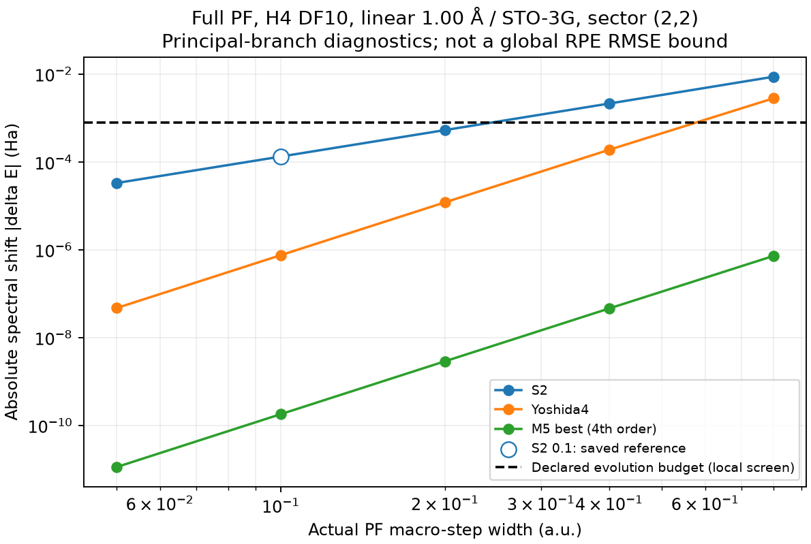

# Full PF公式・幅のH_eff有限探索結果

2026-11-14 JST。[固定計画](../h4_full_pf_heff_scan_preparation_20261114/SCIENCE_PLAN.md)／[全cell一覧](CELL_SUMMARY.csv)／[raw結果](run01/result.json)／[C/B HANDOFF](HANDOFF.md)。

**承認済みの新14件を一回実行し、全H_eff数値gateと28組の二時点照合を通過した。** 既定εtrotに対する局所固有値シフトで、格子内の最も粗い候補は **S2/Δ=.2、Y4/Δ=.4、M5/Δ=.8**。compiled価格・N・Gの順位ではない。既存S2/.1は参照だけで再計算していない。

## 条件・SOURCE・実行範囲

Linear H4、隣接1.00 Å、STO-3G、保存tol-only 1e−8 DF10、weighted-Hermitian completion、sector(2,2)/dimension36。Full PFはone-body＋全DF10/prefix10、元fragment順、元H/state/snapshot/scalar/full DF-H targetを維持する。h=.1/M12/P0、prior/decoder/compiler/profile・既定RMSE budgetを変更しない。Full PFのκ/R/Kはnull。

- 固定計画・cache対応評価器：`878000d8d5d956b1d2f5513986ae40d0612e0bdd`。
- 科学caller SOURCE：`b64f22b97c641fc97d13e9872b723f789e4fa454`、`scripts/run_h4_full_pf_heff_scan.py`。
- 元点・元H保存固有系：`69ee0ff8898960d5f9959af8d34d89f223caec87`。旧S2/.1のstep/Schur/meanを再計算しない。
- 既存C loader/step：`86f37d25ffd5eee3daf7f25ce001b090b1f2cf33`、direct-expm/power kernel：`dd24dd329949c255d5e37b90ff8993fa8df7159b`。B/D identity生成は準備版の固定APIを再利用。

context load1、新PF step14/Schur14、直接PF mean28＋全spectral mean28。元Hの新eigh0、新full-H reference0、旧保存signal再解析0、normalizer/N/MC/新価格/G/追加幅/retry0。既存half-step cacheとmacro-step累乗で195round行を15のformula/actual幅cellへ集約し、14新cellを共有contextで処理した。新しいCPU/RAM/worker上限や共有環境設定変更はない。

## 固有値シフトと幅

比較energyは同sectorの元保存full DF-H matrix minimum −2.1663874486347643 Ha（保存固有系の値）。保存solver proxy −2.1663874486347634 Haは置換しない。全14点で元最低groupと最大trace overlapを持つeffective groupはindex0、指定resolutionで両最低groupは単独だった。minimum同士を無条件に対応させたのではなく、全basis overlapを観測した上で同じgroupになったことを確認した。

既定εE=0.00159360010199040 Ha、εqpe=εtrot=0.00079680005099520 Ha、Minkowski契約を保持する。下表の内/超は **|対応候補のspectral shift|とεtrotの局所比較**で、全RPEのPASS/FAILではない。

| 公式 | actual Δ | δE（Ha、符号付き） | 保存stateのeffective最低group weight | 局所予算 |
|---|---:|---:|---:|---|
| S2 | .05 | +3.34192249869e−5 | .999999995273 | 内 |
| S2 | .1 | +1.33712063195e−4 | .999999924309 | 既存参照のみ (*) |
| S2 | .2 | +5.35412051879e−4 | .999998785246 | 内 |
| S2 | .4 | +2.15074600007e−3 | .999980323920 | 超 |
| S2 | .8 | +8.75374702516e−3 | .999668768937 | 超 |
| Y4 | .05 | −4.76831072405e−8 | ≈1 | 内 |
| Y4 | .1 | −7.62053551817e−7 | ≈1 | 内 |
| Y4 | .2 | −1.21367807977e−5 | .999999999975 | 内 |
| Y4 | .4 | −1.90607716779e−4 | .999999993759 | 内 |
| Y4 | .8 | −2.82316763721e−3 | .999998475899 | 超 |
| M5 best | .05 | −1.14432907594e−11 | ≈1 | 内 |
| M5 best | .1 | −1.83062454084e−10 | 1.0000000000000004 | 内 |
| M5 best | .2 | −2.92537372104e−9 | ≈1 | 内 |
| M5 best | .4 | −4.65616789569e−8 | .999999999999 | 内 |
| M5 best | .8 | −7.28958845286e−7 | .999999999603 | 内 |

(*) A69eeの既存診断をSOURCE付きで転記した。今回の新数値screenは行っていない。元state/weightの丸め値をclamp・再正規化しない。CSVには丸め前の保存値と各SOURCEを保持する。

観測した幅依存は概ねS2のΔ²、Y4/M5のΔ⁴型に整合する。M5も既存4次formulaである。図の線は点を結ぶ案内で、係数fit・精度上界・格子外への外挿ではない。小さいshiftの数値観測を厳密enclosureへ昇格しない。

## 格子内で優先する比較候補

| 候補 | δE（Ha） | m12 qPF | m12 signed S2 piece数 | 保存m3/m4価格のmetadata |
|---|---:|---:|---:|---|
| **S2/.2** | +5.35412051879e−4 | 2048 | 2048 | m3/m4ともX/Y EXACT |
| **Y4/.4** | −1.90607716779e−4 | 1024 | 3072 | m3/m4ともX/Y EXACT |
| **M5/.8** | −7.28958845286e−7 | 512 | 5632 | m3 X/Y EXACT、m4 MISSING |

**Cによるcompiled比較の最初の優先候補はS2/.2**とする。理由は、3候補の全13roundでsigned S2 piece数が最少で、m3/m4の保存価格locatorもあるため。ただしpiece数はcompiled RZではなく、C値の新比較・受入は今回行っていない。Y4/.4を高次formulaの対照、M5/.8を強い誤差抑制と格子上端未探索の候補として残す。どれも正式なG最小winnerではない。

coarse requestのearly actual幅は、S2/.2でm0=.1、Y4/.4でm0=.1/m1=.2、M5/.8でm0=.1/m1=.2/m2=.4となる。同公式の対応cellを参照し、全roundをm12と同一H_effへ置換しない。[C_HANDOFF.json](C_HANDOFF.json)に全roundのcanonical/physical ID・actual幅・step-cell SOURCEを保存した。

3候補ともm12価格は照合catalog外。保存EXACTは旧D catalogのstatus参照であり、現在のconsumer/profile/loweringに対する新しい受入ではない。q比例、PRのE[S]、古いC1係数で欠測を埋めず、旧価格と新ZZ loweringも混同しない。Nを共通又は不変とは仮定しない。

## 数値検査・保全

全14点でprincipal logの数値gateを通過。最小cut clearanceは1.4062241605722114 rad、最大step unitarity欠損4.2450182411075364e−14、最大指数再構成誤差2.836467329435323e−14。最大二時点signal差1.055943051065081e−11、最大power unitarity欠損1.1736239049493291e−10で、固定1e−9 gate内だった。

元固有系cacheは毎点同元H行列・SOURCE/bindingと照合した。元固有系residualは最大1.2955714962740859e−14 Ha、Gram欠損1.7873013348275928e−13。新eigh/fallback・state再正規化・unitary投影・閾値変更はない。phase guard1e−8 rad、energy cluster1e−8 Ha、入力state norm1e−12を維持した。

新caller4人工テストPASS（[記録](CALLER_TESTS.txt)）。準備版の25人工/metadataテストは固定記録を再利用し、再実行していない。NumPy1.26.4/SciPy1.14.1、実caller経過6.538929471047595秒。入力snapshot/receipt/contextの3hashは実行後も一致（[記録](POSTRUN_INPUT_CHECKS.json)）。他担当のworktree/process、既存raw/KEEP/STOPに変更なし。

## 未資格事項・次の範囲

physical alias・厳密ground同定・数値誤差の厳密認証はfalse、`rpe_bias_ha/sufficient_N/global_RMSE_bound/G/winner`はnull。保存stateの支持が大きくても、他spectral成分や全decoder/shot/lossを無視しない。Bがraw signal由来riskを使う際は同じPF shiftを二重加算しない。

**C**には上記3候補の同domain compiled価格接続を優先して検討してもらう。新しい価格取得はユーザーの別承認が必要。**ユーザー**が追加の物理探索を選ぶ場合は、S2の.2–.4、Y4の.4–.8の予算境界や、M5の.8より外側を調べる必要性を判断する。新幅ではB生成のactual幅/early例外とlog分枝条件を改めて固定し、自動補間・幅追加・branch変更はしない。

今回の結果・HANDOFFをcommit/push、remote SHA/tree/主要成果物照合後、**mandatory STOP**。
