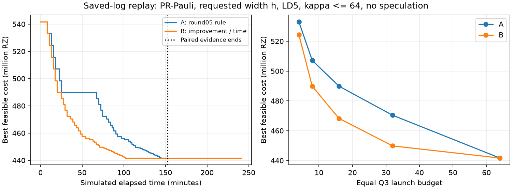

# H4 RPEコスト探索：新しいscheduleと既知scheduleのshot改善を選ぶ順序

2026-11-17 JST。独立branch `codex/h4-rpe-candidate-ordering-20261117`。固定SOURCEと出所は [SOURCE.json](SOURCE.json)、再現・B2接続は [HANDOFF](HANDOFF.md)。実装・保存ログの技術再生・人工検査の報告であり、新しい科学的な方式優位の判定ではない。

## 結果

**全L_Dの主比較は、最初の未保存候補で比較不能になった。LD5・κ≤64・先読みなしの補助比較では、Bが早い段階で安い適合点へ到達し、64件の同一Q3予算ではA/Bが同値になった。** 保存答えのない候補を飛ばして、広域探索での優位を作っていない。

| 比較範囲 | 保存ログから分かること |
|---|---|
| 主比較：PR-Pauli、要求幅h、全L_D、32枠・HYBRID16 | Aは最初のLD1 scheduleの準備が未保存。Bは最初のshotを選ぶが、同時に生成した先読みの4件目が未保存。両者とも模擬時刻0で打切り。比較可能な進行区間は0秒。 |
| 主範囲、先読みを外した感度比較：1枠・1先読み | Aは同じ準備欠測で0秒。Bは3件完了後、4回目の選択で未知scheduleを選び484.531模擬秒で打切り。A/Bの共通区間は依然0秒。 |
| 補助：LD5のみ、κ≤64、1枠・1先読み | 501,233,190.43 RZ以下へAは1,361.362模擬秒・9起動、Bは1,052.901模擬秒・7起動。共通の観測区間は9,146.993模擬秒まで。 |

上の秒は旧jobの保存サービス時間を使った**模擬時間**。実H4の新規信号・較正・compile・Q3、round05本番は0件。Q3本体の高速化、並列枠の最適化、DP再利用の効果は今回の比較に含めない。

## 比較をどう作ったか

基点B2 `d8e806265c3ded8e1184181c37c2d7ec71f08ade` とthroughput `e839b0d3f5469c21f5944aec5d978f91d193efc8` の後続・関連branchを調べた。同等の「外側schedule選択と内側shot選択を同時に比較する」完了成果は見つからなかった。旧throughputの再生器は固定ready集合の内側V2だけを扱うため、その結果を今回の主比較へ転用していない。

既存の `W.Family/plan_wide`、V2候補生成・分類・HYBRID preview、保存ledger index・時計のinterfaceを再利用した。V2を毎回1手で呼ぶと探索counterがresetするため、同じclosureを保持する `priority_session()` を追加した。従来 `run_priority()` は各frameの既定候補を選ぶwrapperとなり、既定の結果・先読み列の一致を固定e839版との人工検査で確かめた。

A=`ROUND05` は、既存Wのfloor・far ladder・安いschedule周辺のrefineと未探索gap・価格下界・範囲停止をそのまま呼ぶ。各W batchの準備を先に選び、その後に既存V2の既定shot候補を選ぶ。FINE/SMALL/DEFERREDを後回しにする既定条件を保つ。初回INITは `per_decision=8` より多く提案し得る既存動作も保持する。

B=`IMPROVEMENT_PER_TIME_V1` も**同じ候補menu**から選ぶ。既知の配分価格について、即時削減 `max(方式内最安−候補価格,0)` × 完了観測の経験的PASS率 ÷ 推定準備＋Q3時間を順序特徴にする。同構成の完了観測を優先し、なければ同方式・同profileの観測を使う。MSE余裕は既知parentのtie-breakだけに用いる。経験的PASS率はBeta(1,1)で縮約した探索特徴であり、適合保証ではない。

時刻または正のscoreがなければ、既知価格の削減・parent余裕・A順へ戻る。4選択ごとに未知・未試行scheduleへ機会を与える。新scheduleで最終的に得られる費用は不明のまま、価格下界を予測適合価格として代用しない。このため本保存再生の新scheduleは、主として周期探索で選ばれる。新しい構成の最終改善を予測できたという実証ではない。人工fixtureでは、準備側が初回評価配分の価格を既知として渡せる場合も検査した。

scoreから不適合・除外を作らず、shotに対するMSE単調性も仮定しない。選択理由、候補pool、chosenとA既定候補の価格・親MSE余裕・再利用/較正状態・時刻根拠・観測IDをtraceへ保存した。全score列は同じ入力から再生成でき、公開圧縮traceではchosen/Aの列を残して反復を省いた。

### 初期知識と保存証拠の区別

実際のround05はprior全4,783結果を読み込む設定である。しかし、それを初期知識にすると今回の問いに答えない。ここでは**round05規則を過去の限られた状態へ適用する反実仮想の技術再生**を行った。実際のround05開始時の再現ではない。

- 初期数値知識はCの9保存点、LD2/3/5の3構成だけ。ID・配分・exact上下界は [cache/CONTEXT_ARCHIVE_V1.json](cache/CONTEXT_ARCHIVE_V1.json)。LD5限定pairでは、そのうちLD5の2点だけ。
- 事前準備済みcacheとして、固定round04の `KAPPA_POINTS.json` と既存生成gridから得た26 ready構成の信号・価格metadataを両側へ宣言した。これらのQ3答えは初期知識にしない。未知scheduleの準備時間は0秒にしない。
- round04/round05 stateから使うのはfamily定数だけ。点の適否・最安値・探索状態を初期へ移さない。
- 4,783件のindexは要求ID・結果locator/hash・運用時刻を持つhidden oracle。数値OUTCOMEを開くのは選択された起動が完了した時点だけ。未完了の先読み結果も見ない。
- 全indexの平均時間を選択器へ渡さない。hidden service timeは起動後の完了イベントを決めるだけ。selectorの時刻推定は、当時までに完了した観測だけから行う。
- 最初の未保存schedule/配分、先読みの未保存起動、時刻欠測でそのbranchを打ち切る。打切り後の値を横に延長しない。

初期から準備cacheを26構成分使えるという条件付き比較であり、初期の信号取得・価格準備を含む総探索時間の再現ではない。新規則が旧履歴と異なる点を選ぶほど保存支持が不足する、という制約が主比較で実際に現れた。

### 各pairの共通条件

| 項目 | 固定条件 |
|---|---|
| 物理・価格資格 | H4直線1Å/STO-3G、tol-only 1e−8 DF10、PR-Pauli S2、要求幅ΔPF=h。条件付き `Σ N E[C_no-prep]`、既存MODEL価格。準備費をRZへ加えない。 |
| 精度・shot | 保存DF targetのconditional proxy、MODEL_MSE_FILTER_ONLY、M=12、既存routeのMSE上下界。εE=0.00159360010199040 Ha、τ=15136964828156312001/5960464477539062500000000。各round caps=[48,45,42,39,36,33,29,26,23,19,16,13,9]。 |
| 候補生成 | 同じW/V2、減算[1,2]、seed B_PRICE/A_SHAPE、transfer_count=2、coarse 1%、small 0.1%、small/deferred STOP。shot振替は双方OFF。 |
| 予算・batch | 主・補助の長軌跡は新規模擬Q3上限400、V2 batch64。別途4/8/16/32/64件を同じ初期状態から再生。 |
| 並列・DP | 主32枠/HYBRID16、感度比較1枠/1。DP profile8、prefix再利用OFF、adaptive_hybrid OFFを各pairで一致。資源上限の推奨ではなく比較条件。 |
| 幅・範囲 | 主はLD1〜9・κ≤65536。補助はLD5・κ≤64へ両側を同じように限定。別幅・他方式の保存性能実証なし。 |

保存jobのサービス時間を別の投入順へ置き直す離散事象モデルであり、競合・OS/I/O・controller・準備・cache warmingの実時間を再測定したものではない。総CPU、同時最大メモリ、実DP HIT率の新たな推定は行っていない。

## 同じ時間・同じQ3予算での比較

詳細は [SUMMARY.json](saved_replay/SUMMARY.json)、[EQUAL_ELAPSED.csv](saved_replay/EQUAL_ELAPSED.csv)、[BUDGETS.csv](saved_replay/BUDGETS.csv)、全選択traceは [COMPARISON.json.gz](saved_replay/COMPARISON.json.gz)。時刻0の最安は541,743,905.57 RZ。

LD5・κ≤64・先読みなしの共通観測区間だけを抜粋する。

| 同じ模擬経過秒 | Aの最安 RZ | Bの最安 RZ | その時点の起動 A / B |
|---:|---:|---:|---:|
| 600 | 533,092,312.14 | 533,092,312.14 | 3 / 3 |
| 1,200 | 507,137,531.86 | 489,834,345.00 | 7 / 8 |
| 2,400 | 489,834,345.00 | 468,203,184.43 | 15 / 16 |
| 3,600 | 489,834,345.00 | 455,222,373.29 | 23 / 25 |
| 7,200 | 448,729,790.71 | 441,692,790.43 | 51 / 54 |
| 9,000 | 441,692,790.43 | 441,692,790.43 | 66 / 66 |

同じ起動予算を使い切る別pairの結果。各行とも未知候補による打切りはなく、全起動が完了した。

| Q3予算（双方） | Aの最安 RZ | Bの最安 RZ | 予算完了の模擬秒 A / B |
|---:|---:|---:|---:|
| 4 | 533,092,312.14 | 524,440,718.71 | 617.116 / 618.503 |
| 8 | 507,137,531.86 | 489,834,345.00 | 1,218.174 / 1,197.251 |
| 16 | 489,834,345.00 | 468,203,184.43 | 2,459.289 / 2,318.756 |
| 32 | 470,366,549.29 | 449,812,406.14 | 4,743.201 / 4,384.832 |
| 64 | 441,692,790.43 | 441,692,790.43 | 8,675.204 / 8,650.922 |

左の縦点線はA/B共通の保存支持が終わる時点。Bのその後の曲線はBだけの保存済みprefixであり、比較の延長には使わない。

費用水準は既存round05 REPORTの4水準をそのまま再利用した。LD5補助pairの到達は次のとおり。

| 費用水準 RZ | A：模擬秒 / 起動 | B：模擬秒 / 起動 |
|---:|---:|---:|
| 501,233,190.43 | 1,361.362 / 9 | 1,052.901 / 7 |
| 437,894,306.43 | 保存支持が終わるまで未到達 | 同左 |
| 414,301,229.37 | 同左 | 同左 |
| 410,199,237.00 | 同左 | 同左 |

400件上限の軌跡は、Aが67既知起動/67完了/67採択・9,146.993秒、Bが114/114/114・14,477.544秒の後、次の未知Q3で打切りとなった。両方の最終観測最安は3091849533/7 RZ。異なる終了時刻の最安だけを同じ400件予算の比較として扱わない。次の未知要求は各1件で、既知模擬起動数には含めず別計数した。

先読みで完了したが採択されない点も全評価最安へ含める実装で、人工検査を加えた。実保存のLD5補助軌跡は先読みを外したため採択外完了0件。32枠主比較では既知3起動/0完了/0採択で打切り、未完了3件の未来の答えは開示していない。

## 最初に順番が変わった具体例

主pairは最初の同じ78候補から分岐した。AはLD1・R全round=1のscheduleを選ぶ。Bは既知LD3構成 `dd5b881d308f…` のm12 X/Yを2→1へ減らす配分を選ぶ。評価前に計算できる価格は483,460,003.67 RZ、方式内最安からの即時差は58,283,901.90 RZだった。時刻priorがまだないため、Bの理由は `POINT_SAVING_A_RANK_FALLBACK_TIMING_OR_POSITIVE_SCORE_UNAVAILABLE` であり、未来のMSEやjob時間を知った選択ではない。

LD5補助pairも最初の同じ7候補から分岐。Aは準備済みのR全round=1のscheduleを先に開く。Bは既知LD5 `4d6e2c9c4511…` の同じm12変更を先に試す。候補価格506,915,580.71 RZ、既知最安からの価格差34,828,324.86 RZ。初回は時間不明のfallback、その後は完了結果から時刻・PASS比率が更新される。候補の安さだけで適合とは判定していない。

## 人工入力と複数幅への接続

[人工3case](artificial/README.md) は同じ13-round fixtureと共有JointReplayを使う。固定した人工時間で、速い既知shotを先に試すBの早期到達、較正待ちを後に回すBの改善、未知scheduleが後の大きい改善へつながりAが勝つ反例を検査した。最初のcaseは到達時間ではBが有利でも、同一Q3件数の最安はAが低い。Bの一般優位を示す人工例集ではない。

複数幅担当 `codex/a-pr-step-width-search-20261117` は着手時に未commit・未公開だった。draft interfaceだけを照合し、mapper・較正・価格登録表は複製しなかった。selectorは幅をopaqueに受け、binary64 `.2` とexact文字列 `"1/5"`、requested IDとevaluation IDを混同しない。信号/価格を再利用できる幅、較正が必要な幅を同じaction menuへ渡す人工検査を実施した。

人工較正caseでexact `"1/5"` を受理したことは、実Pauli/DF mapperの対応証拠ではない。今回、保存性能まで確認したのはPR-Pauli・要求幅hだけ。他3方式、新幅、実較正待ちの効果は未確認。API詳細は [SELECTOR_NOTES](SELECTOR_NOTES.md) とHANDOFFに記した。

## 検査と実装上の発見

[VALIDATION.json](checks/VALIDATION.json) に著者側の人工・回帰66件、人工3caseを記録した。別担当 `prefix_benchmark` はrootコードを読取レビューし、人工40件を別に実行。重要な科学レビューとは区別する。発見・修正した点は次のとおり。

- 1手ずつV2を呼んだ場合のcounter resetを避け、closureを保持。固定旧版との既定軌跡・preview一致、activation時の再分類を検査。
- 小さいshot-only caseで予算停止を外側へ伝えず、再選択を繰り返す不具合を修正。修正前FAIL・修正後PASS。起動済み結果の無料採択は維持。価格・完了曲線の数値は変わらず、余分な未実行の判断記録を除いた。
- 固定d8にないround05作業ファイルをmetadataに拾う危険を修正。round/config/state・route/価格registryを固定blobから自分の出力へmaterializeし、準備cacheの追加範囲は固定round04 κ metadataとして明示した。固定版のみで9 ready構成になる診断と、宣言した26構成cacheを使う本比較を混同しない。
- 既存report用JSON変換は価格配列を省くため、再生cacheにはその投影を使わずexact値を保存。price欠損を先に検出し、固定metadataから構築した場合とcache再利用の全軌跡・予算走査の一致を確認した。

これらは新しいQ3本体の改善ではない。既存round設定・固定SOURCE・原結果・旧STOPを変更していない。新規則は**比較用API/再生入口で選択可能**であり、通常探索へ採用済みとはしていない。

## 次の承認済み実探索で判断する項目

今回の保存支持では、未知scheduleと既知shotのどちらを優先するのが全体で有利か、437.9M以下への早期到達が改善するか、較正再利用・DP prefixを同時に有効にした場合の順序効果は判断できない。

次の実探索が別途承認された場合は、開始時の既知点と準備済み入力、各選択時の共通候補pool/特徴/理由、信号・価格・較正の開始終了、queue投入/起動/完了/採択、DP再利用・CPUを記録すると不足が埋まる。同一予算/条件でA/Bを比べ、未知を選ぶ頻度、初回適合後の改善、実時間と起動件数の両曲線を測る。今回はその実探索を開始していない。
