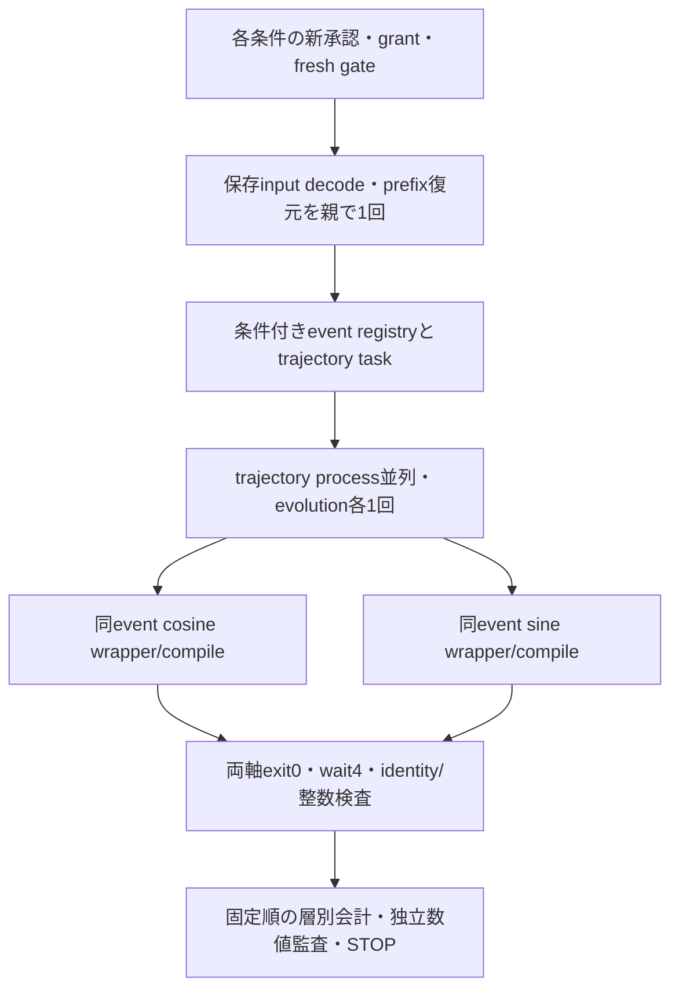

# H8希少RTE：並列化・再利用・資源設計

2026-10-21、C-0技術設計。実分子の性能benchmark、回路生成、compile、GPU計算は0。高速化率は未測定。

## 再利用対象と変更点

取得済み`745a6745:scripts/h8_pr_confirmation_parallel.py`は、trajectoryごとにevolutionを一度作り、fork/COWでcosine/sineのfull-wrapper compileを分け、`native wait4`で全子を回収する。`h8_key_compile_parallel.py`のPID/start/parent/UID identity・before-call予約・atomic result・native終了確認を再利用候補とする。

旧driverのunconditional n48固定、旧grant、旧5CPU groupや1CPU affinity、固定deadline、resume/handoff受入は新契約へそのまま移植しない。旧poolの`child_main`とaffinity監視は単一CPU割当を仮定しているため、同moduleを無変更で呼べば今回の動的資源設計は満たせない。新SOURCEの薄いscheduler adapterに資源tokenとprocess identity/回収の部分を接続し、旧SOURCE/契約は保持する。

`pr_cost_native.load_context`はH8 loaderをprovider import pathから読む。loaderは`9d18cdd6:scripts/h8_ab_native.py`の履歴SOURCEを取得し、native kernelはprovider `c31ef424`の`ax2b_native_df_v5.py`を取得した（SHAは既存Tier Rと一致）。これらは確認runner745a6745と別の来歴であり、将来は実際にimportする全ファイルを新SOURCE/runtime closureへ封印する。C-0でlive providerをimportしたとはしない。

## DAGと並列粒度

親は元saved snapshot/state/block exportを一度読み、p7/p8の必要prefixを元の純粋な代数的復元で作り、期待preparation hashを検証する。SCF/DF/state solver・Gaussian再生成は禁止。元p7/p8は`original preparation_binding.saved_exact_export_match=false`なので、保存prefix objectをそのまま読めると誤記しない。必要なprefix復元は将来のcall予算・明示承認へ含める。C-0ではdecode/復元を実施しない。

trajectory workerは共有read-only state/preparationを継承し、event列を一度決定、evolutionを一度構築する。両軸は同evolutionのCOW viewから個別wrapperを作る。起動時に親がsingle threadであることを確認する。既存BLAS/Rayon/NumPy import後に安全にforkできないなら、独断でthread数/共有環境を変更せずSTOPし、spawn/shared-memory等の代案とidentity影響を提示する。vectorizationはmetadata/固定順整数集計を中心とし、回路順序やcomponent draw順を変えない。

## 動的な資源admission

CPU affinityと有効cgroup quota、MemAvailableとcgroup各階層のmemory.max/current/events、PSI、I/O pressure/load、必要ならプロジェクトの実storage空きとGPU利用可否をread-only観測する。C-0のsnapshotは将来実行の空きを保証しない。CPU affinityは利用可能範囲であって空きCPU数ではなく、loadavgだけから空きcoreを確定しない。

全trajectoryと軸に**共通のadmission token**を使う。外側Wと内側軸A（1または2）と実thread需要をまとめてCPU需要へ計上し、条件を同時に動かす場合も同じpoolに統合する。worker数はfixed limitをコピーせず、pending task数、有効CPU余裕、read-only共有量、evolution/軸compileのprivate増分、I/O需要から決める。

メモリは`shared_parent + Σevolution_private + Σaxis_compile_private + coordinator余裕`を使う。RSSの単純合計でCOW共有量を重複計上しない。実行承認後の最初の登録taskを通常の科学call予算内で計測し、PSS/USS/private peak・実時間・CPU時間を使って**以降の投入だけ**を調整する。未取得peakを既知としてWを作らない。必要なら最初の登録taskから複数独立taskを同時投入できるが、メモリadmission根拠を先に示す。C-0で小さい固定WやRAM/wall capは採用しない。

一時的なPSI上昇、監視欠測、無関係worktreeのHEAD/status変化で正常workerを強制終了・再起動しない。新規投入を抑え、観測を再確立し整合性を確認する。他ユーザーへの支障が懸念されれば自分のjobだけの投入/並列度を調整する。実OOM・継続不能な不足・入力/SOURCE破損・自job異常はSTOP対象。共有cgroup/quota/OS/scheduler/package/cache、他人のprocess/affinity/fileは変更しない。

GPUは存在/空きのread-only確認対象にできるが、元Qiskit1.3.0 CPU transpileを別GPU compilerへ置換しない。現APIに同じidentityの有効経路を確認しておらず、GPU速度向上を前提にしない。

## cacheとI/O

専用private cacheだけを使い、keyはSOURCE/provider/runtime/library digest・Hamiltonian/state/snapshot/preparation・q/r/K/delta・完整event digest（angle/sign/identity含む）・control/scalar・axis/measurement wrapper・compiler settings/fingerprintを含む。衝突時はbytesを照合し、旧q4/q8費用をq倍して転用しない。異なる軸を同じkeyにしない。

再利用可能なのは同じidentityのimmutable入力・同一回路/同一compilerの実compile receiptである。cache hitも母集団drawの行を消さず重複度を保持し、sampling回数・wrapper構築・compile miss・cache hitを分けて記録する。未承認のcache missを裏でcompileしない。compiler/library mutable stateを含むkeyの正当性が未検証ならcompile費用cacheは無効にする。変数のidだけによるcross-process fingerprint cacheは避ける。

worker出力はcondition/phase/stratum/task/axisで分離し、O_EXCL予約→専用task file→atomic result→sha付きreceipt。集計は親がtask ID順で行い、乱数と集計結果を完了順から独立させる。大きいstate/preparationのprocess間pickleや各workerによる復元を避ける。read-only mmap/shared memoryは安全な保存codecとidentityがある場合だけ別途検証する。

## 2条件・grant・失敗

基本は条件別に新grant/ledger/marker/STOPを分ける。2条件同時実行と開始順は未承認。両方の承認がある場合だけ、一つのresource coordinatorから同じread-only contextを安全に共有する案を採れる。片方のgrantだけで他方のevent/回路を生成しない。shared decode費用の担当grantと参照receiptも事前に決め、二重課金・未課金を避ける。

元native/wrapperの`max_instructions=1000000`は既存実装の停止guardとして保持する。これはCPU/RAMの新上限でもcompiled RZの全support上界でもない。guard超過taskは失敗を保全してSTOPし、別の容易なeventへ再抽選・置換しない。

元control関数はstatevector simulationを含む。将来compile承認へ自動的に含めず、必要な代表trajectory/層のcontrol4 probe・event oracle・非測定wrapper等の正確なcall数と実行可否を別途指定する。validationの省略も黙って行わない。

各親は自身の子をwait4で回収し、workerは軸/validation子を回収してから終了する。coordinatorは各receiptのnative exit/status/identity/result SHAと全孫processの回収を検証する。失敗時は新規投入停止、所有PID/start/UID一致の子だけをcleanup、部分結果・非返還消費・STOPを保全。旧grant再使用、retry/resume、失敗taskの統計的除外は禁止。

## 将来の性能測定

承認済みtask内でdecode、event sampling、lowering、wrapper build、fingerprint、各軸transpile、I/O、検証、全体wallとCPU、PSS/private peak、cache hit/miss、resource snapshotを記録する。対照となる同一identityの既存時間receiptがなければ、速度向上率を出すためだけの未承認再compileはしない。cache/forkの効果は実測receiptと比較条件を示して報告する。C-0のtoy動作時間をH8速度予測へ外挿しない。
