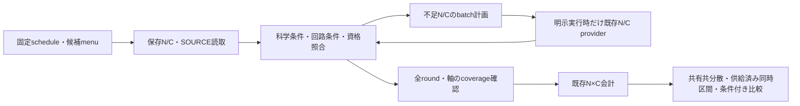

# PF/PRエネルギー推定：総費用pipelineの統合準備

2026-11-10 JST。**固定候補のschedule・保存N/C読取・条件照合・不足計算のbatch要求・既存総費用会計・共有不確かさ・比較までを接続し、人工/mockで一括入口の動作を確認した。実H4/H6の全Gは未取得で、残る科学計算は不足NとCの適用資格・不確かさである。** H6の残5時点を個別campaignとして追加する方針から、有限menuをまとめて評価する構造へ移した。

今回は技術実装、保存JSONの静的対応確認、人工/mock **12件PASS**まで。**新しい実signal/N、価格予測・fit、実N×C/G、sampling/build/compile、RPE simulation、詳細科学レビューは全て0。** [静的計画](static_plan/)・[SOURCE索引](SOURCE_INDEX.json)・[試験記録](TESTS.txt)・[技術照合](CHECKS.txt)。公開照合後mandatory STOP。

## 1. 完成した構造と残る境界



| 部分 | 実装・現在の到達点 |
|---|---|
| schedule受渡し | 保存h/M/prior/精度/α/β/decoderを転記。T、q_RPE、q_PF、δを独立に照合。最適化なし |
| N/C共通形式 | SOURCE、候補全tuple、H/state/snapshot、completion/fragment/preparation契約、signed recipe、compiler/control/wrapper、軸/符号/単位を保持 |
| 保存adapter | H6 m0..7の16候補N、H4 m3の2候補Nを元resultから選択。直接Cと公開済みモデル要約の値はcopyだけ |
| 不足計画 | H4/H6各26候補の固定比較menu案を作成。未評価・未資格・欠測を別欄に保持 |
| batch制御 | `run_missing`で不足Nと不足する期待Cを各1回のprovider呼出しへまとめる。保存FAILを再試行せず、N不成立ならC段へ進まない |
| H6 N実行adapter | context/reference/半step cacheを共有し、旧D2 action/phase/Nを呼ぶ`H6ActionBatch`を用意。今回の検査は全てmock |
| 会計・比較 | `run_fixed_evaluation`→既存`aggregate_supplied_axes`→既存比較器。RZを主指標として実装。全入力不足なら総値なし |
| 不確かさ | 全方式・round・軸を一つの順序で扱うmean-price covariance。共有校正を含む行列のみWΣWᵀへ伝播。不明Σはnull |
| 未完了 | 実H4新signal providerの具体的接続・実行資格、A/Cの新providerのSOURCE/domain資格、残N、全law期待C/系統誤差・共分散。新モデルを自動採用しない |

この段階の完成範囲は、既存数値kernelを束ねる技術的な評価器である。任意条件でh/Mや候補を自動最適化するsolver、compiler再実装、科学保証を自動認定する仕組みは追加していない。

## 2. 固定科学条件と比較単位

現在の基準はLinear H4/H6・隣接1.00Å・STO-3G、tol-only1e−8の保存DF10/DF19、保存weighted-Hermitian completion、保存DF-Hの同sector ground target、保存数値state条件付き、P=0。H4はNα=Nβ=2、H6は3/3・12 system mode・sector400。H/state/snapshotとfragment順/scalarを保持する。

εE=.00159360010199040 Ha、h=.1、M=12・13round、各方式αtotal=.05、αaxis=.05/26、βtotal/stat=.4/.2 rad、保存priorと無shift decoderを再利用する。E_stateでpriorやbranchを選ばない。h/M/α/βを再導出・最適化しない。厳密ground同定、empirical allowanceのrigorous資格、actual implementation/law誤差は未資格。

| 系 | 固定比較族と保存済みN | 未評価roundのmenu案 |
|---|---|---|
| H4 DF10 | PFは**切捨てを含むB0/p7**、PR p1/R4/K2。S2、δ=.1、m3/T.8/qPF8でPF705・PR977/軸 | 同じS2/δ=.1、qPF=2^mを宣言した比較案。Full10への読み替えなし |
| H6 DF19 | PF Full19、PRはm0..3 p5/R32/K2、m4..7 p7/R16/K2。4th m5_best。m0..7のNを保全 | m8..12は同δ1.6・Full19対PR7/R16/K2、qPF16/32/64/128/256の案 |

未知roundのcandidate metadataは**PROPOSAL_NOT_SCIENTIFICALLY_ADOPTED**であり、新候補の科学的成立性を認定していない。固定候補評価が先で、候補集合の最安選択・q/R/K・schedule最適化は別段階。H6 m6run01/run02は同じ一round、独立な標本やNを増やさない。

## 3. 再利用と新規実装

- [`pf_pr_rpe_pipeline.py`](../../../src/trottertracks/pf_pr_rpe_pipeline.py)：軽量なdict interface、固定task照合、保存adapter、静的coverage、batch接続。`evaluate`と`run_fixed_evaluation`は将来の明示的な科学実行入口。
- [`h6_rpe_batch_provider.py`](../../../src/trottertracks/h6_rpe_batch_provider.py)：旧`h6_df19_rpe_d2`のreference_pair/half_step/evolve/analyzeとD2のworker選択を再利用。保存tailだけを使い、旧D1/D2/m6/m7 runnerや固定guardを変更しない。
- [`plan_pf_pr_rpe_cost.py`](../../../scripts/plan_pf_pr_rpe_cost.py)：固定Git JSONだけを読み、計画を出力するCLI。N/G計算mode、科学providerの起動、cache miss→compileの経路はない。
- [`check_pf_pr_rpe_pipeline.py`](../../../tests/check_pf_pr_rpe_pipeline.py)：人工・mockと読取専用の保存metadata検査。実分子配列はロードしない。

積和は`h4_df10_rpe_connection.aggregate_supplied_axes`、比較は`c1_stage3_accuracy.compare_totals`に委譲した。m5 weights/allocation、canonical candidate IDも既存SOURCEを直接再利用する。H4の既存cost bridgeは部分会計・測定符号・cohort分離の設計を再利用した。H6の歴史的binding.T=.8を実Tへ上書きしないため、H4部分会計のtime guardそのものをH6へ移植していない。

Track Dの固定CDF8/52行向け共分散関数はPF/PRの新label順序を受け取れないため、同じWΣWᵀを小さい可変次元adapterとして実装した。CDF8/DF12のN・価格係数・残差・共分散を移植していない。新しい認証・grant・ledger・approval証明機構はない。

## 4. interfaceと資格判定

`task`は保存configuration、binding、completion/fragment/preparation契約、compiler profile、candidate menu。`N record`はそのidentity、ideal plan、actual状態、元diagnostics、元SOURCE。`C record`は同じidentity、X/Y、cohort、RZ単価、価格分類、期待価格資格、model coverage/validation SOURCE、不確かさを持つ。

次を照合する。

- T=.1×2^m、q_RPE=2^m、q_PF=candidate.q、δ=T/q_PF。H6ではq_RPEとq_PFが異なる。
- formula ID・11 signed pieceの値/順序・負時間、prefix/R/K、ABS_TIME_PER_OUTER配分・event数、scalar/identity一回。
- H/state/snapshot、保存completion/fragment/preparationの宣言契約、compiler/control/測定付きfull wrapper/P0。
- X=cosine=Re(zraw)、Y=sine=Im(zraw)、P0−P1、RZはgate_count。paired X/Yには同じcohort/scenarioを選ぶ。
- Nに取り込んだattenuation BをCへ再乗算せず、古典nを量子Nへ掛けない。qubitsは別のmax幅で、N加重しない。

宣言契約の一致は元preparationや二つのlawの物理的同一性の新証明ではない。Cの保存finite-bit samplerとNのideal finite-RTE lawの距離を明示し、actual成功保証を追加しない。

価格はDIRECT_COMPILED_DETERMINISTIC／DIRECT_COMPILED_FINITE_SAMPLE／MODEL_PREDICTION／未検証外挿を区別する。既定の全Gは、単にfinite cohortがあるだけでは計算しない。明示した`finite_cohort_scenario`なら有限cohortを条件付きproxyとして積和できるが、母期待費用へ昇格しない。複数cohortはpoolせず、同じ価格のaliasも独立標本にしない。

新モデルにはq変数=q_PF、対象q、候補domainの適用資格、校正/検証SOURCEを要求する。今回のH4 V2 S1/H6 V1要約は**保存値をcopyしてもqualified_for_candidate=false**のまま。A/Cの新成果は固定commit/pathと適用条件を確認して同じC形式で受け取る。旧モデルの未資格を新fitや無断の倍率補正で埋めない。

## 5. 不確かさと順位

Nは供給された条件付き十分値に固定して扱う。共分散の基準はpath分散ではなく**mean-price estimator**であり、方式・round・X/Y・共有校正・直接anchorとモデルとの依存を含む全行列を要求する。不足blockを0にしない。WΣWᵀでPF/PRと差の統計成分を保持するが、それだけからCIや優劣を作らない。

model systematic、未観測event/finite-bit law、N側のempirical disk・ground仮定の未資格は別に残す。対応する全価格の**供給済み同時区間**と、そのstatistical/model/law coverageの明示がある場合だけ、既存比較器で条件付き費用区間を比較する。観測最大残差を一様上界にせず、新しい%閾値や独立性を採択しない。未知ならPOINT_ESTIMATES_ONLY／未評価を返し、PF/PR優位を確定しない。

現在はRZの主会計を接続した。CX/depth/sizeには同じ既存積和APIがあるが、新interfaceでの科学的な複数資源評価は未実施。加重depthを実機wall timeへ読み替えない。

## 6. 保存成果で対応できる範囲・不足

| 範囲 | 保存値だけでできること／不足 |
|---|---|
| H6 m0..7 | 16候補Nを再計算せず読取。m3/m4のPF直接価格、PR探索9/確認33を別々に受け取れる。旧D1の部分Gは既存値を参照し、重複再計算しない |
| H6 m8..12 | N未取得。5時点・10候補の一括N案を用意。現在の価格V1は全q providerに未資格 |
| H4 m3 | 保存PF/PR NとPF直接・PR探索/確認Cを受け取れる。別途許可があれば既存adapterで保存値の部分会計が可能。今回は実積和0 |
| H4 m4 | 同candidateの保存signal_SOURCEがあるため、元reference/u/binding確認後はscalar2候補を優先。PF q16の直接Cも新compile不要。PR q16の直接Cは固定資料内で欠測 |
| H4他round | 固定D1 carrier内ではN未取得。m0..2とm5..12、11時点・22候補のsignal/referenceが不足。まず同候補の保存資産を確認し、存在する部分は新伝播から除く |
| A/Cの新価格結果後 | 同一候補domainへ資格したprice recordを追加できる。独立q検証が終わっただけでq4096や別δ/prefix/Rを自動採用しない |

ここでの不足は[SOURCE索引](SOURCE_INDEX.json)の固定corpusの範囲で、全私有資産の不存在証明ではない。[H4_PLAN.json](static_plan/H4_PLAN.json)は保存N2・未取得N24（うち保存signal scalar候補2）、[H6_PLAN.json](static_plan/H6_PLAN.json)は保存N16・未取得N10。全taskは13roundを保持し、欠測を0で補わない。

追加compileは既定にしない。A/Cが必要candidateへの適用資格を満たすか、同candidate/receipt/compilerのcache・直接価格があるかを先に判断する。H6 m0..2の別δ/p5/R32、H4/H6の未検証q・別law・preparation/compiler変更で閉包が足りない場合だけ、各価格担当の有限検証scopeを別途定める。BがA/Cのmodelや科学SOURCEを変更・再実行しない。

## 7. 一括実行の使い方と次の科学範囲

静的計画の再生成はworktree rootで次のとおり。既存出力を上書きせずfresh directoryを指定する。

```bash
../../h6-environments/20261011/venv/bin/python -B scripts/plan_pf_pr_rpe_cost.py --output-dir /tmp/pf_pr_new_static_plan
```

科学実行の共通入口は`run_fixed_evaluation(task, saved_N, saved_C, n_provider=..., c_provider=..., cohort_selection=..., joint=...)`。providerは固定menuに対しbatchでcommon recordを返す。phase/radius不成立・数値gate失敗はN=null/未資格として保持し、価格stageや自動retryへ進まない。SOURCE/input不一致、reference gateは停止理由を保持して停止する。

次の具体的scopeは[EXECUTION_PLAN.json](EXECUTION_PLAN.json)。**未実行・新しい許可を待つ提案**であり、既存STOPを解除しない。

1. **H6不足Nを一括**：m8..12/T25.6..409.6、既存Full19 m5対PR7/R16/K2、qPF16..256/δ1.6の固定10候補。新reference5時点/10 action、finite mean10、PR内部対照5、scalar10。m0..7は再計算0。全5時点に適した有限menuとして一括許可を検討する。
2. **H4不足N**：まず保存m4の2候補をreference/u/bindingごと接続しscalar評価。残11時点/22候補は既存H4 finite-mean backendの接続・人工資格を完了してから一つの有限menuで評価する。現在のgeneric batch APIには接続できるが、H4新signal用leaf自体は未接続であり、H6 Full19をB0へ無断転用しない。
3. **C資格を受入れ**：A/Cの新固定SOURCEとdomain/独立q/全law・不確かさの資格を確認する。不足する直接/モデル検証だけを各担当が既存の許可範囲で行う。新fit/compileをBの暗黙fallbackにしない。
4. **全Gを一括**：全13roundのNとCが揃い、有限cohort scenarioまたは期待価格modelの条件を明示してから、H4/H6各PF/PRのRZ積和と不確かさを一括評価する。現在の方針承認はこの実数値集計の許可を含まない。

## 8. 検査・保全・STOP

12 test method PASS。異なる方式/軸のmock N、n/B非乗算、候補/科学/回路/符号/単位不一致、保存再実行の二重登録、finite cohort/未検証model、共有校正/paired axesの相関、PSD/供給同時区間、欠測batch各1呼出し、数値FAIL保存と停止、mock一括入口→既存会計、保存corpusの静的joinを確認した。H6の5reference/cache共有は完全mockで、実H6のm8..12を計算していない。旧依存moduleのDeprecationWarningは記録に保持した。core importだけではNumPy/SciPy/Qiskitもloadしない。

既存H6 branchは14c4f871fに保持し、同じ本担当worktreeで統合専用`codex/pf-pr-rpe-cost-integration-20261110`を新設した。Track Dの既存統合枝はCDF8/Strong-Reference domainで目的が異なるため、数値を混ぜず方法を再利用した。他担当のworktree/process/SOURCEは変更していない。

旧SOURCE/input/raw/結果/grant/ledger/marker/KEEP・過去mandatory STOPを保全。本担当自身の技術検査であり独立科学レビューではない。GitHub公開後にremote SHA・主要成果物を照合して**mandatory STOP**。**ユーザー**：H6不足N batchと後続全G等の科学範囲を判断。**Codex B**：追加科学許可まで停止。**Codex A/C**：各自の既存契約内で価格検証を継続し、固定成果をこのinterfaceへ渡す。
