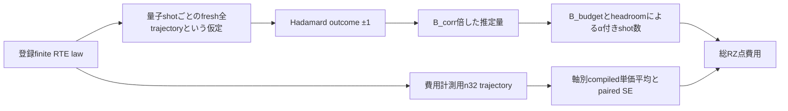

# PR資源評価のαと測定モデルの技術監査

2026-10-18 JST。A-1/A-2の固定SOURCE・保存metadata監査と人工境界検査。

**検査した系列では、各軸α=0.025、ε/√2配分、shot式と費用重みの接続は整合している。native系列にはfreshな全trajectoryのHadamard outcomeをB倍する推定モデルが明記され、n32費用標本と量子測定shotは分離されている。結論は数値bias・normalizationの宣言に条件付く。全結果を無条件の95%精度保証、PR期待費用の母平均保証、RPE全round保証へ昇格させる根拠はない。**

起点は計画書が指定する結果commit `41ba315b2ad369825577ad671c79b69c77e1f3cc`。mainの観測HEAD `0babed07006c4cfc34b2b4191f4f0c8a9e9bceaf`は旧系列のため監査対象の正本に使わなかった。固定snapshotに収録されたTrack Aとその原SOURCEを対象とし、並行する理論資源系列やsnapshot以後の結果は自動的に含めない。既存の採択方針を変更するものではない。

[機械可読の検査記録と固定44 fileのcommit・blob・bytes・SHA256](../../artifacts/resource_applicability/pr_alpha_contract_audit/2026-10-18/technical_validation.json)、[再検査script](../../scripts/audit_pr_alpha_contracts_20261018.py)。実分子入力のNPZ・private runtime・有効grantを開かず、保存shot・費用・順位・失敗確率の再計算は行っていない。

## 系別のαとshot契約

全行の対象は保存DF Hamiltonianと指定stateの有限時間complex signalで、εはenergyのHa精度ではない。主費用は状態準備P=0のfull Hadamard wrapper RZ。各系列内のPRと決定論的PFは同じαと座標許容幅を使う。異なるB・biasによって必要shotが異なることは比較条件の不一致ではない。

|系列と条件|方法|αと軸幅|biasとnormalization|固定SOURCEと保存結果|
|---|---|---|---|---|
|H4 geometry：linear/STO-3G/legacy DF12、.70/.80/.90/1.10/1.40/1.60 Å、T=.8、q1/2/4/8、S2、ordinary/structured Gaussian|PR B2、元B0/full B1、追加B0+I|各軸.025、ε/√2|h=ε/√2−保存軸bias。明示u差引なし。PRは保存normalization、detは1|科学/実行 `d0726e946f89f8c30a08d383fb8ff48b363629ec`、元結果 `7c4483378047b57f514c47dad98905e3f2a9a756`、B0I実行 `924b779c2bc6f6e844d6283c355f91c73aed6445`、結果 `98cdb35cd08469714f20d6cc3b982d9c80908f46`|
|H4 native固定16：linear1 Å/STO-3G/DF12、T=.8、PR p3、full p12、q1/2/4/8、full PF S2/S4、symmetric directional|PR B2とfull PF B1|各軸.025、ε/√2|hから経験的uを差引き、宣言B_upperを使用。geometry系列とは別契約|実行 `217c971dd537b1cc7fbc13742bc0f6c263ff7f45`、結果 `0f96a2e45ba58bd916508e1b1f32e6ff1ff65f41`|
|H6 native：linear1 Å/STO-3G/tol-only1e-8・DF19、T=.8、q1/2/4/8、symmetric directional|探索n8は来歴。主比較は確認union8/n32とB0/full B1/B0I、後続強化対照136|各軸.025、ε/√2|経験的u・log_B_margin、factor1/10。通常biasと経験的非相殺を分離|科学 `5a903aea2492c2d211c1e15e7737df0d50694c12`、確認 `87b6b9f46b7e8ba9abe132ee21478c114b6f46f7`、結果 `321cd8c3066194fe98741cbebbcdba1515d1deaa`、D0解析 `fa75c7997e135da7b7a0c4e23949e47252bd7a2e`、強化会計 `2261a3ad1d6c23521474b31204572a6c3a51258b`|
|H8 native：linear1 Å/STO-3G/tol-only1e-8・DF28、T=.8、q1/2/4/8、symmetric directional|確認union6/n32対決定論184、主要6軸実測反映、追加6精度。実測/model単価を区別|各軸.025、ε/√2|同じ凍結D0式。通常signed biasと経験的非相殺を分離|原実行 `c31ef424175c02379eafebe8fc6c7548c1d9aabe`、原結果 `681ec23c93fdd1090d325908f4b155a79115afdf`、6軸反映結果 `96e69a01d1fae7a402aac2c4efa570a59f8cc7a0`、追加精度SOURCE `3156b036fb4a0015e09cce2cb73785d7819dcb75`、結果は起点commit|

native原SOURCEの`u_aware_shots`と`_number`はH4/H6/H8それぞれを凍結D0とAST比較し一致した。`axis_headroom`、H4/H6とH8の`compact_signal`・`precision_rows`も一致し、計11件PASS。H4 geometryとB0Iの独立式はSOURCEを読んで照合し、同一ASTとは扱っていない。

## 1 shot推定量から確率上界への接続

以下はSOURCEから再構成した、理想測定と宣言した数値入力に条件付くモデルである。実機のN shot実行による検証ではない。

PRでは全trajectory τを有限RTE lawから抽選し、そのunitaryをU_τとする。Hadamard ancillaの測定bitをm、outcomeをY=1−2mとすると、軸bについて

\[
\mathbb E[Y_b\mid\tau]=\operatorname{component}_b\langle\psi|U_\tau|\psi\rangle,
\quad Y_b\in\{-1,+1\}.
\]

native契約の推定量は`B times fresh whole-trajectory Hadamard outcome`。ここでは混同を避け、signalを補正する係数をB_corr、shot予算に使う上界をB_budgetと書く。

\[
X_b=B_{\rm corr}Y_b,\qquad
\mathbb E[X_b]=z_b^{\rm approx},\qquad
|X_b|=B_{\rm corr}\le B_{\rm budget}.
\]

**B_budgetをそのままoutcomeに掛ければよいという意味ではない。** B_corrはraw signalをcorrected signalへ戻す係数であり、B_budgetはその上界としてshot式へ入る。後者の経験的余裕を前者へ混ぜると推定対象が変わる。

- [native契約](https://github.com/HIROMU1015/Partially-Randomized-Trotter/blob/87b6b9f46b7e8ba9abe132ee21478c114b6f46f7/src/trottertracks/resource_applicability/h6_matched_contract_v1.py#L80)は、推定量、各軸.025、解析的shot配分、量子shot未samplingを明記する。H4固定panel/H8契約はこの契約を継承して対象・費用抽選等を変更する。
- [finite RTE law](https://github.com/HIROMU1015/Partially-Randomized-Trotter/blob/c31ef424175c02379eafebe8fc6c7548c1d9aabe/src/trotterlib/rte.py#L1460)は非負の偶数次数weightを総和bで割って抽選する。componentは絶対係数/λの確率で選び、符号はsigned involutionとevent phaseへ吸収される。sample済みeventの確率を測定推定量にもう一度掛ける構造ではない。
- paired Taylorのeventは位相を含むunitary。各eventで係数=確率×bとなるため、独立なR=q r個のeventの積ではB_corr=b^R、平均unitary=corrected作用/B_corrとなる。[signal側](https://github.com/HIROMU1015/Partially-Randomized-Trotter/blob/c31ef424175c02379eafebe8fc6c7548c1d9aabe/src/trottertracks/resource_applicability/h6_matched_port_v1.py#L35)も、raw経路で各short stepをbで割り、`log_B=R*log(b)`と記録する。
- [回路側](https://github.com/HIROMU1015/Partially-Randomized-Trotter/blob/c31ef424175c02379eafebe8fc6c7548c1d9aabe/src/trotterlib/df_rte_qiskit.py)はproductの負符号とevent phaseをcontrolled相対位相へ反映する。[native wrapper](https://github.com/HIROMU1015/Partially-Randomized-Trotter/blob/c31ef424175c02379eafebe8fc6c7548c1d9aabe/src/trottertracks/resource_applicability/ax2b_native_df_v5.py#L259)はH/U/(sineのみSdg)/H/measureでreal/imagに接続する。

この絶対値上界は理想unitary/outcomeモデルでは抽選分布の全supportに共通で、n32に珍しいTaylor次数が観測されたかには依存しない。一方、実際の保存B_corr・B_budgetが正しい実数値を囲んでいること、数値reference・biasの精度は、上の形式的関係だけでは証明されない。nativeのlog_B_margin/uは経験的である。H4 geometryには後述の保存lawの不足も残る。

各軸のshotを独立に同じlawから得る条件で、h_b>0に対して

\[
\Pr(|\widehat z_b-z_b^{\rm approx}|\ge h_b)
\le2\exp\left(-\frac{N_bh_b^2}{2B_{\rm budget}^2}\right).
\]

これをα_b以下にする凍結算術は

\[
N_b=\max\{1,\lceil2B_{\rm budget}^2h_b^{-2}\log(2/\alpha_b)\rceil\}.
\]

nativeではh_b=ε/√2−|保存total_signed_b|−f u_b、B_budget=exp(log_B+f log_B_margin)。H4 geometryはh_b=ε/√2−保存bias_b。保存値・binary64の算術は`BINARY64_DIAGNOSTIC`として扱い、厳密な外向き丸めcertificateへ読み替えない。

## 独立性と費用標本

[native抽選](https://github.com/HIROMU1015/Partially-Randomized-Trotter/blob/c31ef424175c02379eafebe8fc6c7548c1d9aabe/src/trottertracks/resource_applicability/ax2b_molecular_ports_v3.py#L405)は費用groupごとにwhole trajectoryを作り、量子shotを抽選していないと明記する。[繰返しrequest](https://github.com/HIROMU1015/Partially-Randomized-Trotter/blob/c31ef424175c02379eafebe8fc6c7548c1d9aabe/src/trotterlib/df_partial_s2_repeated.py#L311)はouter stepごとのseedを生成し、各occurrence内で登録order/component lawを使う。H4 geometryはouter/short/component種別ごとのseedを生成し、重複step seedを拒否する。

nativeの評価モデルはfresh-IID quantum shot、費用取得は探索n8／独立確認n32である。seedの再現性や異なるseedという記録を、物理的乱数・実測shot独立性の証明とはしない。評価モデルの前提は確認できたが、現在の主表にN shotの測定履歴が存在するとの主張はしない。固定n32回路を反復測定する実行モデルへ変えるなら、元のensemble signalに対する保証をそのまま移送できない。

cosine/sineの同一trajectory pairingは費用共分散を保存する設計である。各軸内のshot間独立性と区別し、両軸のunion boundには軸間独立性を要求しない。

[D0費用SOURCE](https://github.com/HIROMU1015/Partially-Randomized-Trotter/blob/fa75c7997e135da7b7a0c4e23949e47252bd7a2e/scripts/d0_saved_value_reanalysis_v1.py#L145)ではG=Σ_b N_b mean(C_b)、SE=stdev(Σ_b N_b C_b,i)/√n。2n軸を独立標本n=2nへ置換していない。`PAIRED_SAMPLE_SE_NOT_CI`、winner非認証を保持する。小さい費用SEはαの根拠にならず、αも費用の母平均・実現総費用の確率保証にはならない。

## 状態分類と保存結果の検査

原SOURCEと同じ凍結関数から純粋関数だけを取り出し、人工入力16件を検査した。UNKNOWN時のshot未確定、EMPIRICALの証拠参照必須、CERTIFIEDでも証明書未検証、h=0、不適格と未確定の区別、LOG_DOMAIN_ONLY、最小shot、切上げ、normalization/log不一致拒否、片軸不適格、α範囲、paired共分散とSEの分類を含む。実データからshotを再計算する既存checkerは実行していない。

行数は候補・精度・allowance倍率・bias区分ごとの保存entryであり、独立した科学実験の回数ではない。

|保存結果|読取対象|確認した状態|
|---|---:|---|
|D0 H4 native|160行|全accountingでα=.025/EMPIRICAL、証明書検証false、winner認証false|
|D0 H6探索|920行|同上。探索n8を確認n32と混合しない|
|D0 H6確認|280行|同上|
|H6強化対照|4,320行|accountingのある4,200行は同上。残120行はB0Iの非相殺分解不足で、eligible/G_exactともnull|
|H8主要6軸反映|3,800行|非相殺1,900行はaccountingを内包し同上。通常1,900行は簡略projectionで、α等は親会計・固定SOURCEから辿る。両区分とも厳密bias・母平均/winner認証へ昇格していない|
|H8追加6精度|2,280行|全accountingでα=.025/EMPIRICAL、証明書検証false、winner認証false|
|H4 geometry|1,308候補の保存projection|scopeにaxis_alpha=.025/n32。元式は明示u差引なし。nativeの証拠分類schemaを事後付与しない|

検査したnativeの実保存accountingではUNKNOWN/LOG_DOMAIN_ONLYの実例はなく、それらの経路の確認は人工入力による。状態欄の確認を、全保存shot値や全費用値の再導出と呼ばない。

## 発見事項と判定

|ID|区分|所見と影響|
|---|---|---|
|A01|整合確認済み|検査したnative SOURCE/保存accountingでα=.025、軸幅、PR/PF共通shot関数、経験的分類を確認。α取り違えやn32の量子shot化は検出しなかった|
|A02|仮定の照合済み|native契約にfresh全trajectoryの推定量が明記され、finite law・符号・raw/corrected関係が条件付きHoeffdingモデルに接続する。実backendでのIID実証とは別|
|A03|経験的仮定付き|native bias/u/log_B_marginとbinary64の上界性は厳密certificateではない。αの測定統計保証だけで全誤差の無条件保証を付けない|
|A04|証拠不足を保持|H4 geometryのevent/component履歴と、normalizationが1に丸められた既知172候補のlaw復元不足は残る。今回、元NPZから再構築せず、旧限界を解消済みとしない|
|A05|来歴参照が必要|H8通常biasの6軸反映projection単独にはα・全状態欄がない。親会計・SOURCE・条件説明と一緒に参照する必要がある。数値の不具合とは認定しない|
|D01|説明metadataの不一致|既存横断inventoryのH4_GEOMETRY/H4_GEOMETRY_B0Iの`normalization_policy`はB_upperとsaved marginを記すが、原SOURCE・保存projectionは`normalization`を直接使用し、同条件表も明示uなしと記す。native政策を混ぜた説明欄として訂正候補。科学SOURCE・費用結果は変更していない|

全系列を一括PASS/厳密保証とする判定はしない。検査範囲で新しい数値修正を必要とするα会計の実装不具合は特定していない。D01は説明資料の訂正候補であり、既存結果を変更して追加計算へ進む根拠にはしない。費用母平均・選択後winnerの不確かさは別軸で保持する。

## αの保証範囲と旧RPEからの移送

各軸の確率条件が成立し、宣言したbias+allowanceが対象referenceとの差を覆う条件で、単一signalについてunion boundから失敗確率≤.05へ接続できる。複数signalを同時成功させる実験への配分、同じ測定dataを使った選択後保証、全roundの位相・energy成功率はこの個別αから自動拡張しない。

費用を比較して事前選択した1候補にfreshな測定を行う場合まで、候補数だけを理由に多重比較補正を要求しない。n32を見た費用winnerの母平均保証は別問題である。

旧H4の3/4 roundではrawなHadamard信号・round別α配分・位相失敗事象が検証対象である。union bound、bounded outcome、fresh-IIDの原理は参照できるが、保存された具体的失敗率、β/α再配分の費用利得、分枝復元の成功を現行H6/H8の証拠へ移送しない。長round scheduleは既存成果として保持し、今回のAから再実行しない。固定旧資料は検査記録の`old_rpe_*`を参照。

## 追加検証に必要な入力と実行範囲

以下は計画案であり、今回実行していない。具体的な代表点・α値・call数は保存入力の確定後に結果を見る前に固定する。

|単位|必要な保存入力|追加する数値処理|実行前に残る確認とSTOP条件|
|---|---|---|---|
|B-1 代表signalの二項確認|採用候補ID、raw/corrected signal、B_corr/B_budget、軸別headroomとN、参照と経験的u、実行モデル|固定Nの厳密二項tail。仮想測定は別callとして登録。新signal/compileを既定にしない|保存lawとnormalizationの結合、outcome規約を確認。確率domain・正規化・固定入力に矛盾/不足があればSTOP。実確率の計算をbias certificateにしない|
|B-2 総α感度|同じ候補集合、軸別bias/u/B、固定compiled単価、n32 pairing、既存の通常/非相殺区分|総αだけを変更したshot・費用再会計。整数丸め・最小shotと非共通配分を区別|対象α、配分、候補数とcall数を事前固定。候補/単価/ε/biasの意図しない変更、未解決値の補完はSTOP。固定headroomと共通対数因子だけなら連続近似の費用比は不変|
|C-1 RPE全体|既存H4長round schedule、目標energy精度、全軸α/β配分、物理信号、位相判定とcost入力|選択scheduleの全round測定統計・分枝復元・費用の接続|別の科学契約として対象を確定。経験的PF係数を統計検査だけで厳密energy保証へ昇格しない。旧δ=.1/r4/K2の無検証外挿は禁止|

## 次の作業と停止範囲

- **Codex**：D01の説明欄を訂正する場合、原SOURCEに沿う文言だけを変更し、元の結果値を保全する。H8通常biasの簡略表を単独利用する際は、親会計の固定参照と条件付きという説明を添える。いずれも今回の報告では提案まで。
- **ユーザー**：この条件付き資源比較の説明を確認する。B-1/B-2へ進む場合に限り、代表点・対象α・保存入力・必要な数値callを固定した実行範囲を判断する。A完了のために大規模計算や別の詳細科学レビューを開始する必要はない。
- **Codex**：B-1/B-2/C-1、保存実数値のshot再計算・再会計・二項確率・sampling・build/compileへ自動移行しない。

主担当Codex自身による技術検査で、別担当の独立レビューではない。新science SOURCE・既存result・grant・ledger・marker・過去STOPを変更せず、他worktreeや科学processを操作していない。44の固定blobと今回の成果物だけを対象にし、全worktreeの不変や凍結を要求していない。**A-1/A-2の本監査単位は完了し、MANDATORY_STOP。** 公開commit/remoteの成否は最終報告に別記する。
