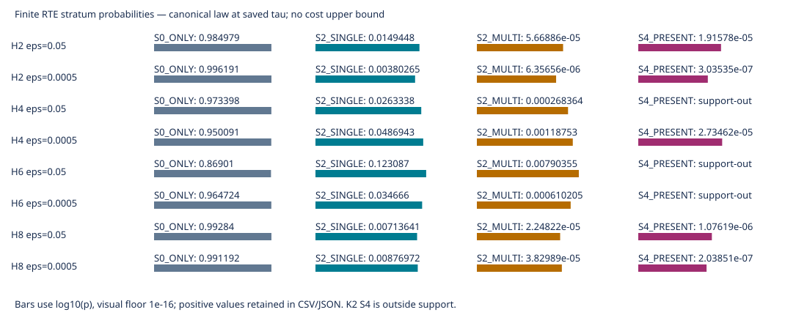

# PR希少RTE期待費用：段階B one-shot結果

2026-10-21 JST。**COMPLETE_STAGE_B / MANDATORY_STOP**。先行調査 `42ed0876c0505502428629c1fb4863233247ebaf` を入力に、承認された8固定条件の保存値解析を1回実行した。新sampling/signal/simulation/SCF/DF/state/回路生成/compileは0。

## 到達点と主張の境界

8条件すべてで原Pのtrajectory・event・両軸RZ・保存analytic shotsを結合し、保存mean exactとpaired SEを再現した。各層の確率、観測平均/SE、未知層を変数として残した条件付き期待費用・逆転境界を保存した。独立有理数DP・integer momentsによる数値照合は全8条件PASS。

**8条件とも全supportの母平均費用順位は保証していない。** 観測層平均をその経験推定に固定した感度では、H4 DF10とH6 DF19のε=.05は、未観測層の費用が非負ならPF低費用を維持する。他の6条件は未知層の加重平均費用に応じて順位が変わる。前者の維持も経験平均固定下の条件付き結果であり、真の母平均順位を認定したものではない。

## 固定条件・SOURCE・入力

linear 1 Å/STO-3G、tol-only DF3/10/19/28、T=.8/P=0、通常signed bias/allowance1、固定PR/PF/analytic shots、独立P cohort、full cosine/sine Hadamard wrapper compiled RZ。旧探索、union n32、legacy H4 DF12、条件付きpilotを混合していない。compilerは旧Qiskit1.3.0/rz,sx,x,cx/opt1/元固定compiler設定/topologyなしの保存測定値であり、今回compilerは起動しない。

新科学SOURCEは `e16c3be8a039f6bc468e112f0ed086bde544fef2`。実行前契約commitは `b1dcc900`。固定[科学契約](pr_rare_rte_stage_b_contract_20261021.md)、[機械可読契約](../../artifacts/resource_applicability/pr_rare_rte_stage_b/2026-10-21/contract.json)、[今回の明示承認receipt](../../artifacts/resource_applicability/pr_rare_rte_stage_b/2026-10-21/execution_approval_receipt.json)、[新grant発行・消費](../../artifacts/resource_applicability/pr_rare_rte_stage_b/2026-10-21/grant_consumption_receipt.json)。有効grant原本は非公開領域に保持し、旧消費済みgrantを再使用していない。

H8 p8/q2のn48には、同じ独立確認cohort内の既完了1 trajectory（両軸）の再利用を含む。結果SOURCE fieldは後続集約実行745a6745であり、初回行の来歴を一律に書き換えたものではない。[元H8結果・再利用記録](track_a_h8_new_pr_confirmation_results_20261019.md)、[固定証拠packet](https://github.com/HIROMU1015/Partially-Randomized-Trotter/blob/a6246f03c6297438ab624fc62e5061a58e53145f/artifacts/resource_applicability/track_a_h8_gpt_share_packet/2026-10-20/candidate/01_results_and_source.json)。H4の同一P cohortの既存MC/bootstrap検証は参照できるが、今回重複実行せず、未観測層を補うものとしない。

GitHubの固定42ed0876・元rte.py・pr_cost_native.pyを実取得してblob ID一致を確認し、原Pのraw・公開projection・監査の1,895入力を読み、SHA対応を保存した。1,526 trajectoryを処理。内部locator・原seed・raw event列は新公開候補に含めない。[入力来歴](../../artifacts/resource_applicability/pr_rare_rte_stage_b/2026-10-21/input_acquisition.json)。

## 条件別の未知層と逆転境界

`K_obs=Σ観測 pi_s*mean_hat_s`、`U=Σ未観測 pi_s`、`mu_U=Σ未観測 pi_s*mu_s/U`。これは未知層の重み付き混合平均という定義であり、各層同費用・費用0の仮定ではない。

`E_plugin[G]=K_obs + U*mu_U`。`mu_U*=(G_PF−K_obs)/U`。観測mean_hatを固定した場合、正の境界ではmu_Uが境界未満ならPR低費用、等号で同費用、超えるとPF低費用になる。負の境界は物理的な負費用の推定ではなく、未知費用非負の全域でPF低費用となることを示す。

下表は保存結果の表示丸め。GはRZ×shot。threshold/S0は、未知層の混合平均境界を観測S0平均で割った保存診断値であり、未知層の実費用比ではない。

|系/ε|PR q/r/K・prefix|層n：S0/single/multi/S4|未知質量U|mu_U*（G単位）|threshold/S0|条件付き方向|
|---|---|---|---|---|---|---|
|H2 / 0.05|B2_p1_q1_2nd_r2_K4|79/1/0/0|0.000075846405|9.6240741e+9|2010.1070|境界依存|
|H2 / 0.0005|B2_p1_q4_2nd_r2_K4|12/0/0/0|0.0038093081|1.4970006e+13|59.971037|境界依存|
|H4 / 0.05|B2_p3_q1_2nd_r4_K2|1071/37/0/0|0.00026836421|-3.6257174e+9|-51.069613|PF維持（観測平均固定）|
|H4 / 0.0005|B2_p2_q8_2nd_r2_K4|71/7/0/0|0.0012148741|2.3893106e+15|482.21337|境界依存|
|H6 / 0.05|B2_p4_q2_2nd_r4_K2|38/10/0/0|0.0079035541|-3.4204441e+10|-54.504056|PF維持（観測平均固定）|
|H6 / 0.0005|B2_p4_q8_2nd_r4_K2|103/1/0/0|0.00061020524|5.7266437e+15|174.26180|境界依存|
|H8 / 0.05|B2_p8_q2_2nd_r4_K4|48/0/0/0|0.0071599715|6.4267258e+9|5.2244968|境界依存|
|H8 / 0.0005|B2_p7_q16_2nd_r4_K4|48/0/0/0|0.0088082223|4.4425404e+14|4.8775067|境界依存|

H2 ε=.05のsingle、H6 ε=.0005のsingleは各n1なのでSE=null。H6粗精度はS2_SINGLE10・multi0と原eventから分類できた。K2のS4は支持外であって未観測費用0ではない。H8両条件はS0以外すべて未観測。

[probabilities.csv](../../artifacts/resource_applicability/pr_rare_rte_stage_b/2026-10-21/probabilities.csv)、[観測層費用・SE](../../artifacts/resource_applicability/pr_rare_rte_stage_b/2026-10-21/observed_strata.csv)、[感度](../../artifacts/resource_applicability/pr_rare_rte_stage_b/2026-10-21/sensitivity.csv)、[全結果JSON](../../artifacts/resource_applicability/pr_rare_rte_stage_b/2026-10-21/result.json)が正本。JSONのunknown_termsは各層の係数と未知平均/分散を保持する。表の丸め値で新しい順位を計算していない。

図のbarは表示用log尺度で、CSV/JSONの小さい正値を0へ置換していない。support-outだけを別表示する。

## 法則の検証と数値上の限定

保存tauを厳密binary64値として取り込んだcanonical有限lawをDecimal100桁で評価した。元SOURCEの次数weight/B/probabilityとsignal側logBを数値照合し、元保存lawを変更していない。保存categorical確率の和と1との差、simplexへの丸め診断とのmass差を結果に残した。これらの差は全8条件で固定1e-12 gate内。canonical有限modelの数値評価と実PRNG bit-level lawは同一認定しない。高精度な表示文字列も元binary64入力の不確かさを消さない。

lambda_Rは保存0次eventの係数・絶対component係数から元式に従いscalar復元し、全保存0次eventでtau=lambda*(.8/q)/rを相対1e-12以内で照合した。独立した全tail L1 norm再監査、SCF/DF/preparation生成ではない。この来歴上の制約はresult.law.lambda_provenanceに明記した。

独立経路はFractionとinteger isqrt130桁によるlaw再構成・4状態DP、integer raw momentsからのvariance/SE計算。主経路のlaw/mass/stats関数を呼ばず、8条件のmassは絶対1e-85、SE/境界は相対1e-85 gateを通過し、mean/varianceはexact一致。[独立数値監査](../../artifacts/resource_applicability/pr_rare_rte_stage_b/2026-10-21/independent_numeric_audit.json)。担当Codex自身の別実装検査であり、独立AI科学レビューや数学的certificateではない。

## 不確かさと段階Cの必要性

未知層massと費用を分けて評価できたが、観測層mean_hatには標本誤差と未被覆component列が残る。bootstrapや標本SEを全support母平均の保証へ格上げしない。全条件のmathematically_guaranteed_cost_upper_boundとunconditional_population_mean_Gはnull。旧Tier Rのcompiler閉包不足も解消していない。

- **H8の2条件**は、未観測混合平均の境界が観測S0の約4.88〜5.22倍で、今回8条件の正境界の中では比較的小さい。single/multi/S4が全て未観測のため、母平均の主張を強めるなら同じp8q2とp7q16の費用情報が最初のC候補になる。確率係数ではsingleが主要な未観測項であり、S4だけの取得を自動優先しない。
- **H6 p4q8/r4/K2とH2 p1q4/r2/K4**は次の情報候補。H6はsingleがn1でSE不明、multiも未観測。H2 q4は全希少層未観測。H6の未知multi境界が大きくても、既知扱いしたsingle平均の精度が十分とは結論しない。
- **H4 DF10 p2q8**の未知multi/S4境界、**H2 p1q1**の未知multi/S4境界は、観測mean_hat固定下ではさらに高い。ただしH2のsingleはn1で、これらを全supportへの保証や未知費用が小さい証拠にはしない。
- **H4/H6の粗精度**は今回の限定された「非負未知費用で条件付きPF方向が変わるか」という問いには追加compile不要。PF母平均順位まで主張するなら、観測層・compiler/確率推論の保証は別問題である。

Cは自動的に必要でも、今回承認済みでもない。有限標本benchmarkと今回の条件付き境界を提示するだけならBで止められる。母平均順位を強める場合も、静的/解析的保証経路で不足を埋められるかを含めた別判断が必要で、有限pilotの増量だけで厳密保証が得られるとはしない。[条件別不足・C最小計画](../../artifacts/resource_applicability/pr_rare_rte_stage_b/2026-10-21/condition_sufficiency_and_C_plan.md)。

## 終了監査・STOP

人工14件PASS（zero-timeのDecimal境界の初期fixture失敗は実データ実行前に修正）。新SOURCE・input・runtime77 fileを封印し、fresh資源を読取確認した。科学予算は解析pass1/条件8/独立照合8/描画1、禁止callは全0。旧証拠1,895 fileは実行前後ともSHA一致。新grant/one-shot markerは各1回、retry/resumeなし。

native worker exit0、同じ親がwait4で回収、残科学worker0。本体wallは保存値 `3.271886132657528` 秒、peak RSSは単一workerの保存値でpool合計ではない。親driverも実行toolでexit0を確認。恣意的なCPU/RAM/worker cap・共有設定/他job操作0。[終了監査](../../artifacts/resource_applicability/pr_rare_rte_stage_b/2026-10-21/completion_audit.json)、[native記録](../../artifacts/resource_applicability/pr_rare_rte_stage_b/2026-10-21/native_exit.json)、[call台帳](../../artifacts/resource_applicability/pr_rare_rte_stage_b/2026-10-21/calls.json)。

[保存・文書構造監査](../../artifacts/resource_applicability/pr_rare_rte_stage_b/2026-10-21/documentation_audit.json)ではCSV/JSON転記一致、旧索引bytesの保持、公開候補の限定private pattern検査、SOURCE・結果のSHAを確認した。[SHA目録](../../artifacts/resource_applicability/pr_rare_rte_stage_b/2026-10-21/SHA256_manifest.json)は自身だけを自己参照から除く。文書checkerの支持外status名・ゼロ文字列表記の初期期待値は保存schemaに合わせて修正した。科学SOURCE/結果の修正や科学再試行はない。

専用branch `codex/pr-rare-rte-stage-b-20261021`。結果・文書・監査をローカルcommitし、新規pushは公開範囲の別承認まで行わない。詳細GPT/Claude科学レビュー・最終evidence freeze未開始。次の担当：**ユーザー**が結果の扱い、必要な母平均保証の範囲、C候補と公開範囲を判断する。**Codex**は段階Bでmandatory STOPし、C/D・追加sampling/compileへ進まない。
