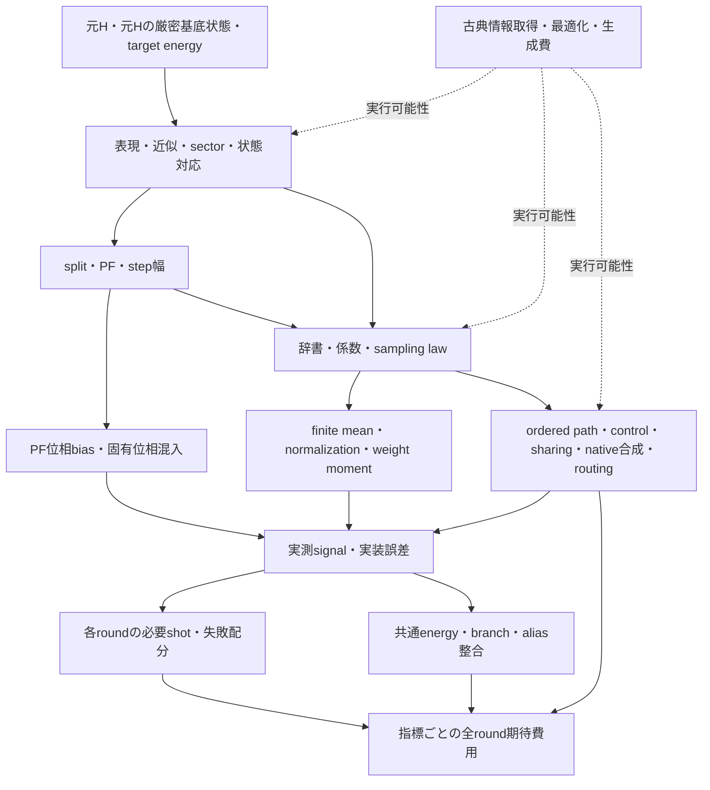

# PR＋RPEの費用・誤差の依存地図

2026-11-06 JST。式と既存文献・保存結果の概念的整理。保存値の再会計、最適化、改善率計算は行っていない。文献locatorは [SOURCES.md](SOURCES.md)、比較条件は [PRIOR_ART_COMPARISON.md](PRIOR_ART_COMPARISON.md)。

## 1. 費用の単位とsignalの単位

元Hの厳密基底状態を同じ条件で利用し、状態準備を除くfull interrogationを数える。

\[
G_{\mathrm{total}}^{(a)}=
\sum_{m,b}N_{m,b}\bar C_{m,b}^{(a)},\qquad
\bar C_{m,b}^{(a)}=
\mathbb E[C_{m,b}^{\mathrm{full,no\text{-}prep},(a)}].
\]

資源 `a` ごとに別の合計を持つ。depthの合計はこのshot費用の指標であり、複数processorでの実wall timeそのものではない。古典時間、追加qubit、peak memoryも別欄に残し、交換率なしにgate数へ合算しない。

full circuitにはcontrolled evolution、ancilla回転、HadamardのX/Y読出し等を含む。追加reference、CSWAP、fan-out/reset/error detectionを方式が要求するならその費用境界を明記する。通常の入力状態準備除外を、候補固有の演算・reference操作がすべて無料という仮定に広げない。

random回路列ωの**振幅平均**がHadamard signalを決める。一般の重み付き構成を記述する記号として

\[
Q_m=\mathbb E_{p_m}[w_m(\omega)V_m(\omega)],\qquad
Z_m^{\mathrm{corr}}=\langle E_0|Q_m|E_0\rangle
\]

を使う。これは新算法ではなくL01/L04/L09に現れる平均/補正の会計表記である。実測raw signal、補正後signal、systemのrandom-unitary channelを分ける。正のBで `Z_raw=B⁻¹ Z_corr` とする実装なら、補正後estimatorのrangeもBに応じて変わる。raw半径によるN増加と補正後rangeによるN増加を二重計上しない。

## 2. 依存関係

矢印は新たに定量化した効果ではない。分子・精度・compilerを固定した後に確認すべき依存関係を表す。全構成要素を変更する必要はなく、一つの変更でもNと価格の積が改善すれば目的に寄与し得る。

## 3. 変更が安くする部分と相殺する部分

| 変更・根拠 | 費用低下へ向かう経路 | 費用増加・誤差・相殺の経路 | 全round接続で未解決の条件 |
|---|---|---|---|
| OO/BLISS/RC-DF、mixed辞書：L03/L07/L14–17 | tail質量低下、安いprimitive、deterministic項削減 | basis移動、fit bias、control、異なるfragment順、状態対応、古典fit | 元H E₀を推定する保証と、表現取得費を含む公平性 |
| L_Dを増やす：L01/L03 | random tail・normalization/shot負担低下 | deterministic backbone単価とPF biasが変化 | PF誤差・N・full priceの同時接続。L_D単独の単調性は仮定しない |
| 高次/processed/near-integrable PF：L02 | 同じbias予算でstepを粗くできる可能性 | stage数、負時間、内部D誤差、RTE normalization、情報取得費 | raw phase/radiusと長roundの分枝条件。高次PFを対照にも許す |
| Taylor cutoffやrを増やす：L01/既存finite RTE | finite-mean誤差低下、半径改善 | event数・rare order・生成・compiled費用増加 | 希少層を含む期待価格とpositive radius。旧検証範囲外への外挿不可 |
| 全path IS/再配分：L04/L05 | 安いpath頻度増加、momentと価格の交換 | weightのrange/二次moment、normalizer/価格取得、生成費 | 必要Nの有限confidence保証。再重み付けだけでbiasを消せない |
| 相関sampling：L22/L23/既存audit | 切替削減、誤差order改善の可能性 | joint mean変更、符号・history計算・weight負担 | marginalだけでなくcoherent mean。旧correlationの留保を維持 |
| Return aggregation/zero-fill：既存G6–G10 | 既知returnをまとめる、不要な回路を減らす | child生成・finite bit・全trial分母・lookup/合成費 | 条件付き成功pathと無条件期待価格を区別。C1は凍結維持 |
| 角度丸め/PAI/native placement：L01/L02/L08–10 | 高価な任意角合成の削減、bias交換 | 残差tail・符号weight・shot増、workspace/RUS、実装誤差 | actual finite RTE・全wrapper・全N。primitiveだけの価格では不足 |
| basis共有/control軽量化：既存builder/L07 | 隣接basisや逆演算の相殺 | 異なるbasis、phase欠落、routingにより利益が変化 | 全方式へ同じ既知fusion。P-A interval固有差は復活させない |
| SE/reference control：L11 | evolutionの制御overheadとdepth低下 | CSWAP、追加qubit、reference位相、routing、検出/retry | 共通固有基底とreference条件をrandom pathで満たせるか |
| round別構成：L03 | 各時刻に合う価格・誤差交換 | 各構成のeffective phase差、状態対応、compile/fit/取得費 | 同じE₀/branchを推定する接続。早いroundのalias失敗を無視しない |
| signal感度設計：L12 | 同じ情報精度の測定/query負担を改善する可能性 | 多重oracle、ancilla合成、設計費、近似誤差蓄積 | RPEと異なる推定器。ideal-oracle保証をPR平均へ直接移せない |
| topology対応：L19/L20 | mapping/routingと辞書の相互作用 | swap、layout探索、register距離、control通信 | 同じgraph/compiler機会で比較。topology-free費用では決められない |

## 4. bias・半径・Nの接続

[研究方法](../研究方法・解析手順.md) と [既存accounting SOURCE](../../../src/trotterlib/rpe_resource_accounting.py) は、統計誤差とPF/finite-RTE誤差を分けている。正当化された基準半径下界がある場合の既存式は

\[
\rho_{m,\mathrm{lb}}^{\mathrm{obs}}
=A_m^{\mathrm{att}}
(\rho_{\star,m,\mathrm{lb}}-\epsilon_{Z,m})>0.
\]

既存のbounded ±1座標測定で使う十分shot式は

\[
N_{m,b}\geq
\left\lceil\frac{2}{\epsilon_{m,b,\mathrm{coord}}^2}
\log\frac{2}{\alpha_{m,b}}\right\rceil.
\]

これは既存式の再掲であり、新しいshot保証の導出ではない。座標許容差を半径と統計位相予算から決めるため、半径低下はNへ効く。weighted estimator、相関trial、検出後のpost-selectionに同式を無変更で用いない。L04の二次moment目的だけから、このNやbranch条件が最適になるとはいえない。

PF bias、finite-RTE bias、native synthesis error、Hamiltonian fit誤差は別の源である。正scalarは位相を回さなくてもshot費を変える。厳密基底状態であっても近似PFの固有状態とは限らず、unit-radius/single-phase条件を新たに仮定しない。`C_use`は実行済みδ窓内の経験的envelopeであってrigorous upper boundではない。

L01 App.EのRMSE会計、L03の最終round近似、L18の訂正後branch条件はそれぞれ別に確認する。旧契約や保存Nを今回修正・再計算していない。

## 5. 元Hへ戻すための対応

| 操作 | 同じE₀へ戻るために必要な説明 |
|---|---|
| 単なる基底/軌道変換 | Hとstateを対応させる。追加の物理演算が必要なら費用境界に含め、候補だけ別state oracleを与えない |
| BLISSのようなblock保存 | 対象sectorとその保持、identity/scalar位相を明示。全空間のground順位保存を仮定しない |
| DF truncation/regularized fit/discard | 元Hとの差をenergy保証に戻す。近似Hの厳密groundやCCSD(T)誤差を元H保証に置換しない |
| PF/processed/round別split | effective phaseから共通E₀への誤差、重み/半径、branch/aliasの対応。局所Cだけで最長roundを保証しない |
| reference control | referenceの既知energyだけを使い、未知のtarget E₀やgapは使わない。制御下の相対位相を保持 |

## 6. 保存証拠が閉じている部分と残る部分

統合台帳の `SUP-RPE-V3R1/ENERGY` は条件付き18round成功・energy接続をすでに含む。一方、長qのprice移送や実装全体の成功、true molecular energy、最終費用優位は閉じていない。`MIX-F2` の単回費用、`SUP-C-*` のnominal/固定word、`C1-*` のlogical pathを、この不足の代わりには使わない。各保存条件は [比較表§4](PRIOR_ART_COMPARISON.md#4-保存結果が課す反証境界) と統合台帳へ戻る。

したがって本mapは、局所改善から総費用への**経路の存在**を示すもので、改善率・最適値・科学的優先順位を与えない。変更する箇所が一つでも、相殺要因と全round成功条件を閉じたときに初めて総費用改善を主張できる。
