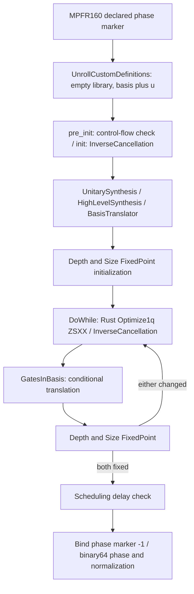

# 研究C：PR-aware DF C2-A・全law native synthesis誤差の技術準備

2026-10-27 JST。Repository：`HIROMU1015/Partially-Randomized-Trotter`。起点`dbb665172e889fb1a4ac1c5673bf38c420586dd9`。

**固定P0の実経路、有限raw grammar、条件付き変換回数制限、phase-sensitive誤差入力／全round伝播adapterを準備した。新規25＋既存回帰85＝110 testsが最終PASS。新規実H4科学callは0。** 全lawの有用な数値上界はまだ取得できず、[契約草案](research_c_pr_aware_df_c2a_contract_draft_20261027.json)は`BLOCKED_UNAPPROVED_SCIENCE_DESIGN`／`executable=false`／call上限nullとした。これは無制限実行の許可ではなく、実行可能な科学契約ではない。

## 1. 固定条件と既存証拠

対象は保存直鎖H4・隣接1.00 Å・STO-3G、通常number CDF rank8のBaseline/Proposed、Nα=Nβ=2/sector36、system8+ancilla1/full512、元frame順LD2。Partial symmetric S2、δ=.1/s4/h1/40/r16/K0、m0..12、own-DF ground oracle／状態準備除外、元g補正κ・scalar一度、CA=.00159 Ha/DF reserveCA/8を維持する。今回それらの実数値を新しく評価していない。

- [C2-Bridge](research_c_pr_aware_df_stage_c2_bridge_execution_20261027.md)：47call完了。最大sector operator観測距離は約6.53e-11/9.47e-11、raw signalは約5.99e-11/8.11e-11。Binary64数値対応であり、丸めenclosureではない。
- [C2-B](research_c_pr_aware_df_stage_c2b_execution_20261027.md)：IID一様53-bit格子モデルの条件付きlaw上界。PCG64 joint streamのIID性やnative synthesisは含まない。
- [B2](research_c_pr_aware_df_stage_b2_execution_20261027.md)：64 sampled complete kernel/full512/actual adjoint/X-YがPASS。Sample最大残差は全law boundにしない。
- [C1](research_c_pr_aware_df_stage_c1_execution_20261027.md)：約83.1%の総RZ削減は明示仮定付き点推定。Evidence laneの保証shots/totalはnullのまま。

保存証拠はhash・JSON来歴の確認と引用だけで、新しい係数・確率・誤差・phase-roomの再解析をしていない。J/U/NPZ/QPYの数値decode、実H4 build/compile、sampling、fit、C1再実行は0。

## 2. 再利用と最小差分

| 既存資産 | 今回の再利用・適合範囲 |
|---|---|
| `c_pr_aware_df_stage_c2_audit.compiler_audit` | 固定presetとローカルSOURCEの確認。新adapterはpre/post stageも含むgraphと属性を検査 |
| `c_pr_aware_df_stage_b/ stage_b2` | 元split、head/tail構造、exact spin-lift κ、full-frame provider、scalar、B2 full operator検証の定義を静的確認 |
| `c1_stage2_native/ c1_stage3_native_bridge` | Gaussian sandwich、central control、r16/K0、head-tail非融合を維持。新emitterなし |
| `c1_h4_strong_baseline.StrongBuilder` | head内部4 directed relative transition/armとanalytic vacuum phase、fsum。一般tail相対融合は追加しない |
| `c1_h6_native_precision.gaussian` | exact-zero、LAPACK Givens、atan2、既存XXPlusYY schedule。Single-particle guardをfull-Fock proofへ昇格させない |
| `c1_h6_compiler_precision.compiled_wrapper` | MPFR160 declared-phase marker、固定P0、最終bind/castを人工回路で再利用。Phase fittingなし |
| `c_pr_aware_df_stage_b2_compat.SharedQiskitCalls` | 人工control生成、unroll、whole compile、actual-adjoint生成に既存process-local mutexを使用 |
| `c_pr_aware_df_c2_bridge.uniform_synthesis_preview`／C2`synthesis_preview` | Phase-sensitive全law proof入力からのexact rational L1 preview。証明器として扱わない |
| `repeat_bound/round_synthesis/assess_native_probe` | 既存unitary telescope・X/Y Lipschitz・数値pilotの範囲を確認。前2者を人工preview診断として再利用 |

新規は`c_pr_aware_df_c2a.py`、passive-only `check_research_c_pr_aware_df_c2a.py`、同名management test。既存に、固定ZSXXの条件付き回数制限・graph mismatch拒否・raw/P0/referenceを分けた入力検査はなかったため、このopt-in接続だけを追加した。旧科学SOURCE／テストは変更していない。

## 3. 固定P0の実経路

[全stage graphと属性](../../artifacts/research_c_pr_aware_df_c2a/2026-10-27/technical/compiler_coverage.json)／[SOURCE hashと公式参照先](../../artifacts/research_c_pr_aware_df_c2a/2026-10-27/technical/external_sources.json)。Qiskit1.3.0、opt1、seed17、`rz,sx,x,cx`、approximation_degree1、qubits_initially_zero=false、layout/coupling/backendなし。Profile・emitter・compiler政策は変更していない。

| 変換 | 実際の対象・分岐・数値意味 |
|---|---|
| UnrollCustomDefinitions | 空EquivalenceLibrary、basis+uをleafとしてofficial definitionsを再帰展開。Supported/directive/calibrated/control-flow/open-controlの分岐あり。今回grammarはbound numeric unitary、calibration/control-flow等を除外。未知definitionはFAIL |
| Init InverseCancellation | 固定self-inverse/pairのみ。Raw event境界を知らずadjacent runsを消し得る。登録gateはすべてparameter-free。Rust parameter比較1e-10を任意RZ近似cancelへ転用しない |
| UnitarySynthesis | presetには存在する。既定対象は`unitary`（pulse条件でswap）。Official unroll後がu/rz/sx/x/cxだけならopaque matrix synthesisは作動しない。このgrammar前提が破れれば未coverage |
| HighLevelSynthesis | 初期translationでpassは実行される。High-level plugin/control-flow等はこのlowered grammar外。Standard gateのequivalence/definition対応を持ち、数値enclosureは別途必要 |
| BasisTranslator | 固定SessionEquivalenceLibraryから最終basisへ翻訳。uの定義・parameter arithmetic・phaseを含む。初期translationの全規則が数値proof済みという意味ではない |
| Optimize1qGatesDecomposition | Python`run`はRustを呼ぶ。固定属性はtarget=None/error_map=None/decomposers=['ZSXX']。Python補助`_substitution_checks`だけを現経路の根拠にしない |
| Rust 1Q処理 | `collect_1q_runs`、各gateのf64 2×2行列を左から積算、Euler角からZSXX列を生成、短い列/identity等へ置換しphaseを加算。Runは同一wireのmulti-qubit境界まで伸び、元event/head境界は保持されない |
| ループと条件付き翻訳 | Optimize1q→InverseCancellation→GatesInBasis→必要時translation→depth/size検査。最終basis閉包が保たれればループtranslationは不作動。新gate/target/plugin追加時はこの議論を使わない |
| Phase wrapper | MPFR160 offsetをsymbolic phaseへ加え、compile後に-1でbindしfloat化。Compilerが先に生成したf64角度/phaseの誤差や、最終phase正規化を消す手段ではない |

根拠：[fixed preset](https://github.com/Qiskit/qiskit/blob/1.3.0/qiskit/transpiler/preset_passmanagers/builtin_plugins.py#L535)、[実Python→Rust呼出し](https://github.com/Qiskit/qiskit/blob/1.3.0/qiskit/transpiler/passes/optimization/optimize_1q_decomposition.py)、[Rust active optimizer](https://github.com/Qiskit/qiskit/blob/1.3.0/crates/accelerate/src/euler_one_qubit_decomposer.rs#L1076)。初期graphとZSXX/target属性・param-free条件を検査する`check_graph`は、未知pass/設定を未coverageへ落とす。Graph一致も数値certificateではない。

### ZSXXの数値分岐

Rustの`params_zyz_inner`はdeterminantのarg、`atan2(|u10|,|u00|)`、各entryのargから角度を復元し、`params_u1x_inner`でphaseを変換する。ZSXXはnear-zero θ、near-π/2、near-π、λ+π/φ近傍、RZ省略、2 SX対X shortcut、mod2π endpointを使う。`ANGLE_ZERO_EPSILON=1e-12`はこれらの分岐閾値であり、whole-operator誤差ではない。

特にRZ生成と`global_phase += phi/2`を組にするとP(phi)に相当する。省略branchで両方を省けば、局所差はRZ単体の角度差だけでは記述できない。RZ(a+2π)=-RZ(a)なので、mod2πとphaseを切り離すと符号を失う。人工テストはこの相対phase欠落を検出する。[ZSXX/PSX実装](https://github.com/Qiskit/qiskit/blob/1.3.0/crates/accelerate/src/euler_one_qubit_decomposer.rs#L276)。

未確認の**数値proof**は、全near-unitary入力領域におけるf64 gate行列/積、arg/atan2・mod2πのplatform依存誤差、branch簡略化を含む再構成operator、phase加算/最終castの囲い込み。高精度との有限点一致やMPFR使用だけではこれを埋められない。固有のEuler角は極付近で悪条件になり得るため、角度の一様Lipschitzだけでなく**再構成2×2 operator**の誤差を囲う必要がある。

## 4. 有限raw grammarと指数列挙を避ける構成

[Primitive coverage](../../artifacts/research_c_pr_aware_df_c2a/2026-10-27/technical/primitive_coverage.json)／[人工symbolic template](../../artifacts/research_c_pr_aware_df_c2a/2026-10-27/technical/symbolic_templates.json)。各armに9 basis、headの4 directed relative products、tail6frame×36 signed Z/ZZ=216 atom、K0 angle、scalar/identity、head/X/Y shell、actual inverseがある。16 eventで同一basisのrunは1〜16。既存はtail runの両端にB⁻¹/Bを置き、tail間に新たな一般相対Gaussianは合成しない。

二つの3-factor headは各4 Gaussian（入口・相対2・出口）、tailは最大32 Gaussianで、合計最大40。8-mode Gaussianの既存elimination loopは最大8 RZと28 XXPlusYY。Head中央は6因子×最大8 controlled RZ/28 controlled RZZ、tail eventは最大2 RZ/4 CX、head scalar/Iと末尾phaseは最大7 P。これはSOURCE loopからの構造要件で、H4の実native単価や科学的費用ではない。

人工symbolicなXXPlusYY/逆・controlled RZ/RZZ・Pをofficial definitionsでbasis+uへ展開した。例えばCRZは2RZ+2CX、XX/逆は同じtopology。Symbolic proxyだけはnumeric production controlと同じexplicit definitionへするため`annotated=False`を指定した。生産SOURCEのcontrol条件は変更していない。Symbolic countsはreference/translation丸めの証明でも、実H4回路のbuildでもない。

### 新たに絞れた条件付き回数制限

初期translation後にN nodeあり、(i) basis閉包、(ii) target/error_mapなし、(iii) ZSXXのみ、(iv) parameter-free cancellation、(v) calibrationなし、とする。この条件下ではRustの採用条件はgate countのstrict減少になる（outside-basisはfalse、error proxyはgate count、zero列置換もstrict減少）。ZSXX出力は最大5gate。InverseCancellationは削除だけである。

- 採用rewrite回数R≤N、loop iteration≤N+1。
- 1Q runの最大長≤N。Event境界に限定しない。
- 採用したrunの入力gateはその時点で除去される。初期gate N個と各rewriteの新gate≤5個しか再入力を供給しないので、**採用run全体のgate行列積の入力回数≤N+5R≤6N**。
- 置換されないrunの数値計算は最終回路へ使われず、その丸めをoutput誤差へ積み上げない。

`monotone_budget`はこの条件付きの整数構成を実装し、前提不足ではnullを返す。深さ/sizeの実際の監視条件もSOURCEから確認した。これにより「全216^16 wordそれぞれのcompileを列挙しないとcoverageを設計できない」という必要はない。**ただしNを固定する初期翻訳のtopology上界と、各採用rewriteの有効な数値上界は別に必要**。実H4のN・一様誤差は算定していない。Gate数の議論が証明するのは回数であり、ZSXX数値誤差ではない。

## 5. Raw・P0・referenceの誤差源と取得方法

| 誤差源/対象 | 有効な上界の候補・必要条件 | 現状 |
|---|---|---|
| Gaussian Γ(V)／vacuum phase | Unitary対象のsingle-particle誤差を外積powerへliftする解析評価、またはvalidated局所演算子。元U非unitarityとphaseを別に囲う | 既存1e-10 transfer guardだけではfull controlled証明なし |
| Relative Vj†Vi | 小行列積のrounding、元basisと新Gaussianのvacuum phase差をenclosureへ含める | 数学的向き・fsum経路は追跡済み、有効数値enclosureなし |
| Signed event、κ/I/scalar | 元係数→時間係数→atanτ→native角度・control phase。倍角・control分解・phaseの同時評価 | 符号/定義は既存検証、有効丸め上界なし |
| Raw gate emitter | Official RZ/XXPlusYY/control定義をexact gate意味論とparameter演算へ分離 | 人工symbolic/phaseテスト、all-parameter roundingは未資格 |
| P0 initial unroll/translation | 有限gate定義と選択したequivalence規則をphase込みで囲う | 構造資料と人工展開、数値proof未取得 |
| P0 whole 1Q rewrite | 全near-unitary 2×2入力領域＋全ZSXX分岐のoperator enclosureを、≤6N visits/≤N phase加算へ適用 | **最優先の未解決条件** |
| CAR・density/operator | CAR exact algebraと保存係数の丸めを分離、entry interval/解析上界 | Bridgeのobserved residualを代用しない |
| expm・product・power | Validated small-matrix exponential／積のoutward enclosureとunitary/invariant条件 | 高精度二水準cross-checkだけでは厳密保証にならない |
| Norm・complex signal・Operator decode | 2-normを必ずSVDで囲う必要はなく、validated entryからFrobenius上界等へ。Gate decode/expectationのroundingを含む | 新H4計算なし |
| Actual adjoint | Exact unitary adjointなら距離不変。ただし実際のinverse/control再構築の丸めとphaseは別coverage | 既存inverse/mutexを人工再利用。元kernelのprobeだけで未観測inverseまで証明しない |
| X/Y shell | 共通3shellは一度ずつphase-sensitive enclosure | 人工数値検証のみ、H4のqualified値なし |

Directed rounding/interval/validated matrixの採用は候補で、まだ固定していない。特に独立referenceを高精度で計算しても、実Rust/libm出力に全入力で適用する誤差モデルが自動的に得られるわけではない。普遍的unitary距離2だけを有用なcertificateとしない。

## 6. 全roundのraw complex-signalへ

`uniform_preview`はraw5分類、compiler7分類、numerical-reference、head/X/Yを別に受け取る。`analytic_unitary_bound/enclosed_unitary_bound`、full controlled operator2、phase-sensitive、all-word coverage、同じexact saved-atom target、CAR Bridge除外を要求する。Observed/sample最大値、event別P0、phase-fit、未知reference、graph/branch不足、非unitary/invariant未確認は拒否またはnull。証明そのものをschemaが認証するわけではない。

各occurrenceで別trajectoryを使っても、**全wordに有効な同じε**があり、比較するfactorがexact unitaryなら、積の差はΣ εで抑えられる。固定wordの反復だけを仮定しない。Pointwise boundを平均する段階にはIIDは不要で、B1理想平均/C2-B lawへ結び付けるIID条件は別で残る。

`n=4*2^m`、εk=εraw+εP0+εnumref として、既存伝播の保守的L1形は

`d_X=min(2,n εk+εhead+εX)`、`d_Y=min(2,n εk+εhead+εY)`、`raw synthesis ≤ 2(d_X+d_Y)`。

実装は既存Bridge/C2のexact rational previewを使い、`repeat_bound/round_synthesis`のfloat版は診断欄だけに置く。Attenuationを機械的に掛けない。Shellはroundに一度、numerical-referenceは一度。CAR/atom Bridgeは外部のround-level signal項、C2-B lawも別項で、ここへ再加算しない。未知は0にしない。

Capsが効かない領域でm12のkernel誤差係数は4n=65536。将来の利用可能raw roomをBとすると、shell等を除いたεkはおおむねB/65536より小さい必要がある。これは固定反復数からの構造式であり、保存H4のphase roomとの新比較やshots算定はしていない。過度に保守的な全branch/global上界が有用性を失う可能性を残す。

## 7. 人工・回帰と保全

[構造化結果](../../artifacts/research_c_pr_aware_df_c2a/2026-10-27/technical/tests.json)／[新規25 PASS](../../artifacts/research_c_pr_aware_df_c2a/2026-10-27/technical/c2a_tests.log)／[回帰85 PASS](../../artifacts/research_c_pr_aware_df_c2a/2026-10-27/technical/regression_tests.log)。Finite grammar、条件不足拒否、actual preset、unknown pass、eventをまたぐrun短縮、near0/π/2/π/mod2π、full controlled相対phase、actual adjoint、X/Y、全round proof-input E2E、double-count防止、null、SOURCE/input不一致、実行option不在を確認した。人工full operatorだけを使い、実H4に転用していない。

回帰の初回は旧C2の故障注入testで1件FAIL/84PASS。[初回log](../../artifacts/research_c_pr_aware_df_c2a/2026-10-27/technical/regression_initial.log)を保存した。並列armの原REPLAY例外に先行してdependent `Stopped`が表出する旧経路の順序競合で、journalによるSTOPの意味は維持される。旧SOURCE/testを変更せず全suiteを再実行し85PASS。最終110PASSだけを安定性の保証とせず、この既存testの順序依存を残る技術的制約として記録する。

[Passive preflight](../../artifacts/research_c_pr_aware_df_c2a/2026-10-27/technical/passive_preflight.json)はSOURCE93/input23と14個のfixed Qiskit Python SOURCE、package版を照合し、数値関数/NPZ decode禁止下でもPASSする。共有venv/OS/cache/他jobは変更しない。Task-local cache、2独立test process（各process内のQiskitはmutex）を用い、CPU/RAM/worker/wallの人工上限なし。小さい人工回路/2×2行列なのでGPUや大規模operatorを必要としない。実資源はpreflight記録を参照。

[保全確認](../../artifacts/research_c_pr_aware_df_c2a/2026-10-27/technical/preservation.json)では旧src/scripts/PR-aware証拠1848件のうち1846件がbyte不変、残る2件はscript/library READMEへの入口追記だけ。旧科学SOURCE、結果、grant/ledger/marker/STOPとC1/C2-B/Bridgeの資格は変更していない。

## 8. 最小科学案と未承認契約の状態

今回の順序は**まずtechnicalなuniversal 2×2 rewrite enclosure**を推奨する。実H4のprimitive残差を追加で測るだけでは、主要なwhole-P0 gapを埋められない。A1で使うreference評価法すら未固定のまま、仮のcall数を実行可能上限にしない。

| 案 | 得られる科学情報と前提 |
|---|---|
| A1 finite primitive/reference | 各armの9 basis+4 directed relative、signed central angle/phase等を囲う。評価法/precision/target/guardが固定できれば小行列中心で現実的。ただしA1だけでwhole-P0は完成しない |
| A2 whole-P0 | 全ZSXX branchと初期translation/phaseを囲い、構造回数へ適用する。全216^16 compile列挙を既定としない。現在は数値enclosure不足 |
| A3 統合 | 有効なA1/A2/reference/shellを受け、独立Bridge/law項と接続。未知のままC1へ注入しない |

[草案](research_c_pr_aware_df_c2a_contract_draft_20261027.json)には固定物理条件/compiler、SOURCE93/input23、reference対象、未資格数値条件、分類、STOP、retry/resume0を記載した。**科学call分類・最大数・enclosure precisionはnull、executable=false**。Reserved outputは未作成。Passive-only entryに`--execute`はなく、genericな許可だけでこの草案から科学実行へ進めない。承認証明書や新grantは不要であり、問題は許可の証明ではなく数値評価法とscopeの未完成である。

最小の追加技術調査は、(1) supported near-unitary 2×2領域とRust transcendentalの誤差前提を明示、(2) ZSXX全分岐を再構成operatorとして囲う方法を人工領域で確立、(3) official初期translation/phaseの同じ方法への適合、の3点。次に必要なA1だけをSOURCE/precision/callへ具体化する。Compiler政策の変更や別の実装誤差モデルの採択が必要なら研究Cへ戻す。

## 9. SOURCE・Q1〜Q5・次の担当

- Branch：`codex/research-c-pr-aware-df-c2a-preparation-20261027`
- [SOURCE93](../../artifacts/research_c_pr_aware_df_c2a/2026-10-27/technical/SOURCE.json) SHA256：`3f4fce88f4d35f703545b98ae8087aeedb4e84fe02aadb0ee90df01287d211c1`
- 契約草案SHA256：`ec21db2ad4b0f2aa0d6b66ba62f5cb8c94d04bad5c3b6017fe271e4a10bc8744`
- [技術STOP](../../artifacts/research_c_pr_aware_df_c2a/2026-10-27/technical/STOP.json)：新規実H4科学call0、C2-A/C1 scienceなし。

**Q1：方法の構造はある。** 固定ZSXXの全2×2領域で局所operator誤差を囲い、whole-P0の採用回数/phaseへ伝播する。現状、有効な数値enclosureは未完成。

**Q2：有限raw basis/relative/216 signed support/angle/phase/3shellと、initial unroll/translation、全ZSXX分岐、phase、actual inverseを覆う必要がある。** Finite raw集合だけではcompiler数値pathを覆わない。

**Q3：指数列挙なしの構造的・計算量的経路は見えるが、有用性は未判定。** 小行列のvalidated計算を使う候補はある。SOURCEの簡略化閾値や高精度cross-checkを数値proofの代わりにしない。

**Q4：現時点ではH4科学実験より、universal 2×2 rewriteとreferenceの数値囲い込みを先に技術確立する。** A1/A2/A3の科学callは未固定で実行不可。未知branch/SOURCE/phase/単位性の不一致、政策変更が必要な場合は依存資格付けをSTOPする。

**Q5：今回の技術結果だけでは約83%点推定の科学的資格は変わらない。** 将来、小さい全law raw/P0/reference boundを得れば誤差仮定の一部を実装証拠へ置換できる。実PCG64、Bridge enclosure、費用support/CI、共通CAとshots/総資源の再評価はそれぞれ残り、同時に保証されたとはしない。

次は**研究C／ユーザー**が上の不足に絞った技術作業の方針を判断する。**Codex**はその具体的指示後に進み、実行可能な新科学契約を作れてから別途明示許可後だけ実H4を評価する。今回のcommit/push・remote SHA/SOURCE/成果物照合後は**mandatory STOP**。C2-A実分子計算、C1再解析、sampling、shots/総資源、別分子、重要なGPT詳細科学レビューへ自動進行しない。
