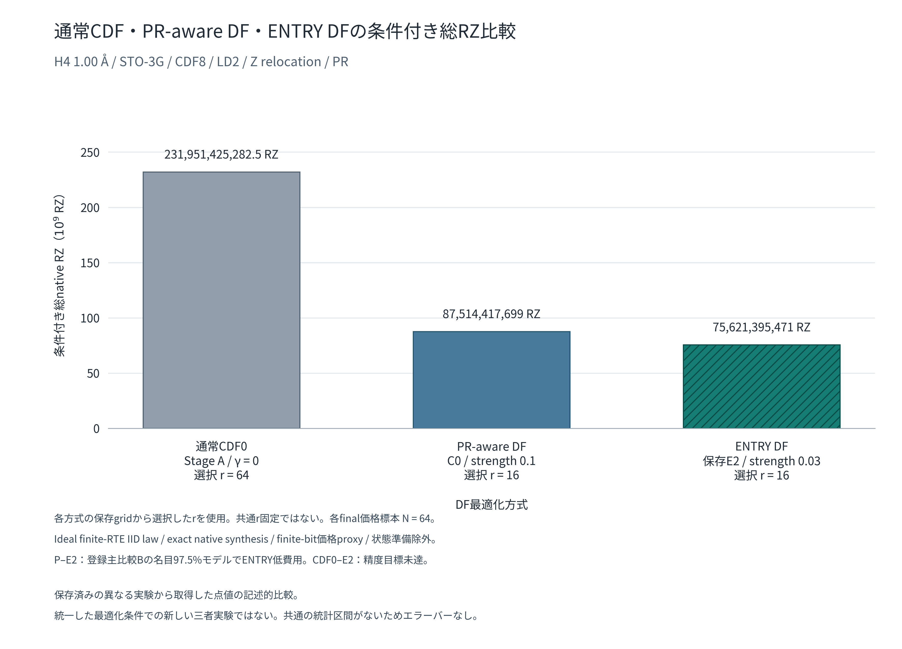

# 研究C：通常CDF・PR-aware DF・ENTRY DFのZ再配置後三者比較

2026-11-08 JST。既存科学結果の統合資料。Repository: HIROMU1015/Partially-Randomized-Trotter。

**保存された条件付き総RZの点値は、通常CDF0/r64が231,951,425,282.5、PR-aware P/r16が87,514,417,699、ENTRY E2/r16が75,621,395,471。** ENTRYがこの三つの保存点値では最小だが、統計資格は比較ごとに異なる。P対E2の登録主比較Bは`NOMINAL_MODEL_ENTRY_LOWER`、CDF0対E2は**`UNRESOLVED_PRECISION_TARGET`**のままである。[再配置P/E原報告][B]、[CDF0 run02原報告][C]

## 1. 目的と比較の単位

複数の固定報告・SOURCE・保存JSONに分かれた、**CDF8＋線形Z再配置＋部分ランダム化PF**の費用点値、DF最適化条件、精度・統計資格を対応付ける。新しい科学実験・数値再解析・重要GPT科学レビューではない。今回の数値処理は既存scalarの正確な転記、等値照合と図の表示単位変換に限る。

> 保存済みの異なる実験から取得した点値の記述的比較。統一した最適化条件での新しい三者実験ではない。

比較する単位は、それぞれの保存J/U・選択済みr・own-DF ground oracleを持つ有限候補の資源である。三者は同じ元分子inputを用いるが、近似DF Hamiltonianとown-groundが一致するとは扱わない。最適化履歴・探索機会・停止条件も三者で一律ではなく、目的関数だけの因果効果を同定する比較ではない。

## 2. 三者の定義と候補identity

| 方式 | 本資料で使う保存候補 | 対象外との区別 |
|---|---|---|
| 通常CDF0 | `CDF0_STAGE_A_X0_V2_GAMMA0_FINAL_R8`。Stage A V2のtensor-only γ=0 **最終fit** | 初期強DのCDF8、neutral C0起点、CDF7、P1/P2 restoreとは別 |
| PR-aware DF | P = `H4_100_C0_PR_g01_budget64`。共通C0、strength 0.1、64受理U更新 | Stage Aのγ=0.1最終fitや後続update005/064を代用しない |
| ENTRY DF | E2 = `H4_100_C0_ENTRY_g003_budget64`。共通C0、strength 0.03、64受理U更新 | E1（strength 0.1）とは別。ENTRYはDF目的armであり、実行方式はPR |

三者とも一般実対称signed Jとframe別実直交Uのnumber-CDF rank8。XDFのrank-one的な表現や、原法RC-DF・SCDF・UWCを同じ候補名で扱わない。既知手法との対応は[固定総括§2・§10][D]に従い、今回新たな新規性判断は行わない。

| 候補 | 保存J/U exportのSHA256 | 一次出典 |
|---|---|---|
| CDF0 | `f3a3141059e29f79f39c3f6d3721562abfa7221ad97ce06a118331f6583e1a02` | [run02契約のcandidate][C-CONTRACT]、[Stage A原報告][STAGE-A] |
| P | `1bd7c00ec11ef468993b36edcd267b84f921d66acb8994a4f6a9c751ddb66cfb` | [handoff契約のP][B-CONTRACT]、[最適化result checkpoint64][P-FIT] |
| E2 | `0e1119dfb6be9b75fb5e592b7a65c76cda61e348fd7cad65d7f104bf997929f5` | [handoff契約のE2][B-CONTRACT]、[最適化result checkpoint64][E-FIT] |

共通h/g/constant input identityは`1d6087f60484c6c249f298be75437730e59a1e18e97d1529c19fdf24370603db`。上記は科学的な候補・入力の識別であり、承認証明を新設したものではない。今回はNPZ配列をdecodeせず、既存契約・checkpoint・結果の文字列bindingを照合した。

## 3. 固定物理系・PR・compiler条件

| 項目 | 主比較で共通する保存条件 |
|---|---|
| 系・基底 | Linear H4、隣接1.00 Å、STO-3G、電荷0/singlet、Nα=Nβ=2 |
| 空間・DF | sector36 / system256 / controlled512、number-CDF rank8、元frame順F0〜F7、LD2 |
| 線形Z再配置 | F2〜F7の線形Zを既存one-body headへ移す。frame identity・ZZを保持し、元g補正κとnuclear scalar一回の規約を維持 |
| PF/RTE | Partial ordered S2、s1、δ=h=0.1のみ、K0 |
| r・RPE | rは各保存gridからselection32のみで固定。m0〜12の13round、独立final64 |
| state/oracle | 各候補のown-DF ground oracle。状態準備費用除外 |
| 共通誤差予算 | CA=0.00159 Ha、DF reserve=CA/8=0.00019875 Ha、βtotal=π/6、βstat=π/12、failure=0.01、axis=0.01/26 |
| Compiler P0 | Qiskit 1.3.0、optimization_level=1、seed_transpiler=17、rz/sx/x/cx、MPFR160 declared phase、位相fitなし |
| 会計 | fenced serial、shell込み、shots加重条件付き総native RZ count |
| 主図のlane | `ideal_exact_native`：exact native synthesis、ideal finite-RTE IID law、finite-bit価格標本平均をideal-law価格proxyとする仮定 |

再配置は各候補内で全Hamiltonianを保つ表現変更として検査されたが、head/tail splitとPF/RTEは変わる。[P/E原報告][B]、[CDF0原報告][C]。下流の登録条件が揃うことを、三者の最適化条件・近似Hamiltonianまで同一である証拠にはしない。

既存会計は`総RZ = W × kernel平均RZ + shell RZ`。rと価格校正標本数をWへ重複乗算しない。N=64は古典的価格校正の標本数で、量子shot数ではない。Ideal laneの未知誤差0は反実仮想の前提であり、実装law誤差の測定値0を意味しない。

## 4. 主比較表：Z再配置後の保存点値

| DF方式・候補 | 選択r | 条件付き総native RZ | 価格cohortと保存値の場所 |
|---|---:|---:|---|
| 通常CDF0 | **64** | **231,951,425,282.5** | run02 final64。[CDF0.json][C-RESULT]の`comparison.total_points.PR`（歴史的PRキーはCDF0）、[final_summary][C-FINAL]の`result.lanes.ideal_exact_native.conditional_totals` |
| PR-aware P | **16** | **87,514,417,699** | handoff P/r16 final64。[comparison.json][B-RESULT]の`comparisons.B_fair_retuned.total_points.PR`、[P final_summary][P-FINAL] |
| ENTRY E2 | **16** | **75,621,395,471** | handoff E2/r16 final64。[comparison.json][B-RESULT]の同`ENTRY`、[E2 final_summary][E-FINAL]。CDF0対照でもこの同じfinal64を再利用 |

値は[公開P/E要約][B-SUMMARY]・[公開CDF0要約][C-SUMMARY]とも一致する。CDF0対E2は保存E2を使った延長比較であり、新たな同時取得two-arm trialではない。二つの比較のENTRYを独立な再現実験二件として数えない。

**rを三者同じ値に固定していない。** CDF0は保存gridの適格r64/r128からselection32でr64を選び、P/E2はそれぞれの保存gridからr16を選んだ。最終価格を見た再選択は行っていない。[CDF0選択原本][C-SELECT]、[P/E選択原本][B-SELECT]

## 5. 総RZ比較図



[PNG](comparison_total_rz.png) / [SVG](comparison_total_rz.svg)。縦軸は10^9 RZ、各棒のラベルは単位変換前の保存総RZと選択r。斜線付きの棒は保存ENTRY E2。白背景、PNG 300 dpi、SVGは日本語glyphをpath化している。

保存済みの異なる実験から取得した点値の記述的比較。統一した最適化条件での新しい三者実験ではない。三者共通の一つの統計区間はなく、異なる登録比較の区間を同じ推定対象のエラーバーとして付けていない。統計資格は次の§7に分ける。

## 6. DF最適化条件・精度資格の対応

以下のfitは**Z再配置前の目的**で行われた保存fitであり、再配置後の目的で再最適化していない。`f=½‖g−gDF‖F²`とする。PRは元Z＋ZZ辞書のsmooth tail mass Mε、ENTRYはJ要素のsmooth weighted-entry mass Bηを使う。[統合原報告][A]、[共通有限recipe][RECIPE]、[統合fit条件][FIT-POLICY]

| 項目 | 通常CDF0 | PR-aware P | ENTRY E2 |
|---|---|---|---|
| 目的関数 | Tensor-only `f/f*` | `f/f* + γ(Mε/M*)²` | `f/f* + β(Bη/B*)²` |
| 正則化strength | γ=0 | γ=0.1 | β=0.03 |
| 正則化の定義 | なし | 元順LD2以後のZ/ZZ Pauli係数mass。ε=1e−8 Ha | tail J entry正則化。ordered重みdiag=5/4、offdiag=3/2。ηは既存zero-floor一致政策 |
| 初期値 | Stage A qualified x0 `prepare/initial.npz`から1 fit | 統合実験の共通neutral C0からPR inner/refinement | 同じC0からENTRY inner/refinement |
| 更新予算・実履歴 | L-BFGS-B **nit97**、nfev=njev107。64 U更新recipeではない | 同一軌道16prefix/64terminal、主候補64受理U更新、停止`MAXIMUM_ACCEPTED_UPDATES` | 同左、主候補64受理U更新、同停止 |
| Optimizer | ffsim0.0.83既存L-BFGS-B、options=None | J: 既存Newton-CG＋2 refinement。U: recentered bounded Armijo | 同じ有限recipe、ENTRY backend |
| 収束状態 | success=true/status0、相対目的減少停止。十分な一次収束は未認定 | 独立J一次MET、U一次NOT_MET。同時一次未達 | 独立J一次MET、U一次NOT_MET。同時一次未達 |
| DF精度 | 保存sector数値予算PASS | 保存sector数値予算PASS | 保存sector数値予算PASS |
| Z再配置 | 保存fit後にあり | 保存fit後にあり | 保存fit後にあり |
| PRのr選択 | {8,16,32,64,128}。r8/16/32不適格、適格r64/128をselection32で選択 | 同gridを保存Pに評価しselection32のみで選択 | 同gridを保存E2に評価しselection32のみで選択 |
| 最終r | **64** | **16** | **16** |

f*=2.1839632053132894e−9 Ha²。保存PのM*=2.2093719370722074 Ha、E2のB*=3.7406246716667324 Ha。ENTRYのηは`ε(2n+1)/(1.5n−1/4)`、n=4という既存定義で、今回数値を評価していない。自己初期massによる正規化は初期penalty寄与の政策であり、最終誤差・曲率・optimizer負荷の一致を意味しない。[Stage A][STAGE-A]、[P objective_spec][P-FIT]、[E2 objective_spec][E-FIT]、[recipe§3][RECIPE]

共通C0はStage Aの**初期**`prepare/initial.npz`（SHA256 `78f67ec50f8c286122be795abc77df398058d1a802d1c5a3373582fc80a8b856`）のneutral起点。CDF0はその後のγ=0最終fitであり、C0起点自身ではない。[候補区別・初期値表][CDF0-READY]

PR/ENTRYの統合実験は共通C0/P1/P2、strength {0.03,0.1,0.3}、16/64更新を持ち、旧辞書では双方に同等のstrength/r探索機会を与えた。今回の再配置下流は固定したP/E1/E2に同じr探索機会を与えたもので、再fit・strength追加探索はない。**単一のCDF0 fitに、その同じ最適化探索機会があったとは表示しない。** 同じ64受理更新でも同CPU・同FLOPs・同じ最適化誤差や収束精度を保証しない。

| 保存された終端診断 | 通常CDF0 | PR-aware P/C0/64 | ENTRY E2/C0/64 |
|---|---:|---:|---:|
| Tensor Frobenius | 5.607958698344648e−9 | 2.743887577335467e−9 | 2.3766577587674755e−9 |
| Sector operator norm [Ha] | 7.018855038843621e−9 | 4.6473458032352824e−9 | 2.319854032718789e−9 |
| Engineering guard [Ha] | 3.278781198621627e−9 | 3.2163326597422014e−9 | 3.3210657426701382e−9 |
| 共通DF reserve [Ha]・保存判定 | 0.00019875 / PASS | 0.00019875 / PASS | 0.00019875 / PASS |
| 一次診断 | 生combined gradient∞=0.7423484410886623、L2=3.104515097647238 | 独立J∞=9.584452343325972e−8（MET）、U接空間L2=0.43487403822057896（NOT_MET） | 独立J∞=7.780573902174681e−8（MET）、U接空間L2=0.54418624879148（NOT_MET） |
| 主な一次出典 | [Stage A表][STAGE-A]、[CDF0原報告§2][C] | [checkpoint64 evidence/physical][P-FIT]、[handoff候補P][B-CONTRACT] | [checkpoint64 evidence/physical][E-FIT]、[handoff候補E2][B-CONTRACT] |

DF予算はsector norm＋工程guardによる登録数値pilotのPASSであり、厳密丸めenclosureではない。CDF0の保存和は1.0297636237465247e−8 Ha。P/Eの一次閾値はJ∞・物理U接空間L2各1e−5と元のmarginで、CDF0の生パラメータgradientと尺度・診断方法を揃えた比較ではない。DF精度、optimizer停止、一次資格、actual CAを別に保つ。

## 7. 登録済み統計判定・共通未資格

### 7.1 Z再配置後の比較ごとの資格

差は左側費用−ENTRY費用。区間・判定は原本からの転記であり、今回推定したものではない。

| 比較 | 保存cohort・名目モデル | 保存差区間 [RZ] | 精度・診断 | 正式な保存判定 |
|---|---|---|---|---|
| **PR-aware P/r16 対 ENTRY E2/r16**（登録主比較B） | 各独立final64、近似IID Welch **97.5%**。主比較A/B family α=0.05 | [9,453,375,634.38987, 14,332,668,821.610132] | `precision_met=true`、登録skewness/influence診断通過 | **`NOMINAL_MODEL_ENTRY_LOWER`**。指定名目モデルでENTRY低費用 |
| **通常CDF0/r64 対保存ENTRY E2/r16** | CDF0 final64と既存E2 final64、近似IID Welch **95%** | [151,717,539,065.4622, 160,942,520,557.5378] | 半幅4,612,490,746.037811。半幅/ENTRY **6.0994520364% > 登録5%**。skewness/influence診断は通過 | **`UNRESOLVED_PRECISION_TARGET`**。正の名目区間と正式未解決を併記 |
| **通常CDF0 対 PR-aware P** | 保存点値の記述的併置のみ | 登録直接比較の区間なし | 今回確認した範囲では**直接統計比較なし** | 新判定・p値・区間を導出しない |

P/Eは[比較原本B_fair_retuned][B-RESULT]・[原報告][B]、CDF0/Eは[CDF0.json comparison][C-RESULT]・[原報告§6][C]に対応する。後者のhelper内`PR`キーはCDF0を意味する。両比較の`ratio_interval`はnullのまま。点差が大きいことを理由に精度目標を外してPASSへ変更しない。

P/r16の**別の個別95% PR/D比較およびsecondary best-policy比較**は、delete-one shift/halfwidth=0.25118664314278466 > 0.25により`UNRESOLVED_DISTRIBUTION_DIAGNOSTIC`である。主比較Bの97.5%では同診断が0.21859960564988432で通過した。主比較Bの名目判定を、未解決のsecondary判定へ流用せず、confidenceを選び直していない。[保存公開要約comparisons][B-SUMMARY]

直接比較の静的調査範囲は、指定A〜Dの固定本文・総括CSVの関連record、CDF0準備/実行/run02報告・契約/結果、参照treeの研究C再配置関連報告である。Z再配置後のCDF0対Pの登録直接統計比較は見つからなかった。全remote branch/history・非公開rawの不存在を証明したものではない。旧Stage Aのbaseline/proposed比較は候補・s/r・再配置条件が違い、この直接比較へ移さない。異なるcohortを結合した推定は行っていない。

### 7.2 精度資格の限界

| 対象 | 保存された資格と限界 |
|---|---|
| DF表現・物理残差 | 上記の候補固有sector数値pilotと工程guardによる予算PASS。厳密DF enclosureや十分なoptimizer収束とは別 |
| 有限native回路correctness | P/Eの保存800価格標本、CDF0の保存128価格標本でfull512 raw/compiled・実inverse・位相/return/X-Yを検査しFAIL0。有限標本の数値検査であり全law保証ではない |
| 統計 | 固定N・近似IID Welchの名目区間。独立性、未観測希少tail、cost support、被覆率は保証していない。selectionとfinalや旧cohortをpoolしない |
| Whole-law synthesis誤差 | 未資格。有限回路correctness PASSを全trajectory一様上界へ格上げしない |
| Actual implemented-law全誤差・ideal-law価格transfer | 未資格。有限bit価格proxyの仮定を保持 |
| Actual CA achieved | 未資格/null。仮定付き`CONDITIONAL_CA_PASS`やDF予算PASSと区別 |
| Hardware/FT資源保証 | 未資格。RZ countをT/Toffoli・実機runtimeへ置換しない |
| 状態準備を含む総コスト | 未取得。準備費用を0と推定したのではなく費用範囲から除外 |

参照：[P/E原報告の全検査・未資格][B]、[CDF0原報告§5〜§7][C]。新しいscientific performanceの検証は今回実施していない。

## 8. Z再配置前との関係

[旧辞書の統合比較][A]ではC0・64更新の公平retuningでPR-awareがENTRYより低費用だった。下表はその既存値を参考転記したもので、主図の三棒へ混ぜない。

| 旧Z＋ZZ辞書の比較 | PR-aware候補/r・総RZ | ENTRY候補/r・総RZ | 既存判定 |
|---|---|---|---|
| 共通r32 | C0/.1/64、r32、93,726,889,299.50 | C0/.1/64（E1）、r32、191,600,010,354.75 | 元主family名目98.75% Welch、`NOMINAL_MODEL_PR_LOWER` |
| 公平retuning | C0/.1/64（P）、r16、93,007,350,398.25 | C0/.03/64（E2）、r64、170,559,917,333.00 | 同主family、`NOMINAL_MODEL_PR_LOWER` |

再配置後は保存P/E2で登録主比較Bの向きが逆転した。これは重要な既存観測だが、ENTRYのr64→16、r探索gridの拡張や価格cohortの違い等を含むため、再配置前後の総費用差を**線形Z移送だけの純粋削減率**にはしない。再配置後にJ/Uを再fitした比較や、目的関数の因果効果も未取得である。[旧報告][A]、[再配置後報告][B]

## 9. 研究上の解釈と限界

直接確認できるのは、指定保存候補の点値ではENTRY＋Z再配置＋PRが最小で、PR-aware＋Z再配置＋PRも通常CDF0の保存点値より小さいこと、P対E2の登録主比較は指定名目モデルでENTRY低費用判定、CDF0対E2は登録統計精度未達という既存事実である。

この資料から、ENTRY正則化の数学的最適性、十分収束した三方式の最適能力の順位、目的関数だけによる因果的な費用差は結論しない。別分子・別geometryへの一般化、全law/actual CA保証付きの総資源削減、状態準備込みの利益、RC-DF等に対する独立新規性も確認できない。**保存候補の資源比較と、目的関数だけの因果効果比較は異なる。**

[11月7日総括][D]はCDF0 run02公表前の整理である。そこで未取得だった値や、[CDF0準備報告][CDF0-READY]のCASE B、旧run01の環境STOPを、run02結果の否定や現在のnullへ流用しない。反対にrun02の正常完了によって過去の失敗・未収束・研究管理上の区切りを上書きしない。別SOURCE・候補・policy・時点の記録として保全する。

## 10. SOURCE・commit・結果への参照

以下のResult commitは公開固定点であり、それ自身をfit実行SOURCEへ付け替えない。

| 系列 | 固定Result／資料commit | 科学SOURCE・原本への入口 |
|---|---|---|
| A：元辞書のPR-aware/ENTRY統合 | `417fa459b823509be5c2010c5836e58955088282` | [原報告][A]、[全36checkpoint表][FIT-TABLE]、[P fit][P-FIT]、[E2 fit][E-FIT]。この2 fitの保存`source_sha256`は`200418968aa9e60e5ce842425e0373a4d8fafdb4f78c53a22df37b204989afd6`。独立した科学SOURCE commitは未特定で、manifest固定として扱う |
| B：再配置P/E | `3015d4fb342d4d98b58e41d57553e75539a07655` | 継続科学SOURCE `cfc64b70861a6482dddd042da8a110abebd6ad7a`。[SOURCE][B-SOURCE] SHA256 `6bd88bc86bd1da2876f87b8ae67be509b15727f01517cea9c7219f91c350c4cc`、sampling SOURCE SHA256 `bb102f16c3bf757853f9e9fc98d811dc230592d71cd6bad57bcce0363fa2046e`。[比較][B-RESULT]・[選択][B-SELECT]・[価格CSV][B-CSV]・[STOP][B-STOP] |
| C：再配置CDF0 run02 | `cbc517e75ad47054e4246748351f56269dac3a0c` | 科学code SOURCE `bde646c2b0d275c66d9890eee835d4692f55cafb`、[SOURCE][C-SOURCE] SHA256 `640052dfeed3b886bb95e11abb410e3275cdda1ffe82661e544037c120f94c32`。[CDF0][C-RESULT]・[final][C-FINAL]・[選択][C-SELECT]・[公開要約][C-SUMMARY]・[128価格CSV][C-CSV]・[65round CSV][C-ROUNDS]・[STOP][C-STOP] |
| D：研究C総括 | `3eccab64a2672813e479c113c2485219f8479885` | [REPORT][D]・[EVIDENCE_INDEX.csv][D-INDEX]。静的総括、科学runのSOURCEではない |
| CDF0 fitの前段 | 公開科学SOURCE `e1085c95f5c01b68566e17d543ace5832cb94061` | [Stage A実行報告][STAGE-A]、数値実装 `5a185964090f2cb8d19d445d41cf520c4d8ed2c7`。CDF0 finalとneutral起点の区別を維持 |

必要rawのリンク・保管範囲は原報告に従う。Gitに選択公開されたJSON/CSV/TSVと、原サーバーに保全された全NPZ/QPY等を区別し、全raw byteや非公開原本を今回監査したとは主張しない。大量rawの新規複製・新結果としての再登録は行わない。

## 11. 描画再生成・技術検証・未実施処理

[render_comparison.py](render_comparison.py)は固定commitの二つのJSONから総RZを読み、期待点値・選択r・判定・保存E2の一致を検査し、表示単位を10^9 RZへ変換するだけである。SOURCE側の科学関数、optimizer、回路builder、統計helperをimportしない。元実験の実行環境を再現するためのscriptではない。

再生成にはPython、Matplotlibと日本語フォント（例：[Noto Sans CJK JP](https://github.com/notofonts/noto-cjk)）を使う。今回の描画環境は専用一時venv、Matplotlib 3.10.8。SVGはpathとしてフォントを含むため閲覧時の日本語フォント導入は不要。

```bash
python docs/research/research_c_three_method_z_relocated_comparison_20261108/render_comparison.py \
  --font /path/to/NotoSansCJKjp-Regular.otf
```

再利用候補として既存`scripts/plot_df_optimized_costs.py`、`scripts/plot_df_partial_grouping_cost_comparison.py`と関連描画経路を確認した。前者は誤差予算・最適費用を再計算する経路、後者も旧grouping/DF proxyとbest選択に結び付いており、今回の固定三点転記には適合しない。既存の[保存JSON転記script][OLD-SCALAR-SCRIPT]・結果索引の読み方を参照し、科学処理を呼ばない小さな描画scriptを新設した。旧scriptは変更していない。

技術検証では三点・選択r・保存E2・判定の一致、人工図の単位変換/斜線/可視textのcanvas内配置、点値・候補・r・判定の4種類の入力不一致拒否を確認した。PNGは3540×2550、SVG XML・正確な数値ラベル・必須注記を確認し、PNGを目視して軸・ラベル・注記に重なりがないことを確認した。報告書の全固定commit参照と相対リンクも解決した。指定4報告本文と再配置2系列のSOURCEはGitHub接続のblob SHAがローカル固定objectと一致した。

科学project・Qiskit・SciPy統計moduleのimportなし、科学SOURCE・raw再解析なし。これらは科学性能・外部独立再現の証拠ではない。最終の成果物公開SHA/tree・本文/画像bytes・主要SOURCEの照合実績は完了チャットで報告する。

**今回の新科学計算0件。** 新fit、実H4 Hamiltonian/PF/RTE/RPE計算、native build/compile、価格標本取得、raw再解析、統計推定・区間・検定・削減率の新規生成、cohort統合、再最適化、重要GPT科学レビューは実施しない。

## 12. 保全・STOP状況

正式共通運用指示`research_project_instructions_unified_2026-10-25.md`の§8.1・§8.2・§8.4・§10・§10.3と、親/作業treeのAGENTS.mdを適用した。今回の追加はこのディレクトリの`REPORT.md`、PNG、SVG、描画scriptに限る。既存SOURCE、input、raw、科学結果、契約、grant、ledger、marker、旧STOPを変更しない。中央の研究概要・manifest・既存総括も、科学資格を変える更新は行わない。

CDF0旧run01の環境失敗STOPとrun02の正常STOP、P/E元processのwrapper STOP/completion欠落と継続runの正常STOP、旧統合の1.15 Å初期化STOPは各原本のまま保つ。今回それらをresume/retryせず、STOP markerを新科学結果として作り直さない。

独立branch `codex/research-c-three-method-z-relocated-comparison-20261108`、基点`cbc517e75ad47054e4246748351f56269dac3a0c`、専用worktreeで作成。主エージェントのみで調査・作図・技術確認を行った。共有設定・他worktree・他processへ変更しない。

**成果物のGitHub公開照合後、MANDATORY STOP。Codexの次の作業なし。** 追加fit・標本・精度改善・他分子展開・全law保証・重要レビューへ自動進行しない。

[A]: https://github.com/HIROMU1015/Partially-Randomized-Trotter/blob/417fa459b823509be5c2010c5836e58955088282/docs/research/research_c_integrated_h4_100_results_20261106.md
[B]: https://github.com/HIROMU1015/Partially-Randomized-Trotter/blob/3015d4fb342d4d98b58e41d57553e75539a07655/docs/research/research_c_h4_relocated_downstream_results_20261106.md
[C]: https://github.com/HIROMU1015/Partially-Randomized-Trotter/blob/cbc517e75ad47054e4246748351f56269dac3a0c/docs/research/research_c_cdf0_z_relocation_rerun02_results_20261108.md
[D]: https://github.com/HIROMU1015/Partially-Randomized-Trotter/blob/3eccab64a2672813e479c113c2485219f8479885/docs/research/research_c_final_synthesis_20261107/REPORT.md
[D-INDEX]: https://github.com/HIROMU1015/Partially-Randomized-Trotter/blob/3eccab64a2672813e479c113c2485219f8479885/docs/research/research_c_final_synthesis_20261107/EVIDENCE_INDEX.csv
[STAGE-A]: https://github.com/HIROMU1015/Partially-Randomized-Trotter/blob/cbc517e75ad47054e4246748351f56269dac3a0c/docs/research/research_c_pr_aware_df_stage_a_x0_v2_execution_20261027.md
[CDF0-READY]: https://github.com/HIROMU1015/Partially-Randomized-Trotter/blob/cbc517e75ad47054e4246748351f56269dac3a0c/docs/research/research_c_cdf0_z_relocation_comparison_readiness_20261108.md
[FIT-POLICY]: https://github.com/HIROMU1015/Partially-Randomized-Trotter/blob/417fa459b823509be5c2010c5836e58955088282/docs/research/research_c_integrated_robustness_preparation_20261105.md
[RECIPE]: https://github.com/HIROMU1015/Partially-Randomized-Trotter/blob/417fa459b823509be5c2010c5836e58955088282/docs/research/research_c_near_objective_practical_comparison_preparation_20261103.md
[FIT-TABLE]: https://github.com/HIROMU1015/Partially-Randomized-Trotter/blob/417fa459b823509be5c2010c5836e58955088282/artifacts/research_c_integrated/2026-11-06-picklefix/summary_h4_100/optimization_checkpoints.tsv
[P-FIT]: https://github.com/HIROMU1015/Partially-Randomized-Trotter/blob/417fa459b823509be5c2010c5836e58955088282/artifacts/research_c_integrated/2026-11-06/development/run01/optimization/H4_100_C0_PR_g01/result.json
[E-FIT]: https://github.com/HIROMU1015/Partially-Randomized-Trotter/blob/417fa459b823509be5c2010c5836e58955088282/artifacts/research_c_integrated/2026-11-06/development/run01/optimization/H4_100_C0_ENTRY_g003/result.json
[B-CONTRACT]: https://github.com/HIROMU1015/Partially-Randomized-Trotter/blob/3015d4fb342d4d98b58e41d57553e75539a07655/docs/research/research_c_h4_handoff_contract_20261106.json
[B-SOURCE]: https://github.com/HIROMU1015/Partially-Randomized-Trotter/blob/3015d4fb342d4d98b58e41d57553e75539a07655/artifacts/research_c_h4_handoff/2026-11-06/science/run01/SOURCE.json
[B-RESULT]: https://github.com/HIROMU1015/Partially-Randomized-Trotter/blob/3015d4fb342d4d98b58e41d57553e75539a07655/artifacts/research_c_h4_handoff/2026-11-06/science/run01/comparison.json
[B-SUMMARY]: https://github.com/HIROMU1015/Partially-Randomized-Trotter/blob/3015d4fb342d4d98b58e41d57553e75539a07655/artifacts/research_c_h4_handoff/2026-11-06/publication/summary.json
[B-SELECT]: https://github.com/HIROMU1015/Partially-Randomized-Trotter/blob/3015d4fb342d4d98b58e41d57553e75539a07655/artifacts/research_c_h4_handoff/2026-11-06/science/run01/frozen_selection.json
[P-FINAL]: https://github.com/HIROMU1015/Partially-Randomized-Trotter/blob/3015d4fb342d4d98b58e41d57553e75539a07655/artifacts/research_c_h4_handoff/2026-11-06/science/run01/P/final_r16/summary.json
[E-FINAL]: https://github.com/HIROMU1015/Partially-Randomized-Trotter/blob/3015d4fb342d4d98b58e41d57553e75539a07655/artifacts/research_c_h4_handoff/2026-11-06/science/run01/E2/final_r16/summary.json
[B-CSV]: https://github.com/HIROMU1015/Partially-Randomized-Trotter/blob/3015d4fb342d4d98b58e41d57553e75539a07655/artifacts/research_c_h4_handoff/2026-11-06/publication/native_price_samples.csv
[B-STOP]: https://github.com/HIROMU1015/Partially-Randomized-Trotter/blob/3015d4fb342d4d98b58e41d57553e75539a07655/artifacts/research_c_h4_handoff/2026-11-06/science/run01/STOP.json
[C-CONTRACT]: https://github.com/HIROMU1015/Partially-Randomized-Trotter/blob/cbc517e75ad47054e4246748351f56269dac3a0c/docs/research/research_c_cdf0_relocated_contract_rerun02_20261108.json
[C-SOURCE]: https://github.com/HIROMU1015/Partially-Randomized-Trotter/blob/cbc517e75ad47054e4246748351f56269dac3a0c/artifacts/research_c_cdf0_relocated/2026-11-08/science/run02/SOURCE.json
[C-RESULT]: https://github.com/HIROMU1015/Partially-Randomized-Trotter/blob/cbc517e75ad47054e4246748351f56269dac3a0c/artifacts/research_c_cdf0_relocated/2026-11-08/science/run02/CDF0.json
[C-FINAL]: https://github.com/HIROMU1015/Partially-Randomized-Trotter/blob/cbc517e75ad47054e4246748351f56269dac3a0c/artifacts/research_c_cdf0_relocated/2026-11-08/science/run02/final_summary.json
[C-SELECT]: https://github.com/HIROMU1015/Partially-Randomized-Trotter/blob/cbc517e75ad47054e4246748351f56269dac3a0c/artifacts/research_c_cdf0_relocated/2026-11-08/science/run02/frozen_selection.json
[C-SUMMARY]: https://github.com/HIROMU1015/Partially-Randomized-Trotter/blob/cbc517e75ad47054e4246748351f56269dac3a0c/artifacts/research_c_cdf0_relocated/2026-11-08/publication_run02/summary.json
[C-CSV]: https://github.com/HIROMU1015/Partially-Randomized-Trotter/blob/cbc517e75ad47054e4246748351f56269dac3a0c/artifacts/research_c_cdf0_relocated/2026-11-08/publication_run02/native_samples128.csv
[C-ROUNDS]: https://github.com/HIROMU1015/Partially-Randomized-Trotter/blob/cbc517e75ad47054e4246748351f56269dac3a0c/artifacts/research_c_cdf0_relocated/2026-11-08/publication_run02/reference_rounds65.csv
[C-STOP]: https://github.com/HIROMU1015/Partially-Randomized-Trotter/blob/cbc517e75ad47054e4246748351f56269dac3a0c/artifacts/research_c_cdf0_relocated/2026-11-08/science/run02/STOP.json
[OLD-SCALAR-SCRIPT]: https://github.com/HIROMU1015/Partially-Randomized-Trotter/blob/417fa459b823509be5c2010c5836e58955088282/artifacts/research_c_integrated/2026-11-06-picklefix/summary_h4_100/summarize_saved.py
