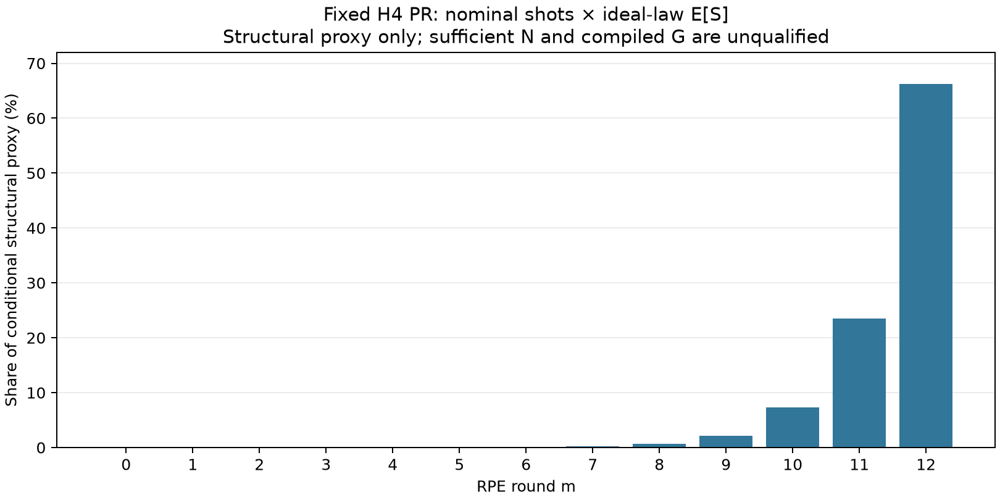

# DECISION_PACKET_V0：承認済みP0〜P4の保存再解析結果

2026-11-13 JST。**科学SOURCE 6ec7d1958b0691aa322b4adfa6595ac6329f7508、固定計画80dade8eのP0〜P4を一回集計。** [原JSON](run01/RESULT.json)がexact有理数の正本。[旧準備packet](../rpe_cost_preliminary_analysis_preparation_20261113/DECISION_PACKET_V0.md)は未実行時点の履歴として保全した。今回は新signal/MC/compile/fit/N最適化なし。正式G・十分N・winnerはnull。

## P0：固定nominal×ideal E[S]の構造費用

H=Σ n⁰ E[S] = **250942266140.0665**。元構造数値enclosureを重み付けした表示端点は[250942253966.12518, 250942279665.02313]。表示は丸め値で、exact端点はJSONを参照する。confidence interval、compiled価格、正式Gの上下界ではない。B²/normalization/古典価格標本数の追加乗算は0。

| round | H_m（構造proxy） | H_m/H |
|---|---:|---:|
| 0 | 223189.536732 | 0.000088941% |
| 1 | 487429.464466 | 0.000194240% |
| 2 | 1252364.28716 | 0.000499065% |
| 3 | 3677055.0167 | 0.001465299% |
| 4 | 11603745.608 | 0.004624070% |
| 5 | 39437466.0538 | 0.015715753% |
| 6 | 134114104.943 | 0.053444207% |
| 7 | 468766336.183 | 0.186802464% |
| 8 | 1637892438.56 | 0.652696919% |
| 9 | 5432051210.45 | 2.164661734% |
| 10 | 18205372410.1 | 7.254805135% |
| 11 | 58875761855.3 | 23.461875419% |
| 12 | 166131626535 | 66.203126755% |

| tail | 中央寄与率 | 元数値契約に条件付く寄与率box（表示丸め） |
|---|---:|---|
| m6〜m12 | 99.977412633% | 99.977412632%〜99.977412634% |
| m9〜m12 | 99.084469043% | 99.084468999%〜99.084469093% |
| m10〜m12 | 96.919807309% | 96.919807157%〜96.919807477% |
| m12〜m12 | 66.203126755% | 66.203124946%〜66.203128698% |

**この固定proxyでは長時間roundへ集中する。** ただしNの十分性とC/S補正が未知なので、実Gの支配率はまだ不明。早いroundの構造費用が小さくても、branch決定を支えるshotを独立に削減できるわけではない。[CSV](run01/ROUND_CONTRIBUTIONS.csv)。

## P1：成長と条件付き感度

各軸13個のS/T²と隣接12比をJSONの`P0_P1.cells`へ保存。例えばX軸m12の保存値由来S/T²は **41259.2358**、m12/m11のS比は **3.99745379**。両軸は今回の保存値で一致しているが、他candidateやcompiled Cの同値性ではない。

これは固定L_D1/S2/.1/K2/共通exactκ・ceil/整数Rに沿った記述で、T² modelのfit・長q外挿や他L_D/Kへの係数移送をしていない。group一括価格倍率のHに対するlog感度は上表の寄与率。実Gなら未知のτ=N/n⁰とρ=C/Sが追加される：`G=Σ n⁰ S τρ`。τ/ρの数値grid・N比1は採択していない。

## P2：Full PF C / PR Sの損益分岐係数

同roundで **r_N×ρ_compiled < θ** のとき局所費用でPRが小さい。ここでr_N=N_PR/N_PF、ρ_compiled=C_PR/S_PRはどちらも未知。計算したθ=f_PF/S_PRは**compiled価格同士の比やPR勝利ではない**。

| 保存Full PF lane | m3 θ | m4 θ |
|---|---:|---:|
| FULL_2nd_d.1 | 1.76972712 | 1.01126743 |
| FULL_2nd_d.4 | 0.449396594 | UNKNOWN |
| FULL_4th_d.1 | 5.2918153 | UNKNOWN |
| FULL_4th_d.4 | 1.33082371 | 0.759849991 |
| FULL_4th(m5_best)_d.1 | 19.3005217 | UNKNOWN |
| FULL_4th(m5_best)_d.4 | 4.85155428 | UNKNOWN |

X/Y両方を別々に16係数計算し、この保存scopeでは一致したため表をまとめた。4欠測対の8軸はUNKNOWN。元価格/cohort/compiler/receipt/SOURCEをJSONへ保持した。[全24軸CSV](run01/BREAK_EVEN.csv)。

S2/.1のm4では境界が約1.0113、Y4/.4のm4では約0.75985であり、未知N比やcompiled補正を同じものと仮定するだけで解釈が変わる。実際の値を代入していない。M5等の短roundの価格差だけで手法を除外せず、精度/Nと全scheduleの費用を確認する必要がある。

旧Full PF native receiptと新PR controlled ZZは別SOURCE。compiler hashが同じでもlowering同一とは認定しない。m3/m4のPR compiled価格はなく、m0/m6のPR pilotと異round価格を割っていない。長時間PFのaffine係数を新fitせず、欠測Cを外挿していない。

## P3：D fresh development cohort内の比

| m | 軸 | bar C | bar S | bar C/bar S | bar D/bar S |
|---|---|---:|---:|---:|---:|
| 0 | X | 1877.5 | 1690 | 1.11094675 | 0.110946746 |
| 0 | Y | 1877.5 | 1690 | 1.11094675 | 0.110946746 |
| 6 | X | 1841426.5 | 1767037.75 | 1.042098 | 0.0420979971 |
| 6 | Y | 1841426.5 | 1767037.75 | 1.042098 | 0.0420979971 |

各mでfresh4 normal pathの既存要約を使用。ratio of sample meansであり、比の期待値・全law比・独立holdout・新CIではない。P1/replayをpoolせず、分散/XY共分散は保存要約をcopyしただけ。[CSV](run01/PILOT_RATIOS.csv)。

この2点ではCとSの差を無視できるという結論にはならず、m12で同じ補正率になるという証拠もない。Cのideal E_P[S]へsampler Qのbar Dを無条件に加えて全law平均にしていない。rare/tail、law距離、長q systematic、共分散/total CIの未知はnullのまま。

## P4：保存signal・状態の一覧

PR13、Full PF m3/m4の12、m6の新4＝**29保存record**をSOURCE付きでコピーした。[一覧CSV](run01/SIGNAL_INVENTORY.csv)／JSON `P4`。raw/corrected/logB、既存bias/local/numerical/allowance・出典を保持し、欠けるphase/radius等は再計算していない。

PRの保存logBはm0で0.04048939178989724、m12で0.0411433313021524。これは現共通κの保存観測であり、κ変更時の減衰応答、必要N比、誤branch率、energy RMSEの保証ではない。局所phase/TやB²から十分Nを作っていない。

A screenの4保存・6 gate失敗・9未開始・1空例外の状態をJSONへcopy。m12の失敗残差値は未取得、科学的FAIL/全体RMSE FAILへ変換しない。S3 trial archiveを開かず、RMSE/CIを再計算していない。

## 意思決定への結び付け

- **条件付き導出**：長時間domainの価格/shot競合を扱わない計画では、この固定proxyの主要部分が未評価になる。特にm10〜m12の証拠が重要な候補となる。
- **未資格**：その3roundへ価格取得予算を何割配分するか、shotをどれほど動かすべきかは、適格NとC区間がないため決められない。
- **仮定付き記号式**：τ/ρ、r_N/ρ_compiledを自由記号で残した。現在の固定PRを全設計空間の最適候補へ採択しない。
- **次の判断**：全decoderのrisk/N資格、baselineの長時間数値安定性、最大使用domainのcompiled価格資格を優先し、L_D/κ/K/幅の大格子は先に始めない。

全て表示丸めを伴うため、機械的な再利用にはJSONのexact欄と元SOURCEを使う。本packetは正式G/4方式winner/最適Nを供給しない。
