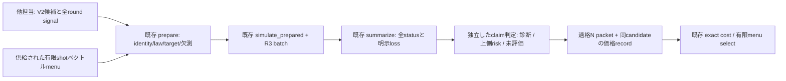

# 供給signalから全RPE精度・shot配分を評価する再利用設計

2026-11-13 JST。**設計・人工検証のみ。科学的なclaim policy、L1経験的評価、必要N、候補最適性を採択していない。** 物理候補生成とsignal計算は他担当。Bは供給された全schedule meanからdecoder出力・loss・shot配分の資格を評価し、適格価格との費用会計へ接続する。

## 1. 評価単位と既存処理

一つの評価単位は`(configuration_id, signal_source_bundle, allocation_id, statistical_contract_id)`。物理configurationは元V2で、分割/PF幅/formula/finite K・共通κから全roundのT/q/R/event/allocation/H/state/profileを固定する。`allocation_id`は**全round×X/Yのshotベクトル**の別名であり、physical candidate IDではない。seedやMC反復数も物理candidate IDを変更しない。

Pはmetadataだけで、MC/RMSE/N生成を起動しない。科学実行を許可された時点でS/Rへ進む。Qの科学的成立条件が未定ならCへQUALIFIED recordを出さない。今回は実データをS以降へ渡していない。

| 再利用部分 | 実装・役割 |
|---|---|
| signal入口 | `rpe_decoder_statistics.mean_from_a`（固定A scheduleのphysical bridge）、`prepare`（canonical mean配列＋任意の供給shotベクトル） |
| sampling/count | `simulate`：rawからIID marginal binomial、PCG64の元順序。`count_mean`：exact整数差/Fraction→binary64 |
| 全decoder | 元`pr_rpe_rmse.decode_supplied_coordinates`→`reconstruct_rpe_phase`、又はR3 `decode_sampled_counts`。scalar互換のzero/tie/branch/priorを保持 |
| loss/MC | `summarize`、既存CP/Hoeffding、`trial_budget`。`exact_counts`は小さな人工分布だけ |
| 旧Nモデル | `pr_rpe_rmse.nominal_axis_shots/evaluate/b_handoff`は候補nominal・局所診断。`n_from_a`はnullを保つ固定adapter。全体risk solverではない |
| N/C資格・費用 | V2 `assess/cost/select`、`pr_rpe_rmse_evidence.plan`、既存price lookupと会計器。exact整数/有理数N×Cを再利用 |

新decoder・MC・物理signal provider・新最適化frameworkを作らない。追加したのはこれらを繋ぐ人工回帰7件だけで、production codeは無変更。

## 2. 評価対象の確率model

各candidateのraw mean μ_(m,X/Y)が入力。採択するfresh IID modelなら、`K_(m,a)~Binomial(N_(m,a),(1+μ_(m,a))/2)`、全roundのcount配列を**一度に元decoderへ**渡す。これは有限RTE trajectoryの新samplingではなく、供給meanに条件付くHadamard outcomeの周辺model。

rawは既にattenuatedで、corrected=B×rawとnormalizer/logBは出典付き診断として受ける。correctedや位相だけから測定確率を作らず、rawにBを再乗除しない。NへB²をもう一度掛けず、価格側へnormalizationを掛けない。供給元の数値誤差/underflow・欠測/nullは0や理想単位振幅で補完しない。NumPyの確率とcount→位相はbinary64であり、厳密実数lawの認証ではない。

共同trajectory/cohortの使い回し等でshot・X/Y・roundが依存する場合、meanだけでは全RPE分布を決められない。joint-law又は供給countsを別契約で受ける必要がある。現IID simulatorへ同じmarginal meanを入れてactual-law保証にしない。

元decoderは初回位相で枝の基準を作り、m以降は直前推定に最も近いdyadic branchを選ぶ。早いroundの誤りが後段を変える。したがって、各roundの位相分散を独立に最小化した結果をつないでも全energy RMSEの最適配分にならない。

## 3. 共通の比較規約と未確定事項

| 項目 | 維持する規則／採択が必要な部分 |
|---|---|
| target | 保存H_DF/sector/state binding・energy shift0。保存solver proxyか、包含されたground targetかを明示。proxyをprior/branch選択へ流用しない |
| decoder | scalar最近傍・math.atan2・元wrap・1e−12 tie判定。zero座標はtieより優先。旧vectorizedの完全tie規則とは区別 |
| 未解決 | energy=Noneとstatusを保全。UNDEFINEDなら解決条件付きRMSE・未解決率・解決分MSE寄与まで。全population RMSEは未定義 |
| 全事象risk | 別途採択するenergy補完family又はloss契約が必要。BOUNDED_INTERVALは感度envelopeであり特定推定器の全RMSEではない。fallback変更は元decoderを黙って変更するものにしない |
| 誤branch/alias | DECODEDは正解oracleではない。energy差は実直線上で評価し、circular lossで大誤差を消さない。branch誤りの確率を出すなら正しいbranchの定義・target条件が別に必要 |
| 不確かさ | finite-MC、rawの数値誤差、target、actual law/実装差、price/model誤差を分ける。未知はnull。点RMSEとpopulation上側boundを混同しない |
| claim | 経験的診断、confidence付きplug-in risk、解析的ideal model、認証global/actualを別表示。Claudeの「L1経験的評価」は未採択の候補ラベルのまま |

L1の具体的SOURCE/定義は今回指定されていないため、L1を平均絶対誤差やL1 normへ読み替えず、別研究のentry-L1結果とも統合しない。後続で採用を検討するなら、評価量・loss・confidence/precision・適用条件をその担当から受ける。経験的L1 PASSを既存controllerのglobal RMSE QUALIFIEDへaliasしない。

## 4. 必要shot数の求め方

### 4.1 最初は低次元のwhole-vector family

候補の物理パラメータθとNを分け、有限なallocation family `N(θ,η)`を外部入力として宣言する。初期案は、供給されたbase配分n⁰_(m,a)に共通scale sを掛けてinteger ceilする一変数family。baseの出典とnominalという意味を保ち、sの有限集合・ceil式・X/Y等数の有無を採択する。baseをnominalから作ること自体は新しい科学的N設計なので今回は実値で行わない。

必要ならsに加えてterminal/slope等の少数parameter、事前固定round group/軸比を扱う案もあるが、旧nominalの11/4やX=Yを普遍的な十分条件としない。共通κが各roundのRとmeanを結ぶこと、N policyが各round/axisのベクトルを結ぶことは別の制約。供給されたNだけを変えて物理Rやnormalizerを変更しない。

現在の`prepare`は異なるX/Yの正整数も受ける。これは**技術的に表現可能**という意味で、各roundを自由に独立最適化できる科学許可ではない。shot policyのequal-axis・比例・budget制約は、採択したfinite vector menuの生成元が満たし、Bは元ベクトル/descriptorを保持する。存在しないpolicy最適化器が実装済みとは扱わない。

### 4.2 whole-vectorで適格性を評価

各(θ,η)について全round signalを再利用し、同じtarget/decoder/統計model/claim contractでriskを評価する。必要Nとは、まず**その配分全体が所望claimの下で精度条件を満たすこと**。座標ごとの独立な最小Nの集合は一般に存在しない（複数の配分が互いに非優越）。

- 診断：MCのconditional RMSE/未解決率・標本loss等を返す。nominal/screened配分の候補提示であり、十分N出力ではない。
- 上側risk：全事象lossと有効population CI・target/raw/lawの移送範囲が揃う場合、そのclaimに限定して`upper_RMSE≤εE`を判定する。未達ならその配分は未認定で、全candidateが不可能と断定しない。
- INCONCLUSIVE：CI幅・未解決loss・support・物理不確かさが不足する。点推定が小さいだけでPASS、CIが目標を跨ぐだけでINFEASIBLEとしない。
- 固定finite family内の必要配分：qualifiedな配分だけを価格付きで比較。全menu未評価があるなら探索済み部分集合と未探索域を表示し、global最適N/最適方式としない。

Nに関する単調性は仮定しない。整数count格子・偶奇・zero/tie・branch境界が変わるため、N増加で未解決確率が単調減少するとは限らない。人工N1→N2でzero座標事象が新たに現れる回帰例を保存した。これはenergy riskの非単調性を全候補で証明した結果ではなく、decoder規則だけから安易な二分探索を正当化できないことを示す。使うfamilyに有効な単調**上界**が別途ある場合だけ、その根拠付きに二分探索等を使う。

### 4.3 G最小化との関係

最終目的は`min_(θ,η: accuracy qualified) Σ_(m,a)N_(m,a)(θ,η) μ_C(θ,m,a)`であり、`min ΣN`ではない。同じθではfresh per-shot law・非adaptive測定・固定compilerならCはN自体で変わらないので、適格価格を複数allocationに再利用できる。cohort再利用やadaptive stoppingで実装law/単価が変わる場合は別contract。

価格が未取得の段階ではN/riskを受入れ候補表に留め、真の資源winnerを出さない。price intervalがあれば前回B価格計画の`ΣN b`と同時区間を使い、未知を0にしない。単純shot数で選抜して価格の高いroundへshotを集中させた候補を「最適」としない。

## 5. 効率化と精度限界

| 方策 | 再利用するもの・注意 |
|---|---|
| 供給signalを1回受入れ | θのcanonical/source/law/targetが同じ限り、全allocationへ同じraw/normalization/error recordをcopy。Nを変えるたびに物理actionを呼ばない |
| batch decoder | 既存R3 hookで全trial一括復元。scalar比較・新seedを実candidateへ自動追加しない |
| binomial count | shotを1発ずつ生成せず既存binomial。NはPython整数で保持し、int64超なら現backendは明示拒否。normal/Poissonへ黙って置換しない |
| 有限screen→独立確認 | 採択した少数allocationを粗い診断でscreenする提案。N選択に使った同じMCを未調整の最終CIとして使わず、独立確認又は全menu同時被覆を事前固定 |
| 同時confidence | candidate/shot vector/metricのfamilyへα配分。CPとrisk CIのfamilyも含む。最小点推定を選んでmarginal95%を比較全体95%としない |
| 共通乱数 | 実装変更しない初回はvectorごと固定独立seedを提案。将来common random numbersを使うならbinomial変換/coupling/SOURCE・選択後CIを別に検証 |
| 解析tail/DP | rareなzero/tie/誤branchでMC supportが粗い場合に有用な技術候補。A97146481の既存式を再利用し、全count直積の13round列挙を完成solverとしない |

現在の`exact_counts`は小人工分布用で、状態数は`Π_(m,a)(N_(m,a)+1)`。現実の13roundへ直積適用する案は採らない。decoderの逐次状態・probability mass集約やtail境界の新solverが必要なら、先に人工の有限格子でscalar/zero/tie互換・誤差囲いを検証する別技術scopeで扱う。今回その開発・実H4適用はしていない。

既存Hoeffdingは有界loss UでMC MSE幅ηに対し`n_MC≥ceil(U² log(2/α)/(2η²))`という保守的設計。これは量子shot Nではない。rare aliasの大lossを覆うUだと非実用的になり得る。既存S3の広い感度CIを無視してN探索を増やすより、目的claimの統計法/rare根拠を先に選ぶ。trial数を恣意的capして精度達成としない。

## 6. 物理誤差とRMSE予算

A97146481を再利用し、次の2経路を混同しない。

1. **供給raw全riskの直接評価**：rawに現れるPF/finite-K/stateの効果を含む。別に同じsignal biasをRMSEへ加算すると二重会計。proxy距離d_target、評価対象lawとplug-in count-lawのTV≤Δ、loss≤Uが根拠付きなら、`sqrt(R_Q^+ + UΔ)+d_target`という形で元Hへの移送を検討する。Δは1回の全RPE測定data lawで、MC反復数を掛けない。全事象energy estimator/familyと有効なrisk boundが前提。
2. **既定εqpe/εtrotの個別評価**：同一target・全事象出力・基準推定量Z0・couplingを採択し、`||Z0−E0||₂`と`||Z−Z0||₂`をそれぞれ評価する。直接riskが通っても個別budgetの証明ではない。共通有効Hが未取得というだけで直接riskルートを不必要に止めない。

経験的allowance、m3/m4の過去norm欠測、ground/proxy・actual lawのunknownは0にしない。解析的bias floorでshotを増やしても精度が届かないことを主張するなら、元decoder/targetについての根拠が必要。局所phase/Tだけで候補をpruneしない。

## 7. V2への接続上の限界

`controller.cost`は一つのconfig＋一つのN packetを既存exact会計へ通す。複数allocationには同じconfigで別々に呼べるが、`select`は**unique configuration IDに対しevaluation1個**を要求する。allocation違いを物理config IDの改変で偽装して通さない。

将来の最小接続は、同config内の有限allocation評価を`allocation_id`で別管理し、同claim/price policyでqualifiedになった配分のG又は区間を比較して、選んだ1配分と探索coverageを外側controllerへ渡すこと。点最小だけの比較は既存`strict_cost_dominance_qualified=false`を保持する。NとCの同時不確かさ・未評価配分を無視しない。今回は実allocation optimizerを追加せず、既存APIの制約とこの内側層の必要性を人工テストで確認した。

経験的L1等を別モードで扱う場合は、旧V2の`SCIENTIFIC/EXTERNALLY_QUALIFIED`のflagを緩めて受け入れず、別claim/診断viewとして管理する。科学的採択後に必要な狭いpolicy対応だけを行う。今回のN/global bound/Gはnullのまま。
