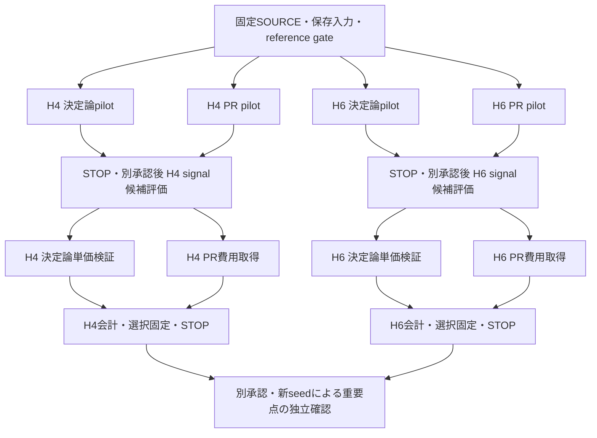

# H4/H6：4th(m5_best)の論文用比較と並列検証計画

> 2026-10-19更新：この文書は初期計画の記録。後続の[native実行準備](track_a_h46_m5_best_native_readiness_20261019.md)でadapter・launcherと4契約を封印した。実計算は引き続き未承認。

2026-10-19。**計画・schedule adapter・人工検証まで完了。実分子計算は0、mandatory STOP。** 新しい主候補はPF研究側の既存 `pf_label="4th(m5_best)"`。new_2の再探索から始めず、既存係数・実装・検証を引き継ぐ。今回の実装はmetadataとcallbackによるschedule接続までで、実分子用native adapter/launcherのSOURCE封印は未完了。現時点ではpilotを起動できるとは報告しない。

計画SOURCE：`834b738a1e14b80753f96b56f2901a3a60969aa7`。専用branch：`track-a-h46-m5-best-parallel-readiness-20261019`。起点はH6独立確認結果 `6e197973d4d4183d4e27b1b8cc95cb02f311bb92`。主Track Aの新A_COST `64c85f7a…`、最終監査 `bf8c1905…`は固定Git objectで読み取り、別系列の実行結果・承認を混合していない。

## 1. 既存成果をどう使うか

PF repository固定 `20d64c2fea1ed2d2188777df4f3d962ee94df486` の `actual_circuit_optimized_4th_m5_list()` を使用候補にする。保存tail係数は以下の5個。

```text
0.11225428783206336, 0.14181961643121604, 0.1211920365713068,
0.13781643533753404, 0.12547397927357543
```

元Pythonと同じ演算順で `w0=1-2*sum(tail)`、時間順は `reversed(tail)+[w0]+tail`、11段S2合成である。新formula IDは `PF_M5_BEST_20D64C2_BINARY64_V1`。元の関数とbinary64のhex値が全て一致することを人工testで確認した。係数の最適化・projection・root探索を再実行していない。

次数残差は保存精度・検証区間とともに記録し、非ZEROというだけで棄却しない。数値的な4次実装の評価と厳密代数的証明を区別する。人工2×2非可換toyでもq2/4/8/16の4次収束を確認したが、これは新しい実H4/H6次数測定ではない。

| 既存成果 | 再利用 | 今回必要な差分 |
|---|---|---|
| PF側m5係数・合成順・既存H4/H6資料 | 係数と検証の根拠・原SOURCE | DF/Hadamard複素signalへの接続。PF側のPauli/QPE費用を移送しない |
| new_2のGaussian/負時間/位相修正 | explicit XXPlusYY/number Phase、oracle、wrapper等 | 11段と主Track A controlでの接続・correctness |
| 高次PR q比較・H6独立確認 | paired整数会計・seed分離・STOP構造 | m5の値へ読み替えず、ordinary系列の補足結果として保持 |
| 新A_COST・強化決定論対照 | 保存入力、候補domain、採用会計の根拠 | 完全なnative/profile/preparation joinを通った費用だけ再利用 |

`m5_best`はH3実回路費用探索に由来する名称で、H4/H6やPRでも最良だと仮定しない。PF側の別分子での費用予測モデル不合格も記録されているため、そのモデル係数を今回へ移送しない。固定16証拠fileの取得状況・commit・SHAは `evidence_inventory.json` に保存した。今回それらのlive remote最新一致を新たに検査したとは主張しない。

## 2. 主比較の条件

| 項目 | 採用する計画 |
|---|---|
| 対象 | H4/H6直鎖、隣接1 Å、STO-3G、既存保存Hamiltonian/state、T=.8、P=0 |
| DF | H4 legacy固定rank12、H6 tol-only1e-8/rank19。サイズscalingは主張しない |
| PF | S2・Yoshida4・m5_best |
| 決定論 | full PF、B0、B0+I。既存強化対照を保持 |
| PR | 3公式それぞれの外側合成。正負時間・RTE配分を明記 |
| 主endpoint | ε=.05/.01/.005/.001/.0005、usual signed bias、allowance倍率1 |
| 会計 | ε/√2、α_axis=.025、主Track Aの採用済み整数ceil/headroom/normalization規則 |
| control | **symmetric_directional**。旧高次PRのordinary費用と同条件だと扱わない |
| compiler | Qiskit1.3.0、rz/sx/x/cx、opt1、seed17、target/backend/couplingなしを封印時に照合 |

主Track Aのallowanceは候補ごとの数値診断とその証拠に結合する。旧高次PRの1e-9を新m5候補へ自動移送しない。native correctnessの1e-9とは別の規則である。新候補に必要なu、margin、headroom gateの出力schemaを実行SOURCEで固定してからpilotを承認可能にする。

H4の現在の主比較は `old_plus_direct_subset16`、登録104候補全体の解決済み最良ではない。登録104の未解決を消して全候補最良と主張しない。H6は `strengthened_S2_S4_136` を保持し、model/実測/未解決を分ける。H6非相殺の旧B0+I12欠測など、最終監査の未解決は本計画でも保留する。

## 3. 最初の限定pilot：4系統を並列にする

実分子用adapterと実行契約を封印した後、別承認で実行する提案。H4/H6それぞれq2、決定論の打切りprefixはH4 p3/H6 p5、full PFはrank全体。PRはK4、**各signed S2 pieceに2 short steps**。このpilotはcorrectnessと取得経路の確認で、費用winnerの正式選択ではない。

| 系統 | 条件 | native evolution | compiled軸 |
|---|---|---:|---:|
| H4決定論 | 3公式 × full/B0/B0+I | 9 | 18 |
| H4 PR | 3公式 × 技術確認2 trajectory | 6 | 12 |
| H6決定論 | 3公式 × full/B0/B0+I | 9 | 18 |
| H6 PR | 3公式 × 技術確認2 trajectory | 6 | 12 |
| 合計 | 24 signal条件、PR計12 trajectory | 30 | 60 |

全H_DF基準は1系1reference job（合計2）として保存referenceの来歴照合・必要な検証を先に行い、4つの重いlaneが同じ凍結referenceを使う。24 signal job、30 evolution、60 wrapper compileを上限案にする。各決定論条件とPR各群の代表1本、計24代表にlow/high・reference作用・Hadamard・compiled vectorの計168主要照合を予定する。scalar/λ・生成順・normalization・finite値のgateは別に必須。実adapterで隠れたcompileが増えないよう、science entry台帳を封印時に照合する。

各laneに独立したSOURCE/input binding、grant、消費marker、ledger、output、STOPを割り当てる。4laneの予算を一つの共通grantで融通しない。reference/preflightが共通でも、あるlaneのSTOPで無関係なlaneをkillしない。PR同一trajectoryのcosine/sineは必ずpairとし、2本を4独立標本と数えない。全laneは完了・失敗にかかわらずSTOPし、Phase3へ自動移行しない。

## 4. 科学処理の依存関係と並列化



機械可読DAGは重いlane間の依存を表し、最初の共通preflight/reference gateは上図の前提。plannerは「依存が揃った」だけでは進めず、そのPhaseの明示的なactive指定と個別承認を要求する。DAG表示自体に科学dispatch機能はない。

各lane内も、formula・候補・trajectory単位のprocess poolで並列化する。代表controlのPASS後に、その候補の残りを投入する。入力NPZ・DF primitive・固有分解・preparationはprocess内でcacheし、5精度は同じsignalと軸単価から再重み付けする。精度ごとに別samplingやcompileを重複しない。

nativeのmode/基底変換差替えはprocess内に閉じ、thread間の共有patchを避ける。内側transpiler/BLASは1、外側trajectoryで並列化する。worker数はfresh idle CPU・RAM・I/Oと当該回路の観測RSSから決め、過去の4/32/60を固定上限にしない。m5 wrapperの実RSS/wallは未測定で、ここで確約しない。ホストの一時的なPSIや別worktree変更は観測のみ。実OOM・own process異常・SOURCE破損・科学不一致では当該scopeをSTOPする。

## 5. Pilot後の探索案：全変数の直積を避ける

以下はPhase3の暫定上限案で、pilotの結果を受けて対象・call・費用取得数を別契約へ固定する。

### PRのsignal候補：各系54条件

- 基準prefix H4 p3/H6 p5、3公式、q1/2/4/8、K4。RTEはpiece当たり2、piece当たり4、絶対時間に比例してouter合計16を配分、の3政策：36条件。
- 隣接prefix H4 p2/4、H6 p3/4、q2/8、K4、piece当たり4：12条件。
- K2は基準prefix、q1/4、piece当たり4：6条件。

各piece minimum1、配分は既存abs-largest-remainder関数をそのまま再利用する。piece当たりrなら総RTE数は `q×段数×r`。outer合計16政策なら `16q`。全公式に一律32を課すだけの比較を避け、探索自由度とコストを明記する。既存のlaw・時刻・K・control・preparationが完全一致する行は再利用し、値の再取得をしない。

### 決定論の追加signal候補：m5だけH4 52、H6 92条件

既存S2/Yoshida4の強化集合は保持する。m5はfull q1/2/4/8と、既存登録prefixに対応するB0/B0+Iを追加する。

- H4：p2/3/4/6/9/11 × q1/2/4/8 × 2方式、full4点で52。
- H6：p5〜15 × q1/2/4/8 × 2方式、full4点で92。

PR108＋新m5決定論144、最大252 signal候補。これは252点すべてをcompileする計画ではない。signal処理は保存状態のcacheと候補並列で進める。q8等の境界が選ばれたら境界の結果と明示し、q16や追加prefixを自動探索しない。登録集合内の点比較に主張を限定する。

### 費用取得を絞る

決定論laneとPR費用laneは独立に並行できる。m5にYoshidaの3段係数を流用しない。新m5固有モデルを用いる場合の案は、B0/B0+Iそれぞれで端prefix・q1/8の3点fit＋独立1点holdout、fullはq1/4 fit＋q8 holdout。両軸を含み最大22軸/系、計44軸。`a+bq+dpq`等の式と適用条件はfit前に固定し、各検証軸で誤差2%以上なら即STOP。自動再fit・追加anchor・補正はしない。

検証PASS後もmodelは登録範囲に限定した経験的モデル。5精度のm5最良候補のunionを最大5候補/系として、最大20軸の直接確認案を別途固定する。未測定・未検証モデルを直接測定と表記しない。モデル不合格時は比較範囲を明示した直接実測subset案へ戻し、全候補最良をnullのまま保持する。

PR費用候補は1公式あたり最大2点/系、全12群を上限案にする。どの候補を選ぶか、探索標本n_E、signalだけで選択を偏らせないための単価情報・選択規則はpilot後に事前固定する。compile予算は `2×群数×n_E`。n_Eを根拠なくn8/n32に決めない。希少event・分散過小評価は保留し、paired整数費用・標本SE・未観測層を併記する。

## 6. 論文へ載せる範囲と独立確認

主表は同一複素signal精度・P0のshot込みfull-wrapper RZを用い、軸単価・軸shot・normalization・bias・総費用・paired SE・実測/modelを一つの候補IDへ対応させる。未解決を除外して全登録最良としない。通常bias、経験的非相殺、厳密bias保証を分ける。今回の主計画は通常bias/倍率1であり、全geometry、全時間、RPE全round、全希少上界、倍率10の網羅を要求しない。

探索で選択を固定した後、論文の結論を左右する点だけ新seedで独立確認する。n_Cは差・SE・比較familyから別設計し、探索値と混合しない。点順位再現・近似区間・未観測rare込みの母平均保証を区別する。どの方法が有利でも同じ基準で報告する。

## 7. 今回の実装と残る技術作業

`src/trotterlib/h46_m5_plan.py`：元係数の11段schedule、RTE2政策、scalarのB0/B0+I区別、callback adapter、候補台帳、DAG/Phase barrier。`scripts/plan_h46_m5_best.py`：scope/plan出力のみで、`--execute`は入力・output生成前にexit2。`tests/test_h46_m5_plan.py`：新12件PASS（Python3.12.3）。原係数hex、負時間/合成順、凍結配分、scalar、非可換toy、予算・一意ID、4lane独立、STOP隔離、Phase越境拒否を人工値で検証した。作者自身の検証で、独立reviewではない。

未完了は、main-native loweringの実adapter接続、必要なruntime/preparation/basis/profileの同一性封印、新candidate allowance生成の接続、実行用SOURCE・入力hash・新seed registry・output/ledgerのsealである。旧固定grantを変更・流用しない。実分子signal/statevector/回路生成/compile/sampling/新rankingはすべて0、有効grant0。

次の**Codex**作業は、この計画に沿ったpilot adapter/launcherの接続・人工検証・実行SOURCE封印。**ユーザー**は具体的な封印済み4契約を確認した後、pilot4laneの一回実行を承認するか判断する。今回の計画承認を科学実行承認には拡張しない。
