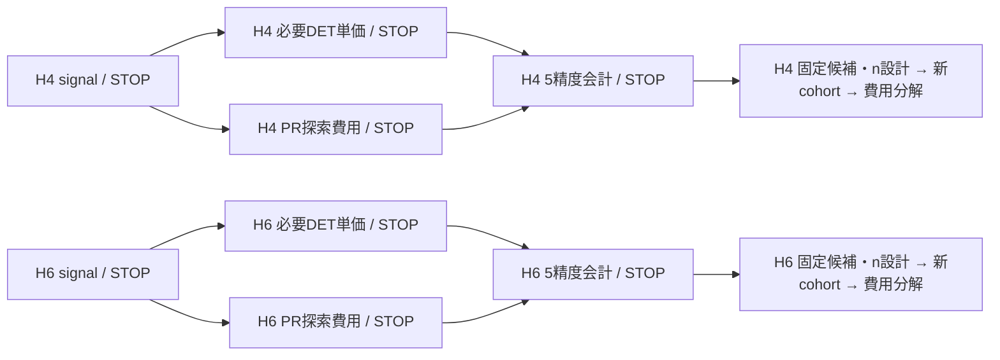

# H4/H6 m5：既存PFと比較するための最小探索・費用評価案

2026-10-19。**次の基本範囲は、q1/2/4/8の共通PR格子24条件と、m5決定論的対照64条件、計88 signal条件とする案を推奨する。** prefix・RTE予算・Kの局所確認20条件は別枠とし、最初から全直積を計算しない。今回作成したのは静的照合・metadata候補一覧・実行順序の**DRAFT**である。科学条件の正式採択、signal・sampling・compile・fit・保存値再会計・統計・ランキングは実施していない。

ユーザーが指示した「既存PFと比較可能になる最小限の探索範囲の整理」に対応する。起点commitは`16e7d1b63092532f2ad0227ca1598285a782fa9f`、branchは`track-a-h46-m5-minimal-comparison-plan-20261019`。[計画JSON](../../artifacts/resource_applicability/track_a_h46_m5_minimal_comparison_plan/2026-10-19/plan_DRAFT.json)、[候補CSV](../../artifacts/resource_applicability/track_a_h46_m5_minimal_comparison_plan/2026-10-19/candidate_domain_DRAFT.csv)、[固定資料catalog](../../artifacts/resource_applicability/track_a_h46_m5_minimal_comparison_plan/2026-10-19/evidence_catalog.json)を添付した。

## 1. 完了済みの計算と、比較の二つの目的

H4/H6のtol-only technical pilotでは、q2のS2/Yoshida4/m5、full/B0/B0Iと、PR各公式2 trajectoryを取得した。元pilotの58受理軸を保持し、H6 full m5 p19/q2のcosineをCT01で別受入、未実施sine一軸を一回取得した。対象60軸に相当する技術証拠は別来歴で揃っているが、旧runのSTOPを正常終了へ書き換えない。m5だけのpilotは各系full/B0/B0Iの3組とPR2本、両軸である。

[元pilot](track_a_h46_m5_tol_pilot_run01_results_20261019.md)、[不足二軸の最終結果](track_a_h6_m5_ct01_sine_run01_results_20261019.md)。これは実装・代表状態・軸別単価の検証で、q最良の選択、shot allowanceの採択、総費用優位の確認ではない。

今後の主張を二つに分ける。

- **公式間の限定q比較**：同じ保存入力・prefix・RTE総step政策・controlで、S2/Yoshida4/m5のq1/2/4/8を比較する。固定prefix・固定予算の有限格子という主張に限定する。
- **PR対強化決定論対照の主比較**：m5もfull/B0/B0Iへ加え、既存の強化S2/S4対照を保持して、共通5精度で総費用を評価する。前者のPR同士の比較だけでは、強化PFに対する利益を認定しない。

後者まで論文の主比較に使うために64決定論条件も計画する。固定q比較だけを先に作る場合、24PR条件のsignal準備は独立に進められる。AD03による追加PFの正式主比較採用は保留したままである。

## 2. 旧結果をそのまま足せない理由と再利用

| 証拠 | 実際の条件 | 今回の使い方 |
| --- | --- | --- |
| 旧H4/H6高次PF q比較 | q1/2/4/8、ordinary control、H4 DF12/H6 DF19、outer当たり32 steps、K4、主にε=.001、n8探索 | q格子・配分実装・設計の参考。旧平均や単価・shotは新系列へ移送しない |
| 旧H6高次PF独立確認 | ordinary、S2/q8・Y4/q2/q4、13/45/45本、ε=.001 | 別系列の完了証拠。m5の独立確認を代替しない |
| 今回のtol-only pilot | directional、H4 DF10/H6 DF19、q2、piece当たりr2、PR各群2本 | 同一条件の実装検査・reference・単価を再利用。outer32の無条件標本へ混ぜない |
| 今回のm5決定論q2 | H4 p3/full10、H6 p5/full19、B0/B0I/full | 6 pair＝12軸を再利用候補として一覧化。H6 fullはCT01の別受入を結合 |
| 既存強化S2/S4決定論集合 | 系・入力・native/compiler/preparationの来歴が別資料に分散 | 元集合を削らず、同一性を読取joinしてから接続。不明なら全対照最良は未解決 |

[旧高次PFの比較条件](track_a_h46_higher_pf_integrated_run01_results_20261018.md)ではH4 legacy DF12、ordinary controlを使っている。同じQiskitのoptionsでも、directional・tol-onlyの新m5費用と無条件に混合できない。**旧q比較へm5だけ追加して、同条件の4次比較が完成したとはしない。** 必要なS2/Yoshida4の共通条件行も取得する案であり、同じ計算の重複ではない。

piece r2の総RTE数は公式の段数に依存する。S2はouter当たり2、Yoshida4は6、m5は22で、全て32の比較群とは別条件である。新PR主格子は共通outer32を提案し、signed絶対時間の既存largest-remainder/minimum-one規則を再利用する。同じ32でもPF段数・負時間・native gate数・希少event確率まで等しいとは扱わない。

元2件のfull-H reference、保存入力、係数版・次数検証、11段signed S2順序、scalar一回、Gaussian、occupation oracle、fingerprint/cache、paired処理は再利用する。referenceのHamiltonian/state/T/位相/bit順とbytesが一致すれば再作用しない。保存signalの値も同じ候補なら再利用候補だが、pilotのallowanceは`EMPIRICAL_DIAGNOSTICS_ONLY_NOT_ADOPTED_FOR_SHOTS`である。compile tolerance1e-7をshot allowanceへ流用してはいけない。

[12軸再利用候補CSV](../../artifacts/resource_applicability/track_a_h46_m5_minimal_comparison_plan/2026-10-19/deterministic_reuse_candidates.csv)は単価の転記とmetadata joinのみ。新しい統計・費用比・最良選択は行っていない。raw signal再利用とshot適格性の新検証を分ける。

## 3. 推奨する基本88 signal条件

全て、線形隣接1 Å/STO-3G、保存tol-only1e-8・rank自動の観測H4=10/H6=19、T=.8、P=0、通常signed bias、allowance倍率1、symmetric-directional、full Hadamard両軸とする。m5係数版は`PF_M5_BEST_20D64C2_BINARY64_V1`。元Qiskit1.3.0・rz/sx/x/cx・opt1・seed17を維持し、再合成無効や代数的縮減の別compilerは混ぜない。

| 対象 | prefix | q | PR条件 | signal条件数 |
| --- | --- | --- | --- | ---: |
| H4 PR：S2/Yoshida4/m5 | 3 | 1/2/4/8 | K4、ABS_TIME_PER_OUTER=32 | 12 |
| H6 PR：S2/Yoshida4/m5 | 5 | 1/2/4/8 | 同上 | 12 |
| H4 m5：B0/B0I | 3/8/9 | 1/2/4/8 | なし | 24 |
| H4 m5：full | 10 | 1/2/4/8 | なし | 4 |
| H6 m5：B0/B0I | 5/7/11/15 | 1/2/4/8 | なし | 32 |
| H6 m5：full | 19 | 1/2/4/8 | なし | 4 |
| **合計** | | | | **88** |

q範囲を旧高次PFと揃えることで、q2一点だけという不足を解消する。PR prefixはまず既存anchorに固定し、qの効果とprefixの効果を混同しない。m5決定論prefixはpilot点と高prefix・既存強化対照の代表点を疎に含める。H4の旧p11をrank10へ移送しない。各系の全生成規則の同一性は未認定なので、サイズの因果効果・漸近則は主張しない。

既存S2/S4決定論domainをこのm5の疎なdomainへ縮小しない。m5も含む全prefix/q最適性ではなく、登録した集合内の比較として表示する。

これは**signalの目標domain**で、88 compileや88 sampling群という意味ではない。m5決定論64条件のうち6条件には同一点の保存signal・単価証拠がある。ただしallowance/headroomは別途検証する。PR24条件はpilotのr2とはlawが異なるため、その2本を新群nの一部として数えない。

### 旧124条件案との関係

旧[共通条件整合案](track_a_h46_m5_protocol_alignment_20261019.md)の124条件は未採択DRAFTで、piece r4/outer16の両政策、隣接prefix、K2を含んでいた。本案はその書換えや自動適用ではない。決定論prefix域64は維持し、PR部分を「旧高次PFと同じouter32でqを揃える」24条件へ集中する**別の新提案**である。旧案の結果を見てwinnerに合わせた再選択はしていないが、新条件が実行前登録済みとも扱わない。

## 4. 局所確認は別枠20条件

| 追加目的 | 各系のm5条件 | 合計 |
| --- | --- | ---: |
| prefixの近傍 | H4 p2/4、H6 p4/6、q2/8、outer32・K4 | 8 |
| RTE予算の感度 | anchor、q2/8、outer16/64・K4 | 8 |
| Taylor cutoff K | anchor、q2/8、outer32・K2 | 4 |

これらは主格子のrankingへ自動unionしない。固定prefix/予算/K4の限定q比較を掲載するなら、必須の前提にしない。prefix/r/Kへの頑健性や、候補生成範囲内で調整したPRという主張を必要とする場合だけ、**追加signalを見る前に**対象・取り扱い・費用取得規則を別登録する。

基本q格子のwinnerがq1/q8にあれば物理的下端・探索上端として表示し、最適性を強く主張する必要があれば別の探索設計を判断する。q16・距離・T・H8・別状態へ自動拡張しない。不適格やPR不利を理由に都合のよいprefixへ置換しない。

## 5. 単価取得を絞る規則・標本設計

signal段階で、共通5精度ε=.05/.01/.005/.001/.0005、各軸ε/√2・α_axis=.025、候補固有のbias/u/log_B/margin/headroomを検証する。**allowance値・丸め/closure guardのSOURCEは実装準備で固定する未解決事項**であり、既存1e-9等を無断採用しない。適格/不適格/未決を分離し、全5精度で不適格と確認した候補のcompileは省ける。

- **決定論費用**：同一性が結合できた12軸を再compileしない。残る必要候補はcosine/sineを直接実測する案を基本とする。全64条件が費用対象なら不足分の上限は116軸。適格性や追加の同一行再利用で減らせる。m5固有modelで削減する場合は、anchor/holdout・範囲・誤差基準・STOPを別契約にし、Yoshida係数や旧modelを流用しない。本案ではmodelを採択していない。
- **PR費用**：登録した24群のうち、少なくとも1精度で適格な群を費用評価domainへ残す。q最良を比較する主張なら、その中の費用欠測qを勝手に除かない。biasだけでqや方式を絞らない。探索標本数n_E、seed/law、代表native検査、希少層記録、費用domainをsampling前に固定する。
- **標本数**：n_Eと独立確認n_Cは今回はnull。先例のn8をそのまま正式採択せず、有限標本の探索目的・費用差の主張と資源から別設計する。参考として全24群に各n_E=8を採る場合は192 trajectory/384軸、決定論不足116と合わせ最大500新compile軸となる。これはmetadata上の予算例で、採択値・実行grantではない。高いnで未観測tailの保証を置き換えない。
- **会計**：同じsignalと各trajectoryの両軸単価を5精度に再利用する。精度ごとに回路を作り直さない。探索nの平均とpaired SEを出し、母平均の保証・独立確認と区別する。既存pilot2本を新cohortへpoolしない。

保存単価とsignalの入力/control/native/準備/compiler・cohortのidentityが一致しない、または費用が未取得ならnullと理由を保存する。全domainの未知費用を0補完せず、全登録最良をnullにする。別に事前固定したsubsetの点比較はsubsetと表示する。既存強化S2/S4対照とのjoinが未解決なら、PR公式間の固定q panelと、全PF対照比較の状態を分ける。

## 6. 既存codeの再利用と必要な差分

| 既存code | 再利用できる部分 | 次の準備で必要な差分 |
| --- | --- | --- |
| `h46_m5_plan.py` | 固定係数、signed schedule、ABS_TIME_PER_OUTER整数配分 | 旧legacy H4定数/screenを直接使わず本候補一覧・tol-only bindingへ接続 |
| `h46_m5_tol_saved_input.py` / `h46_m5_tol_native.py` | 保存loader、低/高branch、scalar、oracle、native/paired経路 | prefixごとのpreparation・tail・λ・spectrumを生成し、cache keyへprefix/入力を含める |
| `h46_m5_native.py:signal` | deterministic/finite mean・bias成分・log_B・closure | signal-only入口と採択済みallowanceの証拠化。現contextのanchor固定tailを新prefixへ付け替えない |
| `launch_h46_m5_tol_pilot.py` | lane独立STOP、candidate/trajectory並列、cache、回収 | q2/fixed pilot専用scopeから切り離した新契約。signal段階でcompileを起動しない |
| `h6_m5_ct01_sine_contract.py`等 | CT01の意味、旧STOP保全・SOURCE/input/runtimeの結合・外部exit監査 | 新candidate campaignは新SOURCE・grant・台帳。sine一軸の旧grantを再使用しない |
| 既存D0/会計・paired集計 | SOURCEで照合した整数shotとpaired費用処理 | 新normalization/bias/allowanceと独立cohortへ明示adapter、保存表再現gate |

現native signal/requestはK4をhardcodeしているため、optional K2は表示値を変えるだけでは実行できない。選択した場合だけKのlaw/normalization/回路と人工検証を新SOURCEへ結合する。元のsealed SOURCEは変更しない。

新科学実行SOURCE、signal-only adapter、採択済みallowance、n/seed registry、runtime closureはこの計画では未seal、launch_ready=falseである。metadata計画validatorはscientific runnerではない。

## 7. 並列schedule・高速化・停止

H4/H6は並列、各系のDET/PR費用も依存するsignalの合格・別承認後に並列実行できる。一方のSTOPは、その系・その入力・その依存laneの新投入だけを止め、無関係の正常jobを停止しない。各nodeは独立に承認・終了時mandatory STOP、矢印は自動進行許可ではない。共有reference破損など本当に共有する依存は、利用するlane全てで拒否する。

検証内もcandidate/trajectory単位の外側process並列、同一trajectoryでnative evolutionとcos/sinを共有する。保存入力/preparation・prefixごとのspectra・fingerprintのcacheを使い、5精度のshot計算へ同じ費用標本を使う。inner BLAS/transpilerの余分な並列はworker内だけで抑え、共有OSや既存環境を変更しない。GPUへの新移植・大きなcompiler改造は前提にしない。

worker数・RAM capを固定せず、fresh affinity/idle CPU・有効cgroup空きRAM・disk・その候補の観測RSSからadmissionを決める。H6 q2/full m5の保存peak22,557,356 KiBは観測であり、q8や全poolの上限ではない。旧pilotの軽い候補のRSS見積りを重いfull q8へ流用しない。現launcherのhost MemAvailableだけの判定は、新契約では有効cgroupまで確認する。値が未実測の重い候補は開始時の並列度を保守的に決め、観測に基づいて未投入jobのadmissionを更新する。固定科学予算・sealを後から変えない。

compile前後raw vector差はCT01のfiniteかつ1e-7未満。他のnative/occupation/reference/closure基準は元SOURCEを維持する。PSIの一時上昇、CPU競合、無関係worktree資料更新だけではkillしない。実OOM、継続不能、自身の異常、入力/SOURCE/runtime破損、科学不一致は対象scopeをSTOPし、未確認をPASSにしない。自動retry/refit/候補追加をしない。

PR有利・不利・不適格・点順位非再現は科学的な結果として保存する。望む順位が出るまでsamplingを増やすことを完了条件にしない。

## 8. 独立確認と完了条件

5精度会計の後、原則ε=.05と.0005の重要候補、PF対照版、shot、期待方向、比較familyを新sampling前に固定する。全qを独立確認する必要はないが、僅差のq最適性を主張するなら対抗qも対象候補とする。両端不適格の場合や代替endpointは別判断する。

n_Cは新系列の探索分散・希少層・識別したい差から個別設計し、旧ordinaryの13/45/45やH8のn48をコピーしない。新seed/cohort、同一candidateのcos/sin pairing、探索/確認の非混合、未観測s4/s2_multi費用をnullに残す方針を維持する。

主張する系・domain・endpointで、適格性と費用、強化対照の来歴、独立確認、同じcohortの総費用比/shot数比/有効単価比・軸別分解、技術終了証拠が揃えばCoreを一区切りにできる。PR不利や非再現でも有効な完了で、Extended/Guaranteeへ自動進行しない。固定prefixの限定q panelだけならその限定をcaptionへ明記し、Common Core全体の完了とは呼ばない。AD03主比較採用はユーザー判断を別に受ける。

## 9. 今回の成果と次の担当

固定Git資料14件をbyte/SHA確認し、候補domain・12軸再利用候補・入力目標・並列DAGを作成した。構造validatorは候補の一意性、q範囲、cohort分離、未承認状態、旧証拠を検査し、8種の人工改変拒否も行う。これはCodex自身の確認で独立reviewではない。新科学計算・費用平均/比・統計・rankingは0。旧SOURCE・raw・grant・ledger・marker・STOPと他worktreeを変更しない。

**ユーザー**：基本88条件の範囲とouter32政策を採用して次の技術準備へ進むか判断する。optional20、探索n、独立確認n、科学実行、主比較採用は今回決めていない。

**Codex（次の準備作業）**：採用された範囲に対し、signal-only adapter・prefix別context・allowance/guardの接続・人工検証・個別契約を準備する。実signalの起動は別途明示承認後。pilotを再実行したり、費用取得をsignalと同時に無承認で起動したりしない。

[metadata検査](../../artifacts/resource_applicability/track_a_h46_m5_minimal_comparison_plan/2026-10-19/validation.json)・人工改変拒否8種と、[構造検査39項目](../../artifacts/resource_applicability/track_a_h46_m5_minimal_comparison_plan/2026-10-19/structure_validation.json)は全PASS。旧証拠2885fileは不変だった。[検査器](../../scripts/check_h46_m5_minimal_comparison_plan.py)は標準libraryだけを使い、科学moduleをimportしない。

local commit後mandatory STOP。公開pushなし。
