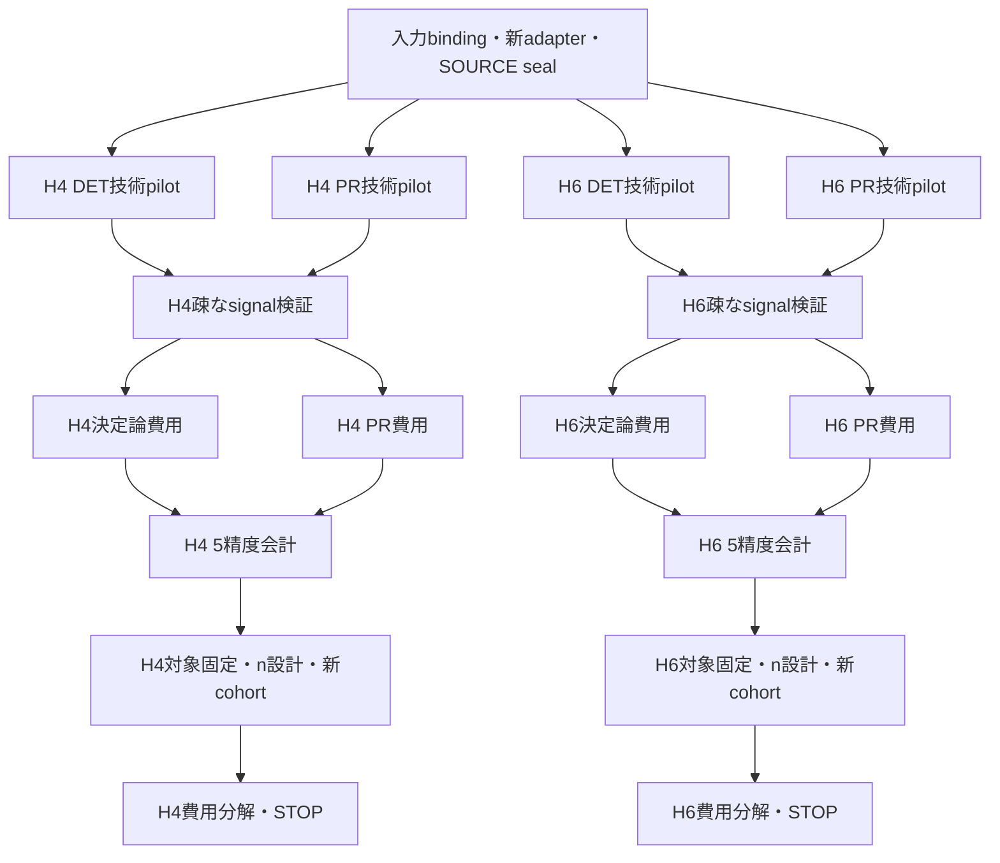

# H4/H6 m5_best：共通プロトコルv1への計画整合

2026-10-19。**PLAN_REVISION_ONLY_NOT_LAUNCH_READY**。ユーザーが承認したのは既存実装を再利用した計画差分の整理・構造検査である。新科学計算・数値再解析・実装の科学SOURCE変更・有効grant発行・公開pushは行わない。AD03の主比較採用保留を解除せず、以下の候補域・後続取得数も実行前登録済みとは扱わない。

[旧native準備](track_a_h46_m5_best_native_readiness_20261019.md)と[旧初期計画](track_a_h46_m5_best_parallel_plan_20261019.md)を保全した上で、本差分を今後の計画入口とする。旧4契約は変更・再sealしない。機械可読入口は[新計画案](../../artifacts/resource_applicability/track_a_h46_m5_protocol_alignment/2026-10-19/aligned_plan_DRAFT.json)、[差分表](../../artifacts/resource_applicability/track_a_h46_m5_protocol_alignment/2026-10-19/protocol_gap_matrix.csv)、[入力目標](../../artifacts/resource_applicability/track_a_h46_m5_protocol_alignment/2026-10-19/target_input_bindings_DRAFT.json)、[候補域案](../../artifacts/resource_applicability/track_a_h46_m5_protocol_alignment/2026-10-19/candidate_domain_PROPOSED.json)。

## 1. 基準・既存資産・今回の確認限界

共通プロトコルの正本はcommit `9036d8a87ad1c38e83b9ff654b412dde7041e9d3` の `docs/research/track_a_pr_resource_evaluation_protocol_v1.md` と採択判断表。m5旧準備は `f9cd14984675fc81505e1c9bc7c1b506cdcb2021`、科学SOURCEは `7a4d126ad2df622873aebdb372487c8fd956de4c`。固定Git objectの本文・metadata・SOURCEを読み、SHA/bytesを[catalog](../../artifacts/resource_applicability/track_a_h46_m5_protocol_alignment/2026-10-19/evidence_catalog.json)へ記録した。private NPZ、native環境、元runtime closureを今回再検証したわけではない。

係数版は `PF_M5_BEST_20D64C2_BINARY64_V1`、PF原commitは `20d64c2fea1ed2d2188777df4f3d962ee94df486`。元binary64係数と11段signed S2合成順を維持し、係数最適化・次数残差の新測定は行わない。既存の数値次数検証を原scopeで再利用し、残差が非ZEROというだけで棄却しない。新DF/nativeへの適用窓と数値誤差は後続の実検証で区別する。

再利用するのはschedule、negative-time処理、scalar一回、explicit Gaussian、occupation oracle、full wrapper、paired処理、並列launcher、独立laneのSTOP/ledger、人工fixture。新入力へのcorrectnessまで再利用で証明済みとはしない。既存人工120件は元SOURCEの結果で、今回再実行したと表示しない。

## 2. 入力と共通条件の差分

|項目|旧m5計画|整合後の計画と未確認事項|
|---|---|---|
|H4|legacy DF12、p3|主比較候補は保存tol-only1e-8のDF10入力。rank10を生成引数へ固定せず既存Fの観測値として扱う。p3はpilot anchor案|
|H6|tol-only DF19、p5|同じ保存入力を継続候補にする。既存hashは転記できるが、将来実行の原本bytes/runtimeはfresh確認|
|入力規則|主に保存hash|SCF/MO/積分/DF correction・signed weights・generation順・cutoff/projection/sector/stateを照合。全生成規則のH4/H6同一性はNOT_VERIFIED|
|時間・会計|T=.8/P0/5ε/通常signed・倍率1の後続案|維持。ε=.05/.01/.005/.001/.0005、ε/√2、α_axis=.025。shot用allowanceの成立は別gate|
|native/compiler|directional、Qiskit1.3、opt1、seed17|維持。profile/preparation/runtime identityの照合が必要。同じoptionsだけで旧費用を移送しない|

H4の固定証拠は `97d25cc431516d720ce91c7cb4f148e061d8ea34` のF/FP。`FP_binding.json.input_binding` のHamiltonian/state/snapshot/compiler hashを新しい入力目標へ転記した。**同bundleのinput_binding.jsonは旧legacy入力のbindingであり、tol-onlyのbindingとして使わない。** F完了receiptはnative exit0・final gate PASS。新SCF・DF・state生成を再実行する計画ではない。

既存 `h4_tol_only_input.py:load` が保存復元候補だが、m5 contextとの互換性、配列/SOURCE、sector/bit順、hash、projection・scalar・prefix/preparationの接続は未検証。現m5の `SYSTEMS['H4']['rank']=12`、legacy snapshot loader、旧binding参照を変更するには小さい新adapterと新SOURCEが必要。rank値だけを10へ差し替えて旧plan/grantを流用しない。今回その実装修正はしていない。

H4 legacy DF12のDは後続commit `4e8ad193…` で登録104の既存評価が完了している。旧m5計画の「subset16・登録104未解決」は歴史的記述である。ただし、その改善をtol-only DF10の対照完成とみなさない。H4 tol-onlyのD/A準備は別Codex Bの対象であり、既存登録・入力・結果の読取joinを先に行う。重複したD/A campaignをここから起動しない。

## 3. 技術pilot：4lane構成を再利用する案

|新lane案|入力|固定構成案|最大compile軸|技術PR trajectory|reference job枠|
|---|---|---|---:|---:|---:|
|H4_TOL_PILOT_DET|H4 tol-only10|S2/Yoshida4/m5 × full/B0/B0I、q2、cut p3|18|0|1|
|H4_TOL_PILOT_PR|同上|3公式、q2、p3、K4、piece当たりr2|12|6|0（DETと共有）|
|H6_TOL_PILOT_DET|H6 tol-only19|3公式 × full/B0/B0I、q2、cut p5|18|0|1|
|H6_TOL_PILOT_PR|同上|3公式、q2、p5、K4、piece当たりr2|12|6|0（DETと共有）|

旧計画と同じ**最大60軸・PR12本・reference2枠**を技術範囲の案として維持する。費用取得済みの完全同一行があればscopeを事前に減らせるが、旧ordinary系列やlegacy H4の費用を同一と認定して減らさない。referenceも同一Hamiltonian/state/T/位相/bit順の保存作用が結合できれば再利用し、なければ系ごと一回だけ別予算で生成する。reference作用の計算は新科学計算なので今回は実行しない。

旧native correctnessの1e-9未満、finite、低/高branch・漏洩・occupation oracle・Hadamard両軸・compile前後の確認方針を維持する。モデル2%をnative検査の代用にせず、native toleranceをshot allowanceへ読み替えない。pilotはq比較の最良選択、独立確認、shot込み費用優位の証拠ではない。各群2本は技術確認のみ。

新4laneは未seal、科学SOURCE/新plan digest/seed/grant/output/ledger/markerは未発行。旧4契約はそのまま残し、新H4への自動適用・旧grantのvalid化はしない。

## 4. Coreへ進む最小構成案：疎な候補域と承認単位

以下は**数値結果を見ずに設計した候補案**であり、実行前のユーザー確認と契約固定が必要。旧最大252 signalの全取得を自動継承しない。各系の既存S2/S4強化対照は保全し、m5を加えるために弱い対照へ置き換えない。

|lane|初期案|理由・主張範囲|
|---|---|---|
|H4 m5決定論signal|B0/B0Iのp3/8/9 × q1/2/4/8とfull10の同q：28条件|p3はpilot、p8は既存FPの高prefix側、p9はfull近傍。legacy p11は新rank10へ移送しない|
|H6 m5決定論signal|B0/B0Iのp5/7/11/15 × q1/2/4/8とfull19の同q：36条件|pilot p5、保存強化対照の代表p7/p11、高prefix p15を疎に含む|
|PR signal（各系）|基準prefixで3公式 × q1/2/4/8 × K4 × 2配分政策：24。m5隣接prefix × q2/8：4。m5 K2 × q2/8：2、計30条件|基準H4 p3/H6 p5、隣接H4 p2/4・H6 p4/6。配分はpiece当たりr4とabs-time加重outer合計16。隣接/K2はpiece r4|

提案全体はmetadataとして**124 signal条件**。実分子のsignal・bias・適格性は未計算である。prefix/q/r/Kの全直積は要求しない。既存の同一SOURCE/input/公式/control/allowance/lawの行は再利用し、異なる入力・公式・配分を同一条件としない。候補IDにpolicy版と入力系列を含める。

piece r4では総RTE数が段数に依存するため、同じrという文字列だけで同資源条件としない。outer合計16では既存abs-largest-remainder/minimum1規則を使い、signed pieceの絶対時間とallocationをlaw/normalizationへ結合する。両政策のどちらが良いかも未評価である。

この候補域は有限登録内の比較案で、m5の全prefix/q最適性を保証しない。境界やsingletonを表示し、winnerが端でもq16・新prefix等へ自動拡張しない。必要ならその時点でSTOPし、別の事前登録を判断する。S2/S4の既存登録集合はこの新m5域より広くても保持する。

### 適格性・単価・5精度会計

1. signal・normalization・bias成分と、候補固有のu/log marginの証拠を結合する。pilotの `EMPIRICAL_DIAGNOSTICS_ONLY_NOT_ADOPTED_FOR_SHOTS` をそのまま主会計へ流用しない。roundoff/closure/guardは実装SOURCEで固定する。厳密bias certificateは付けない。
2. 決定論単価は同系列の実測、またはm5固有の事前検証modelで埋める。Yoshida/H6係数の流用は禁止。model式・anchor/holdout・適用域・閾値・STOPは別契約。旧計画の2%案は新契約で明示採択する場合だけ使い、未実測点を実測へ改称しない。
3. PRの費用取得は、signal適格な候補からどれを何本取得するか、proxy単価の根拠・選択規則・探索nを**sampling前に別登録**する。signal biasだけで費用winnerを決めない。最大2候補/公式/系という旧案は予算候補に留め、未測定候補を除いて全signal域最良と呼ばない。
4. 欠測が残る全登録域の最良はnull。必要なら別に事前固定したcost評価subsetの点比較を明示する。model/実測/欠測を分離し、未知費用を0補完しない。必要な単価が揃ってから共通5εを一回の保存値会計で評価し、精度ごとの重複compileをしない。

## 5. 独立確認P・費用分解・完了条件

原則ε=.05と.0005について、探索後にPR候補・PF対照版・shot・期待方向・主要比較familyを固定する。費用順位の解釈を左右する方式間比較が別に必要なら、その比較も事前判断する。全formulaの全qを独立確認する義務はない。両端が不適格なら結果を保存し、代替endpointは別判断する。

nは個別の分散・比較差・希少event・目的から事前設計し、n48や旧高次PF13/45/45をコピーしない。pilotや探索を新cohortへpoolingしない。新namespace/seed除外台帳とcos/sin pairing、旧sampling・条件付きpilotとの分離を維持する。点順位再現・非再現・tie、paired SEと観測/未観測層を記録し、母平均保証と区別する。

同じ掲載cohort/対照版で `G=sum_a(N_a*C_a)`、総費用比＝shot総数比×有効回路単価比、および軸別の正確な分解を保存会計と照合する。normalization/bias/headroomの説明側guardはcore恒等式と別status。不足を逆算して埋めない。主張に必要な説明が欠測なら会計のみの条件付き掲載か保留とする。

既存H4/H6の別cohortの機構表をm5へ付け替えない。登録内の有限標本比較と明示例外の範囲でCoreを一区切りにできる。PR不利・非再現でも正常実験として保存し、Extended/Guarantee、H8、全時間/距離/stateへ自動移行しない。

## 6. 並列scheduleと停止

**矢印は依存だけを示し、自動実行の許可ではない。各stageに別承認・新grant・終了時mandatory STOPが必要。** H4/H6とDET/PRを独立に進め、一方の未完了・論理STOPで無関係の正常laneを止めない。H4主対照が別担当で未完成でも、独立したH6の技術準備を待たせる必要はない。ただし会計段階は当該系の対照・単価・allowanceの閉包を要求する。

各lane内はformula/candidate/trajectoryの外側process並列、同一trajectoryのevolutionと両軸を共有する。reference一回、保存入力/preparation/spectra/fingerprint cacheを再利用する。内側BLAS/transpilerの1threadはoversubscription対策のprocess内設定であり、worker上限ではない。fresh有効CPU/RAMと観測RSSから投入数を決め、歴史的な4/32/60 workerを恒常capにしない。重い高速化の追加実装は前提にしない。

SOURCE/入力/compiler/runtime破損、nonfinite、native不一致、自分のプロセス異常、実OOM・継続不能な資源不足は対象scopeをSTOPする。上位cgroupの一時PSI、CPU競合、無関係worktree更新だけでkillしない。監視を再確立して整合確認し、未確認結果をPASSにしない。旧STOP/消費は保存し、自動retry/refit/予算融通はしない。

## 7. 今回の成果・技術検査・次の担当

今回は新計画案・入力目標・候補域案・Core差分CSV・固定証拠catalogと構造checker/人工testのみを作成した。新しい人工・構造12件、124候補metadataの一意性/範囲、18差分要件、23固定Git objectのSHA/bytesを検査してPASSした。これは作者自身の技術検査であり、別reviewerによる独立レビューや実分子の検証ではない。旧科学code、係数、4契約、grant、seed、closure、結果、STOPは変更しない。新旧の不一致を隠してlaunch-readyと表示しない。

**次のCodex作業（提案）**：H4保存tol-only loaderとm5 contextをつなぐ小さいadapter、系列を含むID/binding/新契約、人工検査とSOURCE sealを準備する。既存Codex Bの対照準備とはmetadata照合だけを行い、別計算を重ねない。H6新A独立確認とA82説明は別チャットの担当であり、この計画から実行・変更しない。

**次のユーザー判断**：疎な候補案と掲載scopeを確認し、新しいsealed pilotの実行範囲を承認するか判断する。主比較へのm5採用判断、pilot、新signal、model/compile、保存値会計、独立確認はそれぞれ承認を分離する。

今回の計画差分はlocal commit後mandatory STOP。公開push・新科学計算・数値再解析・既存契約への自動適用なし。
