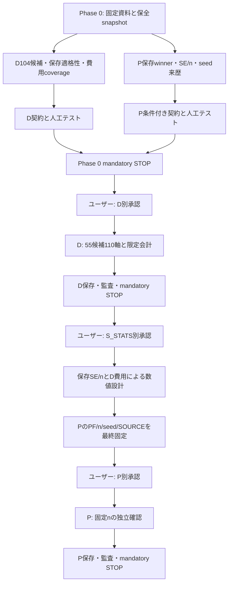

# H4 D/Pの依存関係と並列化

Phase 0は技術準備だけ。主担当Codex 1名で実施し、AI subagentは0。
独立なfile読取・固定資料取得は並列に行った。科学的なSOURCEや解析値の生成はしていない。

Dの結果待ちの間にP候補登録・式・判定・schema・人工テストまでは用意できる。
PFと具体的n、seedの最終一覧、数値call予算は確定できないためpendingとして保持する。
S_STATSはsampling/compileの承認ではなく、D承認もP承認ではない。
保存統計値からの数値設計でも、今回の利用者指示では別承認が必要。

D：55候補を独立processへ投入し、各候補内はevolution/control→cosine→sine。
P：候補の先頭controlが合格してから残軌道を並列取得し、同一軌道の軸を共有する。
prefix preparationをworker内cache、共通inputを保存copy、compiler結果は指紋一致が証明できる場合のみ再利用。
新しい単価モデル・候補削除・law変更で速くしない。

freshな実効CPU/memoryに合わせてworker数を設定し、task数以上のprocessを作らない。
内部thread1はnested oversubscription回避の実行設定であり、プロジェクト全体のCPU上限ではない。
一時的な共有資源の競合は観測記録とし、他チャットのworktree HEAD/statusを実行拒否条件にしない。
今回実際に使うSOURCE/input/runtime/compiler/results/grant/ledger/markerだけを不変条件にする。

次の担当：ユーザーがD契約を審査する。Phase 0からの自動科学起動はない。
