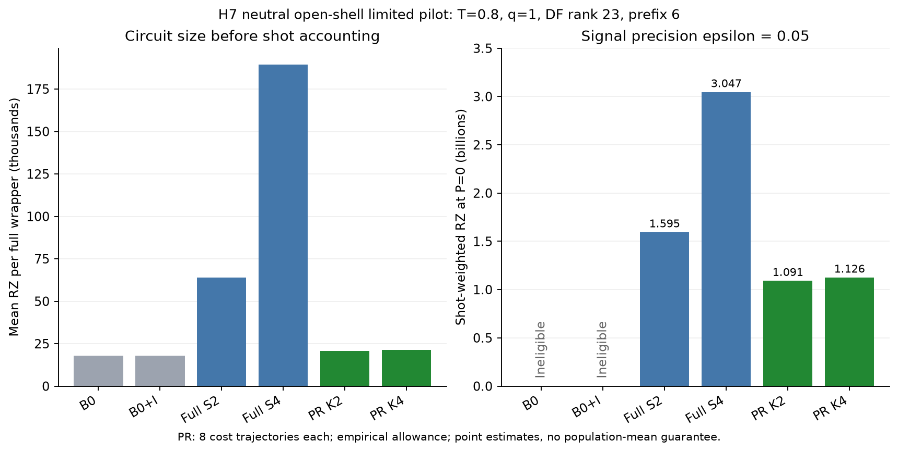

# H7中性開殻：限定pilotの結果

2026-10-16 JST。**20/20 group・40/40 full-wrapper compile・16 PR trajectory・32 RTE eventsを完了し、mandatory STOP。**

要求精度ε=.05、状態準備費用P=0、既定の経験的numerical allowanceと対称軸shot規則では、PR r2/K2とr2/K4の総RZ点推定は、限定panel内で最良の決定論的対照full PF S2よりそれぞれ**31.58%・29.39%低かった**。PRはε≤.01で不適格、ε=.01ではfull PF S4のみ適格。有限pilotから母平均優位性や全候補最良を保証しない。

- [結果・監査の入口](../../artifacts/resource_applicability/track_a_h7_neutral_open_shell_pilot_v1/2026-10-16/README.md)
- 科学・seed起点SOURCE：`f93ad35b05a75c5e17e2c53b0f3de2af4fc443f2`
- 退出監視修正・再開runtime SOURCE：`d9fd36fc630a67fab220752154bfaa9c4b8d60c6`
- 結果整理branch：`track-a-h7-neutral-open-shell-pilot-results-20261016`

## 条件と完了範囲

Linear neutral H7、1.00 Å、STO-3G、charge0、ROHF共通real spatial MO、7 electrons/Nα4/Nβ3、14 spin modes/sector1,225。DFはtol-only1e-8・cutoff0・signed returned generation order・weighted Hermitian projectionを保持し、実rank23、prefix ceil(23/4)=6。T=.8、q1、δ=.8。実測rankを他系へ合わせて切り落としていない。

入力stateはDF sector solver stateであり、ROHF determinantの代用ではない。B0/B0+I prefix6 S2、full PF rank23 S2/global Yoshida S4、PR prefix6 S2/r2/K2・K4の6構成を固定した。最初に各1 group、その後適格なPR各7本を追加し、決定論4 group＋PR各8 trajectoryで20 group。探索592/独立32確認等とは別のH7限定pilotである。

各groupのcosine/sineは同じtrajectoryを使用し、合計40 wrapperのRZ/CX/RZ depth/CX depth/total depth/sizeを保存した。数値は量子回路の古典的な資源評価で、量子backendによるshot測定は実施していない。

## Signal・回路・測定込み費用

下表のsignal biasは補正後の複素signalとfull-H referenceの距離。RZ/CXは1 wrapperあたりのcosine平均（今回のpaired sine値も同じ）。PRは各8本の算術平均である。

| 構成 | 複素signal bias | 全体normalization B | RZ/回路 | CX/回路 | ε=.05のshot数（両軸計） | ε=.05・P0の総RZ点推定 |
|---|---:|---:|---:|---:|---:|---:|
| B0 p6 S2 | .132145 | 1 | 17,861 | 7,446 | 不適格 | 不適格 |
| B0+I p6 S2 | .0500121 | 1 | 17,861 | 7,446 | 不適格 | 不適格 |
| Full PF S2 | .0127632 | 1 | 64,086 | 27,382 | 24,892 | 1,595,228,712 |
| Full PF S4 | .00388605 | 1 | 189,546 | 81,426 | 16,075 | 3,046,951,950 |
| PR r2/K2 | .0127462 | 1.45504 | 20,731 | 8,243 | 52,648 | 1,091,445,688 |
| PR r2/K4 | .0127441 | 1.45949 | 21,267.75 | 8,390.75 | 52,959 | 1,126,318,772.25 |

PR/fullS2比はK2 .684193859、K4 .706054727。K2をこの有限標本の点最良と表現できるが、K2/K4の母平均順位や科学的なwinnerは認定しない。総RZのpaired standard errorはそれぞれ約10.00百万・10.96百万で、未観測費用tailを制御した信頼上界ではない。

PRの単回路RZはfullS2の約32.35–33.19%だが、全体normalizationがB≈1.46となり、両軸shot数は約2.12倍へ増える。その差し引きで総費用が約29–32%低い。全体Bは保存log_Bのexpで、per-occurrence b≈1.206/1.208と区別する。

B0+IはB0よりbiasを減らしたが、今回のq1/p6ではε=.05にも不適格だった。identity位相はsignalへ適用し、full-H referenceは回転していない。K4はK2からbiasを大きく減らしておらず、固定q1のこのpanelだけでKやqを再最適化していない。

| ε | この固定panelで適格な構成 | 備考 |
|---|---|---|
| .05 | fullS2、fullS4、PR K2、PR K4 | 総RZの点最小はPR K2 |
| .01 | fullS4 | 1,048,762 shots・総RZ198,788,642,052 |
| .005 | なし | 全6構成が不適格 |
| .001 | なし | 全6構成が不適格 |
| .0005 | なし | 全6構成が不適格 |

適格性は複素biasのノルムだけでは決まらない。既定の各軸ε/√2、絶対axis bias、numerical allowanceを用いる。たとえばS4の複素bias .003886は.005より小さいが、imag bias .003842が.005/√2≈.003536を超えるため、このshot規則では不適格。費用を0へ補完して順位付けしない。

Shotは保存値を使用し、軸別に h=ε/√2−|bias_axis|−u_axis、N_axis=ceil(2 B_upper² log(2/.025)/h²)を別算術で照合した。B_upper=exp(log_B+log_B_margin)、P0総RZはN_cos×mean(RZ_cos)+N_sin×mean(RZ_sin)。6構成×5精度×2感度×2軸＝120組が一致した。uと10uの結果は保存JSONで追跡できる。これらは経験的allowanceであり厳密certificateではない。

PRのsignalはfinite-RTE平均演算子によるensemble計算であり、費用用8trajectoryのsignal標本平均とは区別する。

## State・source・compilerの整合性

- S²=.7500000000000001、target residual1.12e-15、DF eigen residual2.15e-12。独立CSR最低energyとの差約3.4e-14 Hartree。
- 全1,225列のproduction/独立CSR H作用差4.21e-14、native primitive447 probeの最大差9.34e-15。6構成の初回control検査24を完了。
- 科学/seed起点f93ad35bを保持し、残8 groupは元のtask/seed/inputで再開。旧完了12 groupと新8 groupのtask集合は重複なく各PR replica0–7を埋めた。late completion1 groupもnative COMPLETE・exit0・wait/reap・bytes照合が揃ったものだけ受理。
- Qiskit1.3.0/opt1/seed17/basis rz,sx,x,cx/backend等None、symmetric_directional。Compiler hash `1239304c14c65cde2e66ac783646abae19455ad8af6ce0cafd157557eeabb33b`。
- 環境profile14,817file digest `70ebab6aec9b79b21592da2d928f3b68c15ba5b152be52560014596a8dca6992`。既存private venvへinstall/updateなし。runtime270fileと環境全byteの最終検査は、COMPLETE設定直前のverify_assetsで通過している。結果整理でもruntime270fileとsnapshot streaming SHAを再照合した。

全spin/Fock空間の基底状態証明、厳密numerical certificate、旧host compiler outputのbit完全同一性、外部再現/immutable CIとは区別する。

## 監視競合の修正・再開・実資源

最初のrun01はinput・最初の6構成・拡張の一部まで終了したが、退出中のworkerの/procメモリfieldが先に消える競合でPROCESS_MEMORY_MISSING STOPとなった。OOM/RSS超過や科学回路の失敗ではない。旧STOP・partial・予約は保全した。

新H7 monitorでは、所有PID/start_ticksを毎回確認し、memory/thread field欠測だけ最大.2秒で再観測する。子退出がwaitidで証明された場合だけ観測終了を認め、生きている欠測や他errorを成功扱いしない。33件の限定人工/mock回帰に合格し、完了12 groupを再利用した。

resume01は科学dispatch/one-shot claim前のfresh CPU_BUSYで終了し、science call0。resume02は空いている別physical coreへown-runだけを配置して、通常最大4 group並列・内部thread1で残8 groupを実行。S4は初回に単独完了しており再compileしなかった。

| 実測項目 | 値 |
|---|---:|
| 初回run01 native wall（STOPを含む） | 870.822秒 |
| resume01起動前CPU gate終了 | 6.175秒 |
| resume02 native wall | 109.560秒 |
| 3 attemptの記録済みwall合計 | 986.556秒（約16分27秒、会話・修正待ち時間を含まない） |
| S4成功group wall | 550.097秒（約9分10秒、両軸） |
| S4 worker peak HWM | 5.714 GiB |
| S4監視中VmPeak最大 | 6.166 GiB |
| 通常group wallの範囲 | 約42–172秒（fullS2含む） |
| PR group wallの範囲 | 約43–52秒 |
| 全stage最大同時worker RSSのサンプル | 5.066 GiB |
| 監視間隔最大 / 観測処理最大 | 1.00346秒 / .00899秒 |

HWM、sampled RSS、VmPeak、両軸group wallは別量で、未記録の瞬間peakは補完しない。host/cgroup full PSIは保存観測で0、OOM counter増加なし。Worker AS32GiB/RSS9GiB・aggregate38GiB、driver softAS8GiB/RSS2GiB、headroom16GiBを維持。preparation/CSR/phase/hash/evolution共用と4並列を使用したが、直列版に対する実測speedup倍率はない。

最終runは2026-10-16 13:53:49–13:55:39 JST、native exit0、全worker exit0/wait/reap、cleanup error0、own-run identity残存0を結果整理時に確認。mandatory STOP・次stage未認可を維持。

## Call会計と限界

科学panelは40compile/16trajectory/32events。再開後の新増分は16compile/8trajectory/16eventsで、SCF/DF/state/reference/signal再計算は0。初回に中断された3 groupのpartial実消費は未確定のままnullとし、6compile/3trajectory/6eventsの保守枠を保持した。H7累積上限は46compile/19trajectory/38events。完了済みlogical callsとpartialを含む保守上限を同一のactual実測値とは呼ばない。

旧H5/H6/H8/H4 lineageはcarryのまま保持し、返却/resetなし。結果整理は保存JSON・byte SHA・scalar算術だけで、新しい科学計算やcompileを実行していない。

PR K2は16 events中order0が15・order2が1、K4はorder0が14・order2が2で、order4は未観測。未観測のcomponent/列/次数の平均費用寄与上界は得ていない。この有限pilotはH7全resource-map、より大きいq、別T、状態準備込み費用、energy/QPE/RPE総費用、母平均winnerの証拠へ拡張しない。

本資料は既定条件内の結果集計。研究方針の科学レビューや追加samplingは開始せず、mandatory STOP。
