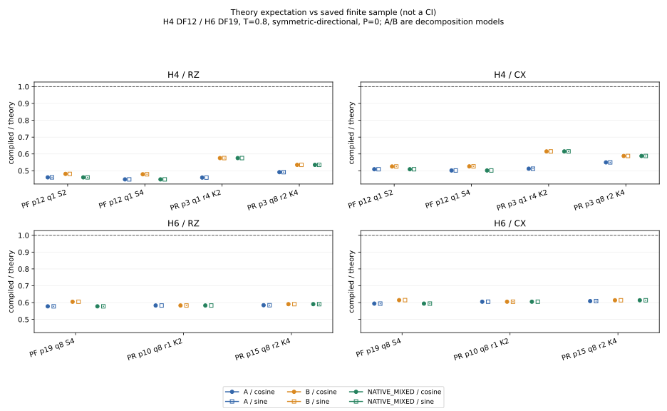
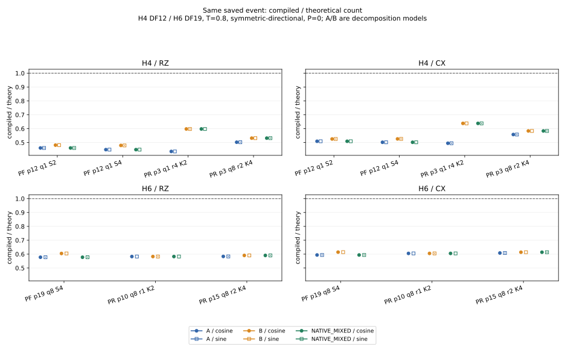

# H4/H6：PR理論リソースと実compiledリソースの固定範囲比較

**OBJECTIVE_COMPLETED_LIMITED_SCOPE / mandatory STOP。** 固定7候補、A/B/NATIVE_MIXED、cosine/sine、RZ/CXを比較した。新しいPR/PF最適化、H8評価、fit、母平均保証は行っていない。

同一eventでの実compiled/theory（NATIVE_MIXED、RZ/CX）は約**0.449〜0.638**だった。shot込み主表では、H4・ε=.05のPR p3/q8/r2/K4対full PF q1/S4が、理論比 **0.871668**に対し保存実測比 **1.039336**となり、費用比較の方向が反転した。理論値をそのままcompiled費用や候補選択の保証へ使えないことを示す限定例である。

[一つの資料入口](../../artifacts/resource_applicability/track_a_pr_theory_compiled_h46_completed/2026-10-18/README.md)。branch `track-a-pr-theory-compiled-h46-completed-20261018`。最終科学SOURCE `536a3671c0ec2939ff3886e40467db26a27ec65a`。

## 条件とモデル

H4はlinear 1 Å/STO-3G/legacy DF12/8 modes/T=.8、full PF p12 q1 S2/S4とPR p3 q1 r4 K2・p3 q8 r2 K4。H6はlinear 1 Å/STO-3G/tol-only DF19/12 modes/T=.8、full PF p19 q8 S4とPR p10 q8 r1 K2・p15 q8 r2 K4。DF政策が異なるため系サイズscalingへ統合しない。

全てsymmetric-directional、full Hadamard wrapper、P=0、state preparation除外。compilerはQiskit1.3.0、rz/sx/x/cx、opt1、seed17、topologyなし。ordinary回路は除外。H4 PRは旧anchor n32、H6 PRは探索n8、PFはn1。H6独立確認n32と混合しない。

AはGaussian再利用なし、Bは厳密に等しい隣接basis境界だけを相殺する仮想モデル。NATIVE_MIXEDはprefix A＋closed RTE tail B＋native scalar/wrapper。PFではA相当。既存counterのbytes/SHAは不変で、A/B総数を補間していない。全てexplicit_rz_sx_x_cx_v1のRZ/CX数で、理論depthやT/Toffoli数ではない。理論値は実compiled費用の上界ではない。

## 実行と入力来歴

|Stage|実行SOURCE|終端|
|---|---|---|
|1|`106ed56b294717da12d9b64ad72fbdd7317223b7`|COMPLETE_MANDATORY_STOP|
|2|`98e5c9e61f245dbb9faf381d835a3846ee7e9bf3`|COMPLETE_MANDATORY_STOP|
|3|`34b2da1a6bfc001314e0e31458d803caca80adf2`|COMPLETE_MANDATORY_STOP|
|4|`536a3671c0ec2939ff3886e40467db26a27ec65a`|COMPLETE_MANDATORY_STOP|

Stage1はH6 PR2候補の条件付き保存16行を取得した。Stage2は保存H4 snapshotからpreparationを補完し、prefix3/full12のhashが旧記録と完全一致した。24理論wrapper行を新規評価。Stage3はH6固定archiveからmixed6行を取得し、元のnative finite law/preparation hashを照合、uniform A/B12行を再利用した。旧832行・144 law・10,480接続は再生成していない。

Stage4は保存7 groupを再生し、全44 RTE eventの再サンプリングは0。新sampling0、control28、追加compile 0、保存compile再利用 14 /14。各候補のcosine/sineは同じevent digest。新SOURCE/grant/outputを段階ごとに固定し、各one-shotは完了STOP。科学retry0、旧grant/ledger/STOPの変更・返却・reset0。

SOURCE2/3の実行commitはローカルで先に固定した。通常HTTPS pushは認証不足だったため、既存GitHub接続で**同一treeの公開mirror**を作成した。実行SHAとmirror SHAは別であり、[原commit内容と対応](../../artifacts/resource_applicability/track_a_pr_theory_compiled_h46_completed/2026-10-18/source_commit_proofs.json)を保存した。最終SOURCE4は公開SHA自体から実行した。mirrorを実行SHAと称さず、旧commitのauthor/parent/messageも改変していない。

## Q1：理論期待費用と保存有限標本平均

ρ=C_compiled/C_theory、e=(C_compiled−C_theory)/C_compiled。幅は元lower/upperを保持し、表の小数は表示丸め。正確な有理数はJSON/CSVへ保存。幅は信頼区間ではない。以下は旧保存平均への条件付き比較で、完全な数値envelopeやcompiler効果だけの抽出を認定しない。

|System|Candidate|Axis|Metric|A lower…upper|B lower…upper|NATIVE_MIXED lower…upper|Saved compiled mean (n)|ρ mixed lower…upper|e mixed lower…upper|
|---|---|---|---|---:|---:|---:|---:|---:|---:|
|H4|B1_p12_q1_2nd|cosine|RZ|16,096|15,408|16,096|7,416 (1)|0.460736|-1.170442|
|H4|B1_p12_q1_2nd|cosine|CX|7,150|6,926|7,150|3,640 (1)|0.509091|-0.964286|
|H4|B1_p12_q1_2nd|sine|RZ|16,097|15,409|16,097|7,416 (1)|0.460707|-1.170577|
|H4|B1_p12_q1_2nd|sine|CX|7,150|6,926|7,150|3,640 (1)|0.509091|-0.964286|
|H4|B1_p12_q1_4th|cosine|RZ|48,272|45,216|48,272|21,662 (1)|0.448749|-1.228418|
|H4|B1_p12_q1_4th|cosine|CX|21,444|20,452|21,444|10,760 (1)|0.501772|-0.992937|
|H4|B1_p12_q1_4th|sine|RZ|48,273|45,217|48,273|21,662 (1)|0.448739|-1.228465|
|H4|B1_p12_q1_4th|sine|CX|21,444|20,452|21,444|10,760 (1)|0.501772|-0.992937|
|H4|B2_p3_q1_2nd_r4_K2|cosine|RZ|7,344.772206|5,864.132408|5,864.132408|3,374.9375 (32)|0.575522|-0.737553|
|H4|B2_p3_q1_2nd_r4_K2|cosine|CX|2,883.567451|2,401.927364|2,401.927364|1,477.3125 (32)|0.615053|-0.625876|
|H4|B2_p3_q1_2nd_r4_K2|sine|RZ|7,345.772206|5,865.132408|5,865.132408|3,374.9375 (32)|0.575424|-0.737849|
|H4|B2_p3_q1_2nd_r4_K2|sine|CX|2,883.567451|2,401.927364|2,401.927364|1,477.3125 (32)|0.615053|-0.625876|
|H4|B2_p3_q8_2nd_r2_K4|cosine|RZ|47,958.772775|44,073.294483|44,073.294483|23,582.1875 (32)|0.535068|-0.868923|
|H4|B2_p3_q8_2nd_r2_K4|cosine|CX|19,515.072361|18,251.157865|18,251.157865|10,730.5 (32)|0.587935|-0.700867|
|H4|B2_p3_q8_2nd_r2_K4|sine|RZ|47,959.772775|44,074.294483|44,074.294483|23,582.1875 (32)|0.535055|-0.868965|
|H4|B2_p3_q8_2nd_r2_K4|sine|CX|19,515.072361|18,251.157865|18,251.157865|10,730.5 (32)|0.587935|-0.700867|
|H6|B1_p19_q8_4th|cosine|RZ|1,521,189|1,452,789|1,521,189|878,573 (1)|0.577557|-0.731432|
|H6|B1_p19_q8_4th|cosine|CX|667,264|644,840|667,264|396,212 (1)|0.593786|-0.684109|
|H6|B1_p19_q8_4th|sine|RZ|1,521,190|1,452,790|1,521,190|878,573 (1)|0.577556|-0.731433|
|H6|B1_p19_q8_4th|sine|CX|667,264|644,840|667,264|396,212 (1)|0.593786|-0.684109|
|H6|B2_p10_q8_2nd_r1_K2|cosine|RZ|292,499.780254|292,499.631054|292,499.631054|170,411.25 (8)|0.582603|-0.716434|
|H6|B2_p10_q8_2nd_r1_K2|cosine|CX|125,579.822766|125,579.773823|125,579.773823|75,984 (8)|0.605066|-0.652713|
|H6|B2_p10_q8_2nd_r1_K2|sine|RZ|292,500.780254|292,500.631054|292,500.631054|170,411.25 (8)|0.582601|-0.71644|
|H6|B2_p10_q8_2nd_r1_K2|sine|CX|125,579.822766|125,579.773823|125,579.773823|75,984 (8)|0.605066|-0.652713|
|H6|B2_p15_q8_2nd_r2_K4|cosine|RZ|428,370.856111|423,791.564639|423,791.564639|250,271.875 (8)|0.590554|-0.693325|
|H6|B2_p15_q8_2nd_r2_K4|cosine|CX|184,900.616849|183,402.655048|183,402.655048|112,542 (8)|0.613633|-0.629637|
|H6|B2_p15_q8_2nd_r2_K4|sine|RZ|428,371.856111|423,792.564639|423,792.564639|250,271.875 (8)|0.590553|-0.693329|
|H6|B2_p15_q8_2nd_r2_K4|sine|CX|184,900.616849|183,402.655048|183,402.655048|112,542 (8)|0.613633|-0.629637|

## Q2/Q3：同一event・native構築・compiledの分離

保存eventを再生し、固定H/preparation・control・scalar・wrapperに結合した。保存費用再利用はwrapper fingerprint、event digest、compiler settings hash、axis、候補の一致時だけ行った。旧hostとのcompiler binary/output完全同一性は未認定のまま。

同一eventのNATIVE_MIXEDに対するcompiled比ρは今回の局所表で0.448739〜0.638070。この範囲は有限固定panelの観測で、将来回路・他compiler・母平均の保証ではない。

|System|Candidate|Axis|Metric|Mixed same event|Native explicit lowered|Compiled same event|ρ|Origin|
|---|---|---|---|---:|---:|---:|---:|---|
|H4|B1_p12_q1_2nd|cosine|RZ|16,096|16,096|7,416|0.460736|SAVED_COMPILED_EXACT_WRAPPER_DIGEST|
|H4|B1_p12_q1_2nd|cosine|CX|7,150|7,150|3,640|0.509091|SAVED_COMPILED_EXACT_WRAPPER_DIGEST|
|H4|B1_p12_q1_2nd|sine|RZ|16,097|16,097|7,416|0.460707|SAVED_COMPILED_EXACT_WRAPPER_DIGEST|
|H4|B1_p12_q1_2nd|sine|CX|7,150|7,150|3,640|0.509091|SAVED_COMPILED_EXACT_WRAPPER_DIGEST|
|H4|B1_p12_q1_4th|cosine|RZ|48,272|48,274|21,662|0.448749|SAVED_COMPILED_EXACT_WRAPPER_DIGEST|
|H4|B1_p12_q1_4th|cosine|CX|21,444|21,446|10,760|0.501772|SAVED_COMPILED_EXACT_WRAPPER_DIGEST|
|H4|B1_p12_q1_4th|sine|RZ|48,273|48,275|21,662|0.448739|SAVED_COMPILED_EXACT_WRAPPER_DIGEST|
|H4|B1_p12_q1_4th|sine|CX|21,444|21,446|10,760|0.501772|SAVED_COMPILED_EXACT_WRAPPER_DIGEST|
|H4|B2_p3_q1_2nd_r4_K2|cosine|RZ|5,359|5,359|3,203|0.597686|SAVED_COMPILED_EXACT_WRAPPER_DIGEST|
|H4|B2_p3_q1_2nd_r4_K2|cosine|CX|2,238|2,238|1,428|0.63807|SAVED_COMPILED_EXACT_WRAPPER_DIGEST|
|H4|B2_p3_q1_2nd_r4_K2|sine|RZ|5,360|5,360|3,203|0.597575|SAVED_COMPILED_EXACT_WRAPPER_DIGEST|
|H4|B2_p3_q1_2nd_r4_K2|sine|CX|2,238|2,238|1,428|0.63807|SAVED_COMPILED_EXACT_WRAPPER_DIGEST|
|H4|B2_p3_q8_2nd_r2_K4|cosine|RZ|45,269|45,269|24,069|0.531688|SAVED_COMPILED_EXACT_WRAPPER_DIGEST|
|H4|B2_p3_q8_2nd_r2_K4|cosine|CX|18,640|18,640|10,876|0.583476|SAVED_COMPILED_EXACT_WRAPPER_DIGEST|
|H4|B2_p3_q8_2nd_r2_K4|sine|RZ|45,270|45,270|24,069|0.531677|SAVED_COMPILED_EXACT_WRAPPER_DIGEST|
|H4|B2_p3_q8_2nd_r2_K4|sine|CX|18,640|18,640|10,876|0.583476|SAVED_COMPILED_EXACT_WRAPPER_DIGEST|
|H6|B1_p19_q8_4th|cosine|RZ|1,521,189|1,521,173|878,573|0.577557|SAVED_COMPILED_EXACT_WRAPPER_DIGEST|
|H6|B1_p19_q8_4th|cosine|CX|667,264|667,248|396,212|0.593786|SAVED_COMPILED_EXACT_WRAPPER_DIGEST|
|H6|B1_p19_q8_4th|sine|RZ|1,521,190|1,521,174|878,573|0.577556|SAVED_COMPILED_EXACT_WRAPPER_DIGEST|
|H6|B1_p19_q8_4th|sine|CX|667,264|667,248|396,212|0.593786|SAVED_COMPILED_EXACT_WRAPPER_DIGEST|
|H6|B2_p10_q8_2nd_r1_K2|cosine|RZ|292,509|292,509|170,441|0.582686|SAVED_COMPILED_EXACT_WRAPPER_DIGEST|
|H6|B2_p10_q8_2nd_r1_K2|cosine|CX|125,584|125,584|76,000|0.605173|SAVED_COMPILED_EXACT_WRAPPER_DIGEST|
|H6|B2_p10_q8_2nd_r1_K2|sine|RZ|292,510|292,510|170,441|0.582684|SAVED_COMPILED_EXACT_WRAPPER_DIGEST|
|H6|B2_p10_q8_2nd_r1_K2|sine|CX|125,584|125,584|76,000|0.605173|SAVED_COMPILED_EXACT_WRAPPER_DIGEST|
|H6|B2_p15_q8_2nd_r2_K4|cosine|RZ|423,365|423,365|250,055|0.590637|SAVED_COMPILED_EXACT_WRAPPER_DIGEST|
|H6|B2_p15_q8_2nd_r2_K4|cosine|CX|183,264|183,264|112,482|0.61377|SAVED_COMPILED_EXACT_WRAPPER_DIGEST|
|H6|B2_p15_q8_2nd_r2_K4|sine|RZ|423,366|423,366|250,055|0.590636|SAVED_COMPILED_EXACT_WRAPPER_DIGEST|
|H6|B2_p15_q8_2nd_r2_K4|sine|CX|183,264|183,264|112,482|0.61377|SAVED_COMPILED_EXACT_WRAPPER_DIGEST|

### 帰属できる差と未解決の差

- A/B/mixedの構成差は、同じeventに適用した既存counterの部品から算出した。uniform Bを実native全体と扱わない。
- mixedとnative explicit lowered数が一致する行では、残るcompiledとの差は指定の理論loweringとQiskitのlowering＋opt1の合成差である。opt0の追加compileは実施していないため、loweringとoptimizerの寄与を別々には識別できない。
- **mixedとnative explicit loweredが一致しない行は8 metric行**。[差分監査](../../artifacts/resource_applicability/track_a_pr_theory_compiled_h46_completed/2026-10-18/model_native_difference_audit.json)に値を保存した。この差はUNATTRIBUTEDとし、compilerだけに帰属させず、モデルを後から調整しない。結果JSONのSAME_FIXED_CIRCUIT_BOUNDは固定入力・schedule・controlへの結合を表し、lowered primitive列のbit同一性を保証する語ではない。
- S4係数の静的source検査では、nativeの`-a/(2-a)`とcounterの`-a*(1/(2-a))`にbinary64で1 ULPの差がある。[静的監査](../../artifacts/resource_applicability/track_a_pr_theory_compiled_h46_completed/2026-10-18/static_yoshida_float_audit.json)。これはgate差の候補機構であり、観測差の原因と断定しない。既存counter/nativeの式を変更して一致させていない。
- PR期待値対保存平均にはevent構成の有限標本差も含まれる。同一eventの比較を旧n8/n32の平均と混ぜず、追加の独立標本やSE改善とは扱わない。

## Q4：固定panel内でのPR/PF費用比較

元の5精度×factor1/10の候補別N_real/N_imagを保持し、G=Σ_axis N_axis C_axisで比較した。旧G_exactへの一致を検査。新shot規則・bias・normalization・allowance・winnerを導出/変更していない。以下はP=0/RZ/factor1、全30固定pair条件であり、不適格条件は欠測のまま。A/B・CX・factor10を含む全360行は[機械可読比較](../../artifacts/resource_applicability/track_a_pr_theory_compiled_h46_completed/2026-10-18/pf_pr_comparisons.json)。

|System|PR|PF|ε|Theory mixed PR/PF|Saved compiled PR/PF|Status|
|---|---|---|---:|---:|---:|---|
|H4|B2_p3_q1_2nd_r4_K2|B1_p12_q1_2nd|0.0005|MISSING|MISSING|NO_COMMON_SAVED_ELIGIBILITY|
|H4|B2_p3_q1_2nd_r4_K2|B1_p12_q1_2nd|0.001|MISSING|MISSING|NO_COMMON_SAVED_ELIGIBILITY|
|H4|B2_p3_q1_2nd_r4_K2|B1_p12_q1_2nd|0.005|MISSING|MISSING|NO_COMMON_SAVED_ELIGIBILITY|
|H4|B2_p3_q1_2nd_r4_K2|B1_p12_q1_2nd|0.01|MISSING|MISSING|NO_COMMON_SAVED_ELIGIBILITY|
|H4|B2_p3_q1_2nd_r4_K2|B1_p12_q1_2nd|0.05|0.405603|0.506631|CONDITIONAL_SAVED_COST_COMPARISON|
|H4|B2_p3_q1_2nd_r4_K2|B1_p12_q1_4th|0.0005|MISSING|MISSING|NO_COMMON_SAVED_ELIGIBILITY|
|H4|B2_p3_q1_2nd_r4_K2|B1_p12_q1_4th|0.001|MISSING|MISSING|NO_COMMON_SAVED_ELIGIBILITY|
|H4|B2_p3_q1_2nd_r4_K2|B1_p12_q1_4th|0.005|MISSING|MISSING|NO_COMMON_SAVED_ELIGIBILITY|
|H4|B2_p3_q1_2nd_r4_K2|B1_p12_q1_4th|0.01|MISSING|MISSING|NO_COMMON_SAVED_ELIGIBILITY|
|H4|B2_p3_q1_2nd_r4_K2|B1_p12_q1_4th|0.05|0.164939|0.211522|CONDITIONAL_SAVED_COST_COMPARISON|
|H4|B2_p3_q8_2nd_r2_K4|B1_p12_q1_2nd|0.0005|MISSING|MISSING|NO_COMMON_SAVED_ELIGIBILITY|
|H4|B2_p3_q8_2nd_r2_K4|B1_p12_q1_2nd|0.001|MISSING|MISSING|NO_COMMON_SAVED_ELIGIBILITY|
|H4|B2_p3_q8_2nd_r2_K4|B1_p12_q1_2nd|0.005|MISSING|MISSING|NO_COMMON_SAVED_ELIGIBILITY|
|H4|B2_p3_q8_2nd_r2_K4|B1_p12_q1_2nd|0.01|MISSING|MISSING|NO_COMMON_SAVED_ELIGIBILITY|
|H4|B2_p3_q8_2nd_r2_K4|B1_p12_q1_2nd|0.05|2.14353|2.489386|CONDITIONAL_SAVED_COST_COMPARISON|
|H4|B2_p3_q8_2nd_r2_K4|B1_p12_q1_4th|0.0005|MISSING|MISSING|NO_COMMON_SAVED_ELIGIBILITY|
|H4|B2_p3_q8_2nd_r2_K4|B1_p12_q1_4th|0.001|MISSING|MISSING|NO_COMMON_SAVED_ELIGIBILITY|
|H4|B2_p3_q8_2nd_r2_K4|B1_p12_q1_4th|0.005|0.227486|0.271242|CONDITIONAL_SAVED_COST_COMPARISON|
|H4|B2_p3_q8_2nd_r2_K4|B1_p12_q1_4th|0.01|0.58871|0.701948|CONDITIONAL_SAVED_COST_COMPARISON|
|H4|B2_p3_q8_2nd_r2_K4|B1_p12_q1_4th|0.05|0.871668|1.039336|CONDITIONAL_SAVED_COST_COMPARISON|
|H6|B2_p10_q8_2nd_r1_K2|B1_p19_q8_4th|0.0005|0.435542|0.439347|CONDITIONAL_SAVED_COST_COMPARISON|
|H6|B2_p10_q8_2nd_r1_K2|B1_p19_q8_4th|0.001|0.275018|0.277421|CONDITIONAL_SAVED_COST_COMPARISON|
|H6|B2_p10_q8_2nd_r1_K2|B1_p19_q8_4th|0.005|0.205373|0.207168|CONDITIONAL_SAVED_COST_COMPARISON|
|H6|B2_p10_q8_2nd_r1_K2|B1_p19_q8_4th|0.01|0.198678|0.200414|CONDITIONAL_SAVED_COST_COMPARISON|
|H6|B2_p10_q8_2nd_r1_K2|B1_p19_q8_4th|0.05|0.193573|0.195264|CONDITIONAL_SAVED_COST_COMPARISON|
|H6|B2_p15_q8_2nd_r2_K4|B1_p19_q8_4th|0.0005|0.63091|0.645107|CONDITIONAL_SAVED_COST_COMPARISON|
|H6|B2_p15_q8_2nd_r2_K4|B1_p19_q8_4th|0.001|0.398381|0.407346|CONDITIONAL_SAVED_COST_COMPARISON|
|H6|B2_p15_q8_2nd_r2_K4|B1_p19_q8_4th|0.005|0.297496|0.304191|CONDITIONAL_SAVED_COST_COMPARISON|
|H6|B2_p15_q8_2nd_r2_K4|B1_p19_q8_4th|0.01|0.287797|0.294274|CONDITIONAL_SAVED_COST_COMPARISON|
|H6|B2_p15_q8_2nd_r2_K4|B1_p19_q8_4th|0.05|0.2804|0.28671|CONDITIONAL_SAVED_COST_COMPARISON|

主表の共通適格条件は16件で、理論区間全体のPR/PF方向とcompiled点比率の方向が反対になる条件は**1件**。これは相関する表内条件数で、独立実験数や確率保証ではない。[方向監査](../../artifacts/resource_applicability/track_a_pr_theory_compiled_h46_completed/2026-10-18/relative_cost_direction_audit.json)。

同じ保存shot規則のもとで、理論モデルとcompiled比較の対応を検討できる。絶対数の過大評価と候補間比率の誤差は別問題である。固定panel外の最適性、全精度・全分子でのPR優位、母平均や未観測希少次数のcompiled費用上界は認定しない。

## 資源・検証・終了監査

追加人工10 unit tests＋固定panel合成1件＋3qubit native再生接続1件PASS。既存32 tests/保存descriptor接続は反復しない。人工接続では汎用打切り許容値を誤って使った段階で失敗し、元の固定K用規則へ修正後PASS。実Stage4の科学予約前の修正であり、実科学runのretryではない。subagent0、独立別担当reviewや外部再現と称さない。

最大4 own worker、内部thread1、process内のcontent検査付きhash再利用、固定preparation再利用。CPU affinity・OS/cgroup/quota・共有venv/package/cache・他jobを変更せず、新AS/RSS/wall capなし。PSIは観測のみ。Stage4 wall 1548.782秒、最大単一worker RSS 2.709 GiB、control最大誤差 8.45594e-14。7 workerとcoordinatorのnative exit0・wait/reap・残存0を確認。source closure/236 provider/56 input/選択15 runtime filesを終了時再照合した。全venvの再hash・他worktree一括凍結は行わず、quotaは独立認証なしと明記する。追加compile0のため、今回のwall/RSSは再生・control・照合の値であり、新しいtranspile速度・必要メモリの測定ではない。

準備時にREVIEW資料の配置参照とH6 receiptのfragment order参照を修正したが、どちらもplan/grant/科学child作成前で科学dispatch0を確認した。自動承認レビューによる誤認の拒否も保存し、未実行証拠確認後に初回実行した。科学失敗runの再試行は0。

[最終gate](../../artifacts/resource_applicability/track_a_pr_theory_compiled_h46_completed/2026-10-18/final_gate.json)、[call ledger](../../artifacts/resource_applicability/track_a_pr_theory_compiled_h46_completed/2026-10-18/call_ledger_summary.json)、[原SOURCE/mirror](../../artifacts/resource_applicability/track_a_pr_theory_compiled_h46_completed/2026-10-18/source_commit_proofs.json)。各旧ledgerを参照して保持しており、別namespaceの過去消費を一つの新しいactual総数として算出し直してはいない。

## 達成判定・限界・次の担当

OBJECTIVE_COMPLETED_LIMITED_SCOPE。両系の固定PR/PF、A/B/mixed、両軸RZ/CX、数値比・差、同一eventのnative/compiled対照、保存shot込み比較を取得した。counterの絶対値はQiskit compiled数そのものではなく、今回の範囲で構成依存の予測として有用性と限界を示した。

未解決は母平均・希少eventのcompiled費用上界、全候補最適性、旧compiler出力のbit同一性、lowering/opt1の独立寄与、および保存したpretranspileモデル/nativeの不一致である。これらを成功のために緩めたり、追加計算で救済したりしていない。

次の担当：ユーザー/GPTが本固定panelで原稿へ反映できる主張範囲を判断する。Codexによる追加sampling/compile/fit/H8計算・新しい研究方針の採択は開始しない。**mandatory STOP。**
