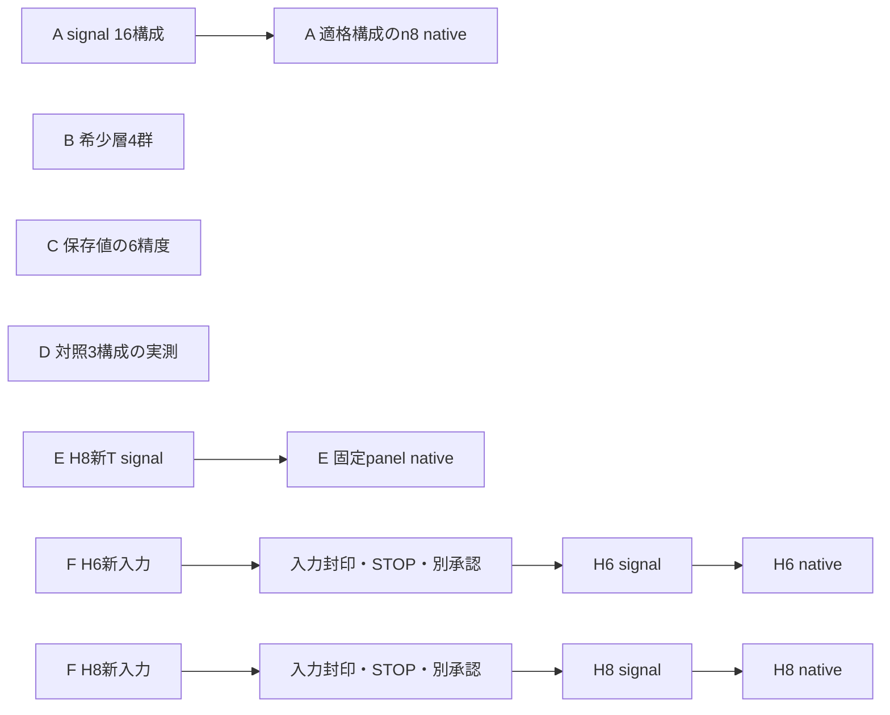

# Track A：変数範囲を絞った検証と並列実行の計画

追記：本計画の後に利用者の準備後実行承認を受け、[Cの追加6精度検証](track_a_h8_epsilon_boundary_run01_results_20261018.md)を正常完了した。以下の未承認表記は計画時点の履歴。他系列の科学計算は未実行。

2026-10-18 JST。利用者の「必要な範囲を選び、検証間・検証内を並列化する」方針に基づく**未承認の具体案**。完了済みの解析を再利用し、追加検証6系列を15の承認単位に分けた。今回は計画コード・依存関係の人工検証・再利用監査までで、新しい科学計算は0。各単位のproduction adapter、実入力manifest、control予算、実行契約は未sealであり、科学実行可能な状態とはしていない。

SOURCE `daf701d8e4fb25a22e5c383202f535f9db7a6e25`、起点 `cf8e93eef50333bef41f6d75803f6b819d679343`。[計画JSON](../../artifacts/resource_applicability/track_a_targeted_parallel_plan/2026-10-18/campaign_plan_UNAPPROVED_v1.json)のdigestは `b2519efb7c6f5d87fe18a561459edf325965ea7cb865d969c589dc4a9dfe341c`。[bundle](../../artifacts/resource_applicability/track_a_targeted_parallel_plan/2026-10-18/README.md)、[metadata CLI](../../scripts/prepare_track_a_targeted_plan.py)、[計画module](../../src/trotterlib/targeted_validation_plan.py)。このCLIはscience dispatchを実装していない。

## 今回選ぶ範囲

「必要十分」は以下の局所的な問いに対する作業量の選択であり、全変数でのPR最適性・統計的検出力・母平均の保証を意味しない。追加を自動で増やさず、結果が未解決なら未解決としてSTOPする。

| 系列 | 問いと固定する最小範囲 | 提案する追加処理量上限 | 再利用・残る実装 |
|---|---|---:|---|
| A：H8 PR探索境界 | prefix下端・r/q上端に改善余地があるか。p6/8×q2/4/8×r4×K2/4の12構成、p7/r8/K4/q4・8の2構成、p7/q16/r4/K4、p6/q8/r8/K4の計16構成 | まずsignal・normalization・適格性16構成。登録endpointのどれかが適格な構成に限りn8、最大128 trajectory・256軸compile | 元PR providerと保存preparationを継承。p6/8 preparation、r8/q16 scope・seed・入力adapterは要実装 |
| B：希少層 | 未観測費用を実測する。H8 p7/r4/K4、q4/8×s2_multi/s4の4群 | 各群n8、32 trajectory・64軸compile | 既存count条件付きsamplerを再利用。native接続・control・seed台帳を追加 |
| C：精度境界 | 保存候補集合でPR費用の符号が変わる区間を粗く絞る | ε=.04/.025/.015と.000875/.00075/.000625の6点、通常/非相殺を別計算、倍率1。190候補×6点×2区分=2,280行。compile0 | 凍結D0 shot式と保存signal/成分/費用を再利用。新ε adapterが必要 |
| D：対照直接実測 | 重要なmodel依存の対照単価を確認 | H8 B0 p15/q8 S2（通常ε=.001）、H8 B0+I p16/q4 S4（非相殺ε=.0005）、H6 B0+I p11/q4 S4（通常ε=.0005）の3構成、6軸 | full-wrapper adapter・QPY・cleanupを再利用。3つの新scope、保存予測値/入力の結合が必要 |
| E：H8時間依存 | 代表構成の結果がTを変えて維持されるか | T=.4/1.6、δ=.2固定でq2/8。各T PR n8＋決定論4構成、最大48軸compile | H6固定δ panelの手順とH8 providerを再利用。H8用reference・scope adapterを追加 |
| F：H6/H8距離依存 | 1Å以外で同じ分割処方が機能するか | 各系1.40Åを1点だけ。新入力2組を先に生成・封印しSTOP。別承認後、各系PR n8＋決定論4構成、最大48軸compile | H4のgate・queue設計を参考にする。H6/H8用入力生成adapterは新設が必要 |

上限は全系列を将来別々に承認した場合のnative compile計422軸であり、今回の実行許可・実績ではない。signal/reference検証やnative control probeは別予算で、**control予算未確定を0と解釈しない**。Aはsignal gateにより実際のcompile対象を減らす。各n8は既存pilotと揃えた有限標本診断であり、必要標本数の数学的保証ではない。新n32確認や標本追加は自動で行わない。

## 固定する科学条件と解釈

A〜Dは保存されたlinear H8/H6、1Å、STO-3G、tol-only DF（H8 rank28/sector4900、H6 rank19/sector400）を使う。基本T=.8、finite-RTE law、symmetric-directional full Hadamard wrapper、scalar phase・full-H reference・経験的allowanceの区分、P=0を継承する。PRはS2。元compiler SHA `1239304c14c65cde2e66ac783646abae19455ad8af6ce0cafd157557eeabb33b`、H8 profile `622ce4a8391002558b877240b48d831d9bb0a72aeabba2e4d73bfec64b9c9f12`。H6のprofile/preparationはH6側の保存証拠から別に結合し、H8 profileと同一とは仮定しない。fresh gateは固定SOURCE・実入力hash・Python/依存package・compiler/controlの整合性を検査する。

**A**：元H8の72構成（p7/14/21、q1/2/4/8、r1/2/4、K2/4）と確認union6 n32を再利用する。境界を1段拡げ、r8とq16はK4だけを診断し、1つだけ連動cornerを含める。K2や複数変数の相互作用を全探索したとはしない。通常/非相殺、既存5精度、倍率1でsignalの適格性を記録する。有限RTEの期待値・normalizationの計算と、compile用n8 trajectoryを区別する。n8で選んだ候補は探索結果であり、既存n32と同じ確認済み扱いにしない。

**B**：`s2_multi: N2>=2,N4=0`、`s4: N4>=1,N2 arbitrary`。count vectorを正しい条件付き確率で抽選し、位置を一様配置し、元の成分law・event生成を呼ぶ。N2=2やN4=1への固定は禁止。条件付き正規化は条件分布の抽選にだけ使い、元PRのnormalizationを書き換えない。元s2 n8が全てsingleだったという観測を、single固定の実験設計と混同しない。新しいq/層ごとに先頭trajectoryでnative controlを確認し、残り7を起動する。元native control台帳376/376は消費済みであり、新予算を別に登録する。完了済み[2変数感度境界](track_a_h8_rare_sensitivity_selection_run01_results_20261018.md)は再実行しない。新実測との結合・再会計も別stage・別承認とする。

**C**：決定論強化184と確認PR6を[6軸反映後の保存結果](track_a_h8_six_axis_reaccount_run01_results_20261017.md)に固定する。新しいA候補やD単価は混ぜない。保存された通常bias/非相殺成分と凍結D0 shot式を使い、εだけを変更する。各区分のε=.05/.01と.001/.0005を保存anchorとして読む。整数shot・候補切替により費用は不連続なので、単一の連続根や単調な二分探索を仮定しない。求めるのは6点での符号と候補切替であり、厳密な逆転閾値ではない。SELECTION_SAVEDのε=.0005・非相殺・倍率10へのbootstrap拡張は今回含めない。

**D**：モデル予測値は各系の保存会計/modelから読み取り、値・SOURCE・対象軸をseal時に固定する。今回新たに予測値を再計算したりfitしたりしていない。各構成のcosine→判定→sineを維持し、軸ごとの相対誤差が**2%以上ならその契約を即STOP**。分母・丸め・非finite拒否も旧検証契約から明示的に継承する。異なる構成/系は独立契約として並列化できるが、一構成内の判定を追い越さない。検証不一致時は同じ仮説を使う待機処理も止める。実測後の費用再会計は自動起動しない。これで全モデル単価の実測が完了するわけではない。

**E**：T=.8/q4は保存値を再利用する。新Tの各panelはPR p7/r4/K4、B0 p15 S2、B0+I p15 S4、full p28 S2/S4の5固定構成。Tごとに最良候補を再探索しない。保存SCF/DF/stateは再生成せず、新Tのfull-H referenceとprimitive整合性を確認する。H6のT=.4/.8/1.6固定δ panelは完了済みなので再実行しない。H6/H8の代表構成が異なる点を残し、最適利益の系サイズ則と解釈しない。

**F**：H6/H8を1.40Åで各1点追加し、1Åとの比較に限定する。tol-only1e-8/cutoff0、signed generation order、weighted Hermitian projectionを維持し、**新距離のDF rankを19/28へ固定しない**。入力生成後にrank・state・reference・全入力hashを封印してSTOPする。新しい信号/compileにはその入力への別承認が必要。固定処方はPR prefix=ceil(rank/4)、B0+I prefix=ceil(3rank/4)、T=.8/q4/r4/K4、PRとB0+I S2/S4・full S2/S4。prefixが有効な打切りを作らない場合はNOT_APPLICABLEとして記録し、事後的に別prefixを探さない。H4の旧DF12や配列形状は移植しない。距離全域・基底依存・大規模系への外挿は対象外。

## 並列化と順序

科学実行契約を別々に承認した後の依存関係は次のとおり。現在の実行可能nodeは0。図は予定であり、実行中の処理ではない。

最初の準備優先順はCの保存入力adapter、Bのnative接続、Dの新scope、Aの境界scope、E、Fの新入力adapter。依存しないものは準備完了・個別承認後すぐ同時実行でき、Aの探索結果をE/Fの開始条件にしない。準備が軽いCやDを重いFの完成まで待たせない。Aのsignal内では16構成を並列化し、その完了・STOP・別承認を挟んで、適格構成のcompile内を並列化する。この承認境界を追い越すpipelineは今回採用しない。

検証内の高速化は以下に限定する。性能向上率やwall timeはまだ測定していない。

- A/E/F：prefix・入力hash・Tが一致するpreparation、CSR/primitive、referenceを一度だけ作り、独立候補・trajectoryをworkerへ配る。異なるT/距離へreferenceや費用を流用しない。
- B：既存の条件付きcount表をcacheし、先頭control通過後のtrajectoryを並列化。cosine/sineは同じevent列でpairedにし、両軸で抽選を二重にしない。
- C：同じ保存標本平均・成分を全εで再利用する。2,280行の軽い会計はまず単一processでまとめ、process間転送の方が重くなる並列化を増やさない。
- D：準備・wrapper/QPY生成を構成間で並列化し、各構成内の軸判定順は保つ。終了した自分のworkerを回収して次の仕事へ割り当てる。
- worker数・library thread数・同時native compile数はfresh affinity/メモリ観測と既存の類似taskの測定値から選ぶ。過去の4/6workerやRAM上限を恒常的な制限にしない。外側worker数×内側BLAS thread数を把握し、過剰な多重化を避ける。
- seedはcampaign/package/system/input hash/T/candidate/層/phase/replicaから登録する。worker番号・完了順・時刻を乱数系列の識別に使わず、旧seedとの衝突を事前検査する。候補間のpaired構造は仮定しない。

汎用の新ジョブ基盤は作らない。既存のowned-worker/cleanup/cacheを各adapterで使い、小さなmetadata DAGで順序を確認する。実行時のメモリ実績・throughputがない段階で完了時刻は見積もらない。

## STOP・保全・再利用の証拠

各承認単位はone-shot、終了時mandatory STOP。SOURCE/入力/runtime/compilerの不一致、成分closure/control不一致、非finite、実OOM、owned workerの異常、Dの2%以上不一致は関係する契約をSTOPし、未確認結果をPASSにしない。科学的にPRが劣る結果・不適格な候補は正常な観測として残す。再fit・追加候補・標本追加・自動retryはしない。独立した契約の正常jobまで一括で止めないが、共有していた入力/仮説の破損なら依存先を止める。

現在並行チャットはないという利用者の説明を採用した。通常の一時的CPU競合やPSI上昇は観測・再確認し、それだけでworkerを強制終了しない。保護対象は実際に使うSOURCE・入力・runtime・結果・grant・ledger・marker。無関係worktreeを凍結せず、共有OSや他利用者の環境/プロセスを変更しない。

[再利用監査](../../artifacts/resource_applicability/track_a_targeted_parallel_plan/2026-10-18/reuse_audit_v1.json)は18既知fileを固定commit/blob/bytes/SHA256・ASTで確認した。元H8 provider `c31ef424…` は現checkoutにはないがGit objectから再利用可能。H4 geometry入力codeはH4専用であり、H6/H8対応済みとはしない。既存コードの固定scopeをそのまま新契約として動かさない。author自身の技術確認であり、独立レビューではない。

新規人工metadataテスト21件＋既存保存解析/希少層の人工135件、計156件PASS。依存cycle・重複候補・R/id不整合・signal/cost範囲差・未承認起動・geometry封印後の自動移行・STOP子孫と独立nodeの分離・one-shot再使用・CLI上書きを検査した。CLIの`--execute`はexit2で拒否する。新規科学sampling/signal/数値再解析/native compile/fit/input生成は全て0。

旧SOURCE・結果・grant・ledger・marker、V1、V2 NO_GO、H5/H7は変更していない。独立cloneのみで作業し、起点の完了済み結果cloneはHEAD `cf8e93ee…`・cleanを保持する。既存RARE/SELECTION、H6 T panel、H4 geometry、旧H8探索・確認を繰り返さない。追加独立holdout、大きな系、別基底・noise/backend拡張は今回は保留する。

## 次の作業と承認

1. **Codex**：まずC/B/Dの新scope adapter・入力manifest・人工接続テスト・control予算・独立した実行契約を完成させ、実行直前に承認できる具体物へする。A/E/Fは同じ方針で段階的に接続する。科学計算は起動しない。
2. **ユーザー**：完成した各SOURCE・実入力・call/control予算・STOP条件を確認し、実行する単位だけを別途明示承認する。今回の計画の確認を有効grantと扱わない。
3. **Codex**：承認済み単位をfresh gate後に並列実行し、単位ごとに結果・native exit・資源実績を保存してmandatory STOPする。新結果の統合再会計は別途計画・承認する。
