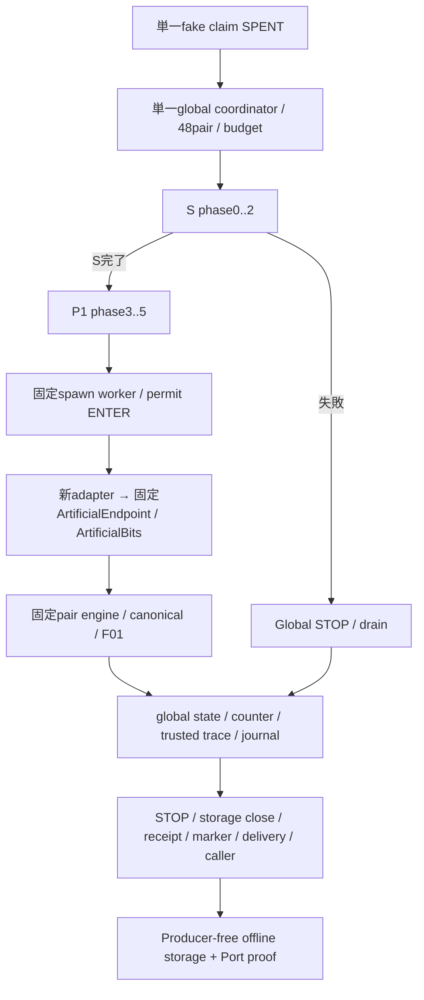

# 統合構造

固定人工測定SOURCE：`deade78a19f5b23859d16816d3a7bfb37765dd80`。直接基点Global Bundle `d24cccbecdf0928fe977080dd7b28c591df0089e`、選択取得API Port `82896d53fa97235fa848d6c0833eb193af8b99d6`、既存独立受入 `6bffb5b5819918698b522270ff19b255766d3072`。Branch `track-b-g6-w2c-b3-closed-port-bundle-integration-20261019`。

ARTIFICIAL_ONLY / UNADOPTED / EXECUTION_CLOSED。サーバーCodex主担当による技術自己検証。実G7/F3 import・科学bits・sampling・新科学計算・数値再解析・正式science/authority・native処理0。mandatory STOP。

旧bridge.execute_artificialはF.ArtificialFactory(runtime)を生成し、_conditionの全run_phaseへF.bits_factoryを直接渡していた。このhardwireが外部Port不在の原因。新subpackage g6_w2c_b3_port_bundle_v1/bridge.pyへ固定Bridgeをversioned派生し、Fを新adapter、Kを新contractへ切替。scheduler/worker/ControlledEndpoint/run_pair/Stream/fused codec/CachedObserver/coalesced client/Storage V2は固定実装を再利用する。

全S/P1は同じclaim、uint8 statefile、cursor/ticket、trace/journal、64GiB/256MiBの一つのbudgetを共有する。conditionごとの独立実行や独立grantは作らない。
