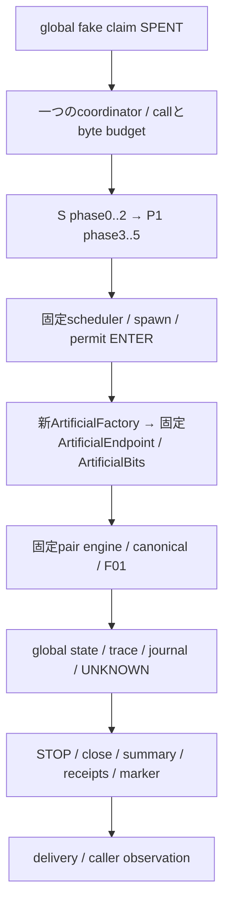

# 統合data flow

直接基点 `5e862a70f2d74defe72dd39205d38c2a4f8ebeaf`。統合公開HEAD `62967269e611b61e73b70abe20e998d9c7eaaf50`、人工測定SOURCE `deade78a19f5b23859d16816d3a7bfb37765dd80`。実施2026-10-19〜20 JST。ARTIFICIAL_ONLY・未採択・実科学入口閉鎖。

[独立差分・AST](integration_source_structure.json)を元Git bytesから生成。Producer保存patchを唯一の根拠にしない。

旧BridgeのF.ArtificialFactory(runtime)とF.bits_factoryのhardwireを、新subpackageのcontract/adapterへ置き換えるversioned派生。元Bundle52 pins・元Port6 pinsは変えていない。scheduler・run_phase・worker・ControlledEndpoint・run_pair・Stream/fused codec・CachedObserver・Storage V2は固定実装を再利用する。

workerへ渡るcontextはrun/task/variant/人工fault、candidate/manifest/runtime/endpoint digest。FakeStore、approval、実grantの操作能力は渡さない。factoryはcontext seal、class、loaded path、SOURCE、taskを確認する。

独立consumerは旧独立identity/trace/storage/costを再利用し、新Referenceが統合candidate/manifestを厳密比較する。新dispatch verifierは同じraw内の人工bits/event/evidenceを独立再構成し、global RESERVE/ENTER/COMPLETE・offset・physical state・PIDと結ぶ。別port gridを連続実行するだけの構造ではない。

今回成立したのは固定人工Portとの統合。実G7/F3 factory/bits/codec/F3 Evidence/real authorityへの接続は未実装・未承認。
