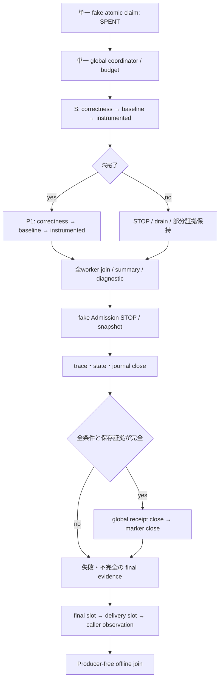

# Architecture

bridge は Storage V2 `Coordinator` の versioned subclass を一つだけ生成する。S/P1 は共通の48-task plan、uint8 statefile、RAM shadow、global counter/cursor/ticket、byte budget、ordered trace、control journalを共有する。Sの3 phaseをjoin後、同じcoordinatorのsettingsをP1へ切り替える。条件ごとに新しいclaim・budget・statefileを作る構造ではない。

worker/F01/Stream/fused codec/CachedObserver/coalesced clientは固定SOURCEを再利用し、既存moduleは変更しない。新bridgeはcondition begin/end、global trial identity、global offset、PHASE_ABORT、post-close保存とcaller観測を追加する。S/P1各24pairはfresh spawn child。Sは逐次、P1は既存8-pair構造。固定順S→P1で科学反復1候補、順序反転は含めない。

runtime SOURCE と科学参照/input/runtime bytesを起動時・phase境界・worker setupで照合する。call entryのpermitは親RPCが唯一のgate。consumerはbridge/Producer/scheduler/Admissionをimportせず、旧global/F01/cost primitivesと新trace判定を使う。
