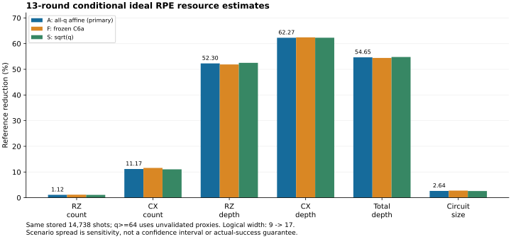

# Track D B/C統合：全13-round条件付き総資源評価

2026-11-08 JST。**承認された一campaignを完了。主評価A・比較F/Sの全6資源でReferenceの点推定は減少した。** ただし各方式総資源の約99.4〜99.5%は独立compile未検証のq≥64 proxyに依存する。全RPEの保証された費用優位やactual成功保証を認定した結果ではない。

分類：`CONDITIONAL_IDEAL_RPE_TOTAL_ESTIMATE`、`DIRECT_FINITE_SAMPLE_PRICE_INPUT`、`EXPLORATORY_LONG_Q_PROXY`、`MODEL_SENSITIVITY`、`UNCERTAINTY_PARTIALLY_QUALIFIED`、`ACTUAL_RPE_UNQUALIFIED`。

## 固定条件・Nと測定の資格

Linear H4/隣接1.00 Å/STO-3G/Nα=Nβ=2、元H、number-CDF8/元frame順LD2、ordered partial S2/s1/r32/K0、h=δ=.1。元H厳密groundを仮定し、状態準備費は除外。13round m0..12/q1..4096、energy .00159 Ha、failure .01、βtotal π/6、βstat π/12、αaxis .01/26、energy prior[-10,10]、元decoder/位相符号/normalization/attenuationを保持。

[B4-2固定07d18bfe](https://github.com/HIROMU1015/Partially-Randomized-Trotter/blob/07d18bfe1d5145d6f8de026c0d994d5cb1c783c8/artifacts/track_d_b4_2_rpe_shots/2026-11-06/Stage_C_handoff.json)の26 axis行を使用した。NX=NY、合計14,738は保存されたHoeffding **十分shot数**であり、必要最小値または「必要十分」の認定ではない。N再算定・failure最適化・ground/DF solveは0。

[B6bの理想同値性](https://github.com/HIROMU1015/Partially-Randomized-Trotter/blob/7ffe8b281b76cef3a6fd06f43413904d6766d0ec/docs/research/track_d_b6b_bc_integration_20261108/MEASUREMENT_EQUIVALENCE.md)は、V=AB、actual A†、真空v、正しいχとVv=e^{iχ}v、強いsymmetricのW0†W1=V、同じX/Y規約というideal blueprintに条件付き。これに同じideal finite-RTE product law、各軸内fresh independent trials、元H ground/誤差・prior/decoder/targetの一致を加え、保存Nを両方式へ共通使用した。literal floating/compiled誤差、finite-bit joint-law、actual RPE成功は保証していない。

## 価格採択とSOURCE

価格scopeはsingle_hadamard_interrogation_without_state_preparation。P0はQiskit1.3/opt1/seed17/rz,sx,x,cx/approx1/initially_zero=false/topology-free/位相保持。既存strongのGaussian共有/directional/relative fusion/step境界融合・scalar集約とwhole-path Referenceを含む保存full-wrapper価格をそのまま利用した。

|q|N_X=N_Y|n whole-path|価格入力・cut|
|---|---:|---:|---|
|1|512|32|Stage A保存平均、complete event16後cut|
|2|512|16|C6a保存平均、step1後cut|
|4|512|16|C6a保存平均、step2後cut|
|8|512|32|C6b保存平均、step4後cut|
|16|513|16|C7-1保存平均、step8後cut|
|32|514|8|C7-3保存平均、step16後cut|
|64|516|—|A/F/Sモデル、想定complete step32後cut|
|128|521|—|A/F/Sモデル、想定complete step64後cut|
|256|530|—|A/F/Sモデル、想定complete step128後cut|
|512|549|—|A/F/Sモデル、想定complete step256後cut|
|1024|589|—|A/F/Sモデル、想定complete step512後cut|
|2048|679|—|A/F/Sモデル、想定complete step1024後cut|
|4096|910|—|A/F/Sモデル、想定complete step2048後cut|

q1はq≥2のモデルで置換しない。q2..32の88 whole-pathとq1保存32本を区別し、XYを独立nへ倍増しない。直接価格は元finite_cohort_summary/paired_statisticsの保存平均で、新平均・新compileは生成していない。

q≥64の**主評価AはC7-4 all-q affine**、Fは元C6a凍結affine、SはC7-4 design=[1,q,sqrt(q)]。固定PLANの1/q/sqrt(q)という区切り表記も列の列挙を意味し、逆数1/q項はない。A/Sのfitは保存q2..32をすべて使用しておりq32は独立holdoutではない。Fの係数は元q2/q4のみ。全て長qの独立検証/保証付き母平均は未取得。basis/lane-runは未来joint feature law不足のため使用しない。モデル単価を整数へ丸めず、資源別に都合のよいscenarioを選ばない。

C7-4公開版は[64072ba8](https://github.com/HIROMU1015/Partially-Randomized-Trotter/blob/64072ba81bb70db1df1b34e94adb08e78926f24b/docs/research/track_d_c7_4_model_stability_20261107/MODEL_REPORT.md)、実行SOURCEdd31e1e2。A/F/Sの仕様は実行前[PLAN](PLAN.md)・[SCENARIOS](SCENARIOS.json)で固定した。今回実行SOURCEは**b09b7e7abaa3b817c26657974a62c3bd3047af89**、基点はB6b最終7ffe8b28。[SOURCE](../../../artifacts/track_d_bc_total/2026-11-08/run01/SOURCE.json)／[45固定input hash](../../../artifacts/track_d_bc_total/2026-11-08/run01/input_bindings.json)／[preflight](../../../artifacts/track_d_bc_total/2026-11-08/run01/preflight.json)。旧sampling/compile SOURCEの役割分担も価格catalogで保持している。

## 全資源の結果

GはΣ_m,b N_m,b × 採択平均/proxy。ΔG=Reference−strong。削減率=(strong−Reference)/strong、正ならReferenceが小さい。以下は表示のみ小数3桁、原本はbinary64値。各depthの総和は**累積depth会計**であり、並列実機wall timeではない。RZ→T換算はしない。

|Scenario|資源|Strong G|Reference G|ΔG|削減率 %|
|---|---|---:|---:|---:|---:|
|A|RZ count|65,571,929,655.980|64,837,503,933.902|-734,425,722.078|1.1200|
|A|CX count|25,126,424,589.114|22,320,542,317.114|-2,805,882,272.000|11.1671|
|A|RZ depth|15,955,840,605.020|7,610,732,151.313|-8,345,108,453.707|52.3013|
|A|CX depth|12,308,579,168.345|4,643,648,093.054|-7,664,931,075.290|62.2731|
|A|Total depth|37,183,234,444.389|16,860,792,816.900|-20,322,441,627.489|54.6549|
|A|Circuit size|134,031,038,096.803|130,493,505,270.725|-3,537,532,826.078|2.6393|
|F|RZ count|62,548,874,000.500|61,812,900,105.750|-735,973,894.750|1.1766|
|F|CX count|24,191,199,569.500|21,385,317,297.500|-2,805,882,272.000|11.5988|
|F|RZ depth|15,052,583,798.875|7,242,531,792.250|-7,810,052,006.625|51.8851|
|F|CX depth|11,863,129,579.625|4,454,642,710.500|-7,408,486,869.125|62.4497|
|F|Total depth|35,180,015,998.500|16,033,186,792.375|-19,146,829,206.125|54.4253|
|F|Circuit size|127,888,247,957.000|124,349,166,958.250|-3,539,080,998.750|2.7673|
|S|RZ count|66,487,389,759.182|65,752,539,491.448|-734,850,267.734|1.1052|
|S|CX count|25,414,994,226.401|22,609,111,954.401|-2,805,882,272.000|11.0403|
|S|RZ depth|16,248,000,316.746|7,716,744,456.096|-8,531,255,860.650|52.5065|
|S|CX depth|12,439,075,549.015|4,689,103,145.651|-7,749,972,403.364|62.3034|
|S|Total depth|37,804,569,342.975|17,090,364,439.464|-20,714,204,903.511|54.7929|
|S|Circuit size|135,923,259,581.630|132,385,302,209.896|-3,537,957,371.734|2.6029|

主評価AではCX約11.17%、total depth約54.65%、RZ約1.12%の減少。全6資源の差の符号はA/F/Sで同じだった。RZ削減は他の指標より小さく、価格の方式別外挿biasに敏感である。CXのΔGが3モデルで丸め誤差内で一致するのは保存モデルが同じpaired CX直線を外挿するためで、3回の独立実証や全support定理ではない。

logical peak qubitsはstrong9、Reference17（追加8、約1.89倍）。shot数やround数を掛けて加算しない。従って回路価格の全6量が下がるモデルでも、幅の負担は増える。

## 主評価A：直接価格と長q proxyの寄与

|資源|q1 ΔG|q2..32 ΔG|q64..4096 ΔG|長q/Strong %|長q/Reference %|長q/ΔG %|
|---|---:|---:|---:|---:|---:|---:|
|RZ count|289,856.000|-1,422,749.500|-733,292,828.578|99.4785|99.4743|99.8457|
|CX count|-47,168.000|-13,190,944.000|-2,792,644,160.000|99.4799|99.4738|99.5282|
|RZ depth|-597,600.000|-41,952,872.375|-8,302,557,981.332|99.4794|99.4676|99.4901|
|CX depth|-527,520.000|-38,449,347.875|-7,625,954,207.415|99.4808|99.4632|99.4915|
|Total depth|-1,456,320.000|-102,178,656.875|-20,218,806,650.614|99.4798|99.4674|99.4900|
|Circuit size|384,768.000|-13,629,501.500|-3,524,288,092.578|99.4789|99.4749|99.6256|

全方式・scenarioの絶対総資源の約99.4〜99.5%がq≥64、差の約99.45〜99.85%が長q proxyに由来する。保存された短qの直接価格だけで全RPEの優位を支持する比重ではない。q1でのRZ/size増加も削除せず含めた。全scenarioの群別方式絶対寄与は各result.jsonのgrouped、13-round×axis×方式×資源の312寄与と156 paired寄与はCSVに保存した。

|資源|A削減 %|F削減 %|S削減 %|モデル内の優劣|
|---|---:|---:|---:|---|
|RZ count|1.1200|1.1766|1.1052|全3版でReference減少|
|CX count|11.1671|11.5988|11.0403|全3版でReference減少|
|RZ depth|52.3013|51.8851|52.5065|全3版でReference減少|
|CX depth|62.2731|62.4497|62.3034|全3版でReference減少|
|Total depth|54.6549|54.4253|54.7929|全3版でReference減少|
|Circuit size|2.6393|2.7673|2.6029|全3版でReference減少|

この変動は`MODEL_SENSITIVITY`で、母平均の信頼区間、model bias上界、最適モデル選択の結果ではない。共有入力を持つ3scenarioを独立実験として数えない。

## 共分散と不確かさ

[共分散報告](UNCERTAINTY.md)。保存C7-4の36量joint within-q covarianceとモデル係数共分散、元C6a係数共分散を使用。method・XY・資源・共有係数による長q round間依存を18出力の共分散へ伝播した。Fはq2/q4直接平均と同じ凍結βの線形関係を使ったjoint componentも保存し、重複加算しない。

A/Sの直接標本とfit係数のcross-covariance、q1 joint covariance、他cohort/scenario間依存、model bias/law/外挿誤差は不足している。**全体のcovariance・SD・CIはnull**。利用可能なblockの名目的変動は、保存pseudo-IID/bootstrap等への条件付きであり、全体の95%保証や下界ではない。未知量を0にしていない。CXの名目的係数変動がほぼ0でも、全path/長qの価格変動やbiasが0とはしない。

## 実行・保全・成果物

人工/回帰21件PASS（新scalar12、既存B6b会計9）。一campaignでA/F/Sを実行し、各52価格record・312寄与・156 paired寄与、全13-round会計/群分解の恒等式を照合した。SOURCE/inputの前後照合PASS。新H4 sampling/build/compile、trajectory再生成、fit/bootstrap、N再算定、ground/DF solve、actual誤差bound/成功保証、routing/T/noise、詳細科学レビューは全て0。

既存B6b guardとaggregate_totalsを変更せず再利用。新実装は固定scenarioの展開、保存共分散の線形伝播と出力だけ。保存scalar/小行列なのでプロセス分割より単一processが適切で、CPU/RAM人工上限は設定しなかった。共有環境・他worktree/jobへ変更なし。旧SOURCE・input・raw・grant・ledger・marker・STOPは不変、raw event/QPY/NPZと内部絶対path/CPU/RAM観測の追加公開なし。

- [Campaign result](../../../artifacts/track_d_bc_total/2026-11-08/run01/result.json)／[flat totals CSV](../../../artifacts/track_d_bc_total/2026-11-08/run01/totals.csv)
- [A result](../../../artifacts/track_d_bc_total/2026-11-08/run01/A/result.json)／[F result](../../../artifacts/track_d_bc_total/2026-11-08/run01/F/result.json)／[S result](../../../artifacts/track_d_bc_total/2026-11-08/run01/S/result.json)
- [A 52価格](../../../artifacts/track_d_bc_total/2026-11-08/run01/A/prices52.json)／[A round寄与](../../../artifacts/track_d_bc_total/2026-11-08/run01/A/contributions.csv)／[A paired寄与](../../../artifacts/track_d_bc_total/2026-11-08/run01/A/paired_rounds.csv)（F/Sも同名）
- [人工/回帰record](../../../artifacts/track_d_bc_total/2026-11-08/technical/tests.json)／[STOP](../../../artifacts/track_d_bc_total/2026-11-08/run01/STOP.json)

## 支持される範囲と次の判断

支持するのは、**同じ保存ideal十分Nと事前採択したA/F/S価格proxyの下で、全6累積資源の点推定が減り、幅が増える**という限定的な結果。保証付き母平均優位、actualでの同成功率、全PR条件・別Hamiltonianへの移送、PR対決定論PFの最終最適性は支持していない。

**ユーザー/GPT**は[次段階案](NEXT_EXECUTION_DRAFT.md)に従い、長q価格の独立検証と必要なモデル精度を優先するか、actual共通N資格を先に得るかを判断する。q64だけでq4096外挿が検証済みにはならない。**Codex**は今回の公開SHA/tree/bytes照合後mandatory STOPし、新sampling/compile/fit/N/actual保証・別研究・詳細レビューへ自動進行しない。
