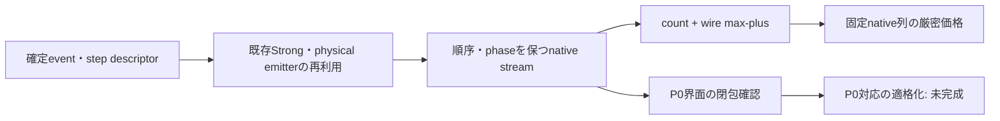

# Track D：長qの非full-compile型資源評価・技術設計

2026-11-09 JST。**固定native命令列のcount・depthは、full-wrapperオブジェクトや状態伝播なしで厳密に計数できる。未compileのPR入力から既存P0後と同じ価格を得るためのbridgeは未完成である。** 推奨する最初の実装は、既存emitterの命令を受け取るstreaming counterとwire別max-plus transferである。P0との対応が未資格な出力を、既存の適格価格として登録しない。

本成果は静的SOURCE調査・数理整理・設計と整数mock試験に限る。新しいH4計算、保存価格の再計数・科学的数値再解析、sampling、回路生成、P0 compile、fit、N・全13-round会計、詳細科学レビューは実施していない。主価格モデルA、比較F/S、過去の結果・STOPは変更しない。

## 証拠と今回の位置

引用する分子条件はLinear H4／隣接1.00 Å／STO-3G／Nα=Nβ=2、元Hamiltonian H、number-CDF8／元frame順LD2、ordered partial S2/s1/r32/K0、h=δ=.1。元Hの厳密groundを仮定し、状態準備費を除外する。P0はQiskit1.3.0／opt1／seed17／rz,sx,x,cx／approximation1／initially_zero=False／topology-free／宣言位相保持。q≥2のwhole-path一gadgetと強いsymmetric-directional、合法step境界融合・basis共有・scalar集約を対象とし、C1 head-tail追加融合はOFFである。

| 固定証拠 | 読み取った結果・限界 |
|---|---|
| [C7-2・709d6ed9](https://github.com/HIROMU1015/Partially-Randomized-Trotter/blob/709d6ed9c234bf6d5a8848d3a30be69d88fd6476/docs/research/track_d_c7_2_cx_structure_20261107/REPORT.md) | 54人工回路の局所価格と非加法性。shell＋max(lane)の反例、filtered-depth recurrence。H4全supportのP0閉包は未証明 |
| [C7-4・64072ba8](https://github.com/HIROMU1015/Partially-Randomized-Trotter/blob/64072ba81bb70db1df1b34e94adb08e78926f24b/docs/research/track_d_c7_4_model_stability_20261107/MODEL_REPORT.md) | q2/4/8/16/32、16/16/32/16/8＝88 whole-path。全保存X/YのΔCX=208−224q、A/F/S・basis/lane特徴。有限観測と探索モデル |
| [C8-1完了・fe361b20](https://github.com/HIROMU1015/Partially-Randomized-Trotter/blob/fe361b206a6572142775ac01972545d312e5fb14/docs/research/track_d_c8_1_q64_20261108/COMPLETION_RESULT.md) | q64/cut32、独立8保存path。raw8、post32、paired X/Y・χ8がPASS。全8でΔCX=−14128。全law・任意qの定理ではない |
| [B/C会計・8828b298](https://github.com/HIROMU1015/Partially-Randomized-Trotter/blob/8828b298975c88a2c0d1fd57ff6ed905233840f5/docs/research/track_d_bc_total_20261108/REPORT.md) | 当時の条件付き会計の約99.4〜99.5%がq≥64 proxy。今回q64を差し込む再会計はしない |

q64固定報告からの引用（新しい平均算定ではない）：

| 資源 | Strong平均 | Reference平均 |
|---|---:|---:|
| CX count | 128880 | 114752 |
| Total depth | 190931.875 | 86706.25 |
| RZ count | 336797.375 | 333473.75 |
| Logical peak qubits | 9 | 17 |

X/Yを16独立pathと数えない。q64のReference RZ減少も有限観測であり、q1等の増加を否定しない。C1追加融合の限定q4結果は別policyで、q64価格と混ぜない。

## 1. 現行pipelineで何に費用がかかるか

n＝system qubits、d＝deterministic blocks、r＝1stepのRTE event数、L＝展開後の命令数、R＝実際に共有されたbasis-run数、k＝列batch幅とする。固定H4ではn=8、d=3、r=32。下表はSOURCEの静的計算量であり、新ベンチマークではない。

| 工程 | 主な仕事・メモリ | q依存と価格評価に必要な部分 |
|---|---|---|
| event生成・保存 | 既存canonical samplerとseed binding。O(qr) descriptor、通常は全recordを保持 | 今回は既存保存値の読解のみ。将来の価格入力は保存event stream／確定lawの構造特徴でよく、再sampling不要 |
| deterministic head | `head_recipe/mixed_head`、同rotation group、relative Gaussian、directional/ordinary中心 | 固定n,dでO(q)。一般nではGaussian展開O(n²)、分解準備O(n³)程度の要因。既存cacheを利用する |
| RTE tail | signed angle/support、連続同basis共有、parity/control演算 | O(qr) event読取＋実際のbasis/runとsupportに比例する展開。符号・zero・angleを捨てない |
| Strong whole wrapper | q−1合法half-sweep融合、basis共有、scalar一括phase、X/Y readout | 命令格納O(L)。価格用streamは演算順を維持する。弱い対照への置換は不可 |
| Reference A†／B | cutで2segment、physical restriction、実際のA.inverse、2n+1幅 | 内部融合q−2、cut損失1。逆順を扱えるdescriptor／templateが必要。全QuantumCircuitを持つ必要性とは別 |
| CSWAP・χ・readout | 二cascade、共通ancilla、phase補正、測定 | gate数の固定部分だがlaneとのP0界面は非加法。全wrapper価格から除外しない |
| P0 | custom定義展開、basis translation、1q再合成・inverse cancellationの反復等 | 全DAG・中間IR・QPY等がLに依存。固定点反復・library実装を含むため、この調査だけから時間O(L)とは保証しない |
| native資源計数 | count、wire到着時刻、最大値 | 固定gate wordなら有界arityでO(L)、到着時刻O(n) memory。状態vectorは不要 |
| raw correctness | CAR target、AB=V、actual adjoint、vacuum ray/χ、全入力observable | `prepare_steps`は価格回路だけでなくCARのdense積等も構築する。価格専用呼出しへ丸ごと再利用すると不要な仕事が残る |
| compiled postcheck | Strong ≤9qubitの全unitary、Reference17の256入力・全出力 | Strongの格納O(4^(n+1))、Reference列配列O(2^n·2^(2n+1))。固定nでgate伝播時間は概ねLに比例する要因を持つが、qだけの実測比例則ではない |
| paired X/Y・χ | 保存observable間の最終照合、compiled vacuumと位相 | 価格計数とは独立の資格検査。毎回の予測値に全256列の再伝播を要求する必然性はない |

Referenceの全256出力列の**一配列だけ**でも、binary64 complexで2^8×2^17×16 bytes＝512 MiBとなる。これは理論上の当該配列サイズで、実peak RAMではない。入力・出力・copy・simulation実験・参照・native backendの保持分が加わる。17qubit全Operatorを作らない既存方針は維持する。[既存adapterと検査](SOURCE_INDEX.md)。

保存時間の定性的読解では、run04のsample01について4方式/axisともcompile記録のwall_secondsが対応postcheck記録を上回る。一方、campaign終盤にはcompile全件完了後もReference postcheckが残った。**compileも全入力検証も重く、「検証だけが律速」あるいは「compileだけが律速」と一括しない。** taskごとの並列度・競合・投入時刻が異なり、単件wall timeとcampaign critical pathも異なる。

これらは既存private運用記録の読解で、新たな実行時間分布やspeedupの算定ではない。元契約どおりCPU/RAM/worker・runtime原記録は非公開のまま保持した。`ru_maxrss`はworker再利用前のraw等を含むhigh-waterの場合があり、全件を純粋なcompile peakとして比較できない。sampling、head、tail、QPY I/Oごとの均一な独立timerも不足する。したがってq1024/4096の所要時間やRAM倍率を数値予測しない。

## 2. CXとdepthの到達点

**CX：現時点の選択は「全P0の構造的導出は未完成」。** C7-2/C7-4の条件付き中心数会計ならPdet=80、r=32から−2(Pdet+r)=−224を説明できる。ただし各中心が非零であり、同じcontrol premiumを持ち、共有Gaussian・parity・界面残差が指定どおり処理されることが必要である。208を端部価格から独立に導いた証拠はなく、未知残差を0にしない。[詳細](CX_STRUCTURE_ANALYSIS.md)。

**Depth：固定native gate wordなら厳密なstream/max-plus計数が可能。** templateの全wire入力→出力依存を保持すれば、非一様arrival、A†/B並列、CSWAPとancilla同期を合成できる。零入力での単一exit vectorや単体depthの和だけでは不十分である。P0変換前のtemplateを同じように合成しても、P0後depthに一致する保証は得られない。[導出と限界](DEPTH_STRUCTURAL_MODEL.md)。

RZ count・circuit sizeも固定native列では加法的に厳密計数できる。しかしP0の1q再合成・zero/special angle・位相処理・境界相殺に敏感で、pre-P0の定数表を足すだけでは既存P0価格にならない。qubitsは同時使用幅を別に報告し、shot・round数を掛けて加算しない。RZ→T換算、topology-free depth→実機時間換算は行わない。

## 3. 推奨する設計と既存モデル

最初に作る価値があるのは**streaming native IR＋exact count/max-plus backend**である。既存C7-2の`weighted_depth`とC7-4の`event_features`を核に、全wrapper/dense targetを要求しない受け口を最小拡張する。最初の段階では出力を「対象native列に厳密／P0対応未資格」と明示する。P0を再実装する一般compilerや新しい承認・管理frameworkを作らない。

その後、CXを優先してbasis/parity・step/cut・CSWAP/phase界面の閉包を検証する。閉じた領域だけを厳密化し、残りはA/F/S等との**未資格な残差候補**として扱う。既存モデルの係数を引いたり再fitしたりして新モデルを今回作ったものとはしない。[方法比較](METHOD_COMPARISON.md)／[次段階案](NEXT_EXECUTION_PROPOSAL.md)。

A（all-q affine）は現在の主価格モデル、Fは元C6a凍結比較、S（1,q,sqrt(q)）は探索モデルのまま。q64のpaired total-depth点残差は保存報告のA約−683、F約−6411、S約−76であり、Sが小さかった。ただし8本holdoutの点残差からモデル選択・長q bias上界・母平均保証は得られず、A→Sへ変更しない。全88本を使ったモデル設計と、独立q64の探索診断を区別する。

## 4. PR＋RPEへ接続するための残条件

価格評価器の厳密性、gadget/compileの測定同値性、全lawの期待値、RPE成功条件は別々の資格である。固定列の価格に状態vectorは不要だが、builder/compilerの意味を正当化する証拠や長qの数値誤差資格まで不要になるわけではない。

全資源には G_g=Σ_m,b N_m,b E[C_g,m,b] の**方式別絶対価格**が必要。paired CX式が確定しても両方式の絶対価格は決まらない。各pathに厳密な評価器ができても、law/joint-law、特徴分布、E[max]≠max(E)、標本変動・外挿bias・共分散は別途残る。旧B/C結果やNは今回更新していない。

O1/O2/O3等の共同最適化では、各候補が実際に変更するdescriptor、cut、control/basis/phase policyを価格入力へ反映する。qだけをcache keyにしない。異なるSOURCE・CDF/frame・law・P0・C1 ON/OFFの価格を共有しない。方式ごとの価格精度が不明な段階で探索selectorへ優劣保証を与えず、最終評価用のデータと選択に使ったデータを分ける。algorithm側が信号・lawを変える場合、共通Nも別の検討となる。

## 5. 今回の技術検証・保全・終了

[整数mock](check_maxplus_mock.py)は、既存C7-2の`weighted_depth`関数だけをASTで取り出し、Qiskit非依存の命令mockに適用し、**7件PASS**した。新しく確認するのは全wire transferの合成、非一様入力、filtered-out gateの同期、共有ancilla順序、空template等である。実H4ファイル、QPY、NPZ、sampler、transpiler、state simulatorを読み込まず、人工回路のP0も呼ばない。これは資源構造の技術試験で、分子性能やP0価格の新証拠ではない。[試験出力](MOCK_TEST_RESULT.txt)。

基点は統合最新141fa762（ユーザー指定9d12d7c6の子孫）。q64最終fe361b20とは共通祖先b1e7cc5bから分岐し、統合にないq64完了資料は固定linkで参照した。統合枝・q64保全枝を変更せず、リソース評価系列の設計枝 `codex/resource-eval-track-d-longq-structure-20261109` に本成果を置く。適用AGENTS、PROJECT_MAP、現状資料、正式共通指示2026-11-09（特に§8.1/8.4/10.1/10.3/10.4）を確認した。旧版で代用せず、既存個別契約とSTOPは維持した。

公開対象は設計書・mockとその出力・navigationのみ。既存src/scripts/tests/artifactsとraw原本は変更しない。[出典索引](SOURCE_INDEX.md)／[STOP](STOP.md)。**公開SHA・Git tree・公開bytesの照合後mandatory STOP。** 次の担当はユーザー/GPT：技術実装案と必要な人工P0／保存H4比較の範囲を判断する。Codexは未承認の実装・科学計算・詳細レビューへ進まない。
