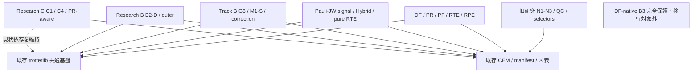
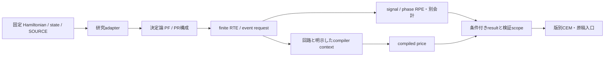

# Research pipeline map

LOCAL観測 2026-10-27T17:02:00.871221+09:00。487 remote branchを前回の版固定索引と結合。以下は現状の実装対応と提案接続であり、今回新しい統一runnerを実装・実行したものではない。

## 研究系列と支援層

## DF / PR / PF / RTE / RPE

共通11 moduleは既継承だが、H4 geometry等の後続adapterが旧all-rに全て存在するわけではない。既存run_partial_randomized_pf.pyは旧経路も含み、現行の全科学契約を束ねる万能入口とは扱わない。P1で新しい非凍結composerへ必要な機能だけを接続する。B3のSOURCE/resultや稼働資産にはアクセスしない。

|段階|既存の固定実装|責務・保持条件|
|---|---|---|
|Hamiltonian/input/SOURCE|[src/trotterlib/df_hamiltonian.py](https://github.com/HIROMU1015/Partially-Randomized-Trotter/blob/f29eafbf4412193e8e8660d9f051889c2cba684b/src/trotterlib/df_hamiltonian.py) @ `f29eafbf4412193e8e8660d9f051889c2cba684b`|型DFHamiltonianと分子固有入力。H4生成/SCFは科学処理であり今回実行なし。|
|分子別input接続|[src/trottertracks/resource_applicability/h4_geometry/inputs.py](https://github.com/HIROMU1015/Partially-Randomized-Trotter/blob/821cc0f6ced57168293ea166644024867b064ffb/src/trottertracks/resource_applicability/h4_geometry/inputs.py) @ `821cc0f6ced57168293ea166644024867b064ffb`|後続H4 geometryのinputs/freeze/sectorは研究adapterに残す。|
|deterministic PF / PR|[src/trotterlib/df_partial_randomized_pf.py](https://github.com/HIROMU1015/Partially-Randomized-Trotter/blob/f29eafbf4412193e8e8660d9f051889c2cba684b/src/trotterlib/df_partial_randomized_pf.py) @ `f29eafbf4412193e8e8660d9f051889c2cba684b`|共通split/PFを再利用し、allowlist/order/rank条件を研究側で限定。|
|finite RTE / event circuit|[src/trotterlib/df_rte_qiskit.py](https://github.com/HIROMU1015/Partially-Randomized-Trotter/blob/f29eafbf4412193e8e8660d9f051889c2cba684b/src/trotterlib/df_rte_qiskit.py) @ `f29eafbf4412193e8e8660d9f051889c2cba684b`|法則/normalizationとDF basisをtyped eventへ接続。|
|signal / phase RPE / shots|[src/trotterlib/rpe_resource_accounting.py](https://github.com/HIROMU1015/Partially-Randomized-Trotter/blob/f29eafbf4412193e8e8660d9f051889c2cba684b/src/trotterlib/rpe_resource_accounting.py) @ `f29eafbf4412193e8e8660d9f051889c2cba684b`|fixed-time signalとphase-RPEは異なるestimand。|
|compiled price|[src/trotterlib/rte_compiled_cost.py](https://github.com/HIROMU1015/Partially-Randomized-Trotter/blob/f29eafbf4412193e8e8660d9f051889c2cba684b/src/trotterlib/rte_compiled_cost.py) @ `f29eafbf4412193e8e8660d9f051889c2cba684b`|compiler/metric/prep/controlのscopeと価格標本を別record。|
|結果・検証→CEM|[EVIDENCE_MATRIX.csv](https://github.com/HIROMU1015/Partially-Randomized-Trotter/blob/fbf701356cbc4da6ca8e3b7ef53533e1763243f9/EVIDENCE_MATRIX.csv) @ `fbf701356cbc4da6ca8e3b7ef53533e1763243f9`|各SOURCE/resultを引用、全RPE/final cost完了とはしない。|

## Pauli-JW fixed-signal / Hybrid / pure RTE

Pauli input → 固有law/mean signal → axis wrapper/price → analytic shots → 探索と独立確認 → saved report。DFとの共通点は基盤の再利用であり、入力型や比較taskの同一化ではない。

|段階|既存の固定実装|責務・保持条件|
|---|---|---|
|Hamiltonian/state/reference|[src/trotterlib/pauli_signal_adapter.py](https://github.com/HIROMU1015/Partially-Randomized-Trotter/blob/b6c899698645a4ccdaa65c0c5e8d706fd9d1cc2b/src/trotterlib/pauli_signal_adapter.py) @ `b6c899698645a4ccdaa65c0c5e8d706fd9d1cc2b`|PauliHamiltonian、constant/label/bit orderと固定snapshotを維持。|
|Hybrid / pure RTE law|[scripts/run_pauli_hybrid_rte_comparison.py](https://github.com/HIROMU1015/Partially-Randomized-Trotter/blob/b6c899698645a4ccdaa65c0c5e8d706fd9d1cc2b/scripts/run_pauli_hybrid_rte_comparison.py) @ `b6c899698645a4ccdaa65c0c5e8d706fd9d1cc2b`|各prefix/q/r/Kに固有のlaw。r>8 Hybrid readinessは新結果でない。|
|mean signal / enclosure|[src/trotterlib/pauli_vector_tight_enclosure.py](https://github.com/HIROMU1015/Partially-Randomized-Trotter/blob/b6c899698645a4ccdaa65c0c5e8d706fd9d1cc2b/src/trotterlib/pauli_vector_tight_enclosure.py) @ `b6c899698645a4ccdaa65c0c5e8d706fd9d1cc2b`|tight L2評価の適用域を保持し、saved raw normを別入力扱い。|
|controlled wrapper / price|[src/trotterlib/fixed_signal_evaluation.py](https://github.com/HIROMU1015/Partially-Randomized-Trotter/blob/b6c899698645a4ccdaa65c0c5e8d706fd9d1cc2b/src/trotterlib/fixed_signal_evaluation.py) @ `b6c899698645a4ccdaa65c0c5e8d706fd9d1cc2b`|state preparationを含む範囲・axes/control/phaseが研究固有。|
|shot/cost accounting|[src/trotterlib/fixed_signal_accounting.py](https://github.com/HIROMU1015/Partially-Randomized-Trotter/blob/b6c899698645a4ccdaa65c0c5e8d706fd9d1cc2b/src/trotterlib/fixed_signal_accounting.py) @ `b6c899698645a4ccdaa65c0c5e8d706fd9d1cc2b`|analytic Nと古典n、rho仮定/未資格を分離。|
|探索/固定nominee/独立確認|[scripts/run_pauli_rte_event_extension.py](https://github.com/HIROMU1015/Partially-Randomized-Trotter/blob/b6c899698645a4ccdaa65c0c5e8d706fd9d1cc2b/scripts/run_pauli_rte_event_extension.py) @ `b6c899698645a4ccdaa65c0c5e8d706fd9d1cc2b`|元snapshot/event_run・call/seed/STOPを保持。|
|saved report→CEM|[scripts/document_pauli_jw_saved_summary.py](https://github.com/HIROMU1015/Partially-Randomized-Trotter/blob/b6c899698645a4ccdaa65c0c5e8d706fd9d1cc2b/scripts/document_pauli_jw_saved_summary.py) @ `b6c899698645a4ccdaa65c0c5e8d706fd9d1cc2b`|既存summary generatorを入口。root CEM不在を別branchの索引で補う。|

## Track B algorithm co-design

Track Bには一本の直線pipelineを仮定しない。G6・M1-S γ・M1-S π3が並列の独立経路で、descriptor/native inventory/証拠入口に適合する接点だけを設ける。

|段階|既存の固定実装|責務・保持条件|
|---|---|---|
|固定inputとstage descriptor|[src/trottertracks/algorithm_codesign/adapter.py](https://github.com/HIROMU1015/Partially-Randomized-Trotter/blob/09c9e89555032213b52a6a60b38f55563d07a34d/src/trottertracks/algorithm_codesign/adapter.py) @ `09c9e89555032213b52a6a60b38f55563d07a34d`|D/E/M/Gは別実験・誤差保証。|
|G6 generator/precision|[src/trottertracks/algorithm_codesign/g6_f3_generator.py](https://github.com/HIROMU1015/Partially-Randomized-Trotter/blob/5f750a23f023d75c8c4fbcabc6937d6953ce61f2/src/trottertracks/algorithm_codesign/g6_f3_generator.py) @ `5f750a23f023d75c8c4fbcabc6937d6953ce61f2`|F3 GeneratorSession/prepareは後続G6側の追加機能。|
|M1-S finite-signal γ|[src/trottertracks/algorithm_codesign/m1s_finite_signal_v2/numerics.py](https://github.com/HIROMU1015/Partially-Randomized-Trotter/blob/e7791c9ffe59577528e6095da5b2419bf6fadda4/src/trottertracks/algorithm_codesign/m1s_finite_signal_v2/numerics.py) @ `e7791c9ffe59577528e6095da5b2419bf6fadda4`|G6代表に不在。Kernelsの別数学/intervalを維持。|
|M1-S π3別gate|[src/trottertracks/algorithm_codesign/m1s_gamma_pi3_v1/compare.py](https://github.com/HIROMU1015/Partially-Randomized-Trotter/blob/b17b056deec60820413c0881978f7b77caf0861b/src/trottertracks/algorithm_codesign/m1s_gamma_pi3_v1/compare.py) @ `b17b056deec60820413c0881978f7b77caf0861b`|γ版と祖先関係がない別ref。実行許可へ拡張しない。|
|native/synthesis inventory|[src/trottertracks/algorithm_codesign/df_correction_comparison/native.py](https://github.com/HIROMU1015/Partially-Randomized-Trotter/blob/5f750a23f023d75c8c4fbcabc6937d6953ce61f2/src/trottertracks/algorithm_codesign/df_correction_comparison/native.py) @ `5f750a23f023d75c8c4fbcabc6937d6953ce61f2`|SDKとnative IRは別scope、global phase/bit orderを保持。|
|結果・failure/STOPの入口|[scripts/tracks/algorithm_codesign/README.md](https://github.com/HIROMU1015/Partially-Randomized-Trotter/blob/5f750a23f023d75c8c4fbcabc6937d6953ce61f2/scripts/tracks/algorithm_codesign/README.md) @ `5f750a23f023d75c8c4fbcabc6937d6953ce61f2`|umbrellaで各packetへ戻る。旧Track B B3を現DF B3と混同しない。|

## Research B / B2-D / outer

prepared recipe → evaluator/backend → outer/Exact-R/Full-DF別stage → launcher/evidence → stage別結果。主要機能はfinal-pause内へ既継承されており、whole branch mergeは不要。

|段階|既存の固定実装|責務・保持条件|
|---|---|---|
|prepared input / recipe|[src/trottertracks/b2d_evaluator/input_package.py](https://github.com/HIROMU1015/Partially-Randomized-Trotter/blob/e87375fa9a998dce80792be0f15597c747f00d83/src/trottertracks/b2d_evaluator/input_package.py) @ `e87375fa9a998dce80792be0f15597c747f00d83`|connect_preparedのmodel/target/contract。|
|reference / evaluation|[src/trottertracks/b2d_evaluator/evaluation.py](https://github.com/HIROMU1015/Partially-Randomized-Trotter/blob/e87375fa9a998dce80792be0f15597c747f00d83/src/trottertracks/b2d_evaluator/evaluation.py) @ `e87375fa9a998dce80792be0f15597c747f00d83`|dense/reference/backend interfaceの共有。|
|outer / native|[src/trottertracks/b2d_evaluator/outer.py](https://github.com/HIROMU1015/Partially-Randomized-Trotter/blob/e87375fa9a998dce80792be0f15597c747f00d83/src/trottertracks/b2d_evaluator/outer.py) @ `e87375fa9a998dce80792be0f15597c747f00d83`|stage別compiler/operator qualificationを維持。|
|Exact-R|[src/trottertracks/b2d_evaluator/exact_r.py](https://github.com/HIROMU1015/Partially-Randomized-Trotter/blob/e87375fa9a998dce80792be0f15597c747f00d83/src/trottertracks/b2d_evaluator/exact_r.py) @ `e87375fa9a998dce80792be0f15597c747f00d83`|共通evaluatorへの接続済み拡張。|
|Full-DF / q4|[src/trottertracks/b2d_evaluator/full_df_q4.py](https://github.com/HIROMU1015/Partially-Randomized-Trotter/blob/e87375fa9a998dce80792be0f15597c747f00d83/src/trottertracks/b2d_evaluator/full_df_q4.py) @ `e87375fa9a998dce80792be0f15597c747f00d83`|別allowlist・signed schedule・SOURCE。|
|execution / evidence|[src/trottertracks/b2d_evaluator/launcher.py](https://github.com/HIROMU1015/Partially-Randomized-Trotter/blob/e87375fa9a998dce80792be0f15597c747f00d83/src/trottertracks/b2d_evaluator/launcher.py) @ `e87375fa9a998dce80792be0f15597c747f00d83`|Evidence/ScopeLedgerとfailure/STOPを研究側に残す。|
|成果入口|[src/trottertracks/b2d_evaluator/README.md](https://github.com/HIROMU1015/Partially-Randomized-Trotter/blob/e87375fa9a998dce80792be0f15597c747f00d83/src/trottertracks/b2d_evaluator/README.md) @ `e87375fa9a998dce80792be0f15597c747f00d83`|chronological READMEとcurrent stage表を分ける設計。|

## Research C C1 / C4 / PR-aware DF

構造上の位置付けだけを示す。現行C1/C4/PR-aware/fixed-CARの作業環境・SOURCE・科学条件を変更する移行は保留。

|段階|既存の固定実装|責務・保持条件|
|---|---|---|
|C1 codec / fixed x0|[src/trottertracks/c1_ffsim_corrected_codec.py](https://github.com/HIROMU1015/Partially-Randomized-Trotter/blob/f4de9f62c2ff1cbaaa75b6cdaa07217d00dfd957/src/trottertracks/c1_ffsim_corrected_codec.py) @ `f4de9f62c2ff1cbaaa75b6cdaa07217d00dfd957`|real-Schur/ffsim/JAX process契約を維持。|
|C4 dictionary / compiler|[src/trottertracks/pr_dictionary_validation/circuits.py](https://github.com/HIROMU1015/Partially-Randomized-Trotter/blob/ec27625839564dc22db2728923120f497b7cadee/src/trottertracks/pr_dictionary_validation/circuits.py) @ `ec27625839564dc22db2728923120f497b7cadee`|辞書/occupied state/保証scopeを独立保持。|
|PR-aware fit / law / guarantee|[src/trottertracks/c_pr_aware_df.py](https://github.com/HIROMU1015/Partially-Randomized-Trotter/blob/1f2b6338815af34bfa58d6292d98e7b5f66f898e/src/trottertracks/c_pr_aware_df.py) @ `1f2b6338815af34bfa58d6292d98e7b5f66f898e`|C1とはobjectiveとscales/資格が異なる現行研究。|

## 研究成果 / CEM / 原稿 / 図表

|段階|既存の固定実装|責務・保持条件|
|---|---|---|
|科学正本への版固定参照|[EVIDENCE_MATRIX.csv](https://github.com/HIROMU1015/Partially-Randomized-Trotter/blob/fbf701356cbc4da6ca8e3b7ef53533e1763243f9/EVIDENCE_MATRIX.csv) @ `fbf701356cbc4da6ca8e3b7ef53533e1763243f9`|SOURCE/resultの別commitとstudy/cohortを保持。|
|研究入口|[RESEARCH_SYNTHESIS.md](https://github.com/HIROMU1015/Partially-Randomized-Trotter/blob/fbf701356cbc4da6ca8e3b7ef53533e1763243f9/RESEARCH_SYNTHESIS.md) @ `fbf701356cbc4da6ca8e3b7ef53533e1763243f9`|最新の科学採択をbranch tipだけで決めない。|
|原稿/図表/script/input|[FIGURE_TABLE_PLAN.md](https://github.com/HIROMU1015/Partially-Randomized-Trotter/blob/fbf701356cbc4da6ca8e3b7ef53533e1763243f9/FIGURE_TABLE_PLAN.md) @ `fbf701356cbc4da6ca8e3b7ef53533e1763243f9`|公開subsetとprivate fullを分けて元versionへリンク。|

## 何が重複し、何が不足しているか

- DF/Pauliで共通coreは存在するが、分子adapter/誤差metric/price/cohort contractは分かれる。共通baseが古く、最新研究用scriptをそのまま起動できる入口になっていない。

- Pauliのrunnerは、固定snapshotのh4_b0_execution_private / hx_study / event_runという別namespaceを使用する。移行時にcurrent libraryへ暗黙差替えしてはいけない。新規composerは明示した固定module/providerだけを利用する。

- B2-Dの旧static-cost-outerからfinal-pauseは祖先で、evaluator/backend/inputを既継承。Exact-R/Full-DF/q4の新規追加を既存packageから辿る入口が必要。

- G6 old→v1.2は祖先でF3 generatorが追加された。一方M1-S v2はG6 v1.2に不在で、M1-S γ→π3も祖先でない。新しい日付の一本を全Track B正本にする設計は採らない。

- 旧STUDY_CATALOGは当該repo55単位の歴史索引であり、現在の独立project数ではない。旧QC/N1/N3の研究ロジックを共通libraryと一括分類しない。

今回の確認は静的tree/API/import/既存文書。library・科学runnerのimport、test/sampling/compile/数値再解析は0。23 branchのmetadata（18は前回再利用）＋M1-S π3の追加tree、33選定path×23 branchの759存在/同blob対応を使用し、全branch全ファイルを再走査していない。

## 固定SOURCE・結果・実行入口の具体的対応

RESEARCH_STREAMS.csvは科学正本/実装代表/成果入口/実行entry/test入口/元SOURCE・STOPの参照を別fieldへ分けた。下記は既存公開索引の例であり、SOURCE本体/rawを新たに計算・評価したものではない。

- RS-DF `H4_TOL10_INDEPENDENT_P_20261019`: SOURCE `3c664ca4a9f003880b9f6d56f2a0e55ed5b56603`、result `821cc0f6ced57168293ea166644024867b064ffb`。元index `6e3436a16b13e539b0faa2a0a3286f6ab3549543:EVIDENCE_MATRIX.csv`。cohortは元recordを保持。
- RS-PAULI `PAULI_JW_LATEST_20261026`: SOURCE `H2 bf5f2339f723f4edb7bf91a8ca88f33251bbef57; H4/H6 event extensione755ecf581600192fd2745d7066e410cebd933d3; reused Hybrid from source-specific priorstudy`、result `4aea054b3369709bc0d35ff081071e62b5f77cbe`。元index `6e3436a16b13e539b0faa2a0a3286f6ab3549543:EVIDENCE_MATRIX.csv`。cohortは元recordを保持。
- [codex/pauli-jw-research-summary-20261026:docs/research/data/pauli_jw_summary/source_references.json](https://github.com/HIROMU1015/Partially-Randomized-Trotter/blob/b6c899698645a4ccdaa65c0c5e8d706fd9d1cc2b/docs/research/data/pauli_jw_summary/source_references.json) @ `b6c899698645a4ccdaa65c0c5e8d706fd9d1cc2b`。既存source/result/適用限界への入口として読んだ。
- [codex/research-b-final-pause-handoff-20261026:docs/research/research_b_final_outcomes_and_pause_handoff_20261026.md](https://github.com/HIROMU1015/Partially-Randomized-Trotter/blob/e87375fa9a998dce80792be0f15597c747f00d83/docs/research/research_b_final_outcomes_and_pause_handoff_20261026.md) @ `e87375fa9a998dce80792be0f15597c747f00d83`。既存source/result/適用限界への入口として読んだ。
- [track-b-g6-v1-2-draft-review-integration-20261022:docs/research/track_b_g6_v1_2_draft_review_integration_20261022/handoff.md](https://github.com/HIROMU1015/Partially-Randomized-Trotter/blob/5f750a23f023d75c8c4fbcabc6937d6953ce61f2/docs/research/track_b_g6_v1_2_draft_review_integration_20261022/handoff.md) @ `5f750a23f023d75c8c4fbcabc6937d6953ce61f2`。既存source/result/適用限界への入口として読んだ。

G6 handoffのDRAFT_COMPLETE_AWAITING_USER_GPT_DECISION、B2-Dの一時保留、M1-S π3の契約採択と数値実行未許可を区別する。これらの記録を新しい採択/実行許可へ拡張しない。科学的検証済み範囲は元SOURCE/cohortのまま。

H6 Hybridの未取得/新r条件という記述は、表に固定したsummary/FAIR audit版のscopeである。その後追加されたreadiness/execution branchはremote metadataのみで、現時点の実装・取得完了を調査していない。次回のPauli移行時は担当者の固定引継ぎから新結果/契約の有無を照合し、並行jobへ介入しない。
