# Target research architecture — proposal only

## 基本構造

5つの主研究系列（DF、Pauli-JW、Track B、Research B/B2-D、Research C）と、旧研究を保全する履歴portfolioを科学側として区別する。共通技術基盤、成果/原稿、環境運用は支援層であり独立科学研究の数へ加算しない。異なるSOURCE/cohort/条件を同じ科学結果へ統合しない。

科学的正本・実装代表・成果入口・歴史ref・現行作業branchの5役割を分離する。代表branchを選んでも、既存checkoutを切替えず、実行中/凍結SOURCEを変えない。現在のmain/primary checkoutの古い案内は更新候補であり、全系列の最新採択の根拠ではない。

## 提案ディレクトリと責務

```text
src/trotterlib/                          既存の共有計算API、型、回路/backend、適用域別会計
  df_hamiltonian.py                     DF型・sector・input表現
  pauli_signal_adapter.py               既存Pauli型/SDK kernelを当初のimport pathで保持
  product_formula.py / rte.py           PF・finite RTEの基盤（研究allowlistは外側）
  df_rte_circuit.py / df_rte_qiskit.py   typed requestとDF backend
  rte_compiled_cost.py                  compiler context/価格record
  rpe_resource_accounting.py            phase/RPE用。fixed-signal会計とは別入口
  fixed_signal_accounting.py            fixed complex-signal用
  parallel_validation_executor.py       既存機構の適合部分。domain adapterを段階分離
src/trottertracks/
  resource_applicability/               DF/Track Aの研究条件・input/claim adapter
    pipeline.py                        将来必要なら追加する薄いcomposer。現時点では未作成
    h4_geometry/ / h4_b0i/              元SOURCE/import/contractは固定のまま
  pauli_jw/pipeline.py                  将来の分子別配線。kernelのコピーや全module移動はしない
  algorithm_codesign/                   旧Track B、G6とM1-S等の別namespaceを維持
  b2d_evaluator/ / b2d_adapter/          Research B固有evaluator/backend/実行scope
  c1_*.py                              Research C C1：現状維持
  pr_dictionary_validation/             Research C C4と旧lineage：版別維持
  c_pr_aware_df*.py                     Research C PR-aware：現状維持
  representation_exploration/          旧N1/N3等：read-only履歴・未解決保留
scripts/                               明示した研究entry/CLI。新入口は薄い配線
tests/                                 core unit、adapter契約、研究固有regressionを区別
docs/research/                         規範/採用済み判断と各系列入口（既存構造を再利用）
artifacts/<existing-study>/<existing-run>/  元のSOURCE/input/result/STOPを保持
EVIDENCE_MATRIX.csv / RESEARCH_SYNTHESIS.md  版固定した既存成果索引
inventory/                             今回の設計・運用記録。科学原本の代替にしない
```

これは配置案であり、今回rename/move/package作成は0。初期移行では既存import/runner/outputの場所を保ち、必要な薄い入口だけ追加する。C1/C4/PR-awareを新packageへ整理する作業も保留。名前を揃えるだけの移動や、巨大な汎用workflow/config/registryの新設を行わない。

## 依存方向と入出力契約

```mermaid
flowchart TB
  CLI[研究別CLI / 明示した新entry] --> ORCH[trottertracks 研究composer]
  ORCH --> AD[研究adapter / 科学条件 / SOURCE contract]
  AD --> CORE[既存 trotterlib capabilities]
  CORE --> OPT[NumPy / SciPy / optional Qiskit 等]
  ORCH --> EXEC[適合する既存実行機構]
  EXEC --> AD
  ORCH --> REC[元formatのresult / STOP・契約は研究側]
  INDEX[既存 CEM / manifest / 研究入口] -. read-only locator .-> REC
  INDEX -. versioned reference .-> AD
```



長期の依存規則は「研究composer→研究adapter→共通core」であり、coreから研究packageを逆importする設計を増やさない。現在のparallel_validation_executorには科学adapter実装も含まれるので、module全体を無条件で汎用coreと呼ばず、新経路から機構とadapterを分ける。既存frozen moduleを一括移動しない。実行機構からadapterへの呼出しは明示callback/module参照であり、dependencyを反転して科学的採択を行う仕組みにしない。

|境界|入力|出力・責務|共通化しないもの|
|---|---|---|---|
|入力/表現|固定snapshotと元identity/sector/ordering|DF/Pauli等の別型、identity参照|科学input生成、rank選択、scalar/state修復|
|PF/RTE|formula/time/LD/K/lawと研究allowlist|typed signed stage/event・normalization|別law/cohortの同一化、許可範囲拡張|
|回路/backend|typed requestとcontrol/phase/context|回路またはnative IR、明示したmetric scope|state prep/control/identity、backend間科学的同値性の推定|
|会計|estimand/precision/qualification|適用域付きrecord、未資格は欠損|RPEとfixed signalの誤差混合、未取得N/Gの補完|
|実行|研究側が定めたtask/出力/許可scope|子process/衝突回避/技術状態|新grant/approval proof、既存one-shot/retry/STOPの解除|
|証拠|元SOURCE/result/validation locator|既存manifest/CEMへの版別参照|新しい科学正本database、private原本の公開|

入力/出力の型を無理に一つへ統一しない。共通contextは既存SOURCE/manifest内の意味の対応であり、全研究へ新しい必須schemaを強制する計画ではない。

## Gitの開発主線と共通codeの供給

`all-r-coherent-opt2-reoptimization`を、既存trotterlibの機能・テスト導線と祖先関係から、DF開発/共通coreの候補とする。これは最新の全研究機能を既に含むという主張ではない。Pauli/Track B/B2-D固有の開発は各既存代表branchに残す。mainを統合先とせず、新しい統合branchは提案・作成しない。

**別branchのcodeはcheckoutをまたいで自動importされない。** 共通coreの新変更は科学条件を含まない小さな選択差分commitとして設計し、後続の明示許可下で各代表branchの同じcheckoutへ取り込む。consumerが利用した共通commit/versionを新SOURCEの既存provenance欄に記録する。科学条件や途中実験を含むbranch全体のmerge、別worktree絶対path/PYTHONPATH依存、共有venvの差替えは使わない。相互branchが祖先であるだけで、異なるcommitを同時利用できるとは扱わない。

現行コードに対する機能移植前には、moduleの依存closure・公開API・optional依存・数値意味・既存test・出力scopeを限定比較する。旧frozen SOURCEは元commitを使い続け、新入口のsource identityと区別する。新しい共通codeによって旧結果を生成したと表示しない。

## 代表的な開発入口の数

既存branchを使う**code入口9＋成果入口1＝計10**を提案する。DF開発と共通coreは同じall-r入口を共有し二重計上しない。内訳はDF/core 1、Pauli 1、Track B 3（G6・M1-S γ・π3）、B2-D 1、Research C 3、成果1。Research CとM1-Sの継続/再開は未許可であり、この数は推奨参照入口の数であって、現在実行中jobや新設branchの数ではない。N1/N3/R2-CS等の閉じた研究は履歴入口として保持し、新しい開発を自動再開しない。既存inventory branchは運用公開先で、この10に含めない。

## 科学SOURCE・結果・検証の保存体系

元SOURCE/input/raw/result/STOPは研究単位・run/cohort・commitごとの既存場所に残す。公開索引は `(index version, study_id, SOURCE commit, result commit, cohort, applicable conditions)` を用いてリンクし、不明条件は欠損のまま記録する。claim_idだけを最新行で上書きしない。旧CEM43行、新50行、public subset、private local-fullは別version/役割。図表は元resultとscript/inputを辿れるようにするが、rawの移動・再集計は計画に含めない。

PROJECT_MAPは探索案内、VALIDATION_STATUS/validation_manifestは版とscope付き検証索引、CEMはclaimと科学SOURCEの対応として役割を明記する。古い案内の更新は後続docs作業で行い、新しい正本を多数複製しない。独立cohort、negative/failed/partial/STOP、grant/ledger/marker、one-shot/retry/resumeを別namespaceのまま保持する。

## 重複開発を防ぐ最小運用

1. 新しい研究を始める担当者は系列入口とCROSS_STREAM_CAPABILITIESを確認し、既存APIと適合しない条件だけを研究adapterへ置く。
2. 複数系列に必要な機能だけを共通coreで保守し、研究特有loss/保証/選択/STOPは研究packageへ残す。小helperの統一はP6。
3. 変更ごとに本当に影響するsrc/scripts/tests/docs/artifactsの入口だけを更新する。管理frameworkや全研究共通承認ledgerを作らない。
4. science validator/compile/optimizerを呼ぶtestはpure API/mockと分け、後続の独立科学許可を確認する。技術PASSを科学GOへ格上げしない。
5. shared coreの修正は同じ機能を各branchへ別実装せず、意味の定まった共通差分と互換wrapperを再利用する。frozen SOURCEへ自動伝播させない。
6. 既存branchの役割が変わる場合は入口のリンクを更新し、branch削除や履歴書換えを付随操作にしない。

## 現状からの移行

P0で既存研究入口を接続し、最初の大規模実装P1でDFパイプラインと共有基盤の責務を分ける。P2 Pauli、P3 B2-D、P4 Track Bは独立条件を保つ選択的接続、P5で成果入口を新codeへ版別接続する。P6で初めて前回INT-01/02/03/05の小helperを実需要に応じて扱う。Research C/B3/N1-N3旧SOURCEは保護・保留のまま。全段階は今回未実施で、次回の明示指示が必要。

並行更新の境界: 新しいH6 Hybrid readiness/execution branchの追加をremote metadataだけで観測した。新branchの実行状態・実装・新結果は未調査で保護する。本書の未実行/未取得という記述は引用した固定版のscopeであり、現況の不存在を主張しない。次回のP2実装では担当者の引継ぎと固定SOURCEを確認して既存新機能を再利用し、重複実装しない。
